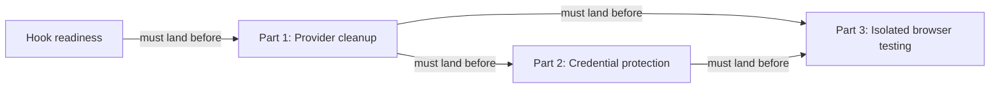

# Keep local agent work within useful boundaries: Codex — Part 1: Provider cleanup

## Summary

Put the remaining Codex-specific hook and headless-command details behind the provider boundary
before adding credential protection or isolated browser execution. This is the prerequisite for
the other two parts of the series; it changes ownership and dispatch without widening permissions.

## Context

A provider is RoboRepo's adapter for one agent harness. Shared orchestration reads its manifest
and calls its adapters; provider code owns native paths, formats, and command syntax.

| Current touchpoint | Remaining work |
| --- | --- |
| `scripts/cli/hook-composition.mjs` | Main branches on Codex for both file routing and writing. Hook-readiness replaces both in its unlanded branch; consume that implementation after landing |
| `globals/system/hooks/codex/` | Codex scripts still live in the shared system tree. Move their sources provider-side while retaining installed paths and command strings |
| `scripts/cli/telemetry.mjs` | `findDeepReadCli` uses a fixed CLI list and `runDeepRead` passes `-p` to every CLI. Recorded Codex help identifies `-p` as profile selection, not its non-interactive prompt syntax |
| `scripts/cli/worktree-policy.mjs` and provider manifests | The optional Codex worktree-folder declaration depends on the Claude companion's `agentWorktreeDirs` contract and verified app provenance |

Checked against local main `890f56fe688b314408ee313af01b3601b747b019` on October 24.
The configured origin is `kirinmurphy/roborepo-alpha`; the checkout directory is named `roborepo`.
No remote freshness or push status is inferred. Hook-readiness remains in review. Its authoritative
worktree tip `caa888b897fe0e2c9e4a6ad413b7e3d3e48b29d9` and frontmatter reviewed commit
`7d72487f8461f0243f6ba98e716c8713dba7bd32` are not ancestors of this main; branch containment
lists only its worktree branch. Its reviewed-commit field predates later implementation and review
records. The primary plan copy still describes unfinished work already present in that worktree.

The worktree's latest review records report a package-install smoke failure reproduced on clean
main, separate passing browser checks, and Windows parity deferred to its own plan. Those records
are historical evidence, not checks rerun during this preparation. Landing, current completion-gate
results, and the final accepted contract must be checked before implementation starts. Promotion
prepares this document; it does not clear the dependency recorded in `blocked_by`.

### Related-plan reconciliation

| Plan | Classification | Contract for this cleanup |
| --- | --- | --- |
| [[wjlt1zvf]] | Unlanded dependency; primary-copy and reviewed-commit prose drift | Wait for landing. Preserve manifest-backed routing/writing, Codex append order, optional core bundle, metadata, owned files, and trust safeguards. Its lifecycle stays under its own review workflow |
| [[4zyo2woj]] | Unlanded downstream dependency; backlog | Part 2 depends on this plan and owns native credential denial. Its existing path and original id remain valid |
| [[8bjltk2n]] | Unlanded downstream dependency; backlog | Part 3 depends on Parts 1 and 2 and owns isolated browser execution |
| [[46qth5z8]] | Plan-vs-plan ownership drift; unlanded adjacent story | Its older prose assigns Codex relocation to Part 2. The series split assigns relocation here; Claude relocation and `agentWorktreeDirs` stay with that companion. Separate prose cleanup is needed there |
| [[7k3m9qd]] | Unlanded adjacent story | Retains delivery redesign. Relocation consumes the landed installer contract without adding a delivery planner |
| [[harness-capability-derived-resource-targeting]] | Unlanded adjacent story | Retains resource target selection. Headless eligibility uses enabled providers, independent of package-resource targeting |

Desktop discovery is already landed: `cc4d97b2` is an ancestor of this main, and
`scripts/harnesses/discovery.mjs` exposes `selectedHarnessExecutable`, preferring a validated PATH
executable before a desktop runtime. Reuse it rather than restoring telemetry's `which` loop.

## Series and prerequisites

| Part | Plan | Ownership |
| --- | --- | --- |
| 1 | This plan | Provider cleanup |
| 2 | [[4zyo2woj]] | Native credential denial; retains the original plan id and probe evidence |
| 3 | [[8bjltk2n]] | One constrained offline app/browser workflow |

`46qth5z8` owns Claude source relocation and the worktree-folder contract. `7k3m9qd` owns package
delivery redesign; capability-derived targeting owns resource selection. These adjacent backlog
plans do not authorize a delivery or permissions-model redesign here.

## Goals

- Shared hook routing consumes provider manifest paths, preserving hook-readiness's contract.
- Codex hook sources have one provider-owned home, with unchanged install destinations.
- Eligible headless providers declare validated argv templates; selection works for a synthetic
  provider without editing a fixed harness list.
- Parts 2 and 3 start only after this prerequisite has landed and been rechecked.

## Proposed design

| Concern | Required implementation |
| --- | --- |
| Hook routing | Consume `hasHarnessPath` / `resolveHarnessPath` routing from hook-readiness. Preserve root-config fixture overrides, checkout-link protection, and `recordConfigWrite`; add only missing regression coverage |
| Hook source ownership | Move `globals/system/hooks/codex/*` to `globals/harnesses/codex/hooks/`. Repoint the dependency's per-file-owned `managed_files` row, preserving `~/.codex/hooks`, native labels, command strings, removal semantics, and standalone manifest discovery/state-root overrides |
| Hook order and trust | Retain appended fragments and existing positions. Preserve foreign-file/symlink conflict handling; never write trust records or restore directory-wide copying |
| Headless invocation | Add `extensions.app.headlessPromptArgs` with one whole-argument prompt placeholder, validated by schema and runtime contract. Discover enabled eligible providers in registry order with existing executable selection, including desktop-only runtimes. Spawn argv directly; preserve public `deepread_cli` report values |
| Worktree folders | Add the Codex declaration only after the companion's field lands and app provenance is verified. Otherwise record the conditional item as deferred; do not invent a second field or block the mandatory cleanup on Claude research |

### Headless contract and ownership

Keep selection and invocation beside their telemetry consumer in `scripts/cli/telemetry.mjs`.
Use `createHarnessRuntime().enabledProviders()` from `scripts/harnesses/harness-runtime.mjs` for
registry-ordered enablement and `selectedHarnessExecutable` for the executable path. The current
`deepread_cli` report field and result `cli` field contain provider command names, not executable
paths; preserve those values while spawning the resolved path. Preserve the existing 60-second
timeout, summary-only prompt, and best-effort error/empty-output handling.

Define `extensions.app.headlessPromptArgs` as a nonempty array of nonempty strings containing
exactly one whole argument `{prompt}`. Reject missing, embedded, or repeated placeholders and
nonstring entries when the field is present; omission means ineligible. Add the same constraints
to `scripts/harnesses/provider-manifest.schema.json` and `scripts/harnesses/contract.mjs`.
The runtime must not spawn an ineligible provider, including malformed data supplied by a fixture.
Substitute the summary prompt as one literal argv element without shell expansion. Real-provider
templates are added only after their selected executable's own help confirms the headless syntax;
this preparation does not claim successful native synthesis.

### Source relocation and ownership

Main still uses `managed_copy` for the Codex script directory. The dependency's worktree uses
`managed_files`, handled by `scripts/cli/shared-target-rows.mjs` and
`scripts/cli/managed-files-row.mjs`. Repoint that landed row rather than reintroducing a directory
copy. `permission-check.mjs` must remain standalone with Node built-ins, preserving `REPO_ROOT`,
`ROBOREPO_STATE_ROOT`, `ROBOREPO_STATE_DIR`, app-root/install-state discovery, and missing-manifest
behavior. Relocation changes source ownership, not the permission classification or trust policy.

Missing or malformed templates, disabled providers, and unavailable runtimes remain explicitly
ineligible. Verify each real argv template with the selected executable's own help; a synthetic
process test proves argument transport, not successful native model synthesis.

## Implementation plan

- [ ] Confirm `wjlt1zvf` has landed and inspect current routing, source ownership, trust safeguards,
      config-write logging, and tests. Verify Git ancestry and current behavior before clearing
      `blocked_by`. If unlanded, stop implementation without merging its branch or recreating it.
- [ ] Add missing source-relocation and install/remove/idempotence coverage before moving scripts.
- [ ] Move Codex sources provider-side and update `manifests/platform/manifest.tsv`, source-path
      references in `scripts/test/test-cli.sh`, and affected docs; preserve installed commands.
- [ ] Add failing headless selection/argv cases for omitted/malformed templates, disabled and
      unavailable providers, desktop-only discovery, shell metacharacters, and a synthetic provider.
- [ ] Validate the optional template in schema and runtime contract. Extend
      `scripts/test/harness-registry-check.mjs` with valid and invalid manifest fixtures; use existing
      discovery fixtures for PATH preference and desktop fallback, without probing real model calls.
- [ ] Add verified eligible-provider templates and migrate both headless selection and invocation.
      Extend `scripts/test/telemetry-synthetic-provider-check.mjs` for a literal prompt argument.
- [ ] Recheck the conditional worktree-folder contract; implement only if its prerequisites hold,
      otherwise record why it remains with the companion and does not block Parts 2 and 3.
- [ ] Run focused checks and the full local parity gate; document any native synthesis checks
      that need separate authorization rather than making an unapproved model call.
- [ ] Update the documentation listed below and scan current source/test/doc references for the
      old source path. Follow the moved file in adjacent backlog plans; preserve historical evidence
      in completed plans and keep their lifecycle unchanged.

## Validation

- Shared hook routing contains neither `harness === "codex"` nor `codexHooksPath` and retains
  manifest-backed synthetic-provider behavior.
- Clean installation and removal preserve user-owned files, native labels, positions, trust
  safeguards, config-write logging, and the existing installed script destinations/commands.
- A synthetic headless provider receives exactly one literal prompt argument. Invalid or missing
  templates degrade gracefully, and no fixed CLI list or shell-string interpolation remains.
- Disabled and unavailable providers are skipped in registry order. PATH and desktop-only fixtures
  receive the resolved executable path; `deepread_cli` and result `cli` retain command-name values.
  Cover whitespace, quotes, newlines, leading dashes, and shell metacharacters in a single prompt,
  plus timeout, nonzero exit, and empty output, without contacting a model service.
- Run `node scripts/test/hook-composition-check.mjs`,
  `node scripts/test/harness-registry-check.mjs`,
  `node scripts/test/telemetry-synthetic-provider-check.mjs`,
  the dependency's `node scripts/test/shared-target-rows-check.mjs`,
  `bash scripts/test/test-cli.sh --quiet`, `bash scripts/test/test-install-collisions.sh --quiet`,
  `env CLEAN_MACHINE_STRICT=1 npm run test:clean-machine-permissions-sandbox`,
  `bash scripts/doctor.sh --quiet`, `git diff --check`, and `npm run check` before handoff.

## Documentation impact

- `docs/user/reference/architecture.md`: update Codex source ownership and retain install paths.
- `docs/internal/hooks-internals.md`, `docs/internal/harness-anatomy.md`,
  `docs/internal/harnesses-explained.md`, `docs/internal/backlog-review.md`: update moved source paths.
- `docs/internal/harness-provider-interface.md`: document headless argv eligibility and templates.
- `docs/user/reference/telemetry.md`: replace the fixed installed-CLI fallback description with
  enabled-provider eligibility, graceful unavailability, and summary-only synthesis.
- `docs/internal/telemetry-internals.md`: document selection, resolved executable invocation,
  unchanged report identifiers, and fixture versus native verification.

## Risks

| Risk | Mitigation |
| --- | --- |
| Hook-readiness advances before cleanup starts | Reinspect landed code; preserve its routing, ownership, ordering, logging, and trust contracts |
| Relocation loses installed standalone manifest discovery | Test installed command strings and state-root overrides, not just source imports |
| Headless argv is mistaken for permission to call a model | Verify transport synthetically; obtain separate authorization for real synthesis when needed |

## Decision Log

- October 24: split provider cleanup out of the combined Codex boundary plan. The user made it
  a prerequisite for all credential and runner implementation. Parts share the same base title,
  with numbered descriptions. The optional Claude-owned folder contract remains conditional.
- October 24 preparation: verified main and the authoritative hook-readiness worktree. Recorded
  the unlanded dependency as an implementation blocker, reconciled the companion's stale ownership
  prose, and made headless validation, state/discovery reuse, report compatibility, and documentation
  touchpoints explicit. The optional folder declaration is still conditional; no code was implemented.

## Open questions

None requiring a design decision before preparation. Hook-readiness landing remains a prerequisite.
