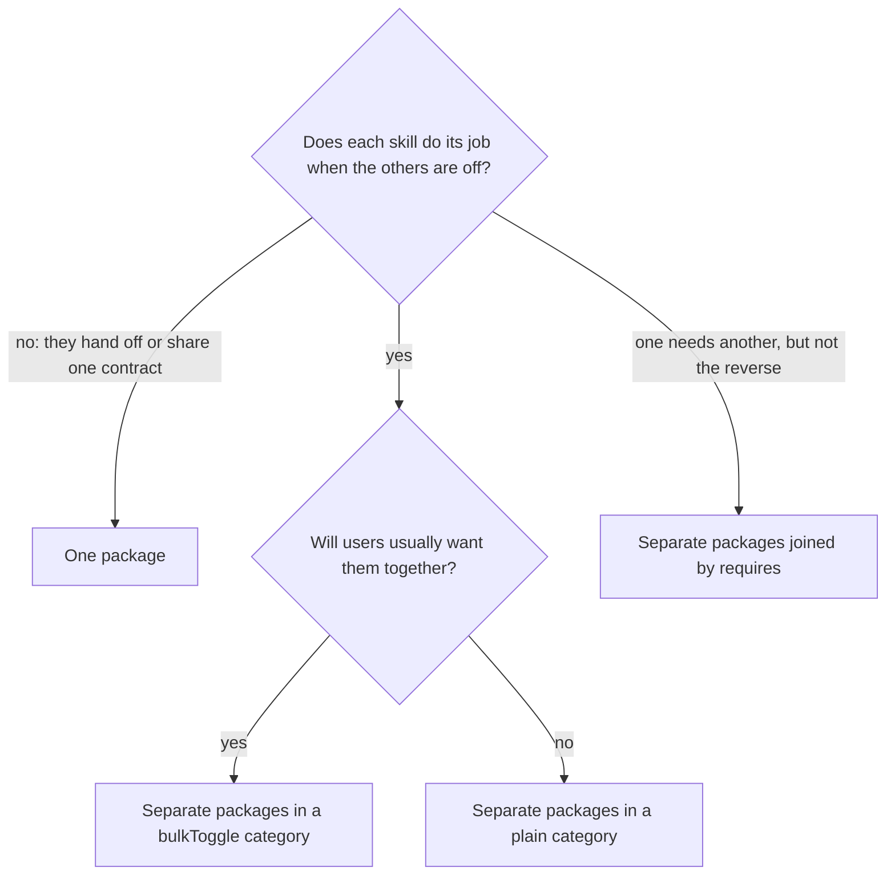
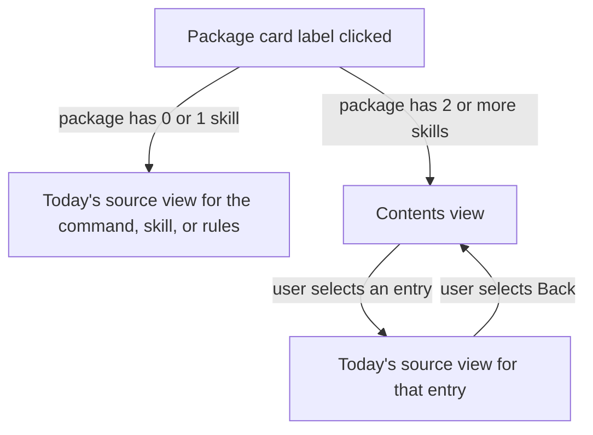

# Package Management: Part 01 - Bundle Skills That Only Work Together

## Summary

A RoboRepo package can technically list several `skill` resources, but none does. Every authoring
path, the Agents page card, and its source popup assume one skill per package. That works while
every skill stands alone. It breaks when skills only make sense together, like the six plan
lifecycle skills, which hand off to one another and are shipped today as six separate packages.

This plan makes several skills in one package a supported shape: authored, validated, enabled,
reported, and shown in the portal. The plan suite is its first user. Its six skills move into one
`plan-suite` package, and `session-close` stays a separate package.

The plan also sets the vocabulary for groups of skills, because a package with several skills is
easy to confuse with a group of packages:

| Concept | What the user controls | Example | Declared by |
| --- | --- | --- | --- |
| **Package** | One switch. Every resource in it turns on and off together. | `plan-suite`, `caveman` | `package.config.json` |
| **Collection** | Each member has its own switch, plus Select All / Deselect All for the group | Today's Plan Suite section | Today, a category with `bulkToggle: true`; see Non-goals |
| **Category** | Each member has its own switch, with no group switch | Code Conventions | A category without `bulkToggle` |
| **Dependency** | Nothing directly. It turns on because a selected package `requires` it. | `implementation-review` | `requires` in the parent manifest ([[o9zwxuav]]) |

The rule for authors: **a package holds skills that are only correct together; a collection holds
skills that are useful together.**

## Context

### Current state

Verified at `ce0749f`.

| Area | Today |
| --- | --- |
| Catalog validation | `normalizeResource` in `scripts/cli/package-catalog.mjs` validates each resource on its own, and `validatePackageCatalog` claims each skill ID once across the catalog. Nothing forbids two skills in one package, but no fixture or built-in package exercises it. |
| Authoring | `roborepo package dev create <id> --kind=…` scaffolds a package with at most one skill. There is no command to add a skill to an existing package. |
| Activation | Each skill folder is copied to `~/.roborepo/skills/<skill-id>` and linked into every harness skill folder by skill ID. The package ID does not appear in any installed path. |
| Trigger fixtures | One `skill-triggers.json` per package: a `tests` array keyed by `skill`, read by `scripts/cli/skill-trigger-fixtures.mjs`. Several skills already fit this shape. |
| Agents page card | `buildBehaviorView` in `scripts/cli/config.mjs` builds `toolByPackage` as a `Map` keyed by package ID, so a package with several commands keeps only the last one. `packagePresentationItem` sets one `inspect` target: the command, else `item.skillIds[0]`, else the rules. |
| Source popup | `portal/config/panels.js` `createConfigModal` owns one `<dialog id="config-modal">`. Clicking a card's label calls `openSource(inspect)`, which fetches and renders one source file. |
| Collections | `manifests/inventory/package-categories.json` marks only `skills-dev-lifecycle` ("Plan Suite") with `bulkToggle: true`. `standardSection` in `portal/config/templates.js` renders its Select All / Deselect All switch. |

Plan suite specifics:

| Area | Today |
| --- | --- |
| Packages | `globals/packages/plan-{write,promote,execute,review,close,archive}/`, each with one `skill` resource and one `slash-command` entrypoint. `plan-execute` also has a `rules` resource (`rules.md`). All are in `skills-dev-lifecycle`, with order 10–45. |
| Runtime package-ID references | `scripts/cli/plans.mjs` `planWritePackageState()` reads `packageStatusSummary("plan-write")`, and every plans snapshot carries the result as `planWritePackage`, which `portal/plans/app.js`, `portal/plans/templates.js`, `portal/plans/plan-drawer.js`, `portal/home/app.js`, and `scripts/cli/mock-home.mjs` read. `scripts/cli/telemetry.mjs` `loadPlanCloseEnabled` reads `packageStatusSummary("plan-close")`; the comment on `withCleanupOffer` in `scripts/cli/repository-overview-projections.mjs` names "the plan-close package". `portal/plans/api.js` `PLAN_SUITE_PACKAGES` lists all six plus `session-close` for the onboarding banner's bulk enable. |
| Command references | `manifests/platform/plan-lifecycle.json`, `portal/plans/plan-actions.js`, and `portal/plans/plan-drawer-partial.html` name commands and skills, not packages, so they stay as they are. The Plans page skill popup (`portal/shared/skill-detail-modal.js`) and `loadConfigSource` resolve skills by skill ID and commands through `packageSlashCommands()`, so they follow the move without edits. No preset or bundle in `manifests/` names a plan package. |
| Docs | `docs/user/guides/setup-and-daily-use.md` and `docs/user/guides/plan/lifecycle/plan-suite.md` tell users to run `roborepo package enable` once per plan package. `docs/internal/plans-portal-internals.md` lists the six `globals/packages/plan-*/` directories. |
| Tests naming the packages | By package ID: `scripts/test/plan-suite-check.mjs` and `scripts/test/plan-suite-commands-check.mjs` (enable, disable, or query `plan-write`); `scripts/test/config-bulk-toggle-check.mjs` (`SECTION_IDS` lists all seven, plus individual `plan-write` toggles); `scripts/test/package-retired-ids-check.mjs` and `scripts/test/system-package-ownership-characterization-check.mjs` (use `plan-write` as a current, enableable package); `scripts/test/package-catalog-check.mjs` (looks up `plan-write`'s `urls`, which would pass vacuously once the ID is gone); `scripts/test/cli-command-catalog-check.mjs` (parses `package status plan-write` without reading the catalog, so it can stay). By path: `scripts/test/plan-close-integration-check.mjs`, `scripts/test/skill-reference-matrix-characterization-check.mjs`, `scripts/test/plan-suite-skills-check.mjs`, and `scripts/test/test-cli.sh` read files under `globals/packages/plan-*/` or `generated/packages/plan-*/`. Other tests name the plan skills or commands only. |
| Retired package IDs | No mapping exists. `scripts/test/package-retired-ids-check.mjs` pins what `roborepo update` does with registry IDs the catalog no longer has (`plan-docs`, `wrap-up`, `plan-start`): `reconcile` drops them from both registry lists and removes their skill cache, harness skill views, and slash commands. |

### Why now

- **External skills ([[jdsobwn]], [[user-managed-packages-and-add-workflows]])** will create
  packages with several skills from repos that ship a suite. The card, popup, and status paths need
  to work on content RoboRepo controls first.
- **Desired state ([[o9zwxuav]])** changes what the enabled-packages file means. Changing the plan
  package IDs first means its migration fixtures use the final IDs.
- **Required and recommended skills ([[ejsc769o]])** lists `requires` edges from `plan-write`,
  `plan-promote`, `plan-execute`, `plan-review`, and `plan-close`. After this plan those edges all
  start from `plan-suite`.

## Goals

- A package with several `skill` resources validates, enables, disables, reports `partial` when any
  one component is missing, and sums context cost across all of them.
- Authors can add a skill to an existing package from the CLI.
- On the Agents page, a package with one skill looks and behaves exactly as it does today.
- A package with several skills shows a count on its card. Clicking its label opens a contents view
  that lists each resource, and each entry opens today's single-source view.
- The six plan lifecycle skills ship as one `plan-suite` package; `session-close` stays separate.
- Package, collection, category, and dependency are defined in package-development guidance, along
  with the authoring rule for choosing between a package and a collection.

## Non-goals

- Toggling individual skills inside a package. A package is all-or-nothing by definition; skills
  that need their own switches belong in a collection.
- A collection record separate from categories. Categories with `bulkToggle` already are
  collections. A separate record is needed once a collection comes from somewhere other than a
  built-in category: a user creating one ([[user-managed-packages-and-add-workflows]]) or an
  external source with several skills ([[jdsobwn]]). Whichever lands first defines it.
- Deciding from skill content whether skills belong in one package. [[ejsc769o]] owns the reference
  audit that flags candidates; see Package or collection.
- Mapping old plan package IDs to `plan-suite` in the enabled-packages file. RoboRepo has not
  launched, so no compatibility shim is added. See Risks.
- Changing any plan skill's content or workflow.
- The System / Custom / Third Party tabs on the Agents page, owned by
  [[user-managed-packages-and-add-workflows]].

## Proposed design

### Package or collection

The decision belongs to the author, because only the author knows whether a skill is correct
without its siblings. The question to answer:



The plan suite answers "no" to the first question: `/plan-promote` hands off to `/plan-execute`, which
hands off to `/plan-review`, and so on. Code Conventions answers "yes, but not always together":
`code-style` is useful without `react`.

The skill reference audit in [[ejsc769o]] gives the deterministic check: an unconditional handoff
from a skill in one package to a skill in another package, with no `requires` between them, is
reported as a candidate for merging or for a `requires` edge.

### Agents page: card and contents view

A package's card shows one switch whatever it contains. What changes is the label and what clicking
it opens:



Contents view, rendered inside the existing `#config-modal` dialog:

```text
Plan Suite                                      Startup: <cost>  When loaded: <cost>
6 skills · 1 rules fragment
──────────────────────────────────────────────────────────────────────────────
/plan-write     <SKILL.md description, one line>                    <cost>  ›
/plan-promote   <SKILL.md description, one line>                    <cost>  ›
/plan-execute   <SKILL.md description, one line>                    <cost>  ›
/plan-review    <SKILL.md description, one line>                    <cost>  ›
/plan-close     <SKILL.md description, one line>                    <cost>  ›
/plan-archive   <SKILL.md description, one line>                    <cost>  ›
Rules           Code Outlives Plans                                 <cost>  ›
```

| Element | Source |
| --- | --- |
| Header title and cost row | The package label and the package's existing cost chips |
| Summary line | Resource counts by type |
| Entry label | `/command` for a skill with a slash command, the skill ID otherwise, and the resource type for rules or hooks |
| Entry description | The skill's `SKILL.md` frontmatter `description`, shortened to one line |
| Entry cost | The resource's entry in the per-component list that `scripts/cli/context-cost.mjs` already builds for each package |
| Entry action | `openSource` with the same `inspect` object a single-skill card uses today |
| Back | Re-renders the contents view in the same dialog. No second dialog is stacked. |

On the card, a `6 skills` badge sits beside the cost chips so users can tell before clicking that
the card controls a set. The card label is the package label, never one of its commands.

[[user-managed-packages-and-add-workflows]] later splits the Agents page into System, Custom, and
Third Party tabs. The card, badge, and contents view behave the same on every tab; `plan-suite`
sits on the System tab.

Server side, `packagePresentationItem` sets `inspect` to `{ kind: "package-contents", id, entries }`
when a package has two or more skills. Each entry carries the `inspect` object it would have had as
a single-skill card. `buildBehaviorView` groups tools by package as arrays instead of keeping one per
package. `loadConfigSource` needs no change, because every entry's `inspect` is a kind it already
serves.

### Authoring

Add `roborepo package dev add-skill <package-id> <skill-id> [--command] [--description=…]`. It
creates `skills/<skill-id>/SKILL.md`, appends the `skill` resource (and its `slash-command`
entrypoint with `--command`), adds a `skill-triggers.json` entry, and runs package validation. It
refuses when the skill ID is already claimed by any package.

### Plan suite migration

```text
globals/packages/plan-suite/
  package.config.json
  rules.md                      moved from plan-execute/
  skill-triggers.json           the six tests arrays concatenated
  skills/
    plan-write/                 moved unchanged
    plan-promote/
    plan-execute/
    plan-review/
    plan-close/
    plan-archive/
```

The manifest header replaces the six old headers:

```json
{
  "schemaVersion": 1,
  "id": "plan-suite",
  "label": "Plan Suite",
  "description": "One command for each step of a plan's life: write, promote, execute, review, close, and archive.",
  "lifecycle": "optional",
  "presentation": { "category": "skills-dev-lifecycle", "order": 10 }
}
```

`resources` holds the six `skill` resources in lifecycle order, each copied unchanged from its old
manifest (`id`, `source`, `invocation`, `risk`, and the `slash-command` entrypoint), followed by the
`rules` resource from `plan-execute`.

| Location | Today | After |
| --- | --- | --- |
| `scripts/cli/plans.mjs` `planWritePackageState` | `packageStatusSummary("plan-write")` | `packageStatusSummary("plan-suite")`. Rename the function to `planSuitePackageState`. |
| Plans snapshot field `planWritePackage` and the portal's `planWriteEnabled` / `getPlanWritePackage` | Named after `plan-write` | Rename to `planSuitePackage`, `planSuiteEnabled`, and `getPlanSuitePackage` in `scripts/cli/plans.mjs`, `scripts/cli/mock-home.mjs`, `portal/plans/`, `portal/home/app.js`, and the portal UI specs, so no name points at a package that no longer exists. The field's shape is unchanged. |
| `scripts/cli/telemetry.mjs` `loadPlanCloseEnabled` | `packageStatusSummary("plan-close").enabled` | `packageStatusSummary("plan-suite").enabled`. The name stays: it still answers whether `/plan-close` is available. |
| `scripts/cli/repository-overview-projections.mjs` `withCleanupOffer` comment | "the plan-close package is disabled" | "the plan-suite package is disabled" |
| `portal/plans/api.js` `PLAN_SUITE_PACKAGES` | seven IDs | `["plan-suite", "session-close"]` |

After the move, the `skills-dev-lifecycle` category keeps its "Plan Suite" label and `bulkToggle`,
and holds two packages: `plan-suite` and `session-close`. Select All / Deselect All turns both on or
off, matching what the onboarding banner enables. See Decision Log.

## Implementation plan

### Phase 1: Several skills in one package

- [ ] Add a workspace fixture package with two skills, one with a slash command, plus a rules
      resource.
- [ ] Prove with checks that the fixture validates, enables both skills and the command, reports
      `partial` when one skill link is removed, disables cleanly, and sums context cost.
- [ ] Fix any path that assumes one skill per package, found by the checks or by searching
      `scripts/cli/` for `skillIds[0]` and for maps keyed by package ID that hold one resource.

### Phase 2: Authoring

- [ ] Add the `package dev add-skill` command definition under
      `manifests/platform/cli/command-definitions/package/` and its implementation beside
      `package dev create` in `scripts/cli/packages.mjs`.
- [ ] Update `docs/user/reference/roborepo-cli.md` and the package-development reference.

### Phase 3: Agents page

- [ ] Group tools by package in `buildBehaviorView`, and emit the `package-contents` inspect target
      and the skill-count badge from `packagePresentationItem`.
- [ ] Add a `showContents` view to `createConfigModal` in `portal/config/panels.js`, with Back
      returning to it from `openSource`, and a template for the entry list in
      `portal/config/templates.js`.
- [ ] Keep card and popup output identical for packages with zero or one skill.

### Phase 4: Plan suite migration

- [ ] Create `globals/packages/plan-suite/` with `git mv` for the skill folders and `rules.md`, then
      delete the six old package directories.
- [ ] Run `roborepo skill render-commands` and `roborepo skill triggers --check`; commit
      `generated/packages/plan-suite/` and delete the six `generated/packages/plan-*/` directories.
- [ ] Update the runtime references in the table above, then search `scripts/`, `modules/`,
      `portal/`, and `manifests/` again for any old package ID used as a package ID.
- [ ] Update the tests that name old package IDs or paths, listed under Current state. In
      `package-catalog-check.mjs`, point the `urls` lookup at `plan-suite` and assert the package
      exists, so the check cannot pass vacuously.
- [ ] Extend `scripts/test/package-retired-ids-check.mjs` with the six old plan package IDs: after
      `reconcile`, they leave the registry; after `roborepo package enable plan-suite`, all six
      plan skills and their slash commands are installed. Record in this plan what happens to the
      plan skill links between those two steps.
- [ ] Update the two user guides so the CLI shows `roborepo package enable plan-suite` and
      `roborepo package enable session-close`.
- [ ] Replace `globals/packages/plan-*/` paths in `docs/internal/plans-portal-internals.md` and in
      open plans under `docs/plans/backlog/`, `ready/`, `active/`, and `review/`. Leave completed and
      archived plans and `docs/internal/history/` as written: they record the layout at the time.

### Phase 5: Guidance

- [ ] Add the package, collection, category, and dependency table and the authoring question to
      `.claude/skills/roborepo-development/references/package-development.md`.
- [ ] Describe the contents view and the skill-count badge in `docs/user/reference/config-control-panel.md`.

## Validation

| Behavior | Check |
| --- | --- |
| Two skills in one package validate; each skill ID is claimed once | `node scripts/test/package-catalog-check.mjs` |
| Enable, disable, and `partial` across several skills and a rules fragment | `node scripts/test/package-lifecycle-check.mjs` |
| Context cost sums every resource and exposes each resource's share | `node scripts/test/context-cost-check.mjs` |
| `package dev add-skill` creates the files and refuses a claimed ID | `bash scripts/test/test-cli.sh --quiet` |
| Command catalog accepts the new definition | `node scripts/test/cli-command-catalog-check.mjs` |
| Several-skill card shows the badge; label opens the contents view; each entry opens its source; Back returns; single-skill cards are unchanged | `npm run test:portal-ui` |
| Plans page and command status read `plan-suite` | `node scripts/test/plan-suite-check.mjs`, `node scripts/test/plan-suite-commands-check.mjs` |
| Plan skill content and the rules fragment are unchanged after the move | `node scripts/test/plan-suite-skills-check.mjs`, `node scripts/test/plan-close-integration-check.mjs`, `node scripts/test/skill-reference-matrix-characterization-check.mjs` |
| Onboarding bulk enable turns on `plan-suite` and `session-close` | `node scripts/test/config-bulk-toggle-check.mjs` |
| Updating a machine that enabled the six old IDs drops them, and enabling `plan-suite` installs all six skills and commands | `node scripts/test/package-retired-ids-check.mjs` |
| Enabling and disabling `plan-suite` installs and removes its command wrappers | `node scripts/test/system-package-ownership-characterization-check.mjs` |
| Generated command wrappers and trigger fixtures match source | `roborepo skill render-commands --check`, `roborepo skill triggers --check` |
| Full gate: package defaults, generated output, CLI catalog, and portal change | `bash scripts/doctor.sh --quiet`, `npm run check` |

## Risks

| Risk | Treatment |
| --- | --- |
| Existing machines list the six old IDs in `~/.roborepo/enabled-packages.json`. `reconcileEnabledPackages` in `scripts/cli/packages.mjs` drops IDs missing from the catalog and then runs `cleanupPackageProjections`, so `plan-suite` is not enabled after update. `package-retired-ids-check.mjs` shows that a retired package's skill cache, skill views, and commands are removed; the plan suite differs because `plan-suite` reuses the same skill IDs, and whether that keeps the links has not been checked. | Pre-launch, no mapping is added. The release note and both user guides say to run `roborepo package enable plan-suite` once. Phase 4 extends `package-retired-ids-check.mjs` to assert the actual result. |
| A path assumes one skill per package and the fixture does not reach it | Phase 1 searches as well as tests, and Phase 4 repeats the search for the plan suite |
| Authors put unrelated skills in one package to save toggles | The authoring question in package-development guidance, and the [[ejsc769o]] audit, which also reports skills in one package that never reference each other |

## Decision Log

- **2026-10-24: The `skills-dev-lifecycle` category stays "Plan Suite" with `bulkToggle`.** Decided
  by the user. After the move it is a collection of two packages, `plan-suite` and `session-close`,
  and its section header shares a name with the `plan-suite` card. Considered and not chosen:
  renaming the category to "Dev Lifecycle" and dropping `bulkToggle`, and moving `session-close`
  to another category.
- **2026-10-24: The plans snapshot field `planWritePackage` is renamed to `planSuitePackage`.**
  Decided during promotion. It reports `plan-suite`'s status after the move, and the field is
  internal to the portal and its tests. `loadPlanCloseEnabled` keeps its name because it still
  answers whether `/plan-close` is available.

## Documentation impact

| Doc | Update |
| --- | --- |
| `.claude/skills/roborepo-development/references/package-development.md` | Several skills per package; package, collection, category, and dependency; the authoring question; `package dev add-skill` |
| `docs/user/reference/roborepo-cli.md` | `package dev add-skill` |
| `docs/user/reference/config-control-panel.md` | Contents view and skill-count badge |
| `docs/user/guides/setup-and-daily-use.md` | Replace the six per-package `enable` lines with `plan-suite` |
| `docs/user/guides/plan/lifecycle/plan-suite.md` | Same CLI change, and the new Agents page layout |
| `docs/internal/plans-portal-internals.md` | The six plan package directories become `globals/packages/plan-suite/` |

## Coordination

| Plan | Effect |
| --- | --- |
| [[o9zwxuav]] | Depends on this plan; registry migration fixtures use `plan-suite`. Its dependency-row mockup still shows `/plan-close` as its own card under Plan Suite; after this plan that card is `Plan Suite`. It should refresh the mockup when it is promoted. |
| [[ejsc769o]] | Depends on this plan; owns the reference audit that flags package-or-collection candidates, and its plan rows collapse into one `plan-suite` row |
| [[jdsobwn]] | Depends on this plan; external suites become packages with several skills and use the contents view. It also names `globals/packages/plan-write/skills/plan-write/`, which Phase 4 rewrites |
| [[user-managed-packages-and-add-workflows]] | Depends on this plan; "Multiple things together" asks whether to create a package or a collection; adds the System / Custom / Third Party tabs, inside which the contents view must work unchanged |
| [[46qth5z8]], [[plans-portal-live-refresh-and-static-preflight]], [[plan-lifecycle-suite-blockers-dependencies]] | Not dependencies. Each names a file under `globals/packages/plan-*/`; Phase 4 rewrites those paths to `globals/packages/plan-suite/` and changes nothing else in them |
