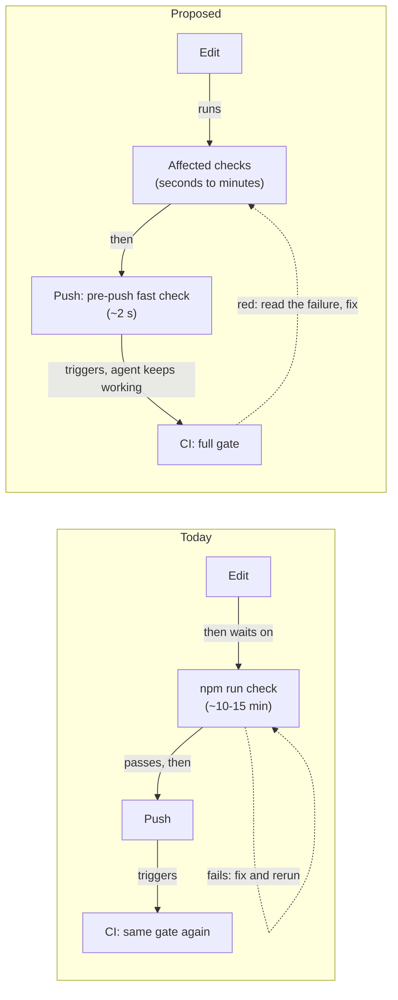

# Keep Main Green and Let CI Run the Full Gate

## Summary

Agents run the full local CI parity gate (`npm run check`) many times per session and the user
waits on each run, yet about a third of CI runs still fail. Most of those failures are ones the
local gate cannot see: main was already red, a test flaked, or the failure only happens on the
Linux runner. This plan stops main from going red with a fast pre-push check, removes the two
recurring flakes, and changes the rules and plan skills so CI runs the full gate in the background
while agents keep working, instead of every session repeating it locally.

## Context

`npm run check` runs `scripts/test/ci.sh`: doctor, the shell suite, install collisions, the `ci`
check group, package install, Docker clean-machine sandboxes, PowerShell parity, and the Playwright
portal suite. `.github/workflows/ci.yml` runs the same script on `ubuntu-latest` and `macos-latest`
for every pull request and every push to main. A CI run takes about 10 minutes on Linux and 15 on
macOS.

### What failed in CI

Measured from the 30 most recent failed runs, as of 2026-10-30:

| Cause | Runs | Example | Caught by a local full gate? |
| --- | --- | --- | --- |
| Main already red; every PR based on it failed the same way | 15 | `docs-reference-check.mjs` red on main for about 13 hours; `plan-execute/SKILL.md` at 503 lines failed doctor's 500-line limit | No: the breaking commits were pushed straight to main |
| Flaky tests | 8 | `browser-lifecycle-check.mjs:83` parses empty stdout on macOS; portal UI `route.fetch` fails with `ECONNRESET` in `scripts/test/portal-ui/helpers.mjs` | No: they pass on rerun |
| Linux-only or runner environment | 4 | Seven Ubuntu-only portal UI failures; the macOS runner's `filter.lfs.smudge` Git driver | No: the local gate runs on macOS |
| Regression on the branch | 3 | `plan-suite: findings catalog and destination policy` | Yes |

Across the last 200 runs, 66 failed, 117 passed, 16 were cancelled, and 1 was still running.

### Why main goes red

In the two weeks to 2026-10-30, 112 of the 127 first-parent commits on main were pushed directly
rather than merged through a pull request. Plan lifecycle commits land on main by design, and the
user also pushes small skill, doc, and UI edits there. CI sees those commits only after they land.
The checks that would have caught both main breakages above take about 2 seconds together:
`bash scripts/doctor.sh --quiet` and `node scripts/test/docs-reference-check.mjs`.

Agent shells override `core.hooksPath` with RoboRepo's agent hooks (`~/.claude/git-hooks` in
Claude), set in the `command` config scope. Their `pre-push` (`globals/system/git-hooks/pre-push`)
refuses agent pushes to protected branches and force pushes, then pipes the same ref lines on stdin
to `roborepo_chain_hook` (`globals/system/git-hooks/chain.sh`). The chain finds the repository's own
hooks directory from `core.hooksPath` in every scope except `command`, falling back to
`.git/hooks`, and `exec`s that directory's `pre-push`, so the repository hook's exit status decides
the push. The repository has no hook of its own and no `core.hooksPath` outside the agent override,
so nothing runs checks before a push, whether the user or an agent pushes.

### Why agents run the full gate so often

Over the 10 days to 2026-10-30, 94 of 232 session transcripts in this repository ran the gate, 430
runs in total: a median of 3 per session that ran it, and up to 27. These instructions drive it:

| Source | Instruction |
| --- | --- |
| `globals/system/rules/shared/08-validation-gates.md` | Full gate for generated outputs, package defaults, and harness config, and "before pushing" |
| `globals/packages/plan-suite/skills/plan-execute/references/validation-loop.md` | The Validator receives "the repository's completion gate command and the output of its latest run" |
| `globals/packages/plan-suite/skills/plan-review/SKILL.md` | Run the canonical completion gate; rerun it after fixes and on the base branch for each failure |
| `globals/packages/plan-suite/skills/plan-close/SKILL.md` | Run the canonical completion gate after merge, and again after any code or test change |
| `globals/packages/test-harness/skills/test-harness/SKILL.md` | Full checks "before a push" |
| `local/skills/roborepo-development/SKILL.md` | Reserve `npm run check` for "pre-push, release", and CI or test-orchestration changes |

A plan that goes through execute, review, and close therefore runs the full gate at least three
times locally, plus once per fix, and CI runs it again on the pull request and on main.

## Goals

- Main stays green: a push that would fail the fast repository checks is refused before it lands.
- A red CI result means a real failure, not one of the known flakes.
- CI is the full gate. Agents run the checks their change affects, push, and keep working while CI
  runs; they read the CI result instead of reproducing it locally.
- Plan skills read the CI result for the commit they judge, and run the local gate only when no CI
  result exists for it.

## Non-goals

- Requiring pull requests for every commit to main. Plan lifecycle commits land on main by design.
- Diff-scoped tier selection and CI path filters. They are deferred with no owning plan: write a
  CI-speed plan only if the CI run times measured after this plan lands (see Validation) show CI
  time matters.
- Agents fixing their own pull requests on every harness. GitHub Integration Part 02 (`f0jwe76j`)
  owns that; this plan only tells agents to read the CI result.
- Removing any check from `npm run check` or from CI.

## Proposed design



### Fast pre-push check

A tracked script, `scripts/test/pre-push-check.sh`, runs the checks that are fast and catch
main-breaking mistakes:

- `bash scripts/doctor.sh --quiet`, which includes skill structure limits and generated-output drift
- `node scripts/test/docs-reference-check.mjs`
- `git diff --check` over the commits being pushed

Measured on 2026-10-30 on a development checkout: doctor took 2.0 s and the docs reference check
0.1 s.

It sets `ROBOREPO_SKIP_NODE_RELEASE_CHECK=1` as `ci.sh` does, so the check stays off the network,
and the whole script must stay under 10 seconds. A tracked `scripts/git-hooks/pre-push` reads the
`<local ref> <local sha> <remote ref> <remote sha>` lines git passes on stdin and calls the script.
For each pushed ref, `git diff --check` covers `<remote sha>..<local sha>`; a new branch (zero
remote sha) diffs from its merge base with the remote's default branch, and a deletion (zero local
sha) is skipped. The doctor and docs checks read the working tree, not the pushed commits, so they
run once per push; a dirty tree can make them disagree with what is pushed, which is an accepted
limit of a fast check that CI covers.

The check does not run the plan validator. CI does not validate repository plans, so a plan schema
mistake cannot turn main red, and the lifecycle transition commands already validate each plan they
move. `roborepo plans validate` also takes about 5 s per call, which would more than triple the
hook.
One command installs it for the primary checkout and every linked worktree, since they share the
repository's config:

```bash
git config core.hooksPath scripts/git-hooks
```

The user's own pushes run it directly. Agent pushes reach it through `roborepo_chain_hook`, which
reads `core.hooksPath` from every scope except the agent's `command`-scope override.

### Flake fixes

- `scripts/test/browser-lifecycle-check.mjs:83` parses the stdout of the forced-shutdown scenario,
  a `--serve` service that ignores `SIGTERM`, and that stdout is sometimes empty on macOS. Find why
  the run exits without JSON (for example, cleanup's escalation to `SIGKILL` racing the run's own
  exit), then fix the cause, or assert on the exit status and stderr before parsing so the failure
  says what happened.
- The portal UI helpers in `scripts/test/portal-ui/helpers.mjs` call `route.fetch()` against the
  real portal and fail with `ECONNRESET`. Find why the connection drops, then fix the cause, or
  retry that fetch once inside the helper.
- Set `retries: process.env.CI ? 1 : 0` in `scripts/test/portal-ui/playwright.config.mjs`. The
  `list` reporter marks a test that passes on retry as flaky, so a flake stays visible in the log
  without failing the run.

### Rules and skills: CI is the full gate

"Affected checks" below means the checks the validation-gates rule's tier table assigns to the
files a change touches: the checks that read an edited doc or skill, a module's own tests, or a
shared module's callers.

| File | Change |
| --- | --- |
| `globals/system/rules/shared/08-validation-gates.md` | The last table row runs the full gate locally only for CI, workflow, or test-orchestration changes, or on request. Replace "Before pushing, run it once" with: the pre-push check runs on push, CI runs the full gate, and the agent keeps working and reads the result when it lands. When a local full run is needed, run it in the background where the harness allows. |
| `globals/packages/test-harness/skills/test-harness/SKILL.md` | Drop "before a push" from the full-check list in step 4, and add reading the CI result as the pre-merge check. |
| `local/skills/roborepo-development/SKILL.md` | Update "Full CI parity is expensive": local `npm run check` is for CI or test-orchestration changes; pushes rely on the pre-push check and CI. |
| `globals/packages/plan-suite/skills/plan-execute/references/validation-loop.md` | The Validator receives the CI result for the branch's head commit when one exists, otherwise the output of the affected checks. |
| `globals/packages/plan-suite/skills/plan-review/SKILL.md` | Read the pull request's CI result for the reviewed commit; run the local gate once only when no CI result exists. Classify a base failure from the base branch's CI result instead of rerunning on base. After a fix, rerun the affected checks and push; CI reruns the full gate. Keep the existing "A long gate does not hold up work that cannot change its result" paragraph, which `plan-suite-skills-check.mjs` asserts, and the pull request feedback paragraph that records a CI failure as one `### Verification` line. |
| `globals/packages/plan-suite/skills/plan-close/SKILL.md` | The landed commit's CI result on the base branch replaces the local gate run; run focused plan tests only. |

The plan-suite skills ship to client repositories, so their wording stays forge-neutral: "the
repository's CI result for the commit, from its forge when available; otherwise the repository's
canonical completion gate, once."

## Related plans

| Plan | Relationship | Effect on this plan |
| --- | --- | --- |
| GitHub Integration Part 02 (`f0jwe76j`, backlog) | Unlanded, independent | Owns agents fixing their own pull requests. Nothing here waits on it. |
| GitHub Integration Part 03 (`developer-runtime-remote-branch-status`, backlog) | Unlanded, independent | Shows a checkout's CI result in Runtime. Agents here read CI through the forge directly, not through Runtime. |

## Implementation plan

Flakes first, so the CI results the later steps lean on are trustworthy.

- [ ] Reproduce the `browser-lifecycle-check.mjs:83` empty stdout (loop the check on macOS until it
      fails, capturing the run's exit status and stderr), then fix the cause or assert on status
      and stderr before parsing. Done when 20 consecutive runs pass.
- [ ] Find why `route.fetch()` in `scripts/test/portal-ui/helpers.mjs` (both route handlers) drops
      the connection, then fix the cause or retry that fetch once inside the helper.
- [ ] Set `retries: process.env.CI ? 1 : 0` in `scripts/test/portal-ui/playwright.config.mjs`.
- [ ] Add `scripts/test/pre-push-check.sh` (doctor, docs reference check, per-ref
      `git diff --check` as described in Proposed design) and an executable
      `scripts/git-hooks/pre-push` that calls it with git's stdin. Time it.
- [ ] Prove the hook wiring with a local remote, not the real one:
      `git clone --bare . <tmp>/remote.git`, push a throwaway branch with a broken doc reference to
      it from the user's shell and from an agent shell, and confirm both are refused while the same
      branch without that commit pushes.
- [ ] Edit `globals/system/rules/shared/08-validation-gates.md`, then run
      `bash scripts/build/render-rules.sh` to regenerate the rendered rules.
- [ ] Edit the test-harness skill and `local/skills/roborepo-development/SKILL.md`.
- [ ] Edit the plan-execute validation loop, plan-review, and plan-close, keeping the wording
      forge-neutral; update any phrase `scripts/test/plan-suite-skills-check.mjs` asserts that the
      edits change.
- [ ] Update `docs/internal/testing.md` and `docs/internal/hooks-internals.md`.
- [ ] Run the checks in Validation, including one `npm run check`.

## Validation

- `scripts/test/pre-push-check.sh` finishes in under 10 seconds on a development checkout.
- With the hook installed, pushing a throwaway branch whose commit adds a broken doc reference to a
  local bare clone is refused, from the user's shell and from an agent shell; the same branch
  without that commit pushes. A bare clone keeps `HEAD` pointing at `main`, which the agent hook
  needs to name the default branch. The checks the script runs already have their own tests, so
  this manual push proves only the hook wiring.
- `node scripts/test/browser-lifecycle-check.mjs` passes 20 consecutive runs on macOS.
- `npm run test:portal-ui` passes on both CI legs, with any retried test listed as flaky.
- `node scripts/test/plan-suite-skills-check.mjs`, the generated-rules check run by
  `bash scripts/doctor.sh --quiet`, and `roborepo skill triggers --check` pass after the rule and
  skill edits.
- One `npm run check` run passes before the pull request, because this change touches test
  orchestration.
- Two weeks after merge, compare against the baseline in Context: the share of failed CI runs
  (baseline 66 of 183 completed), failures inherited from a red main (baseline 15 of 30), local
  gate runs per session (baseline 430 across 94 sessions in 10 days), and median CI run time per
  leg (baseline about 10 minutes on Linux and 15 on macOS). The run times decide whether a CI-speed
  plan is worth writing.

## Risks

- **A late CI failure costs a context switch.** The agent or user has moved on when CI goes red.
  The failure output must name the failing check clearly enough to act on cold.
- **The hook is per clone.** A new clone skips the pre-push check until someone runs the install
  command in `docs/internal/testing.md`.
- **Retries can hide a new flake.** The flaky marker in the log is the only signal; nothing fails
  on it.
- **Linux-only failures still reach CI.** This plan does not add a local Linux run; those failures
  stay CI's to catch.

- **Another session is editing `plan-review/SKILL.md` and `docs/internal/hooks-internals.md`.** As
  of 2026-10-30 both have uncommitted changes in the primary checkout. Start the skill and doc edits
  from a base that includes those changes once they land, and keep their wording.

## Open questions

None. Whether the pre-push check should also run the plan validator was decided against; Proposed
design gives the reasons.

## Documentation impact

- `docs/internal/testing.md`: when to run `npm run check` locally, the pre-push check, and how to
  install the repository hook.
- `docs/internal/hooks-internals.md`: the repository `pre-push` hook as a target of
  `roborepo_chain_hook`.
- No user-facing doc changes. The rule and skill text ships to users, but it describes agent
  behavior, not a command or setting they use.
