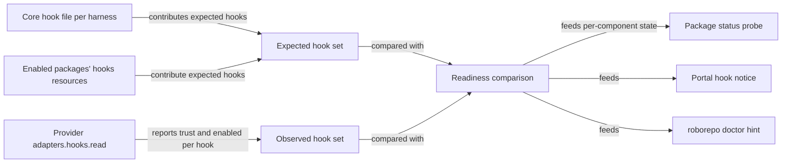
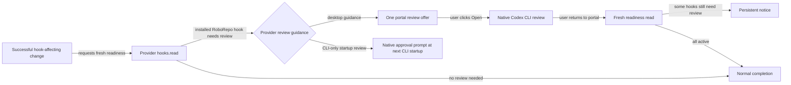

# Report hook readiness and guide Codex approval during setup and package changes

## Summary

When a RoboRepo package installs Codex hooks, those hooks don't run yet. Codex runs a non-managed
hook only after the user reviews and trusts its exact definition. The desktop app offers an in-app
review flow, but RoboRepo must show which hooks need it. Codex also keys that trust by the hook's
position in `~/.codex/hooks.json`. RoboRepo previously prepended each new package hook, so enabling
one package could revoke trust from hooks the user had already reviewed. That happened on the
reference Mac: after Skill Visibility was enabled, Codex stopped running the telemetry
`PostToolUse` hook. Package hooks now append after existing Codex hooks.

Plan `3jp3yhtq` added a read-only check for this, but only for the five telemetry hooks. That check
lives outside the Codex provider and copies the hook list instead of reading it from the package.
Some other parts of `3jp3yhtq` also put provider-specific behavior in shared code.

This plan covers the complete path from installing a hook to making it usable:

- makes Codex append package hooks, so enabling a package leaves existing trust in place;
- moves hook readiness behind the provider `hooks.read` adapter, so every package and harness is
  covered;
- shows one notice per harness, with the Codex app review path and a terminal alternative;
- installs the core Codex hooks, including when packages already populated the hook file;
- moves the remaining provider-specific code and copy out of shared modules;
- offers a timely, nonmodal Codex review action after setup or a hook-changing operation, opens
  Codex's native review in a terminal on a user click, and refreshes status afterward. RoboRepo
  never approves hooks on the user's behalf.

## Context

### Terms

| Term | Meaning |
| --- | --- |
| Core hooks | Hooks RoboRepo installs for a harness whatever packages are enabled, declared in a per-harness file such as `generated/codex/hooks.json` |
| Installed | The hook entry exists in the harness's hook file (`~/.codex/hooks.json`, or `hooks` in `~/.claude/settings.json`) |
| Trust key | Codex's record for one hook in `~/.codex/config.toml`: `[hooks.state."<hook file>:<event>:<group index>:<handler index>"]` with a `trusted_hash` |
| Trusted | Codex has a trust key whose hash matches the hook at that position, or reports the hook as managed |
| Active | Installed, enabled, and trusted where the provider can observe trust; Claude's interactive workspace trust remains outside this file-level status |

Claude has no Codex-style per-hook trust decision. In an interactive Claude Code session, hooks
from settings files, including user settings, are held until the user accepts workspace trust for
that folder. A `-p` or SDK session treats the folder as trusted. Consequently, file-level Claude
readiness means configured and enabled, not proof a hook will run in every interactive workspace.
Codex adds a separate per-hook trust step.

### Behavior before this work

How hooks reach a harness and how their state gets reported:

| Step | Where | Behavior |
| --- | --- | --- |
| Install | `scripts/cli/packages.mjs` `hooks` case → `mergeHooksInto` in `scripts/cli/hook-composition.mjs` → provider `adapters.hooks.merge` | Every provider reaches `mergeHooksMap` in `scripts/harnesses/hooks-merge.mjs` (Claude and Gemini through `root-config-hooks.mjs`), which **prepends** a fragment's entries. The comment there explains why: a Claude deny hook must run before an allow hook |
| Package status | `probeHooks` in `scripts/cli/package-probes.mjs` | Counts installed commands only. Hardcodes `~/.codex/hooks.json` and `~/.<harness>/hooks/` instead of asking `hookFilePath` and the provider |
| Codex readiness | `scripts/cli/codex-hook-status.mjs` | Spawns `codex app-server` and calls `hooks/list`. Hardcodes the five telemetry events and commands. Returns `active`, `review_required`, `inactive`, `missing`, `unknown`, or `unavailable` (no executable). Its executable picker prefers the desktop runtime, the reverse of `selectedHarnessExecutable` in `scripts/harnesses/discovery.mjs` |
| Route | `/api/config/hooks/codex/status` in `scripts/cli/portal-routes-config.mjs`, handled by `loadCodexHookStatus` in `scripts/cli/telemetry.mjs` | Reports any thrown error as `unknown` |
| Portal notice | `portal/shared/codex-hook-status.js`, template `tpl-codex-hook-status` in `portal/shared/widget-templates-partial.html` | Rendered on Settings, Tokens, and Home when Token Telemetry is enabled and Codex is active. Shows nothing for `unknown` or `unavailable` |
| User docs | `docs/user/reference/codex-hooks.md` | Says the warning appears on Agents, which is no longer true |
| Provider slot | `hooks.read` in `scripts/harnesses/codex/index.mjs`, `scripts/harnesses/claude/index.mjs`, and `scripts/harnesses/gemini/index.mjs` | A `notYetMigrated` stub that throws |
| Doctor | `scripts/doctor.sh` | Has only `ok` and `fail` output helpers; no non-failing hint |

Other provider-specific behavior in shared modules:

| Location | Leak |
| --- | --- |
| `scripts/harnesses/desktop-runtime.mjs` | The no-runtime warning hardcodes "Code tab", a Claude Desktop detail |
| `scripts/harnesses/mcp-claude-cli.mjs` | Claude MCP command construction sits beside, not inside, `scripts/harnesses/claude/` |
| `generated/codex/hooks.json` | Holds the `jcodemunch` SessionStart notice, although that hook belongs to the archived package's `globals/packages-archived/jcodemunch/hooks-codex.json`. `system-package-ownership-characterization-check.mjs` already guards the same leak for Caveman and JDocMunch |

`scripts/harnesses/transcript-parse.mjs` also holds Codex parsing, but its header explains why: the
capture hook runs on every tool call and must not load a full provider module. It stays where it is.

### Observed on the reference Mac

October 12-13, 2026, during `3jp3yhtq` QA:

- Discovery found one Codex executable, the desktop runtime `codex-cli 0.155.0-alpha.16.4`. No
  Codex CLI is on `PATH`.
- `hooks/list` reported five telemetry hooks, all `trusted` and enabled, trusted by hand through
  Codex's review screen.
- The newest spool records then reported zero tokens, but predated the parser fix.

October 15, 2026, during promotion of this plan:

- `hooks/list` reports six hooks. The Skill Visibility observer
  (`node "$HOME/.codex/hooks/skill-reference-observer.mjs"`) was added at `PostToolUse` position
  0 on October 13. Codex reports it as `modified`, because it inherited the trust key the telemetry
  hook held there. The telemetry `PostToolUse` hook moved to position 1 and is `untrusted`. The
  other four telemetry hooks remain `trusted`.
- The Codex spool's last `PostToolUse` record is from October 13 at 20:39 UTC, before the
  observer was installed. Since then it holds 877 `PreToolUse` records and no `PostToolUse` ones.
- Five Codex sessions captured since October 13 report nonzero counts: 1.7M to 30.5M total tokens
  and 18 to 228 tool calls. Tool counts come from the transcript parse, so the missing
  `PostToolUse` hook does not zero them.
- The live `~/.codex/hooks.json` holds none of the four core hooks from
  `generated/codex/hooks.json`. `manifests/platform/manifest.tsv` maps that file to
  `~/.codex/hooks.json` as a `managed_copy`. `~/.codex/hooks/` holds only
  `skill-reference-observer.mjs`, not `permission-check.mjs` or `minimize-bash-output.mjs`. The
  cause is unknown. Without `permission-check.mjs`, the permission `ask` bucket on Codex falls
  through to `approval_policy`.
- `hooks/list` records carry `key`, `eventName` (camelCase, such as `postToolUse`), `command`,
  `sourcePath`, `source`, `isManaged`, `enabled`, `currentHash`, and `trustStatus`.

### Related plans

| Plan | Relationship | Effect on this plan |
| --- | --- | --- |
| `3jp3yhtq` (`completed/harness-desktop-runtime-discovery.md`) | Landed dependency. `cc4d97b` is an ancestor of the reviewed commit | Supplies `selectedHarnessExecutable` and the desktop-runtime discovery this plan reads. This plan supersedes its Codex hook check and portal notice |
| `codex-cmux-hook-trust-review` | Unlanded, independent | Owns `--dangerously-bypass-hook-trust`. No shared code |
| `harness-capability-derived-resource-targeting` | Unlanded, overlapping | Changes how a `hooks` resource names its harnesses, and its per-command `ask` work may add a Codex `PreToolUse` hook. The expected hook set must use the same harness resolution `packages.mjs` uses, so it follows that change |
| `usage-statusline-codex-hook-parity` | Unlanded, blocked upstream | Concerns a Codex footer hook, not lifecycle hooks. No shared code |
| `v6lvuu2` and `rtkmc8kf` | Unlanded, related portal onboarding and Home work | Reuse the review handoff after their configuration commit rather than adding another approval flow |

### Review handoff gap (closed by Phase 5)

Before Phase 5, `scripts/harnesses/hook-readiness.mjs` compared core and enabled-package hooks with
provider `hooks.read` results, the portal showed a notice on Home, Settings, and Tokens, and
`scripts/cli/hook-readiness-status.mjs` cached each harness result for 30 seconds. A completed setup
or package change had no direct review handoff, terminal launcher, or return-to-portal refresh.
Phase 5 adds them; see `docs/internal/portal-architecture.md` "Hook Review Handoff".

The default installer applies the `base` bundle; core hooks are in the optional `hooks` bundle.
Installing RoboRepo alone does not prove that Codex review is needed. A package's Codex `hooks`
resource identifies a possible change, while fresh provider readiness decides whether an
installed hook actually awaits approval.

| Capability | Evidence today | Additional work |
| --- | --- | --- |
| Distinguish Codex Desktop from a CLI on `PATH` | `detectHarnessProvider` records a validated app bundle and bundled binary as `source: "desktop"`, and a `PATH` executable as `source: "cli"`. Both may exist; the `PATH` executable may itself point into the bundle | Pass both candidates to the review launcher without guessing which surface the user normally uses |
| Recognize package-owned Codex hooks | A normalized component has `type: "hooks"` and `harness: "codex"`; `expectedHooks` reads its fragment | Check live readiness after apply instead of treating the manifest as proof that trust is needed |
| Start native review from the portal | No local terminal-launch route exists | Add a user-click-only launch action with a copyable command fallback |

On the reference Mac, starting the desktop-bundled CLI with pending hooks automatically displays
**Hooks need review**; the user does not enter `/hooks` first. [Codex's hooks reference](https://learn.chatgpt.com/docs/hooks)
documents selective review and a CLI startup warning. The [desktop deep-link reference](https://learn.chatgpt.com/docs/reference/commands#settings)
documents general Settings but no direct Hooks-review route; unsupported Settings links open the
main Settings page.

## Goals

- Enabling or disabling a RoboRepo package does not revoke Codex trust from hooks the user already
  trusted, except for hooks that sit after a removed one.
- Package status and the portal say "installed, awaiting review" for any package's Codex hook,
  with the exact command that opens Codex's review screen. A user with Token Telemetry enabled
  never sees silent partial capture.
- Hook readiness comes from the provider's `hooks.read` adapter. The expected hook set comes from
  the core hook file and enabled packages' `hooks` resources, never from a copied list.
- Desktop discovery (`desktop-runtime.mjs`, `discovery.mjs`, `contract.mjs`) takes all product
  copy from provider manifests, and Claude MCP command code lives in the Claude provider.
- When the `hooks` bundle is applied to a present Codex home, its core hooks install alongside
  package hooks and retain their own ownership, regardless of which packages are enabled.
- After a successful operation leaves installed RoboRepo Codex hooks awaiting review, show one
  clear next step that opens Codex's own selective review, or can be deferred. Refresh the notice
  after the user returns without repeatedly interrupting them.
- Give distinct remedies for missing, inactive, unknown, and no-review states; an absent hook is
  not something a user can approve.

## Non-goals

- Writing Codex trust state (`[hooks.state]` hashes), recommending **Trust all** for unrelated
  hooks, or building a RoboRepo approval editor. Trust stays a user decision made in Codex; an
  in-portal editor would change RoboRepo's ownership boundary and needs its own design decision.
- Using `--dangerously-bypass-hook-trust`. Plan `codex-cmux-hook-trust-review` owns that flag.
- Changing Claude's or Gemini's hook order.
- Moving Codex transcript parsing out of `scripts/harnesses/transcript-parse.mjs`.
- Gemini hook readiness. Gemini keeps its `hooks.read` stub, and readiness skips it.
- Designing a per-hook Claude approval UI. Interactive Claude sessions gate settings hooks on
  workspace trust rather than Codex-style per-hook approval.

## Proposed design

### Stable Codex trust keys

The Codex `hooks.merge` adapter appends a fragment's entries after the existing ones, in fragment
order, instead of calling the prepending `mergeHooksMap`. Enabling a package then adds new
positions without moving trusted ones. Claude and Gemini keep prepending.

Core fragments also append, so installing core hooks into a file that already holds package hooks
preserves those package hooks' positions. Codex hook execution does not rely on core hooks having
an earlier position. Disabling a package still moves every later hook at the same event; the
readiness notice identifies hooks that need review afterward.

### Readiness flow

### `hooks.read` contract

Each provider implements `adapters.hooks.read({ cwd })` and returns one record per installed hook:
`{ event, command, sourcePath, trust, enabled }`.

- `event` uses the fragment spelling (`PostToolUse`), so records compare directly with
  `hooks` resources.
- `sourcePath` lets the comparison ignore hooks from project or plugin sources that happen to share
  a command.
- `trust` is one of `trusted`, `managed`, `untrusted`, `modified`, `not-required`, or `unknown`.

| Provider | Source of `trust` |
| --- | --- |
| Claude | `not-required` for per-hook approval. Reads the `hooks` key of the file `hookFilePath("claude", …)` returns; its file-level read cannot see interactive workspace trust |
| Codex | `hooks/list` from `app-server`, run with the executable Phase 1's rule picks. `trustStatus` maps directly, and `isManaged` maps to `managed`. The app-server client moves from `scripts/cli/codex-hook-status.mjs` into `scripts/harnesses/codex/` |

When the runtime is missing, too old, or slow, `read` returns entries with `trust: "unknown"`
rather than throwing. Callers keep working, and the notice says the state is unknown. The current
`unavailable` state folds into `unknown`.

### Readiness states

The shared comparison reports one state per harness for each package's `hooks` component, and one
for the harness's core hooks:

| State | Meaning | User-facing next step |
| --- | --- | --- |
| `active` | Every expected hook is installed, enabled, and trusted or exempt | none |
| `review_required` | At least one expected hook is `untrusted` or `modified` | **Open Codex hook review** (a terminal running Codex's CLI), **Copy command**, or Settings → Hooks in the Codex app; trust only the listed RoboRepo hooks, then start a new session |
| `inactive` | Installed and trusted but disabled in the harness | Re-enable the hooks in Codex's Settings → Hooks, or `/hooks` in the CLI |
| `missing` | An expected hook is absent from the hook file | Reapply the owning package, or `roborepo bundle apply hooks` for core hooks |
| `unknown` | The harness runtime could not report | Check that the harness runtime is installed and has been launched |

The portal notice leads with **Open Codex hook review**, which opens the desktop bundle's own
`codex` binary (or a `PATH` CLI when no desktop app is present) in a terminal, plus **Copy
command** and the Codex app's Settings → Hooks route. Trust lives in `~/.codex/config.toml`, which
the desktop runtime reads, so trust recorded from either binary applies to desktop sessions.

`probeHooks` reports this state in its `detail`. The portal replaces the Codex-only notice with one
notice per harness that names the affected packages and hooks. `/api/config/hooks/codex/status`
becomes `/api/config/hooks/<harness>/status`, served by a handler outside `scripts/cli/telemetry.mjs`.

### Guided review after a hook change

The shared handoff consumes provider readiness and group records. A `hooks` package resource is a
reason to refresh, not a static `requiresApproval` flag: Codex trust depends on the installed
definition, its position, and current runtime state. Extend the optional provider
`hooks.guidance()` contract with review-route metadata if needed, so shared mutation code does not
hardcode Codex. A `missing` hook, core or package, is never offered for approval; its remedy is
reinstalling it.

1. Finish the entire setup or configuration operation, then read fresh readiness for each selected
   provider. Offer review only for installed RoboRepo hooks reported as `review_required` when
   the provider does not delegate approval to startup through `reviewOnStartup`. CLI-only installs
   get no pending-approval or resolved banner, offer, or post-change terminal hint.
2. For desktop guidance, show one contextual, nonmodal card naming affected owners and events. Offer **Open Codex hook
   review** on a platform with a tested launcher, **Copy command**, **Later**, and **Check again**.
   **Later** dismisses the immediate card but leaves a persistent notice. Neither a page load nor
   a successful mutation automatically opens a terminal or modal.
3. On **Open**, the local server rechecks readiness. If review is still needed, a terminal starts
   a validated Codex CLI. The user chooses which individual hooks to trust; the portal sends no
   trust decision and must not recommend **Trust all** when unrelated hooks are visible. If review
   was resolved elsewhere, update the portal instead of launching an empty Codex session.
4. When the portal regains focus, or on **Check again**, bypass its readiness cache. Keep any
   remaining review items, clear resolved ones, and explain that newly trusted hooks need a new
   Codex session to run.

For every operation below, CLI-only pending approval stays with native Codex startup. Desktop
guidance follows the offer policies; all environments retain missing, disabled, and unknown remedies.

| Successful operation | Review policy |
| --- | --- |
| Terminal or browser onboarding | Check once after final apply, including optional `hooks` bundle and telemetry selections. Base-only install gets no offer unless it actually installed reviewable hooks. Desktop-detected installs receive review guidance; CLI-only installs rely on native startup approval. Headless runs never launch a terminal |
| Package enable or re-enable | Refresh after apply; offer review for newly installed or changed Codex hooks only when provider readiness confirms it |
| Package disable | Refresh after removal because later hooks at an event may shift position and need renewed trust. Do not offer review for the removed package |
| Bulk enable or disable | Reconcile first, then read once and show one combined offer, not one per package |
| Telemetry enable from Tokens, Agents, or CLI | Use the same package handoff once; do not add a second telemetry-specific prompt |
| Update, repair, bundle apply, harness refresh, or another hook rewrite | Invalidate readiness and offer review only if the finished change leaves RoboRepo hooks in `review_required` |

For desktop-detected installs, show the immediate card at most once per completed change and review-set revision, even if several
portal views refresh. A changed definition or shifted trust key is a new revision; routine reads of
the same pending hooks are not. Use the read-only Codex `hooks/list` key/hash identity for matching
RoboRepo hooks without exposing or persisting hashes as approval material. Avoid another app-server
read for every member of a bulk operation.

### Native route, platform fallback, and status freshness

| Route | Role and limit |
| --- | --- |
| Portal click opens a terminal with Codex CLI | Preferred on macOS after a real launch prototype passes. A bare invocation of the reference Mac's bundled CLI opens interactive Codex and automatically presents **Hooks need review** when pending hooks exist |
| **Copy command** | Desktop review fallback where offered. CLI-only approval relies on the native interactive startup prompt |
| `codex://settings` then Settings → Hooks | Opens general desktop Settings only; no supported direct Hooks deep link is documented. Keep as manual guidance, not a button labeled as direct review |
| RoboRepo trust editor | Out of scope because it would write Codex trust state and assume responsibility for races and hash-format compatibility |

At click time on macOS, use provider discovery to prefer a validated desktop-bundled CLI, then a
validated `PATH` CLI. Desktop presence does not reveal which surface the user normally uses; a
CLI-only installation relies on Codex startup review, without redundant portal approval notices or post-change terminal instructions. Test systems where both binaries exist
against the same user home and trust state. Launch from a server-chosen neutral working directory
to avoid unnecessarily including project hooks from the portal checkout. The local authenticated
route accepts no browser-provided executable, command, arguments, or working directory. Prototype
Terminal launch and macOS Automation-denial behavior; failure keeps **Copy command** and the portal
usable. On Linux and Windows, enable one-click launch only after a terminal and CLI launch path is
tested; otherwise show the copy and manual routes.

Invalidate or bypass the current 30-second per-harness cache after a mutation and on return to the
portal. A read started before the mutation must not overwrite a newer result; coalesce safe
concurrent reads and discard stale responses. A successful terminal launch is not evidence of
approval: only a later Codex `hooks/list` result clears `review_required`.

| Fresh readiness | Portal behavior |
| --- | --- |
| CLI-only `review_required` with `reviewOnStartup` | No pending-approval banner, offer, CLI setup tooltip, resolved banner, or post-change terminal hint; native startup handles review. Diagnostic/API status remains available |
| Any matched RoboRepo hook is `review_required` and startup does not handle review | Show its owner and event with the review action, even if another group is `missing` and the aggregate state is `missing` |
| All active, or no expected Codex hooks | No review offer; clear a resolved notice |
| `inactive` | Explain how to turn hooks on in Codex rather than describing trust approval |
| `missing` | Explain repair or reapply; an absent hook cannot be reviewed |
| `unknown` or no validated executable | Explain that readiness could not be checked; provide manual guidance without claiming approval is required |

### Remaining boundary moves

- Add an optional `setupHint` to `parentApp` in `scripts/harnesses/provider-manifest.schema.json`
  and `scripts/harnesses/contract.mjs`. The Claude manifest supplies the "Code tab" sentence, and
  `desktop-runtime.mjs` falls back to a generic sentence.
- Move `scripts/harnesses/mcp-claude-cli.mjs` into `scripts/harnesses/claude/`, keeping its
  import graph free of the registry for the reason its header gives.
- Move the `jcodemunch` notice out of `generated/codex/hooks.json`. The archived package already
  owns it.

## Implementation plan

### Phase 1: Facts and trust-key stability

- [x] Check whether enabling a package shifts the positions Codex trust keys depend on. It does:
      see "Observed on the reference Mac".
- [x] Add a `scripts/test/hook-composition-check.mjs` case proving that merging a second Codex
      fragment leaves the first fragment's entries at their original indexes, and run it to see it
      fail. Then make the Codex `hooks.merge` adapter in `scripts/harnesses/codex/index.mjs` append
      entries in fragment order.
- [x] Find why `~/.codex/hooks.json` on the reference Mac lacks the core hooks, reproducing on a
      clean `HOME` before changing the installer, and fix the install path. Fixed with the
      `hook_fragment` and `managed_files` manifest kinds (`scripts/cli/shared-target-rows.mjs`,
      `scripts/cli/managed-files-row.mjs`); core entries append after package entries, per the
      user decision in the Decision Log. `scripts/test/shared-target-rows-check.mjs` fails against
      the old `managed_copy` rows and passes now.
- [x] Remove the `jcodemunch` notice from `generated/codex/hooks.json`, and add the matching
      `doesNotMatch` assertion beside the Caveman and JDocMunch ones in
      `scripts/test/system-package-ownership-characterization-check.mjs`.
- [x] Confirm that the desktop bundle's `codex` binary opens a terminal UI offering `/hooks`, and
      that trust recorded there makes a desktop session run the hook. Record the exact command in
      the Decision Log. If it fails, stop and bring the trust path back to the user.
- [x] Pick the `hooks.read` executable rule and record it in the Decision Log. The live check of
      `hooks/list` on the oldest `PATH` Codex CLI could not run (no `PATH` CLI on the reference
      Mac, and installing one is an unapproved download); it is a `## Not tested` entry, and a
      runtime without the method reports `unknown`.

### Phase 2: Provider `hooks.read`

- [x] Implement `hooks.read` for Codex in `scripts/harnesses/codex/`, using the Phase 1 executable
      rule.
- [x] Implement `hooks.read` for Claude.
- [x] Qualify Claude's file-level `active` wording in status and docs so it does not claim an
      interactive untrusted workspace will run the hook. Package status says "configured" for
      `not-required` hooks; `docs/user/reference/claude-hooks.md` and the provider interface doc
      explain workspace trust. Claude stays outside the Codex review handoff.
- [x] Add the readiness comparison in `scripts/harnesses/hook-readiness.mjs`. It builds the
      expected set from core hook files and enabled packages' `hooks` resources, resolving each
      resource's harness the way `packages.mjs` does. It skips a harness whose `hooks.read` is
      still a stub. Package status, the portal route, and `doctor` all consume it, so it lives
      with the shared harness code rather than with any one of them.
- [x] Route `probeHooks` through `hookFilePath` and the comparison, and remove its hardcoded Codex
      hook file and `~/.<harness>/hooks/` paths.
- [x] Delete `scripts/cli/codex-hook-status.mjs` and move its `telemetry-correctness-check.mjs`
      assertions to the new comparison's tests.

### Phase 3: Surfaces

- [x] Replace the route and its `scripts/cli/telemetry.mjs` handler with the harness-parameterized
      route, and update `scripts/test/harness-portal-api-check.mjs`.
- [x] Replace `portal/shared/codex-hook-status.js` and `tpl-codex-hook-status` with a generic
      notice. Update its three mounts in `portal/{settings,tokens,home}/` with their styles, and
      the specs at `scripts/test/portal-ui/portal-ui.spec.mjs` that route the old URL.
- [x] Add a non-failing hint helper to `scripts/doctor.sh` and report readiness through it.
- [x] Update `docs/user/reference/codex-hooks.md` (readiness states, review steps, the pages that
      show the notice) and `docs/internal/harness-provider-interface.md` (the `hooks.read`
      contract and Codex append order).

### Phase 4: Boundary moves

- [x] Add `parentApp.setupHint` and move the "Code tab" copy into
      `globals/harnesses/claude/provider.json`. Keep the `, then run roborepo harness refresh.`
      ending, or update `finishesOnItsOwn` in `portal/shared/harness-warning.js`, which rewrites
      that ending into the portal's "RoboRepo will finish setting it up." copy.
- [x] Move `mcp-claude-cli.mjs` into `scripts/harnesses/claude/`. Update its importers
      (`scripts/cli/mcp-claude.mjs`, `scripts/cli/packages.mjs`, `scripts/harnesses/claude/mcp.mjs`),
      its relative `provider.json` URL, and the comment in `scripts/test/test-cli.sh`.

### Phase 5: Guided review and launch

- [x] Add a post-mutation review handoff shared by onboarding, package operations, bulk
      reconciliation, telemetry, and hook-rewriting maintenance paths. Readiness carries a
      `reviewRevision`; package and bulk responses carry `hookHarnesses`
      (`reportPackageHookChange`); `hooks.guidance()` gained `review` and `reviewApp`.
- [x] Add explicit cache invalidation or forced refresh with in-flight safety:
      `invalidateHookReadiness()` drops cached and in-flight reads, `?fresh=1` skips the cache
      and joins a read started within one second.
- [x] Add a local, authenticated, user-click-only launch route:
      `POST /api/config/hooks/<harness>/review` (`scripts/cli/hook-review-launch.mjs`) with the
      launcher in `scripts/cli/terminal-launch.mjs`. Any body field is a 400.
- [x] Add the contextual card and action to the shared hook notice/template
      (`portal/shared/hook-readiness.js`, `portal/shared/hook-review-offer.js`), wired to Agents
      single and bulk toggles and the Settings and Tokens telemetry toggles; refresh on focus and
      **Check again**; the multi-page persistent notice stays.
- [x] Add concise TTY onboarding and CLI completion guidance (`scripts/cli/hook-review-guidance.mjs`):
      `package enable|disable`, `telemetry enable`, `bundle apply|remove`, interactive onboarding,
      and update. Headless base-only runs ask Codex nothing; the CLI never launches a terminal.
- [x] Update user and internal docs with selective review, **Trust all** avoidance, the need for
      a new session after trusting, return-to-portal refresh, and launch/manual fallbacks.

## Validation

- [x] Unit tests feed `hooks/list` fixtures to the Codex `hooks.read` and the comparison. Cover
      every readiness state, a package other than telemetry, the core hooks, a hook from another
      `sourcePath`, and a runtime that times out. `scripts/test/hook-readiness-check.mjs`, against
      a fake `app-server` in `scripts/test/fixtures/hook-readiness/`.
- [x] `scripts/test/hook-composition-check.mjs` proves Codex appends and Claude still prepends.
- [x] `scripts/test/harness-registry-check.mjs` proves the Claude and Codex `hooks.read` return
      records for a fixture home instead of throwing the `notYetMigrated` error.
- [x] `scripts/test/harness-desktop-runtime-check.mjs` proves the no-runtime warning uses the
      manifest's `parentApp.setupHint`, and the generic sentence when the hint is absent.
- [x] `npm run test:portal-ui` covers the generic notice for `review_required`, `missing`, and
      `unknown`.
- [x] `npm run check` passes. Hook installation and package status are cross-cutting, so the full
      gate is required before handoff. Passed October 15, 2026, including the Docker clean-machine
      legs; Windows installer parity skipped (no `pwsh`).
- [x] Unit tests select only matched RoboRepo hooks and suppress repeat offers for the same
      review revision: `hook-readiness-check.mjs` covers unrelated hooks, mixed `missing` and
      `review_required`, shifted trust keys, changed definitions, core hooks not chosen, and
      inactive/unknown/active cases.
- [x] API tests (`hook-review-launch-check.mjs`) cover a click-triggered launch, review resolved
      elsewhere, unsupported platform, missing binary, a failed launch, rejected browser-supplied
      executable/command/arguments/working directory, the `fresh` query, and cache invalidation
      after a package change. `harness-desktop-runtime-check.mjs` covers desktop-first selection.
- [x] Browser tests cover a telemetry-toggle offer and a bulk offer only for fresh
      `review_required`, no modal or automatic launch, one card per revision across a reload,
      **Later**, return-focus and **Check again** freshness, remaining untrusted hooks, the
      resolved notice, a failed launch's copy-command fallback, and no launcher support.
- [x] CLI tests (`hook-review-cli-check.mjs`) cover base-only install, headless onboarding,
      package enable, `telemetry enable` without a duplicate, the optional hooks bundle,
      CLI-only and desktop discovery, and no terminal launch.
- [x] Rerun `npm run check` before handoff because onboarding, package state, install/update, and
      portal routes interact. Passed October 16, 2026 on `d18b38a0`: 41/41 check suites, 107
      portal UI tests, and the Docker clean-machine legs. The first run caught a heavy import in
      the readiness path (`package-default-enabled-check.mjs`), fixed in that commit.

## Documentation impact

- `docs/user/reference/codex-hooks.md`: add the portal action, selective review, refreshed
  status, and launch/manual fallbacks.
- `docs/user/reference/config-control-panel.md` and `docs/user/reference/telemetry.md`: explain
  the offer after package or telemetry changes.
- `docs/user/guides/setup-and-daily-use.md` and `docs/user/guides/install-workflows.md`: add the
  conditional review step after interactive onboarding.
- `docs/internal/portal-architecture.md` and `docs/internal/harness-provider-interface.md`:
  document the local launch route, readiness refresh ownership, and any guidance adapter change.

## Not tested

- [x] Verify hook banner placement, checklist, tooltips, return refresh, resolved messaging, and
      absence of console errors. October 23 feature verification passed 17 browser assertions:
      live approved pages have no pending banner; browser-only pending fixtures show one notice
      on Home, Settings, and Tokens, and one inline Agents offer per revision without floating or
      duplicate cards. Partial and resolved states were fixtures, not native approval changes.
- [x] Confirm nonzero token and tool counts in live Codex capture. October 23 verification
      observed fresh PreToolUse and PostToolUse records with nonzero cumulative counts in the
      primary-checkout scope. This replaces reliance on the older five sessions carried from
      3jp3yhtq; their desktop provenance is not asserted. Fresh-session execution remains below.
- [x] Confirm native approval preservation when adding core hooks after already-trusted package
      hooks. October 24 isolated real-engine check (bundled Codex 0.163.0-alpha.11.2, temporary
      HOME/CODEX_HOME, fixture-only `trusted_hash` seeding): after trusting five Telemetry hooks,
      `bundle apply hooks` appended the three core hooks at index 1; all five Telemetry keys, hashes,
      and trust were unchanged, core hooks were untrusted, and readiness reported Telemetry active and
      core review_required. Live package removal and re-enable were verified October 23: removing Skill Visibility
      shifted telemetry PostToolUse into a different identity and required renewed approval; all
      seven unchanged hooks stayed trusted. Re-enable appended Skill Visibility and preserved all
      eight existing identities/states. Core installation order remains unconfirmed on the live Mac.
- [x] Confirm fresh Codex desktop telemetry startup and tool capture after native approval.
      User ran one pwd call in new chat 01a1698a-bfe6-7920-b3a5-42da6eae978d. Native spool records
      showed SessionStart, UserPromptSubmit, PreToolUse, PostToolUse, and Stop for that session;
      Stop reported 73,306 tokens and one tool call. The command ran in the plan worktree, but
      the chat's hook scope remained the primary checkout. This confirms global telemetry execution.
- [x] Confirm execution of the core hooks in a fresh desktop session. The fresh chat above confirms
      telemetry startup/tool capture, but does not independently prove each core hook executed.
      Confirmed by the user October 24 ("core hooks running in a fresh desktop session; - working").
- [x] Confirm the desktop notice's terminal fallback opens the detected CLI in the neutral
      terminal-launch directory, including workspace-trust behavior. Native desktop partial approval
      was confirmed October 23: user trusted telemetry alone, portal showed only Skill Visibility,
      native state showed eight trusted hooks and one pending; after the user trusted Skill
      Visibility, the portal showed the exact resolved message and native state showed all nine
      enabled and trusted. CLI-only portal launch guidance was removed by the later user decision.
      October 24: the user confirmed the desktop notice's terminal option opens a terminal, and
      restated that CLI-only installs need no portal workflow because Codex prompts at startup
      (already implemented per the October 23 decision).
- [ ] Verify the native review flow with an unrelated pending hook and a changed definition after
      update. October 24 isolated real-engine check: with an unrelated untrusted user hook appended
      and a trusted Telemetry PostToolUse definition carrying an older label, reapplying Telemetry
      restored the shipped label; Codex reported that hook `modified`, the other four trusted, and the
      unrelated hook untrusted. Readiness listed only Telemetry PostToolUse as pending, never the
      unrelated hook, set a review revision, and its guidance has no Trust all recommendation. The
      Codex review screen itself was not viewed; left open for the human to accept this RoboRepo-side
      evidence or check the screen. Package removal that shifts later hooks, package re-enable, and preservation of the
      seven unaffected approvals were confirmed live October 23; partial and resolved desktop review
      were also confirmed by the user and native reads. Browser tests cover revision offers and
      avoiding Trust all recommendations.
- [x] Run Windows installer parity for hook_fragment and managed_files dispatch to
      scripts/cli/shared-target-rows.mjs. The full gate skipped this because pwsh is unavailable.
      Not required for this plan: deferred by the user October 24 to plan `l1mz96d9`
      (`os-windows-test-environment-and-parity`), which now carries this task.
- [x] Confirm fresh core hook installation and native approval on the reference Mac. The user
      confirmed installation worked; October 23 native and portal reads confirmed all three core
      hooks enabled and trusted. Core installation also passed in the isolated real CLI fixture.
      Installation after pre-existing trusted package hooks is confirmed by the October 24 isolated
      real-engine check in the lifecycle entry above.
- [ ] Confirm hooks/list on the oldest supported standalone Codex CLI. The October 23 real
      CLI-only fixture passed with the existing 0.163.0-alpha.11.2 bundled engine on isolated PATH;
      it does not establish standalone distribution or oldest-version compatibility. Simulated
      unsupported-method coverage verifies the unknown fallback.
- [x] Check Claude hook execution in a fresh interactive workspace and a -p session. File-level
      configured status is implemented and tested; actual workspace-trust behavior remains
      unconfirmed. Not required for this plan: the user ruled it out of scope October 24 ("this
      story has noting to do with claude").

## Risks

| Risk | Treatment |
| --- | --- |
| Codex changes `app-server` or `hooks/list` | `read` degrades to `unknown`; fixtures pin the observed shape |
| Spawning `app-server` on each portal load adds latency | Keep the existing timeout; cache the result for the portal refresh interval |
| Removing a package shifts later hooks at the same event | The notice names each hook that needs review again |
| Claude's file-level readiness is mistaken for permission to run hooks in every workspace | Qualify the status wording; [Claude's hooks reference](https://code.claude.com/docs/en/hooks#workspace-trust) says interactive settings hooks wait for workspace trust, while `-p`/SDK sessions treat the folder as trusted |
| A terminal launch fails or macOS denies Automation permission | Keep a copyable command and manual Settings → Hooks guidance; do not lose the portal's current state |
| Codex changes its startup review screen or moves the bundled CLI | Resolve candidates at click time and retain `/hooks` guidance; never encode a machine-specific bundle path in product code |
| A hook rewrite leaves old cache data or an older read resolves last | Invalidate by generation and force a return-focus read; verify with delayed fake responses |

## Open Questions

One review decision is open: whether RoboRepo-side evidence settles the unrelated-pending and
changed-definition Not tested entry, or the human checks Codex's review screen (see `## Review`).
Every earlier question was answered by the user; see the Decision Log.

## Decision Log

- **October 24 remaining manual checks:** The user confirmed core hooks run in a fresh desktop
  session and that the desktop notice's terminal option opens a terminal. Windows installer parity
  is deferred to `l1mz96d9`, where a task was added. Claude workspace-trust execution is out of
  scope for this Codex hook story. Alternative for each deferral was keeping it as an approval
  blocker; the user chose not to.
- **October 23 CLI-only approval guidance:** User observed native approval prompts on CLI startup and explicitly approved removing redundant pending-review banners, one-time offers, CLI-focused Set up via CLI tooltips, and repeated post-install terminal instructions. Desktop-detected installs retain approval guidance. Missing, disabled, and unknown hooks retain their remedies. This refines presentation without changing installation, native trust, or readiness reporting.

- **October 23 checklist synchronization requested by the user:** mark the verified browser flow, current live capture, and core installation/approval checked with their evidence limits. Keep seven native/platform scenarios open, narrow partially verified items to their remaining checks, and track the previously documented external-update refresh gap as an open review finding. Current capture replaces reliance on historical session provenance; a fresh desktop session remains a separate required check. This updates tracking only; overall review and approval stay pending.

- **Interface-aware approval guidance (October 21, 2026, user feedback after seeing the native
  hook notice).** Prefer desktop approval instructions when a desktop runtime is detected, with
  the available CLI under a collapsed alternative. CLI-only installations get only CLI guidance.
  Discovery establishes availability, not active interface use. Current desktop CLI nesting is
  supported alongside the earlier layout; an absent alternative is not a broken-runtime warning
  when another declared layout works.

- **Browser remediation and Settings placement (October 21, 2026, user review feedback).** The
  missing-core notice offers **Install core hooks**, backed by the existing bundle installer and
  an authenticated empty-body route. It applies the bundle for all available harnesses, refreshes
  readiness, and offers native review separately when needed. Missing-hook copy describes only
  the absent hooks rather than claiming nothing needs review. The Settings notice sits below the
  token tracking heading and above its toggle. A temporary home and hidden command-line/desktop
  discovery exercise the missing-Codex path without removing the installed app.

- **Hook matcher identity moves to its own plan (October 20, 2026, user decision on PR #39 finding
  3).** Readiness matches hooks by event and command, but so does every provider's hook merge,
  so reapplying a package never repairs a changed matcher and comparing matchers here alone would
  report a problem with no working remedy. Keep installed hook matchers in step with their packages
  (`e97a44qa`, `docs/plans/backlog/agent-config-hook-matcher-identity.md`) changes merge and
  readiness together. Options B (readiness only) and C (both in this PR) were declined.

- **PR #39 review findings 1, 2, 4, and 5 fixed (October 19, 2026).** Each was confirmed in the
  code before fixing, with a regression test that fails on the earlier commit:
  - A per-file symlink under a `managed_files` directory that points outside the checkout is never
    RoboRepo's: it is never recorded, updated through, or removed, and goes through the conflict
    policy (overwrite moves the link aside and writes a regular file). Links into the checkout are
    still detached as before. `shared-target-rows-check.mjs`.
  - Notices, the offer card, the CLI hint, and doctor lines follow each hook's own state, so a
    package with a missing hook and an untrusted one shows both. `hook-review-launch-check.mjs`,
    portal spec "one package with a missing hook and an untrusted one shows both".
  - "Reviewed" needs a successful read that finds every previously pending hook `active`. An
    unknown read keeps the pending set; a hook that went missing ends it without a success notice.
    The launch route opens Codex when readiness is unknown instead of answering "nothing to
    review". Portal spec "a failed read or a hook that went missing is never reported as reviewed".
  - Retired scripts: install and uninstall also walk the hash record, so a script an earlier
    version installed and a later one renamed or dropped is removed when unedited, on update and
    on uninstall. `shared-target-rows-check.mjs`.

- **Core Codex hooks install through a `hook_fragment` manifest row, appended after package hooks
  (October 16, 2026, user decision).** Options were A appended (chosen), A with core first, B core
  hooks as a system package, and C a `copyItem` special case. Codex's hooks reference says matching
  command hooks "are launched concurrently" with no defined order, so putting core first would cost
  a round of re-review on machines with package hooks and buy no decision priority. Uninstall and
  bundle removal unmerge exactly the core entries.
- **The terminal opens only on a user click (October 16, 2026, user decision).** No automatic
  launch after onboarding or bulk changes; the portal offers a nonmodal card and the CLI prints the
  command. An in-portal trust editor stays excluded.
- **Script directories use a new `managed_files` kind with per-file hash records**
  (`<stateRoot>/config-state/managed-files.json`). Alternatives: change `managed_copy` directory
  semantics for every row (would also change `~/.codex/rules`, outside scope), or a manifest flag
  (every consumer still needs new code). An unedited copy updates silently, an edited one follows
  the conflict policy per file, and a non-directory at the target follows it for the whole row, so
  the existing keep/overwrite behavior and its tests hold.
- **Core hooks are expected only when the bundle that installs them is selected.** Before, the
  core group was always expected, so a base-only install would have reported them missing.
  `coreHookBundle` (`scripts/cli/core-hook-bundle.mjs`, kept apart from `presets.mjs` so status reads stay light) reads the manifest and preset catalog, so no provider id is hardcoded; Claude's
  core hooks ride in its root config and stay always expected. This replaces the earlier decision
  to hide missing core hooks: they now show with `roborepo bundle apply hooks` as the remedy.
- **Review revision is a digest of opaque per-hook identities.** Codex's record folds its trust key
  and definition hash into a 16-hex `identity` inside the adapter; the comparison digests the
  pending RoboRepo hooks' identities into `reviewRevision`. Alternatives: send key and hash to the
  browser (exposes trust material), or key on event and command only (misses a shifted position or
  changed definition).
- **Cache invalidation drops in-flight reads; `fresh` joins a read started within one second.**
  The cache stores promises, so clearing it is enough to keep a pre-change read from answering a
  post-change request. The one-second join keeps three pages refreshing on one focus event to one
  app-server. A generation counter was tried and removed as redundant.
- **The launcher hands a `.command` script to `open` instead of `osascript … do script`.** It needs
  no Apple Events, so no Automation permission can block it, and it respects the user's default
  terminal. The plan's "denied Automation" case becomes "launch failed". Linux and Windows report no
  support until a launch path is tested there.
- **Launch prefers the desktop-bundled CLI; `hooks.read` keeps `PATH` first.** The user asked for
  desktop-first launch. Both binaries read the same `~/.codex/config.toml`, so they see the same
  trust. `selectedHarnessExecutable` gained a `prefer` option rather than a second picker.
- **Browser onboarding is not wired, because nothing in this branch applies configuration from the
  browser.** `portal-setup.mjs` is read-only. `offerHookReview(hookHarnesses)` is exported for the
  browser onboarding plans `v6lvuu2` and `rtkmc8kf`. Harness refresh invalidates the cache and
  relies on the persistent notice rather than a one-time card, since its response names harnesses
  that were enabled, not hooks that changed.
- **CLI hints sit on the commands, not inside `enablePackage`.** Portal changes and the onboarding
  wizard call `enablePackage` too, so a hint there would print once per package in a wizard and
  into portal server logs. `package enable|disable` definitions now point at
  `enablePackageCommand`/`disablePackageCommand`.
- **Offered revisions are remembered in `localStorage`.** It is a per-viewer convenience (not
  showing the same card twice); when storage is unavailable the offer is remembered for the page
  load and the persistent notice still covers the state.
- **Claude `not-required` hooks read "configured" in package status.** Claude has no per-hook
  approval, and interactive sessions hold settings hooks until workspace trust, so "active" would
  overclaim.

- **Review handoff joined this active plan (October 16, 2026, user decision).** The separate
  untracked backlog draft was absorbed so installation, readiness, and native approval guidance
  remain one implementation effort in this same worktree and branch. It never had a committed
  lifecycle transition. The active plan keeps ID `wjlt1zvf` and its worktree association.
- **Created from plan `3jp3yhtq`'s open items.** That plan's discovery work landed in `cc4d97b`.
  Its unconfirmed live Codex token counts and the Codex hook-trust design moved here at the user's
  request, with the provider-boundary findings from reviewing `3jp3yhtq` at close.
- **Guided review reaches `active` (October 15, 2026, user decision).** The notice gives the
  command that opens Codex's terminal UI, where `/hooks` trusts RoboRepo's hooks. Managed hooks
  were not pursued. Writing trust hashes stays excluded.
- **Codex appends package hooks (October 15, 2026, user decision).** Codex trust keys are
  positional, and prepending revoked trust on the reference Mac. Claude and Gemini keep prepending.
- **Live capture evidence recorded at promotion.** The spool shows nonzero token and tool counts
  since the parser fix, so Phase 1 no longer runs a separate capture task. The `## Not tested`
  entry stays until the user confirms it.
- **The review command is the selected executable, here
  `/Applications/ChatGPT.app/Contents/Resources/codex`** (chosen desktop-first since October 16; see
  the launch entry above. Superseded October 24: that path no longer exists, and discovery now
  selects `…/Contents/Resources/codex-cli/CodexCLI.app/Contents/MacOS/codex`). Its `--help` says a bare invocation
  opens the interactive CLI. `3jp3yhtq` QA trusted the five telemetry hooks through this embedded
  runtime's review screen, and the next desktop task produced seven spool records, so trust
  recorded there applies to desktop sessions. Alternatives: a hardcoded `codex` (fails when no CLI
  is on `PATH`, as on the reference Mac) or no command (leaves the user without a route to
  `/hooks`). The live `/hooks` walk is a `## Not tested` entry.
- **`hooks.read` uses `selectedHarnessExecutable` (CLI on `PATH` first, then the desktop
  binary).** The old status check preferred the desktop binary. No `PATH` CLI exists here to test
  an older version, so the rule follows discovery, and a runtime without `hooks/list` (an RPC
  error), with no output (timeout), or absent returns the file's entries with `trust: "unknown"`.
  Alternative: keep the desktop-first picker, which disagrees with every other caller of
  discovery for no stated reason.
- **`hooks.read` is async for every provider.** Codex must wait on a child process; Claude
  resolves immediately. A synchronous Codex read would block the portal server for up to the
  8-second timeout. Package status stays synchronous: `buildPackageLiveState` takes optional
  `hookRecords`, and without them `probeHooks` reads the hook file with `trust: "unknown"` and
  reports installed counts only. No current surface renders a component's `detail`, so the
  user-facing readiness is the portal notice and `doctor`.
- **Core hook fragments and review copy come from optional provider methods, `hooks.core()` and
  `hooks.guidance()`.** Alternatives: a manifest field (the schema says core code must not read
  `extensions`, and a new top-level key would be a schema change for two strings), or a shared
  map keyed by harness id (the leak this plan removes). Optional methods keep
  `CAPABILITY_REQUIRED_METHODS` unchanged.
- **The portal notice is not gated on Token Telemetry.** Any package's Codex hooks can need
  review (Skill visibility did on the reference Mac), and the goal names any package. Every active
  harness is asked; the server caches each harness's result for 30 seconds because the Codex read
  starts a process. Gemini reports `supported: false` and shows nothing.
- **The portal notice leaves out core hooks that are only `missing`** (superseded October 16 by the
  core-expectation entry above, once `bundle apply hooks` became a working remedy).
- **`shellQuote` moved to `scripts/harnesses/shell-quote.mjs`.** The Codex review command needed
  the same quoting the Claude MCP module had; after the move into `claude/`, Codex would otherwise
  import from another provider's directory. `scripts/maintenance/git-remote-sync.mjs` keeps its
  own copy, outside this plan's scope.
- **`test-cli.sh`'s update fixture now links `~/.codex/hooks.json` to a temp copy.** It linked
  the tracked `generated/codex/hooks.json`, so its `package enable jcodemunch` rewrote the
  baseline; that is how the `jcodemunch` notice got committed there, and with append order the
  first gate run re-added it at the end. A new assertion compares the baseline's hash before and
  after.
- **Hook and root-config writes replace a symlink into the checkout with a real file (user
  request, October 15, 2026).** A legacy install could link `~/.codex/hooks.json` or a root config
  such as `~/.claude/settings.json` into the repo, and `writeHooksFile` and `writeRootConfig`
  wrote through it. Both now call `detachRepoLink` (`scripts/cli/repo-links.mjs`) first. The
  alternative was refusing the write, as hook-script directories do; that would leave package hooks
  uninstallable on such a machine, since nothing else converts the link. `bundle apply`
  (`copyItem` in `presets.mjs`) already detaches these links, so this matches it.
  `hook-composition-check.mjs` covers both files.
- **Doctor reports readiness only under `--installed`.** Readiness reads live harness homes and
  starts the Codex runtime, like the other `--installed` checks. The existing harness-warning
  hints now print through the same `hint()` helper.
- **QA restored intra-fragment command deduplication.** The first append implementation filtered
  each fragment entry against only the pre-existing map, so two entries with the same command in
  one fragment both landed. The prior reverse prepend loop kept the last such entry. Both merge
  orders now retain that behavior, with a regression in `hook-composition-check.mjs`.
- **QA extended the checkout-link guard.** A dangling file link or a new file below a directory
  linked into the checkout could evade `realpathSync` and write into the checkout. File links are
  detached, while a directory link is refused before creating a file. The same test covers both.
- **QA made hook file routing manifest-backed.** The shared `hookFilePath` used to return Claude's
  settings path for every non-Codex harness, including Gemini. It now uses a provider's declared
  `hooks` path when present, or that provider's root config path, and the writer uses the same
  distinction. This removes the hardcoded Codex path and prevents Gemini hook resources from
  targeting Claude's settings file.
- **QA corrected end-user review guidance.** [OpenAI's app changelog](https://learn.chatgpt.com/docs/changelog)
  documents an in-app hook trust review flow and Hooks settings. The portal and user guide now
  lead with Settings → Hooks; the terminal `/hooks` screen remains an alternative. RoboRepo still
  only reports readiness and never records trust for the user.

## Review

### Findings
- [x] Portal Install hooks spawns `bundle apply` without `ROBOREPO_WRITE_ACTOR`, so its writes log under the portal server's actor (`scripts/cli/hook-core-install.mjs:35`). — fixed in review (`75538ced`); regression asserts the child gets the request actor.
- [x] Shared resolved notice hardcodes Codex product copy (`portal/shared/hook-readiness.js:90`); move it into Codex hook guidance. — fixed in review (`77a57dc1`); `guidance.reviewResolved`, documented in the provider interface.
- [x] Mount-refresh comment sits above `hasHookReadinessMount` instead of `refreshHookReadinessMounts` (`portal/shared/hook-readiness.js:387`). — fixed in review (`d637c1f4`).
- [x] `listAffected` `counts` option is never set; remove the dead branch (`portal/shared/hook-readiness.js:320`). — fixed in review (`d637c1f4`).
- [x] User docs still describe review offers and hints on CLI-only installs (`docs/user/reference/telemetry.md:29`, `docs/user/guides/install-workflows.md:16,100`, `docs/user/reference/config-control-panel.md:92`). — fixed in review (`02250966`).
- [x] Decision Log names a review executable path that no longer exists; mark it superseded by the current CodexCLI.app path. — fixed in review (this plan record).
- [x] Two Not tested entries (core hooks after trusted package hooks; unrelated pending hook plus changed definition) can run against an isolated real-CLI fixture instead of the human. — run in review; both pass (see the October 24 verification and the two Not tested entries). The review-screen half of the second stays a human decision.
- [x] Pass 2: CLI-only and offer-placement wording in `telemetry.md` and `config-control-panel.md` did not match the pages that render notices and offers — fixed in review (`7e289a2b`).
- [x] Pass 2: no test asserted the real Codex `reviewResolved` copy or the shared fallback — fixed in review (`c4c2e6b1`).
- [x] Pass 2: stale plan wording (verification pointer, lifecycle sentence, doubled Decision Log parenthetical) — fixed in review (this plan record).
- [ ] Pass 2 escalation: the unrelated-pending/changed-definition Not tested entry is proven on RoboRepo's side only; the human decides whether that settles it.
- [x] A visible Agents approval offer survived a desktop-to-CLI-only discovery change during mutation — fixed in `1f3217ee`; regression failed before the fix and passed afterward.
- [x] CLI-only hook approval duplicated Codex startup prompts — fixed in `1f3217ee` following the user decision; pending-review/resolved notices, offers, duplicate CLI tooltips, and post-change hints are suppressed while desktop guidance and other readiness remedies remain.
- [x] Claude hooks.read comment claimed installed hooks execute automatically despite workspace-trust requirements — corrected to describe file-level configuration in review (`01220497`).
- [x] An already-active portal page skipped return refresh after external terminal hook changes — fixed in review (`01220497`); the new browser regression failed before the fix, then all 21 focused hook-readiness/review tests passed.
- [x] Native hook source paths using filesystem aliases were filtered out by scripts/harnesses/hook-readiness.mjs, suppressing CLI review hints — fixed before this resumed review (`04a47962`); alias regression and real-runtime CLI-only verification pass.
- [x] Clarify missing-hook messaging, offer browser installation, and move the Settings notice above the tracking row — fixed from October 21 user feedback (`7d72487f`), with passing API, real isolated installation, and browser checks.
- [x] Refresh an Agents review offer on return from manual Codex review — fixed in review (`61b7752d`), with a browser regression that fails under the original focus guard.
- [x] Correct the stable-trust design and risk table: core fragments append and preserve existing package positions — fixed in review (`cbf4f2b8`).

### Verification

#### October 24 resumed review and base synchronization

- Resumed from pending Result at `1f3217ee` (base `0cd270ea`); plan tip `ec76894d` differed only in this plan. Main had advanced to `501f5aeb`; `roborepo plans sync-base` merged it cleanly as `0cdcb7bf`. The base change shares no files with this branch.
- `npm run check` on `0cdcb7bf`: doctor (107 checks), CLI, install-collision, and 60/60 check suites passed, then package-install smoke failed at `scripts/test/package-install-smoke/tarball.mjs:23` (TypeError, not iterable). **Base failure:** a clean `git archive` export of main `501f5aeb` fails identically with exit 1. The gate stopped before its Docker legs and browser stage.
- Fresh-context Validator pass 1: goals met with observable-outcome tests; no interaction defect from `501f5aeb` (`writeRootConfig` link detach, TOML `[hooks.state]` headers, write-log actor sanitizing, package command definitions). It reported the six code/doc fix findings and the two agent-runnable Not tested entries above, no escalations. Its 12 focused checks passed, including hook-readiness, hook-composition, hook-review-cli, hook-review-launch, shared-target-rows, root-config-merge characterization, and write-log.
- Isolated real-engine checks (bundled Codex 0.163.0-alpha.11.2, temporary HOME/CODEX_HOME, fixture-only `trusted_hash` seeding) passed for core-after-trusted-package installation and for an unrelated pending hook plus a reapplied changed definition; details are in the two Not tested entries. No live hook or trust state was read or written.
- After the pass-1 fixes, a second `npm run check` gave the same result: doctor (106 checks; the change from 107 is an installed-skills-out-of-date warning from the home installation, not this branch), CLI, install-collision, and 60/60 check suites passed, then the package-install smoke base failure. The focused hook browser suite (25 tests) passed after each portal change.
- Fresh-context Validator pass 2 reported seven fix findings (docs, test gap, plan wording) and one escalation, all recorded above.
- After the pass-2 fixes, the full browser suite passed 130 tests. A third `npm run check` failed one CLI assertion (`single-repo refresh should leave other cached ahead repos in the main list`, the remote-sync menu check also seen October 22); this branch changes no remote-sync code, and `node scripts/test/cli-surface-integration-check.mjs` passed three isolated reruns. Cause not established.
- Fresh-context Validator pass 3 found no defects; its cosmetic findings (a short source line in `telemetry.md`, this Open Questions entry, a stray blank line here) were fixed in this plan record and a doc rewrap.

#### October 23 CLI-only workflow refinement and native QA

- Verification on the refined implementation: full browser suite passed 130 tests; focused hook browser suite passed 24 tests. A fresh isolated profile using the real native CLI reported five untrusted hooks while four executed browser checks confirmed diagnostic pending state and no duplicate approval UI on Settings, Home, and Tokens. The successful capture waited for loading overlays to disappear; a prior screenshot caught a spinner and is not used as layout evidence. The optional browser runner initially could not resolve Playwright from a scenario under /tmp; placing the temporary scenario in the project reused the existing dependency. The temporary scenario was removed after the run.
- `npm run check` passed doctor (107 checks), 457 CLI assertions, installer collisions, and all 60 grouped suites, then failed in package-install smoke at scripts/test/package-install-smoke/tarball.mjs:23 because parsed npm pack output was not the expected iterable array. The same command reproduced the failure in the primary main checkout, which had unrelated edits. A subsequent temporary export containing only committed main `a1917ca62e1834fd1d9edd1a73aae23c2aa26ac5` reproduced the identical TypeError with exit 1, establishing a clean-base failure rather than a hook-guidance finding. No branch or worktree was moved for that check. The gate stopped before its four clean-machine legs and browser stage; those Docker legs were not rerun for this refinement. The browser suite was run separately and passed. Full parity is not claimed.
- Current evidence: /tmp/wjlt1zvf-cli-refinement-full-gate.log, /tmp/wjlt1zvf-cli-base-package-smoke.log, /tmp/wjlt1zvf-cli-clean-main-package-smoke.log, /tmp/wjlt1zvf-cli-refinement-full-browser.log, and /tmp/wjlt1zvf-cli-quiet-browser-result.json. Browser run 20261024T204516Z-6c76a5 passed four assertions and produced an observed Settings screenshot under <stateRoot>/browser/evidence/. The new CLI-only test portal is available at its recorded temporary port for inspection; no live hooks or trust records were changed by this refinement.

- User approved leaving CLI-only hook approval to Codex startup. The provider now supplies reviewOnStartup when a validated CLI is present without a desktop runtime. Portal approval/resolved notices, one-time offers, duplicate CLI-focused setup tooltips, and post-change terminal hints follow this policy. Missing, disabled, unknown, and explicit diagnostic/API readiness remain available. Native definitions and trust writes are unchanged.
- Native package removal/re-enable and partial/resolved desktop QA passed as described in Not tested. User confirmations concern those checks, not overall plan approval. Seven narrower native/platform entries remain open, including independent core-hook execution.
- New CLI-only browser regressions failed before the change. Validator pass 1 found an existing offer could survive a desktop-to-CLI-only mutation; its added regression failed before the fix and passed afterward. All 24 focused browser tests, CLI guidance, desktop discovery, hook readiness, and launch checks passed. Validator pass 2 found stale unconditional offer policies in the current plan design; these now describe the CLI-only startup branch. Validator pass 3 found no remaining code/documentation violations. This refinement is committed as `1f3217ee9d1424423ba473b4931833df446a93fe`.

#### October 23 resumed review and base synchronization

- Resumed review against the clean feature tip `04a47962`; review Result was pending and plan approval was not requested. Seven native/platform checks remain open. Historical passing checks are not current verification.
- Synchronized main through `ffbe8024` in merge `ca30ff1e`, preserving hook behavior alongside configuration-write logging, write guards, dry-run previews, CSS, and lifecycle regressions across six resolved conflicts. Main advanced during resolution, so the continue command committed that merge but refused its freshness postcondition. A second canonical sync merged `0cd270ea0c2244438fccbdc93636bd2252c95be5` cleanly as `292ff91678b9d83a20cb2a50fa26a21a183f294a`.
- Fresh-context Validator pass 1 found one inaccurate Claude adapter comment; no other actionable scoped implementation findings. Independent hook-readiness, hook-composition, shared-target-rows, and hook-review-launch checks passed. Main's later refactor added no hook-specific changes.
- Added a browser regression for the existing external-update refresh finding. It failed against the original active-page guard. The proposed correction passed all 21 focused hook-readiness/review browser tests. The sandbox initially blocked the local test server; the authorized rerun passed. The correction and Claude comment fix were committed separately as `01220497`.
- Validator pass 2 found no further code issues; it identified an outdated events-in-approval-step claim in the touched portal architecture row, corrected to point to View Hook Details in `be0bb009`. Plan findings and next_action reflect the two fixed issues. Validator pass 3 found no remaining violations against technical-writing core, anti-patterns, section guidance, representation, plan schema, and applicable code conventions.
- Final `npm run check` passed on implementation `be0bb00917c27ee4e086f0910ed2f281ab22f9fd`, synchronized with main `0cd270ea0c2244438fccbdc93636bd2252c95be5`: 457 CLI assertions, installer collision tests, 60/60 grouped suites, package-install smoke, four Docker clean-machine legs, and 127 browser tests. Windows installer parity was skipped because `pwsh` is unavailable; this is an open platform check, not a passing assertion. The initial sandboxed attempt failed on local-server permissions; the final authorized run exited zero. Final log: `/tmp/wjlt1zvf-review-final-gate.log`.
- `bash scripts/doctor.sh --quiet` passed 107 checks, `git diff --check` passed, and plan validation reported only seven unconfirmed Not tested entries with no blocking schema findings. No base failures were established. A fresh `git fetch origin main` confirmed local main, origin/main, and FETCH_HEAD all at `0cd270ea`, which is an ancestor of the feature branch. Both merges are committed; no merge conflicts remain.
- All scoped code/documentation findings are resolved. Seven native/platform checks remain open: live trust preservation through package/core lifecycle, fresh desktop startup and capture, actual terminal launch with partial approval, unrelated-hook/update/re-enable behavior, Windows installer parity, oldest standalone CLI, and Claude trusted-workspace execution. Review Result stays pending and plan approval is not requested; native hook approval is separate from plan approval.

- October 21, 2026: the submitted plan had no prior `## Review` validation record. Checked tasks and historical test reports were not treated as independent validation.
- Completion preflight passed; submit committed as `434ab4d0b7b52a198fa30a2287da25cf6e7068e0`.
- Base synchronization merged main at `434ab4d0b7b52a198fa30a2287da25cf6e7068e0` in `ed4be4d9b0e8a31ed9165aad8bdba38866883a65`.
- Fresh-context Validator pass 1 found the two findings above; ten required manual or unavailable-platform checks remain under `## Not tested`.
- Focused checks passed: `node scripts/test/hook-readiness-check.mjs`, `node scripts/test/hook-review-launch-check.mjs`, `node scripts/test/shared-target-rows-check.mjs`, and `node scripts/test/hook-composition-check.mjs`.
- Initial `npm run check` was blocked by sandbox `listen EPERM` errors on loopback tests; the unrestricted rerun below resolved that environment block. This is not recorded as a base failure.

- Initial review’s final `npm run check` passed on the implementation committed as `61b7752d0c516d0217a7bbb660899f19956c1768`: 447 CLI assertions, 41/41 check suites, all four Docker legs, and 113 browser tests. Windows installer parity was skipped because `pwsh` is unavailable.
- `npm run test:portal-ui -- --grep 'hook readiness warning'` passed all 13 tests. The corrected Agents regression fails with the original focus guard and passes with the fix. An earlier run used a fixture that removed pending hooks; it was corrected to report those same hooks trusted before final verification.
- Fresh-context Validator pass 2 found no further code or prose fixes and flagged the then-failing fixture; pass 3 found no fix findings or escalations after the fixture correction.
- `git diff --check` passed. Base failures: none found in the final gate.
- During the initial review, main advanced through plan-only changes; comparison from the synchronized base found no implementation changes.
- Review remains pending because the ten `## Not tested` entries have not been confirmed by the human. No live trust, hook configuration, or capture state was changed during this review.

#### October 21 browser-install follow-up

- `npm run check` passed for implementation `7d72487f8461f0243f6ba98e716c8713dba7bd32`: 447 CLI assertions, 41/41 check suites, four Docker legs, and 115 browser tests. Windows parity was skipped because `pwsh` is unavailable.
- The three new browser regressions failed before implementation. Afterward, all 15 hook-readiness browser tests passed, including the installation-to-review transition, failure recovery, and Settings notice placement.
- `shared-target-rows-check.mjs` exercises the real portal installation helper with a temporary home, command-line stubs, and hidden desktop discovery: core hooks install without shifting package positions, readiness remains unknown without Codex, and no terminal launcher is offered. The host app is not removed or changed.
- An isolated Settings screenshot confirmed the notice sits between the heading and Token Tracking Active; no JavaScript page errors were reported. This adds hermetic evidence, not confirmation of the remaining live page checks.
- Fresh-context implementation and documentation validation found no remaining findings after updating the guide’s missing-state table. `git diff --check` passed.
- The ten required `## Not tested` entries remain open; Result stays pending and approval is not requested.

#### October 21 procedural messaging and next-action follow-up

- The user approved concise core-hook purpose copy and numbered instructions, then requested direct Codex CLI launch guidance and state-driven actions. The banner names the launch button and the SessionStart/PreToolUse hooks; Check again is hidden while installation or terminal launch is available.
- Return-focus reads cover unresolved readiness, including installation performed in a separate terminal. Unknown or unsupported-launch states retain a manual Check again action.
- `npm run check` passed for the current working-tree changes after `e3e16a2c`: 41/41 suites, all four Docker legs, and 116 browser tests. The focused hook-notice suite passed 16 tests. Windows parity remains skipped because PowerShell is unavailable.
- The external-installation browser regression failed before the focus-refresh change and passed afterward. Fresh-context validation found no remaining code or documentation findings; `git diff --check` passed.
- These changes remain uncommitted after commit permission was declined. The recorded implementation commit below still identifies the earlier committed review; Result remains pending, and no human approval or manual-check confirmation is inferred.

#### October 21 tooltip and procedural setup follow-up

- Replaced the missing-core purpose paragraph with **What is this for?** beside the heading. Its hover/focus tooltip names the SessionStart skill-folder check and both PreToolUse scripts, including command permissions and output minimization.
- Desktop installation now has four steps: install, open the anchor notice or Settings → Hooks, approve RoboRepo’s SessionStart/PreToolUse hooks, and start a new session. CLI-only guidance retains the same install button and directs approval to Codex CLI.
- Replaced the missing-state terminal disclosure with inline **Set up via CLI** help beside **Install hooks**. It tells users to ask Codex CLI to run the RoboRepo installer, restart, and approve; it does not claim a native Codex installation command exists.
- For the user’s fresh-install test, removed only the live core Codex hook entries and owned scripts using the normal removal helpers. Confirmed telemetry remained active, unrelated hooks and positions were preserved, the Hooks bundle remained selected, and the live portal reported core hooks missing. Codex approval records were preserved.
- The prior interface-guidance full gate passed all 117 browser tests. For this follow-up, desktop-runtime and readiness checks and all 17 focused browser checks passed. The live worktree portal serves the new copy; banner layout and tooltips were inspected without reinstalling hooks. Full gate `npm run check` passed (`/tmp/wjlt1zvf-tooltip-gate.log`), including all 117 browser tests and the clean-machine Docker checks. `bash scripts/doctor.sh --quiet` passed 102 checks, `git diff --check` passed, and fresh-context validation found no actionable findings. Windows parity remains skipped because PowerShell is unavailable.
- No lifecycle, approval, or manual-check completion changes are inferred. Changes remain uncommitted.

#### October 22 checklist continuity QA

- Added a small decorative info icon before both tooltip labels; renamed the purpose label to **Why?**. This supersedes the earlier label recorded above.
- Core hooks awaiting approval retain the installation heading and four numbered steps, with a green check and strikethrough on completed step 1. A muted reminder beneath step 2 tells the user to leave unrecognized hooks alone. Package-only review keeps its existing selective guidance.
- The new browser regression failed before the implementation (missing info icon), then passed with the installation-to-approval transition and reload assertions. All 18 focused hook-readiness tests passed. The first full gate then failed the tooltip spacing assertion after its tooltip disappeared (117 other browser tests passed); tooltip focus now uses `preventScroll`. The final `npm run check` rerun passed: 447 CLI assertions, 41/41 check suites, all four clean-machine legs, and 118 browser tests including all 18 hook-readiness tests. Windows installer parity was skipped because `pwsh` is unavailable.
- `bash scripts/doctor.sh --quiet` passed 102 checks; `git diff --check` passed. A fresh-context documentation Validator found no violations in the revised guide or review evidence. A fresh-context scoped code Validator found no concrete defects; it noted that the post-install CLI alternative remains a collapsed disclosure rather than the installation tooltip.
- Read-only runtime evidence from this worktree’s portal confirms core SessionStart/PreToolUse hooks are installed but untrusted, while all five telemetry hooks remain trusted and active. Verified process ownership before restarting the same portal; afterward the status endpoint served **Why?** and the new caution. No hook installation or approval was performed by the agent.
- Manual review remains in progress: visually confirm the revised installed-state banner, approve selected RoboRepo hooks natively, return to confirm automatic refresh, and inspect the resolved state in a new session. The existing Not tested entries remain unchecked. Result stays pending; no approval, lifecycle transition, or commit is recorded.

#### October 22 CLI tooltip continuity correction

- User requested that core approval retain **Set up via CLI** as a tooltip instead of restoring the collapsible CLI alternative. The installed-state tooltip keeps its four steps and marks step 1 with a green check and strikethrough, matching the main checklist. This supersedes the prior scoped Validator’s disclosure observation.
- Expanded the installation/reload regression to require the hidden disclosure and completed tooltip step; it failed on the visible disclosure before the fix. All 18 focused hook-readiness browser tests now pass. The full `npm run check` attempt stopped after 446 CLI assertions passed and one remote-sync menu assertion failed (`single-repo refresh should leave other cached ahead repos in the main list`). The failing test file and remote-sync implementation match main at `d155e9ae78ac09dbe910aff211838f18d0e0b626`; `node scripts/test/cli-surface-integration-check.mjs` passed on an isolated rerun. This attempt is a failed gate, not a clean result. Later gate stages were not reached. The separate `npm run test:portal-ui` run passed all 118 browser tests against the final UI.
- Final scoped validation of the UI, inline-code formatter, and corrected docs found no remaining violations. `bash scripts/doctor.sh --quiet` passed 102 checks, and `git diff --check` passed.
- Scoped Validator found no behavioral defect and identified two guide sentences that still promised a CLI launch button after core installation; corrected both to describe the checklist and tooltip.
- Subsequent user feedback removed both decorative info icons, placed **Check again** before **Set up via CLI**, and requested inline-code formatting for `SessionStart`, `PreToolUse`, and `Settings → Hooks`. The formatter uses text and code nodes, including tooltip template content. Expanded reload regression failed on the old icon, then all 18 focused tests passed with the final ordering and code-format assertions.
- No hooks were installed or approved by the agent. Changes remain uncommitted; required manual checks and human approval remain pending.

#### October 22 native hook identification QA

- User screenshots show three unnamed entries: two `PreToolUse` command handlers and one `SessionStart` handler. These are three hooks under two event types. User requested clearer ownership plus **Codex/ChatGPT** in the core setup title and **ChatGPT desktop app** in desktop instructions.
- Read the installed desktop’s hook-title formatter: it uses a nonempty `statusMessage`, otherwise `Hook {index}`. The installed CLI protocol schema exposes `statusMessage`. An isolated real-runtime `hooks/list` probe returned the configured label, preserved the positional key, and changed the approval hash. No native hook was executed or approved by the probe.
- Added the native labels **RoboRepo: command permissions**, **RoboRepo: concise command output**, and **RoboRepo: unmanaged skills check**. Created the canonical Codex hook definition source in `globals/harnesses/codex/hooks-codex.json` and generate the baseline through the existing build entrypoint. Commands remain unchanged; the SessionStart command still checks both existing skill-folder locations, as shown in the screenshot.
- Codex’s merge adapter updates supplied labels in place by event/command, preserving handler positions and other fields. The isolated bundle reapply regression failed before implementation, then passed with all three labels, stable positions, and idempotence. Focused readiness, composition, shared-target, and all 18 banner browser tests passed.
- The first full `npm run check` attempt passed the CLI and install-collision stages, then failed one stale `harness-desktop-runtime-check.mjs` assertion expecting **Codex app** (40/41 check suites passed). Corrected it to **ChatGPT desktop app**; that check and readiness passed in isolation. The final `npm run check` rerun passed: 447 CLI assertions, 41/41 check suites, all four clean-machine legs, and 118 browser tests. Windows installer parity was skipped because `pwsh` is unavailable.
- Applied the three labels to the installed Codex hook file after sandbox permission. The update asserted identical commands, positions, and non-label fields; it did not open or write approval records. A fresh read-only native `hooks/list` reports all three labels enabled/untrusted and all five telemetry hooks enabled/trusted. The sandboxed runtime read timed out; the permitted read outside the sandbox succeeded.
- Manual observation: after closing and reopening the review dialog, the user still saw **Hook 1 / Hook 2 / Hook 3** despite the fresh standalone runtime returning all three labels. Inspected the installed review-dialog component and verified it calls the same `statusMessage` title formatter. The installed Settings **Reload hooks** action refetches hook data and broadcasts invalidation. The user then selected **Reload hooks**, reopened review, and explicitly confirmed **Yes, all three RoboRepo names appear**. Native label visibility is manually confirmed after explicit reload; closing/reopening alone was insufficient. The exact earlier stale-data mechanism was not established. A separate same-process isolated runtime probe picked up a label edit on its next `hooks/list` request.
- Manual confirmation: in response to the instruction to approve only the three native RoboRepo entries and return without pressing **Check again**, the user answered **Checklist clears or shows reviewed**. This confirms the tested native approval and automatic return-refresh path reaches its resolved presentation; the exact cleared-versus-reviewed wording was not specified. This is manual hook-flow evidence, not approval of the plan.
- Manual next step: start a new Codex/ChatGPT session so newly approved hooks can run, then confirm the remaining runtime checks. Broader Not tested entries remain unchecked because they include other requirements not established by this response. Result and overall human approval remain pending. Changes remain uncommitted.

#### October 22 CLI reset and later-addition QA

- Replaced the Codex resolved-notice body with **These updates will be applied to your next ChatGPT/Codex session.** Other providers retain their existing wording. All 18 focused hook-readiness browser tests passed; `bash scripts/doctor.sh --quiet` passed 102 checks and `git diff --check` passed. Full `npm run check` was not repeated for this copy-only change; the preceding full-gate result is historical evidence.
- User requested a fresh CLI walkthrough. A real-runtime isolated fixture verified that deleting a selected `trusted_hash` through native `config/batchWrite` changes that fixture hook to untrusted while leaving another fixture hook trusted and preserving both positions. This is a manual QA reset, not a product feature that grants trust.
- After explicit sandbox permission, cleared only the three core approvals through that native API, then removed only the three core definitions and two unedited owned scripts through RoboRepo’s normal removal helpers. The reset asserted unchanged non-core positions, enabled flags, and trust; all five telemetry hooks remain enabled/trusted. No hooks were reinstalled. No plan approval is inferred.
- Package-toggle QA: Branch safety declares rules and no hook resources, so it is not a hook-count test. The user instead disabled Telemetry; a subsequent read-only native `hooks/list` confirmed no telemetry commands and no labelled core hooks (the earlier core reset remains in effect). Re-enabling Telemetry and checking restored definitions/approval reuse remain pending. No package was toggled by the agent.
- Next manual step: install the Hooks bundle from this worktree’s CLI, inspect the printed review hint, open the detected Codex CLI and approve only the three named core hooks there. Confirm native CLI review, return refresh/resolved state, and a new session. These checks remain pending.
- Later-addition behavior verified in current code: portal package changes call `offerHookReview`, which offers once per pending revision; terminal package commands and updates print native-review hints for pending RoboRepo hooks. Home/Settings/Tokens show persistent readiness. Already-active mounts do not refresh merely on focus after an external terminal update, so reload that page to discover new pending hooks. Unchanged definitions at unchanged positions retain approval; new or modified definitions need review.
- Changes remain uncommitted; Result and overall human approval remain pending.

#### October 22 non-core approval handoff

- The user identified that a fixed **three hooks** checklist obscures package hooks. Clarified source copy to **three core hooks** in the checklist and CLI tooltip; readiness checks and all 18 focused browser tests passed. This copy clarification is not a unified approval-flow implementation, and the full gate has not been repeated after the latest copy-only edits.
- Existing code detects pending core and enabled-package hooks, but the four-step core checklist and generic package review notice are separate presentations. Package hooks also require native approval when new or modified. Telemetry’s five hooks did not appear in the earlier three-hook prompt because the live runtime reported them already trusted; that is not evidence that package hooks skip approval.
- Recommendation for continued review, not yet implemented or approved as a final design: unify guidance across all pending RoboRepo hooks, derive counts/names and package ownership from readiness instead of hardcoding three, and make only installation actions specific to the core bundle. Keep per-hook approval, partial-review handling, resolved copy, and the CLI tooltip’s completed installation state.
- Additional follow-up recommendations: extend readable native labels to package-owned hooks where needed (label edits can require native reapproval), and test/improve return refresh when an already-active page is followed by a terminal update adding pending hooks. Current active-page focus handling does not detect that external change until another read/page reload.
- Live QA remains paused after the core reset and the user disabling Telemetry. Last native read found no labelled core hooks and no telemetry commands. Recheck live state before proceeding; the user may have changed it. Telemetry re-enable/approval reuse, fresh CLI install/approval, partial approval, unrelated pending hooks, update-triggered review, and new-session execution remain pending. Overall plan approval has not been granted. Leave all changes uncommitted.

#### October 22 follow-up review and delayed desktop indicator

- User requested the accumulated QA changes be committed; commit `b804d89d` contains that work. The worktree was clean afterward. Review remains pending and overall approval has not been granted.
- Verified the unified core/package approval recommendation against the existing goals and readiness design: the plan already requires notices to identify pending core and package hooks, so this presentation correction fits its current requirements. At that point the unified UI remained unimplemented; the later package checklist correction below supersedes that presentation. Active mounts still skip focus refresh when no hook needs attention.
- During the user's fresh installation, the native runtime reported all three named core hooks installed and enabled: command permissions and unmanaged skills check were `modified`; concise command output was `untrusted`. No telemetry hooks were reported. The user initially saw no desktop review icon, then confirmed it appeared later without the requested manual reload. Installed desktop code caches its hook query for five minutes and renders the icon for enabled, unmanaged, untrusted or modified hooks in the current working directory. Delayed icon appearance is confirmed; the precise refresh trigger is not. Direct UI inspection was blocked by the computer-use tool. No agent installation, reload, or approval was performed.
- Verified three CodeRabbit findings against current code and reproduced each with a failing regression: terminal guidance omitted transitive hook requirements; launch availability rediscovered the runtime instead of using cached guidance; and split UTF-8 stdout corrupted a non-ASCII hook command. Fixed reporting to carry recursively processed package IDs through terminal, individual portal, and bulk paths, including cascade dependents and reconciled packages. The harness-derivation helper still only maps supplied IDs. Launch availability now uses cached guidance while the actual launch retains its fresh route lookup. Stdout uses streaming UTF-8 decoding and counts decoded chunks by their UTF-8 byte length.
- Focused readiness, launch/cache, terminal/recursive reporting, and bulk-toggle integration checks passed. UTF-8 coverage includes split characters and multibyte responses on both sides of the existing 1 MiB limit. The terminal test also verifies portal and bulk reporting of transitive packages and cascade dependents.
- The reported Home browser failure occurred in the fixture's upstream read, before the plan-path assertion. A dedicated test server reproduced a reset on the first read; the regression failed with retries disabled and passed with two bounded Playwright retries. The fixture retries only connection resets, not HTTP error responses. The new reset regression and the reported merged-plan-path test both passed ten repetitions (20 tests). The cause of the original CI connection reset remains unverified. Full-gate verification is in progress.
- Fresh-context Validator pass 1 found a reconciliation reporting gap: a default-enabled composite can rewrite a non-default requirement without that requirement appearing in the enabled registry. A new regression reproduced the missing harness report, then passed after reconciliation returned the actual recursively processed IDs. No other scoped code or documentation findings were reported on that pass. Validator pass 2 found no actionable code or documentation findings. Final full-gate verification remains pending.
- CodeRabbit CLI is unavailable locally, so its optional local review was not run. Changes from this follow-up remain uncommitted. The ten original Not tested entries remain unchecked, and the unified guidance and remaining native QA are still outstanding.

#### October 22 package approval checklist and duplicate notice correction

- User confirmed the fresh core installation worked, then enabled Telemetry and supplied a screenshot showing the older package-review copy twice: the normal Settings notice and a fixed corner offer. Requested the same ordered checklist and tooltips as core setup, explicit package ownership, and normal page placement without a duplicate banner.
- Package-only approval now marks package installation complete, shows four ordered steps, and names pending owners, hook counts, and events. A separate summary names already-active hooks. Desktop instructions use **Why?** and **Set up via CLI** tooltips; CLI-only package review retains its explicit terminal-launch and copy actions. Mixed pending core/package sets share one checklist. Package approval is independent of the optional core bundle. Native package definitions and approval hashes are unchanged.
- Hook-changing operations refresh an existing normal notice instead of adding an offer beside it. Pages without a normal notice show the once-per-revision offer inline above the main content; another revision replaces the card for that harness. This supersedes the earlier fixed corner offer behavior. The earlier unified-guidance recommendation is now implemented for package and mixed pending sets; core-only setup retains its existing presentation.
- Three new browser regressions failed against the preceding UI: package checklist/tooltips, mixed partial approval, and one normal Settings notice after package changes. All 19 focused hook-readiness browser tests passed with the correction, including inline Agents offers, dismissal, and a later pending revision. The preceding full-gate run passed 447 CLI assertions, 41/41 suites, four clean-machine legs, and 119 browser tests, but began before the final reconciliation correction and precedes these UI changes; it is historical evidence. The final full gate is running separately.
- Core installation is manually confirmed by the user. This does not establish native approval, new-session execution, Telemetry approval reuse, or the broader ten Not tested entries, which remain unchecked. Review and overall approval remain pending, with follow-up changes uncommitted.

#### October 22 deterministic hook names and contextual approval help

- User reported numbered native package hooks after enabling Telemetry and requested consistent ordered instructions, native names for every new hook, and contextual **Why?** content derived from deterministic hook data.
- Added supported `statusMessage` names and source-only `_descriptions` metadata to all shipped Codex hook fragments, including optional and archived packages. The existing underscore-key convention excludes explanations from native merges; the core renderer strips them from generated output. Codex’s core adapter reads its canonical source so readiness receives the same metadata as package hooks. Readiness preserves each source name and description beside its event, command, owner, and state; both core and package **Why?** content now comes from those records. Core-only setup retains its title and ordered checklist, while its help follows the actual expected hook set.
- Label changes require a new native approval hash. Descriptions stay outside native definitions and do not change those hashes. No live package definitions or approval records were rewritten; labels in source will reach existing installed package hooks only when reapplied. Isolated package-reapply coverage verifies all five Telemetry labels, unchanged commands and positions, and exclusion of source-only help from the native file.
- Added a CI guard requiring readable unique native names and matching nonempty explanations for shipped Codex core, active-package, and archived-package hooks. It failed on the preceding metadata-less core definition, then passed. Readiness coverage confirms canonical names and descriptions survive comparison.
- Validator pass 3 found two package-banner issues: active hooks could be approval-exempt, and a completed package installation step contradicted other missing hooks. Corrected the summary to **Already active** and narrowed the completed step to **Hooks awaiting review installed.** Browser coverage includes managed active hooks, partial package installation, and hook-specific names and explanations. The preceding full gate passed 120 browser tests but failed one old tooltip assertion that expected two static event descriptions for a one-hook fixture. That assertion now follows the actual single hook; final checks are pending.
- The live portal was restarted after verifying this worktree owned its port, to serve the earlier checklist/placement correction. That restart preceded the source-metadata follow-up and changed no native hooks or approvals. Overall review remains pending; required manual checks are still open.

#### October 22 concise approval instruction

- User requested removal of the already-active summary and combination of the separate package inventory with the approval instruction. Package, mixed, and installed core review now use a single approval step containing the pending count, owner, and event names, such as **Approve 2 Token Telemetry package hooks (SessionStart, PreToolUse).** The CLI tooltip uses the same instruction, and the separate affected list is hidden for this guided review state. Missing/inactive/unknown remedies retain their own context.
- This supersedes the earlier separate active-summary and pending-inventory presentation. Source descriptions still drive the contextual **Why?** tooltip. All 20 focused banner tests passed. The final `npm run check` passed 447 CLI assertions, 41/41 check suites, all four clean-machine legs, and 121 browser tests. Windows parity was skipped because `pwsh` is unavailable. `git diff --check` passed. Fresh-context validation found no code issues; its last documentation finding (an obsolete active-totals claim) was corrected. Overall review remains pending.

#### October 22 authorized live Telemetry names

- After source changes and the full gate passed, the user explicitly chose **Apply the five names now**, acknowledging that changed labels may require reviewing all five Telemetry hooks again. Applied only the five source `statusMessage` labels to the already-installed Telemetry definitions through the normal hook writer. Preflight and post-write assertions confirmed unchanged commands, positions, non-label fields, and unrelated labels; no approval record was read or written by the apply script.
- The worktree-owned portal was refreshed and its source hash verified against the current checkout. Before the label update, its fresh status reported two pending Telemetry hooks, SessionStart and PreToolUse, with source-derived names and descriptions. A subsequent native read confirmed all five Telemetry names enabled and awaiting review (two untrusted, three modified), while all three core hooks remained trusted. The portal’s fresh read likewise reports all five Telemetry hooks awaiting review. Native hook approval and the broader manual checks remain the user’s decisions; overall plan review remains pending.

#### October 22 banner reminder and event-list wrapping

- User requested removing the unrelated-hook reminder from related banners and grouping each parenthesized event list as an inline block. This supersedes the earlier reminder placement requirement. Shared Codex guidance and the setup template no longer include the reminder; the common formatter groups event lists in banners and CLI tooltips while retaining inline-code event names.
- All 20 focused hook-readiness browser tests passed, including constrained-width wrapping and tooltip coverage. The sandbox blocked the initial test server listener; the authorized retry passed. The full completion gate passed for this intermediate version before the subsequent hook-details revision below.
- Refreshed the live portal after confirming worktree ownership, then verified its source hash against the current checkout. Review and manual QA remain pending; changes remain uncommitted.

#### October 22 hook-details tooltip revision

- User replaced the inline-block event list request with a **View Hook Details** tooltip alongside the concise approval instruction. Approval instructions now name counts and owners; the tooltip uses the same pending-hook names, events, and descriptions as **Why?**. The parenthesized lists and their inline-block styling were removed.
- **Why?** now begins with the requested sentence, **Adding these hooks enable RoboRepo to enable strict behaviors within the harness**. **View Hook Details** contains the hook details alone. The CLI setup tooltip keeps the concise approval instruction without nesting another tooltip trigger.
- All 20 focused hook-readiness browser tests passed. An initial assertion still expected inline event names in the approval row and was updated to the new location. A separate read-only validation found no actionable code issues. The full completion gate is running for this revision.
- Review remains pending; the ten manual checks remain open and all follow-up changes remain uncommitted.

#### October 23 installed Skill Visibility name and metadata audit

- User requested naming the native **Hook 2** entry and checking all package hooks for review names and badge descriptions. The entry’s command identifies Skill Visibility’s PostToolUse observer. Its source already declares **RoboRepo: skill reference tracking**, but the installed definition lacked a statusMessage.
- Applied only that installed label using the normal hook writer. Assertions confirmed unchanged commands, positions, non-label fields, and unrelated labels. No approval state was written.
- Audited all five active or archived packages with Codex hook resources: Caveman, Skill Visibility, Token Telemetry, jcodemunch, and jdocmunch. All nine source hooks have readable native names and matching descriptions. The metadata guard passed. A separate live-file comparison verified all six currently installed package hooks match their source names and have source descriptions. No package source additions were needed.
- The latest UI edits use smaller tooltip triggers and owner/event headings without duplicate native titles. Current focused browser verification is not clean: 19 passed and the core approval checklist test failed because the details tooltip was absent after focus. An earlier full run also had a tooltip-visibility failure; the cause remains unverified. The interrupted final full-gate log does not establish a passing completion gate for these latest edits.
- Overall review remains pending and the ten manual checks remain open. Current edits remain uncommitted; earlier changes were committed outside this agent’s actions as fe215376.

#### October 23 approved hooks and CLI-only verification

- User confirmed **ok i've approved the hooks**. A fresh read-only native hooks/list query reported all nine RoboRepo hooks enabled and trusted: three core hooks, five Telemetry hooks, and Skill Visibility. A fresh read from the worktree-owned portal agreed: all groups active and reviewRevision null. This confirms current native approvals, not execution in a new session or approval of the plan.
- Ran hook-review-cli-check.mjs and hook-readiness-check.mjs locally; both passed. Ran both suites again in a disposable node:22-bookworm-slim Docker container with no network, the worktree mounted read-only, and no host harness configuration; both passed. The image was already available locally. Docker access required sandbox escalation.
- These suites use a simulated Codex app-server. They cover CLI-only discovery and review guidance, package and core installation, metadata reapply, trusted-hook preservation expectations, recursive package changes, missing runtime, timeouts, and unsupported hooks/list. They do not establish a real CLI approval screen, real native approval reuse in Linux, actual hook execution, or compatibility with the oldest supported CLI.
- The ten broad manual checklist entries remain open. Current core installation and approval are confirmed, but earlier entries also require installation order, trust preservation, native launch, partial approval, and new-session capture checks. The latest full gate remains unconfirmed; tooltip-visibility failures recorded above still need investigation. Overall review and approval remain pending.

#### October 23 feature-verification pass

- Ran the feature-verification skill against the worktree-owned portal. Seventeen browser assertions passed across two runs: nine live hooks active, no pending banners on Home/Settings/Tokens, no persistent or floating Agents banner, one fixture banner with four spaced steps, smaller triggers, contextual Why and hook details, CLI tooltip, partial-review return refresh, exact resolved message, no console errors, pending notices without duplicates on all three normal banner pages, one inline Agents offer per revision, and CLI-only instructions with launch/copy controls. Pending and partial states were browser-only response fixtures; live approval state was unchanged. Screenshots are observed layout evidence alongside the executed assertions.
- An initial browser run failed two hover checks. A focused diagnostic recorded scroll events after pointer entry canceling pending tooltip display; keyboard activation passed. With controls visible without auto-scrolling, all twelve browser checks passed. The two existing tooltip tests now scroll controls into view and wait for animation frames before focus; both passed ten repetitions each. This does not claim every earlier suite failure has the same cause.
- During a harmless tool action, fresh live Codex capture records appeared: two PreToolUse and two PostToolUse records with nonzero cumulative tokens and tool counts. Captures used the current chat’s primary-checkout scope, not the command’s worktree override. This is live capture evidence, not a newly started session or direct evidence that every approved hook has executed.
- Evidence: browser runs 20261023T061500Z-57ecd4 (12 checks) and 20261023T150033Z-07c523 (5 checks), with screenshots under <stateRoot>/browser/evidence/. Local results are /tmp/wjlt1zvf-feature-verification-result.json, /tmp/wjlt1zvf-feature-extra-result.json, /tmp/wjlt1zvf-live-capture-verification.json, and /tmp/wjlt1zvf-real-cli-only-result.json. Full-gate output is /tmp/wjlt1zvf-feature-verification-final-gate.log.
- A real Codex CLI-only fixture exposed the source-path alias finding above: the runtime returned a canonical /private/var path for the same file RoboRepo knew through /var. The new regression failed before the fix and passed after physical-file comparison was added; unrelated files with identical commands remain excluded.
- Using the existing Codex CLI engine (0.163.0-alpha.11.2), a temporary home, isolated PATH, and desktop discovery disabled, verified CLI-only detection, native hooks/list, core plus Telemetry installation, review hints, eight named untrusted hooks, and stable native keys/hashes after identical reapply. No terminal was launched, no hook was approved, and no live config was reset. This is not standalone Linux-distribution or oldest-supported-version coverage.
- The final npm run check passed: 447 CLI assertions, 41/41 check suites, all four clean-machine legs, and 121 browser tests. Windows parity was skipped because pwsh is unavailable. git diff --check passed. The worktree-owned portal was restarted to load the path fix. Required native approval interactions, fresh-session execution, live package lifecycle checks, oldest CLI, Windows parity, and Claude workspace trust remain separate. Review remains pending and changes remain uncommitted.

### Acceptance evidence

| Requirement | Implementation | Verification |
| --- | --- | --- |
| Codex additions preserve existing positions; Claude retains prepend behavior | `scripts/harnesses/codex/index.mjs`, `scripts/harnesses/hooks-merge.mjs` | `hook-composition-check.mjs` checks append order, deduplication, and cross-provider behavior |
| Readiness derives from providers, core selection, and enabled package resources | `scripts/harnesses/codex/hooks-read.mjs`, `scripts/harnesses/hook-readiness.mjs`, `scripts/cli/core-hook-bundle.mjs` | `hook-readiness-check.mjs`, `harness-registry-check.mjs`: all states, timeout/old RPC fallback, source filtering, core and non-telemetry packages |
| Core hooks install alongside package hooks and scripts retain ownership protection | `manifests/platform/manifest.tsv`, `scripts/cli/shared-target-rows.mjs`, `scripts/cli/managed-files-row.mjs` | `shared-target-rows-check.mjs`, install-collision and Docker clean-machine legs; Windows remains unverified |
| Portal and terminal report readiness and selective review remedies | `portal/shared/hook-readiness.js`, `scripts/cli/hook-review-guidance.mjs`, `scripts/cli/hook-readiness-doctor.mjs` | Browser notice tests, `hook-review-cli-check.mjs`, `harness-portal-api-check.mjs`; live desktop checks remain open |
| Launch is authenticated, user-triggered, and refreshes status after review | `scripts/cli/portal-routes-config.mjs`, `scripts/cli/hook-review-launch.mjs`, `portal/shared/hook-review-offer.js` | `hook-review-launch-check.mjs` and browser tests cover routes, cache refresh, partial review, failed reads, manual return on Agents, and no automatic launch |
| Provider-specific discovery copy and Claude MCP code stay provider-owned | `globals/harnesses/claude/provider.json`, `scripts/harnesses/desktop-runtime.mjs`, `scripts/harnesses/claude/mcp-claude-cli.mjs` | `harness-desktop-runtime-check.mjs`, manifest/registry and CLI suites |
| User and internal docs describe the implemented flow | `docs/user/reference/codex-hooks.md`, setup/install guides, `docs/internal/harness-provider-interface.md`, `docs/internal/portal-architecture.md` | Read against the implementation; obsolete core-order claims corrected in this plan |

### Result
- Status: pending
- Reviewed implementation commit: 1f3217ee9d1424423ba473b4931833df446a93fe
- Base commit: 0cd270ea0c2244438fccbdc93636bd2252c95be5

### Approval
- Decision: not requested
