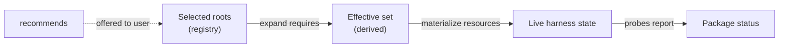
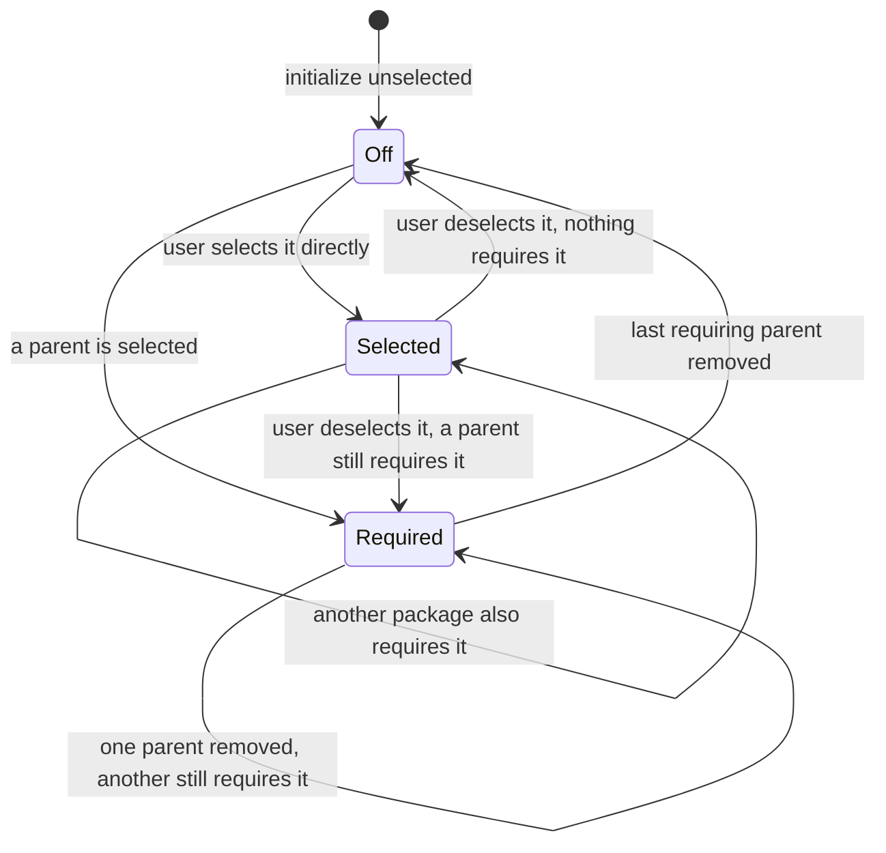

# Package Management: Part 02 - Track What You Turned On, What It Pulls In, and What Is Installed

## Summary

RoboRepo records which packages a user turned on in `~/.roborepo/enabled-packages.json`, but that
file mixes two things: packages the user chose, and packages switched on only because a chosen
package `requires` them. Once written, the two look the same, so a dependency stays on after the
package that needed it is turned off. Package enable also reports success without checking that
every resource actually landed. Install bundles have the same flaw in their own record: selecting
`telemetry` writes `hooks` as if the user had chosen it.

This plan gives package state one model with three layers, each with one owner:

| Layer | Answers | Owner |
| --- | --- | --- |
| Selected roots | What did the user (or a default) choose? | The registry file |
| Effective set | What must be active because of those choices? | Derived: roots plus their required-dependency closure |
| Live state | What is actually installed in each harness? | The existing resource probes |

On top of that model it adds `recommends` (offered, never automatic), non-selectable
dependency-only packages, a verified result from every enable and disable, required packages listed
in each package's source popup and a Recommended dependencies list on the Config page, and the same roots-plus-derived-dependencies rule for
install bundles.

This plan merges two earlier backlog plans: the derived-dependency plan this file grew from, and
`package-registry-live-state-reconciliation`, whose remaining work is folded in below.

## Context

### Current state

Verified on `main` at `69dea56`.

| Area | Today | Gap |
| --- | --- | --- |
| Registry ownership | `scripts/cli/rules-render.mjs` owns `readEnabledPackagesRegistry`, `setPackageEnabled`, `forgetPackageIds`, and `effectiveEnabledIds`, although the registry covers every package type. Importers: `packages.mjs`, `package-commands.mjs`, `package-projection-cleanup.mjs`, `package-probes.mjs`, `hook-readiness-status.mjs`, `config-bulk.mjs`, `browser/gate.mjs` (all under `scripts/cli/`), and `scripts/test/package-default-enabled-check.mjs` | Package state lives in the rules renderer |
| Registry shape | `{ packages: [...], disabled: [...], updatedAt }`, no version field; `effectiveEnabledIds` = `packages` minus `disabled`, plus `defaultEnabled` packages not in `disabled` | No record of why an id is in `packages` |
| Enable | `enablePackage` in `scripts/cli/packages.mjs` recursively enables each `requires` entry and writes it to `packages` | Dependencies become sticky roots |
| Disable | `disablePackage` refuses while enabled dependents exist; `--cascade` disables them first | Turning off the last parent leaves its dependency on |
| Mutation result | Enable applies each component and prints progress; nothing probes afterward. Errors leave through `process.exit` (14 call sites in `packages.mjs`), which is why `config-bulk.mjs` runs a preflight before calling it from the portal | A half-applied package reports as enabled, and a failure cannot be returned as a result |
| Portal mutation path | `mutatePackage` in `scripts/cli/config-mutate.mjs` wraps `enablePackage`/`disablePackage` and returns `{ ok, message, changedPackageIds }`; `config-bulk.mjs` applies a set (a `bulkToggle` section's Select All, or the Plans onboarding banner's `plan-suite` + `session-close`) | No per-package outcome |
| Live probes | `scripts/cli/package-probes.mjs` `buildPackageLiveState` reports `enabled`, `configured`, `partial`, `disabled`, or `external` per package and per component, including a `requires` component | Already shipped |
| Status API | `scripts/cli/package-status.mjs` and `/api/config` `componentStatus` expose probe results | Already shipped |
| Repair and adopt | `roborepo package reconcile` re-applies effective packages and drops ids missing from the catalog; `roborepo package adopt-live` marks external live packages as enabled | Already shipped |
| Portal badges | `portal/config/elements/config-item.js` styles `partial` as a warning and `external` as informational | Already shipped |
| Source popup | `openSource` in `portal/config/panels.js`, reached through `openSourceModal` in `portal/config/app.js` | Reused to list and open a package's required packages |
| Relationships | Catalog (`scripts/cli/package-catalog.mjs`) supports `requires` with cycle and missing-id checks. No built-in package uses it ([[o93hile]] removed the marker packages' dependency). `scripts/test/test-cli.sh` covers it with a workspace-only `test-composite` fixture that requires `jcodemunch` and `jdocmunch`, which now live in `globals/packages-archived/` but still load into the catalog | No `recommends`, selectability, or dependency visibility |
| Install bundles | `manifests/platform/presets.json` defines `base`, `rules`, `hooks`, `commands` (no rows), and `telemetry` (no rows). `scripts/cli/presets.mjs` keeps the selection in `~/.roborepo/presets/state.json` (`selected[]`). `withDependencies` hard-codes telemetry → hooks and the result is written back to `selected`. `bundle check` (run by `scripts/doctor.sh` and `scripts/verify-install.sh`) prints `<id> selected but not fully applied` without naming the missing rows | The same sticky-dependency flaw, a dependency rule hidden in code, and a failure that does not say what is missing |

A concrete case of the sticky dependency: enabling `test-composite` writes `test-composite`,
`jcodemunch`, and `jdocmunch` to `packages`. Disabling `test-composite` later leaves both
dependencies on, and nothing records that the user never chose them.

### Why now

[[ejsc769o]] adds a dependency-only `implementation-review` package (it does not exist yet) that
users cannot switch off on its own. Since [[bysyzl1e]] merged the plan skills into one `plan-suite`
package, its first edges are `plan-suite → implementation-review` and
`session-close → implementation-review`: one dependency shared by two selectable packages. That
needs selectability and derived activation. Every other package-state consumer (rules rendering,
command ownership, probes, the Config page) also reads the effective set, so the model has to
change in one place rather than per consumer.

## Goals

- Record only selected roots in the registry; derive dependencies on every read.
- Keep a shared dependency active until the last selected root that requires it is turned off.
- Add `recommends`: shown and offered, never enabled without a user choice, never a cause of
  `partial`.
- Add `selectable: false` so a dependency-only package cannot be toggled directly.
- Add `presentation.visibility` so dependency-only packages leave the normal rows but stay
  inspectable where they are referenced.
- Let each package's author choose its dependency form: selectable (its own row), dependency-only
  (listed only under Requires), or hidden (shown nowhere).
- Remove a package RoboRepo installed once it leaves the effective set, and never a package
  RoboRepo did not install.
- Make enable and disable return the probed outcome (`enabled`, `partial`, or `blocked`) instead of
  assuming success.
- Give package state its own module, so the rules renderer only renders.
- List each package's required packages in its source popup, and show a Recommended dependencies
  list on the Config page, through the shared behavior
  view.
- Store install bundle selections as roots too, declare the telemetry → hooks dependency in
  `presets.json`, and derive it through the same graph helper.

## Non-goals

- Turning install bundles into packages or showing them on the Config page. Bundles keep their own
  record and install-time apply; only their dependency rule and reporting change.
- `forget` and `remove` actions, and an expandable per-resource detail row in the portal. The
  shipped `reconcile`, `adopt-live`, and status badges cover current needs; add these when a
  concrete case needs them.
- Ownership markers inside harness config files.
- Plan-suite-specific behavior such as the `implementation-review` package and the actual
  `requires`/`recommends` edges on built-in packages; [[ejsc769o]] owns them.
- Showing or offering recommendations in terminal onboarding. [[ejsc769o]], which adds the first
  `recommends` edges, decides how the wizard presents them (user decision 2026-10-28).
- Turning conditional, task-dependent skill pairing into static package relationships.

## Proposed design

### 1. Three layers, computed in one direction



```text
selectedRoots = registry.packages + defaultEnabled packages, minus registry.disabled
effective     = selectedRoots + transitive requires of selectedRoots
```

Every consumer that today calls `effectiveEnabledIds` reads `effective` from the new module.
Nothing reads the raw registry except that module.

Beside the three layers, the same module keeps a machine-local applied record,
`~/.roborepo/applied-packages.json`: the packages RoboRepo installed on this machine. Applying a
package adds it; removing its components drops it. The record is not a selection and never feeds
the effective set. It exists so cleanup removes only packages RoboRepo installed, never one it did
not; removing a package still takes out every entry its manifest lists (§4).

### 2. Registry ownership and shape

Move registry read, write, `forgetPackageIds`, and the effective-set computation from
`scripts/cli/rules-render.mjs` to a new `scripts/cli/package-state.mjs`. Graph traversal (closure,
`requiredBy`, `recommendedBy`) goes in a separate pure module, `scripts/cli/package-graph.mjs`,
that takes plain `{ id, requires, recommends }` nodes, so it can be tested without a home directory
and reused for install bundles.

The file keeps its current path and `{ packages, disabled }` shape, with one change of meaning:
`packages` holds selected roots only. A `schemaVersion: 2` field marks files written under that
meaning.

A file without `schemaVersion` (version 1) is read by dropping every listed id that another listed,
non-disabled id requires, directly or transitively. Those ids stay effective through their parent,
so nothing turns off on upgrade; they turn off with their last parent. The next write stores
`schemaVersion: 2`. The cost: a dependency the user also chose on purpose before the upgrade is
read as derived. No built-in package declares `requires` today and `implementation-review` will
only ever be written under version 2, so in practice this affects workspace packages only.

### 3. Manifest fields

```json
{
  "requires": ["implementation-review"],
  "recommends": ["test-harness"],
  "selectable": false,
  "presentation": { "visibility": "dependency" }
}
```

| Field | Default | Meaning |
| --- | --- | --- |
| `requires` | `[]` | The package is invalid without these; they join the effective set automatically |
| `recommends` | `[]` | Useful companions; offered, never added automatically |
| `selectable` | `true` | `false` rejects direct `package enable`; disable can remove an existing selected root |
| `presentation.visibility` | `catalog` | `catalog`: normal row. `dependency`: no row; listed under Requires in the popup of each package that requires it. `hidden`: no UI row |

A required package takes one of three forms, chosen by its author per package (user decision
2026-10-30: some skills make sense on their own, others do not):

| Form | Manifest | Config page | Switching |
| --- | --- | --- | --- |
| Selectable (default) | `selectable` omitted or `true`; any visibility | `catalog`: own row and Requires reference; `dependency`: Requires reference only; `hidden`: shown nowhere | Enable alone, or on through a parent |
| Dependency-only | `selectable: false`, `presentation.visibility: "dependency"` | No row; listed only under Requires | On and off with its parents only |
| Hidden | `presentation.visibility: "hidden"` | Shown nowhere | As its `selectable` value allows |

`roborepo package validate` rejects unknown ids in either relationship, self-references, invalid
values, and cycles in `requires`. `recommends` does not take part in cycle detection. A
`selectable: false` package with `defaultEnabled: true` is rejected so dependency-only packages
are not selected by catalog defaults. A `selectable: false` package with `catalog` visibility is rejected too, since it would be
a page row with no switch: `<id>: a package with selectable: false must use presentation.visibility
"dependency" or "hidden"`.

### 4. Enable and disable

A user action changes roots only; reconciliation then compares the effective set before and after
and applies or removes resources for the difference.



- `enable` and `disable` on a `selectable: false` package fail without changing state, and name
  the packages that control it. The exception: `disable` removes such a package when it is a
  recorded root (an older registry, or a manifest that later set `selectable: false`), since no
  other action could remove that root.
- `disable` on a selectable package that is a selected root removes the root. If a selected parent
  still requires it, it stays effective and the result says which parents keep it on.
- `disable` on a selectable package that is effective only because a parent requires it has no
  root to remove: it is refused and names the parents. `--cascade` disables those parents first,
  so the dependency turns off with them.
- After applying, the mutation probes every package whose effective state changed and returns one
  outcome per package, with the per-component detail the probes already produce. The CLI prints it;
  `mutatePackage` and the bulk path return it to the portal.

  | Outcome | When |
  | --- | --- |
  | `enabled` | Every component probes as present |
  | `partial` | Some components probe as present and others as missing |
  | `blocked` | Applying stopped on an error, such as a collision with a user-owned file or a missing harness home |

  Returning `blocked` means the apply path throws a typed error that the CLI entry point turns into
  the exit code, instead of calling `process.exit` mid-apply.
- `package reconcile`, which `roborepo update` runs, removes the components of every package in
  the applied record that is no longer effective, dependencies after the packages that required
  them, then re-applies the effective set. A package leaves the effective set this way when a
  parent drops its `requires` edge, a `defaultEnabled` default flips to `false`, or the registry is
  edited by hand. Only applied ids are removed, so a package RoboRepo did not install is never
  touched. The guarantee is per package: removing one takes out every entry its manifest lists,
  as `package disable` does, because harness config carries no per-entry ownership markers
  (Non-goals). Installs from before the record have no entries, so their existing leftovers are
  left alone. Ids the catalog no longer has are dropped from the record with the registry's stale
  entries. Uninstall removes the record.

### 5. Recommendations

When a selectable package is enabled and some of its recommendations are off:

| Caller | Behavior |
| --- | --- |
| Portal enable | Lists the disabled recommendations; the user enables them or continues |
| Interactive CLI | Prompts to enable or skip |
| Non-interactive CLI and API | Never enables them; returns them in the result |

The package engine returns recommendation data; only the portal and the interactive CLI prompt.
Graph and reconciliation functions never prompt.

### 6. Config page dependencies

Dependency-only packages are references in their parents' source popups, while selectable
catalog-visible requirements keep their own rows. No separate Required dependencies section is
added. `buildBehaviorView` in `scripts/cli/config.mjs` gives each package row a `requires[]` list (its transitive required
packages, each with the inspect target and cost its own row would have), and the source popup
lists them under **Requires**. Each name opens that package's source, with **Back** to the package
that requires it. `roborepo config status` prints a `requires:` line under the row.

Recommended packages are offers the user acts on, so each section exposes
`recommendedDependencies[]`: switchable rows below the section's own rows, each naming the packages
that recommend it. A package the section already shows, or one a row requires, is left out.

Illustration, using the edges [[ejsc769o]] is expected to add:

```text
Development Workflows
  Development Planning Lifecycle     [toggle]
  Session Close                      [toggle]

  Recommended dependencies
    Test Harness                     recommended by Session Close           [toggle]

Session Close popup
  Requires: Implementation Review    (opens its source; Back returns)
```

Terminal onboarding and the portal read the same behavior view. Bulk enable (a `bulkToggle`
section's Select All and the Plans onboarding banner) acts on selectable roots only.

### 7. Install bundles

Bundles keep `~/.roborepo/presets/state.json` and their install-time apply, and adopt the same
rule:

- `presets.json` declares `"requires": ["hooks"]` on the `telemetry` bundle; `withDependencies` in
  `scripts/cli/presets.mjs` is replaced by the `package-graph.mjs` closure.
- `selected[]` stores roots only. Apply, check, and status act on the effective set. Every listed
  bundle is read as a root, whatever the file's `schemaVersion` (user decision 2026-10-28: no
  compatibility reading for older bundle records).
- `bundle remove hooks` while `telemetry` is selected removes the root but leaves hooks applied,
  and says telemetry still requires it.
- `bundle status` marks each effective bundle as selected or `required by <bundle>`.
- `bundle check` names the missing rows when a bundle is not fully applied, so a `roborepo doctor
  --installed` failure says what to repair.

## Implementation plan

### Phase 1: State module and graph helpers

- [x] Add `scripts/cli/package-graph.mjs` with pure functions over `{ id, requires, recommends }`
      nodes: selected roots, required closure, `requiredBy`, and `recommendedBy`.
- [x] Add `scripts/cli/package-state.mjs`; move `readEnabledPackagesRegistry`,
      `setPackageEnabled`, `forgetPackageIds`, and `effectiveEnabledIds` out of
      `scripts/cli/rules-render.mjs`, and update every importer listed under Current state.
- [x] Extend `scripts/cli/package-catalog.mjs` to normalize and validate `recommends`,
      `selectable`, and `presentation.visibility`, including the non-selectable default-enabled
      rejection.
- [x] Fixtures: shared, transitive, and directly selected dependencies; non-selectable packages;
      missing recommendation ids; a `requires` cycle.

### Phase 2: Derived activation and verified results

- [x] Remove the recursive `enablePackage` call for `requires`; enable and disable change roots,
      then reconcile the before/after effective difference.
- [x] Apply the disable rules in Proposed design §4 (root removal, derived-only refusal,
      `--cascade`).
- [x] Reject direct mutation of `selectable: false` packages.
- [x] Replace mid-apply `process.exit` calls in `packages.mjs` with typed errors the CLI entry
      point maps to exit codes.
- [x] Probe changed packages after each mutation and return `enabled`, `partial`, or `blocked`
      from `enablePackage`/`disablePackage`, `mutatePackage`, and the `config-bulk.mjs` batch.
- [x] Read version-1 registries with the drop-required rule, and write `schemaVersion: 2`.
- [x] Confirm rules rendering, command ownership, probes, `reconcile`, `adopt-live`, hook
      readiness, and the browser gate read the effective set from `package-state.mjs`, and that
      no other module reads `enabled-packages.json`.

### Phase 3: Recommendations

- [x] Return disabled recommendations from the enable result.
- [x] Add the portal prompt and the interactive CLI prompt; keep the non-interactive path silent.

### Phase 4: Config presentation

- [x] Add selectability, visibility, derived-vs-selected state, and inverse relationships to the
      package snapshot in `scripts/cli/config.mjs`.
- [x] Derive each row's required references and each section's recommended list in
      `buildBehaviorView`; omit `visibility: dependency` packages from normal rows.
- [x] List required packages under **Requires** in the source popup (`portal/config/panels.js`),
      each opening its source with Back, and render the Recommended dependencies list through
      `portal/config/elements/config-item.js` and its templates, following the portal's template
      and light-DOM conventions.
- [x] Make bulk enable skip non-selectable and derived-only rows.

### Phase 5: Install bundles

- [x] Add `requires` to the bundle schema in `manifests/platform/presets.json` and declare
      `telemetry → hooks`.
- [x] Replace `withDependencies` in `scripts/cli/presets.mjs` with the graph closure; store roots
      only and read every listed bundle as a root.
- [x] Show derived bundles in `bundle status` and name missing rows in `bundle check`.

### Phase 6: Catalog and docs

- [x] Update the docs listed under Documentation impact.

## Validation

| Behavior | Check |
| --- | --- |
| Graph helpers compute closure, `requiredBy`, and `recommendedBy`, and ignore `recommends` for cycles | New `scripts/test/package-graph-check.mjs` |
| Catalog accepts valid graphs and rejects bad ids, values, `requires` cycles, and non-selectable defaults | `scripts/test/package-catalog-check.mjs` |
| Enabling a package that requires another makes the dependency effective without recording it as a root (fixture package) | `scripts/test/package-lifecycle-check.mjs` |
| Two parents share a dependency; disabling one keeps it, disabling both removes it | `scripts/test/package-lifecycle-check.mjs` |
| A directly selected dependency survives its parents being disabled; deselecting it while a parent remains keeps it effective | `scripts/test/package-lifecycle-check.mjs` |
| Disabling a derived-only dependency is refused; `--cascade` turns it off with its parents | `scripts/test/package-lifecycle-check.mjs` and the existing `test-composite` assertions in `scripts/test/test-cli.sh` |
| Direct enable/disable of a non-selectable package fails and changes nothing, except that disable removes one recorded as a root | `scripts/test/package-lifecycle-check.mjs` |
| A forced component failure returns `partial`, and an apply error returns `blocked`, not `enabled` | `scripts/test/package-lifecycle-check.mjs` |
| Reading a version-1 registry leaves the effective set unchanged and drops required ids from roots | `scripts/test/package-lifecycle-check.mjs` |
| Defaults still apply and explicit disables still win | `scripts/test/package-default-enabled-check.mjs` |
| Bulk enable skips dependency rows and returns per-package outcomes | `scripts/test/config-bulk-toggle-check.mjs` |
| Visible requirements appear in the source popup and open their source; catalog-visible packages retain their rows, dependency-only packages have none, and recommended rows render with a toggle | `npm run test:portal-ui` |
| Catalog rejects `selectable: false` with `catalog` visibility; dependency-only and hidden forms load | `scripts/test/package-catalog-check.mjs` |
| Reconcile removes an applied package that left the effective set (last `requires` edge dropped, or its root edited out of the registry), keeps it while another parent requires it, never removes a package with no applied entry (never enabled, or installed before the record), and drops it from the applied record; a dry run changes nothing, a plain disable drops the entry, and a corrupt record removes nothing; `package status` reports a required-only dependency as enabled | `scripts/test/package-lifecycle-check.mjs` |
| Reconcile drops retired ids from the applied record; uninstall removes the record | `scripts/test/package-retired-ids-check.mjs`, `scripts/test/managed-uninstall-check.mjs`, `scripts/test/test-install-collisions.sh` |
| Row references are transitive; the recommended list skips shown and required packages; `config status` prints both | `scripts/test/config-dependency-sections-check.mjs` |
| Telemetry bundle derives hooks; removing telemetry drops hooks unless selected; `bundle check` names missing rows | Bundle assertions in `scripts/test/test-cli.sh` |
| Full gate, since package state reaches install, rules, and generated harness output | `npm run check` |

## Risks

| Risk | Treatment |
| --- | --- |
| A consumer keeps reading the raw registry and brings back sticky or missing dependencies | Only `package-state.mjs` reads the file; search for direct reads during Phase 2 |
| Prompts leak into graph code and break non-interactive callers | Prompts live only in the portal and the interactive CLI |
| A dependency row makes a category look partly selected | Bulk enable and category state count selectable roots only |
| Changing the meaning of `packages` turns off something a user relies on | The version-1 read rule keeps every currently effective package effective; a fixture asserts the effective set is unchanged across the upgrade |
| Replacing `process.exit` changes CLI exit codes | The CLI entry point maps each typed error to the code the old exit used; existing `test-cli.sh` exit-code assertions stay unchanged |
| Bundle state change breaks install or doctor | Every listed bundle is read as a choice. A telemetry-only record from `main` requires `hooks`; checks can fail until those rows are applied. `roborepo update` now applies the required hooks while preserving the selected roots; `bundle remove telemetry` remains the way to remove that selection (see Decision Log 2026-10-28 and correction 2026-10-31) |

## Documentation impact

| Doc | Update |
| --- | --- |
| `.claude/skills/roborepo-development/references/package-development.md` | `requires`, `recommends`, `selectable`, `presentation.visibility`; selected/effective/live model and the applied record; reconcile cleanup; the three dependency forms |
| `docs/user/reference/config-control-panel.md` | Requires line in the source popup; Recommended dependencies list; recommendation prompt; dependency-only and hidden forms |
| `docs/internal/config-panel-internals.md` | Dependency sections in `buildBehaviorView`; per-package mutation outcomes |
| `docs/user/reference/roborepo-cli.md` | `package enable`/`disable` outcomes, disable rules for dependencies, recommendation prompt; `package reconcile` removing installed packages that left the effective set |
| `docs/internal/cli-internals.md` | `package-state.mjs`/`package-graph.mjs` ownership, including the applied record; bundle roots and derived dependencies |

## Not tested

No entries. The portal recommendations dialog has a stubbed Playwright test for both buttons, and
both it and the interactive terminal prompt were also run for real against a workspace fixture;
see `## Review` → `### Verification`.

## Open Questions

None. The existing user decisions remain requirements:

- Every recorded bundle is a selected root. Update applies those roots and their requirements;
  the changed update path corrects the old warning, without changing the chosen selection rule.
- The package registry keeps its version-1 read rule, as explicitly retained on 2026-10-28.
  Its narrower relevance to old workspace packages does not change that decision.

The re-review entries below are resolved from those recorded decisions, without asking the user
to choose them again. Verification and approval of the changed implementation remain separate.

## Decision Log

- **2026-10-12: Merged `package-registry-live-state-reconciliation` into this plan.** Both plans
  redesigned the same registry in the same files. Most of that plan's work had shipped (probes,
  status API, `reconcile`, `adopt-live`, portal badges); its remaining items were a versioned
  registry and verified mutation results, which this plan now owns. Its `forget`/`remove` actions
  and per-resource detail rows are deferred (see Non-goals). The superseded plan is archived at
  `docs/plans/archived/package-registry-live-state-reconciliation.md`.
- **2026-10-26: Version-1 registries drop required ids.** Chosen by the user over keeping every
  listed id as a root. It fixes stickiness without changing what is active today; the lost
  "also chose it directly" signal only matters for workspace packages.
- **2026-10-26: Install bundles share the graph but keep their record.** Chosen by the user over
  turning bundles into packages (which would reach install, update, uninstall, and root-config
  collision handling) and over documenting the gap only.
- **2026-10-26: Disable rules for dependencies.** The earlier text both kept the "enabled packages
  depend on it" refusal and let a user deselect a still-required root. Resolved: deselecting a root
  always succeeds and the package stays effective if required; refusal and `--cascade` apply only to
  a package that is effective solely through a parent.

- **2026-10-26: Disable reports its own outcomes.** The plan's outcome table names `enabled`,
  `partial`, and `blocked` for enables. Disable needed a success state too, so each removed package
  probes as `disabled` (nothing it owns is present), `partial` (something it owns is still there,
  named), or `blocked`. Alternatives: reuse `enabled` for "change applied" (misleading), or return
  no outcomes from disable (the plan asks for one per changed package).
- **2026-10-26: `partial` exits 0, `blocked` exits 1.** A partial apply already happened before
  this change (with exit 0) and is common in fake homes (an MCP preset skipped with `SKIP_MCP`); a
  non-zero exit would break every scripted enable while adding nothing the printed warning does
  not. `blocked` replaces the uncaught error that already exited 1. Refusals keep exit 2.
- **2026-10-26: Enable re-applies the whole required closure.** Enable applies every package in
  the selected root's closure, not only the newly effective ones, matching the old recursive
  enable that re-applied each dependency. Re-applying is idempotent and repairs a dependency with
  a missing resource; applying only the difference would leave such a dependency broken.
- **2026-10-26: `--cascade` on a selected root also deselects the parents that require it.** The
  design text covers `--cascade` for a derived-only package. For a root a parent also requires,
  `--cascade` deselects those parents too, so the package actually turns off — the same meaning
  `--cascade` has always had ("disable dependents first"). Without it, the root is deselected and
  stays on, as §4 specifies.
- **2026-10-26: Reconcile applies effective packages directly.** `reconcile` used to call
  `enablePackage --reconcile`, an internal flag. It now applies each effective package's components
  in dependency order through the same component-apply function enable uses, and the internal flag
  is gone.
- **2026-10-26: The non-interactive enable lists recommendations in one line.** "Silent" in Phase 3
  is read as "never prompts and never enables": scripts get one `recommended (not enabled): ...`
  line, and API callers get `recommendations[]` in the result. Alternative: print nothing, which
  hides the offer from scripted users entirely.
- **2026-10-26 (user decision): Required packages live in the source popup, not on the page.**
  The first build gave each section a Required dependencies list of rows. The user judged that a
  required package that cannot be switched is a reference by another name, not a package option,
  and asked for it to be called out in the package popup instead. Each row now carries its
  transitive required packages; the popup lists them under **Requires**, each opening its source
  with Back. The Recommended dependencies list stays on the page, since those rows have a switch.
- **2026-10-26: Requires lists the transitive closure; Recommended skips what a row requires.** A
  two-level requirement is still visible from the package that pulls it in. A package both required
  and recommended is left out of the recommended list, since it turns on anyway.
- **2026-10-26: Reconcile does not re-run the command-ownership check.** The old reconcile went
  through `enablePackage --reconcile`, which ran `validatePackageCommandOwnership` per package.
  That check compares `command` components, which come only from `cli-command` resources, and
  `validatePackageCatalog` rejects any second package claiming one on every `loadPackageCatalog`
  call. So two effective packages can never conflict by the time reconcile runs, and the check was
  unreachable there before this change too. Alternatives: restore it as a typed error (dead code), or
  skip-and-warn (same). Validation pass 3 raised this as an escalation; the evidence settles it.
- **2026-10-26: Bulk disable skips derived-only members.** A bulk Deselect All member that is on
  only because another selection requires it is reported `skipped` instead of being refused, so a
  batch never fails on a package it cannot switch directly. Selection is re-read before each member.
- **2026-10-26: Turning telemetry off leaves the hooks bundle's files in place.** Turning telemetry
  off (`deselectTelemetryBundle`) only drops a recorded `telemetry` root; it never applies or
  removes bundle rows. `bundle remove telemetry` is the path that removes the hooks it required.
  Removing core hooks as a side effect of a telemetry toggle would be a wider behavior change than
  this plan asks for.
- **2026-10-26: Bundle selection lives in its own small module.** `bundle-selection.mjs` holds bundle
  roots and the effective set so hook readiness (`core-hook-bundle.mjs`), the Config snapshot, and
  `presets.mjs` share one rule without hook readiness importing the bundle-apply module.
- **2026-10-26: Updated one fixture for the planned bundle behavior.** `shared-target-rows-check`
  enables the telemetry package and then runs `bundle remove hooks`. After the 2026-10-27 telemetry
  decision the package records no bundle, so the fixture asserts the removal is not kept, as on the
  base branch.
- **2026-10-27 (user decision): Package-side telemetry records no bundle.** Chosen over installing
  the hooks bundle from `telemetry install` and over dropping the telemetry → hooks edge.
  `telemetry install` and the Settings toggle no longer write a `telemetry` bundle root, so a
  telemetry-only setup leaves `hooks` off and `bundle check` and hook readiness expect no core
  hooks. Turning telemetry off still drops a root that `bundle apply telemetry` recorded.
- **2026-10-28 (user decision): Older bundle records are read as written.** Validation pass 4
  found that the drop-required rule turned a user's own `hooks` choice into a dependency of a
  `telemetry` root recorded by `main`'s package path, so turning telemetry off left `hooks`
  unselected. Offered: drop a legacy `telemetry` root, keep every listed bundle as a root, or accept
  the cost. The user, not needing backwards compatibility, chose to remove compatibility reading for
  bundles: every listed bundle is a root and `schemaVersion` is written but not branched on. This
  replaces the 2026-10-27 rule that dropped a legacy root listed without its requirements. Accepted
  cost: a telemetry-only record written by `main` (`["base","telemetry"]`) makes `hooks` required,
  so `bundle check`, `doctor --installed`, and `verify-install` fail until the required hooks are
  applied or that telemetry selection is removed. Correction on 2026-10-31: main 7c65c2e7 made
  `roborepo update` run `bundle apply --selected`, so update now applies those hooks while keeping
  the selected roots. The earlier warning that update was not a remedy is obsolete. The user's
  bundle-selection decision stands. The package registry keeps its version-1 rule.
- **2026-10-27 (user decision): The Claude MCP adapter returns `ok: false`.** Chosen over a typed
  error and over deferring to a harness-adapter plan. `runClaudeMcpAdd` returns its status, the
  adapter's `addServer` returns `ok: false` with the message in `warnings` and the CLI status in
  `exitStatus`, package enable reports the package `blocked` with that message, and `roborepo mcp
  add` / `mcp apply` exit with the Claude CLI's status as before.
- **2026-10-28 (user decision, human review): Onboarding recommendations wait for [[ejsc769o]].**
  The review found the terminal setup wizard neither shows nor offers recommendations. No built-in
  package declares `recommends`, so nothing is affected yet. Offered: defer to the plan that adds
  the first edges, prompt after the wizard applies, or print one line after it applies. The user
  chose to defer ("Leave for later plan").
- **2026-10-30 (user decision, human review): Reconcile garbage-collects packages that left the
  effective set.** After walking through the user experience, the user chose to keep a
  machine-local applied-packages record (`~/.roborepo/applied-packages.json`, owned by
  `package-state.mjs`) so `package reconcile` and `roborepo update` remove a package RoboRepo
  installed once it is no longer effective (a dropped `requires` edge, a `defaultEnabled` flip to
  `false`, a hand-edited registry): a package that exists only behind the scenes should not
  linger. Cleanup never touches configuration RoboRepo did not apply. Installs from before this
  record have no entries, so their existing leftovers are left alone. The user then asked for it
  as a stated requirement (Goals, §1, §4, Validation): "if a skill exists only behind the scenes
  then we should do garbage collection and make sure that the skill no longer exists."
  Correction (review Validator pass 1): "never touching configuration RoboRepo did not apply"
  holds per package, not per entry. Removing a package takes out every entry its manifest lists,
  as `package disable` does, so §1 and §4 state it per package.
- **2026-10-30 (user decision, human review): Package authors choose a dependency form.** A
  required package is selectable (the default: own row, also under Requires), dependency-only
  (`selectable: false` with `dependency` visibility: no row, only under Requires, on and off with
  its parents), or hidden (`hidden` visibility: nowhere). The user: "sometimes it doesn't make
  sense to have a skill exist by itself, other times it may." The catalog now rejects
  `selectable: false` with `catalog` visibility, the one combination that would give a row with no
  switch (§3).
- **2026-10-31 (user decision, human review): The re-review escalations stay closed.** A parallel
  review session closed both in 6c2ffb3b from earlier decisions: the 2026-10-28 telemetry-only
  bundle cost is corrected, since `roborepo update` now applies the required hooks, and the
  version-1 registry read rule is retained. Asked whether to accept those closures or drop the
  version-1 rule, the user chose "Accept both".

## Review

### Findings

- [x] Re-review at the synced tip (2026-10-31): a package with no source of its own got a
      contents target whenever it listed `requires`, so one whose requirements are all hidden
      opened an empty popup — keyed on visible requirements, with a hidden-only fixture that fails
      without the fix (aff4c7b0)
- [x] Re-review at the synced tip: `package-development.md` and `config-control-panel.md` still
      limited the contents view to packages with two or more skills — documented the source-less
      case (c22ca182)
- [x] Re-review at the synced tip: Verification and Result did not record the merge of main
      9849eba1 (e3e2bb69) — recorded below
- [x] Review Validator pass 10: the required-reference comments still equate inspect targets
      with source files — described contents targets and plain-text references accurately,
      without changing executable lines or markup (744d480a)
- [x] Review Validator pass 9: packages with only requirements receive no inspect target, so their
      dependency-only children cannot be reached — exposed their requirements through the existing
      contents popup, with API and browser regressions (f111d1fe)
- [x] Review Validator pass 9: enabling several recommendations replaces unanswered nested
      recommendation dialogs — awaited each flow before enabling the next choice, with a browser
      regression (e07d0083)
- [x] Review Validator pass 9: the catalog's non-selectable-default comment wrongly says no
      disable can turn it off — corrected the dependency-only selection rationale (c49ba1fc)
- [x] Review Validator pass 8: a service removal returning `ok: false` is treated as successful
      and its applied id is forgotten — propagated the failure and added a failed-write/successful
      retry regression (677673a1)
- [x] Review Validator pass 8: the Requires HTML comment says every required package is never
      switched directly — qualified it as dependency-only behavior (802d4533)
- [x] Review Validator pass 7: adoption comments in `packages.mjs` and the lifecycle test wrongly
      claim a recorded dependency-only root cannot be disabled — corrected the selection rationale
      without changing executable lines (dc83dea2)
- [x] Review Validator pass 7: the Config panel docs and dependency-reference comments wrongly
      hide every required package — distinguished selectable catalog rows from dependency-only
      rows, without changing executable lines (2aa59381)
- [x] Review Validator pass 5: a required multi-skill package loses the Back callback in
      `portal/config/app.js` and `panels.js` — preserved through contents and nested source views,
      with a browser regression (85a51bd5)
- [x] Review Validator pass 5: `disabledRecommendations` includes hidden packages — filtered from
      the shared enable result, with a terminal recommendation regression (f748fe76)
- [x] `## Not tested` pointed to verification evidence the plan did not hold; the Enable selected
      path had no assertion — recorded below and added a portal test for **Enable selected** (bb2a435e)
- [x] `adopt-live` could record a dependency-only package as a root that no disable can remove —
      skips non-selectable packages, with a lifecycle assertion (fails without the fix) (bb2a435e)
- [x] A bulk group switch counted rows on only through another selection, so an all-derived
      section was stuck on Deselect All — counts only switchable rows and hides when none remain,
      with a portal test (bb2a435e)
- [x] `bundle check` said "selected" for a bundle that is only required — names `required by
      <bundle>`; test-cli assertion updated (bb2a435e)
- [x] `recommendationOption` split the packages-intro comment from its function — moved below (bb2a435e)
- [x] The terminal dependency lists and the view's closure, no-repeat, and required-over-recommended
      rules had no direct test — added `scripts/test/config-dependency-sections-check.mjs` (bb2a435e)
- [x] A failing `claude mcp add` still exits mid-enable — user chose `ok: false` from the adapter;
      covered by `mcp-claude-add-failure-check.mjs` (adapter result, `mcp add` exit status, package
      enable `blocked`)
- [x] Comments in `config.mjs` and `package-catalog.mjs` still described per-section dependency
      lists that the user decision removed — reworded to the popup's Requires line
- [x] A required package with no inspectable source rendered as a button that did nothing —
      listed as plain text instead, with a portal assertion
- [x] A telemetry-only selection now requires the hooks bundle it never applies — user chose to
      stop recording the bundle; test-cli asserts `telemetry enable` records none
- [x] Reconcile no longer ran the command-ownership check that `enablePackage --reconcile` ran —
      no change needed: the check could never fire (see Decision Log)
- [x] `coreHookBundle` reporting a required-only bundle as selected has no test — test-cli asserts
      `selected: true` for a `telemetry` root
- [x] The config panel doc tied "no row" to `selectable: false` instead of
      `presentation.visibility` — reworded
- [x] The `PackageMutationError` comment left out the dependency-only refusal — added
- [x] The `AdapterActionResult` typedef did not document the new `exitStatus` field — added
- [x] The 2026-10-28 accepted cost named `roborepo update` as a remedy it is not — corrected in
      the Decision Log and Risks; the cost is within the user's no-compatibility choice
- [x] `## Risks` and `### Verification` still described the removed bundle rule and an undated gate
      run — reworded
- [x] `package-graph.mjs` header named `presets.mjs` as the bundle user — now `bundle-selection.mjs`
- [x] `next_action`, a pass-5 cross-reference, and the latest gate run were stale or missing in the
      plan — updated
- [x] An older bundle record with telemetry on loses the user's own hooks selection — user chose
      to read bundle records as written; test-cli asserts `hooks` stays selected and applied after
      `bundle remove telemetry` on such a record
- [x] Human review: the terminal asks about recommendations after a `blocked` enable —
      `offerRecommendations` in `scripts/cli/packages.mjs` runs whatever `result.ok` is — fixed in
      review (ab513c7a)
- [x] Human review: bulk Deselect All reporting a selectable required-only member `skipped`
      (`scripts/cli/config-bulk.mjs`) has no test — only the non-selectable case is covered — fixed
      in review (ab513c7a)
- [x] Human review: terminal onboarding (`buildOnboardSteps`/`applyWizardChanges` in
      `scripts/cli/presets.mjs`) neither shows nor offers recommendations, though §5–§6 say the
      interactive CLI prompts and onboarding reads the same view — escalated; the user deferred it
      to [[ejsc769o]] (see Decision Log and Non-goals)
- [x] Re-review after main 88d00172 (2e3492ce): "ownership conflict"/"ownership checks" wording
      survives in `packages.mjs:509`, `package-state.mjs:59`, `config-panel-internals.md:56`, though
      main removed the command-ownership check — fixed in review (73dcf8c6)
- [x] Re-review: `bundle apply --selected` (`presets.mjs:564`, from main) reads
      `readPresetState().selected` instead of `selectedBundleRoots` — fixed in review (73dcf8c6)
- [x] Re-review: the `dep-partial` fixture in `package-lifecycle-check.mjs:243,323` names the
      `jcodemunch` MCP preset main deleted; passes only because `SKIP_MCP` returns first — fixed in
      review (73dcf8c6)
- [x] Re-review: main 7c65c2e7 made update apply selected bundles and their required hooks —
      corrected the obsolete warning; retained the 2026-10-28 bundle-selection decision
- [x] Re-review: the version-1 package-registry rule now reaches only old workspace packages —
      retained the explicit 2026-10-26/28 decision; removal elsewhere does not reopen that choice
- [x] Re-review: a dependency that leaves the effective set (dropped `requires` edge, default
      flipped off) kept its installed components, and `package status` did not probe transitive
      requirements — user chose to garbage-collect through an applied record (see Decision Log
      2026-10-30) (82d2ae70)
- [x] Validator over 82d2ae70: uninstall left `applied-packages.json` behind and `--check-clean`
      did not list it — fixed in review (152e685e)
- [x] Validator over 82d2ae70: reconcile never pruned retired ids from the applied record — fixed
      in review (e5ba52f2)
- [x] Validator over 82d2ae70: `package status <dep>` read a required-only dependency as
      `enabled: false` because it probes a subset that cannot see the parent root — fixed in review
      (2f219bc7)
- [x] Validator over 82d2ae70: the reconcile log said "no longer required" for any removed
      package, and the package-state header, `cli-internals.md`, the package-development layers
      table, and the CLI reference did not describe the applied record — fixed in review (e60a3336)
- [x] Validator over 82d2ae70: probe-status and reconcile-cleanup assertions sat in the Config
      dependency-sections check, outside its header's scope — moved to
      `package-lifecycle-check.mjs` (2ca33cf7)
- [x] Human review (2026-10-30): the catalog accepted `selectable: false` with `catalog`
      visibility, a row with no switch — user asked to reject it (see Decision Log) (4c31f6e9)
- [x] Review Validator pass 1 (2026-10-30): reconcile cleanup had no test for a dry run, a plain
      disable dropping the applied entry, a package installed before the record, or a corrupt
      record — added to `package-lifecycle-check.mjs` with a hand-edited-registry case (a33caf3c)
- [x] Review Validator pass 1: "cleanup never touches configuration RoboRepo did not apply"
      overstated the guarantee; removal takes out every entry the manifest lists — reworded per
      package in docs, comments, and §4 (1ad59fd1)
- [x] Review Validator pass 1: `## Validation` and `## Documentation impact` had no rows for the
      applied record — Validation rows added (bd18059e), Documentation impact updated
- [x] Review Validator pass 2: the reconcile Validation row and §1 still used the per-entry
      wording and the row omitted the newly tested edges — reworded, with a correction note on the
      2026-10-30 Decision Log entry
- [x] Review Validator pass 3: the package-development CLI table's reconcile row omitted cleanup —
      fixed in review (aa976114)
- [x] Review Validator pass 4: §4, the Validation row, `roborepo-cli.md`, and the
      package-development manifest table said disable always refuses a non-selectable package,
      though `packages.mjs` removes one recorded as a root (asserted in the lifecycle check) —
      docs fixed in review (43a0d6a1), plan prose reworded

### Verification

- Validation pass 1 (fresh-context subagent): 6 fix, 1 escalate, 1 base.
- Validation pass 2 (fresh-context subagent): 3 fix, 1 escalate, 1 base (the same docs link).
- Validation pass 3 (fresh-context subagent): 3 fix, 1 escalate (resolved from evidence, see
  Decision Log), 1 base (the same docs link).
- After the 2026-10-27 decisions: `test-cli.sh` 476 passed, 0 failed.
- Merged `main` at 8cb1cf20, resolving this plan's file (`main`'s copy matched the start
  transition, so the worktree copy was kept) and the Codex sandbox plan's ready/review rename (kept
  `main`'s `review/` file). `test-cli.sh` 476 passed on the merged tree. `npm run check` 61/62 on
  the merged tree; the failure is `docs-reference-check` on `backlog-review.md:86`, which now names
  the Codex sandbox plan's old `ready/` path. It fails the same way at the merge base, so it is a
  base failure.
- Validation pass 4 (fresh-context subagent): 1 fix, 1 escalate, 1 base (that docs link).
- After the 2026-10-28 bundle-record decision: `test-cli.sh` 474 passed, 0 failed (two older-record
  assertions removed, one replaced by the hooks-survives-telemetry assertion).
- Full gate on 2026-10-26, after the Requires-popup user decision: `npm run check` 61/62 suites; the
  failure was `docs-reference-check.mjs` on `docs/internal/backlog-review.md:86` (then a `backlog/`
  path), which also failed at the base commit `b0b5288b`.
- Validation pass 5 (fresh-context subagent): 2 fix (plan text), 1 escalate (the accepted cost was
  misstated; corrected above, in the Decision Log), 1 base (the same docs link, `ready/` path at merge base `c1d92150`,
  fixed on `main`).
- Full gate at `e1a78593`: `npm run check` 61/62 suites; the failure is the same base docs link.
  Later commits change only the plan document and one comment.
- Validation pass 6 (fresh-context subagent): 3 fix (a stale `package-graph.mjs` header and plan
  text), 1 base (the same docs link). This pass is past the loop's five-pass cap, so the plan was
  not submitted.
- Validation: clean on pass 7 at `e46240f9` (fresh-context subagent, run past the cap at the user's
  request): no fix or escalate findings; 1 base (the same docs link, fixed on `main`).
- Human review (2026-10-28): merged `main` at 3ef32327 into the branch (218aaf3c, no conflicts).
  `npm run check` passed at 218aaf3c (all suites, portal UI 154 passed); the earlier
  `docs-reference-check` base failure no longer occurs. Review Validator pass (fresh-context
  subagent): 2 fix, 1 escalate, 0 base.
- Manual, portal (2026-10-26): a hermetic portal on a workspace fixture (Demo Planner and Demo
  Closer require a dependency-only Demo Review; Demo Closer recommends Demo Tester). The Integrations
  section showed Demo Review only under a Required dependencies list (since replaced by the popup's
  Requires line, re-verified below), with no switch. Turning on Demo Closer opened the recommendations dialog listing Demo
  Tester; **Enable selected** left Demo Tester `selected` and Demo Review `required` in
  `/api/config`.
- Manual, portal after the user decision (2026-10-26): the Integrations section had no Required
  list; Demo Planner's popup showed `Requires: Demo Review (dependency-only)`, the name opened Demo
  Review with Back shown and no Requires line, and Back returned to Demo Planner. (The popup body
  reads "path escapes repo" for workspace packages outside the app folder; `readSourceFile` is
  unchanged by this branch, so that limit predates it.)
- Manual, terminal (2026-10-26): `package enable demo-closer` under a pseudo-terminal asked
  `Also enable recommended package Demo Tester (demo-tester)? [y/N]`; answering `y` enabled it and
  the registry read `["demo-planner", "demo-closer", "demo-tester"]`.
- Human review (2026-10-28), after the review fixes: `npm run check` passed at a5a5d032 (all
  suites, portal UI 154 passed). Second review Validator pass (fresh-context subagent) over
  ab513c7a: clean.
- Earlier result and approval (history): review complete at 28822b47 on base 3ef32327; the user
  approved 28822b47 in the /plan-review chat (2026-10-29). Merges of `main` afterward (24a80344,
  e7d64f25 by the user; 0fd97311 by review, plan-only) made it stale.
- Re-review after those merges (2026-10-29): no conflict hunks. Five files changed on both sides
  (`cli-internals.md`, `roborepo-cli.md`, `telemetry.mjs`, `check-groups.json`,
  `portal-ui.spec.mjs`), and main's side of each is additive. Validator pass (fresh-context
  subagent): clean; every line the branch added is still present, and nothing incoming reads
  package or bundle state. The first `npm run check` at 0fd97311 failed one test-cli assertion
  ("roborepo update preserves local hooks, trust, and enabled skills") while other package checks
  ran at the same time; `test-cli.sh` alone then passed 474/0, and a rerun of `npm run check` at
  0fd97311 passed (all suites, portal UI 154 passed).
- Re-review after main merges 4974e7dd (clean) and 2e3492ce (2026-10-30): `plans sync-base`
  up-to-date at 2e3492ce on base 88d00172. 2e3492ce resolved conflicts in seven files and a
  modify/delete of `package-commands.mjs` (deleted on main; the branch's edits there only fed the
  ownership check main removed). Validator pass (fresh-context subagent): 3 fix, 2 escalate, 2 base
  (dead `case "command"` branches in `packages.mjs`; "back-compat scripts" in
  `cli-internals.md:81`, both also on main). It ran the package checks (all pass), `test-cli.sh`
  419 passed, 0 failed (main #50 removed tests), every branch-added `test-cli.sh` assertion still
  present, and the portal dependency specs 5/5.
- `npm run check` passed at 2e3492ce (66/66 suites, local).
- PR 46 CI at 2e3492ce: `check (macos-latest)` failed `browser-lifecycle-check.mjs`; a base failure
  (macOS returns `EPERM` for a process group holding only zombies, and `signalGroup` in
  `scripts/cli/browser/local-service.mjs`, unchanged from main, rethrew it). Fixed at the user's
  request (2571d380).
- Human review (2026-10-30): `plans sync-base` merged local `main` at 8adee1aa (af4f3423, no
  conflicts; main brought plan-write skill prose and other plans only). Base failure:
  `docs-reference-check.mjs` reports `docs/internal/backlog-review.md:139` linking to
  `plans/backlog/test-validation-tiers-and-diff-scoping.md`, which main's 8adee1aa archived; the
  branch does not touch that file.
- Review Validator pass 1 (fresh-context subagent, over `2e3492ce..af4f3423`): 3 fix, 0 escalate,
  0 base; ran the package lifecycle, retired-ids, managed-uninstall, bulk-toggle, and
  dependency-sections checks (all pass).
- Review Validator pass 2 (fresh-context subagent, over `2e3492ce..266d7ff3`): 2 fix (plan prose),
  0 escalate, 1 base (the same docs link). Confirmed the catalog rule's exact message on every load
  path (`package validate`, `list`, `enable`), no built-in package or fixture violating it, and ran
  the catalog, lifecycle, dependency-sections, and bulk-toggle checks (all pass).
- Review Validator pass 3 (fresh-context subagent, at e5811714): 1 fix (docs), 0 escalate, 1 base
  (the same docs link).
- `npm run check` at 266d7ff3 was cut short: `test-install-collisions.sh` fresh installs were
  killed with SIGTERM while Validator subagents ran uninstall checks from this checkout at the
  same time. Uninstall's `cli_process_pids` (`scripts/install/uninstall-lib.sh:489`, unchanged by
  this branch) stops every `<repo>/scripts/install/main.sh` process on the machine, so concurrent
  install and uninstall tests from one checkout interfere. A fresh install alone exited 0.
- `npm run check` at aa976114, nothing else running from this checkout: 66/67 suites; the one
  failure is the base `docs-reference-check.mjs` link above. This is historical evidence; it does
  not cover the later fifth-pass source and test fixes.
- Review Validator pass 4 (fresh-context subagent, read-only, no install/uninstall tests, at
  aa976114): 1 fix (docs), 0 escalate, 1 base (the same docs link); ran the lifecycle, catalog,
  retired-ids, and dependency-sections checks (all pass).
- Review resumption (2026-10-31): carried forward the recorded package-registry and bundle
  decisions, corrected the stale update warning, and closed the two reopened escalations without
  changing behavior. A direct version-1 registry assertion preserved the effective package set;
  an isolated `bundle apply --selected` followed by `bundle check` applied telemetry's required
  hooks while leaving selected roots `["base", "telemetry"]` unchanged. Both checks passed.
- Fixed the inherited archived-plan link in 90f2f326. `node scripts/test/docs-reference-check.mjs`
  and `git diff --check` passed after the fix.
- Review Validator pass 5 (fresh-context, read-only, at 90f2f326 plus the pending record): 2 fix,
  0 escalate, 0 newly identified base defects. Both reproduced against the then-current code and
  were fixed in 85a51bd5 and f748fe76. This reaches the five-pass limit; a clean post-fix Validator
  result has not been established.
- Back-navigation source-controller and panel assertions failed before 85a51bd5 and passed after
  it, covering entry source → contents → parent and required source → contents → parent. These
  are source-wiring assertions, not a browser-suite pass. The permanent browser regression is
  in `portal-ui.spec.mjs`.
- The hidden-recommendation regression in `config-dependency-sections-check.mjs` failed before
  f748fe76 and reached all assertions afterward. Final fixture cleanup still raised `EPERM`;
  diagnostic execution retained nonzero exit 2, so the suite is not recorded as passed.
- Standalone isolated CLI assertions at f748fe76 passed: enable offered a visible recommendation
  and omitted its hidden sibling; inspection fields, unavailable-requirement warnings, and
  non-selectable-root disable behavior also passed. These checks left their disposable fixtures
  in place and do not establish suite cleanup or browser coverage.
- `npm run check` attempted with the fifth-pass fixes: health passed (96 checks); `test-cli.sh`
  then reported three add-skill rollback assertions and an `EPERM` cleanup error. It exited 1
  before the later aggregate stages. The captured output does not establish the cause of those
  three assertion failures; no current full-gate pass is claimed.
- Elevated standalone lifecycle and bulk-toggle attempts also remained blocked: lifecycle at
  fixture-directory removal, bulk toggle at `listen EPERM` on `127.0.0.1`. A headless Chromium
  probe using a disposable profile failed macOS Mach-port registration, including an elevated
  retry. `docker info` with elevation could not connect to the Docker socket. Connected PR
  diagnostics were unavailable. Credential-read restrictions were not changed.
- Base freshness: the last integrated main commit remains 8adee1aa. Local main advanced to
  5c76d9f9 with a plan-review skill clarification and another plan's start record; no package
  runtime changes are incoming. No merge or checkout change was performed. A concurrent
  lifecycle-test edit was preserved and is outside the historical gate evidence.
- A second review session worked in parallel and numbered its passes separately. Its last pass,
  also called pass 5 (fresh-context subagent, read-only, at 90f2f326), found 1 fix (test): the
  corrupt-record case had no package both applied and out of the effective set, so its assertion
  could not fail. Fixed in 714d4402, which now corrupts the record after an applied root is
  dropped; a mutant with a readable record fails it. Neither session has a clean Validator pass
  after its fifth-pass fixes.
- `npm run check` passed at 714d4402 (all suites, portal UI 154 passed), run with nothing else
  from this checkout. It includes 85a51bd5 and f748fe76, so it supersedes the blocked attempt
  above.
- `plans sync-base` merged local `main` at 5c76d9f9 (ce08b99a, no conflicts; main brought
  `plan-review` skill prose and another plan's move). Skill structure, trigger, slash-command, and
  docs-reference checks and `doctor.sh` (97 checks) passed at ce08b99a.
- Review Validator pass 6 (fresh-context subagent, read-only, at 59130e64, past the cap at the
  user's request): no fix or escalate findings on the implementation; 1 plan-text fix (a stale
  Result status), resolved by this Result. It confirmed 85a51bd5, f748fe76, and 714d4402 and the
  earlier wording fixes, and ran the lifecycle, catalog, retired-ids, dependency-sections,
  bulk-toggle, and docs-reference checks (all pass). Implementation is unchanged from ce08b99a.
- Extended review (2026-10-31): the user explicitly requested "keep running plan-review" and
  "use as many passes as possible", overriding the default five-pass limit. The prior decisions
  and the requirement for explicit approval are unchanged.
- Review Validator pass 7 (fresh-context subagent, read-only, at 1a18e67e): 2 wording fixes,
  0 escalations, 0 newly identified base defects. Corrected adoption's rationale in dc83dea2 and
  required-row visibility wording in 2aa59381. A direct comparison confirmed all four affected
  JavaScript files changed only comment lines. Syntax, docs references, and whitespace checks
  passed. Those prose commits did not change runtime/test execution, so the gate at 714d4402 and
  the post-sync checks at ce08b99a covered that result; no fresh full-gate pass is claimed for the
  prose edits.
- The plan's manifest tables, Config presentation description, and validation row were also
  aligned with the existing selectable-root disable exception and visibility-based normal rows;
  these clarify the recorded requirements without changing behavior.
- Review Validator pass 8 (fresh-context subagent, read-only, at 2aa59381 plus the pending record):
  2 fixes, 0 escalations, 0 newly identified base defects. Service cleanup could lose its retry
  record after a handler returned `ok: false`; fixed in 677673a1. The HTML Requires comment's
  switching claim was corrected in 802d4533.
- The new cleanup-retry regression failed before 677673a1 because reconciliation exited 0 after
  the injected service write failure. After the fix, every assertion in the current lifecycle
  cleanup/status block completed, including retained ownership on failure and successful retry;
  final fixture cleanup remained blocked, and the diagnostic retained exit 2. This is not a
  completed lifecycle-suite pass. Syntax, docs-reference, and whitespace checks passed. The
  earlier passing full gate predates this runtime change and is not current verification for it.
- Standalone assertions using the real package APIs passed after 677673a1: a failed service enable
  returned a blocked outcome, a subsequent enable succeeded, a failed removal retained its applied
  entry and enabled service state, and the next reconciliation disabled it and removed the entry.
  Disposable fixtures were retained; this does not establish full-suite cleanup coverage.
- `npm run check` with the eighth-pass fixes passed health (97 checks), then stopped at the same
  three add-skill rollback assertions and an `EPERM` fixture-cleanup error. Later stages did not
  run; the three assertion failures' cause is not established by that output. A current full-gate
  pass is still missing.
- Review Validator pass 9 (fresh-context subagent, read-only, at 802d4533 plus the pending record):
  3 fixes, 0 escalations, 0 newly identified base defects. Pure composites had no inspectable
  popup (f111d1fe); nested recommendation questions could replace each other before an answer
  (e07d0083); a catalog comment gave an obsolete default-selection rationale (c49ba1fc).
- The pure-composite regression failed before f111d1fe and reached all assertions afterward,
  including transitive references and an empty contents entry list. Final fixture cleanup remained
  blocked, retaining diagnostic exit 2. Real controller/dialog assertions failed before e07d0083
  because the second nested offer replaced the first, and passed afterward: each question remained
  until answered and only the chosen packages were enabled. These used a DOM stub, not a browser.
  Both cases have permanent browser regressions; no UX or architectural choice was changed.
- Review Validator pass 10 (fresh-context subagent, read-only, at c49ba1fc plus the pending record):
  1 comment fix, 0 escalations, 0 newly identified base defects, and no new runtime defect. Updated
  inspection comments in 744d480a. A direct comparison confirmed executable JavaScript and
  rendered HTML were unchanged; syntax, documentation references, and whitespace checks passed.
- The ninth-pass full-gate attempt again passed health (97 checks) and stopped at the three
  add-skill rollback assertions and `EPERM` cleanup. Targeted reproductions now establish the
  cause of all three assertions in this environment: the skill-collision, command-collision,
  and empty-package cases restore their manifests, then report `EPERM` removing their temporary
  skill directories, leaving the directories the assertions expect absent. The exact
  `addSkillToPackage` implementation was compared with `main` and is unchanged. This explains
  the rollback failures; it does not establish that the later gate stages passed.
- Review Validator pass 11 (fresh-context subagent, read-only, at 2c06b05d): clean — 0 fixes,
  0 escalations, 0 newly identified base defects. The full requirements, branch diff, affected
  code/tests/docs, and all three convention checks were reviewed. Fresh graph, selection, bundle,
  changed-JavaScript syntax, docs-reference, and whitespace assertions passed. Implementation
  remained unchanged since 744d480a; the working tree was clean and main 5c76d9f9 was integrated.
  The current full gate and browser coverage remain unconfirmed in this environment; the earlier
  passing gate predates the latest runtime fixes. No human-only test or UX/architecture decision
  is open, and no renewed approval has been requested.

- Re-review at the synced tip (2026-10-31): the user asked this session to finish the review
  after the parallel session's passes 7-11. `plans sync-base` merged local `main` at 9849eba1
  (e3e2bb69, no conflicts). Main added the `plan-suite-init` skill and updated the plan-suite
  counts in `package-catalog-check.mjs` and `portal-ui.spec.mjs`; nothing in this branch's hunks
  collides.
- Validator pass (fresh-context subagent, read-only, at e3e2bb69): 3 fix (one code, two docs, plus
  this record), 0 escalate, 1 base. Validator pass after the fixes (at c22ca182): clean; it ran
  the lifecycle, catalog, retired-ids, dependency-sections, bulk-toggle, graph, and docs-reference
  checks (all pass).
- Base failure: `portal-ui.spec.mjs:38` ("a package with several skills opens a contents view")
  expects 7 contents-entry chips, but 8 render. Main's own b5d93625 added the eighth entry
  (`/plan-suite-init`) and updated the label list and counts two lines above, but not the chip
  count. `git show main:` has the same assertion. That commit is only on local `main`
  (origin/main bd85fcae), so CI has not run it yet. The branch does not change how entry chips
  render.
- `npm run check` at c22ca182: every check suite passed (67/67), along with `test-cli.sh` 422/0,
  `test-install-collisions.sh`, the package-install and clean-machine sandboxes, and `doctor.sh`.
  Portal UI was 155 passed and 1 failed, the base failure above. An earlier run at c22ca182 failed
  one `test-cli.sh` update assertion while a Validator ran `package-lifecycle-check.mjs`, which
  calls `uninstall.sh` and so stops this checkout's install processes. The rerun, with nothing
  else running, passed it. At e3e2bb69 the gate had the same single portal failure.

- Re-review after the user's merge of main 2b582e47 (db992633, 2026-11-01): 26 incoming files
  (Home portal, developer-runtime git, repo overview, plan-suite skill prose). None touch package
  state, the graph, reconcile, catalog validation, the Config behavior view, `portal/config/`, or
  this branch's docs of record. Main also fixed the base chip-count assertion
  (`portal-ui.spec.mjs:38`, now 8). Validator pass (fresh-context subagent, read-only, git and file
  reads only): clean. The branch's own patch is identical before and after the merge, there are
  no conflict markers, and the edits to `portal-ui.spec.mjs` are in separate hunks.
- `npm run check` passed at db992633 (67/67 suites, `test-cli.sh` 422/0, portal UI 163 passed),
  with nothing else running from this checkout.

### Result

- Status: complete
- Reviewed implementation commit: db9926333e4b2c7c2d5f01dd39e8ac05db299433
- Base commit: 2b582e47f9069159dc0b79b476a9de47ffb21071

### Approval

- Decision: approved
- Reviewed implementation commit: db9926333e4b2c7c2d5f01dd39e8ac05db299433
- Confirmed by: human
- Evidence: the user answered "Approve" to "Do you approve "Package Management: Part 02 - Track
  What You Turned On, What It Pulls In, and What Is Installed" at reviewed commit
  db9926333e4b2c7c2d5f01dd39e8ac05db299433 (your main merge, base 2b582e47)?" in the
  /plan-review chat (2026-11-01). Earlier history: approvals of 0fd97311 (2026-10-29) and
  c22ca182 (2026-10-31) went stale when main was merged afterward.

## Coordination and completed baseline

The superseded reconciliation proposal is archived as
`docs/plans/archived/package-registry-live-state-reconciliation.md`; this plan owns its remaining
versioned state, verified mutation, and repair/adoption requirements. Existing live probes and
`package inspect/status/reconcile/adopt-live` remain the baseline.

| Plan | Relationship | Effect |
| --- | --- | --- |
| [[bysyzl1e]] | Landed dependency (`ba3a6851`, closed in `efbf12bf`) | Plan skills are one `plan-suite` package under Development Workflows; fixtures and the mockup use `plan-suite` |
| [[ejsc769o]] | Unlanded downstream consumer | Adds `implementation-review` and the built-in `requires`/`recommends` edges on this contract; its per-skill plan edges collapse onto `plan-suite`, which that plan settles when promoted |
| [[jdsobwn]] | Unlanded, related | Agree state/provenance references before persisting source-qualified selections |
| [[user-managed-packages-and-add-workflows]] | Unlanded, related | Reuses this registry and live probes |
| [[74h2tlim]] | Unlanded, related | Consumes feature-owned schemas; no second package-state model |
