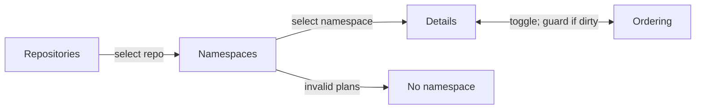

# Organize and prioritize backlog plans by namespace

## Summary

Make Backlog useful for deciding what to build next. Navigate from repositories to namespaces to one list of plans. **Details** and **Ordering** are two presentations of that list. Order is explicit within a repository/namespace, unprioritized plans appear first, and dependency-connected Backlog plans automatically form contiguous movable groups **in Ordering mode only** (Option A). Details shows individual flat cards in the same plan order. Manual Ordering edits stay local until the user saves them. A repo's screen leads with **Next up**, each namespace's highest-ranked unblocked plan, and every Backlog plan lists the unfinished prerequisites it is waiting on, including those in other namespaces.

## Context

The issues to solve:

- Long titles do not consistently show their namespace at the beginning of the displayed label.
- A global Backlog card feed is difficult to scan when many repositories and namespaces are involved.
- H/M/L does not specify a concrete next-to-build order.
- Part 1/2/3 work often has hard dependencies; remaining backlog phases should move together, but unrelated work may go ahead of them.
- New plans can disappear into an implicit backlog tail unless they remain visibly unprioritized.
- A prioritization session may involve many edits, so immediate persistence is too easy to trigger accidentally.
- Invalid namespace metadata must be rejected when authored but remain discoverable if it exists on disk.

Automatic dependency regrouping (Option A) is the chosen behavior. Do not implement or design a separate approval workflow for automatic regrouping.

## Current state

Checked against commit `9a2ebc74`.

| Area | Current behavior | Touchpoints |
| --- | --- | --- |
| Namespaces | Longest-prefix matching exists but is private, and records carry no `namespace` field. Universal namespaces are a constant. | `modules/plan-suite/naming.mjs` (`matchNamespace`, `UNIVERSAL_NAMESPACES`), `readPlanRecord` and `publicPlan` in `modules/plan-suite/index.mjs` |
| Naming enforcement | Naming findings are advisory, so `roborepo plans validate` exits 0. Transition gates leave them out, so no transition refuses them. A repo without `plans-config.json` gets no findings. Malformed config is silently treated as not configured. | `modules/plan-suite/findings.mjs`, `lifecycleFindings` in `index.mjs`, `assertDestinationReady` in `transition.mjs`, `naming.mjs` |
| Naming in CI | `npm run check` tests a hard-coded filename list, not the real plan tree. Other repos have no enforcement. | `scripts/test/plan-suite-findings-check.mjs` |
| Plan creation | No command or portal route creates or renames a plan. `plan-write` is a skill whose agent writes the file and then runs the validator. | `globals/packages/plan-suite/skills/plan-write/` |
| Dependencies | `plan.dependencies` is parsed. Self-references and missing IDs are findings; cycles are not detected. | `modules/plan-suite/index.mjs`, `findings.mjs` |
| Priority | Backlog and Ready show a priority dropdown and filter, and every lifecycle uses it as a sort key. Home shows it as a read-only chip. Start and reopen write `priority: none`, as does landed recovery. | `planSort` in `portal/plans/state.js`, `portal/plans/elements/plan-status.js`, `manifests/platform/plan-lifecycle.json` (`showsPriority`), `POST /api/plans/priority`, `transition-rules.mjs`, `landed-recovery.mjs`, `repair.mjs` |
| Unknown frontmatter | No allowlist rejects extra keys, so a leftover `priority:` line is inert once the field's rules are gone. | `modules/plan-suite/lifecycle-policy.mjs` |
| Repo scope | The shared `?repo=` selector pushes the URL and then notifies the page. It has no way to refuse a change. | `portal/shared/repository-scope.js`, `repository-scope-selector.js` |
| Refresh | Home polls a cached snapshot that rebuilds when a fingerprint of every entry under `docs/plans` changes. The open Plans page refetches only on Refresh, after mutations, and while a sync runs; nothing pushes file changes to it. | `modules/plan-suite/snapshot-fingerprint.mjs`, `scripts/cli/plans.mjs` |
| Lifecycle moves | Transitions commit only the plan's old and new paths. No transition returns a plan to Backlog. | `manifests/platform/plan-lifecycle.json`, `modules/plan-suite/transition.mjs` |

Real data for fixtures: this repo has 49 Backlog plans across 14 namespaces, all with valid prefixes. Six dependency edges join two same-namespace Backlog plans, including the fork `forge-github-01` → `02`, `03`. Eight more point at another namespace or out of Backlog, and all resolve. Twenty-one live plans keep legacy slug IDs, so the registry must accept any valid plan ID, not only base36. Fifty non-terminal plan files carry a `priority` line.

## Goals

- Change **Backlog only**, apart from removing priority. Other lifecycle views lose their priority control, filter, chip, and sort key, and otherwise keep their behavior, sorting, filtering, navigation, and presentation.
- Use one approved namespace per plan, taken from that repository's configured vocabulary plus permitted universal namespaces.
- Show a plan's namespace as a badge where plans from several namespaces appear together (Next up cards and prerequisite lists); leave authored H1 titles intact.
- Scope priority to one repository and namespace, never across repositories or namespaces.
- Show what each Backlog plan is waiting on, including prerequisites in other namespaces.
- Lead a repo's view with each namespace's highest-ranked unblocked plan.
- Show unprioritized plans first and support simple placement without numeric fields.
- Share one flattened plan sequence between Details and Ordering; derive group containers **only in Ordering** and use the same backing order state.
- Group unfinished dependency sequences, including multiple prerequisites and dependents, into contiguous movable blocks without adding an initiative/epic/series field.
- Save all ordering edits explicitly, with Cancel and guarded navigation.
- Automatically place new or newly dependent plans when they attach to an already prioritized same-namespace chain.
- Remove H/M/L/none priority entirely from **non-completed, non-archived plans** and all live skill, UI, CLI, validation, and documentation consumers.

## Non-goals

- No global ordering of plans across repositories or namespaces. Next up lists at most one plan per namespace. A pin lifts a whole namespace on the repo screen and in Next up; it ranks no plan against another namespace's.
- No separate Roadmap page, hierarchy map, or extra grouping metadata.
- No automatic rewriting of H1s, filename ordinals, or forced `Namespace Part ###` titles.
- No footer namespace badge or badge-click filter interaction. Only a Next up card's badge and a `Waiting on` line's badge outside the drawer are clickable, and each opens that namespace.
- No changes to **any** non-Backlog lifecycle state or its UI presentation, including Ready, Active, Review, Completed, Archived, and Unclassified, except that priority disappears: Ready loses its dropdown and filter, Home loses its chip, and every view drops the priority sort key so it falls through to recency and then title.
- No general live refresh; that remains [[plans-portal-live-refresh-and-static-preflight]]'s decision.
- No wiring of validation into other repositories' CI. `roborepo plans validate` is the check they can adopt.
- No backward-compatibility layer for the old priority field in current lifecycle plans; breaking changes are acceptable. Historical Completed/Archived files may retain the unused field.

## Data contracts and ownership

| Concept | Source of truth | Rule |
| --- | --- | --- |
| Namespace vocabulary | Repository `docs/plans/plans-config.json` plus plan-suite universal namespaces | Validate before create/rename; do not invent a prefix |
| Plan identity | Existing opaque `id` | Never rewrite IDs to match names |
| Plan namespace | Derived from validated filename prefix (approved vocabulary) | Expose a read-only `namespace` property on parsed plan objects; unknown/malformed prefixes enter **No namespace** for recovery |
| Hard prerequisites | Existing `depends_on` IDs | Preserve true edges even when multiple prerequisites or dependents exist; never manufacture dependencies to match display order |
| Priority order | One repository-local ordered-ID registry, scoped by namespace | Explicit, stable order; no H/M/L and no independent Details sort |
| Effective order | Pure calculation from the registry, current plans, and config | Computed on every read; the portal never writes on read |
| Unprioritized | Backlog plan absent from the **effective** ranked order | Derived; no new frontmatter flag |
| Dependency group | Direct dependency edges between same-namespace Backlog plans only | Option A: linearize each connected in-Backlog component into one contiguous movable block; never bridge through plans outside Backlog |
| Draft ordering | Client-side edit session | Not persisted until explicit Save |
| Next up | Pure calculation in the browser from the snapshot's order, lifecycles, and blockers | Never stored; never changes an order |

**Namespace decision:** do **not** add `namespace` to plan frontmatter. Derive it from the longest approved `<namespace>-` filename prefix and expose it as a computed field on the parsed plan model. Cache that resolution per indexed plan and reuse the loaded namespace vocabulary per repository snapshot: the in-memory match is inexpensive and requires no additional I/O. Validate malformed/unknown prefixes at creation, rename, and build; retain invalid files in **No namespace** when reading. Add a correctness and performance regression test. Render the namespace badge from the derived namespace, not from manually typed H1 text. It is a display label, not a required H1 prefix.

## Proposed design

### Backlog navigation



| Scope | Visible content |
| --- | --- |
| No repo selected | Only repositories with Backlog plans; ready, unprioritized, and total counts |
| Repo selected, no namespace | **Next up** when any plan qualifies, then **All Plans**: approved namespaces with Backlog plans, pinned first, each with ready, unprioritized, and total counts; **No namespace** last if invalid plans exist |
| Repo and namespace selected | Details: a banner counting the plans that need prioritization, then ranked cards. Ordering: **Needs prioritization** at top when nonempty, then the ordered list. Details/Ordering toggle. A namespace with nothing ranked opens in Ordering on arrival |
| Repo and **No namespace** selected | Files with missing, malformed, or unapproved filename prefixes, with errors and a repair path; no priority editing until repaired |

Counts measure **plans**, not collapsed groups. No empty-state congratulation such as “All backlog plans have been prioritized.” Use terse UI labels such as `Needs prioritization`, `Prioritized`, `Details`, `Prioritize`, and `Save`. This plan's prose keeps the words Ordered and Ordering for those two labels; the UI, user docs, and code comments use the new ones, and code identifiers keep `ordering`.

The repo level uses the existing shared scope: **All repos** shows the repository directory, and choosing a row calls `setRepositoryScope`. The namespace level adds one Backlog-only URL parameter, so reload and back/forward keep the position. A repo with no `plans-config.json` shows one **No namespace** row with a config-level notice pointing to `/plan-suite-init`, and no per-file findings, because such a repo never adopted the naming convention.

The existing Filters popup keeps working in Backlog: it narrows directory counts and Details cards. Ordering always shows the whole namespace and hides Filters, because moving a row among hidden rows has no defined result.

Do not change other lifecycle tabs/views, even if they currently show plans across all repos or use existing filters. Backlog-only directory navigation must not leak into those views.

### Common list and displayed titles

**Visual contract:** See `docs/internal/plan-backlog-ordering-architecture-addendum.md` → “UI reference: Backlog navigation and paired list projections” for the exact example screens, per-mode component boundaries, control layouts, and fork/join/split cases. This contract governs the UI implementation; no dependency group nesting appears in Details. Where the addendum and this plan disagree, this plan wins; see “Addendum corrections” below.

- Inside a namespace, Details and Ordering show the plain title, since the breadcrumb names the namespace; do not rewrite the Markdown H1 or filename.
- Display the **same flattened plan order** in Details and Ordering, but **show dependency grouping only in Ordering**.
- In Details, render every ranked plan as an independent, flat, un-nested rich card (even when its dependency-connected neighbors would form one Ordering block). Retain existing Backlog summaries, progress, and actions; no group headers, group outlines, rank controls, or drag handles.
- In Ordering, show compact rows and derived contiguous dependency blocks with title, short purpose, dependency/blocking clue, and position. Group controls act on the whole block; do not add an independent ranking property.
- The addendum contains the **normative paired wireframes and dependency-pattern matrix**. Use these visuals to implement the UI without re-deciding grouping behavior.
- Do **not** create a clickable footer namespace badge.
- Build rows from `<template>` markup and fill helpers, the portal's convention. Ordering rows and blocks may be light-DOM custom elements under `portal/plans/elements/`, since each owns listeners and focus. The shipped package has no runtime dependencies, so drag uses native browser events and the move buttons are the keyboard path.

### Needs prioritization

- In Ordering, show **Needs prioritization** **before** the ranked list, only when nonempty. In Details, a banner gives its count and leads to Ordering.
- New independent plans default to unprioritized; do not append them to the end of the registry.
- In Ordering mode, each unprioritized row or eligible dependency group has exactly three right-side controls, in this order:
  1. **Move down** — insert at the *top* of Ordered.
  2. **Move to bottom** — insert at the bottom of Ordered.
  3. **Drag handle** — drag to any valid position in Ordered.
- Each plan in Needs prioritization, including each member of a group, has its own **Archive** icon beside its modified time. It retires that plan alone, after a reason and a final yes. It commits at once, so it is disabled during a dirty draft. Hovering or clicking it neither opens the plan nor grows its description.
- Do not use a position dropdown, numeric field, or additional placement controls.
- Placement updates the **draft** immediately (the item leaves Needs prioritization and appears in Ordered), but does not persist until **Save**.
- Invalid drops are disabled or rejected with a concise reason. Moving a group moves all its remaining Backlog plans together.

### Ordered rows

Every Ordered row or derived dependency group places controls **on the right**, in exactly this sequence:

1. **Move to top**
2. **Move up**
3. **Move down**
4. **Move to bottom**
5. **Return to unprioritized**
6. **Drag handle** (furthest right)

Icon buttons need accessible names, tooltips, keyboard support, correct disabled states, and focus behavior. Move operations cannot invert actual prerequisites. For long lists, consider virtual rendering only if the existing portal already needs it; do not introduce it preemptively.

### Explicit save and navigation guard

1. Opening Ordering copies the committed order into a draft; changes are not written on each move.
2. The first change marks the draft **dirty**. Show a compact, always-visible **Save** and **Cancel** action bar (sticky while the list scrolls), plus an unsaved indicator.
3. **Save** validates all moves against the latest namespace snapshot and writes the entire namespace order as one atomic operation. Only on success clear dirty state and update committed Details order.
4. **Cancel** on the action bar discards the draft and restores the last committed order, with no confirmation.
5. Before leaving Ordering via Details toggle, repo/namespace selection, lifecycle tab, page navigation, in-app back, or route change, display:

   > Your prioritization changes have not been saved.

   Actions, stacked in this order: **Save and Continue** (save, then finish the attempted navigation), **Discard Changes** (drop the draft and finish the navigation), and **Keep Editing** (stay in Ordering with the draft untouched). Do not navigate after failed Save. The same guard applies to leaving the Plans page.
6. For tab close/reload or browser-level navigation, use the browser's supported unsaved-change mechanism; browsers may show their own wording rather than the custom sentence. The custom prompt needs three seams that do not exist yet: a way for the page to refuse a change in `portal/shared/repository-scope.js`, interception of header links to other portal pages (full page loads), and a `popstate` handler that restores the URL, since back/forward cannot be cancelled.
7. Detect stale drafts (another tab, filesystem change, dependency edit, or concurrent writer) by a revision/ETag check. Do not silently overwrite; show a conflict and require a refresh/reconciliation before saving.

The draft encompasses **both** ranked order and moves from Needs prioritization. Only a successful Save commits them together.

### Dependency chains and automated placement

- Hard dependencies determine which plan must precede which. Ranking determines what to work on next, *within* that constraint.
- For a simple same-namespace chain `A → B → C`, group remaining Backlog phases as a movable unit; never require the entire chain to be worked without interruption.
- When `A` moves out of Backlog, `[B → C]` remains grouped **if C directly depends on B**. An unrelated `X` can move ahead of `[B → C]`. When `B` leaves Backlog, `C` remains as one row.
- **Confirmed group boundary:** only direct dependency edges between two same-namespace plans currently in Backlog connect rows into movable groups. Do not use shared out-of-Backlog ancestors to join plans. For a fork `A → B` and `A → C`, `[A, B, C]` forms a group while A is in Backlog. Once A leaves Backlog (including Active or Completed), B and C become separate ranked rows if there is no direct B↔C dependency. Preserve their relative rank and their real dependencies on A. They may still be blocked until A completes.
- Splitting a group because a prerequisite leaves Backlog does **not** make its previously ranked survivors unprioritized.
- Show dependency indicators for prerequisites outside Backlog; they still block work as appropriate. A ranked plan may be blocked by a phase in another lifecycle state.
- A **new plan** with an explicit same-namespace dependency on an **already-ranked** plan or simple ranked chain automatically joins the ranked group at a valid position. Do not prompt for separate prioritization or put it in Needs prioritization.
- A new plan dependent **only** on unprioritized plans joins their unprioritized group; it cannot inherit a rank that does not exist.
- Adding a dependency to an existing prioritized Backlog plan moves that plan into the dependency's ranked group automatically. Keep the plan's stable ID.
- **One ranking rule for connected plans:** a connected group with at least one ranked member is ranked, anchored at its earliest ranked member, and any unranked members join it. A group with no ranked member stays in Needs prioritization. So a ranked plan that gains an unranked prerequisite keeps its rank and pulls the prerequisite in.
- **Removing a dependency keeps the rank.** Plans separated by a removed edge stay at their current positions as separate rows or smaller groups, and nothing moves to Needs prioritization. The current data cannot tell a detached plan from one ranked on its own, and hand edits to `depends_on` have no write path that could record the difference.
- Recompute group membership and the effective order on every read, so any dependency edit, plan creation, lifecycle change, or repo snapshot refresh is reflected deterministically and visibly, even if it reorders independent plans. Avoid silently overwriting an unsaved draft; use the stale-draft guard.
- Keep dependency cycles, missing references, and invalid cross-namespace placements visible as findings; never auto-rank invalid relationships. Cross-namespace prerequisites may block execution but do not impose a rank across namespace boundaries.

**Chosen branching policy — Option A:** `depends_on` may express joins and forks. **Only Ordering mode wraps connected plans into movable blocks; Details remains flat.** Linearize each dependency-connected set of remaining **same-namespace Backlog plans, connected by direct edges among those Backlog plans**, into one contiguous, movable display block, with a valid topological order within it. A display sequence such as `A → B → C` does **not** add a hard dependency from A to B when C independently depends on A and B. When new edges connect separately ranked groups, automatically regroup them, even when unrelated plans move down in priority. Show a concise explanation of automatic moves; automatic dependency regrouping does not ask for approval. This is separate from Save/Cancel for manual Ordering edits. Never rewrite actual dependency edges to force a chain.

### Prerequisites in other namespaces and Next up

Reviewing Backlog on real repos showed that a repo's plans can form one chain across several namespaces: all 8 of research_bots' Backlog plans do, across 4 namespaces. A namespace's order alone therefore does not say what can be built. Namespace ranks stay independent; these additions make the chain visible and store nothing.

- **Waiting on:** every Backlog plan, in Details, Ordering, and the drawer, lists its unfinished prerequisites under `Waiting on:`, each with a link on its title that opens it, and a namespace badge when it is in another namespace. Each shows its lifecycle, Backlog included, so a mixed list reads evenly; a missing one shows `not found`. A completed prerequisite is left out, and Ordering leaves out one its tree already draws.
- **Next up:** a section above the namespace list on a selected repo's screen, showing the same cards as Details. Each namespace gets at most one card: its highest-ranked plan that has no blocker and whose unfinished prerequisites are all in Ready, Active, or Review. An unranked plan never appears, and with no qualifying plan the section is hidden. Filters narrow it. Namespaces stay in directory order, so pinned ones lead. The card's namespace badge opens that namespace, the same as its row in the list, without opening the plan; nothing here changes an order.
- **Namespace label:** the `PORTAL · Title` prefix is gone. The namespace appears only where it tells the reader something:

| Surface | How the namespace appears |
| --- | --- |
| Next up card | Badge beside the repo badge; a link to the namespace |
| `Waiting on` list | Badge only on a line from another namespace, a link to that namespace outside the drawer and plain text in it; the plan's title opens the plan |
| Details card and Ordering row | Not shown; the title is plain and the breadcrumb names the namespace |
| Breadcrumb and namespace rows | Capitalized label, unchanged |
| Any tab other than Backlog | Not shown |

A `Waiting on` link opens the plan's drawer in place, so using one in Ordering leaves an unsaved draft untouched.

### Ordering registry

Use a repository-local `docs/plans/plans-order.json` keyed by namespace, storing stable plan IDs rather than filenames, titles, or a persisted group hierarchy. A missing file means every plan is unprioritized. `modules/plan-suite/` owns reading, calculating, and writing it; the portal route and CLI command are thin adapters. Writes use the temp-file-and-rename pattern already in `modules/repositories/registry.mjs`, in the primary checkout, and are left uncommitted like today's priority edits.

| Who writes | When | What |
| --- | --- | --- |
| Portal **Save** | Explicit user action | That namespace's full effective order with the draft applied |
| `roborepo plans order place <plan>` | `plan-write` creating a plan, or a user | The plan's position, plus that namespace's effective order |
| Portal pin control | Explicit user action, with no Save | The `pinned` list, which sets the order between namespaces |
| Nothing else | Portal reads and lifecycle transitions never write it | Transitions keep committing only the plan's own paths |

```json
{
  "schemaVersion": 1,
  "namespaces": {
    "plans": ["rxv53v6z", "a1b2c3d4"],
    "git": ["h3j4k5m6"]
  }
}
```

Example IDs are illustrative. Keep a single ordered array per namespace; derive dependency blocks from edges. Automatic attachment must not create a second shadow priority system. A plan's absence from the **effective** ordered list (after dependency reconciliation) indicates unprioritized state.

| Registry entry | Effective order | Next write |
| --- | --- | --- |
| Plan now outside Backlog | Ignored, which keeps survivors' relative rank | Pruned without a finding; this is normal |
| Unknown ID | Excluded, with a finding | Preserved until someone removes it |
| Namespace no longer approved | Excluded, with a finding | Preserved; a write touches only its own namespace |
| Plan with no `id`, or a duplicate | Cannot be ranked; shown with its finding | Not written |
| Pin on a namespace no longer approved | Ignored, with no finding | Pruned |

An unparseable registry is a finding: every plan shows as unprioritized and Save is refused rather than overwriting the file. Store changes in the repository that owns the plans, not a global portal order file. Do not rely on any backward-compatible migration of priority labels. Worktree-only Backlog plans rank like any other, and their position is still stored in the primary checkout.

### Namespace enforcement and recovery

**Prevent creation of invalid names:**

- Agents write plan files directly, so rejection happens at validation. Make `INVALID_PLAN_FILENAME`, `FORBIDDEN_PLAN_FILENAME_SUFFIX`, and `UNKNOWN_PLAN_NAMESPACE` blocking so `roborepo plans validate` exits 1, add them to the promote and start gates, and keep `plan-write`'s existing validator step as the creation check. Severity alone does not gate transitions, so the gates need their own check. All of this applies only where a repository has declared namespaces.
- Reject filename prefixes outside the approved vocabulary; present the allowed choices and a path to update `plans-config.json` rather than silently using an invented prefix. Do not add, require, or cross-check a `namespace` frontmatter field; consumers use the derived parsed value.
- Author reader-facing H1s normally, but show the approved namespace as a badge where the Backlog UI mixes namespaces. Never badge an unapproved namespace; do not require authors to type a namespace twice in H1s.
- Add a check that validates this repository's real plan tree, since the current one reads a hard-coded list. It runs through `npm run check`. Other repositories get the same rule by running `roborepo plans validate`.

**Recover invalid files without hiding them:**

- Parsing/indexing must not crash or omit a plan because its filename prefix cannot be matched to an approved namespace.
- Under the selected repository, show **No namespace** **after** approved namespace rows, only if such Backlog plans exist. Count them, show their exact filenames and validation findings, and link to the repair workflow. These plans cannot enter an Ordered namespace until repaired.
- Report unknown names consistently in the CLI/validator and portal. Strict create/build validation and tolerant read/display behavior are complementary, not contradictory.
- Keep **Unclassified** (a lifecycle/folder condition) distinct from **No namespace** (metadata classification); do not change the Unclassified lifecycle UI.

### Namespace-config changes and reconciliation

Treat `docs/plans/plans-config.json` as an input to each repository's Backlog index, not a namespace vocabulary loaded once for the lifetime of the process. The existing mtime-keyed config cache and snapshot fingerprint already cover config edits and branch switches on the server. An open page picks up the change on load, on **Refresh**, after mutations, and at **Save**, which rechecks the revision so a stale draft cannot persist; this plan adds no push channel. `readProjectNamespaces` must start reporting malformed config as an error rather than as "not configured". The revision is a content hash of the config, the namespace's saved order, and each namespace plan's ID, filename, and `depends_on`. Changes are scoped to the affected repository.

- **Namespace added:** reparse filenames with the new approved vocabulary, including longest-prefix collisions. Matching previously **No namespace** plans move into their approved namespace at the next load or Refresh. Show the namespace row only if it contains Backlog plans. Newly recognized plans are **Needs prioritization** unless they already have a valid saved rank or qualify for automatic dependency attachment.
- **Namespace removed:** affected Backlog plans move to **No namespace** with actionable validation findings. Do not delete/rename plan files or silently discard their old registry entries; flag entries belonging to now-invalid namespaces for repair, exclude them from the effective ordered view, and preserve them until an intentional cleanup/migration.
- **Namespace renamed:** treat as removal plus addition, not a silent filename migration. Existing files remain in **No namespace** until renamed to an approved prefix; preserve plan IDs and reconcile ordering after repair.
- **Unreadable/malformed config:** report a configuration error; do not silently keep using a stale vocabulary as if it were current. Continue tolerant recovery/indexing where possible without inventing namespace matches.
- **Unsaved ordering:** if a config change affects the selected namespace, plan membership, or effective order, mark any open Ordering draft stale. Prevent Save until the user refreshes/reconciles; reuse the existing unsaved-navigation safeguards.

Use shared namespace parsing and validation in the portal, CLI, plan writers, and build enforcement. Test config changes followed by Refresh with the Backlog screen open, reload/branch-switch behavior, removed namespaces with saved order entries, and concurrent config edits while an Ordering draft is dirty. Do not modify presentation of non-Backlog lifecycle views.

### Remove the legacy priority field

This is a **breaking cleanup**, not a deprecation:

- Delete H/M/L/none priority from the current plan schema and allowed frontmatter for Backlog, Ready, Active, and Review plans, and any other non-Completed/non-Archived managed plans.
- Remove the frontmatter line from existing files in those states (including this plan once the new validator is active). Do not rewrite Completed or Archived documents merely to delete historical values; ignore those values when reading them.
- Remove all current priority computation, sorting, badges, form fields, APIs/types, default values, validator rules, error messages, UI interactions, CLI flags/output, plan-suite skill instructions, references, templates, generated prompts, fixtures, tests, and documentation that assume the field still exists. That includes `PRIORITIES`, `updatePlanPriority`, `POST /api/plans/priority`, the `MISSING_PRIORITY`, `INVALID_PRIORITY`, and `INVALID_PRIORITY_VALUE` findings, `showsPriority` in the manifest and its readers, the `Priority:` prompt line, `SCAFFOLD_PRIORITY`, and `scripts/cli/mock-home.mjs`.
- Remove the `priority: none` writes in `transition-rules.mjs` and `landed-recovery.mjs`, because `writeFrontmatterField` would otherwise put the line back.
- Delete `updatePlanField`: `updatePlanPriority` is its only caller.
- Retain only the namespace-scoped ordered-ID priority system for Backlog. Do not create a secondary priority notion in other lifecycle views, and do not change their presentation.
- Existing H/M/L values do **not** migrate into ranked positions. All independent Backlog plans without an explicit saved position begin in Needs prioritization; dependent plans may inherit placement **only** by the automatic dependency rules above.

### `plan-write` integration

**Dependency placement rule:** `depends_on` governs eligibility and automatic initial placement, not a separate H/M/L or numeric priority. Each ranked plan, including each member of a dependency group, still has its own stable ID in the saved order. For a fork `A → B` and `A → C`, save `[A, B, C]` (or another dependency-valid order); when A leaves Backlog, B and C split into independent rows **without losing their existing relative rank**. No extra `plan-write` placement prompt is needed for B or C once they attach to an already-ranked group.

1. Resolve an approved namespace from the repository config before writing; validate the `<namespace>-<slug>.md` name and derive the parsed namespace from it. Do not store `namespace` in frontmatter.
2. Create the plan with stable ID and valid metadata, **without** the legacy `priority` field after the schema change.
3. If it has qualifying dependencies on a ranked same-namespace group, **auto-place** it into that group and persist its individual plan ID by running `roborepo plans order place <plan>`; no separate ranking prompt. Preserve the existing relative priority of independent siblings and use a deterministic tie-break for new siblings.
4. Otherwise, offer insertion at the top or bottom of the namespace order (`--top`, `--bottom`) or **Prioritize later**. A deferred independent plan remains at the top in Needs prioritization.
5. For non-interactive creation, default an independent plan to unprioritized; a dependent plan still follows deterministic auto-attachment rules.
6. Surface a registry write/validation failure explicitly; never claim automatic placement succeeded if it did not.
7. If a new plan connects multiple ranked prerequisite groups, calculate the merged group and persist the deterministic order atomically; surface the automatic changes. Each member has an individual saved position; the new plan does not enter Needs prioritization merely because it has multiple prerequisites.

## Chosen policy: Option A dependency regrouping

Treat dependencies as a directed graph (the actual `depends_on` edges), but present the remaining same-namespace Backlog plans as a **flat list of contiguous movable groups in Ordering mode only**. Details renders independent cards in the same flattened order. A connected component built from **direct edges among current same-namespace Backlog nodes** is one group, including joins (C depends on A and B) and forks (B and C both depend on A). Do not traverse through Active, Completed, or other out-of-Backlog ancestors to group sibling plans. Cross-namespace edges remain execution constraints, not cross-namespace ranking groups.

Example: existing ranked order `[A, X, Y, B]`, followed by a new plan C depending on both A and B. The new order is `[A, B, C, X, Y]`: regroup A, B, and C at the earliest existing member's position. A and B retain their actual independence; B is merely listed before C. X and Y retain their relative order. If existing positions allow `[B, A, C]` instead, preserve existing ranked order between independent prerequisites. Use a stable topological sort for the group's internal sequence, with existing saved priority and then stable plan ID as tie-breakers.

**Dependency ordering implementation:**

1. `deriveGroups(plans, lifecycle)` — pure calculation of dependency-connected remaining Backlog groups; validate missing edges and cycles.
2. `proposeOrder(currentOrder, groups, change)` — pure calculation returning `{order, moves, findings}` with a deterministic, valid rank. For an automatic merge, anchor at the earliest ranked member and preserve unaffected items' relative order. Never write inside this function.
3. `applyOrder(proposal, expectedRevision)` — persist the proposed IDs atomically after validation. Portal **Save** and `roborepo plans order place` are its only callers; manual Ordering-mode changes remain draft-only until explicit **Save**.

Automatic regrouping needs no approval and takes effect on the next read, because the effective order is calculated from current inputs. It reaches the file at the next write: a hand edit to `depends_on` has no command to hook, and a portal read must not dirty a tracked file. If such a plan was never written to the registry and its only ranked prerequisite leaves Backlog first, it falls to Needs prioritization: visible, never lost. If an Ordering draft is dirty, do not overwrite it; flag a stale revision and require refresh/reconciliation. Show automatic moves by comparing the stored order with the effective order, as a concise notice in Ordering and in the command's output. Dependency blocks are derived from individual plan IDs persisted in the existing registry; do not persist a second group hierarchy.

Do not introduce graph editors, separate roadmap pages, nested views, manual splitting, or artificial dependency edges. Keep cycles and broken references as validation errors rather than attempting to generate a misleading order. Put cycle detection in `deriveGroups` as an exported calculation so [[plan-lifecycle-suite-blockers-dependencies]] can reuse it.

### Addendum corrections

`docs/internal/plan-backlog-ordering-architecture-addendum.md` remains the UI contract, except:

| Addendum text | Current rule |
| --- | --- |
| Header names `plan-backlog-roadmap-ordering-v7.md` | The plan is this file |
| M2 wireframe, matrix row, and state table send a detached plan to Needs prioritization | The plan keeps its rank |
| “Plan leaves Backlog: remove its ID from Backlog order” | Ignored on read, pruned at the next write |
| “Plan returns to Backlog” row | Unreachable; no such transition exists |
| “Automatic placement persists as part of that write operation” for dependency edits | Applies to `roborepo plans order place`; hand edits persist at the next write |
| `AGENTS · ` title prefixes in the wireframes | The plain title; the breadcrumb names the namespace. The addendum's prose says this too; only its drawings keep the prefix |
| `Ordered` and `Ordering` labels throughout | `Prioritized` and `Prioritize`. Only the labels changed |
| `Requires: Q` in the wireframes | `Waiting on:`, listing each unfinished prerequisite with its status, and its namespace when that differs. The addendum's prose says this too; only its drawings keep `Requires:` |
| `Needs prioritization (1)` in the wireframes, and its cards in Details | Details shows a banner with the count and no cards for those plans; Prioritize's heading has no count |

## Implementation checklist

Priority removal comes last, so Backlog has its replacement before the old control disappears.

- [x] Export the namespace resolver from `naming.mjs` and add a computed `namespace` to plan records and `publicPlan`; report malformed config as an error; test overlapping prefixes and scan cost.
- [x] Make naming findings blocking, add them to the promote and start gates, and add a check over the real plan tree.
- [x] Add a plan-suite module with pure `deriveGroups` and `proposeOrder`, plus registry read and `applyOrder`; cover every addendum gallery case, using the real fork and chain shapes as fixtures.
- [x] Add the registry and revision to the plans snapshot, the Save route in `scripts/cli/portal-routes-plans.mjs`, and `roborepo plans order place` with its command definition under `manifests/platform/cli/command-definitions/internal/`.
- [x] Add the repo and namespace directory levels to Backlog only, with **No namespace** recovery and the no-config notice.
- [x] Add the shared draft/committed view model and flat Details cards in registry order, with the Needs prioritization banner first.
- [x] Add Ordering: derived block containers, the exact right-side controls, native drag, keyboard paths, disabled states, the automatic-move notice, and Filters hidden.
- [x] Add sticky Save/Cancel, dirty state, the guard prompt with its three navigation seams, native exit protection, atomic Save, and stale-revision conflicts.
- [x] Integrate automatic placement and explicit deferral into `plan-write` with failure reporting.
- [x] Remove priority from all code, skills, tests, and fixtures, and sweep the line from every non-Completed/non-Archived plan including this one.
- [x] Update the documents listed under Documentation impact, correct the addendum per “Addendum corrections”, and retake `docs/images/plans.png`.

### UI review

Added after reviewing Backlog on real repos. The behavior is built; the open tasks close its test gaps and repeat the validation that predates it.

- [x] List each unfinished prerequisite under `Waiting on:` in Details, Ordering, and the drawer, with its status and a link, and its namespace when that differs.
- [x] Add Next up above the namespace list: full cards, ranked plans only, at most one per namespace, following Filters.
- [x] Replace the title prefix with the namespace badge, shown only on Next up cards and in `Waiting on` lists.
- [x] Update `plans-portal.md`, the addendum, and `plans-portal-internals.md`, and retake `docs/images/plans.png`.
- [x] Make the `Waiting on` list a real list, and assert it and its badges by role in `plans-backlog.spec.mjs` instead of the `.plan-dependency` and `.namespace-badge` selectors.
- [x] Test that ranking a plan and pressing Save puts it in Next up on returning to the repo screen.
- [x] Test that Next up appears only on a selected repo's screen: not on All repos, not inside a namespace, and not for a repo with no config.
- [x] Test that clicking a Next up card's namespace badge opens the namespace without opening the plan's drawer.
- [x] Test that the drawer shows another namespace's position for a prerequisite.
- [x] Test that opening a `Waiting on` link during a dirty Ordering draft keeps the draft and its unsaved state.
- [x] Check a Next up card with both badges and a long title at phone width and in the light theme, and fix what fails. Add a horizontal-overflow assertion for phone width.
- [x] Run the gates under "Before human review" on the final commit and record the results in `### Verification`.
- [x] Pin namespaces from their rows, lifting them on the repo screen and in Next up, and store the pins in `plans-order.json`, pruning removed namespaces at the next write.
- [x] Count a plan as unblocked, and match the Blockers filter, only when no prerequisite is unfinished.
- [x] Rename `View All Plans` to `All Plans`, show section titles at full contrast across the portal, and bold directory count numbers.
- [x] Show a Prioritize row's clock and modified age beside its title, and align its contents to the top.
- [x] Shrink Next up's info icon, say "for each category below", and widen the gap above All Plans.
- [x] Drop the caret from namespace rows and move the pin to the far right.
- [x] Return a prioritized plan to Needs prioritization by a control or a drop zone below the list, on Save.
- [x] Give the sustained-hover description a padded, bordered panel, and make it the default in every lifecycle.
- [x] Let the repo breadcrumb switch repos on the repo's own screen, and show a plain link back once a namespace is selected.
- [x] Make the no-namespaces notice a tight warning, name the skill, and explain namespaces below it.
- [x] Enlarge the shared dropdown caret and narrow the breadcrumb separator.
- [x] Add Discard Changes to the leave prompt, rename its Cancel to Keep Editing, stack its options with the save first, and drop the action bar Cancel's confirmation.
- [x] Set the hover panel to the page background in both themes.
- [x] Replace directory counts with ready, unprioritized, and total.
- [x] Archive unprioritized plans from Prioritize, asking for a reason and then a final yes.
- [x] Use the standard notice for the no-namespaces banner, with its explanation and default namespaces inside it.
- [x] Move Archive from the block's controls to each unprioritized plan's heading, so one plan of a group can be retired alone, without opening the plan or its longer description.
- [x] Clear an archived plan from unfinished plans' `depends_on` and `blocked_by` in the archive transition, so the portal and `/plan-archive` both get it.
- [x] Give every textarea one shared style with padding, put the archive dialog's actions in one row at the right, and raise the archive icon to line up with its row.
- [x] Set every breadcrumb part to one size, brighten and space its separators, and underline a dropdown crumb on hover instead of turning it blue.
- [x] Raise the dropdown caret 2px everywhere, and center the breadcrumb's letters with Details and Prioritize without moving the trail between levels.
- [x] Set Details and Prioritize to the breadcrumb's size, and put the whole row on a band in the repo filter's color at every level.
- [x] Center a Prioritize row's title, modified age, and archive icon, with even gaps, and match the gap between its sections to the repo screen's.
- [x] Restore the info icon host's `inline-flex`, which lifts every info icon out of its line box, including Next up's.
- [x] Give a Prioritize row's hover panel the card panel's text color and background, drop the row's own hover background, and make the drawer's copy button copy the plan's absolute path.
- [x] Underline only a dropdown crumb's text on hover, square the breadcrumb row and hang it off the lifecycle row, and even the gaps around Next up.

## Validation

Run the checks for the tier as each task lands, then let CI run the full gate. Existing suites that change: `plan-suite-check`, `plan-suite-findings-check`, `plan-suite-skills-check`, `plan-suite-repair-check`, `plan-suite-canonical-check`, `plan-suite-authority-scan-check`, `plan-authority-check`, `plan-landed-recovery-check`, `plan-lifecycle-manifest-check`, `plan-lifecycle-transitions-check`, `plans-portal-state-check`, and `cli-command-catalog-check`, each run as `node scripts/test/<name>.mjs`. Browser behavior runs through `npm run test:portal-ui`, using `plans-status.spec.mjs`, `repository-scope.spec.mjs`, and a new Backlog spec with role-based selectors. List any new `*-check.mjs` in `scripts/test/check-groups.json`, which `orphan-test-check` enforces. Skill changes also need `roborepo update` and `roborepo doctor`, since they change installed output.

| Scenario | Acceptance criterion |
| --- | --- |
| Other lifecycle states | Every view other than Backlog behaves and looks unchanged, apart from the removed priority control, filter, chip, and sort key |
| No config | A repo without `plans-config.json` shows one **No namespace** row with a `/plan-suite-init` notice and no per-file findings |
| Filters | Filters narrow directory counts and Details; Ordering shows the whole namespace |
| Read purity | Loading Backlog with a regrouping pending leaves `plans-order.json` unchanged and shows the move notice |
| Lifecycle commits | A transition out of Backlog changes only the plan's paths; the next write prunes its registry entry |
| Repo scope | Only repos with Backlog plans show, with correct counts |
| Namespace scope | Approved nonempty namespaces show; **No namespace** is last when needed |
| Namespace derivation | Longest approved filename prefix resolves once per index; derived property powers the directory and the namespace badge, no frontmatter duplication, and performance is verified |
| Namespace config edits | After Refresh, an added/removed/renamed namespace updates open Backlog and cache; orphaned plans appear in No namespace; invalid registry references are flagged, not silently dropped |
| Namespace config conflicts | Dirty Ordering drafts cannot save across a conflicting config revision; invalid/unreadable configs surface errors |
| Invalid namespace | `roborepo plans validate` exits 1 and promote/start refuse bad filename prefixes in a configured repo, but Backlog displays affected plans with repair findings |
| Titles | Next up and prerequisite lists badge an approved namespace; Details and Ordering rows show the plain title; authored H1 unchanged; no footer badge |
| Unprioritized | In Ordering, the section appears first only when needed and moves into a draft Ordered list; in Details, a banner gives the count |
| Ranked controls | Right side: top, up, down, bottom, return, handle; invalid actions disabled |
| Return to unprioritized | The control or the drop zone sends a whole block to the top of Needs prioritization; Save removes it from the file; an order that drops a plan without naming it is refused |
| Unranked controls | Right side: down-to-top, bottom, handle; no numeric/select placement |
| Archive | Per plan, beside its modified time; asks for a reason, then a final yes; commits the plan's paths and its cleared dependents on the base branch; disabled during a dirty draft; a group's other plans stay; the route refuses a ranked plan |
| Archive clears dependencies | Through the portal or `roborepo plans archive`, the plan leaves unfinished plans' `depends_on` and `blocked_by`; a dirty dependent refuses the move; a worktree-bound dependent is left and reported |
| Two modes | Same flattened order of ranked plans; Details is always flat/un-nested; Ordering alone displays derived dependency group containers and movement controls |
| Explicit Save | Multiple moves persist in one atomic write only after Save succeeds |
| Cancel | Discards uncommitted moves at once and restores persisted order |
| Guarded exit | Mode/tab/route/repo/page navigation prompts Save and Continue, Discard Changes, or Keep Editing when dirty |
| Browser exit | Native supported unsaved-change protection is active |
| Concurrent change | Stale draft cannot silently overwrite external dependency/order edits |
| Waiting on | Details, Ordering, and the drawer list each unfinished prerequisite with a link, and its namespace when that differs; a completed one is left out, and Ordering omits one its tree draws; a missing one says `not found` with no link |
| Prerequisite status | Every listed prerequisite shows its lifecycle, Backlog included; a missing one says `not found` |
| Waiting on in a draft | A link opens the drawer in place; the draft, its moves, and the Save bar survive |
| Next up selection | At most one plan per namespace, the highest ranked that qualifies; never an unranked plan, or one held up by a Backlog, missing, or archived prerequisite or a blocker; a plan waiting only on Ready, Active, or Review work qualifies |
| Next up placement | Above the namespace list on a selected repo's screen only, as full cards with their usual actions; hidden when nothing qualifies; follows Filters |
| Next up after Save | Ranking a plan and saving puts it in Next up on returning to the repo screen; nothing else writes `plans-order.json` |
| Namespace badge | Matches the "How the namespace appears" table; a Next up badge opens the namespace without opening the drawer |
| Narrow and light | At phone width no page scrolls sideways and a long title stays readable beside both badges; badges stay legible in the light theme |
| Linear chain | Remaining phases move together; independent work may move ahead |
| Fork/join group | Direct edges among same-namespace Backlog plans form movable blocks with topological order; dragging cannot violate actual dependency edges |
| Completed/shared prerequisite | With A→B and A→C, moving A out of Backlog separates B and C (unless directly dependent), preserves ranked positions and their actual dependency on A |
| Linear remainder | With A→B→C, moving A out of Backlog retains the direct B→C block |
| New dependent | Auto-ranks when attached to ranked same-namespace group; no manual placement required |
| New independent | Unprioritized until explicitly placed |
| Added dependency | Existing ranked plan automatically reattaches/reorders into dependency group |
| Ranked plan gains unranked prerequisite | The plan keeps its rank and the prerequisite joins its group |
| Removed dependency | Separated plans keep their positions as separate rows or smaller groups; nothing moves to Needs prioritization |
| Multiple dependencies | Option A creates one contiguous block for connected remaining Backlog plans; true dependency edges remain unchanged; topological order is valid |
| Auto regrouping | With `[A, X, Y, B]` and new `C` depending on `A` and `B`, propose and apply `[A, B, C, X, Y]`; affected movement is visible |
| Separate concerns | Grouping and ordering calculation is pure; external changes apply automatically while user-initiated Ordering edits require Save |
| Priority cleanup | No legacy priority UI/behavior/schema/skill/docs/field in current lifecycle files; historical files unchanged |

### Before human review

Earlier validation passes predate the UI review, so they do not cover it. Run these in order on the final commit; a failure returns the work to the checklist.

| Gate | Command or evidence | Passes when |
| --- | --- | --- |
| Model rules | `node scripts/test/backlog-model-check.mjs` | It exits 0 |
| Backlog in the browser | `node scripts/test/portal-ui/run.mjs plans-backlog plans-status` | Every test passes |
| Full portal UI | `node scripts/test/portal-ui/run.mjs` | Every test passes, or each failure is classed with evidence in `### Verification` |
| Docs | `node scripts/test/docs-reference-check.mjs` and `docs/images/plans.png` read against the page | The check passes and the image shows no title prefix |
| Plan | `roborepo plans validate` for this plan | No finding except its unconfirmed `## Not tested` entries |
| Fresh review | A fresh-context validation pass over everything since 4f2b701d, including this plan's prose | No open `fix` or `escalate` finding |
| CI | The PR's checks after a push the user asks for | Green |

## Documentation impact

- `globals/packages/plan-suite/skills/plan-write/SKILL.md` and `references/plan-schema.md`, `references/workflow-create.md`, `references/workflow-update.md`, `references/workflow-validate.md`: namespace enforcement, new dependency placement, removal of legacy priority, and updated schema.
- `docs/user/reference/plans-portal.md` (doc of record for the Plans portal): navigation hierarchy, Next up, Waiting on, the namespace badge, Needs prioritization, dependency groups, Save/Cancel, No namespace recovery, the registry contract, and removal of the priority control, filter, and tables.
- `docs/user/guides/plan/lifecycle/plan-suite.md`: the frontmatter example, the priority filter, and the priority-clearing note.
- `docs/internal/plans-portal-internals.md` and `docs/internal/portal-architecture.md`: the Save route and order module replace `/api/plans/priority`.
- `README.md` and `docs/images/plans.png`: the metadata table, caption, and screenshot.
- `docs/internal/plan-backlog-ordering-architecture-addendum.md`: the corrections listed above.

## Risks and implementation checks

- **Repo coverage:** CI enforcement covers this repository only. Other repositories are held to the rule when they run `roborepo plans validate` or a lifecycle transition.
- **Blocking naming findings:** Configured repositories with non-conforming active names will start failing validation and promote/start. This repo has none today; other repositories' plans are unchecked and get the existing finding text as their repair path.
- **Tracked registry on the primary checkout:** Uncommitted `plans-order.json` edits can collect on the base branch and conflict across branches, as priority edits already can. The next write recalculates from whatever the file holds.
- **Parallel `portal/plans/` work:** [[plans-portal-live-refresh-and-static-preflight]] and the session-launching plans change the same files, so rebase rather than duplicate their seams.
- **Automated regrouping:** Automatic merges may change existing ranks and move unrelated plans. Use deterministic tie-breaks, surface resulting moves, and preserve revision safety. Do not add an approval workflow for automatic merges.
- **Empty Next up:** A repo with nothing ranked shows no Next up, so the section stays invisible there until someone ranks plans.
- **Long Next up:** One card per namespace could put 12 full cards above roborepo-alpha's namespace list once each namespace has a ranked plan. `## Not tested` asks the user to judge this with real ranks.
- **Edit races:** File watchers, another tab, or a separate skill may rewrite dependencies while Ordering is dirty. Detect and reconcile; never last-write-wins without feedback.
- **Missing/malformed filename namespace:** Strict creation must reject it, but tolerant reads must not make the existing plan invisible or crash indexing.
- **Schema rollout:** Remove legacy priority and update all live producers/consumers in one breaking change; otherwise current validators would report newly written plans as missing the field. Active plans' worktree copies keep an inert `priority:` line until their next base synchronization, because no allowlist rejects it. Until then the sweep's edit to an active plan's main copy, such as `git-worktree-permanent-cleanup`, shows the advisory **Edited outside worktree** finding, which that synchronization clears.

## Decision Log

Autonomous decisions made during implementation, each clear, with its effects inside this feature.

- **Plans that depend across namespaces stay ranked per namespace, with the link made visible (user decision).** In research_bots all 8 Backlog plans form one chain across 4 namespaces, and rows did not say where a prerequisite lives. The user chose prerequisite namespace, status, and links plus a read-only Next up list. Alternatives: a repo dependency map, which conflicts with the no-Roadmap non-goal, and one repo-wide order, which is a large rework and would turn research_bots into one 8-plan block with nothing to rank.
- **Next up shows only ranked plans, as full cards above the namespace list (user decision).** The first version listed compact rows below the list and fell back to the alphabetically first plan in an unranked namespace, which read as a recommendation it could not back up. So a repo with nothing ranked shows no Next up, research_bots included.
- **The namespace is a badge, not a title prefix (user decision).** It appears only where plans from several namespaces appear together: Next up cards and prerequisite lists. Details and Ordering rows show the plain title, because the breadcrumb already names the namespace. A Next up card's badge is a link that does what the namespace's row does. This replaces the `PORTAL · Title` label and narrows the non-goal against a clickable badge.
- **`Waiting on` shows the lifecycle, badges only other namespaces, and links the badge (user decision at review).** This replaces `Backlog, position N`, a badge on every line, a plain badge, and a count in the heading, which the first version specified. Commit 9fc6099c made the change, and the docs and tests follow it. The user chose to keep it over restoring the original. It also narrows the non-goal against a clickable badge to Next up and this list.
- **Details shows a banner for unprioritized plans, not a section of cards (user decision at review).** Ranking happens in Ordering, so Details counts those plans and leads there. Ordering's Needs prioritization heading carries no count. The user chose to keep this over restoring cards in Details, so an unranked plan has no Details card.
- **Next up shows one plan per namespace, not every unblocked ranked plan.** Chosen because rank within a namespace is what makes one plan next, and a namespace's lower ranks are one click away.
- **A ranked plan waiting only on work in Ready, Active, or Review counts for Next up.** Alternative: only plans with nothing unfinished. Chosen because that work is underway, and the card's Waiting on list says what it comes after.
- **A plan's namespace resolves against the primary checkout's vocabulary.** `buildPlanRecord` resolves it against the checkout it reads, and `repositoryPlanRecords` re-resolves it against the first checkout's. Alternative: trust each record. Chosen because the order the plan ranks in lives with the primary checkout, so an older or newer config in a worktree must not decide it.
- **The promote and start gates also refuse an unreadable config.** Alternative: treat it as no vocabulary and let the plan through. Chosen because the plan says not to continue as if a broken vocabulary were current, and a gate that cannot judge a filename should not approve it.
- **`DEPENDENCY_CYCLE` is blocking; the other relationship findings stay advisory.** Alternative: advisory like `DEPENDENCY_NOT_FOUND`. Chosen because the plan calls cycles validation errors and no order can be produced from one. Transition gates read document findings, so this affects `plans validate` only.
- **A cycle or missing prerequisite locks the whole namespace's Ordering.** Alternative: lock only the affected block. Chosen because the addendum's E1 and E2 wireframes show unrelated rows blocked too.
- **A repo with no config lists its Backlog plans as ordinary cards under No namespace.** Alternative: repair rows, as for a declared vocabulary. Chosen because that repo has nothing to repair, and rows would remove Promote and the other card actions.
- **A registry entry for a Backlog plan with no namespace is preserved on write.** The plan's table prunes plans outside Backlog and preserves unknown ids, and does not name this case. It is kept after the ranked plans, so a rename brings it back ranked rather than losing the rank, which the plan says to reconcile after repair.
- **Save refuses an order that drops a ranked plan unless it names that plan as unprioritized (user decision added the un-rank path).** Alternative: treat omission as un-ranking. Chosen because a bug or a stale client must not silently demote plans. A linked group returns whole, since the rest of a group would pull a lone member back in.
- **Returning a plan has both a drop zone and a control.** The user asked for the zone and was open to an icon. Dragging is pointer-only and the move buttons are the keyboard path, so the zone alone would leave keyboard users no way to do it. This adds a control the "Ordered rows" list did not have.
- **The repo breadcrumb is a dropdown only on the repo's own screen (user decision).** Inside a namespace it stays the link back to that screen. With one repo in Backlog it stays plain text, since there is nothing to switch to.
- **The leave prompt's labels and order are the user's: Save and Continue, Discard Changes, Keep Editing, stacked.** Keep Editing replaces Cancel because the action bar's Cancel discards, so one word would have meant opposite things a click apart. A stale draft disables Save, so that dialog opens focused on Keep Editing rather than Discard Changes.
- **The label in Next up's tip says "category"; the rest of the page still says namespace.** The user named this one string. Whether "category" should replace "namespace" across the UI is theirs to call.
- **`--top` and `--bottom` are ignored, and reported, for a plan connected to a ranked plan but not yet stored.** A stored plan moves with its group, since that is an explicit move. Alternative: refuse. Chosen because `plan-write` may not know the plan is connected, and the plan makes attachment automatic.
- **A plan that cannot be ranked stays in Needs prioritization with no controls and a reason.** The plan requires it be shown with its finding but does not say where.
- **`roborepo plans validate` sets `process.exitCode` instead of calling `process.exit`.** Validation now exits 1 more often, and `exit()` truncated `--json` output past a pipe buffer, which reproduced while checking this repo's tree.
- **`plans validate` gains a `repositoryFindings` array.** A broken config or registry belongs to no one plan. It is added to the existing summary counts, so the exit code covers it.
- **This plan's file moved to `plans-backlog-roadmap-ordering.md`.** Merging `main` removed the `plan` namespace in favor of `plans`, so the old name failed the blocking naming check. Alternative: put `plan` back in `plans-config.json`, which undoes that restructure. The id, branch, and `worktree:` value keep their old form, since plan copies match by id and the worktree folder already exists.
- **`Move down` is the accessible name of both the Ordered and Needs prioritization controls,** as the plan specifies. The Needs one is internally `place-top`, so the two behaviors stay distinct in code.
- **The description preview and hover panel apply to every lifecycle (user decision), and the smaller text stays Backlog's.** The user asked for the panel as a default of the views, which narrows the goal that other lifecycles' presentation does not change.
- **Directory rows show `N ready`, `N unprioritized`, and `N total` (user decision).** Ready means prioritized and unblocked, and total gives the namespace's or repo's full scope. A zero ready or unprioritized count still drops out. The word overlaps the Ready lifecycle tab; the user chose it knowing the tab's name is a separate question to revisit if it confuses.
- **The portal can archive unprioritized plans directly (user decision).** This is its first lifecycle change and its first commit, which narrows "the portal never writes a plan file". It calls the same `transitionPlan` as the command, so the base-branch and uncommitted-edit refusals still apply, and the route refuses a ranked plan. The dialog requires a reason because the archive record exists to say why, and the skill forbids inventing one. Alternative: a fixed reason, which would leave the record empty.
- **A draft's revision covers only its own namespace's saved order, not the whole order file.** A pin or another namespace's Save changes nothing a draft's Save depends on, and a Save re-reads the file and keeps them. Alternative: hash the whole file, which made those unrelated changes throw away a draft. The whole config stays in the hash, since edits to it are rare and a needless refusal there costs little.
- **The portal archives on the remote's default branch, or else `main` or `master`, and refuses when none says.** The commands keep their `--base` flag. Alternative: treat the checked-out branch as the base, which would remove the check that it is the base.
- **A Save whose refresh fails keeps the saved order on screen, held, until a new snapshot arrives.** Details would show the old order as current. The page says it may be out of date, and that warning follows the user if they leave, because the Save itself succeeded and a leave is allowed.
- **A plan that depends on itself does not lock its namespace.** It has its own finding, and an order can still be calculated, unlike a cycle or a missing prerequisite. It never counts as ready and never reaches Next up. Alternative: lock the namespace, which would stop all of its ranking over one bad line.
- **The final Archive button waits half a second before it can be clicked.** It can land under the cursor after Continue, so a double-click would otherwise answer both questions.
- **Each plan archives alone, and the control waits for a clean draft (user decision).** Often only one plan of a group should go, so the block-wide control moved to each plan. Any archive changes the namespace's revision, which would make an unsaved draft stale.
- **Archiving clears dependents' references, in the transition (user decision).** So the portal and `/plan-archive` behave alike, and nothing keeps waiting on work that will never happen. `depends_on` and `blocked_by` are cleared; `related` stays, because an archived plan still resolves and is often the point of the link. The archived plan keeps its own lists as history. A chain is cut, not rewired, because a transitive link would invent a dependency no one wrote. A dirty dependent refuses the move, since committing the file would commit someone else's edit. A worktree-bound dependent is left and reported, because editing its base copy would read as a conflicting copy later.
- **The banner says default namespaces apply "once set up".** `approvedNamespaces` returns nothing until a repo declares its own, so saying every repo already has them would be false for the repo showing the banner.
- **Pinned namespaces lead the repo screen and Next up, stored in `plans-order.json` (user decision).** Pins are listed first pinned first, so re-pinning is how to reorder them. Alternative: alphabetical among pins, which could not express that one focus comes before another. Details shows one namespace at a time, so a pin has nothing to reorder there.
- **A stale pin is pruned at the next write, not when the config changes (user asked for pruning; timing follows the read-purity rule).** It stops applying as soon as the namespace leaves the config. A pin on an approved namespace with nothing in Backlog stays.
- **A commit that fails after the rename leaves the move staged and says so (user decision at review).** The error names the new path and how to finish or undo it. Alternative: roll back the rename and dependent edits, which adds work to the path every transition shares and could lose uncommitted plan edits that a transition carries.
- **Unblocked means no blocker and no unfinished prerequisite (user decision).** research_bots' lone `ingest` plan showed `1 unblocked` because the count accepted a prerequisite in Active. Directory counts and Backlog's Blockers filter now share this rule; other lifecycles' filter still reads `blocked_by` only. Next up keeps accepting work underway, as decided above.

## Not tested

- [x] The Backlog on your own portal with real plans. You have viewed it on real repos through a portal running this worktree, but only you can confirm it works for your plans.
- [x] Next up with real ranks. Rank plans in research_bots and press Save, which writes `docs/plans/plans-order.json` in its primary checkout, then check the repo screen. Only you can press Save on your repos. This repo's own `plans-order.json` already holds real ranks, and a read-only calculation from it gave 7 Next up plans with no moves or findings; that did not exercise the page.
- [x] Next up's length on a large repo. Once several roborepo-alpha namespaces have ranked plans, judge whether the cards above the namespace list help or push it too far down. A test cannot judge this.

## Review

### Findings

- [x] A double click on Save sends two saves, the second 409s, and the page throws on a draft with no blocks. — fixed (84bab74e)
- [x] A dirty draft is silently discarded when its namespace disappears. — fixed (84bab74e)
- [x] Save and continue is re-enabled after a failed save that marked the draft stale. — fixed (84bab74e)
- [x] A cancelled drag leaves its block armed for the next drop. — fixed (84bab74e)
- [x] Missing tests: `start` naming and config gates; Filters narrowing Details and not Ordering; removed, renamed, and invalid config at Refresh. — fixed (84bab74e)
- [x] Docs: the transition table omits the naming gate; `order place` flag behavior and `plans repair` wording are wrong; `plan-schema.md` and the addendum contradict the implementation; the Schema rollout risk omits the outside-edit finding; two backlog plans still describe priority. — fixed (84bab74e)
- [x] Comments and leftovers: the registry comment misstates where preserved ids go; dead `reconcile` export, toast actions, drawer returns, `findPlanById`, and `STALE_PLAN`; stale comments and selector; fixtures still write `priority`. — fixed (84bab74e)
- [x] Breadcrumbs took the full-page link guard: Save and continue reloaded the page and dropped Filters. — fixed (c96b1ede)
- [x] Guard routing is misstated in `backlog.js` and `plans-portal-internals.md`. — fixed (c96b1ede)
- [x] Cancel in the action bar stays live during an in-flight Save, so a discard can be confirmed for an order that still lands. — fixed (c96b1ede)
- [x] The guard's Cancel stays live during an in-flight Save, and the page moves anyway when it resolves. — fixed (c96b1ede)
- [x] `option-dropdown`'s `.loading` and `tpl-dropdown-spinner` are dead since priority's removal. — fixed (c96b1ede)
- [x] No browser test for a failed Save through the guard, or Save and continue from the repo selector. — fixed (c96b1ede)
- [x] A `## Not tested` entry could be checked hermetically; recorded as evidence instead. — fixed (c96b1ede)
- [x] Ordering's Needs prioritization count measures blocks, not plans. — fixed (f9736bdc)
- [x] A re-render during an in-flight Save re-enables Cancel and Save, so a discard can be confirmed for an order that still lands. — fixed (f9736bdc)
- [x] Details omits the reason for a broken dependency graph, which the UI contract shows in both modes. — fixed (f9736bdc)
- [x] `order place` reports a move the caller asked for as automatic, and its text output reads wrongly. — fixed (f9736bdc)
- [x] No browser assertion for the duplicate-id row or an unparseable order file locking Ordering. — fixed (f9736bdc)
- [x] No test asserts `DEPENDENCY_CYCLE`, its blocking status, or the refusal of `order place` and Save on a broken graph. — fixed (ed84a58e)
- [x] After Save's request succeeds or after Discard, the old Ordering controls stay live with a null draft: a Move click throws and the bar still says "Unsaved changes". — fixed (b60f0062)
- [x] `docs/user/reference/plans-portal.md`, the `order place` row, lists only two refusals. — fixed (b60f0062)
- [x] An unreadable order file or config puts an absolute filesystem path into `/api/plans`: `readRegistry` in `modules/plan-suite/backlog-registry.mjs` and `readProjectNamespaces` in `naming.mjs` pass the raw `err.message` through. Send only `err.code` for filesystem read errors, as `canonical-scan.mjs` requires; JSON parse messages can stay. — fixed (4d7b3225)
- [x] `plan-schema.md`'s filename rule says "the rest is frontmatter" of a list that includes order, while its Backlog section says order is never a frontmatter field. — fixed (4d7b3225)
- [x] `plans validate`'s `repositoryFindings`, and its exit 1 on a broken config or order file even for one healthy plan, are undocumented in `plans-portal.md` and `workflow-validate.md`. — fixed (4d7b3225)
- [x] `plans-backlog.spec.mjs` uses CSS, id, and class selectors where a role exists (`.backlog-directory-row`, `.backlog-section-title`, `#refresh`, `#filters-toggle`, `#search`, `#filters-update`); the Validation section asks for role-based selectors. Custom-element locators may stay where no role identifies them. — fixed (4d7b3225)
- [x] No test asserts that the Save/Cancel bar stays visible while the list scrolls, which the design requires. Add one with a small viewport and a long list. — fixed (4d7b3225)
- [x] The controller's `isOrdering()` runs `reconcile()`, which can change `mode` and `draft`, and `render()` in `portal/plans/app.js` relies on that to decide whether Filters is hidden. Reconcile explicitly in `render()` and keep the predicate pure. — fixed (4d7b3225)
- [x] The header comment in `portal/plans/elements/backlog-block.js` says locked blocks show why they cannot move; they show a bare "blocked" badge, and the reason is in the notices above the list. — fixed (4d7b3225)
- [x] The contract comment for `readProjectNamespaces` sat above `pathFreeReadError`, describing the wrong function. — fixed (072acc52)
- [x] The comment above `plansOrderCommand` in `scripts/cli/plans-command.mjs` says that without a position "any other plan stays unprioritized"; an independent plan already in the order stays ranked. Say "a plan that is not ranked stays unprioritized". — fixed (7d6b779e)
- [x] `scripts/cli/mock-home.mjs` gives every demo Backlog entry `urlKey: null`, so the demo board's Backlog tab can never open a repo. Give each entry the `urlKey` the mock registry uses for that repo. Traced, not run; it shows only with `MOCK_FIRST_RUN_VIEWS_ENABLED`, which is `false` in the code. — fixed (7d6b779e)
- [x] A failed order write sends an absolute filesystem path to the browser: `applyOrder` in `modules/plan-suite/backlog-registry.mjs` lets the raw `EACCES` from its temp-file write and rename reach `sendDomainError` in `scripts/cli/portal-routes-plans.mjs`, which the Save bar and guard dialog would show. Throw a domain error carrying only `err.code`, as the read path does, remove the temp file on failure, and add a check. Reproduced at `saveNamespaceOrder`; the route and UI steps are traced, not run. — fixed (fbab7591)
- [x] **Copy Repair Prompt**, the No namespace repair path, is only asserted visible in `scripts/test/portal-ui/plans-backlog.spec.mjs`. Click it, then assert the clipboard text names `/plan-write` and the plan's path, as the other Plans copy controls do. — fixed (fbab7591)
- [x] The design's required test of reload and branch-switch behavior for config changes does not exist. Add a real-Git branch-switch case to `scripts/test/backlog-order-check.mjs` and a config-edit-then-reload case to `plans-backlog.spec.mjs`. An ad hoc run of 20 branch switches read the wrong vocabulary 0 times through `readProjectNamespaces`; it did not exercise the snapshot rebuild or the page. — fixed (fbab7591)
- [x] The "Placing a new plan" table in `plan-write/references/workflow-create.md` has no row for a new plan that depends only on unranked plans in a non-interactive run. Widen the last row to "Is independent, or depends only on unranked plans, in a non-interactive run". — fixed (fbab7591)
- [x] The drawer opened from Home shows `(Backlog)` with no position and an unstyled namespace badge, because Home passes no Backlog data and the badge rule lived in the Plans page's stylesheet. — fixed (6ed78b5a)
- [x] Nothing tests that a `Waiting on` position counts blocks, not plans, or that it matches the number Ordering shows. — fixed (6ed78b5a)
- [x] `plans-portal.md` still says Backlog cards show **depends on** with linked plan IDs. — fixed (6ed78b5a)
- [x] The addendum's prose still says Backlog titles carry a namespace prefix and show `Requires:`. — fixed (6ed78b5a)
- [x] The plan's "Schema bootstrap" note and "Namespace derivation" row are stale. — fixed (6ed78b5a)
- [x] Ordering scrolls sideways at phone width on a title with a long unbroken word. — fixed (2c9f548a)
- [x] A prerequisite in No namespace reads `(Backlog)`, the wording for one in this namespace. — fixed (2c9f548a)
- [x] A plan with a duplicate or missing id has no `Waiting on` list in Ordering. — fixed (2c9f548a)
- [x] No test asserts a Next up card's usual actions. — fixed (2c9f548a)
- [x] Nothing asserts that badges stay legible in the light theme. — fixed (2c9f548a)
- [x] The added tests use `#drawer-title` and `#drawer-close` where roles exist. — fixed (2c9f548a)
- [x] `### Verification` omits the UI review's validation passes, and two badge comments describe only the repo filter. — fixed (2c9f548a), with the Verification lines below
- [x] On the No namespace screen at phone width, a long filename with no hyphens is clipped with no way to scroll. — fixed (e8999b57)
- [x] The "Long Next up" risk still counts 14 namespaces; `main`'s restructure leaves 12. — fixed (e8999b57)
- [x] A failed archive can send an absolute path to the browser and leave a half-finished move staged: `transitionPlan` in `modules/plan-suite/transition.mjs` rewrites dependents after `git mv`, and `archiveBacklogPlan` in `scripts/cli/plans.mjs` passes raw errors and git stderr to the route. Reproduced on a throwaway fixture with a read-only dependent and a held `index.lock`. — fixed (6a76dda1)
- [x] `docs/user/reference/plans-portal.md` says `/api/plans` responses expose no absolute paths, but `/api/plans/document` returns one for the drawer's copy button. — fixed (fa4db8b9)
- [x] `docs/images/plans.png` predates the archive icon and modified age on Prioritize rows. — fixed (fa4db8b9)
- [x] The test name at `plans-backlog.spec.mjs:304` says "with no hover expansion", which contradicts the hover behavior another test proves; the comment at `backlog-model-check.mjs:135` still describes a position. — fixed (fa4db8b9)
- [x] Waiting on differs from this plan's table, with no Decision Log entry. — decided by the user: keep the merged behavior; requirements and Decision Log updated
- [x] Details has a banner instead of a Needs prioritization section, with no Decision Log entry. — decided by the user: keep the merged behavior; requirements and Decision Log updated
- [x] Stale plan text on real ranks. — corrected in this record
- [x] Merging `main` after the squash left a stale copy of this plan in `active/`. — fixed (924bb037)
- [x] A read-only plan file still leaves a half-finished move: `transitionPlan` in `modules/plan-suite/transition.mjs` checks only dependents before `git mv`, then its write to the plan throws. Reproduced on a throwaway fixture. — fixed (f176988a)
- [x] No test reaches the raw filesystem error branch of `browserSafeArchiveError` in `scripts/cli/plans.mjs`. — fixed (f176988a)
- [x] `archiveBacklogPlan` calls `primaryCheckout` outside its error handling, and that error's `details` carry raw git stderr to the browser. Traced, not run. — fixed (f176988a)
- [x] Plan and addendum text still described `Waiting on N`, `Needs prioritization (1)`, and clickable drawer badges, and omitted Ordering's drawn prerequisites and its opening mode. — corrected in this record
- [x] A `git add` or `git commit` failure after the rename leaves the move staged, and the browser says only that the plan could not be archived; a retry is then refused. Reproduced with a failing pre-commit hook. — decided by the user: explain the staged state; fixed (ced28146)

### Verification

- Validation pass 1 (fresh-context subagent): the 7 groups of `fix` findings above and no `escalate`. Its full portal UI run on that commit passed, 183 of 183. An earlier run's 3 failures took 4 to 17 minutes against a 30-second limit and passed when rerun.
- Validation pass 2 (fresh-context subagent): the last 7 findings above, no `escalate`; its `node scripts/test/portal-ui/run.mjs` passed 189 of 189.
- At c96b1ede one full portal UI run had 8 failures across Home, onboarding, and repo-scope specs. The next full run on the same commit passed 194 of 194, and the cause was not found.
- Validation pass 3 (fresh-context subagent): the last 5 findings above, no `escalate`; its `node scripts/test/portal-ui/run.mjs` passed 194 of 194.
- Validation pass 4 (fresh-context subagent): the last finding above, no `escalate`; its `node scripts/test/portal-ui/run.mjs` passed 198 of 198.
- Validation pass 5 (fresh-context subagent): stopped at the five-pass cap with the 2 open findings above, no `escalate`; its `node scripts/test/portal-ui/run.mjs` passed 198 of 198.
- Validation pass 6 at fa64c5cb (fresh-context subagent, a further pass the user approved past the cap): the last 7 findings above, no `escalate`; its `node scripts/test/portal-ui/run.mjs` passed 200 of 200. Findings rose from 2 to 7, so the run stopped with them open, as the user's condition for further passes required. The user then chose to fix them and validate again.
- Validation pass 7 at 6af0e6ca (fresh-context subagent): 1 `fix` finding, the last above, no `escalate`; its `node scripts/test/portal-ui/run.mjs` passed 201 of 201.
- Validation pass 8 at d8d006ef (fresh-context subagent): the last 2 findings above, no `escalate`; its `node scripts/test/portal-ui/run.mjs` passed 201 of 201. This was the last pass the user's limit allowed, so the run stopped with them open.
- Validation pass 9 at 1d698bbf (fresh-context subagent, the one further pass the user approved): the 4 open findings above, no `escalate`; its `node scripts/test/portal-ui/run.mjs` passed 201 of 201. The run stopped with them open and did not submit, as the user's condition for this pass required.
- Validation: no `fix` or `escalate` findings on pass 10 at 4f2b701d (fresh-context subagent, a further pass the user approved after fixing pass 9's findings). `node scripts/test/backlog-order-check.mjs` passed; `node scripts/test/portal-ui/run.mjs` passed 203 of 204.
- Portal UI failure on pass 10: `portal-ui.spec.mjs` "worktree rows show their state; Stop Server and Delete Worktree live in row menus" timed out clicking Delete Worktree, with the element unstable and then detached. It passed 5 of 5 alone, and the cause was not found. Classed `base` by its input: the test's lines are not in the diff, `portal/home` changes only by a comment, Home sets no repo-scope guard, and the remaining shared portal changes do not render its worktree rows. It was not run on `main`.
- Installed output, on a temporary HOME and state root: `roborepo update`, enabling plan-suite, `roborepo update`, and `roborepo doctor --installed` all exited 0 (110 doctor checks), and the installed plan-write references carry `plans-order.json` and `order place` with no `priority:` line. `doctor` on this machine warns that installed skills are out of date until `roborepo update` runs after merge.
- Base failure: `roborepo plans validate` exits 1 from blocking findings that are all in `docs/plans/completed/`, none from this change.
- UI review at 79b64f8c (not a validation pass): `node scripts/test/backlog-model-check.mjs` passed, `node scripts/test/portal-ui/run.mjs plans-backlog plans-status` passed 57 of 57, and `node scripts/test/docs-reference-check.mjs` passed. The full portal UI suite and CI were not run on these commits, and no fresh-context pass has reviewed them. Next up's cards were seen on research_bots with ranks simulated in the browser, not saved.
- UI review validation pass 1 at 1a11ebdf (fresh-context subagent): 5 `fix` findings, no `escalate`; `node scripts/test/portal-ui/run.mjs` passed 216 of 216.
- UI review validation pass 2 at 2a0e83a9 (fresh-context subagent): 7 `fix` findings, no `escalate`; `node scripts/test/portal-ui/run.mjs` passed 217 of 217.
- UI review validation pass 3 at 974f57c4 (fresh-context subagent, the last of the 3 passes the user approved for this gate): 2 `fix` findings, no `escalate`; `node scripts/test/portal-ui/run.mjs` passed 218 of 218. Both are fixed at e8999b57, and no further fresh-context pass has reviewed those fixes.
- Before human review gates at 067d5900: `node scripts/test/backlog-model-check.mjs` passed; `node scripts/test/portal-ui/run.mjs plans-backlog plans-status` passed 66 of 66; `node scripts/test/portal-ui/run.mjs` passed 219 of 219; `node scripts/test/docs-reference-check.mjs` passed, and `docs/images/plans.png` shows no title prefix, read against the page; `roborepo plans validate` for this plan reports only its 3 unconfirmed `## Not tested` entries. Fresh review: no open `fix` or `escalate` finding, with pass 3's fixes not revalidated. CI not run: it waits for a push the user asks for.
- After merging `main` at d5c763f7: `bash scripts/doctor.sh --quiet` passed 97 checks at 067d5900, `git diff --check origin/main...HEAD` was clean, and `node scripts/test/plan-tree-naming-check.mjs` passed 143 plans. `main` was fetched just before these gates and had nothing newer.
- The stacked leave prompt, immediate Cancel, page-background hover panel, ready counts, archive control, and standard banner (uncommitted when run): `node scripts/test/portal-ui/run.mjs` passed 238 of 238; `backlog-model-check`, `backlog-order-check`, `repository-scope-check`, `plans-portal-state-check`, and `docs-reference-check` passed; `bash scripts/doctor.sh --quiet` passed 97 checks. No fresh-context pass has reviewed this work, and the "Before human review" gates need rerunning on the final commit.
- The clock label, return to unprioritized, hover panel, repo breadcrumb, notice, and caret changes (uncommitted when run): `backlog-model-check`, `backlog-order-check`, `repository-scope-check`, and `docs-reference-check` passed; `bash scripts/doctor.sh --quiet` passed 97 checks; `node scripts/test/portal-ui/run.mjs plans-backlog plans-status repository-scope` passed 99 of 99, after a full portal UI run passed 236 of 236 before the notice, repo breadcrumb, separator, and caret edits. No fresh-context pass has reviewed this work, and the "Before human review" gates need rerunning on the final commit.
- Pinning, the unblocked rule, and the styling (uncommitted when run): `backlog-model-check`, `backlog-order-check`, and `plans-portal-state-check` passed; `node scripts/test/portal-ui/run.mjs` passed 230 of 231. The failure, `portal-ui.spec.mjs` "global navigation keeps primary pages in the bar and the rest in the ⋮ menu", had the header intercept a click; it passed 3 of 3 alone, and the cause was not found. Filters and counts were read on research_bots through a portal running this worktree; its pinned state was simulated in the browser, so nothing was written there. No fresh-context pass has reviewed this work, and the "Before human review" gates need rerunning on the final commit.
- Post-merge review: PR 56 merged without this review, as b6378eb7. The user asked for the review afterward and chose to record it and land its fixes through this branch and a second pull request.
- CI on e5864f9c, whose tree matches b6378eb7: `check (ubuntu-latest)`, `check (macos-latest)`, and `windows-installer` passed. CI on main at 55611a89 passed.
- At 90086c00, whose implementation matches b6378eb7: `backlog-model-check`, `backlog-order-check`, `plans-portal-state-check`, `docs-reference-check`, and `plan-tree-naming-check` passed; `roborepo plans validate rxv53v6z` reported 0 blocking findings.
- Intermittent, unexplained: `plans-backlog.spec.mjs` "the breadcrumb underlines its links and keeps one height at every level" failed in 2 of 10 runs of the `plans-backlog plans-status` pair, and passed 3 of 3 alone. The captured failure had `tops 155.75,181.25,181.25`, so something 25.5px tall appeared above the breadcrumb after the first screen. It was not identified, and it did not recur in the last 6 runs. A real layout jump is not ruled out.
- Post-merge Validator pass 1 at b6378eb7 (fresh-context subagent): 5 `fix` and 2 `escalate` findings, all listed above; it did not run the portal UI suite.
- Post-merge Validator pass 2 at d352757c (fresh-context subagent): the last 5 findings above, 4 `fix` and 1 `escalate`.
- At d352757c: `node scripts/test/portal-ui/run.mjs plans-backlog plans-status` passed 94 of 94.
- Manual: the three `## Not tested` entries were confirmed by the user on 2026-11-05: "all UI smoke testing has been completed and all behaviors meet expectations".

### Result

- Status: pending
