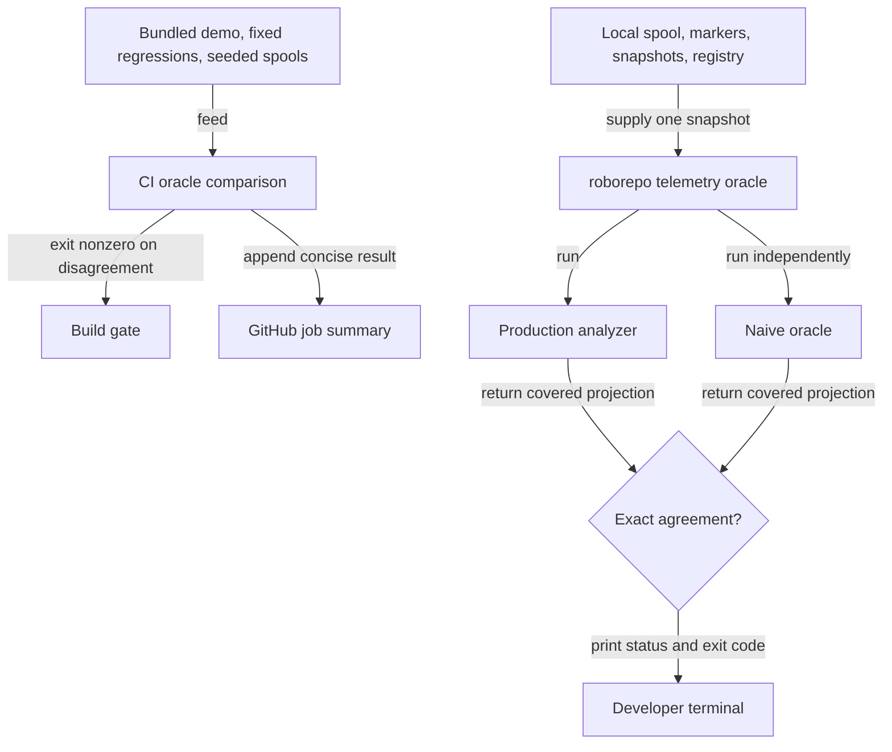

# Independent verification for telemetry analytics

## Summary

Verify the telemetry analytics with an independent implementation, through two signals:

1. a deterministic CI gate that recomputes the covered analytics from bundled and seeded evidence
   and breaks the build on any disagreement; and
2. an on-demand diagnostic, `roborepo telemetry oracle`, that runs the same comparison once over
   the developer's real local evidence and prints a privacy-safe result.

The CI gate is implemented and stays. The second signal was first built as an always-on live
observer: a background worker, a cached health endpoint, and a polling `Oracle health` badge on
the Tokens page. A code review of
[kirinmurphy/roborepo-alpha#21](https://github.com/kirinmurphy/roborepo-alpha/pull/21) found that
this machinery cost more than it returned. Phase 8 replaces it with the command and removes the
observer, endpoint, and badge. See the Decision Log.

## Context

The Tokens report previously relied on focused fixtures that exercised production analysis helpers
directly. Those checks could not catch an error repeated in both the fixture's expectation and the
implementation. The oracle closes that gap: it starts again from raw events, uses deliberately
direct calculations, and compares its covered results with `scripts/cli/telemetry-analyze.mjs`.

Fixtures and seeded spools only contain event shapes their author anticipated. Running the same
comparison over real local evidence is the one thing CI cannot do: it surfaces unmodeled shapes as
`partial` and real disagreements as `failed`.

### Terms

| Term | Meaning |
| --- | --- |
| Production analyzer | The implementation that supplies the CLI report and Tokens dashboard. |
| Oracle | An independent, intentionally obvious recomputation from raw event fields. It does not import production normalization, condition, boundary, finding, or metric helpers. |
| Comparison | One run of production and oracle over the same raw evidence snapshot, projected onto the oracle's covered fields and compared exactly. Implemented by `scripts/cli/telemetry-oracle-compare.mjs`. |
| Oracle result | The small, privacy-safe record a comparison returns: status, aggregate counts, coverage, differing field names, and an optional error category. |
| Evidence snapshot | The spool files, markers, snapshots, and repository registry read once from local state. |

## Goals

- Preserve an independent implementation for harness-scoped sessions, token coverage, mirrored
  operation deduplication, affected-session condition cohorts, marker boundaries and exclusions,
  evidence gating, per-call regression, and harness-local loop detection.
- Keep the deterministic oracle in the normal CI gate, with its result visible in the GitHub
  Actions job summary.
- Let a developer run the comparison over their real local evidence with one command, and get a
  clear status and exit code.
- Keep the command's output privacy-safe: aggregate counts, coverage categories, and field names
  only.
- Remove all background scheduling, portal routes, and Tokens UI that existed only for the live
  observer.

## Non-goals

- Running the comparison in the background, on a schedule, or from the portal.
- Any portal endpoint or Tokens page UI for oracle results.
- Replacing the focused telemetry, presentation, route, and browser checks. The oracle is one
  confidence layer, not a substitute for the rest of the suite.
- Independently verifying unrelated dashboard totals, generated insight prose, marker persistence,
  approximate waste attribution, transcript lookup, or browser rendering.
- Making the naive oracle incremental. Full recomputation is slower but easier to audit.
- Sending telemetry, oracle results, or failure evidence off the machine.
- Printing raw events, prompts, file paths, command output, or minimized live-spool JSONL.
- Running the fixture shrinker on live evidence. It can be quadratic in event count and is designed
  for small synthetic cases.

## Current state

### Kept: independent oracle and CI gate

The oracle recomputes these values without importing production analysis helpers:

| Covered invariant | Independent calculation |
| --- | --- |
| Session identity | One session per `[harness, session_id]`, plus the subset with usable token data. |
| Operation identity | Mirrored schema-v3 captures collapse by harness, session, and call; fallbacks remain deterministic. |
| Condition comparisons | Spike, loop, and read-warning affected-session rates for model, repository, harness, packages, and skills, with present, absent, and unknown cohorts. |
| Change boundaries | Before and after cohorts use `effective_at ?? ts`; touching, spanning, and ambiguous sessions are excluded and counted. |
| Evidence policy | Minimum cohort `10`, minimum affected events `3`, and display band `20%` are encoded locally rather than imported. |
| Regression | Per-call before/after averages split only at a distinct timestamp within one comparable stream. |
| Loop isolation | Repetition is detected within a harness-scoped session and never across harnesses. |

| Area | Files | State |
| --- | --- | --- |
| Independent core | `scripts/cli/telemetry-oracle-{observations,findings,cohorts,regression,run}.mjs` | Kept unchanged. An import-boundary assertion in `scripts/test/telemetry-oracle-core-check.mjs` rejects production helper imports. |
| Comparison boundary | `scripts/cli/telemetry-oracle-compare.mjs` | Kept. Returns `passed`, `partial`, `failed`, or `unavailable` with sanitized differences. |
| CI comparator | `scripts/test/telemetry-oracle-check.mjs`, `scripts/test/fixtures/telemetry-oracle-cases.mjs` | Kept. Nine cases (one bundled demo, two fixed regressions, six seeded spools), 879 events. Exits nonzero on disagreement and appends a summary to `GITHUB_STEP_SUMMARY`. |
| Live coverage accounting | `scripts/test/telemetry-oracle-live-check.mjs` | Kept. Covers legacy repository hashes staying unresolved, unsupported shapes, skipped evidence, and privacy of injected disagreements. |

### Removed: live observer

| Area | Files |
| --- | --- |
| Observer scheduler | `scripts/cli/telemetry-oracle-observer.mjs`; `scripts/test/telemetry-oracle-observer-check.mjs`; `scripts/test/fixtures/telemetry-oracle-observer.mjs` |
| Worker thread | `scripts/cli/telemetry-oracle-worker.mjs` (its evidence reader moves; see Proposed design); `scripts/test/telemetry-oracle-worker-check.mjs` |
| Portal wiring | Observer start, stop, and `loadOracleHealth` in `scripts/cli/telemetry.mjs`; the `Worker` import; `telemetryOracleEvidenceSignature` |
| Health endpoint | `GET /api/telemetry/oracle-health` in `scripts/cli/portal-routes-telemetry.mjs`; `scripts/test/telemetry-oracle-route-check.mjs` |
| Runtime check | `scripts/test/telemetry-oracle-runtime-check.mjs`, which measured portal responsiveness while the worker ran |
| Tokens badge | `portal/tokens/oracle-health.js`; its import and `start()` calls in `portal/tokens/app.js`; badge and dialog markup in `portal/tokens/index.html`; badge and dialog styles in `portal/tokens/styles.css`; `scripts/test/portal-ui/telemetry-oracle-health.spec.mjs` |
| Screenshots | `docs/images/tokens/oracle-health{,-detail}-{light,dark}.png`; the Oracle captures and the "Oracle guide screenshots are served" test in `scripts/test/portal-ui/telemetry-documentation.spec.mjs` |

Two shared portal changes made while building the badge stay. The `[data-doc-anchor]` click
delegate moved from `portal/tokens/app.js` into the shared factory in
`portal/shared/doc-guide-modal.js`, so any page that creates a doc guide gets it; Tokens is its only
user today. `portal/shared/info-icon.js` now forwards `aria-controls` to its inner button, a
general accessibility fix that no current `portal-info-icon` sets. The delegate's line that closed
a host dialog before opening the guide served only the Oracle dialog and is removed, so the guide
opens over the session drill-down as on main.

The branch also carries one incidental test refactor: `scripts/test/lib/fake-response.mjs` (c283fca1)
shares one fake `ServerResponse` across four route-table checks. It changes no product behavior.

The branch also extended the report cache signature to cover markers, snapshots, and the repository
registry (`telemetryReportEvidenceSignature` in `scripts/cli/telemetry.mjs`). That fixes a stale
report cache independently of the oracle and stays. It shares stamp helpers with the strict oracle
signature, which is removed.

### Disagreements found

| Comparison | Resolution |
| --- | --- |
| Production midpoint regression split calls with equal timestamps across before and after cohorts. | Confirmed as a production bug. `regression()` in `scripts/cli/telemetry-analysis/regression.mjs` now chooses the closest distinct timestamp boundary and reports unavailable when no temporal ordering exists. Two fixed oracle regressions pin both cases. |
| Bundled demo and six seeded random spools | No remaining disagreement after the timestamp fix. |

### Performance evidence

These measurements were taken with the worker this phase removes. They still estimate how long the
command will take, because the command does the same read and both calculations.

| Input | Read plus both calculations |
| --- | ---: |
| Deterministic CI suite, 879 events | about 0.20 seconds for the full check |
| Synthetic 4 MiB spool, 1,905 events | 189 ms |
| Synthetic 24 MiB spool, 11,405 events | 1,016 ms |
| Synthetic 24 MB spool, 11,070 events (oracle only) | about 2.2 seconds and about 28 MB temporary heap growth |

Cost grows roughly `N log N` in event volume, plus sessions × condition cardinality and sessions ×
watched markers.

## Proposed design

### Confidence layers



CI protects committed behavior against a repeatable corpus. The command checks the installed
analyzer against the developer's real evidence when they choose to run it.

### Command behavior

```bash
roborepo telemetry oracle [--json]
```

1. Read one evidence snapshot from local state: spool `.jsonl` files, markers, snapshots, and the
   repository registry. Count unparseable records per store instead of failing.
2. Call `compareTelemetryOracle(events, options)` in-process. A short-lived CLI process has no
   event loop to protect, so no worker thread is needed.
3. Add `checked_at` and `duration_ms`, then project the result through the result schema.
4. Print the result and exit with the status's code.

Default output is a few readable lines. The shape below is illustrative; real counts come from the
snapshot:

```text
Oracle check: Passed
Evidence: 1,845 events · 7 sessions · 912 operations
Coverage: 1,845 supported · 0 unsupported
Checked: sessions, operations, conditions, boundaries, gating, regression, loops
Duration: 292 ms
```

`failed` adds a `Differences:` line listing differing field names. `unavailable` adds the error
category. `--json` prints the projected result object instead, for scripts.

| Status | Exit code | Meaning |
| --- | ---: | --- |
| `passed` | 0 | Exact agreement, and every required row was independently interpretable. |
| `failed` | 1 | Production and oracle disagree on at least one covered field. |
| `partial` | 2 | Covered values agree for supported rows, but some rows or condition inputs could not be interpreted independently. |
| `unavailable` | 2 | No events, no comparable input, or an operational error such as an unreadable store. |

Exit code 2 means inconclusive: the check neither passed nor found a disagreement.

### Result contract

The result schema drops the fields that only served the observer: `evidence_signature` and the
`checking` and `stale` statuses.

```json
{
  "schema": 1,
  "status": "passed",
  "checked_at": "2026-10-01T18:22:31.000Z",
  "duration_ms": 292,
  "event_count": 1845,
  "session_count": 7,
  "operation_count": 912,
  "coverage": {
    "supported_events": 1845,
    "unsupported_events": 0,
    "comparable": true,
    "complete": true,
    "issues": [],
    "checks": ["sessions", "operations", "conditions", "boundaries", "gating", "regression", "loops"]
  },
  "differences": [],
  "summary": "Production and oracle calculations agree for the checked supported evidence."
}
```

`coverage.issues` lists `{ category, count }` pairs: the machine-readable cause behind `partial`
and behind an `unavailable` caused by uninterpretable evidence. An `unavailable` with no events has
`event_count: 0` and `coverage.comparable` and `coverage.complete` both `false`, and one caused by
a read or comparison failure carries `error_category`. `error_category` appears only on
`unavailable`. Schema version 1 never shipped outside this branch, so it is not bumped.

### Module ownership

| File | Responsibility |
| --- | --- |
| `scripts/cli/telemetry-oracle-evidence.mjs` (new) | Read one raw evidence snapshot from explicit paths and count skipped records. Moved from `readEvidenceSnapshot` in the worker, behavior unchanged. |
| `scripts/cli/telemetry-oracle-command.mjs` (new) | Parse `--json`, resolve evidence paths from `scripts/cli/state-paths.mjs`, run the read and comparison, time it, format output, and map status to exit code. Only orchestration and formatting live here. |
| `scripts/cli/telemetry-oracle-compare.mjs` | Logic unchanged; comments reworded to describe the command. The only runtime module that knows both implementations. |
| `scripts/cli/telemetry-schemas/oracle-result-schema.mjs` | Renamed from `oracle-health-schema.mjs`. The four statuses, the projection, error categories, and status summaries. |
| `scripts/cli/telemetry.mjs` | Add `case "oracle"` to `telemetryCommand`, delegating to the command module. No oracle logic. |
| `manifests/platform/cli/command-definitions/telemetry/oracle.command.json` (new) | Command definition beside `report.command.json`, in the `Monitoring` menu section. |

In `scripts/cli/telemetry.mjs`, rename `ORACLE_EVIDENCE_PATHS` and `oracleEvidence` to
report-neutral names, because only the report signature uses them now. Keep the `strict` stamp
mode: the registry stamp in the same file relies on its strict default.

## Implementation plan

### Phases 1–4: Independent oracle, CI gate, reusable core — completed

- [x] Define the oracle boundary and implement every covered invariant listed in Current state.
- [x] Compare the bundled demo, two fixed regressions, and six deterministic seeded spools with
      production analysis; print the seed and shrink failures to replayable JSONL.
- [x] Investigate and fix the equal-midpoint-timestamp regression bug in production; pin both
      timestamp cases.
- [x] Add `npm run test:telemetry-oracle` and register the comparator in the `ci` check group.
- [x] Extract the independent modules and the comparison boundary from the test runner; enforce
      the import boundary in `telemetry-oracle-core-check.mjs`.
- [x] Inventory raw schema and repository identity forms; add coverage accounting so unsupported,
      skipped, or malformed evidence yields `partial` or `unavailable`, never `passed`.

### Phases 5–7: Live observer, endpoint, and badge — completed, then superseded

These phases built the isolated worker, observer scheduler, complete evidence signature, cached
`/api/telemetry/oracle-health` route, Tokens badge and details dialog, browser tests,
documentation screenshots, and the GitHub job summary. Phase 8 keeps the job summary
(`telemetry-oracle-summary-check.mjs`) and the report-signature extension, and removes the rest.
The last commit containing the full observer is `3483f83d`.

### Phase 8: On-demand command replaces the live observer

Command:

- [x] Move `readEvidenceSnapshot` and its helpers from `scripts/cli/telemetry-oracle-worker.mjs`
      into `scripts/cli/telemetry-oracle-evidence.mjs` without changing behavior.
- [x] Rename `scripts/cli/telemetry-schemas/oracle-health-schema.mjs` to
      `oracle-result-schema.mjs`. Remove `evidence_signature`, `checking`, `stale`,
      `staleOracleHealth`, and the observer-only error categories (`signature_error`,
      `worker_start_error`, `worker_crash`, `worker_timeout`, `invalid_worker_result`,
      `invalid_cached_health`). An unrecognized error category projects to `comparison_error`
      instead of the removed `invalid_worker_result`. Rename its exports to match, for example
      `createOracleHealthResult` to `createOracleResult`, `emptyOracleHealth` to
      `emptyOracleResult`, and `ORACLE_HEALTH_SCHEMA_VERSION` to `ORACLE_RESULT_SCHEMA_VERSION`.
      Update every importer.
- [x] Add `scripts/cli/telemetry-oracle-command.mjs` with the behavior, output, and exit codes in
      Command behavior.
- [x] Add `case "oracle"` to `telemetryCommand` in `scripts/cli/telemetry.mjs` and the command
      definition `manifests/platform/cli/command-definitions/telemetry/oracle.command.json`.

Removal:

- [x] Delete the observer, worker, route, runtime-check, and Tokens badge files listed in "To
      remove: live observer", and their entries in `scripts/test/check-groups.json`.
- [x] Remove observer wiring, `loadOracleHealth`, the `Worker` import, and
      `telemetryOracleEvidenceSignature` from `scripts/cli/telemetry.mjs`; rename the shared
      evidence helpers as described in Module ownership.
- [x] Remove the route entry and schema import from `scripts/cli/portal-routes-telemetry.mjs`.
- [x] Reword the comments in `scripts/cli/telemetry-oracle-compare.mjs` that name the observer or
      a live caller so they describe the command.
- [x] Remove the badge import and `start()` calls from `portal/tokens/app.js`, and drop "the
      Oracle health guide button" from the doc-guide comment there.
- [x] Remove the badge and dialog markup from `portal/tokens/index.html` and their styles from
      `portal/tokens/styles.css`.
- [x] Remove the Oracle captures, `oracleHealthSample`, and the "Oracle guide screenshots are
      served" test from `scripts/test/portal-ui/telemetry-documentation.spec.mjs`; delete the four
      `oracle-health*` PNGs.

Tests:

- [x] Retarget `scripts/test/telemetry-oracle-health-check.mjs` to the result schema, renamed
      `telemetry-oracle-result-check.mjs`: the four statuses, privacy-safe projection, removal of
      unexpected fields, and `error_category` only on `unavailable`.
- [x] Retarget `scripts/test/telemetry-oracle-signature-check.mjs` to
      `telemetryReportEvidenceSignature` only, keeping its marker, snapshot, registry, rename, and
      same-size-edit cases.
- [x] Add `scripts/test/telemetry-oracle-evidence-check.mjs` carrying the evidence-reader cases
      from the deleted worker check: unresolved legacy repository hashes, per-store skipped counts,
      unsafe parsed rows, and I/O failure.
- [x] Add `scripts/test/telemetry-oracle-command-check.mjs`. Run the real command against a
      disposable `ROBOREPO_STATE_DIR` and assert, for a supported spool: `Passed`, exit 0, and
      readable counts; with `--json`: a schema-valid object with no raw event fields, prompt text,
      or paths; for an empty spool: `unavailable` and exit 2. Unit-test the status-to-exit-code
      mapping for all four statuses. Disagreement detection stays covered by
      `telemetry-oracle-live-check.mjs`.
- [x] Register the new and renamed checks in `scripts/test/check-groups.json`.

Documentation:

- [x] Apply every update in Documentation impact.

## Validation

### Focused checks

```bash
node scripts/test/run-checks.mjs --filter telemetry-oracle
node scripts/test/run-checks.mjs --filter telemetry
node scripts/test/portal-ui/run.mjs
```

Expected results:

- the deterministic suite still reports nine cases, 879 events, 204 condition rows, 21 marker
  comparisons, and 32 regression groups, and the job-summary check still passes;
- the import-boundary assertion still rejects production helper imports from oracle modules;
- the command check proves exit codes 0 and 2 end to end, the full exit-code mapping, and
  privacy-safe `--json` output;
- the portal browser suite passes with the Oracle health spec and captures removed.

### Manual check

```bash
roborepo telemetry oracle
roborepo telemetry oracle --json
```

Run against real local telemetry. Record the status, duration, and event count under
Verification. A `partial` or `failed` result on real data is a finding to record, not a reason to
change the command.

### Removal check

```bash
git grep -n -i "oracle-health\|oracleHealth\|telemetry-oracle-observer\|telemetry-oracle-worker\|telemetryOracleEvidenceSignature" -- ':!docs/plans'
```

Expected: no matches.

### Repository completion gate

```bash
bash scripts/doctor.sh --quiet
npm run check
git diff --check main...HEAD
```

This phase changes CI check groups, the CLI command surface, shared server wiring, and browser UI,
so the full local parity gate is required before handoff. Report any command that cannot run
rather than substituting a narrower check.

## Documentation impact

| Document | Update |
| --- | --- |
| `docs/user/guides/telemetry.md` | Replace the "Oracle health" section and its two screenshots with a short section on `roborepo telemetry oracle`: what it checks, the status and exit-code table, what it does not verify, and that output contains only aggregate counts and field names. |
| `docs/user/reference/roborepo-cli.md` | Add a `roborepo telemetry oracle [--json]` row to the telemetry command table. |
| `docs/internal/telemetry-internals.md` | Replace the runtime observer, cached endpoint, and stale-signature diagram with the command flow; keep the CI confidence diagram and the independent oracle section. |
| `docs/images/tokens/README.md` | Delete it and the directory's remaining images, to match main, which removed them in 23e15c3e; this branch's merge 3483f83d had brought them back. |
| `scratch/telemetry-analytics-oracle/README.md` | Remove the Oracle health section and the sentence describing the live observer and badge. |

## Verification

Evidence from completed phases that still applies after Phase 8:

- `npm run test:telemetry-oracle` passes all nine cases: 879 raw events, 204 condition rows, 21
  marker comparisons, and 32 regression groups. The job-summary check verifies those totals are
  appended through `GITHUB_STEP_SUMMARY`.
- `node scripts/test/telemetry-oracle-core-check.mjs` passes import-boundary rejection fixtures,
  harness identity, mirror deduplication, token coverage, input preservation, order independence,
  and evidence-policy checks.
- `node scripts/test/telemetry-oracle-live-check.mjs` passes unresolved legacy repository hashes, raw
  schema coverage, unsupported evidence, skipped-evidence accounting, and privacy checks. Injected
  disagreements in every projected field group yield sanitized `failed` results.
- Complete production reports matched the pre-refactor analyzer across 213 fixture and option
  cases after the analysis modules were split.
- After Phase 7, before the latest merge from main, `npm run check` passed repository health (101 checks), 420 CLI checks, installer
  collisions, 19 CI suites, packed-package installation, all four Linux clean-machine scenario
  families, and 34 browser tests. Windows parity was skipped because PowerShell was unavailable.

Observer, endpoint, and badge evidence from Phases 5–7 no longer applies; those components are
removed in Phase 8.

Phase 8, 2026-10-21:

- `node scripts/test/run-checks.mjs --filter telemetry` passes 35 suites, including the new
  `telemetry-oracle-result-check`, `telemetry-oracle-evidence-check`,
  `telemetry-oracle-command-check`, and `telemetry-report-signature-check`, and the unchanged
  deterministic suite and job-summary check (nine cases, 879 events).
- The command check runs the real CLI against a disposable `ROBOREPO_STATE_DIR`: `Passed` and exit 0
  for a supported spool, `Unavailable` and exit 2 for an empty spool, `--json` free of raw fields,
  prompt text, and paths, and exit codes for all four statuses.
- `node scripts/test/portal-ui/run.mjs` passes 104 browser tests at 7b667863 with the Oracle
  health spec and captures removed, including the test that the session details guide opens over
  the session drill-down.
- `node scripts/test/cli-command-catalog-check.mjs` and
  `node scripts/test/cli-surface-integration-check.mjs` pass with the new command definition.
- The removal check `git grep` returns no matches outside `docs/plans`.
- Portal started from this worktree on port 4341: `/tokens` renders the report with no Oracle badge
  or dialog, makes no oracle request, and has no failing resource after a reload;
  `GET /api/telemetry/oracle-health` returns 404.
- Manual check against real local telemetry (31 MB spool): `roborepo telemetry oracle` printed
  `Unavailable` with exit 2 in 148 ms, and `--json` printed the same status in 120 ms over 18,075
  events: 15,160 supported, 2,915 unsupported. Issues: `unsupported_bare_tool` 2,456,
  `unknown_model` 251, `missing_snapshot` 228, `unresolved_repository` 14. The unsupported bare-tool
  rows make the input not comparable, so the comparison did not run. This is a finding about live
  event shapes, recorded in Open questions, not a defect in the command.

## Risks

| Risk | Mitigation |
| --- | --- |
| Nobody runs the command, so real-data shape drift goes unnoticed. | CI remains the guardrail for committed behavior. The user guide and CLI reference document the command for developers changing analytics. |
| The command is slow on a near-cap spool. | Measured at about 1–2 seconds at 24 MiB. Acceptable for an explicit diagnostic; it never runs on a request path. |
| Removing the badge strands shared portal code. | The removal check greps for every observer symbol. The doc-guide delegate and `aria-controls` change stay, because other triggers use them. |
| Output exposes sensitive telemetry. | Output passes through the result-schema projection; the command check asserts no raw fields, prompt text, or paths in `--json` output. |
| The oracle becomes production logic in disguise. | The import-boundary assertion is unchanged. |

## Decision Log

- 2026-10-20 — Replace the always-on live observer with an on-demand command. A code review of
  [kirinmurphy/roborepo-alpha#21](https://github.com/kirinmurphy/roborepo-alpha/pull/21) found that
  the observer re-ran full comparisons on unchanged evidence whenever the result was `unavailable`,
  including permanent causes such as no comparable input. It also found that the badge sat beside
  the window- and harness-filtered report while checking all local evidence, and that the scheduler,
  signature, endpoint, and polling UI were a large share of the PR's oracle code and tests. A disagreement on the
  badge is also not something a portal user can act on. The CI oracle and the comparison boundary
  are kept; the command keeps the one capability CI lacks, checking real local evidence. Decided by
  the user.
- 2026-10-21 — Restore `serveCommand` in `scripts/cli/telemetry.mjs` to main's shutdown shape (a
  synchronous SIGTERM handler, no SIGINT hook, no returned server, a plain warm-up timer). The async
  stop, SIGINT hook, close listener, and `closing` guard existed only to await worker exit.
  Alternative: keep them as general lifecycle hardening; rejected because nothing else uses them
  and the plan removes all observer wiring.
- 2026-10-21 — Load the command module with a dynamic import from `telemetryCommand`, as the
  `capture` case does. Alternative: a static import; rejected because it would load the oracle and
  comparison modules on every portal start and every other telemetry subcommand.
- 2026-10-21 — Rename `telemetry-oracle-signature-check.mjs` to
  `telemetry-report-signature-check.mjs`. After the strict oracle signature is removed, the check
  covers only the report cache key, so the old name would misdirect. The plan said "retarget";
  the rename follows from it.
- 2026-10-21 — Fold the shared `oracleEvidence` helper into `telemetryReportEvidenceSignature`,
  with `REPORT_EVIDENCE_PATHS` replacing `ORACLE_EVIDENCE_PATHS` and including experiments. Its one
  remaining caller made a separate helper indirection with no reuse. `evidenceDirectoryStamp` drops
  its `strict` parameter because only non-strict callers remain; `evidenceFileStamp` keeps its
  strict default, which `registrySignature` relies on.
- 2026-10-21 — The readable output adds an `Issues:` line listing coverage categories and counts
  when any exist. Without it, `partial` and `unavailable` give no reason. It prints only fixed
  category names and counts, so it stays within the privacy contract.
- 2026-10-21 — A comparison that fails the schema's shape rules projects to `unavailable` with
  `comparison_error`, replacing the removed `invalid_worker_result`, matching the plan's rule for
  unrecognized categories.
- 2026-10-21 — Remove the screenshot loop from `telemetry-documentation.spec.mjs` entirely, rewrite
  `docs/images/tokens/README.md` to describe the documentation fixture, and drop the root README's
  "screenshot gallery" link. The Oracle captures were the loop's only captures and the gallery's
  only rows, so removing just those (as the plan states) would leave a test that captures nothing
  and a gallery with no images. The fixture and its matrix check are unchanged.
- 2026-10-21 — User decision: restore main's `docs/images/tokens/` state, superseding the README
  part of the previous entry. Main deliberately deleted `docs/images/tokens/README.md`, its images,
  and the root README sentence "Compare observed problem rates… fictional sample data…" in
  23e15c3e; this branch's merge 3483f83d brought the README and sentence back for the Oracle
  gallery, along with `model-metrics-{light,dark}.png`, which were never on main and referenced
  nowhere. Deleted the README and both PNGs, removed the root README sentence, and dropped the
  scratch page's link. Alternative: keep the rewritten fixture README as a new doc; rejected by the
  user in favor of matching main.
- 2026-10-21 — User decision: the Tokens doc guide opens over the session drill-down, as on main.
  Removed the line in `portal/shared/doc-guide-modal.js` that closed a host dialog before opening
  the guide; it existed only for the removed Oracle dialog's guide button. A browser test in
  `telemetry-documentation.spec.mjs` failed before the change and passes after it. Alternative:
  keep closing the host dialog as deliberate UX; rejected by the user.
- 2026-10-21 — User decision: an `unavailable` result with zero events projects
  `coverage.comparable` and `coverage.complete` as `false`, in `oracle-result-schema.mjs`. The
  unchanged comparison boundary reports empty input as comparable and complete, so `--json` said
  "complete" for zero evidence. The result and command checks failed before the change and pass
  after it. Alternatives: change the comparison boundary's early return (the plan keeps that module
  unchanged and CI reads it), or document the fields as meaningless on `unavailable`; both rejected
  by the user.
- 2026-10-21 — User decision: unblock the submit transition with a one-time `next_action` edit to
  main's copy of this plan (517cca6c), then submit (257fcea8). Submit validated main's copy, which
  still had the empty `next_action` from the start transition. Alternatives: review while the plan
  stays in `active/` (rejected: `/plan-close` closes only from `review/`); change submit to validate
  the worktree copy (rejected for this plan: plan-suite tooling outside its scope).
- 2026-10-21 — User decision: restore main's session-close skill and its three generated commands
  on this branch (b0765686). A branch-only commit, 95c784cc, had added a screenshot-refresh rule
  unrelated to the oracle. It can land on its own.
- 2026-10-21 — User decision: move the unrelated backlog plan `os-windows-lifecycle-coverage.md`
  to main as its own commit (18c664ce); the base sync 48145e83 removed it from this branch's diff.
- 2026-10-21 — User decision: keep the `scripts/test/lib/fake-response.mjs` test refactor
  (c283fca1) and record it in Current state.

## Open questions

None block Phase 8. Any live event shape that cannot be interpreted independently stays `partial`
or `unavailable`. Treating such rows as `passed` would be a product decision that needs review.

- Not blocking: on the developer's real telemetry the command reports `unavailable`, because 2,456
  of 18,075 events are `unsupported_bare_tool` rows, which make the whole input not comparable
  rather than `partial`. Until the oracle can interpret those rows, or excludes them as `partial`,
  the command cannot compare this machine's evidence at all. Options: teach the oracle the bare-tool
  shape (most faithful, more independent code to maintain); downgrade the category from
  not-comparable to `partial` (compares the rest, but the production analyzer still sees the rows,
  so totals may disagree); or leave it (the command stays honest but inconclusive here).
  Recommendation: investigate the bare-tool shape in a follow-up plan. Blocks no Phase 8 task.

## Not tested

- [ ] `roborepo telemetry oracle` reaches `Passed` on a real developer machine. The only real
      spool available during implementation was `unavailable` (see Verification), and the
      `Passed` path is covered only by the command check's synthetic spool.

## Review

### Findings

- [x] `telemetry oracle --help` omits `--json`: the command definition has no `usage` field. — fixed (fd4582cd)
- [x] No test covers the conditional `Differences:`, `Error:`, and `Issues:` output lines. — fixed (fd4582cd)
- [x] The user guide's `Unavailable` row implies waiting fixes it, but uninterpretable shapes also
      cause it. — fixed (fd4582cd)
- [x] `scratch/telemetry-analytics-oracle/README.md` still points at a screenshot gallery and
      reproduction command that no longer exist, and its three image links are broken. — fixed (fd4582cd)
- [x] Two assertion messages in `telemetry-oracle-result-check.mjs` name the removed observer. — fixed (fd4582cd)
- [x] `scripts/cli/telemetry-oracle-findings.mjs` ends with a blank line, which
      `git diff --check main...HEAD` reports. — fixed (fd4582cd)
- [x] The user guide's `Unavailable` row says the `Issues:` line names every cause, but a read
      error is on the `Error:` line and an empty spool shows only `Evidence: 0 events`. — fixed (2ebeae7f)
- [x] The internals doc says the evidence reader resolves legacy repository identity; it passes the
      registry through, and unresolved legacy identity stays `partial`. — fixed (2ebeae7f)
- [x] The Result contract example omits `coverage.comparable`, `complete`, and `issues`, which
      `--json` prints. — fixed (2ebeae7f)
- [x] The internals doc says the oracle resolves `repo.normalized_remote_hash` through the registry
      and credits observations with identity resolution; the code and checks prove legacy hashes stay
      unresolved. The plan repeated "legacy repository resolution" in three places. — fixed (259fa943)
- [x] The Result contract says `coverage.issues` explains every `unavailable`; an empty spool and a
      read error both leave it empty. — fixed (259fa943)
- [x] `docs/images/tokens/model-metrics-{light,dark}.png` are unreferenced and absent on main.
      Resolved by the user decision in the Decision Log. — fixed (79d785d5)
- [x] `docs/images/tokens/README.md`, the root README's Tokens sentence, and the scratch link to it
      were deleted on main in 23e15c3e and came back through the merge 3483f83d. Resolved by
      the user decision in the Decision Log. — fixed (79d785d5)
- [x] The two pass-4 findings and the pass-4 Verification line still point at Open questions; the
      user decision (Decision Log, 2026-10-21) resolved those entries. — fixed (571abb26)
- [x] `## Validation > Repository completion gate` lists `git diff --check`; the repository gate is
      `git diff --check main...HEAD`, and the bare form checks nothing on a clean tree. — fixed (571abb26)
- [x] The doc-guide delegate closes the session drill-down before opening the guide, changing
      main's session flow. Escalated; resolved by user decision (Decision Log). — fixed (571abb26)
- [x] `--json` on an empty spool reports `comparable: true` and `complete: true` with `unavailable`.
      Escalated; resolved by user decision (Decision Log). — fixed (571abb26)
- [x] Verification still reports 103 browser tests; the drill-down test makes it 104. — fixed (9bedca3e)

Human review, 2026-10-21, at bd5372a6 (after the base sync):

- [x] Frontmatter `next_action` still asks for the submit-refusal answer; the plan is now in review. — fixed in review (6126f79a)
- [x] Open questions keeps the "Blocking (external): the submit transition refuses" entry; the
      user chose the one-time `next_action` edit on main's copy (517cca6c) and submit succeeded
      (257fcea8). The decision is not in the Decision Log. — fixed in review (6126f79a)
- [x] Review > Verification says commits after 7b667863 change only this plan, so its gate stands;
      the base merge bd5372a6 brought implementation changes from main. — fixed in review (6126f79a)
- [x] Current state says the doc-guide delegate and `aria-controls` stay "because other code uses
      them"; the delegate moved from `portal/tokens/app.js` into the shared factory and Tokens is its
      only user, and no `portal-info-icon` sets `aria-controls`. — fixed in review (6126f79a)
- [x] Module ownership calls `telemetry-oracle-compare.mjs` "Unchanged", but a Phase 8 task reworded
      its comments; the "To remove: live observer" heading describes completed work in future tense. — fixed in review (6126f79a)
- [x] `globals/packages/session-close/skills/session-close/SKILL.md` and its three generated
      commands add a "refresh documentation screenshots" rule (branch-only, 95c784cc) outside this
      plan. — escalated; user chose to drop it, fixed in review (b0765686)
- [x] `docs/plans/backlog/os-windows-lifecycle-coverage.md` is an unrelated backlog plan that exists
      only on this branch (530eb39b). — escalated; user chose to move it to main (18c664ce, synced in 48145e83)
- [x] `scripts/test/lib/fake-response.mjs` and its four importers are a test-helper refactor
      (c283fca1) the plan does not mention. — escalated; user chose to keep it, recorded in review (6126f79a)

Validator pass 2 of the human review, at 7e43b329:

- [ ] Current state says the branch extended the report signature to cover markers, snapshots, and
      the registry; main already covered markers, experiments, and snapshots. The branch adds the
      registry, per-file stamps (device, inode, ctime, names), and a stable fallback for unreadable
      entries.
- [ ] Current state does not record three branch changes: the production analyzer split into
      `scripts/cli/telemetry-analysis/` (a6defd13), the split of `telemetry-schemas-check.mjs` into
      `scripts/test/telemetry-schemas/` (a6defd13), and `aria-labelledby` on the Tokens doc dialog
      in `portal/tokens/index.html` (55c2b2b5).
- [ ] The first Removal task still points at the heading "To remove: live observer", renamed
      "Removed: live observer" in 6126f79a.
- [ ] The Decision Log and the Review findings say 95c784cc added the screenshot rule to
      session-close; it changed the wrap-up skill, and a later merge carried the rule into
      session-close.

### Verification

- Validation pass 1 at 272baded (fresh-context subagent): 6 `fix` findings, no `escalate` or
  `base`.
- Validation pass 2 at 7a47642a (fresh-context subagent): 3 `fix` findings, no `escalate` or
  `base`.
- Validation pass 3 at 0a221fb2 (fresh-context subagent): 2 `fix` findings, no `escalate` or
  `base`. Full gate at 0a221fb2: doctor passed, `git diff --check main...HEAD` clean,
  `npm run check` passed (445 CLI tests, 46/46 suites, 103 browser tests; Windows installer parity
  skipped, `pwsh` unavailable).
- Validation pass 4 at 18f3422e (fresh-context subagent): 1 `fix` and 1 `escalate` finding, no
  `base`. Both concern files a merge restored from before main deleted them; both were resolved
  by the user decision in the Decision Log. Agent-runnable checks all passed at this commit.
- Validation pass 5 at 88e0c7e3 (fresh-context subagent): 2 `fix` and 2 `escalate` findings, no
  `base`. Pass 5 is the cap, so the loop stopped with all four open and the plan was not submitted.
- Full gate at 88e0c7e3: doctor passed, `git diff --check main...HEAD` clean, `npm run check`
  passed (445 CLI tests, 46/46 suites, 103 browser tests; Windows installer parity skipped, `pwsh`
  unavailable).
- After the user's answers, a fresh Validation Loop. Pass 1 at 7b667863 (fresh-context subagent):
  1 `fix` finding, no `escalate` or `base`.
- Full gate at 7b667863: doctor passed, `git diff --check main...HEAD` clean, `npm run check`
  passed (445 CLI tests, 46/46 suites, 104 browser tests; Windows installer parity skipped, `pwsh`
  unavailable).
- Fresh Validation Loop pass 2 at d4b082e8 (fresh-context subagent): no findings. Validation is
  clean on this pass; commits after 7b667863 change only this plan, so the 7b667863 full gate
  stands. Superseded by the human review below: the base merge bd5372a6 brought implementation
  changes, and the gate ran again.

Human review, 2026-10-21:

- Completion preflight passed. Submit first refused with `MISSING_NEXT_ACTION` against main's
  copy; after the user-approved fix 517cca6c it committed the move to review (257fcea8).
- Base sync merged main at 257fcea8 into the branch as bd5372a6, with no conflicts; main brought 11
  implementation files.
- Gate at bd5372a6: doctor passed, `git diff --check main...HEAD` clean. `npm run check` failed
  2 of 445 CLI tests: `plan-lifecycle-transitions-check` and `plan-suite-authority-scan-check`.
  Both pass when run alone on main and on this branch, and
  `node scripts/test/run-checks.mjs --filter plan` passes 16/16 on this branch. The failure did not
  reproduce, and its cause is not established. A second `npm run check` at bd5372a6 passed (445 CLI
  tests, 46/46 suites, 104 browser tests; Windows installer parity skipped, `pwsh` unavailable).
- Validator pass at bd5372a6 (fresh-context subagent): 5 `fix` and 3 `escalate` findings, no
  `base`. `run-checks --filter telemetry-oracle` passed 7/7 suites (9 cases, 879 events); the
  removal check returned no matches; the real-data run is still `Unavailable`, exit 2.
- Base sync merged main at 18c664ce as 48145e83, with no conflicts.
- Gate at 7e43b329: doctor passed (102 checks), `git diff --check main...HEAD` clean,
  `npm run check` passed (445 CLI tests, 46/46 suites, 104 browser tests; Windows installer parity
  skipped, `pwsh` unavailable).
- Validator pass 2 at 7e43b329 (fresh-context subagent): 4 `fix` findings, all plan prose; no
  `escalate` or `base`. `run-checks --filter telemetry-oracle` passed 7/7 suites; every commit the
  Review and Decision Log cite exists and matches its line.

### Result

- Status: pending
- Base commit: 257fcea89f82624175423e33f1aadc6221825912

### Approval

- Decision: not requested
