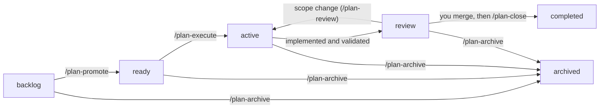

# Plan Suite Walkthrough

## Purpose

The plan suite keeps repository plans in Markdown and gives each step of a plan's life its own
slash command. The Plans page gives you one local place to browse those plans across repositories
and copy the command a plan needs next.

Use it when you want to:

- find backlog, ready, active, review, completed, archived, or unclassified plans across local
  repositories
- write a plan, prepare it, implement it in an isolated worktree with its work checked by a
  separate validator, review and approve it, and close it after you merge it
- keep Markdown files as the source of truth instead of moving plans into a database

## What You Get

| Piece | Always available? | What it does |
| --- | --- | --- |
| Plans page | Yes | Local `/plans` portal view for discovering, filtering, rendering, and copying plan context |
| Plan suite | Optional packages | Seven slash commands, one per lifecycle step |

| Command | What you get |
| --- | --- |
| `/plan-write` | Create a plan with its initial checklist, or revise an existing one, including bringing it up to date with the repository |
| `/plan-promote` | Review and prepare a plan for development, then move it to `ready/` |
| `/plan-execute` | Start or resume implementation in an isolated worktree, check it with a validator and fix what it finds, then move the plan to `review/`; or fix findings a review sent back |
| `/plan-review` | Recheck the finished work against the current base, fix what has a clear fix, show you a review packet, and record your approval |
| `/plan-close` | After you merge the reviewed work, verify it and move the plan to `completed/` |
| `/plan-archive` | Retire a plan that will not be completed, with the reason |
| `/session-close` | End a chat: review and commit the session's work, write the handoff note |

No command takes a mode argument. Each one does one thing, so typing `/plan-` lists every step.
A command never starts the next one: you run each step yourself, normally in a new chat.

## Typical Workflow



1. Run `roborepo web`, open `/plans`, and turn on auto-discovery or add a folder so RoboRepo knows
   your repositories.
2. Enable the plan suite from the Plans page banner.
3. Run `/plan-write` to create a backlog plan.
4. Run `/plan-promote` on it to check it against the repository, resolve open decisions, and move it
   to `ready/`.
5. Run `/plan-execute` to implement it in its own worktree. Run it again to resume in a later chat;
   if you stop mid-work, `/session-close` writes the handoff note. When the work is complete, a
   validator checks it and the same run fixes what it finds; once a check comes back clean, the
   plan moves to `review/`.
6. Run `/plan-review`. It rechecks the work against the current base, fixes anything with a clear
   fix in the same chat, and shows you a review packet. You approve, ask for changes it makes on the
   spot, or decide the questions it could not.
7. Merge the reviewed branch yourself through a pull request.
8. Run `/plan-close`.

## Enable The Plan Suite

The Plans page shows an onboarding banner until the suite is enabled. Its button enables all seven
commands at once, and each command in the list has a **Details** button that shows that command's
skill. The Agents page lists the same seven under **Plan Suite**, with a toggle for the whole
section.

From the CLI, enable each package:

```sh
roborepo package enable plan-write
roborepo package enable plan-promote
roborepo package enable plan-execute
roborepo package enable plan-review
roborepo package enable plan-close
roborepo package enable plan-archive
roborepo package enable session-close
```

`/plan-start` was replaced by `/plan-execute`. Updating RoboRepo removes the old package.

## Where Lifecycle Moves Happen

Every move between lifecycle folders is one commit in the repository's main checkout, on the base
branch, made by a `roborepo plans` command that the suite commands run. The commit contains only
the plan's old and new paths, so other work in the main checkout, staged or not, stays where it is.
Its message names the plan by its filename, for example
`Submit plan plan-lifecycle-review-and-ship-workflow for review`, so `git log` reads without
looking up ids. The suite commands' reports and questions name a plan by its title, with its id in
parentheses once. A refused move changes nothing, running a move again after it succeeded commits nothing, and
nothing is ever pushed.

While a plan is `active` or in `review`, its worktree's copy is the plan: every progress note,
finding, and approval is written there and reaches the base branch when you merge.

## `/plan-write`

Creates a plan, or updates an existing one. The request decides which:

| Request | Work |
| --- | --- |
| No plan owns the work yet | Creates a backlog plan in `docs/plans/backlog/`, with a fresh opaque `id`, a namespaced filename, and an initial checklist |
| An existing plan, to change scope or design | **Revises** it, following your intent |
| An existing plan, after work happened | **Syncs** it from evidence: ticks a task only when the code proves it done, records untested gaps, and updates `next_action` and `reviewed_commit` |

`/plan-write` never moves a plan between lifecycle folders and never writes an approval. It
validates every plan it writes with `roborepo plans validate`, and pairs with `technical-writing`
for the prose.

## `/plan-promote`

Reviews a backlog plan before development: checks its claims against the code, fixes stale
details, refines the checklist, and asks you only about decisions with real tradeoffs. When no
material question remains, it runs `roborepo plans promote`, which moves the plan to `ready/` and
commits the move together with the promotion's edits. A plan that does not meet the Ready
requirements is refused with the list of findings and a repair prompt, and stays where it was.

Run it again on a `ready/` plan to refine it in place. It stops before implementation.

## `/plan-execute`

Starts, resumes, or fixes the implementation of a plan, depending on where the plan is:

| Plan is in | `/plan-execute` |
| --- | --- |
| `ready/` | Creates or safely reuses a worktree under the repository's configured `worktreeRoot`, runs `roborepo plans start` (records the worktree, moves the plan to `active/`, commits, and validates), then implements |
| `active/` | Resumes in the plan's worktree from the first open task |
| `review/` | Fixes only the open findings a review sent back, usually after you decided a question and chose a separate chat for the work; the plan stays in `review/` |
| `backlog/` | Refuses and points you to `/plan-promote` |

While implementing, it works through every unblocked task without stopping for check-ins, records
progress, decisions, and untested work in the worktree's copy of the plan, and reports once at the
end with every open question in one batch.

When the work is finished it runs a validation loop. A validator with fresh context, a separate
agent where the harness has one, reads the plan, the full diff, and the check results, never the
implementing agent's account of the work, and reports findings. It never edits anything. Each
finding gets one of three classes, by consequence rather than size:

| Class | When | What happens |
| --- | --- | --- |
| `fix` | The right fix is clear and stays within the plan's requirements and specified contracts, code included | The same run fixes it and checks it off with its commit |
| `escalate` | The fix chooses between real alternatives, changes requirements or an unspecified contract, or lands outside the plan | It becomes an open question in the run's final batch |
| `base` | The base branch fails the same check | It is recorded as verification, and blocks nothing |

The loop repeats until a pass finds nothing to fix, for at most five passes. The findings and the
passes are recorded in the plan's `## Review` section. Then it runs the completion preflight
(`roborepo plans preflight`), which checks that:

- no task outside `## Not tested` is unchecked;
- `blocked_by` is empty;
- the worktree has no uncommitted changes;
- the feature branch has at least one commit of its own;
- the plan passes the Review requirements, apart from unconfirmed `## Not tested` entries.

If the loop ended clean and the preflight passes, `/plan-execute` runs `roborepo plans submit`,
which moves the plan to `review/`. That says the work is complete and checked, not that you
accepted it. Otherwise the plan stays in `active/` with a `next_action` for the next run; an open
`escalate` finding is an unchecked task, so it holds the plan in `active/` until you answer it.

The first run in a repository asks you to confirm where worktrees go. Later runs reuse that answer.
In Claude, each run also asks once for access to the worktree folder, then works inside it, so edits
there do not prompt one file at a time.

## `/plan-review`

Brings finished work to your review and resumes at the remaining step when rerun. A completed
review records the checked commit separately from your approval, so an interrupted chat can resume
at your decision. An unchanged, already approved review returns **already approved**; a committed
completed plan returns **already closed**. Neither repeats tests or asks for approval again.

A new review runs these steps:

1. for an `active/` plan, runs the completion preflight, and moves the plan to `review/` only if it
   passes;
2. merges the base branch into the feature branch with `roborepo plans sync-base`, which does
   nothing when base has nothing new; on a conflict the merge pauses for a careful resolution, and
   `roborepo plans sync-base --continue` commits it once no conflicts or conflict markers remain;
3. runs the repository's checks, and reruns each failure on the base branch: a failure the base has
   too is recorded as a base failure, not a finding;
4. runs one validator pass over the merged result, with the same classes as `/plan-execute`, and
   records its findings in the plan's `## Review` section;
5. fixes every `fix` finding in the same chat, code included, each in its own commit, and checks
   again until a pass finds nothing to fix. A fixed finding reads
   `- [x] … — fixed in review (<short commit>)`;
6. records the Result as complete once findings and required manual checks are resolved, or pending
   while they remain open, then shows you a review packet: each acceptance criterion with its evidence, what changed, the
   validator passes, the commits it made, base failures, the manual checks waiting on you, and each
   escalated finding as a decision with options and a recommendation.

Then it asks for your approval of the exact commit, and acts on your answer:

| Your answer | What follows |
| --- | --- |
| Approve | It immediately commits the approval for the reviewed implementation and checks that it is fresh |
| Ask for a change, or decide an escalated question, within the requirements | It makes the change in the same chat and shows you the packet again |
| Want the change done in a separate chat | The plan stays in `review/`. Run `/plan-execute`, then `/plan-review` again |
| The requirements themselves must change | With your agreement, it revises the plan, invalidates any approval, and moves the plan back to `active/` with `roborepo plans reopen`. The worktree and branch stay |

The review record looks like this:

```md
## Review

### Findings
- [x] Missing retry test — fixed (a1b2c3d)
- [x] Stale error message — fixed in review (d4e5f6a)

### Verification
- Validation: clean on pass 2 (fresh-context subagent)
- Unit and integration tests passed
- Base failure: `lint` fails on `main` too

### Result
- Status: complete
- Reviewed implementation commit: <full commit id>
- Base commit: <full base commit id>

### Approval
- Decision: approved
- Reviewed implementation commit: <full commit id>
- Confirmed by: human
```

Only you can approve; passing tests are not approval. An approval stays **fresh** while nothing
outside `docs/plans/` changes: recording it, or merging plan-only changes from base, keeps it
fresh, and a code change makes it stale. Check it with `roborepo plans approval <plan>`.

For machine-readable evidence, `roborepo plans approval <plan> --json` reports review freshness
under `review` and human approval under top-level `state`. It returns exit 1 while approval is
pending, even when the review is complete. A completed checklist or successful merge never grants
approval automatically.

If your answer was given but not recorded, `/plan-review` recovers it from an available explicit
answer identifying the reviewed implementation, or asks one confirmation when that answer cannot
be found. It reuses the completed review after checking implementation freshness and current
requirements. If implementation changed, it reviews the changes and runs the gate and Validator
before renewing the Result. Older review records can be recovered from their recorded commits and
verification; incomplete evidence requires only the missing review work.

This approval recovery also works after landing while the plan remains in review. It records
matching plan-only evidence commits in the worktree and primary checkout, keeping close integration
checks intact. Later base changes do not require synchronizing the old feature branch just to
record approval. A partly committed recovery resumes its missing write and preserves independent
plan edits. Closure still requires its own passing test gate.

`/plan-review` never merges your branch into the base branch. After approval, open and merge the
pull request yourself. If base moves again before you merge, run `/plan-review` again.

## `/plan-close`

Closes one plan after you merge it, and refuses rather than closing on incomplete evidence. It
accepts only a plan in `review/`. In order, it:

0. confirms the plan's worktree copy holds nothing the base branch lacks, and refuses with
   `plan: not integrated` when it does; from then on every plan edit goes to the main checkout's
   copy;
1. runs the repository's test command and stops on a failure;
2. checks every claim in the plan against the code;
3. decides complete, incomplete, blocked, superseded, or abandoned; a superseded or abandoned plan
   is handed to `/plan-archive`;
4. refuses while any `## Not tested` entry is unchecked;
5. refuses unless your approval is fresh for the landed branch tip;
6. refuses until the work has landed in the base branch, including after a squash or rebase merge,
   with `roborepo plans landed <plan>`;
7. writes the completion summary and a Verification section, including the absorbing commit as
   `- Absorbing commit: <full commit id>`, then runs `roborepo plans close`, which rechecks
   integration, approval, and landing and commits the move to `completed/`;
8. after that commit succeeds, stops the dev servers still running in its worktree and lists them;
9. runs the repository's worktree cleanup command for the closed plan, removing the worktree and
   local branch when removal succeeds, or reporting why a guard kept them or removal failed.

Landing is scanned once. The first check walks the base branch's history for the commit that
absorbed the branch; after that, `roborepo plans landed`, `roborepo plans close`, and the plan's
worktree cleanup verify the recorded absorbing commit instead of scanning again. Verifying means
the commit is still in the base branch's first-parent history and still absorbs the branch's
current tip, so work added to the branch afterwards is never covered by it; when it fails, the full
scan runs. Reusing landing evidence never skips the test run or your approval.

If the close commit fails, `/plan-close` reports that closure is not durable and skips server and
worktree cleanup. It never merges, never synchronizes base into the branch, and never pushes.

Step 8 stops only processes listening on a port whose working directory is inside the plan's
linked worktree. It never touches the main checkout, agent sessions, shells, or editors, and it
sends `SIGTERM` only: a server that ignores it is reported, not killed. You can run the same step
yourself with `roborepo plans stop-servers <plan>`; add `--dry-run` to list without stopping.

## `/plan-archive`

Retires a plan from `backlog/`, `ready/`, `active/`, or `review/` that will not be completed. It
runs `roborepo plans archive <plan> --reason "<why>"`, which writes the reason under an
`## Archived` heading, clears `next_action`, and commits the move to `archived/`.

Abandoned work never merges, so a worktree copy with progress the base branch never received is
carried into the main checkout's copy once. If both copies were edited, it refuses with
`conflicting copies` and you decide which edit wins. Archiving never removes a worktree or branch;
unmerged code stays where it is.

## `/session-close`

Ends a chat: reviews the code the session changed, syncs docs and any plan the session touched,
commits the session's work, and writes a handoff note for the next chat. It runs only when you ask,
and never moves a plan.

## Not Tested

A plan can carry a `## Not tested` section: checkboxes for work that exists but that no test
covers.

```markdown
## Not tested

- [ ] The report line renders a per-skill tally. Requires a live session; no test can read agent output.
```

`/plan-execute` and `/plan-write` add entries as gaps appear. Only you clear one: confirm it by hand
and check it off, or delete it with the reason in the plan's `## Decision Log`. Open entries do not
block the move to review; `/plan-close` refuses to close a plan while any entry is unchecked.

## Paired Skills

Suite commands load helper skills such as `technical-writing`, `code-style`, and `test-harness`.
Each is its own optional package. When one a command needs is disabled, the command asks whether to
enable it or skip it for that run, and names any skipped skill in its report.

## Open The Plans Page

Start the local portal:

```sh
roborepo web
```

Open:

```text
http://127.0.0.1:4317/plans
```

The page is local-only and uses the same loopback portal server as Config and Telemetry.

## Choose Which Repositories Plans Reads

Plans reads every repository RoboRepo knows about. Make repositories known from the Plans empty state
or from **Manage repositories** (the repository count in the Plans header opens it):

- **Enable auto-discovery of active repos** — every repository you run a dev server in becomes known.
- **Add a folder** — one repository, or a parent folder whose repositories RoboRepo finds for you:

```text
~/projects
~/work/client-a
~/src/specific-repo
```

A folder walk treats the first folder containing `.git` or `docs/plans` as a repository and skips
hidden and common build folders. Inside each repository, Plans reads every checkout — the main
checkout and its worktrees:

```text
docs/plans/**/*.md
```

See [Repository sources](../../../reference/repositories.md#repository-sources) for the walk's limits
and [Which Repositories Plans Reads](../../../reference/plans-portal.md#which-repositories-plans-reads)
for how copies in worktrees are shown.

Plans folders configured before repository sources existed are not carried over; add them again
under **Manage repositories**.

## Plan File Layout

Plan lifecycle comes from folders:

```text
docs/plans/backlog/
docs/plans/ready/
docs/plans/active/
docs/plans/review/
docs/plans/completed/
docs/plans/archived/
```

Files directly under `docs/plans/*.md` still appear, but they are shown as `unclassified`.
The portal does not silently treat them as backlog. A repository that has no `ready/` or `review/`
folder yet gets one the first time a plan moves there.

Recommended frontmatter:

```yaml
---
id: stable-plan-id
priority: high
next_action: Implement the next concrete task
blocked_by: []
depends_on: []
related: []
reviewed_commit:
worktree:
---
```

Leave `worktree:` empty. `/plan-execute` fills it with the linked worktree's Git administrative name
when implementation begins, which lets Home show the plan as that worktree's row. See
[Worktree association](../../../reference/plans-portal.md#worktree-association).

Use Markdown checkboxes for executable work:

```md
- [ ] Add the parser fixture
- [x] Define the schema
```

Headings and checkboxes inside fenced code blocks are examples, not plan structure.

## Browse And Filter

The Plans page supports:

- search across title, ID, path, next action, blockers, repository name, and warnings
- repository, lifecycle, priority, blocked, structure, plan freshness, and health filters
- lifecycle tabs: Backlog, Ready, Active, and Review, with Completed, Archived, and Unclassified
  behind the ⋮ menu
- document rendering with metadata, warnings, and task lists

**Structure** says whether a plan has every required section and field. **Plan freshness** says
whether the document was checked against the code since the repository last changed, from its
`reviewed_commit`; `possibly stale` means the repository changed after that commit, not that the
plan's specific files are stale. Neither is the Ready or Review stage, and neither is an approval.

A Review plan's card shows its review outcome beside its task progress: open findings, **approved**,
or **awaiting review**.

## Copy Actions

The Plans page copies prompts; it never runs a command and never moves a plan for one. Paste the
prompt into Claude or Codex in that repository, and the command does the work, including any move
between lifecycle folders and the commit that records it.

Each card leads with one command button:

| Plan | Button | Copies |
| --- | --- | --- |
| Backlog | **Promote** | `/plan-promote` |
| Ready | **Start** | `/plan-execute` |
| Active, every task outside Not tested checked | **Review** | `/plan-review` |
| Active, never checked or possibly stale | **Update** | `/plan-write` |
| Any other active plan | **Continue** | `/plan-execute`, which resumes in the plan's worktree |
| Review, approval recorded | **Close after merge** | `/plan-close` |
| Any other review plan, open findings included | **Review** | `/plan-review`, which fixes open findings in its own chat |

Each plan's menu lists every command that fits its lifecycle:

| Lifecycle | Actions |
| --- | --- |
| Backlog | **Promote** (`/plan-promote`), **Update** (`/plan-write`), **Archive** (`/plan-archive`) |
| Ready | **Start** (`/plan-execute`), **Refine** (`/plan-promote`), **Archive** |
| Active | **Continue** (`/plan-execute`), **Review** (`/plan-review`), **Update** (`/plan-write`), **Archive** |
| Review | **Review** (`/plan-review`), **Fix findings** (`/plan-execute`), **Close after merge** (`/plan-close`), **Archive** |

Every menu also copies the plan's path and a portable prompt: a self-contained summary for a chat
without repository access. Without the suite enabled, the menu offers repository-aware and portable
prompts with no command.

Lifecycle tabs switch the list you are browsing. Moving a plan through the suite changes its folder.
A merged worktree shows a **merged** completion badge on its plan card and in the detail drawer.

## Current Limits

- The portal edits plan files only to change the `priority` of a plan that is not yet completed or
  archived. All other plan edits happen in your editor or through the suite.
- Manual refresh is the v1 update model.
- No database, daemon, cloud sync, direct editor, automatic merge, or automatic LLM prioritization
  is included.

See [Plans Portal Reference](../../../reference/plans-portal.md) for exact behavior.
