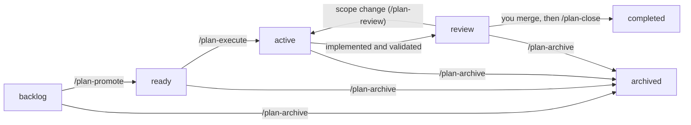

# Plan Suite Walkthrough

## Purpose

The plan suite keeps repository plans in Markdown and gives each step of a plan's life its own
slash command. The Plans page gives you one local place to browse those plans across repositories
and copy the command a plan needs next.

Use it when you want to:

- find backlog, ready, active, review, completed, archived, or unclassified plans across local
  repositories
- write a plan, prepare it, implement it in an isolated worktree with its work checked by a
  separate validator, review and approve it, and close it after you merge it
- keep Markdown files as the source of truth instead of moving plans into a database

## What You Get

| Piece | Always available? | What it does |
| --- | --- | --- |
| Plans page | Yes | Local `/plans` portal view for discovering, filtering, rendering, and copying plan context |
| Plan suite | Optional packages: `plan-suite` and `session-close` | Seven plan commands, including one-time setup, plus `/session-close` |

| Command | What you get |
| --- | --- |
| `/plan-suite-init` | Set up a repo for the suite once: the plans branch and its worktree, where worktrees go, and `plans-config.json` with your plan-name namespaces. On a new machine it reconnects to the existing plans. It ends by checking [branch protection](#protect-the-plans-branch) and offering to add it. `/plan-write` runs it for you when the config is missing |
| `/plan-write` | Create a plan with its initial checklist, or revise an existing one, including bringing it up to date with the repository |
| `/plan-promote` | Review and prepare a plan for development, then move it to `ready/` |
| `/plan-execute` | Start or resume implementation in an isolated worktree, check it with a validator and fix what it finds, then move the plan to `review/`; or fix findings a review sent back |
| `/plan-review` | Recheck the finished work against the current base, fix what has a clear fix, show you a plain-language review, and record your approval |
| `/plan-close` | After you merge the reviewed work, verify it and move the plan to `completed/` |
| `/plan-archive` | Retire a plan that will not be completed, with the reason |
| `/session-close` | End a chat: review and commit the session's work, write the handoff note |

No command takes a mode argument. Each one does one thing, so typing `/plan-` lists every step.
A command never starts the next one: you run each step yourself, normally in a new chat.

## Typical Workflow



1. Run `roborepo web`, open `/plans`, and turn on auto-discovery or add a folder so RoboRepo knows
   your repositories.
2. Enable the plan suite from the Plans page banner.
3. Run `/plan-write` to create a backlog plan.
4. Run `/plan-promote` on it to check it against the repository, resolve open decisions, and move it
   to `ready/`.
5. Run `/plan-execute` to implement it in its own worktree. Run it again to resume in a later chat;
   if you stop mid-work, `/session-close` writes the handoff note. When the work is complete, a
   validator checks it and the same run fixes what it finds; once a check comes back clean, the
   plan moves to `review/`.
6. Run `/plan-review`. It rechecks the work against the current base, fixes anything with a clear
   fix in the same chat, and shows you what the plan is for, what changed, and what needs you. You
   approve, ask for changes it makes on the spot, or decide the questions it could not.
7. Merge the reviewed branch yourself through a pull request.
8. Run `/plan-close`.

## What Each Command Reports

Every plan command ends with a report written for you coming back later, without memory of the
chat. It reads the same way for every command:

1. a headline: the plan's title and what happened to it;
2. one sentence on what the plan is for;
3. what changed, described as things you would notice, with a screenshot or recording for a visible
   change and a before/after diagram for a changed flow;
4. what needs you: each decision with its options, where each leads, and a recommendation, and each
   action with its exact command;
5. a short record: where the plan is, its branch, and a link to the plan document.

Any command, flag, or name in the report is explained beside it. Commit ids, check names, file
lists, and validator passes are left out; ask in the chat when you want them. Decisions and review
findings are also kept in the plan document.

Before you see the report of `/plan-promote`, `/plan-execute`, `/plan-review`, or `/plan-close`, a
separate agent that sees only the report checks that it answers what the plan is for, what changed,
and what you must do, and flags any term it leaves unexplained. `/plan-write` and `/plan-archive`
write shorter reports and run the same check themselves. A plan's next action, shown on the Plans
page, follows the same standard: one sentence you can act on without the chat.

## Enable The Plan Suite

The seven plan commands ship as one package, `plan-suite`, and turn on and off together.
They include `/plan-suite-init` for one-time repository setup. `/session-close` is a separate
package because it is useful in any chat.

The Plans page shows an onboarding banner until the suite is enabled. Its button enables both
packages at once, and each command in the list has a **Details** button that shows that command's
skill. The Agents page shows them under **Development Workflows**: a **Development Planning
Lifecycle** card and a **/session-close** card, each with its own toggle.
Click the Development Planning Lifecycle card's name to list its seven skills and its rules
fragment, each of which opens its source.

From the CLI:

```sh
roborepo package enable plan-suite
roborepo package enable session-close
```

The six commands were once six packages (`plan-write`, `plan-promote`, and so on), and
`/plan-start` was replaced by `/plan-execute`. Updating RoboRepo removes the old package IDs. If
any of the six plan skills were installed, the update keeps them and turns on `plan-suite`, which
installs all seven.

## Where Plans Live

Plans live under `plans/` on the remote branch `origin/repo-plans`, which never merges into a code
branch. RoboRepo keeps a reserved, locked worktree of it at
`<worktreeRoot>/<worktreeRepoName>/repo_plans`. That checkout can always be rebuilt: on a new machine,
run `/plan-suite-init` after cloning.

Plan files change only through named `roborepo plans` commands, from any checkout. Each change is one
commit, pushed automatically. A lifecycle move's commit message names the plan by its filename, for
example `Submit plan plan-lifecycle-review-and-ship-workflow for review`. The suite commands' reports
and questions name a plan by its title, with its id in parentheses once. A refused move changes
nothing, and running a move again after it succeeded commits nothing.

If the remote can't be reached, or refuses the push (a hook or branch rule), the commit stays local
and the command reports **not synchronized** with Git's reason. The next command or portal Refresh
that reaches the remote pushes it; a refusal keeps recurring until the rule allows the push. If another machine changed the
same plan, the command refuses rather than overwriting. Backlog order changes from both sides combine:
added and removed plans from each, and a reorder from either side, unless both reordered the same
namespace differently, which also refuses.

Direct writes to `repo_plans` are prevented differently per harness. In Claude, a deny rule
(`edit-plans-store`) refuses Write and Edit there. In Codex a direct write is technically possible,
because the CLI runs inside the sandbox and needs that access; the skills forbid it, and the next
store command refuses uncommitted edits. In every agent shell, the Git hooks RoboRepo installs refuse
a hand-made commit, merge commit, or push of `repo-plans`; the store's own commands run Git with
hooks off. Neither protects against a
process with unrestricted shell access deleting local files, which is why the remote is the source
of truth.

### Protect the plans branch

`repo-plans` holds the only copy of your plans, so the Git host should refuse to delete or rewrite
it. On GitHub, one command adds that protection, along with review and CI rules for the default
branch:

```bash
roborepo protect
```

It needs repo admin rights and the GitHub CLI (`gh`). `roborepo protect --check` reports the
current state without changing anything, and `/plan-suite-init` offers to run the command when it
sets up a store. [Branch protection](../../../reference/roborepo-cli.md#branch-protection) lists
the rules, the states, and how to skip the default-branch merge rules for one repo.

On another Git host, add the rules by hand:

1. On `repo-plans`: block deletion, block force pushes, and require linear history. Add no other
   rule there. Required reviews, status checks, or signed commits would refuse plan saves, which
   push directly to the branch.
2. On the default branch: block deletion and force pushes for everyone, admins included.
3. On the default branch: require a pull request with 1 approval (including approval of the last
   push) and passing CI checks, with a bypass for repo admins only.

RoboRepo never force-pushes `repo-plans`. Pushes to it start no CI runs as long as your CI, like
RoboRepo's, is limited to `main` and pull requests.

## `/plan-write`

Creates a plan, or updates an existing one. The request decides which:

| Request | Work |
| --- | --- |
| No plan owns the work yet | Creates a backlog plan in `plans/backlog/`, with a fresh opaque `id`, a namespaced filename, and an initial checklist |
| An existing plan, to change scope or design | **Revises** it, following your intent |
| An existing plan, after work happened | **Syncs** it from evidence: ticks a task only when the code proves it done, records untested gaps, and updates `next_action` and `reviewed_commit` |

`/plan-write` never moves a plan between lifecycle folders and never writes an approval. It
validates every plan it writes with `roborepo plans validate`, and pairs with `technical-writing`
for the prose.

## `/plan-promote`

Reviews a backlog plan before development: checks its claims against the code, fixes stale
details, refines the checklist, and asks you only about decisions with real tradeoffs. When no
material question remains, it saves its edits with `roborepo plans save`, then runs
`roborepo plans promote`, which moves the plan to `ready/` and commits the move. A plan that does not meet the Ready
requirements is refused with the list of findings and a repair prompt, and stays where it was.

Run it again on a `ready/` plan to refine it in place. It stops before implementation.

## `/plan-execute`

Starts, resumes, or fixes the implementation of a plan, depending on where the plan is:

| Plan is in | `/plan-execute` |
| --- | --- |
| `ready/` | Creates or safely reuses a worktree under the repository's configured `worktreeRoot`, runs `roborepo plans start` (records the worktree, moves the plan to `active/`, commits, and validates), then implements |
| `active/` | Resumes in the plan's worktree from the first open task |
| `review/` | Fixes only the open findings a review sent back, usually after you decided a question and chose a separate chat for the work; the plan stays in `review/` |
| `backlog/` | Refuses and points you to `/plan-promote` |

While implementing, it works through every unblocked task without stopping for check-ins, records
progress, decisions, and untested work in the plan, and reports once at the
end with every open question in one batch.

When the work is finished it runs a validation loop. A validator with fresh context, a separate
agent where the harness has one, reads the plan, the full diff, and the check results, never the
implementing agent's account of the work, and reports findings against the `implementation-review`
rubric. It never edits anything. Each finding has a severity (`blocking`, `actionable`, or `note`;
a `note` never holds up the loop) and one of three classes, by consequence rather than size:

| Class | When | What happens |
| --- | --- | --- |
| `fix` | The right fix is clear and stays within the plan's requirements and specified contracts, code included | The same run fixes it and checks it off with its commit |
| `escalate` | The fix chooses between real alternatives, each with a compelling argument for it, changes requirements or an unspecified contract, or lands outside the plan | It becomes an open question in the run's final batch |
| `base` | The base branch fails the same check | It is recorded as verification, and blocks nothing |

The run never asks before fixing a `fix` finding. The loop repeats until a pass finds no `blocking`
or `actionable` finding to fix, for at most eight passes. The cap limits passes only: the last pass's findings are fixed like
any other's, and the run records that those fixes were not revalidated. The findings and the passes are recorded in the plan's `## Review` section. Then it runs the completion preflight
(`roborepo plans preflight`), which checks that:

- no task outside `## Not tested` is unchecked;
- `blocked_by` is empty;
- the worktree has no uncommitted changes;
- the feature branch has at least one commit of its own;
- the plan passes the Review requirements. An open `## Not tested` entry is allowed only when it
  says why an agent cannot clear it, and a cleared entry must carry its evidence; the refusal names
  each entry that does neither.

If the loop has ended and the preflight passes, `/plan-execute` runs `roborepo plans submit`,
which moves the plan to `review/`. That says the work is complete and checked, not that you
accepted it. Otherwise the plan stays in `active/` with a `next_action` for the next run; an open
`escalate` finding is an unchecked task, so it holds the plan in `active/` until you answer it.

Either way, every `/plan-execute` and `/plan-review` run that commits to the plan's feature branch
ends by pushing that branch, so the work is never only on your machine and CI runs on each step's
result. Only the feature branch is pushed, never the base branch, and never with force. If the push
is refused, the plan's lifecycle still stands and the report gives you the command to push it
yourself.

When `/plan-execute` moves a plan to `review/`, or fixes findings a review sent back, it hands the
branch off without asking: it merges the base branch, freshly fetched, into the feature branch with
`roborepo plans sync-base`, resolves conflicts within the plan's scope and reruns the checks the
merge touched, pushes, and opens or updates the pull request with a written description. The
report gives the pull request link, whether it merges cleanly, and CI's result so far. The merge
only ever goes from the base into the plan's branch; merging the pull request stays yours. A
conflict that needs a decision outside the plan, or a base it cannot fast-forward, is reported
under Needs you. When the fetch fails, the merge uses the last fetched copy of the base, and the
report's Base line says so.

Worktrees go where you confirmed in `/plan-suite-init`. In Claude, each run also asks once for access to the worktree folder, then works inside it, so edits
there do not prompt one file at a time.

## `/plan-review`

Brings finished work to your review and resumes at the remaining step when rerun. A completed
review records the checked commit separately from your approval, so an interrupted chat can resume
at your decision. An unchanged, already approved review returns **already approved**; a committed
completed plan returns **already closed**. Neither repeats tests or asks for approval again.

A new review runs these steps:

1. for an `active/` plan, runs the completion preflight, and moves the plan to `review/` only if it
   passes;
2. merges the base branch into the feature branch with `roborepo plans sync-base`, which does
   nothing when base has nothing new; on a conflict the merge pauses for a careful resolution, and
   `roborepo plans sync-base --continue` commits it once no conflicts or conflict markers remain;
3. runs the repository's checks, and reruns each failure on the base branch: a failure the base has
   too is recorded as a base failure, not a finding;
4. runs one validator pass over the merged result, with the same classes as `/plan-execute`, and
   records its findings in the plan's `## Review` section;
5. fixes every `fix` finding in the same chat, code included, each in its own commit, and checks
   again until a pass finds nothing to fix, for at most eight passes. A fixed finding reads
   `- [x] … — fixed in review (<short commit>)`;
6. records the Result as complete once findings and required manual checks are resolved, or pending
   while they remain open, then shows you the review in plain language: what the plan is for, what
   changed for a person using it, each acceptance criterion as met or not, base failures, the checks
   only you can make (each with its steps, the expected result, and why an agent could not make
   it), any command a tool blocked for you to allow, and each escalated finding as a decision with
   options and a recommendation. A check an agent could run has already been run, here or in
   `/plan-execute`, and appears as evidence, not as a request. The technical detail (commits, validator findings, and the evidence behind each
   criterion) is one request away in the chat; commits, findings, and checks run are also kept in
   the plan's `## Review` record.

While a finding or manual check is still open, it asks you for what settles it (a decision, or the
result of a check only you can run) instead of asking for approval. Once nothing is open, it asks
for your approval of the exact commit, and acts on your answer:

| Your answer | What follows |
| --- | --- |
| Approve | It immediately records the approval for the reviewed implementation with `roborepo plans approve` and checks that it is fresh |
| Ask for a change, or decide an escalated question, within the requirements | It makes the change in the same chat and shows you the review again |
| Want the change done in a separate chat | The plan stays in `review/`. Run `/plan-execute`, then `/plan-review` again |
| The requirements themselves must change | With your agreement, it revises the plan, invalidates any approval, and moves the plan back to `active/` with `roborepo plans reopen`. The worktree and branch stay |

The review record looks like this:

```md
## Review

### Findings
- [x] Missing retry test — fixed (a1b2c3d)
- [x] Stale error message — fixed in review (d4e5f6a)

### Verification
- Validation: clean on pass 2 (fresh-context subagent)
- Unit and integration tests passed
- Base failure: `lint` fails on `main` too

### Result
- Status: complete
- Reviewed implementation commit: <full commit id>
- Base commit: <full base commit id>

### Approval
- Decision: approved
- Reviewed implementation commit: <full commit id>
- Confirmed by: human
```

Only you can approve; passing tests are not approval. An approval stays **fresh** while the branch's
code still matches the commit you approved. Plan edits land on the plans branch, so they never make
it stale, and a code change does. Check it with `roborepo plans approval <plan>`.

For machine-readable evidence, `roborepo plans approval <plan> --json` reports review freshness
under `review` and human approval under top-level `state`. It returns exit 1 while approval is
pending, even when the review is complete. A completed checklist or successful merge never grants
approval automatically.

If your answer was given but not recorded, `/plan-review` recovers it from an available explicit
answer identifying the reviewed implementation, or asks one confirmation when that answer cannot
be found. It reuses the completed review after checking implementation freshness and current
requirements. If implementation changed, it reviews the changes and runs the gate and Validator
before renewing the Result. Older review records can be recovered from their recorded commits and
verification; incomplete evidence requires only the missing review work.

This recovery also works after landing while the plan remains in review, because recording approval
touches nothing on a code branch. Your answer and a complete review remain required, and closure
still runs its own test gate.

Before merging, `roborepo plans merge-readiness <plan> --json` checks that the plan's review result and approval are committed (its output calls this the review packet),
clean worktree, exact implementation, and reviewed base. A failure names the repair; a pass names
the assessed tips and grants no merge permission.

`/plan-review` never merges your branch into the base branch. After approval, open and merge the
pull request yourself. If base moves again before you merge, run `/plan-review` again.

## `/plan-close`

Closes one plan after you merge it, and refuses rather than closing on incomplete evidence. It
accepts only a plan in `review/`. In order, it:

1. runs the repository's test command and stops on a failure;
2. checks every claim in the plan against the code;
3. decides complete, incomplete, blocked, superseded, or abandoned; a superseded or abandoned plan
   is handed to `/plan-archive`;
4. refuses while any `## Not tested` entry is unchecked, and sends you to `/plan-review`, which
   settles it; close never runs or checks off an entry itself;
5. refuses unless your approval is fresh for the landed branch tip;
6. refuses until the work has landed in the base branch, including after a squash or rebase merge,
   with `roborepo plans landed <plan>`;
7. saves the completion summary and a Verification section, including the absorbing commit as
   `- Absorbing commit: <full commit id>`, then runs `roborepo plans close`, which rechecks approval
   and landing, clears `next_action`, and commits the move to `completed/`;
8. after that commit succeeds, stops the dev servers still running in its worktree and lists them;
9. runs the repository's worktree cleanup command for the closed plan, removing the worktree and
   local branch without a recovery copy when preservation is proven. Unresolved leftovers receive
   one complete discard preview and a **Discard all listed leftovers and remove** or **Keep worktree**
   choice. Approval of the PR does not authorize discarding later edits.

Landing is scanned once. The first check walks the base branch's history for the commit that
absorbed the branch; after that, `roborepo plans landed`, `roborepo plans close`, and the plan's
worktree cleanup verify the recorded absorbing commit instead of scanning again. Verifying means
the commit is still in the base branch's first-parent history and still absorbs the branch's
current tip, so work added to the branch afterwards is never covered by it; when it fails, the full
scan runs. Reusing landing evidence never skips the test run or your approval.

If the close commit fails, `/plan-close` reports that closure is not durable and skips server and
worktree cleanup. It never merges, never synchronizes base into the branch, and never pushes a code branch.

Step 8 stops only processes listening on a port whose working directory is inside the plan's
linked worktree. It never touches the main checkout, agent sessions, shells, or editors, and it
sends `SIGTERM` only: a server that ignores it is reported, not killed. You can run the same step
yourself with `roborepo plans stop-servers <plan>`; add `--dry-run` to list without stopping.

Cleanup failure leaves closure durable. An already-completed retry resumes cleanup without another
closure commit. Changed previews require renewed consent; legacy recovery pending notices lead to
`roborepo git worktrees legacy-recovery` for a separate review. See
[worktree cleanup](../../../reference/repositories.md#worktree-states-and-cleanup) for receipts and retry rules.

## `/plan-archive`

Retires a plan from `backlog/`, `ready/`, `active/`, or `review/` that will not be completed. It
runs `roborepo plans archive <plan> --reason "<why>"`, which writes the reason under an
`## Archived` heading, clears `next_action`, and commits the move to `archived/`.

Archiving never removes a worktree or branch; unmerged code stays where it is.

## `/session-close`

Ends a chat: reviews the code the session changed with `implementation-review`, syncs docs and any
plan the session touched, commits the session's work, and writes a handoff note for the next chat.
Review findings it cannot fix become items in the handoff. It runs only when you ask, and never
moves a plan.

## Not Tested

A plan can carry a `## Not tested` section: checkboxes for work that exists but that no test
covers.

```markdown
## Not tested

- [ ] The dark theme reads well on the Plans page. Needs a person: judging contrast and look is a
      human judgment.
- [ ] The portal starts and lists plans in a browser. Blocked: `roborepo browser run --serve "npm run
      portal"` failed with "listen EPERM 127.0.0.1:4310"; allow it to run outside the sandbox.
- [x] `roborepo plans submit` refuses an entry with no reason. — Verified by agent 2026-11-20 at
      a1b2c3d: `node scripts/test/plan-lifecycle-transitions-check.mjs` → passed.
- [x] The approval question names the commit. — Confirmed by the user 2026-11-21: "saw the full
      commit id in the question".
```

`/plan-execute` and `/plan-write` add entries as gaps appear. Before a plan reaches you for review,
the agent runs every check it can, so you are asked only for what an agent cannot do.

| Entry | Ends with | Who settles it |
| --- | --- | --- |
| Open, needs a person | `Needs a person:` and why an agent cannot make the check | You, during `/plan-review`; the agent records your answer |
| Open, blocked by a tool | `Blocked:`, the exact command, and its error | You allow the command; the agent then runs the check |
| Cleared by an agent | `— Verified by agent`, the date, commit, command or method, and result | Already settled |
| Cleared by you | `— Confirmed by the user`, the date, and what you reported | Already settled |

An agent never checks off a check only a person can make, never clears an entry without recorded
passing evidence, and never approves on your behalf or infers your approval; it records approval
only from your explicit answer. A check that runs and fails is a defect the agent fixes, not an
entry. Deleting an entry is your decision, with the reason in the plan's
`## Decision Log`.

An open entry that gives its reason does not block the move to review. One that gives no reason, or
a checked entry with no evidence, does: `roborepo plans submit` refuses and names it. Every entry
is settled before you approve, and `/plan-close` refuses to close a plan while any entry is
unchecked.

## Paired Skills

Suite commands load helper skills, each from its own package. The suite declares which ones it needs:

| Package | Relationship | What it means for you |
| --- | --- | --- |
| `technical-writing`, `test-harness`, `implementation-review`, `code-style`, `feature-verification` | Included | Enabling `plan-suite` turns them on, and they stay on while it is on |

`implementation-review` holds the review rubric that `/plan-execute`, `/plan-review`, `/plan-close`,
and `/session-close` share. It has no toggle or command of its own: the Agents page lists it under
**Included Packages** when you open the Development Planning Lifecycle or `/session-close` card's
Package Dependencies.

The suite recommends nothing beyond what it includes. A command loads an included skill when the
work calls for it, for example `feature-verification` only when delivered behavior needs a
demonstration. No command asks you to enable a package while it runs.

## Open The Plans Page

Start the local portal:

```sh
roborepo web
```

Open:

```text
http://127.0.0.1:4317/plans
```

The page is local-only and uses the same loopback portal server as Config and Telemetry.

## Choose Which Repositories Plans Reads

Plans reads every repository RoboRepo knows about. Make repositories known from the Plans empty state
or from **Manage repositories** (the repository count in the Plans header opens it):

- **Enable auto-discovery of active repos** — every repository you run a dev server in becomes known.
- **Add a folder** — one repository, or a parent folder whose repositories RoboRepo finds for you:

```text
~/projects
~/work/client-a
~/src/specific-repo
```

A folder walk treats the first folder containing `.git` as a repository and skips hidden and common
build folders. Inside each repository, Plans reads `plans/**/*.md` in the
[plans worktree](#where-plans-live). A repository without one shows a notice to run `/plan-suite-init`.

See [Repository sources](../../../reference/repositories.md#repository-sources) for the walk's limits
and [Which Repositories Plans Reads](../../../reference/plans-portal.md#which-repositories-plans-reads)
for what each repository shows.

Plans folders configured before repository sources existed are not carried over; add them again
under **Manage repositories**.

## Plan File Layout

Plan lifecycle comes from folders:

```text
plans/backlog/
plans/ready/
plans/active/
plans/review/
plans/completed/
plans/archived/
```

Files directly under `plans/*.md` still appear, but they are shown as `unclassified`.
The portal does not silently treat them as backlog.

Recommended frontmatter:

```yaml
---
id: stable-plan-id
next_action: Implement the next concrete task
blocked_by: []
depends_on: []
related: []
reviewed_commit:
worktree:
---
```

Leave `worktree:` empty. `/plan-execute` fills it with the linked worktree's Git administrative name
when implementation begins, which lets Home show the plan as that worktree's row. See
[Worktree association](../../../reference/plans-portal.md#worktree-association).

Use Markdown checkboxes for executable work:

```md
- [ ] Add the parser fixture
- [x] Define the schema
```

Headings and checkboxes inside fenced code blocks are examples, not plan structure.

## Browse And Filter

The Plans page supports:

- search across title, ID, path, next action, blockers, repository name, and warnings
- repository, lifecycle, blocked, structure, plan freshness, and health filters
- Backlog as a directory of repos and namespaces, each namespace with its own explicit order
- lifecycle tabs: Backlog, Ready, Active, and Review, with Completed, Archived, and Unclassified
  behind the ⋮ menu
- document rendering with metadata, warnings, and task lists

**Structure** says whether a plan has every required section and field. **Plan freshness** says
whether the document was checked against the code since the repository last changed, from its
`reviewed_commit`; `possibly stale` means the repository changed after that commit, not that the
plan's specific files are stale. Neither is the Ready or Review stage, and neither is an approval.

A Review plan's card shows its review outcome beside its task progress: open findings, **approved**,
or **awaiting review**.

## Copy Actions

The Plans page copies prompts; it never runs a suite command for you. Paste the
prompt into Claude or Codex in that repository, and the command does the work, including any move
between lifecycle folders and the commit that records it.

The card and detail drawer show a lead button when the plan has a recommended next command.

| Plan | Lead button | Copies |
| --- | --- | --- |
| Backlog, all prerequisites complete | **Promote** | `/plan-promote` |
| Backlog, unfinished prerequisites | — | The card shows **Waiting on** and the prerequisites |
| Ready | **Start** | `/plan-execute` |
| Active | — | **Continue** and **Review** are in the Copy menu |
| Review, unblocked and approved | **Close** | `/plan-close` |
| Review, unblocked and awaiting approval | **Review** | `/plan-review`, which fixes open findings in its own chat |
| Review, blocked | — | Review actions are in the Copy menu |
| Completed, Archived, or Unclassified | — | — |

With the suite enabled, the Copy menu offers these commands.

| Lifecycle | Actions |
| --- | --- |
| Backlog | **Promote** (`/plan-promote`) when prerequisites are complete, **Archive** (`/plan-archive`) |
| Ready | **Start** (`/plan-execute`), **Refine** (`/plan-promote`), **Archive** (`/plan-archive`) |
| Active | **Continue** (`/plan-execute`), **Review** (`/plan-review`), **Archive** (`/plan-archive`) |
| Review | **Review** (`/plan-review`), **Fix findings** (`/plan-execute`), **Close** (`/plan-close`), **Archive** (`/plan-archive`) |
| Completed, Archived, or Unclassified | — |

Use `/plan-write` in an agent chat to update an existing plan. **Copy file path** is
available in every Copy menu. With the suite disabled, the menu offers a **Repo-aware prompt**
in place of the workflow actions.

Lifecycle tabs switch the list you are browsing. Moving a plan through the suite changes its folder.

The **+** button right of **Filters** opens **Import Plan**, for a plan written elsewhere. It previews
an uploaded `.md` file's title, id, filename, and target folder. A new plan enters Backlog. For an
existing id it shows a diff and asks you to confirm; an upload never changes a plan's lifecycle or
approval.
A merged worktree shows a **merged** completion badge on its plan card and in the detail drawer.

## Current Limits

- The portal writes three things through the same plans store as the CLI: a namespace's Backlog
  order when you press **Save**, the archive of an unprioritized Backlog plan, and an uploaded
  Markdown plan from **Import Plan**. All other plan edits go through the suite.
- Manual refresh is the v1 update model.
- No database, daemon, cloud sync, direct editor, automatic merge, or automatic LLM prioritization
  is included.

See [Plans Portal Reference](../../../reference/plans-portal.md) for exact behavior.
