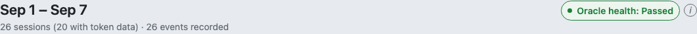
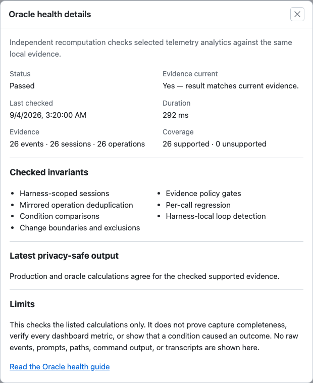

# Tokens page user guide

The **Tokens** page (`/tokens`) shows where agent sessions spend tokens on avoidable work, which
conditions problems tend to follow, and whether a change you made is followed by fewer problems.
The page shows what happened; this guide explains how far each number can be trusted. Each section
below matches a section of the page, and the page's info icons open the matching section.

## Before you start

Telemetry is opt-in and stays on your machine. Start the portal and choose **Tokens**:

```sh
roborepo web
```

If the page asks you to turn on telemetry, enable it and run a session in an installed agent
harness. Until the first capture arrives, the page may show a **simulated tracking report** built
from sample data. Recording changes requires live telemetry.

A typical visit: start at **Action items**, open the evidence behind one, and record a change under
**Your changes** if you act on it. Later sessions show whether problems became less frequent.

## Oracle health

The **Oracle health** badge beside the report period compares selected analytics with an
independent recomputation over the same current local evidence. Open **Oracle health details** for
freshness, duration, aggregate evidence counts, coverage, checked invariants, and the latest
privacy-safe result.





| Status | Meaning |
| --- | --- |
| **Passed** | The production analyzer and independent oracle agree for every supported checked row, and the result matches the current evidence. |
| **Checking** | A comparison is running and no current result is available yet. |
| **Stale** | Evidence changed after the last comparison. The prior result remains visible in the details but is not current. |
| **Partial** | Covered values agree, but some required evidence could not be interpreted independently. |
| **Unavailable** | No complete comparable input could be evaluated, or the isolated comparison could not run. |
| **Failed** | The two implementations disagree on at least one covered field for the current evidence. |

The live oracle checks harness-scoped sessions, mirrored operation deduplication, condition
comparisons, change boundaries and exclusions, evidence gates, per-call regression, and
harness-local loop detection. It does not prove that capture is complete, verify every dashboard
metric, or show that a condition caused an outcome. The badge reports the local runtime comparison;
the deterministic CI oracle remains a separate build-time guardrail.

The details contain only aggregate counts and allowlisted status categories. They do not expose raw
events, prompts, transcripts, file paths, command output, or replayable JSONL. The Tokens report
continues working when oracle health is unavailable.

## Identifiable waste

Each card shows the share of tokens spent on patterns the page recognizes as avoidable. When several
sources flag the same turn, the turn counts once, under the largest source, so the sources add up to
the total. Avoidable tokens outside these patterns are not counted, so treat the figure as a floor.

| Source | Flags |
| --- | --- |
| **Over-testing** | Full-suite reruns with no edit since the last run |
| **Runaway loops** | The same tool fired repeatedly in a row |
| **Redundant reads** | Large or repeated document reads |
| **Spike excess** | Tokens above the spike threshold in a single turn |

A card's color warns as waste takes a larger share of that period's tokens:

| Color | This week | All time |
| --- | --- | --- |
| Red | 16% or more | 10% or more |
| Orange | 10.7% or more | 6.7% or more |
| Yellow | 5.3% or more | 3.3% or more |

Select a source to jump to its evidence under **Investigate**.

## Session details

| Item | What it tells you |
| --- | --- |
| **Next step** | The suggested action from this session's findings. |
| **Configuration** | Packages marked **configured** and skills marked **available** were present in configuration. That does not prove the session used them. |
| **Observation unit** | A session with a problem counts once in each problem rate, however many times the problem occurred. |
| **Coverage** | Which context was captured. A dimension marked **unknown** leaves this session out of comparisons for that dimension. |
| **Heaviest turns** | Shown only while the session transcript is still available. Captured findings show either way. |

## Are you over-testing?

| Signal | What it means |
| --- | --- |
| Badge **yes** | Test runs took 10% or more of captured tokens. |
| Full-suite reruns with the same failure | The suite ran again with nothing fixed. |
| Targeted runs per full-suite run | Below 1 means mostly full suites. |

Running a single file or a filtered set between edits, and the full suite at the end, usually costs
less. This evidence covers the whole report rather than individual sessions, so it does not appear
in condition cards or change comparisons.

## Do problems follow a condition?

A condition is a model, repository, harness, configured package, or available skill. Each card
compares the share of sessions with a problem when the condition is present against the share when
it is absent:

| Sessions | Affected | Rate |
| --- | --- | --- |
| With the condition | 3 of 12 | 25% |
| Without the condition | 9 of 12 | 75% |

That card reads **67% fewer** with the condition: `(25% − 75%) / 75%`. Sessions whose context is
unknown belong to neither side.

| What you see | What it means |
| --- | --- |
| **Cheaper** or **More expensive** | Fewer or more problem sessions with the condition than without. Shown only when both sides have at least 10 sessions and 3 affected sessions, and the rates differ by 20% or more of the rate without the condition. |
| **More evidence needed** | Too small to tell. It does not mean "no difference." |
| **No clear difference** | The rates are within 20% of each other. The 20% line is a display threshold, not a significance test. |
| **A comparison group is missing** | One side has no sessions with known context. Collect sessions with and without the condition. |
| **Full outcomes** | The raw rates and counts behind every card. |

Keep in mind when reading cards:

- **Cards overlap.** One session counts toward its model, its repository, and every package it had,
  so do not add cards together.
- **It is an association.** Tasks differ between the two sides, so a card cannot show that the
  condition caused the difference.
- **Missing history stays missing.** If a condition is unknown for past sessions, more sessions
  will not fill it in; only new captures can.

## What happened, in order

The ledger lists observed problems and changes, newest first.

| Icon | Row | Dated at | Select it to |
| --- | --- | --- | --- |
| ↗ ↻ ! | A spike, loop, or read warning | When the problem was observed | Open the session |
| ✎ | A change you marked | The change's effective time | Jump to its comparison under **Your changes** |
| ⇣ | A package configuration change | When a session first saw it, not when the file was edited | Open the first session that saw it |

Skills-only changes and edits to a resource's content without a configuration change are not
detected. Events at the same moment are shown in a fixed order, but that order does not establish
which came first; an event tied with a change's time is left out of that change's comparison.

## Your changes

Select **+ Mark a change** when you change your setup, or record a change you made earlier. Its
effective time splits sessions into before and after. Sessions that span that time are left out.
Over-testing can be watched but never compared, because its evidence covers the whole report.
**Edit change** corrects a record and keeps its history.

Each watched problem moves through these states:

| State | Meaning |
| --- | --- |
| **Recorded** | Saved; no sessions in its scope yet. |
| **Collecting** | Needs more sessions before or after the change. |
| **Comparison available** | Both sides have enough sessions to compare. |
| **Can't compare fairly** | The scope or timing evidence is not enough for a fair split. |

Once a comparison is available, the card reads:

| Result | Meaning |
| --- | --- |
| **Early signal** | The rates moved, but the evidence is still too small for a percentage. |
| **No clear change** | The after rate is within 20% of the before rate. |
| **Fewer** or **More** … after | The rate moved by 20% or more. This is an association: a reason to look closer, not proof that the change caused it. |

## Terminal view

The condition evidence is also available as structured output:

```sh
roborepo telemetry report --conditions
```

See the [Telemetry Service Reference](../reference/telemetry.md) for capture, retention, schemas,
and CLI details.
