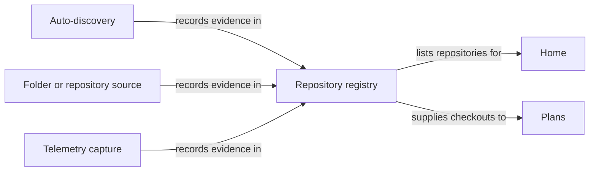
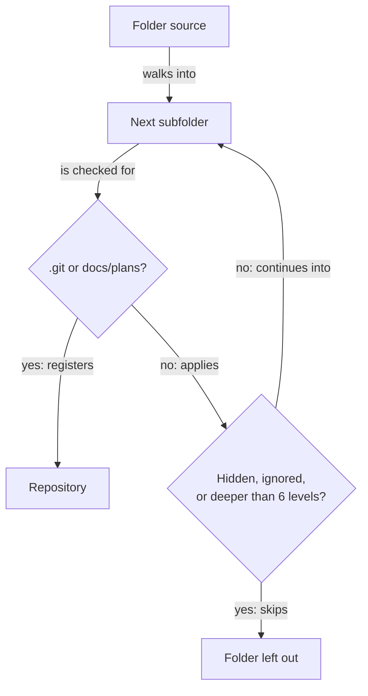

# Repositories in the Portal

The portal Home page is a directory of the repositories RoboRepo already knows about. Settings
is the durable place to review repository discovery and the other cross-portal setup choices. It puts
active checkouts and their running applications first, then links each repository to a persistent
detail page at `/repositories/<urlKey>`.

## Open the directory

Run:

```sh
roborepo web
```

The command opens `/`. On a new machine the directory is empty until you tell RoboRepo how to find
repositories. RoboRepo inspects nothing on the machine — no process observation and no folder walk —
until you take one of the two actions the empty state offers:

- **Enable auto-discovery of active repos** (primary) — RoboRepo watches the dev servers and
  containers you run and remembers the repositories they run in.
- **Add a folder** (secondary) — RoboRepo registers one exact repository, or every repository it
  finds inside a parent folder.

Every repository then looks and behaves the same, however it was found.

## Repository sources

A repository source is a way RoboRepo is allowed to find repositories. There is one built-in source
and any number of folders you add.

| Source | Finds | Default |
| --- | --- | --- |
| Auto-discovery | The repositories your running dev servers and containers run in | Off |
| Repository | That one repository | Added by you |
| Folder | Every repository beneath the folder, using the bounded walk below | Added by you |

Telemetry capture is not a repository source. An agent session adds evidence to a repository a
source already found, so its token usage is attributed there, but it never adds a repository on its
own. A repository you only use with agents appears once auto-discovery or a folder finds it, and its
earlier sessions attach to it then.



The same repository found by several sources is one repository: identity comes from the Git remote
(or, without one, from the checkout), never from which source found it. Overlapping folders such as
`~/projects` and `~/projects/app` therefore still produce one `app`.

### Manage repositories

**Manage repositories** opens one dialog from Settings, Home's heading, the repo selector's **Manage Repos** row on Plans, Tokens, and Agents, and the empty states. Top to bottom it shows:

1. **Auto-discovery** — the Enable button with a sentence explaining that it permits observation of
   active apps and automatic repository enrollment, or, when on, a status line such as
   `On · 4 repos found` and **Turn off**.
2. **Repositories** — one list of every known repository. Each row offers **Pin** and **Ignore
   repository**, whatever found it. A quiet `Found by:` line explains the sources, for example
   `Found by: auto-discovery, ~/projects`. Ignored repositories sit in a collapsed **Ignored** group,
   each with **Restore**.
3. **Add a folder to find more repos** — then each added folder with its state, kind, repository
   count, and **Refresh**, **Disable**, and **Remove**. **How folder scanning works** explains the
   walk.

A path RoboRepo can read is classified for you: a folder with `.git` or `docs/plans` is a repository,
any other folder is a folder of repositories. A path that is missing or unreadable when you add it
asks which of the two it is. That answer is kept on every later refresh, so a path that becomes
readable never broadens into a folder walk you did not ask for.

### Folder walk

A folder source walks down through subfolders until it finds a repository, and never scans a found
repository's own subfolders as candidates:



| Rule | Value |
| --- | --- |
| Maximum depth below the folder | 6 levels |
| Time budget per walk | 5 seconds |
| Maximum repositories per walk | 250 |
| Skipped folder names | names starting with `.`, and `node_modules`, `.git`, `vendor`, `dist`, `build`, `.cache`, `coverage`, `.next`, `.venv`, `__pycache__` |
| Linked Git worktrees | registered as checkouts of the known repository; they are not separate repositories |

The walk tracks each folder's real path and never descends into one twice, so symlink cycles end.

### Source states

A folder is refreshed when you add it, enable it, or select **Refresh**. One failed source never
affects the others or the registry.

| State | Meaning |
| --- | --- |
| Not scanned yet | The source has not been refreshed. |
| Healthy | The last refresh read everything it was asked to. |
| Partial | The walk ran out of time or reached the repository cap, or some subfolders could not be read. Repositories it did not reach keep their earlier evidence. |
| Unavailable | The path is missing, moved, or unreadable. |
| No repository here | A repository source's path no longer holds a repository. |
| Error | The refresh failed for another reason. |

### Turning off and removing sources

Turning a source off and removing it have the same effect on repositories:

1. The source's evidence is removed from every repository. Turning auto-discovery off also stops
   Runtime's process scans.
2. A repository still found by another source stays known and unchanged.
3. A repository left with no source is not deleted. It stays listed (the dialog notes `No current
   source`), and the 30-day ageing sweep hides it once it has not been seen for 30 days.

**Forget This Repo** on Home is offered only for a repository with no known checkout, so it never
competes with a source that would find the repository again.

### Home card menu

A repo card's ⋮ menu lists **All Plans**, **Agent Config**, and **Token Activity** (each opens that page already
filtered to the repo, as `?repo=<key>`), then **Pin**/**Unpin** and **Ignore Repo** (**Forget This Repo** for a
repo with no known checkout).

### Ignore repository

**Ignore Repo** — on Home's card menu, Runtime's repository menu, and the Manage repositories
list — hides a repository everywhere: Home's directory and normal Plans entries leave it out, and
later auto-discovery does not bring it back. Restore it from the dialog's **Ignored** group, or from
Runtime's settings.

Runtime's **Hide from Runtime** is different: it only tucks running apps or Compose stacks away on the
Runtime page and changes nothing about the repository.

## Directory order

Home uses the same lifecycle facts as Runtime. It orders repositories as follows:

1. pinned;
2. active;
3. idle, most recently seen first;
4. stale.

Activity that Runtime cannot associate with a canonical repository appears separately as unresolved
activity. It is not promoted into a repository card.

## Repository cards

Each card combines a compact view of several domains:

- **Workspace and Git** — every known main checkout and worktree is named by its branch when
  available. Dirty state, ahead/behind counts, and base-branch drift appear on the same row.
- **Running application** — a checkout's promoted primary application is a clickable port. A host
  development server and a Compose-backed application behave the same here. Secondary ports and
  hosting diagnostics remain on Runtime.
- **Plans** — below the main checkout, every active or review plan gets one row, ahead of the remaining
  worktrees. The plan title opens the plan drawer, and its completion ring or **done** sits beside it.
  - A plan whose `worktree` field names a linked worktree Home shows becomes that worktree's row: the
    plan title replaces the branch label, a worktree button opens the branch, worktree name, and path
    (each with its own copy action), one status line such as `dirty · 12 ahead · 0 behind remote`,
    the same Git warnings the row's warning is chosen from, and the
    **Stop Server** and **Delete Worktree** actions, and the port, Links,
    and Git warning stay where the checkout row puts them. The match is exact: the plan's value must
    equal the worktree's Git administrative name, exactly one active or review plan must claim it, and exactly
    one known worktree must carry it. Branch names and checkout paths are never used to guess.
  - Any other plan is its own row with a badge: **no worktree** when it names none;
    otherwise **worktree not listed** (Git has it, Runtime does not list it), **worktree missing** (Git
    has no worktree by that name), **worktree ambiguous** (claimed twice, or more than one checkout
    carries the name), or **worktree status unknown** (Runtime is unavailable).
  - Worktrees no plan claimed follow as ordinary checkout rows, each with a ⋮ menu holding
    **Stop Server** (while something runs in it) and **Delete Worktree**.
  - One unlabeled line closes the list with the repository's Active and Backlog counts and an
    **all plans** link, and says so when Plans coverage is partial. A repository with no active
    plans, or one Plans has not scanned, lists its worktrees as plain checkout rows with no plan
    rows or counts. Completed plans never appear.
- **Tokens** — recent repository-associated session warnings appear while token tracking is on and a
  cached Tokens analysis is available. With tracking off, Home shows no warnings, even if earlier
  captures are still on disk, which matches the Tokens page.
- **Agents** — repository-scoped agent configuration is currently unavailable and is labeled that
  way.

### Worktree states and cleanup

Home and Runtime list linked worktrees of a known repository even when no application is running.
Each worktree row shows how it stands:

| Shows | Means |
| --- | --- |
| a port in the actions column, or none | something is running in it, or nothing is |
| **merged** (a purple pill; its tooltip names the base branch) | a commit on the base branch's first-parent history absorbed the branch's work |
| **stale** | not merged, and no activity during the configured interval; a prompt to review, not evidence of a merge |

Activity is the latest of a running process Runtime saw, the branch's last commit, and the last
agent session on the branch. The interval defaults to 7 days. Change it in Runtime's Settings under
**Worktrees**, or set `ROBOREPO_WORKTREE_STALE_DAYS` to a number from 1 to 365 to override the
setting. A detached worktree, such as one the desktop app creates, is named by its folder with
**(detached)**.

A merged row adds a note only when there is something to act on: the reason a guard keeps it (such
as **plan not closed** or **not in worktree folder**), or **removed on next pull** when the
cleanup hook is installed.

**Stop Server** stops the dev servers listening from that worktree, as `/plan-close` does.
**Delete Worktree** opens a confirmation that says in plain words what is deleted (the worktree's
folder and its local branch) and what that costs: no committed work for merged work, or how many commits were
never merged and that a backup keeps them. A worktree an active or review plan claims, or one with something
running, shows a warning and a red **Delete worktree** button. Uncommitted edits or untracked
files also show a warning before confirmation and turn the button red: confirming discards them
permanently. The backup preserves committed work only. Otherwise the button is green.
**Details and how to restore** shows the branch, folder, archive ref, and the commands that bring it
back. Confirming stops the worktree's servers and removes it. Both live in the worktree dropdown on a plan's row and in the ⋮ menu on any
other worktree row; no row shows them inline. If new local changes appear after the page loaded,
the first deletion request keeps the worktree and reveals the warning; a second confirmation is
required to discard them. Automatic cleanup and ordinary CLI cleanup still refuse dirty worktrees.
Deletion refuses a locked worktree, a worktree with valuable ignored files or submodules, a server that does not stop, and the current or
main checkout, and the confirmation shows the reason. Servers stop only after those checks pass, so
a refusal at that point stops nothing. The removal itself can still fail after the servers have
stopped, for example when Git state changed in between; the confirmation shows that reason too.

A merged row drops the Git warnings (behind, unpushed) the row shows for work in progress; the
checkout tooltip and the worktree dropdown still carry them.

`roborepo git worktrees cleanup` previews candidates and reasons. Add `--apply` to remove eligible
landed worktrees and local branches. `--plan <id>` limits it to a completed plan's worktree, and
verifies the absorbing commit that plan's `## Verification` records instead of rescanning. Like
`roborepo plans close`, it checks landing against the local `main` (or `--base <branch>`), so a
closure commit that is not pushed yet still counts. Without `--plan`, landing is checked against
`origin/HEAD` when the repository has one. The command also accepts `--remove <branch> --confirm --apply`. Automatic cleanup waits for an
associated plan to leave `active`. It only removes a clean, unlocked, landed worktree beneath the
repository's worktree folder, and never uses `git worktree remove --force`. The folder is
`worktreeRoot` from `docs/plans/plans-config.json`, or else the folder confirmed when cleanup was
turned on from Home. A worktree elsewhere is suggested for manual review. The command does not touch
remote branches.

With the plan-suite package enabled, `/plan-close` removes each story's worktree as its last step,
and Home does not offer the hook. With it disabled, a repository card with linked worktrees and no
hook shows **Automatic worktree cleanup is off** in its footer. **Turn on automatic cleanup**
confirms the worktree folder (proposed as the deepest folder holding the repository's worktrees,
outside `.claude/worktrees/`) and installs the hook; **Dismiss** hides the offer for that
repository. If another tool's `post-merge` hook is already installed, the dialog shows the line to
add to it.

A hook installed before the plan-suite package is enabled keeps working: a worktree whose active or review
plan names it waits for `/plan-close`. A plan that does not name its worktree cannot protect
it, so if that branch lands the hook may remove the worktree first; the removal log keeps its tip.

`roborepo git worktrees hook install` enables automatic cleanup after a successful merge or pull
in that repository. It returns immediately and writes cleanup output to
`<state root>/worktree-cleanup/hook.log`. An existing foreign `post-merge` hook is left intact; the
installer prints a line to add to it. Use `roborepo git worktrees hook uninstall` to remove a hook
installed by RoboRepo. Fetches and pulls that are already up to date do not invoke the hook.

The installer writes `post-merge` into the directory Git runs hooks from:

| `core.hooksPath` | Hook location | Fires for merges and pulls in |
| --- | --- | --- |
| unset | `<common Git dir>/hooks/` | every checkout of the repository |
| absolute, in repository config | that directory | every checkout of the repository |
| relative, in repository config | that path under the main checkout | the main checkout only |
| relative, with the Git directory outside the main checkout (`--separate-git-dir`) | none; the installer refuses | — |
| set in one worktree's config | that path in that checkout | that checkout only |
| set in global or system config | none; the installer refuses | — |

Git resolves a relative `core.hooksPath` inside the working tree that runs the hook, so a linked
worktree looks for its own copy and never finds the one in the main checkout. The installer says so
when it installs. Cleanup covers every worktree of the repository whichever checkout triggers it,
so pulling `main` in the main checkout is enough. A shared global hooks directory would run this
repository's cleanup for every repository, so the installer prints the reason and writes nothing.

The hook records absolute paths to `node` and to the CLI that installed it, because Git clients run
hooks with their own `PATH`. Install it from the main checkout or an installed `roborepo`: the
installer refuses a CLI inside one of the repository's linked worktrees, since cleanup removes that
worktree once it lands. After moving or upgrading `node`, run the install again to record the new
path; until then each run logs its failure to `hook.log`.

The removal log is `<state root>/worktree-cleanup/removals.jsonl`; each line names the branch and
commit. A confirmed removal also writes `refs/roborepo/abandoned/<branch>-<commit>`, where
`<commit>` is the tip's seven-character short SHA, so archiving the same branch name again keeps the
earlier archive. Restore its branch with `git branch <branch> refs/roborepo/abandoned/<branch>-<commit>`,
then restore a checkout with `git worktree add <path> <branch>`. List archive refs with
`git for-each-ref refs/roborepo/abandoned` and delete one after review with
`git update-ref -d refs/roborepo/abandoned/<branch>-<commit>`.

Cards with more than five checkouts put the additional rows in an expandable section. An open
section and a focused control are not rebuilt during polling, so keyboard position and expanded
state remain stable.

## Repository detail

Select a repository name or its **Details** link to open `/repositories/<urlKey>`. The URL is
bookmarkable and browser Back/Forward navigation works normally. The detail page includes:

- browser-safe identity and discovery provenance;
- all known checkouts, Git state, and promoted application links;
- repository-level Git warnings;
- backlog, ready, active, and review plan counts, and plans changed in the last seven days;
- recent Tokens warnings and their severity;
- the current Agents availability state;
- links to the full Runtime, Plans, Tokens, and Agents pages.

Those domain links are currently unscoped. Repository-scoped domain navigation can be added without
changing the detail URL or its stable `urlKey`.

An unknown or hidden key renders an explicit unavailable page and the overview API returns 404.

## Status and freshness

Runtime, Plans, and Tokens refresh independently. Each domain therefore carries its own status:

| Status | Meaning |
| --- | --- |
| `available` | Cached data is present. |
| `partial` | Data is present, but coverage or collection was incomplete. |
| `stale` | The latest refresh failed and last-known data is retained. |
| `unavailable` | No usable data is currently cached for that domain. |

One unavailable domain does not remove the repository or block the other sections. Home and detail
poll cached summaries every ten seconds; those polls do not start Runtime discovery, a Plans scan,
or Tokens analysis.

## Privacy boundary

Repository identity is path-free. Repository ids, summaries, browser keys, and URLs never contain an
absolute path, so they mean the same thing on every machine and are safe to paste into a chat or an
issue. A repository with no Git remote gets an opaque `local:` id derived from its path rather than
the path itself.

Checkout paths are machine-local facts, and the browser receives them only as checkout details and
as source paths in the Manage repositories dialog. The
Home payload includes each known checkout's path for its tooltip and copy button. It is never used
as identity and never appears in a URL. The portal listens on `127.0.0.1` only and answers only
requests addressed to a loopback host name, so the payload is served to this machine's browser and
not to other websites open in it.

Repository pages receive an allowlisted payload: the display name, stable browser key, lifecycle,
branch and worktree identity, selected Git facts, checkout paths as above, and the promoted
application's origin and Runtime key, which Home uses to discover that application's routes. A
linked worktree's identity is its Git administrative name, which contains no path. The payload does
not include:

- absolute paths in repository ids, browser keys, or URLs;
- the canonical internal repository id in the URL;
- Runtime keys for anything other than a checkout's promoted application;
- secondary ports, PIDs, container ids, or Compose internals;
- telemetry prompts or transcript content.

The browser key is allocated once and remains stable if the repository display name changes.

Configured source paths reach the browser only through the `/api/repositories/sources` routes, which
the Manage repositories dialog reads, and are shown there with your home folder written as `~`.
Every other payload refers to a source by its opaque id or label.

## Registry compatibility

The registry uses schema version 3, which records each source's evidence separately. When RoboRepo
first encounters an older registry (version 1 or 2), it replaces it with a fresh version 3 file. It
does not migrate or back up the old file. Sources repopulate repository facts, but earlier pins,
ignored/restored choices, aliases, timestamps, local-root ownership, and allocated browser keys are
discarded. Browser keys are allocated from display names, so most return unchanged. Plans folders
configured before repository sources existed are not carried over; add them again under **Manage
repositories**.

An unknown future schema version is rejected instead of being overwritten.

Repository sources are stored beside the registry in `~/.roborepo/repositories/sources.json`. A
malformed file is set aside as `sources.json.invalid-<timestamp>`, sources reset to their defaults,
and the dialog says so.
