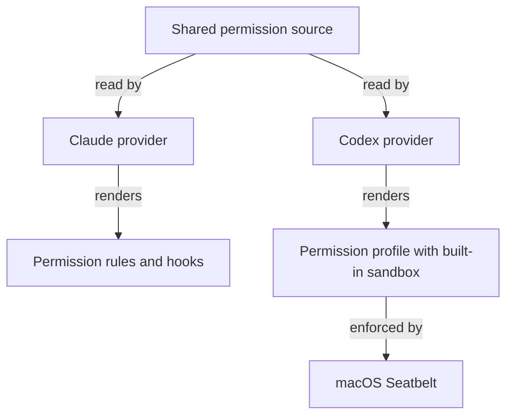
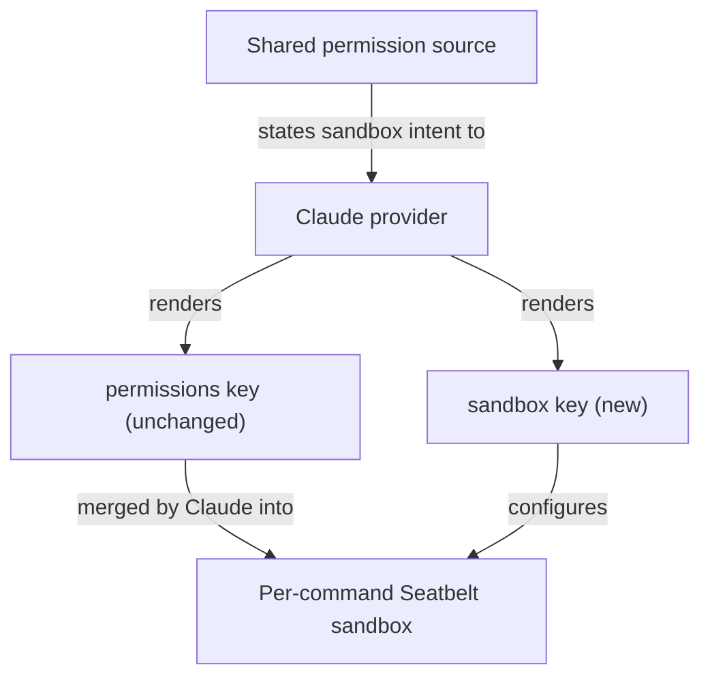

# Cut Claude permission prompts by running shell commands in the native sandbox

## Summary

Long Claude sessions stall on permission prompts for shell commands that only touch the repository
and temp folders. Claude Code has a native sandbox that confines each shell command at the OS level
and lets confined commands run without a prompt. RoboRepo does not turn it on.

This plan makes the Claude provider render that sandbox from the shared permission source, the same
way the Codex provider already renders its sandbox profile. A hand-written trial in one checkout
showed the prompt-free behavior and exposed gaps the generated version must close.

## Context

### Terms

| Term | Meaning |
| --- | --- |
| Shared permission source | `manifests/inventory/agent-permissions.json`: harness-neutral behaviors such as `write-scope`, `read-secrets`, and `go-online` |
| Provider | The per-harness code under `scripts/harnesses/<id>/` and `globals/harnesses/<id>/` that turns shared behaviors into native config |
| Native sandbox | Claude Code's `sandbox` settings block. On macOS it wraps each shell command in Seatbelt; file writes and network access outside the configured bounds fail in the kernel |
| Excluded command | A command pattern in `sandbox.excludedCommands` that is meant to run outside the sandbox, under the ordinary allow, ask, and deny rules |
| Public CA bundle | A file of public certificate authorities that TLS clients read to verify servers, such as `/private/etc/ssl/cert.pem` |
| Plans store worktree | The reserved `repo-plans` worktree outside the checkout, which `roborepo plans` commands lock and commit to |

### Why prompts happen today

Claude allow rules match a command prefix. Agent commands rarely start with one.

| Evidence | Reading |
| --- | --- |
| The generated user settings already allow `Write` and `Edit` under `/tmp`, `/private/tmp`, and `/private/var/folders` | Temp writes through file tools do not prompt; temp writes through the shell do |
| In the 40 most recent session transcripts for this repository (November 12, 2026), about 500 shell command lines began with `cd <path> &&` | A leading `cd` defeats every prefix rule |
| The same transcripts hold hundreds of inline scripts, loops, and env-prefixed commands | No prefix rule can describe them |
| The untracked `.claude/settings.local.json` in the main checkout holds more than 30 one-off approvals, several naming scratch folders of ended sessions | Approving exact commands does not generalize |

### How the two harnesses differ today



Codex confines every command and treats approval as an escalation. Claude checks rules first, and
its sandbox is optional. Current code reflects that:

| Location | Current statement |
| --- | --- |
| `claudePermissions` in `scripts/harnesses/permissions-render.mjs` | Skips `network` behaviors: "Codex-only concept; no Claude equivalent to render" |
| Comment above the Codex network rendering in the same file | "Claude has no sandbox network gate at all" |
| `renderClaudeSettings` in the same file | Writes only the `permissions` key and preserves every other key except `model` |
| `renderClaudeRootConfig` in `scripts/harnesses/claude/index.mjs` | Calls `renderClaudeSettings`, then merges core hooks; this is the Claude provider's `permissions.render` |
| `go-online` in the shared permission source | `codexOnly: true`, default `deny`, described as "Claude does not sandbox network egress" |
| Permission rows in `scripts/cli/config.mjs` | Pass `codexOnly` through with the comment that `go-online` has no Claude equivalent |
| "Provider-owned sandbox additions" in `docs/internal/harness-provider-interface.md` | Names Codex as the only implementer of `permissions.workspaceRoots` and `permissions.writablePaths` |

### What the trial showed

The trial added a `sandbox` block to the untracked `.claude/settings.local.json` of the main
checkout, on Claude Code 2.1.309 and macOS. It took effect in the running session without a restart.
The block, with the credential `denyRead` entries omitted:

```json
{
  "enabled": true,
  "autoAllowBashIfSandboxed": true,
  "filesystem": {
    "allowWrite": ["<claude-temp-folder>", "~/.npm"],
    "allowRead": [
      "/private/etc/ssl/cert.pem",
      "/opt/homebrew/etc/ca-certificates/cert.pem",
      "/opt/homebrew/etc/openssl@4/cert.pem"
    ]
  },
  "network": {
    "allowedDomains": ["registry.npmjs.org", "github.com", "*.githubusercontent.com"],
    "allowLocalBinding": false
  },
  "excludedCommands": ["docker *", "gh *", "git push *", "git pull *", "git fetch *", "roborepo *", "./bin/roborepo *"]
}
```

| Check | Result |
| --- | --- |
| Compound temp-folder command (`mkdir && redirect && cat`) | Succeeded |
| Write inside the repository | Succeeded |
| Write to the home folder | Refused: "operation not permitted" |
| List `~/.ssh` from the shell | Refused |
| `curl` and `npm ping` to the npm registry | Failed on certificates until three public CA bundles were exempted, then succeeded |
| `curl` to a host missing from `allowedDomains` | Succeeded; in manual permission mode an unlisted host prompts and is not refused |
| `git ls-remote` over SSH | Failed; Claude's documentation says SSH cannot pass the sandbox proxy on macOS |
| Headless `claude -p` started from a sandboxed command | Reported "Not logged in"; cause not confirmed |
| `roborepo plans show` from a desktop-app session, with `roborepo *` excluded | Ran inside the sandbox anyway: it reported "The plans worktree could not be locked" and returned unsynchronized output. The same command with the sandbox bypassed synchronized normally |

Whether the session prompted less was not measured: the agent cannot observe prompts.

Four findings shape the design:

- **Claude merges permission rules into the sandbox.** `Edit` allow rules became writable paths, and
  `Read` deny rules became unreadable paths. The `write-scope` and `read-secrets` behaviors
  therefore reach the sandbox with no new rendering.
- **The `//**/*.pem` credential pattern hides public CA bundles.** It blocked
  `/private/etc/ssl/cert.pem`, `/opt/homebrew/etc/ca-certificates/cert.pem`, and the
  `/opt/homebrew/etc/openssl@4/cert.pem` link to it. The generated Codex profile carries the same
  pattern. Its network is off, so the effect there is untested.
- **Excluded commands were not honored in the desktop app.** Why is unconfirmed: the desktop app may
  apply its own sandbox configuration, or the exclusion may need a different pattern. Until this is
  settled, any command on the excluded list must be assumed to run sandboxed, and `roborepo plans`
  commands then fail to write the plans store worktree.
- **Local settings do not reach worktrees.** The trial file is untracked, so a session in a linked
  worktree runs without the sandbox.

### Related plans

| Plan | Status | Relationship |
| --- | --- | --- |
| Keep local agent work within useful boundaries: Codex — Part 2 (`4zyo2woj`) | Completed; commit `60d2ba76` is in `main` | Landed dependency. Built `scripts/harnesses/codex/credential-permissions.mjs`, the pattern this plan's projection module follows |
| Repo-Scoped Write Permissions (`ia1q1z9`) | Completed; `globals/harnesses/claude/hooks/repo-write-scope.mjs` is present | Landed dependency. Its hook bounds `Write` and `Edit` to the checkout; the sandbox bounds shell commands. The two do not overlap |
| Keep local agent work within useful boundaries: Claude (`46qth5z8`) | Backlog | Neighbor. Owns worktree entry and moving Claude hook sources; no shared files with this plan |
| Keep local agent work within useful boundaries: Codex — Part 3 (`8bjltk2n`) | Backlog | Neighbor. Owns isolated app and browser test runs |
| Audit Global Agent Permissions Management (`permva27`) | Backlog | Related, not a prerequisite. This plan renders a native control, which fits either audit outcome |
| Permissions UI Revamp (`permissions-ui-revamp`) | Backlog, depends on `permva27` | Neighbor. Will redesign the rows this plan adds to `scripts/cli/config.mjs`; this plan adds rows in the current shape only |
| Capability-Derived Resource Targeting (`harness-capability-derived-resource-targeting`) | Backlog | No overlap found |
| Agent behavior evals (`0jped168`) | Backlog | Affected. Its runner starts headless `claude -p`, which the trial saw fail with "Not logged in" when started from a sandboxed command |
| Session launching, Milestone 1 (`plan-session-launching-milestone-1`) | Backlog | Affected. Its background start runs one headless Claude turn, the same path as the evals runner |

## Goals

- Sessions started after `roborepo update` run shell commands in Claude's native sandbox, in the
  main checkout and in linked worktrees.
- A command that stays inside the repository and temp folders runs without a permission prompt.
- Credential paths in `read-secrets` stay unreadable from shell commands, while public CA bundles
  stay readable so allowed network tools work.
- Commands that cannot work in the sandbox, including `roborepo plans` writes to the plans store,
  keep working.
- The shared permission source states the intent; the Claude provider owns every Claude-native key.

## Non-goals

- Changing Claude's default permission mode, including auto mode.
- Changing the Codex profile, including what `go-online` does for Codex.
- Isolating app and browser test runs (`8bjltk2n`).
- Relaxing ask rules such as `push-code`, or redesigning the permissions editor
  (`permissions-ui-revamp`).

## Proposed design



### Shared intent

| Intent | Shared source | Claude projection |
| --- | --- | --- |
| Run shell commands confined, without prompting | New behavior, default on | `sandbox.enabled`, `sandbox.autoAllowBashIfSandboxed` |
| Writable temp folders | Existing `write-scope` | None; Claude merges the `Edit` allow rules |
| Unreadable credentials | Existing `read-secrets` | None; Claude merges the `Read` deny rules |
| Readable public CA bundles | New exception list beside `read-secrets` | `sandbox.filesystem.allowRead` |
| Hosts reachable without a prompt | New allowed-host list, default `registry.npmjs.org`, `github.com`, `*.githubusercontent.com` | `sandbox.network.allowedDomains` |

`go-online` keeps its meaning: Codex's network on/off switch, still `codexOnly`, default `deny`. The
allowed-host list is independent of it, and Codex ignores the list until a separate plan adopts it.
Only `go-online`'s description changes, because "Claude does not sandbox network egress" becomes
false.

### Provider-owned details

These carry Claude-native names or Claude-specific limits, so they live with the Claude provider and
never in platform code, as `docs/internal/harness-provider-interface.md` requires:

- **Projection module.** One pure function in a new module under `scripts/harnesses/claude/`,
  following `scripts/harnesses/codex/credential-permissions.mjs`. It takes resolved behaviors and
  provider options and returns the `sandbox` object. `renderClaudeRootConfig` in
  `scripts/harnesses/claude/index.mjs` sets `rendered.sandbox` from it, beside the hooks merge, so
  the platform's `renderClaudeSettings` stays free of Claude sandbox keys.
- **Fixed settings.** `allowLocalBinding: false`; `strictAllowlist` unset, so unlisted hosts prompt.
- **Excluded commands.** `docker`, `gh`, the `git` network commands, and `roborepo`, as in the trial,
  if the first checklist item shows exclusions work. Otherwise the commands that need writes outside
  the sandbox get those paths through writable paths instead.
- **Extra writable paths.** `~/.npm` for the npm cache, which the trial added. The plans store paths
  that `scripts/harnesses/codex/plans-store-grants.mjs` already lists for Codex, if `roborepo plans`
  must run sandboxed. A second consumer moves that module out of the Codex folder to a shared
  location. Wire them through the optional adapter methods `permissions.workspaceRoots` and
  `permissions.writablePaths`, which `permissionOptionsForProvider` in
  `scripts/cli/permissions-render.mjs` already calls with the current directory.

### Ownership of the generated key

RoboRepo owns `sandbox` in the generated `~/.claude/settings.json` the way it owns `permissions`:
each render replaces it, and hand edits there are lost. Claude merges array settings across scopes,
so a repository's `.claude/settings.local.json` can still add entries.

## Implementation plan

- [x] With the trial block active, check whether `sandbox.excludedCommands` is honored, in a
      desktop-app session and in a CLI session, using `roborepo plans show <id> --json` and its
      `synchronized` field. Record the result and the pattern that works in the Decision Log.
- [x] In a linked worktree with the trial block copied in, run `git commit` and record whether
      writes to the main checkout's `.git` succeed.
- [x] Add the confined-shell behavior, the readable CA exception list, and the allowed-host list to
      `manifests/inventory/agent-permissions.json`. Correct the `go-online` description.
- [x] Add the Claude sandbox projection module and its excluded command list under
      `scripts/harnesses/claude/`.
- [x] Set `rendered.sandbox` in `renderClaudeRootConfig`, preserving unrelated keys.
- [x] Implement `permissions.writablePaths`, and `permissions.workspaceRoots` if needed, for Claude
      according to the two checks above. Move `plans-store-grants.mjs` to a shared location if
      Claude reuses it.
- [x] Correct the two "Codex-only" comments in `scripts/harnesses/permissions-render.mjs` and the
      `go-online` comment in `scripts/cli/config.mjs`.
- [x] Show the new behaviors in the permission rows built by `scripts/cli/config.mjs`.
- [x] Add the projection check to `scripts/test/check-groups.json` and the enforcement runner to the
      explicit-runner list in `scripts/test/orphan-test-check.mjs`, as described under Validation.
- [x] Update the documents under Documentation impact.
- [x] ~~Remove the trial `sandbox` block from the main checkout's `.claude/settings.local.json` once
      the generated settings carry it.~~ Moved to `## Not tested`: the block can go only after this
      branch merges and `roborepo update` renders the generated key on this machine.

## Validation

Projection and enforcement need separate evidence, following "Codex credential verification" in
`docs/internal/testing.md`.

| Check | Establishes | Where it runs |
| --- | --- | --- |
| New `scripts/test/claude-sandbox-projection-check.mjs` | The rendered `sandbox` key for default and overridden behaviors; unrelated settings keys and hooks preserved; a second render changes nothing | Deterministic CI group |
| New `scripts/test/claude-sandbox-enforcement-check.mjs` | On a real Claude binary: temp and repository writes succeed, a home-folder write fails, a credential read fails, a public CA bundle reads, an allowed host connects, an excluded command runs unsandboxed | Explicit macOS probe; exits 2 when no sandbox is available, like the Codex runner |
| `scripts/test/permissions-render-live-characterization-check.mjs` | Existing live render output changes only by the new key | Deterministic CI group |

Acceptance criteria:

- [x] After `roborepo update`, the generated Claude settings contain the `sandbox` key and
      `roborepo doctor` passes. Verified for the tracked baseline (`generated/claude/settings.json`) and a
      temporary-home live render; `bash scripts/doctor.sh --quiet` passed (98 checks). The live update on
      this machine waits for merge (see `## Not tested`).
- [x] The enforcement runner passes and records the Claude version, platform, and each positive and
      negative control.
- [x] `git commit` succeeds from a linked worktree session with the sandbox on.
- [x] `git push`, `gh pr view`, and `roborepo plans show <id> --json` behave as they do today;
      `roborepo plans show` reports `"synchronized": true`.
- [x] `npm run check` passes. Passed at 75f212d3 ("CI checks passed"). An earlier run failed only
      because a commit landed mid-run and changed the `generated/` status the suite's guard compares.

## Risks

- **Projection is not enforcement.** A rendered key proves nothing about runtime behavior, so the
  enforcement runner is required before the docs claim coverage.
- **Excluded commands are a gap by design.** They run with full access, and the git network
  commands can reach any host. Keep the list short and reviewed.
- **Writable paths are rendered per checkout.** `~/.claude/settings.json` is user-level, so paths
  derived from the current directory at `roborepo update` apply to every session. Prefer paths that
  hold for any checkout.
- **Headless Claude may not start from a sandboxed command.** The trial's `claude -p` reported "Not
  logged in", cause unconfirmed. With the sandbox on by default, an agent that runs the evals runner
  (`0jped168`) or the session launcher's background start from its shell would hit the same failure.
  Those plans need the cause confirmed, or their commands run outside the sandbox, before they rely
  on that path.
- **Claude version drift.** Sandbox keys and merge rules may change between releases. The
  enforcement runner names the version it verified.
- **macOS-only evidence.** Linux uses a different mechanism and needs extra packages; Windows runs
  unsandboxed. State coverage per platform and do not imply more.
- **A CA exception list can go stale.** A new OpenSSL or Homebrew layout brings back certificate
  failures. The enforcement runner's allowed-host control catches it.

## Documentation impact

- `docs/user/reference/config-control-panel.md`: describe the confined-shell behavior, the allowed
  hosts, and what runs outside the sandbox.
- `docs/internal/harness-provider-interface.md`: "Provider-owned sandbox additions" names Codex as
  the only implementer; add Claude.
- `docs/internal/testing.md`: add the Claude projection and enforcement checks beside "Codex
  credential verification".
- `docs/internal/config-panel-internals.md`: record the new behaviors and their Claude projection.

## Decision Log

- **2026-11-12 — `go-online` stays Codex-only; Claude reads a separate allowed-host list.** Making
  `go-online` gate Claude would, with its `deny` default, make every network command prompt; flipping
  the default would turn on Codex network access. Chosen by the user during promotion.
- **2026-11-12 — Local port binding stays off.** The Codex series rejected wildcard listeners, and
  whether `allowLocalBinding` is narrower is unverified. Dev servers started through the app's
  preview tools do not run in the shell sandbox.
- **2026-11-12 — Unlisted hosts prompt rather than fail.** `strictAllowlist` stays unset at first;
  revisit once the host list has proven complete.
- **2026-11-12 — Codex parity for the CA exceptions and host list is a separate plan.** Codex's
  network is off by default, so the `*.pem` denial has no observed effect there yet.

- **2026-11-12 — Check 1: excluded commands are honored when every command in the call matches.**
  On Claude Code 2.1.309, in this desktop-app session and in a headless `claude -p` session, bare
  `roborepo plans show 9njvfh5z --json` reported `"synchronized": true`, and so did
  `cd <checkout> && roborepo plans show …`. The same command piped to `grep` or `head` ran sandboxed
  and reported "The plans worktree could not be locked." The trial's failure was a piped call, not
  an ignored setting. Claude's documentation says every command in a call must match, and that a
  `cd` keeps a call sandboxed; the `cd` observation contradicts the second point and is not relied on.
  The pattern `roborepo *` works as written; no different pattern is needed.
- **2026-11-12 — Check 2: `git commit` from a linked worktree succeeds sandboxed.** A headless
  session rooted in this plan's worktree committed (an empty probe commit, then dropped), while
  writes to the main checkout's working tree and to the home folder were refused. Claude allows the
  shared `.git` directory for a linked worktree, as its sandbox documentation states. Its settings
  documentation also says a worktree session reads `.claude/settings.local.json` from the main
  checkout's root, so the trial's "local settings do not reach worktrees" finding no longer holds; the
  generated user-level key is still what reaches every checkout.
- **2026-11-12 — No `permissions.writablePaths` or `workspaceRoots` for Claude; `plans-store-grants.mjs`
  stays in the Codex folder.** Both methods derive paths from the current checkout, and
  `~/.claude/settings.json` is user-level. Claude already covers the checkout and the worktree's
  `.git`. The plans store cannot be granted anyway: a sandboxed write to its administrative directory
  was refused with "Operation not permitted", because Claude merges the `edit-plans-store` deny
  (`Edit(//**/repo_plans/**)`) into the sandbox, and that glob also matches
  `.git/worktrees/repo_plans`. Granting it would also undo that guard for every shell command. So
  `roborepo` stays excluded, and `~/.npm` is a provider constant in
  `scripts/harnesses/claude/sandbox-settings.mjs`. Alternative: a `writablePaths` method returning
  `~/.npm` (rejected: the build-time render passes no adapter options, so the tracked baseline would
  lack it).
- **2026-11-12 — New behaviors use provider-neutral kinds with a `claudeOnly` flag.** `sandbox-shell`
  (kind `shell-sandbox`; allow = sandboxed and prompt-free, ask = sandboxed and prompting, deny = off)
  and `reach-allowed-hosts` (kind `network-hosts`; allow = `allowedDomains`, ask = prompt, deny =
  `deniedDomains`). Every existing renderer skips unknown kinds, so Codex and Gemini output is
  unchanged; the projection check asserts it. `claudeOnly` mirrors `codexOnly` in the rows, the
  terminal printout, onboarding, and the portal ("Claude only"). Alternative: a general
  `harnesses: [...]` field (rejected: it redesigns rows that `permissions-ui-revamp` owns).
- **2026-11-12 — CA exceptions are a `readableExceptions` field on `read-secrets`.** They only mean
  something while that behavior denies `*.pem`, so the projection emits `allowRead` only then.
  Alternative: a separate `tools-scoped` Read-allow behavior (rejected: Claude's file tools rank deny
  above allow, so it would render dead rules).
- **2026-11-12 — `./bin/roborepo *` is excluded alongside `roborepo *`.** It is the same CLI run from
  a development checkout, where plans commands need the same unsandboxed store access. It matches
  only that literal text.
- **2026-11-12 — The enforcement runner drives `claude -p`.** Claude has no model-free command
  runner (`claude sandbox` installs the Windows sandbox and reports status only). The runner passes
  the fresh render with `--settings` and `--setting-sources ""`, drops hooks, uses Haiku, and reads
  results the probe writes to a file, so model wording cannot affect the verdict. A global
  protected-branch pre-push guard refused a push to an anonymous path remote, so the runner gives its
  throwaway remote a recorded default branch.
- **2026-11-13 — Ask and deny rules still apply to sandboxed commands.** A headless session with the
  generated settings was told to run `rm victim.txt` (the `delete-files` ask rule) in its workspace:
  Claude requested permission instead of auto-allowing it, and the file survived. The docs say
  prompt-free "unless an ask or deny rule names them".
- **2026-11-13 — `gh pr view` works under the generated settings.** A headless session with the
  fresh render ran `gh pr view 64 --json number,state` as an excluded command and printed
  `{"number":64,"state":"MERGED"}`.
- **2026-11-12 — Scope correction: removing the trial block moves to `## Not tested`.** It may happen
  only once the generated key is live, which needs this branch merged and `roborepo update` run on
  this machine. Removing it earlier would leave the main checkout unsandboxed until then.

## Not tested

- [ ] After merge, `roborepo update` on this machine writes the `sandbox` key into
      `~/.claude/settings.json`, `roborepo doctor` passes, and a new session's shell commands run
      without prompts. Needs the merged code applied to the live home, which this branch must not do
      before review.
- [ ] Then remove the trial `sandbox` block from the main checkout's `.claude/settings.local.json`,
      and confirm a new session still reports the sandbox (`claude sandbox status` shows
      `"enabled": true`). Needs the step above first.
- [ ] A desktop-app session started after the live update honors the generated key the way it
      honored the trial block. The enforcement runner covers `claude -p` only.

## Review

### Findings

- [x] The portal "Claude only" Not tested entry was checkable: the portal UI suite runs a hermetic
      server — fixed (75f212d3), assertion added to `portal-ui.spec.mjs`, entry removed
- [x] `claudeOnly` in rows, the config status printout, and onboarding had no deterministic check —
      fixed (75f212d3), `permission-harness-notes-check.mjs`
- [x] The `sandbox-shell` description and user doc claimed any added command keeps a call
      sandboxed, which the leading-`cd` observation contradicts — fixed (75f212d3)
- [x] The Gemini comment implied the new kinds are handled by name — fixed (75f212d3)
- [x] `docs/internal/hooks-internals.md` omitted the generated `sandbox` key — fixed (75f212d3)
- [x] The `sandbox-shell` description and user doc still claimed added commands keep a call
      sandboxed, against the leading-`cd` observation — fixed (0a1eca67)
- [x] The excluded-commands comment in `sandbox-settings.mjs` repeated the same claim — fixed (0a1eca67)
- [x] `harness-provider-interface.md` said the plans store "needs no grant" instead of "cannot be
      granted" — fixed (0a1eca67)
- [x] No evidence that `gh pr view` works under the generated settings — fixed: run and recorded in
      the Decision Log

### Verification

- Validation pass 1 at bfab9cc6 (fresh-context subagent): 5 `fix` findings, all fixed in 75f212d3
- Validation pass 2 at 75f212d3 (fresh-context subagent): 4 `fix` findings, fixed in 0a1eca67 and the
  Decision Log
- Full local gate (`npm run check`) passed at 75f212d3

## Open questions

None. The two checks at the top of the implementation plan decide provider details, not scope.
