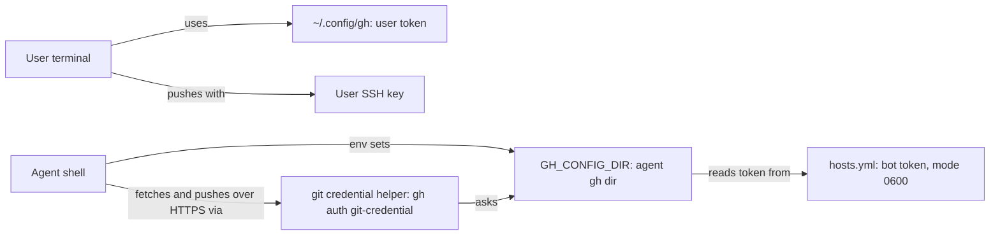
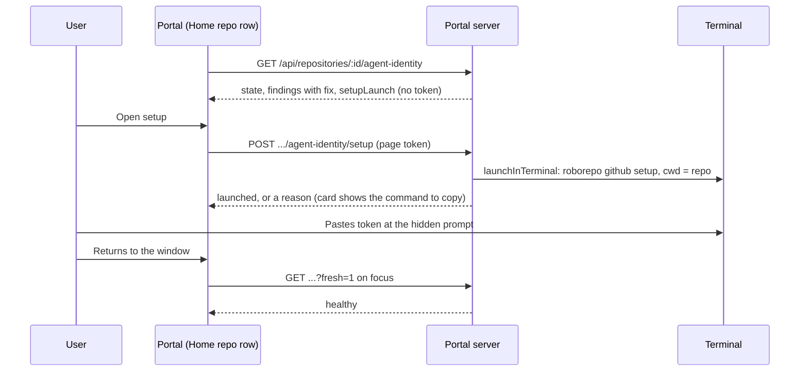

# GitHub Integration Part 01: Agents Act on GitHub Under Their Own Identity

## Summary

Agent shells (Claude, Codex, and Gemini once it can take env) should talk to GitHub as a separate
bot account, not as the user. The bot is a plain collaborator, so it is not on the ruleset bypass
list and has no admin rights. That means GitHub rejects an agent push to `main` and an agent merge
without a human approval, no matter what the local hooks miss. With GitHub enforcing that, `gh api`
can come off the agent deny list, and agents can read review threads and their resolved state,
reply to them, resolve them, and comment on pull requests without a prompt.

The user's own terminal stays on the user's identity, and the user's admin bypass keeps working for
the user's own direct pushes.

The identity also has to work inside Codex's sandbox, where agents cannot reach GitHub today. With
the identity on, Claude and Codex both push feature branches, open pull requests, and save plans
without a prompt, and Codex does so without leaving its sandbox. Until then, plan delivery
(`i5mnkm7z`) under Codex stops at the push and reports the command for the user to run.

Turning the identity on is a guided setup. Right after a user sets up the plan suite in a repo,
RoboRepo offers it. The setup walks the user through the steps only a person can do, checks the
result, and turns the identity on at the end. A user who declines keeps today's behavior.

The portal tracks the setup so the user never has to remember where it stands. Each repo row shows
the bot identity's status and the one next step. The step that handles the token opens the same
setup in a terminal, so the token never passes through the browser or an agent session.

**Recommendation:** a bot user with a classic personal access token, stored by `gh` in a file in the
bot's own `gh` config folder (`~/.roborepo/github-agent/gh`), because neither agent sandbox can read
the keychain (Decision Log, November 22). Agent shells reach it through a non-secret `GH_CONFIG_DIR` setting. An optional
package is the on/off switch. A fine-grained token is not an option for this repo (see Context).
The token expires, so renewing it is part of the design: RoboRepo warns two weeks ahead, and
rerunning the guided setup replaces it.

## Goals

- Claude and Codex push feature branches and open pull requests as the bot without a prompt. Codex
  does this from inside its sandbox, with no escalation.
- An agent push to `main` is rejected by GitHub, not only by local hooks.
- An agent cannot merge its own pull request into `main` without a human's approval.
- An agent cannot change rulesets, branch protection, or repo settings, whatever token it holds.
- `gh api` is allowed for agents running as the bot, so they can read review threads and their
  `isResolved` state, reply to threads, and resolve them.
- Agents running as the bot comment on and review pull requests and create issues without a prompt.
- A plan save or lifecycle move from Codex reaches `origin/repo-plans` from inside the sandbox.
- The user's terminal, `gh`, and SSH pushes keep the user's identity and admin bypass.
- No token value appears in a tracked file, a generated file, a rendered config, or an agent
  transcript.
- A user turns the identity on through one guided setup, offered when they set up the plan suite,
  without reading separate docs first.
- A user renews an expiring, expired, or revoked token by rerunning the same setup, which skips
  every step except the token. Status and doctor warn before the token expires.
- A token exported in the shell that starts an agent does not replace the bot (one documented
  exception, see Risks).
- GitHub-specific pieces sit in one place that is tagged as belonging to the GitHub host.
- The portal shows, per repo, whether the bot identity is set up, healthy, or needs renewal, and
  offers the next step. The step that handles the token opens `roborepo github setup` in a terminal
  (macOS) or gives the command to copy (every OS), and the portal refreshes when the user comes back.

## Non-goals

- A full forge adapter (`roborepo pr …` commands, GitLab or Bitbucket providers). See
  [Future work](#future-work).
- Moving the repo into a GitHub organization.
- Stopping an agent that deliberately goes around the setup, for example by using the user's SSH
  key directly. See Risks.
- Creating the bot account or token for the user. GitHub requires a person for both; the guided
  setup tells the user what to do, waits, and checks the result.
- Entering the token in the portal. The token is typed only at the setup's hidden terminal prompt,
  so it never reaches a browser, the portal server's requests, or an agent transcript.
- No-prompt Codex pushes with the identity off. Only the bot's collaborator role lets GitHub reject
  a push to `main`, so an install without the bot keeps Codex's network closed.

## Context

### Why the local guards are the only guard today

The repo is `kirinmurphy/roborepo-alpha`, a public repo owned by a personal account. It has two
rulesets on the default branch. Checked with `gh ruleset view` on 2026-10-30:

| Ruleset | Rules | Bypass |
| --- | --- | --- |
| `protect-main` | `deletion`, `non_fast_forward` | None. "This ruleset cannot be bypassed" |
| `no-push-to-main` | `pull_request` with `required_approving_review_count: 0`, `require_last_push_approval: false` | Repository admin role, mode `always` |

Since that check, the owner raised `no-push-to-main` to 1 required approval so an agent cannot
merge its own pull request, and bypasses it until the bot exists. "Protect a repo's plans and main
branches on GitHub from one command" (`3xh2sq32`) adds RoboRepo-managed rulesets that keep the
1 approval and admin bypass, add the three required CI checks, and protect `repo-plans`. The owner
then deletes the hand-made rulesets the managed ones cover. This plan depends on that one: the bot
gets push rights only after `repo-plans` is protected from deletion and force pushes. Reread the
rulesets before changing them.

The user is the admin and keeps the bypass for their own direct pushes. Agents run with the user's
credentials: `gh auth status` shows the user's OAuth token, with `repo` and `workflow` scopes, in
the keyring. The `origin` remote uses SSH with the user's key. To GitHub, an agent is the admin. So
these local guards are all that stops an agent push to `main`:

| Guard | Where | Source |
| --- | --- | --- |
| Push hook (PreToolUse) | Claude and Codex | `globals/system/hooks/claude/protected-branch-push.mjs`, `globals/harnesses/codex/hooks/protected-branch-push.mjs` |
| `pre-push` backstop | Agent shells, through `core.hooksPath` | `globals/system/git-hooks/` |
| `gh` deny list | Manifest rules plus the hook's `GH_DENIED` | `manifests/inventory/agent-permissions.json` (`change-github-directly`) |

`gh api` is denied because it can do anything the token can, including moving `main`, and the
hook cannot tell a read from a write. The cost: agents cannot read inline review threads or their
resolution state. `gh pr view --comments` shows comment text but not thread state. Posting
commands (`post-to-github`: `gh pr comment`, `pr review`, `issue create`, and others) are at `ask`
because they speak as the user.

### How agent-only settings reach agent shells today

`core.hooksPath` reaches only agent shells through `GIT_CONFIG_*` variables in config that only
the harness reads:

| Harness | Where | Rendered source (tracked) |
| --- | --- | --- |
| Claude | `env` in `~/.claude/settings.json` | `generated/claude/settings.json` |
| Codex | `[shell_environment_policy.set]` in `~/.codex/config.toml` | `generated/codex/config.toml` |
| Gemini | None today | — |

Both rendered files are tracked in the repo and copied into place by the install step. Anything
placed in them is effectively public. The token itself can never go there.

Optional packages can also change harness config. A package's `config-patch` resource lists `set`
or `union` patches on key paths in a harness's root config, applied at install and reverted when
the package is turned off (`globals/packages/usage-statusline/package.config.json` sets a Claude
`env` key this way). `${package-runtime:<name>}` expands to an installed asset's absolute path.
Validation lets only one package own each `set` path.

### Why Codex cannot reach GitHub from its sandbox today

Codex runs shell commands in the `managed-workspace` sandbox profile. `generated/codex/config.toml`
renders that profile with `network.enabled = false` and a `~/.ssh/**` deny, both from the credential
protection plan ([[4zyo2woj]]), which recorded the choice to keep host networking restricted. The
roborepo push hooks allow a feature-branch push, and the sandbox then stops it.

Each row below is a `codex exec` run on 2026-11-05 with `codex-cli` 0.166.0, using
`git push --dry-run origin HEAD:refs/heads/<throwaway>`. The overrides applied to that run only:

| Override | Result | What stopped it |
| --- | --- | --- |
| None | `Could not resolve hostname github.com` | Network disabled |
| `network.enabled=true` | `Network access to "github.com" was blocked: domain is not on the allowlist` | The domain allowlist, which holds only `localhost` and `127.0.0.1` |
| Also `network.domains={"github.com"="allow"}` | `hostkeys_find_by_key_hostfile: ... known_hosts: Operation not permitted` | The `~/.ssh/**` deny, reached because `origin` uses SSH |

During the second run, the hook also refused `git push --dry-run origin HEAD:main`, so the local
guard on `main` works under `codex exec`.

The third run stopped at SSH, so anything past that point is untested. `features.network_proxy` and
the domain allowlist exist in the live `~/.codex/config.toml` but are not in the generated file.

Two hooks answer differently for a feature-branch push: `permission-check.mjs` says `ask` and
`protected-branch-push.mjs` says `allow`. Part 02 ([[f0jwe76j]]) records that Codex has no
per-command ask tier, so a command the sandbox allows just runs. That matches the runs above, which
all started with no prompt under `codex exec`. An interactive session is unchecked.

### RoboRepo code that talks to GitHub today

| Caller | What it runs | Identity settings it sees |
| --- | --- | --- |
| Plan store, `modules/plan-suite/plan-store.mjs` | `git fetch` (in `fetchInto` and `fetchRemote`) and `git push` of `repo-plans` | None: `gitEnvironment` in `modules/repositories/git-exec.mjs` strips `GIT_CONFIG_COUNT` |
| Delivery commands, `modules/delivery/operations.mjs` | `gh` for PR body, ready, and CI rerun; `git fetch` for `roborepo delivery fetch` | `gh` inherits the full environment, so it would act as the bot. The fetch goes through the same stripping wrapper |

Agents may run `roborepo delivery …` and `roborepo plans …` (both in `allow`). So with the identity
on, both callers run inside agent shells and need it.

### GitHub facts this design rests on

| Fact | Status | Source |
| --- | --- | --- |
| Ruleset bypass lists name roles, teams, and GitHub Apps; actors not on the list are bound by the rules | Verified | [Creating rulesets for a repository](https://docs.github.com/en/repositories/configuring-branches-and-merges-in-your-repository/managing-rulesets/creating-rulesets-for-a-repository) |
| A collaborator on a personal-account repo can push and merge PRs, but cannot change settings; only the owner can | Verified. The page does not mention rulesets by name | [Permission levels for a personal account repository](https://docs.github.com/en/account-and-profile/reference/permission-levels-for-a-personal-account-repository) |
| Personal-account repos have one collaborator role (write). There is no read-only or triage role | Verified | Same page |
| Creating or updating rulesets and branch protection needs the **Administration** permission | Verified | [Permissions for fine-grained tokens](https://docs.github.com/en/rest/authentication/permissions-required-for-fine-grained-personal-access-tokens) |
| Listing review comments needs **Pull requests** read; replying needs **Pull requests** write | Verified | Same page |
| **Fine-grained tokens cannot contribute to repos where the user is an outside or repository collaborator** | Verified as a listed limitation | [Managing your personal access tokens](https://docs.github.com/en/authentication/keeping-your-account-and-data-secure/managing-your-personal-access-tokens) |
| Classic tokens work for a collaborator on a personal-account repo | **Unverified.** The page says so only for organization repos. Phase 2 checks it | Same page |
| `gh auth login --with-token` refuses a classic token without `read:org` | Verified 2026-11-22: a `repo`-only bot token failed with "missing required scope 'read:org'" | Owner's run of the Phase 2 login |
| Adding a collaborator to a personal-account repo sends an invitation the invitee must accept | Verified | [Collaborators REST API](https://docs.github.com/en/rest/collaborators/collaborators) |
| The invitee can list and accept invitations through the API; the `repo` scope covers invitations | Verified that the endpoints exist and that `repo` grants invitation access. The page names no required scope per endpoint. Phase 2 checks the accept with the bot's token | [Repository invitations REST API](https://docs.github.com/en/rest/collaborators/invitations) |
| The classic token page can be pre-filled through URL parameters | **Not documented.** GitHub documents pre-filling only for fine-grained tokens, which cannot be used here, so the setup does not rely on it | [Managing your personal access tokens](https://docs.github.com/en/authentication/keeping-your-account-and-data-secure/managing-your-personal-access-tokens) |
| GitHub App installation tokens last one hour, are minted from a JWT signed by the App's private key, and can be narrowed to repos and permissions | Verified | [Generating an installation access token](https://docs.github.com/en/apps/creating-github-apps/authenticating-with-a-github-app/generating-an-installation-access-token-for-a-github-app) |
| "Require approval of the most recent reviewable push" requires approval from someone other than the last pusher | Verified | [Available rules for rulesets](https://docs.github.com/en/repositories/configuring-branches-and-merges-in-your-repository/managing-rulesets/available-rules-for-rulesets) |
| GraphQL `PullRequestReviewThread.isResolved`, `viewerCanResolve`, and `addPullRequestReviewThreadReply` exist | Verified | [GraphQL pulls reference](https://docs.github.com/en/graphql/reference/pulls) |
| Which permission `resolveReviewThread` needs | **Not stated.** The mutation reference lists its inputs (`threadId`) but no permission. Phase 2 tests it with the bot | [GraphQL pulls reference](https://docs.github.com/en/graphql/reference/pulls) |

The fine-grained limitation changes the original idea. A bot user added as a collaborator to a
personal-account repo cannot use a fine-grained token there. What limits the bot is its
**collaborator role**, not its token scopes. The role cannot change settings or rulesets, and the
role is not on the bypass list.

## Proposed design

### Identity: bot user vs. GitHub App

| Dimension | Bot user + classic token (recommended) | GitHub App |
| --- | --- | --- |
| Setup | Second account, invite as collaborator, create a token | Create an App, install it on the repo, store its private key |
| What limits it | Collaborator role: no settings, no rulesets, not on bypass | App permissions: grant Contents, Pull requests, Issues write; omit Administration |
| Token scope | Classic `repo` and `read:org` (which `gh` requires to log in), covering every repo the bot is invited to. Omit `workflow` so pushes cannot change `.github/workflows/` | Narrowed per repo and per permission |
| Token lifetime | Long-lived. Set an expiry and rotate | One hour |
| Getting a token into `gh` and `git` | `gh auth login --with-token` once; `gh` keeps it in the bot's `hosts.yml` (Decision Log, November 22) | Needs a helper that signs a JWT and mints a token at least hourly. `gh` has no built-in App login |
| Attribution | Commits and comments show the bot login | Commits and comments show `<app>[bot]` |
| Moving parts in roborepo | Env entries only | Env entries plus a minting helper and refresh |

**Use the bot user.** It needs no code to mint or refresh tokens, and its power is limited by
GitHub's role model, not by scopes roborepo has to get right. The classic token is broader than
ideal, but it reaches only repos the bot is invited to, and on each of them the bot is a
collaborator. Revisit the App if the repo moves to an organization, which also makes fine-grained
tokens possible, or if a long-lived token becomes unacceptable.

### What GitHub enforces with the identity on

| Agent action | Identity off (today) | Identity on |
| --- | --- | --- |
| Push to `main` | Local hooks only; GitHub sees the admin | Local hooks, and GitHub rejects it |
| Merge its own PR | Local deny on `gh pr merge` only | GitHub requires another person's approval of the last push |
| Delete or force-push `repo-plans` | Local hooks only | GitHub rejects it (`roborepo protect`) |
| Change rulesets or repo settings | Possible through `gh api` if the hooks miss it | The collaborator role cannot |
| Codex push, PR, or plan save | Fails at the sandbox; the user runs it | Works with no prompt |
| Read, reply to, and resolve review threads | Not possible | Allowed |
| Comment on or review a PR, create an issue | Asks the user | Allowed |

The managed `roborepo-main-merge` ruleset from `3xh2sq32`, applied by `roborepo protect`, carries
the merge rule:

| Setting | 2026-10-30 (`no-push-to-main`) | Required (`roborepo-main-merge`) |
| --- | --- | --- |
| `required_approving_review_count` | 0 (since raised to 1 by the owner) | 1 |
| `require_last_push_approval` | false | true |
| Bypass | Repository admin, `always` | Unchanged |

The bot can then merge only after someone other than the last pusher approves. The user still
pushes and merges directly through the bypass. `gh pr merge` stays on the local deny list as well.

### Turning the identity on

The switch is an optional package, `github-agent-identity`, off by default. Turning it off reverts
everything it added. A user does not enable it by hand: the guided setup enables it as its last step.

The setup automates every step GitHub lets a program do, and guides the user through the rest.
GitHub requires a person, signed in as the bot, to create the account and the token; everything
else runs from the setup:

| Step | Done by | How |
| --- | --- | --- |
| 1. Offer the setup | `/plan-suite-init` | Ends by running the doctor's identity check and naming `roborepo github setup` when it is not set up |
| 2. Start the setup | The user, in their own terminal | `roborepo github setup` |
| 3. Create the bot account | **The user (guided)** | The setup opens GitHub's sign-up page, tells the user to use a private window so their own session stays signed in, and asks for the bot's login. It confirms the account exists with a public `gh api users/<login>` lookup |
| 4. Invite the bot | The setup, as the user | `PUT /repos/{owner}/{repo}/collaborators/{bot}` through the user's own `gh` login, which sends the invitation. Skipped when the bot is already a collaborator |
| 5. Create a classic token | **The user (guided)** | The setup opens the classic token page and shows the exact choices: scopes `repo` and `read:org` only, a note naming the repo, and an expiry. The classic page has no documented way to pre-fill these |
| 6. Hand over the token | The user pastes; the setup checks it, then stores it | Hidden prompt, piped to `gh auth login --with-token` in a staging folder first; only a token for the bot, with the right scopes and not expired, replaces the live login (see "Token entry") |
| 7. Accept the invite | The setup, as the bot | `GET /user/repository_invitations`, then `PATCH /user/repository_invitations/{id}` with the bot's new token. Skipped when there is no pending invite |
| 8. Protect the branches | The setup, as the user | Runs `roborepo protect` after the user confirms, when `roborepo protect --check` reports it missing |
| 9. Check the result | The setup | Bot login differs from the user's, write-not-admin permission, token scopes, and the merge and `repo-plans` rules. A check that cannot run stops the setup too |
| 10. Turn the identity on | The setup | Enables `github-agent-identity`, which re-renders Claude and Codex config. If the package is turned on but one of the files or settings it installs is missing, the setup applies it again; if the package still installs only partly, the setup fails |

If a check fails, the setup reports what failed and how to fix it. If a check cannot run, it reports
why. Either way it does not turn the package on; a package that was already on stays
on. A user who declines the offer keeps today's behavior: agents act as the user, `gh api` stays
denied, and Codex hands pushes back to the user.

| Piece | Behavior |
| --- | --- |
| Offer | `/plan-suite-init` ends by running the doctor's identity check. When the identity is not set up, it offers the setup and gives the one command to run. Packages have no post-enable hook, so the offer lives in the step a user runs right after turning on the plan suite |
| `roborepo github setup` | A new CLI command under a new `github` namespace. Interactive: it opens each GitHub page, waits for the user, and checks the result before moving on. It reruns safely and skips steps already done |
| Token entry | Read with hidden input and piped to `gh auth login --with-token` in a staging folder beside the agent `GH_CONFIG_DIR`. The setup refuses a staged token for another account, with the wrong scopes, or already expired; one that expires soon or never is stored with a note. It then moves the staged `hosts.yml` into place; a refused token is deleted and the previous one keeps working. Never echoed, written anywhere but `gh`'s own `hosts.yml`, or passed as an argument |
| Renewal | A rerun when GitHub rejects the saved token reads the bot's login from `hosts.yml`, skips the account steps, opens the token list (where **Regenerate token** keeps the scopes), and asks only for the new token. A rerun when the token still works but expires within 14 days, has no expiry, or has the wrong scopes offers to replace it |
| Agents and the setup | Agents are denied `roborepo github setup`, so a token never passes through an agent transcript. The offer tells the user to run it in their own terminal |
| Checks | The same checks as the doctor (see "Doctor check"), through `modules/forge/` |
| Ruleset step | If `roborepo protect` has not been run for this repo, the setup runs it after the user confirms |
| Finish | Enables the package through the existing package enable path, which re-renders Claude and Codex config |

What the package changes, and who renders it:

| Entry | Rendered by | Why there |
| --- | --- | --- |
| `GH_CONFIG_DIR` (Claude `env`, Codex `shell_environment_policy.set`) | Package `config-patch` (`set`) | A single key the package owns |
| `GH_TOKEN` and `GITHUB_TOKEN` set to empty (same two places) | Package `config-patch` (`set`) | `gh` uses either ahead of the stored login and treats an empty value as unset |
| A short agent rule: an authentication failure means the bot's token expired, so stop and ask the user to rerun the setup | Package `rules` resource | Agents otherwise retry, or suggest a `gh auth login` they may not run |
| Codex `network.domains` GitHub entries, `features.network_proxy` | Package `config-patch` | Keys the package can own; existing domains are kept |
| Extra `GIT_CONFIG_*` pairs and `GIT_CONFIG_COUNT` | Core renderer, when the package is enabled | `GIT_CONFIG_COUNT` is shared with core's `core.hooksPath` entry, so one patch cannot own it |
| Codex `network.enabled` | Core renderer (`codexNetworkAccess`), when the package is enabled | Already rendered from `go-online` |
| `gh api` and `post-to-github` moving to allow | Core permission rendering, when the package is enabled | Changes core behaviors in `agent-permissions.json` |

Phase 3 confirms this split against config-patch's one-owner rule before building it. If a
package-owned key turns out to need core rendering, it moves to the core column; the switch stays
the package.

### Delivering the identity to agent shells only

The token stays in the bot's `hosts.yml`. Rendered config carries only non-secret values:

| Setting | Delivered as | Value | Purpose |
| --- | --- | --- | --- |
| `GH_CONFIG_DIR` | Environment variable | `<home>/.roborepo/github-agent/gh`, absolute | `gh` reads the bot's login and token from `hosts.yml` here |
| `GH_TOKEN`, `GITHUB_TOKEN` | Environment variables | `""` | A token exported in the user's shell would win over the stored login, for `gh` and for the credential it hands Git |
| `core.hooksPath` | `GIT_CONFIG_*` pair | Unchanged | The existing `pre-push` backstop |
| `credential.helper` | `GIT_CONFIG_*` pair | `""` | Clears inherited helpers, such as `osxkeychain`, which may hold the user's credential |
| `credential.https://github.com.helper` | `GIT_CONFIG_*` pair | `!gh auth git-credential` | Git asks `gh`, which answers as the bot |
| `url.https://github.com/.insteadOf` | Two `GIT_CONFIG_*` pairs | `git@github.com:` and `ssh://git@github.com/` | Fetches and pushes to an SSH remote both go over HTTPS as the bot |

`GIT_CONFIG_COUNT` grows from 1 to 5. If the Phase 2 check shows HTTPS fetch fails as the bot, use
`pushInsteadOf` instead, and record that Codex fetches and plan saves still cannot reach GitHub.

Local checks of the assumptions this rests on, run on 2026-10-30 with `gh` 2.103.1:

| Assumption | Result | How it was checked |
| --- | --- | --- |
| An empty `credential.helper` at environment scope stops `osxkeychain` from answering | **Holds.** Only the `github.com` helper ran | `git credential fill` under `GIT_TRACE=1` with the `GIT_CONFIG_*` pairs above; `osxkeychain` comes from Xcode's system `gitconfig` and did not run |
| `gh` expands `~` in `GH_CONFIG_DIR` | **It does not.** `GH_CONFIG_DIR='~/x'` created a literal `./~/x` | `gh config set` in a scratch directory. The value must be an absolute path in the copied-in config, never `~` and never in the tracked `generated/` file |
| Logging the bot in under a second config dir leaves the user's identity alone | **Holds for current `gh`, with one side effect** | `gh` source (`internal/config/config.go`): tokens are stored per login under service `gh:github.com`, and `ActiveToken` reads the active login's own entry first. Login also rewrites a shared blank-login "active" entry, which `gh` reads only as a fallback. The user's per-login entry exists, so the user's `gh` keeps the user's token. A tool that reads only the blank entry would get the bot's token |
| Gemini CLI can take environment variables | **Not reliable enough.** Gemini loads only the first `.env` it finds, searching from the working directory upward before `~/.gemini/.env`, so any repo with its own `.env` hides roborepo's file. Whether those values reach the shell tool is undocumented | Gemini CLI configuration docs. Gemini is not installed on this machine, so nothing was run |

Gemini therefore keeps the user's identity, and `gh api` stays denied for it, until Gemini offers
a settings-level env mechanism that roborepo can render.

### Letting the identity through Codex's sandbox

The HTTPS rewrite avoids the `~/.ssh/**` deny, because Git asks `gh` for the bot's token instead of
using SSH. It still needs the network, so with the identity on, the Codex profile opens only the
GitHub hosts:

| Codex setting (`network.*` is under `permissions.managed-workspace`) | Identity off | Identity on | Why |
| --- | --- | --- | --- |
| `network.enabled` | From `go-online`, `false` by default | `true` | Commands can reach the network proxy |
| `network.domains` | Unchanged | Adds `github.com` and `api.github.com` as `allow` | Git goes to the first and `gh` calls to the second. `api.github.com` is inferred from `gh`'s behavior and is checked in Phase 2 |
| `network.allow_local_binding` | Unset | Stays unset or `false` | With `true`, the credential protection plan measured wildcard listeners being allowed, which breaks the listener boundary the user chose |
| `features.network_proxy` | Unchanged | `true` | Routes commands through the allowlist |

These values go only into the copied-in config, never into the tracked `generated/` file, so the
default install is unchanged. `go-online` keeps its meaning: it still decides network access when
the identity is off, and its description gains a note about this exception. `~/.ssh/**` stays
denied.

The cost of this exception is that every sandboxed Codex command, not only a push, can reach those
two hosts without a token. Commands that do use the bot's token stay limited by its collaborator
role and the remaining deny list.

### RoboRepo's own Git calls

The plan store and `roborepo delivery fetch` run Git through `runGitProcess`, which strips
`GIT_CONFIG_COUNT`. Under the identity their fetches and pushes would go to SSH: blocked in Codex's
sandbox, and under Claude done with the user's key instead of as the bot.

| Change | Detail |
| --- | --- |
| Keep the identity pairs on request | Add an explicit option to `runGitProcess` that keeps the `GIT_CONFIG_COUNT` pairs. The default still strips them, so polling and read-only callers are unchanged |
| Plan store | Use the option for the store's `fetch` (in `fetchInto` and `fetchRemote`) and its `push` |
| Delivery fetch | Use the option for `fetchTrackingRefs` in `modules/delivery/operations.mjs` |

Both callers already run with `-c core.hooksPath=/dev/null` from the wrapper's hardening, and a
`-c` value wins over the hook path in the identity's `GIT_CONFIG_*` pairs, so keeping those pairs
does not turn hooks back on. That is safe for the store because it pushes one explicit refspec for
`repo-plans` and never `main`. The delivery fetch only writes refs under `refs/remotes/<remote>/`.

A Codex save with the identity off commits locally and reports "not synchronized". After the
identity is turned on, the next save pushes the pending commits too.

Portal saves are unchanged: a portal started from the user's terminal has none of the agent
settings, so its pushes keep the user's identity.

### Permissions with the identity on

| Piece | Change |
| --- | --- |
| `manifests/inventory/agent-permissions.json` | Move `gh api` from `change-github-directly` into a new behavior, `read-and-reply-on-github`, in the `allow` bucket, rendered only with the identity on. Render `post-to-github` as `allow` with the identity on and `ask` without it. Update both descriptions. `gh pr merge`, `gh auth token`, and the repo, secret, variable, release, and workflow commands stay denied |
| `roborepo github setup` | Denied to agents, so the token is only ever typed in the user's terminal |
| `GH_DENIED` in both push hooks | Drop `['api']` only when `GH_CONFIG_DIR` equals the agent identity dir. An install without the identity, or a shell that has unset it, still gets the deny |
| `scripts/test/protected-branch-push-check.mjs` | The `gh --repo=owner/repo api -X PATCH …` case stays `deny` without the identity, and becomes `allow` with it |
| Codex rules | Re-rendered from the manifest; no hand edits |

`gh auth token` stays denied: it would print the bot's token into the transcript.

### GitHub-specific pieces in one place

`modules/repositories/config.mjs` already treats hosts generically. Keep a seam, not an adapter:

- **Tag GitHub pieces by host.** Each `gh` behavior in `agent-permissions.json` gets
  `"host": "github"`. In both hooks, the deny list becomes one `github` entry in a host table
  (`{ github: { cli: "gh", denied: [...] } }`), so a second host is a new entry, not a rewrite.
- **One module for host calls.** Roborepo code that runs `gh` goes in `modules/forge/`, with an
  entry point that takes a host name and a `github.mjs` beside it. The `gh` runner in
  `modules/delivery/operations.mjs` moves there, and delivery calls it through the entry point.
  After that, nothing outside `modules/forge/` runs `gh`. The doctor check and the guided setup also
  call it, and Runtime's PR and CI lookup (Part 03) comes later.
- **Pattern for a future adapter.** The harness provider registry in `scripts/harnesses/`
  (`registry.mjs` and `contract.mjs`, with one folder per provider) is the model to copy when a
  real second host arrives.

### Portal status and terminal hand-off

The setup has several steps over minutes, some on github.com and one in a terminal, and renewal
comes back months later. The portal keeps track so the user does not have to. It only reads status
and opens a terminal; every step that touches the token stays in `roborepo github setup`.

| Piece | Behavior | Built on |
| --- | --- | --- |
| Status route | `GET /api/repositories/:id/agent-identity` checks the id against the repo registry and calls `readCurrentAgentIdentity` (`scripts/cli/github-identity.mjs`) with the repo's path as `cwd` and an 8-second timeout, so the package state and state folder come from the same place as `roborepo github status`. It caches each repo's result for five minutes; `?fresh=1` skips the cache. The response carries the state (`not-set-up`, `healthy`, `problem`, `unavailable`), each finding's id, severity, message, and `fix`, the `reason` when the state is `unavailable`, the token's expiry date, and `setupLaunch.supported`. A repo whose GitHub target (`forgeTargetForRepositoryId`) is not `github.com` returns `{ applies: false }` without calling GitHub. It never carries a token | A wrapper `scripts/cli/repository-agent-identity.mjs` beside `scripts/cli/repository-protection.mjs`, wired as `handlers.loadRepositoryAgentIdentity` in `scripts/cli/telemetry.mjs` and routed in `scripts/cli/portal-routes-repositories.mjs` |
| What the card says | The state, then the `fix` of the first `problem` finding, else the first `warn` or `unchecked` one: the same text doctor and `roborepo github status` print. An `unavailable` result with no findings shows its `reason`. The card offers one button, **Open setup**, when the state is `not-set-up` or the shown `fix` names `roborepo github setup`; the `fix` text says why (set up, renew, refresh) | The `fix` strings `modules/forge/agent-identity.mjs` already returns, so new finding ids need no portal change |
| Where it shows | A status line in each repo card on Home, and the full card from that repo card's menu, next to the branch-protection item. Only repos the protection panel supports (`supportsProtectionPanel`: a `git:` id, not a mock repo) and whose status route does not answer `applies: false` get it, so a repo on another Git host shows nothing | `portal/shared/protection-panel.js` menu pattern |
| Terminal hand-off | **Open setup** posts to `POST /api/repositories/:id/agent-identity/setup`, which takes no body. The server opens a terminal running `roborepo github setup` in the repo's folder and returns `launched` or a reason. The program is `process.execPath` (the Node running the portal) with the absolute path of the portal's own `scripts/cli/main.mjs`, then `github setup`; both are absolute paths that exist, which `launchInTerminal` requires. Where `setupLaunch.supported` is false (any OS but macOS today) or the launch fails, the card shows the command with a copy button instead of the button | `scripts/cli/terminal-launch.mjs` `launchInTerminal`, which needs a working-folder option; `launchHookReview` in `scripts/cli/hook-review-launch.mjs` as the model for status recheck, reasons, and fallback; `<portal-copy-button>` |
| Refresh | After a launch, or once the card shows the copy command, the card refetches that repo with `fresh=1` when the window regains focus or becomes visible, throttled to once per 2 seconds. Other rows use the five-minute cache, so returning to the window does not re-read every repo | The focus pattern in `portal/shared/hook-readiness.js` |

GitHub calls per read: each uncached read runs several `gh` calls (token, login, repo access,
protection). The five-minute cache and the focus refetch limited to the repo whose setup was opened or copied keep Home's
polling from repeating them.

Why this keeps the token out of the portal: the status route only reads, and its response has
logins, dates, and finding ids, no secret. The setup route opens a window and returns; the token is
typed into that terminal's hidden prompt, which only a person at the keyboard answers. A local process
that calls the setup route (the mutation guard checks the page token and origin, not who is calling)
can only open a setup window, not supply a token.

### Doctor check

`roborepo doctor` and `roborepo github status` call GitHub as the bot, using the agent
`GH_CONFIG_DIR`, with any exported `GH_TOKEN` or `GITHUB_TOKEN` removed from those calls. They report:

- whether the identity is set up at all; when it is not, the line names `roborepo github setup`;
- the bot is logged in, its token is not expired or revoked, and its login differs from the user's;
- the bot's permission on the current repo is write, not admin;
- the default branch's effective rules require an approval of the last push (`roborepo-main-merge`);
- `repo-plans` is protected from deletion and force pushes;
- the token is a classic token with exactly `repo` and `read:org`. Any other scope is too broad, and
  a fine-grained token, which lists no scopes, is refused because nothing confirms what it may do.

Each finding has a severity:

| Severity | Examples | Effect on the result |
| --- | --- | --- |
| Problem | Expired or revoked token, wrong scopes, bot is admin or the user, missing protection | `problem`; doctor hints, status exits 1 |
| Warn | Token expires within 14 days, token has no expiry, stale CA bundle copy | Stays `healthy`; doctor hints |
| Unchecked | The user's own account or the branch protection could not be read | `unavailable` (never `healthy`) unless a problem is already known; doctor hints with the fix; setup stops |

A GitHub read that fails with nothing else known stays a plain "check skipped"; a problem found
before a later read fails is still reported.

## Implementation plan

### Phase 1: Check the open facts locally

- [x] Whether `gh` expands `~` in `GH_CONFIG_DIR`. It does not (see the results table).
- [x] An empty `credential.helper` through `GIT_CONFIG_*` stops `osxkeychain` from answering.
- [x] How `gh` keys keychain entries per login (read from source).
- [x] Whether Gemini CLI reads environment variables from a file roborepo can render. Not reliably.

### Phase 2: Account and GitHub settings (by the owner, after `roborepo protect` lands)

These checks need the bot account, which only a person can create. They decide details the later
phases build, so run them before Phase 3.

- [x] Run `roborepo protect` (`3xh2sq32`) so `roborepo-main-merge` requires one approval of the
      most recent push, with the admin bypass kept, and `repo-plans` is protected. — 2026-11-22:
      the owner's `roborepo protect --check` reported `roborepo-plans`, `roborepo-main-integrity`,
      and `roborepo-main-merge` all matching the policy.
- [x] Create the bot account, `codethings-agents`. — 2026-11-22: the owner confirmed it through the
      collaborator permission API.
- [x] The bot is a collaborator on `kirinmurphy/roborepo-alpha` with write, not admin, and its
      invitation is accepted. — 2026-11-22: `gh repo view --json viewerPermission` as the bot →
      `WRITE`. The owner accepted the invite by hand, so the API accept in setup step 7 is still
      untested.
- [x] Create a classic token with `repo` and `read:org` only and an expiry, then log it in under the
      agent `GH_CONFIG_DIR`. — 2026-11-22: a `repo`-only token was refused by `gh auth login`; with
      `read:org` added, `gh auth status` under the agent dir shows `codethings-agents`, scopes
      `read:org`, `repo`, stored in the keyring.
- [x] `gh auth status` in the user's terminal still shows the user after the bot login. —
      2026-11-22: still `kirinmurphy`, its own token and scopes.
- [x] A classic token for a collaborator on a personal-account repo can push a branch and call the
      API for that repo. — 2026-11-22, outside any sandbox: pushed and deleted
      `bot-identity-check-1795361542`; `GIT_TRACE` showed only `gh auth git-credential` answering;
      `gh pr list` as the bot succeeded. `gh api` itself was not run, because the agent hook denies
      it; it uses the same token.
- [x] Remaining Phase 2 checks moved to `## Not tested`: they need the bot's token stored in a
      file (Decision Log, November 22), which only the owner can enter, through
      `roborepo github setup`.
      — The Codex run on 2026-11-22 found the keychain unreachable; see the Decision Log.

### Phase 3: Package and agent-only delivery

- [x] Confirm the rendering split in "Turning the identity on" against config-patch's one-owner — Changed: the Git settings use one always-rendered `include.path` pair instead of package-conditional pairs (Decision Log).
      rule and `${package-runtime:…}` expansion. Move any entry a patch cannot own to the core
      column.
- [x] Add the `github-agent-identity` package under `globals/packages/`, off by default, with its
      config patches.
- [x] Add the identity `GIT_CONFIG_*` pairs to the rendering step that writes `core.hooksPath` for — Done as the `include.path` pair in `generated/claude/settings.json` and `generated/codex/config.toml` (43a377d4).
      Claude and Codex, rendered only when the package is enabled.
- [x] Write an absolute `GH_CONFIG_DIR` into the copied-in config, since `gh` does not expand `~`. — Through the `${roborepo-state:github-agent/gh}` placeholder.
- [x] Render the Codex network settings from "Letting the identity through Codex's sandbox" into the
      copied-in config when the package is enabled, keeping existing `domains` entries. Extend
      `codexNetworkAccess` in `scripts/harnesses/permissions-render.mjs` for the `enabled` value.
- [x] Update the `go-online` description in `agent-permissions.json` to name the exception.
- [x] Record Gemini as not covered in the docs, with the `.env` lookup order as the reason.
- [x] Update the isolated browser testing plan ([[8bjltk2n]]), whose goal of strict host networking
      needs to name the GitHub hosts as the exception.
- [x] Add the keep-identity option to `runGitProcess` in `modules/repositories/git-exec.mjs`, and
      use it for the plan store's fetch and push and for the delivery fetch.

### Phase 4: Permissions

- [x] Add `"host": "github"` to every `gh` behavior in `agent-permissions.json`.
- [x] Add the `read-and-reply-on-github` behavior with `gh api`, rendered only with the identity on.
- [x] Render `post-to-github` as `allow` with the identity on and `ask` without it.
- [x] Deny `roborepo github setup` to agents.
- [x] Turn `GH_DENIED` into a `github` host entry in both hooks, and lift `api` only under the agent
      `GH_CONFIG_DIR`.
- [x] Extend `scripts/test/protected-branch-push-check.mjs` with the with-identity and
      without-identity cases.

### Phase 5: Host module and doctor

- [x] Add `modules/forge/` with a host-name entry point and `github.mjs`. — `modules/forge/` already existed from `3xh2sq32`; added `agent-identity.mjs`.
- [x] Move the `gh` runner from `modules/delivery/operations.mjs` into `modules/forge/github.mjs`; — Already moved by `3xh2sq32`; `runGh` gained an `env` option.
      delivery calls it through the entry point, and `scripts/test/delivery-operations-check.mjs`
      still passes.
- [x] Add the doctor check, tested with a fake `gh` executable for: identity not set up, bot is
      admin, bot is the user, expired token, ruleset without last-push approval, unprotected
      `repo-plans`, and a healthy setup.

### Phase 6: Guided setup

- [x] Add `roborepo github setup` under a new `github` namespace in
      `manifests/platform/cli/command-definitions/`, built on `modules/forge/`. It walks the steps in
      "Turning the identity on", skips steps already done, and on a failed check reports the cause
      and leaves the package off.
- [x] Read the token with hidden input and pipe it to `gh auth login --with-token` under the agent
      `GH_CONFIG_DIR`; never echo it or pass it as an argument, and write it nowhere but `gh`'s own
      `hosts.yml` (Decision Log, November 22).
- [x] Run `roborepo protect` from the setup, after confirmation, when it has not been run for the
      repo.
- [x] Automate the invite and its acceptance: send the invitation through the user's `gh` login
      before the token step, and accept it with the bot's token right after the token is stored.
      Each skips itself when already done.
- [x] Guide the two person-only steps (bot account, classic token): open the page, show the exact
      choices (scopes `repo` and `read:org`), wait, and confirm the result before moving on.
- [x] Enable `github-agent-identity` through the existing package enable path as the last step.
- [x] Add the offer to `/plan-suite-init`
      (`globals/packages/plan-suite/skills/plan-suite-init/SKILL.md`): after the store is ready, run
      the doctor's identity check, and when the identity is not set up, offer `roborepo github setup`
      for the user to run in their own terminal.

### Phase 7: Token lifetime and setup hardening

Added November 23 at the user's request and from review of PR 82 (Decision Log). The last three
items are fixes found along the way that the token work depends on.

- [x] Rerunning the setup after GitHub rejects the token renews it for the saved bot, without the
      account steps. — 0b1f4d26; `github-setup-check.mjs` renewal case.
- [x] Status and doctor warn 14 days before expiry and note a token with no expiry date. —
      0b1f4d26; `github-identity-status-check.mjs` 13- and 15-day and no-expiry cases.
- [x] The package adds an agent rule that an authentication failure means the token expired. —
      0b1f4d26 (`globals/packages/github-agent-identity/rules.md`).
- [x] The setup suggests a 90-day expiry, and the setup guide has a renewal section. — 0b1f4d26.
- [x] A rerun offers to replace a working token that expires soon, has no expiry, or has the wrong
      scopes. — b10b5c5b; `github-setup-check.mjs` replace-or-keep case.
- [x] A new token is checked in a staging folder before it replaces the live login. — b10b5c5b;
      rejected-replacement case.
- [x] Setup's and status's bot calls drop an exported `GH_TOKEN` or `GITHUB_TOKEN`. — b10b5c5b; both
      tests set each variable.
- [x] Status flags any scope beyond `repo` and `read:org`, and fine-grained tokens. — b10b5c5b.
- [x] A check that cannot run makes the result `unavailable`, never `healthy`, and stops the setup.
      — b10b5c5b, abb24603.
- [x] Agent shells get `GH_TOKEN` and `GITHUB_TOKEN` set to empty. — 7167d591;
      `github-agent-identity-package-check.mjs`.
- [x] When the package is on but a file or setting it installs is missing, the setup applies it
      again, and fails if the install is still partial. — b10b5c5b, abb24603; missing-file and
      own-`GH_CONFIG_DIR` cases.
- [x] The Codex permission rules file (`~/.codex/rules/roborepo.rules`) is written even when the
      `rules` folder links to a dotfiles folder outside the checkout; a link into the checkout is
      still left alone. — b10b5c5b; `github-agent-identity-render-check.mjs`.
- [x] The record of which config values a package set (`owned-scalars-state.mjs`) no longer shares
      one empty object between reads in a process, which let a package overwrite a value the user
      set. — abb24603; found by the partial-install test.

### Phase 8: Portal status and terminal hand-off

Added November 23 at the user's request (Decision Log). The token stays in the terminal; the portal
reads status and opens the terminal.

- [x] Add `scripts/cli/repository-agent-identity.mjs`: validate the repo id against the registry,
      call `readCurrentAgentIdentity` with the repo's path as `cwd` and an 8-second timeout, cache
      each repo's result for five minutes, add `setupLaunch.supported`, and answer `applies: false`
      for a repo whose GitHub target is not `github.com`. — `repository-agent-identity-check.mjs`.
- [x] Add `launchAgentIdentitySetup` modeled on `launchHookReview`: recheck the repo, launch
      `process.execPath` with the absolute path of `scripts/cli/main.mjs` and `github setup`, and
      return `launched` or a reason. — Same file; refuses `not_github`, `unsupported_platform`,
      `no_checkout`.
- [x] Wire `handlers.loadRepositoryAgentIdentity` and `handlers.launchAgentIdentitySetup` in
      `scripts/cli/telemetry.mjs`, and add `GET /api/repositories/:id/agent-identity` and
      `POST /api/repositories/:id/agent-identity/setup` in `scripts/cli/portal-routes-repositories.mjs`.
- [x] Give `launchInTerminal` (`scripts/cli/terminal-launch.mjs`) a working-folder option. — `cwd`, refused as `no_folder` unless an existing absolute folder.
- [x] On Home: a status line in each supported repo card, and the full card from its menu, showing
      the state, the first finding's `fix` or the `reason`, **Open setup** or the copy command, and
      the github.com links; refetch that repo on focus after a launch or a shown copy command. —
      `portal/home/agent-identity.js`; `agent-identity.spec.mjs`.
- [x] Move the github.com step text (pages, scopes, expiry advice) into one place that
      `scripts/cli/github-setup.mjs` and the portal card both use. — `modules/forge/agent-identity-guide.mjs`;
      the portal gets it in the status response as `guide`.

## Review

### Findings
- [x] Codex never follows the identity: its rules file is a copy of the identity-off render and its permission hook ignores `agentIdentityBucket`, so `gh api` stays forbidden and pushes and posts prompt — fixed (35f1b186)
- [x] Claude gets a `git push` allow rule with the identity on, which lets a verified push chained to another command run without the prompt `askDecidedByHook` relies on — fixed (35f1b186)
- [x] The push hooks lift `gh api` from the hook's own environment, so a command that sets or unsets `GH_CONFIG_DIR`, sets `GH_TOKEN`/`GITHUB_TOKEN`/`GH_HOST`, or wraps `gh` in `env` is not denied — fixed (35f1b186)
- [x] `keepAgentGitConfig` keeps every numbered `GIT_CONFIG_*` pair, so any key (such as `core.sshCommand` or a credential helper) would reach RoboRepo's own Git; keep only the pairs RoboRepo renders — fixed (35f1b186)
- [x] `scripts/cli/permissions-render.mjs` duplicates the package id and enabled check that `modules/forge/agent-identity.mjs` and `scripts/cli/github-identity.mjs` hold, and splits `renderPermissionsTo` from its comment — fixed (35f1b186)
- [x] `effectivePermissions` in `scripts/cli/config-mutate.mjs` (config panel, `config status`) ignores the identity, so it shows `gh api` denied and posting at ask while they render allowed — fixed (35f1b186)
- [x] No test asserts that existing Codex `network.domains` entries survive enabling the package — fixed (35f1b186)
- [x] The status check lacks doctor cases for a ruleset without last-push approval, an unprotected `repo-plans`, and a skipped merge policy — fixed (35f1b186)
- [x] The docs say Gemini is not covered but not why (its `.env` lookup order) — fixed (35f1b186)
- [x] `## Not tested` omits manual Validation rows an agent can or a person must check, and its Codex entry claims person-only for parts that need no token — fixed: entries rewritten, agent-runnable checks run (plan record, November 22)

- [x] An agent could run the setup past its deny by prefixing `ROBOREPO_GITHUB_SETUP_SCRIPTED=1`, which skipped the terminal check — fixed: the switch is gone and the setup always needs a terminal (a60d58a9)
- [x] The setup compared the typed bot login case-sensitively after storing the token — fixed: GitHub's own spelling, compared case-insensitively (a60d58a9)
- [x] Whether `gh` reaches GitHub inside Codex's sandbox was listed as person-only though it needs no token — fixed: checked, see Not tested
- [x] The setup printed the sign-up and token pages instead of opening them — fixed: opened with the platform opener, still printed (a60d58a9)
- [x] The docs did not say turning the package off leaves the bot's token in `hosts.yml` — fixed: says what remains and how to remove it (a60d58a9)

- [x] The `gh api` lift also applies when the hook's own `GH_CONFIG_DIR` is unset (meant for Codex, whose hooks may not see `shell_environment_policy` values); under Claude a session started before the identity was on has no `GH_CONFIG_DIR`, so `gh api` would run as the user, an admin — owner chose an exact match under Claude; fixed (445fece6)

- [x] With the identity on, the hooks lift every `gh api`, so a heredoc or same-command variable query naming `mergePullRequest`, or the `enqueuePullRequest` mutation, merges a pull request although agents never merge — fixed (ead9425f)
- [x] The docs claim only a file-read query escapes the merge check, and promise the inherited-token check under Codex, whose hooks never see profile-exported variables — fixed (654b3a86)
- [x] A merge mutation name the shell builds (`${M}PullRequest`, `$(printf merge)PullRequest`) is not seen, so the bot could merge through `gh api` by deliberate obfuscation — owner chose to keep it a documented limitation (654b3a86 documents it)

- [x] Home read "healthy" for a token with no expiry date, though the docs, doctor, and setup treat it as one to renew — fixed (d3345f4e); "token expired" also now labels only the expiry problem

### Verification
- Base failure: `cli-surface-integration-check.mjs` fails intermittently at the remote-sync menu step, on `main` too
- Validation pass 1 at 43a377d4 (fresh-context subagent): 10 findings above, all fixed
- Validation pass 2 at 8565a475 (fresh-context subagent): 5 findings above, all fixed
- Validation pass 3 at a60d58a9 (fresh-context subagent, implementation-review rubric): clean apart from one escalate; its comment note fixed in 1b34375a
- Validation pass 4 at 445fece6 (fresh-context subagent): clean; its doc-wording note fixed in 9a18caee
- Validation pass 5 at 9a18caee (fresh-context subagent): 2 actionable findings, fixed in ead9425f
- Validation pass 6 at ead9425f and f3192485 (fresh-context subagent): 2 actionable doc findings fixed, test notes added; one escalate open
- Phase 8 targeted checks at b39f969e: `repository-agent-identity-check.mjs`, `hook-review-launch-check.mjs`, `github-setup-check.mjs`, `github-identity-status-check.mjs` pass; portal UI `agent-identity.spec.mjs` 6/6; `doctor.sh --quiet` passed (99 checks)
- Validation pass 7 at b39f969e (fresh-context subagent): 1 actionable finding, fixed in d3345f4e; two notes (label wording, fixed in the same commit; focus re-reads for a repo left un-renewed, kept as designed)
- Codex TLS: the CA read grants added in 35f1b186 did not work (`/**/*.pem` deny wins); replaced by the CA bundle copy in 8565a475

## Not tested

- [x] Codex with the identity off still cannot reach GitHub. — Verified by agent 2026-11-22 at
      35f1b186: `codex exec` running `git ls-remote origin HEAD` → "Could not resolve hostname
      github.com", exit 128.
- [x] Codex with the identity's network settings still refuses other hosts and wildcard listeners.
      — Verified by agent 2026-11-22 at 35f1b186: `codex exec` with run-only overrides
      (`network.enabled=true`, `features.network_proxy=true`): `curl https://example.com` → "domain is
      not on the allowlist"; a Python bind on `0.0.0.0` → "Operation not permitted". The `~/.ssh/**`
      deny is unchanged by this plan and asserted by `github-agent-identity-render-check.mjs`.
- [x] Git and curl verify GitHub's TLS inside Codex's sandbox through a non-`.pem` CA bundle copy. —
      Verified by agent 2026-11-22 for 8565a475's design: `codex exec` running
      `git -c http.sslCAInfo=<copy>.crt ls-remote https://github.com/kirinmurphy/roborepo-alpha.git HEAD`
      → the HEAD commit, exit 0; `curl --cacert <copy>.crt https://api.github.com/zen` → 200. The copy
      sat in a temporary folder, not the setup's `~/.roborepo/github-agent/ca-bundle.crt`.
- [x] `gh` reaches GitHub over TLS inside Codex's sandbox with the identity's network settings. —
      Verified by agent 2026-11-22 at a60d58a9: `codex exec` running
      `GH_TOKEN=dummy gh repo view kirinmurphy/roborepo-alpha --json name` → "HTTP 401: Bad
      credentials", so the network and TLS work and only the token is missing.
- [x] Codex's permission hook follows the identity. — Verified by agent 2026-11-22 at 35f1b186:
      `codex-command-permission-check.mjs` and a direct hook probe with an isolated state root:
      `gh api repos/o/r` → deny without the package asset, allow with it.
- [ ] `roborepo github setup` end to end on the real repo: the hidden token prompt stores the
      token in `~/.roborepo/github-agent/gh/hosts.yml` (mode 0600), the CA bundle copy and
      `gitconfig.local` are written, and the package is enabled. Needs a person: the token is typed
      at a hidden prompt in the owner's own terminal, and agents are denied the command.
      `roborepo github status` on 2026-11-22 at 43a377d4 already reported the real bot, scopes,
      expiry, and protection correctly.
- [ ] Inside Codex with the identity on, as the bot: `gh` reads the token from `hosts.yml`;
      `git fetch`, `git push` to a feature branch, `roborepo delivery fetch origin`, and
      `gh pr create` succeed with no prompt; a `roborepo plans save` made before the identity was on
      is pushed by the next save. Needs a person: every step needs the token the setup stores.
- [ ] In a Claude agent shell with the identity on: push a feature branch and open a PR as the bot;
      `gh api graphql` reads `reviewThreads { isResolved }`, replies, and resolves a thread;
      `gh pr comment` runs without a prompt. Needs a person: it needs the token stored by the setup,
      and a new agent session to pick up the re-rendered environment.
- [ ] The bot can push `repo-plans` directly (`roborepo plans save` from an agent shell reports
      "synchronized"), and GitHub refuses a delete or force-push of `repo-plans` and an unapproved
      merge of the bot's PR. Needs a person: same token prerequisite; the refusal checks act on the
      real repo's protected branches and are the owner's call to run.
- [ ] With the agent environment exported, `git push --no-verify origin HEAD:main` is rejected by
      GitHub naming `roborepo-main-merge`, and the owner's own push to `main` still succeeds through
      the admin bypass. Needs a person: both attempt real pushes to `main`.
- [ ] Renewing on the real repo: after the bot's token expires or is revoked, rerunning
      `roborepo github setup` names the saved bot, opens the token list, takes a regenerated token,
      and status is healthy again; a rerun with a token expiring within 14 days offers to replace
      it. Needs a person: the token is typed at a hidden prompt in the owner's own terminal.
      `github-setup-check.mjs` covers both paths against a fake `gh`.
- [ ] In a new Claude and a new Codex agent shell with the identity on, after exporting a token in
      the launching shell: `printf '[%s]' "$GH_TOKEN"` prints `[]` and `gh auth status` names the
      bot. Needs a person: it needs the package on in the owner's install and new agent sessions
      started from that shell. A fake-token check (2026-11-23) showed `gh` hands Git the stored
      bot token when `GH_TOKEN` is empty, and the exported one when it is set.
- [x] Home shows the bot identity for a real GitHub repo with the package off. — Verified by agent
      2026-11-23 at b39f969e: a portal started from the worktree (port 47821, the owner's normal
      state) showed `roborepo-alpha` as "needs attention", "A bot is signed in but the
      github-agent-identity package is off", the fix naming `roborepo github setup`, the token's
      expiry, and **Open setup**; repos with no GitHub remote showed no line.
- [ ] **Open setup** on macOS opens a terminal running `roborepo github setup` in the repo's folder,
      and returning to the portal after it finishes shows "healthy". Needs a person: the setup is
      interactive and reads the bot's token at a hidden prompt in the owner's terminal.
      `repository-agent-identity-check.mjs` asserts the launched command and folder, and the
      browser spec covers the post and the refresh on return.
- [ ] `/plan-suite-init` in a repo without a plan store ends by offering `roborepo github setup`.
      Needs a person: initializing a store creates a remote branch on a real GitHub repo, which is
      the owner's call; `github-identity-status-check.mjs` covers the `not-set-up` answer the offer
      reads.

## Validation

Automated:

- `node scripts/test/protected-branch-push-check.mjs` passes, covering `gh api` with and without the
  identity, and `roborepo github setup` denied to agents.
- The doctor check's fake-`gh` test passes for each failure case and the healthy case.
- A setup test with a fake `gh` and scripted input shows: the setup sends the invite as the user
  and accepts it as the bot; a rerun skips finished steps, including an accepted invite; a failed
  check leaves the package off; a passing run enables it; the token never appears in output, argv,
  or files under the test home.
- A rendering test, added beside `scripts/test/codex-permissions-foreign-lines-check.mjs`, shows the
  rendered Codex config for both states. Identity off: `enabled = false`, no GitHub domains.
  Identity on: `enabled = true`, both GitHub domains, existing domains kept, `~/.ssh/**` still
  denied, and `allow_local_binding` not `true`.
- A package test shows enabling `github-agent-identity` adds its entries, including
  `GIT_CONFIG_COUNT = 5` and an absolute `GH_CONFIG_DIR`, and disabling it restores the prior config.
- A `git-exec.mjs` test shows the new option keeps the `GIT_CONFIG_COUNT` pairs and the default
  still strips them.
- `node scripts/test/delivery-operations-check.mjs` passes after the `gh` runner moves.
- The setup test also shows: an expired token is renewed for the saved bot with only the token
  asked for; a working token that expires soon can be replaced or kept; a replacement with the
  wrong scopes is not stored and the old token stays; an exported `GH_TOKEN` or `GITHUB_TOKEN` is
  ignored; a missing package file is re-applied; a partial install fails.
- The status test also shows: notes at 13 days and none at 15; a no-expiry note; any extra scope
  and a fine-grained token are problems; an unreadable account or protection makes the result
  `unavailable`, not `healthy`.
- The package test shows `GH_TOKEN` and `GITHUB_TOKEN` set to empty on enable and removed on
  disable, for Claude and Codex.
- A portal route test shows the status route rejects an unknown repo id, returns each state with its
  findings' `fix` from a fake `gh`, reports the package as on when it is (state `healthy`, not
  `problem`), serves the cache until `fresh=1`, and never includes a token; and the setup route takes
  no body, launches `roborepo github setup` in the repo's folder, and returns a reason when it cannot.
- A portal browser spec shows the card for not set up, healthy, renew-soon, and problem; no card for
  a repo on another Git host (`applies: false`); an `unavailable` card shows its reason; **Open setup**
  posts to the setup route; unsupported launch and a failed launch both show the copy command; focus
  refetches only that repo.
- `npm run check` passes before the PR.

Manual, on the real repo, after Phase 6:

| Check | Expected |
| --- | --- |
| A fresh repo: run `/plan-suite-init` | It ends by offering `roborepo github setup` |
| Run `roborepo github setup` from the user's terminal, end to end | Each step waits and checks; the package is enabled at the end; `roborepo doctor` reports the identity healthy |
| The user, in a terminal with the agent environment exported (`GH_CONFIG_DIR` and the `GIT_CONFIG_*` pairs), runs `git push --no-verify origin HEAD:main`, so that only GitHub decides | GitHub rejects it with a ruleset error naming `roborepo-main-merge` |
| From an agent shell: push a feature branch and open a PR | Push succeeds; the PR and commits show the bot login |
| In an interactive Codex session and in `codex exec`: push a feature branch and open a PR | Both succeed as the bot, with no prompt and no sandbox escalation |
| In an interactive Codex session and in `codex exec`: `roborepo plans save` on a plan | Reports "synchronized"; the commit is on `origin/repo-plans`, pushed with the bot's token, with no prompt and no sandbox escalation |
| Save from Codex with the identity off, turn it on, then save again | The first save reports "not synchronized"; the second pushes both commits |
| In a Codex session: `roborepo delivery fetch origin` | Succeeds over HTTPS as the bot |
| In a Codex session: `git push origin HEAD:main`, and `git push --no-verify origin HEAD:main` | The hook denies both before they reach GitHub |
| In a Codex session: reach a host not on the allowlist, read `~/.ssh/known_hosts`, and bind a wildcard listener | All three are refused |
| In a Codex session with the identity off: `git push --dry-run` to a feature branch | Fails on the network, as it does today |
| From an agent shell: `gh api graphql` query for the PR's `reviewThreads { isResolved }`, a reply, and a resolve | All three succeed as the bot |
| From an agent shell: `gh pr comment` on the bot's PR | Runs without a prompt; the comment shows the bot |
| From an agent shell: merge the bot's PR through `gh api`, with no approval | GitHub refuses |
| From an agent shell: delete or force-push `repo-plans` through `gh api` or `git push --force` | GitHub refuses |
| From the user's terminal: `gh auth status` | Shows the user, not the bot |
| From the user's terminal: push a commit to `main` | Succeeds through the admin bypass |
| Portal, a repo with the identity off: open Home | The repo card shows "not set up" and **Open setup** |
| Portal: click **Open setup** on macOS | A terminal opens running `roborepo github setup` in the repo's folder; after it finishes, returning to the portal shows "healthy" |

## Documentation impact

| Doc | Update |
| --- | --- |
| `docs/user/reference/claude-hooks.md`, "Opening Pull Requests With gh" | `gh api` moves to allow and posting to allow under the agent identity. Replace "to GitHub an agent is you" with the bot setup, and say what stays denied |
| `docs/user/reference/claude-hooks.md`, "Protected Branches" | "Agents can push to feature branches without a prompt" is untrue inside Codex's sandbox until the identity is on. Name the identity as what Codex needs for it |
| `docs/user/reference/codex-hooks.md` | Same identity and `gh` changes for Codex. Under "Permissions On Codex", say the sandbox blocks GitHub until the identity is on, and which hosts it then opens |
| `docs/user/guides/setup-and-daily-use.md` | The guided setup: when it is offered, what the user does on GitHub, what `roborepo github setup` checks, and what stays the same if they decline |
| `docs/user/reference/roborepo-cli.md` | `roborepo github setup` and the new doctor check |
| `docs/user/guides/plan/lifecycle/plan-suite.md` | The setup offer at the end of `/plan-suite-init`. Codex saves push directly with the identity on, and report "not synchronized" without it |
| `docs/internal/docs-map.md` | Add `modules/forge/` and the `github-agent-identity` package |
| `docs/user/guides/setup-and-daily-use.md`, setup section | The portal card: where it shows, what each state means, and that **Open setup** opens the terminal setup |

## Risks

- **The user's credentials stay reachable from agent shells.** The SSH key, the default `gh`
  config, and the keychain are all still there. An agent that unsets `GH_CONFIG_DIR` or runs `ssh`
  directly acts as the admin again, which can push to `main` through the bypass. The local hooks
  still deny the paths they can see. GitHub enforcement covers the default path, not a deliberate
  workaround. Hiding the SSH agent is the next hardening step (see Future work).
- **Classic token breadth.** `repo` reaches every repo the bot is invited to. Invite it only where
  agents work, and set an expiry.
- **Resolving threads can satisfy merge rules.** If "Require conversation resolution" is turned on
  later, an agent resolving threads could unblock a merge. The required approval still holds.
- **Bot attribution changes PR history.** Agent commits and comments show the bot login, which is
  the point, but reviewers need to know who the bot is.
- **The token is a plaintext file.** Neither sandbox can read the keychain, so the token sits in
  `hosts.yml` with mode 0600 (Decision Log, November 22). Any process the user runs, agents included,
  can read it; the bot's limited role and the token's expiry bound the damage.
- **Allowed GitHub hosts widen what sandboxed commands can do.** Any sandboxed command can send data
  to those hosts, for example through `gh api` as the bot. Mitigation: the exception names only two
  hosts, is off without the identity, and the bot's role limits what its token can change. It does
  not stop data leaving through GitHub.
- **An expired bot token looks like a network problem.** An expired token turns Codex saves into
  "not synchronized" rather than an error, and the commits wait locally. Mitigation: status and
  doctor warn 14 days ahead and report an expired or revoked token as a problem (status exits 1,
  doctor shows a hint without failing), a rerun of the setup renews it,
  and the package's agent rule tells agents to stop and ask the user on an authentication failure.
  Nothing warns between doctor runs; GitHub's own expiry email goes to the bot account's address.
- **The Claude desktop app's launch environment may win over Claude's settings.** Claude Code's
  settings reference ("How env values interact with your shell") says that when the desktop app
  starts a session, its launch environment takes precedence for any variable it already sets. So a
  `GH_TOKEN` set there would not be blanked, and agents would act as that token's account. Read from
  the docs on 2026-11-23, not tested. Mitigation: the setup guide says not to set either token there.
- **The status route is readable by any local process.** Read-only portal routes need no page
  token, so a local process can read the bot's login, token expiry, and findings. None is a secret;
  the token itself never leaves `hosts.yml`.
- **The token passes through a terminal.** The setup reads it with hidden input and agents are
  denied the command, but a user who pastes the token into an agent chat leaks it to the transcript.
  The setup's instructions say to paste it only at its own prompt.

## Open questions

None open.

## Decision Log

- November 23, 2026: the github.com step text lives in `modules/forge/agent-identity-guide.mjs`,
  which the setup prints from and the status route returns as `guide`. Alternative: a portal copy of
  the text, which the browser could import directly but would drift from the setup's wording.
- November 23, 2026: the portal passes the repo id it already knows to `readCurrentAgentIdentity`
  (a new optional `repositoryId`) instead of rereading the checkout's origin. With no recorded
  checkout, status still reads from the home folder, and the setup button is replaced by the
  command, since the setup must run in the repo's folder to know which repo to set up.
- November 23, 2026: the line and card read "Agent GitHub account" with short state labels
  (not set up, healthy, renew soon, token expired, needs attention, not checked); the message and
  fix are the report's own text, so doctor, `roborepo github status`, and the portal agree.

- November 23, 2026 (user decision): the portal tracks the bot identity's setup and renewal
  status per repo and hands the token step to a terminal running `roborepo github setup`; the
  token is never entered in the portal. This replaces the earlier non-goal of any portal
  setup. Alternatives: a portal token form (puts the secret in the browser and the server's
  request path), or leaving setup terminal-only (the user has to track where setup stands).
  The card lives in this plan rather than in the Home calls-to-action plan (`rtkmc8kf`), which
  can link to it.
- November 23, 2026 (user decision): a merge name the shell builds (`${M}PullRequest`) or a query read
  from a file stays a documented limitation of the hooks' `gh api` merge check. Alternative: deny any
  `gh api graphql` query using `$`, a backtick, or `@file`, which would also block legitimate queries.
  The gap needs deliberate evasion, and GitHub still requires the owner's approval before any merge.
- November 23, 2026 (user decision): token expiry is handled inside this plan. A rerun of
  `roborepo github setup` renews the token rather than a separate `renew` command; status and doctor
  warn 14 days ahead (was 7) and note a token without an expiry date; the package adds an agent rule
  for authentication failures; the setup suggests a 90-day expiry. Rejected: a separate renew
  command, which would duplicate the setup's checks.
- November 23, 2026: from review of PR 82, a new token is checked in a staging folder
  before it replaces the live login, so a rejected token never reaches agents, and a rerun offers
  to replace a working token that needs it. A check that cannot run gets its own severity,
  `unchecked`, which makes the result `unavailable` instead of `healthy` and stops the setup.
- November 23, 2026 (user decision): agent shells get `GH_TOKEN` and `GITHUB_TOKEN` set to empty,
  because `gh` would use either ahead of the bot's stored login. Chosen over removing them, which
  Claude's `env` cannot do; `gh` treats an empty value as unset (checked with fake tokens). Claude
  Code's docs say a settings value overrides a shell export, except in sessions the desktop app
  starts (see Risks).
- November 23, 2026 (user decision): the push hooks lift the `gh api` deny under Claude only when
  the hook's `GH_CONFIG_DIR` is exactly the agent's gh folder; a Claude session started before setup
  keeps `gh api` denied until restarted. Codex keeps accepting an unset `GH_CONFIG_DIR`: its source
  (`codex-rs/hooks/src/registry.rs`, `command_runner.rs` on main) starts command hooks with the Codex
  process's own environment, not the `shell_environment_policy` values its shells get. The one shared
  hook file tells the harnesses apart by where it is installed (`forCodex`). Alternative: keep the
  unset-or-exact rule in both, which left Claude sessions started before setup running `gh api` as
  the admin. Done in 445fece6.
- November 5, 2026: the user chose no-prompt feature-branch pushes for both Claude and Codex, and
  approved adding these requirements here after being told they open the GitHub hosts as a narrow
  exception to the strict host networking in the credential protection plan. `~/.ssh` stays denied.
  The work lives in this plan because it needs the bot's token: without the bot, GitHub would not
  reject a push to `main`.
- November 6, 2026: the user asked this plan to carry the work that lets Codex plan saves push
  directly, once the bot identity and the plans branch (`pvgx8oh7`) both exist.
- November 14, 2026: the plans branch (`pvgx8oh7`) and the delivery commands from `vzgsx5vz` have
  landed. Plan saves and the delivery fetch are now unconditional work here, and the delivery `gh`
  runner moves into `modules/forge/`, superseding "nothing in RoboRepo runs `gh`". No lifecycle
  change is needed for either plan.
- November 14, 2026: the user chose to build `roborepo protect` (`3xh2sq32`) first rather than set
  rulesets by hand, so this plan depends on it. The bot gets push rights only after `repo-plans` is
  protected.
- November 14, 2026: the user wants a seamless way to turn the identity on. Chosen: a guided setup
  in this plan, `roborepo github setup`, offered at the end of `/plan-suite-init`, with an optional
  package as the underlying switch so turning it off reverts cleanly. Declining keeps today's
  behavior.
- November 14, 2026: with the identity on, `post-to-github` commands move from ask to allow.
- November 22, 2026 (user decision): neither Claude's nor Codex's sandbox can read the macOS
  keychain (`gh` reports the bot's token invalid in both; both deny `~/Library/Keychains/**`), so the
  bot's token is stored in a file: `gh auth login --insecure-storage` under the agent config dir, which
  keeps it in that dir's `hosts.yml`. Rejected: opening the keychain to the sandboxes (exposes the
  user's own credentials), running `gh` outside the sandbox (Codex would prompt), Claude only. This
  replaces the "never written to a file" rule for the token; it still never appears in a tracked or
  rendered file, an argument, or a transcript.
- November 22, 2026: the Git settings reach agent shells through one `include.path` pair that core
  always renders, pointing at `~/.roborepo/package-runtime/github-agent-identity/gitconfig`, a file the
  package installs. Chosen over rendering four more `GIT_CONFIG_*` pairs only when the package is on:
  Git honors `include.path` at command scope, expands `~`, and ignores a missing file (checked
  locally), so core needs no package-conditional rendering and `GIT_CONFIG_COUNT` stays one owner's.
- November 22, 2026: `GH_CONFIG_DIR` is a package config patch using a new
  `${roborepo-state:<path>}` placeholder that expands to an absolute path under the state root,
  since `gh` does not expand `~`. Rejected: pointing it at the package-runtime folder, which every
  apply replaces wholesale and would delete the token.
- November 22, 2026: permission changes are declared in the manifest as `agentIdentityBucket` on
  `read-and-reply-on-github`, `post-to-github`, and `push-code`, applied before user overrides when
  the package is on. `push-code` is included because a Codex feature-branch push needed approval in
  the November 22 run. A package field `permissionsRender: true` re-renders permissions when the
  package is turned on or off. With the identity on, the Codex profile also enables the network and
  grants read access to Git's CA file, which its sandbox could not read in that run.
- November 22, 2026: the user asked that the setup automate every step GitHub allows and guide the
  rest, so another user can set this up without help. The setup now sends the collaborator invite
  as the user and accepts it as the bot; only the bot account and the token stay manual. Pre-filling
  the classic token page was considered and dropped because GitHub does not document it.
- November 22, 2026: Codex's sandbox denies `/**/*.pem` (credential protection), which includes
  the system CA bundle, and a read grant does not override it. The setup copies the bundle to
  `~/.roborepo/github-agent/ca-bundle.crt` and a second include, written by the setup, points Git's
  `sslCAInfo` for github.com at it. Chosen over narrowing the credential deny, which would weaken the
  credential protection plan ([[4zyo2woj]]). Cost: the copy can go stale after a system update, so
  status and doctor warn and rerunning the setup refreshes it.
- November 14, 2026: the user's priority is no agent push to `main` and no merge without a human.
  The user's SSH agent stays visible to agent shells for now; hiding it is future hardening.
  Agent fetches move to HTTPS as the bot (`insteadOf`), gated on the Phase 2 fetch check.

## Future work

- Hide the user's SSH agent from agent shells. Codex's `shell_environment_policy` can exclude
  `SSH_AUTH_SOCK`; Claude's `env` can only set it to empty. With fetches on HTTPS, this closes the
  remaining path by which an agent can act as the admin.
- A full forge adapter: `roborepo pr …` commands, with GitHub as one provider and GitLab or
  Bitbucket as others, modeled on `scripts/harnesses/`. Build it only when a second host is
  actually used.
- A GitHub App identity, if the repo moves to an organization or long-lived tokens are ruled out.
