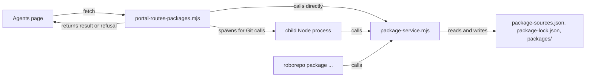

# Package Management: Part 04b - Manage Package Sources and Installs in the Portal

## Summary

Package Management Part 04 (jdsobwn, the merged plan that added package sources) lets RoboRepo get packages from GitHub repos and
local folders, install them at a pinned commit, update them, and remove them. All of that is
reachable only from the command line today. A person who manages RoboRepo from the portal can see
packages and turn them on or off, but cannot add a source, install a package from one, update it,
or remove it.

This plan puts those actions in the portal, on the Agents page, so a person never needs the
command line to manage where packages come from. The portal calls the same package service the CLI
calls, so both show the same state and refuse the same things. The plan ends with one test pass
that drives each action through the portal and through the CLI against the same machine state, and
checks that each surface sees what the other did.

## Context

### Terms

| Term | Meaning |
| --- | --- |
| **Source** | A place packages come from: the built-in library (`builtin`), the workspace (`local`), another local folder, or a public GitHub repo. Stored in `<stateRoot>/package-sources.json` (`~/.roborepo/` by default). |
| **Install** | Recording a package as installed. A GitHub package is copied into the store at a pinned commit; a folder package is used in place. Install does not turn the package on. |
| **Enable** | Applying an installed package to the harnesses, so they read it. |
| **Tab** | Where a package appears in the portal, derived from its source: **System** (built-in), **Custom** (local folders), **Third Party** (GitHub). |
| **All repos scope** | The Agents page's machine-wide view, chosen in its repo selector. Scoped to one repo, the page shows that repo's inspector instead of package rows. |
| **Package service** | `scripts/cli/package-service.mjs`: the one module that reads and changes sources and installs. |

### Current behavior

The package service already provides every operation, and the CLI in
`scripts/cli/package-source-command.mjs` is a thin client over it:

| Action | Service call | CLI |
| --- | --- | --- |
| List sources | `listSources()`, `sourceInfo(id)` | `package source list`, `package source info` |
| Add a source | `addSource({ location, id })` | `package source add <github-url\|folder>` |
| Refresh a GitHub source | `refreshSources(id)` | `package source refresh` |
| Turn a source on or off | `setSourceEnabled(id, enabled)` | `package source enable\|disable` |
| Remove a source | `removeSource(id, { keepInstalled })` | `package source remove [--keep-installed]` |
| List the trusted catalog | `trustedCatalog()` | `package source trusted` (ships empty) |
| Preview, then install | `previewInstall(ref)` → `installPackage(ref, { confirmed, expectedPlan })` | `package install` |
| Update after confirming | `updatePackage(ref, { confirmed, expectedRevision, expectedFrom, reapply })` (async) | `package update` |
| Remove | `removePackage(ref, { disable, retire })` (async) | `package remove` |
| Everything a screen shows | `packageView()`: rows with `tab`, `sourceBadge`, `installed`, `active`, `revision`, `latestRevision`, `updateAvailable`, `available`, `removable`, `sourceChanged`, plus `tabs` (with counts), `unresolved`, `shadowed`, `collisions` | `package list` |

The CLI passes callbacks to the two async operations:

- **Update** passes `reapply: reapplyPackage` from `scripts/cli/packages.mjs`, so an update of an
  active package re-applies it to the harnesses; a failed reapply rolls the update back. Unconfirmed,
  `updatePackage` refuses with `confirmationRequired` and the change to show in `details.change`
  (`from`, `to`, `files`, `contents`).
- **Remove** passes `disable: (id) => disablePackage([id])` and `retire: retireStrandedPackage`,
  both from `scripts/cli/packages.mjs`. An active package is turned off first; if another active
  package requires it, nothing is removed.

Refusals are `PackageServiceError`s whose `code` is a key of `SERVICE_EXIT_CODES` (`usage`,
`ambiguous`, `confirmationRequired`, `unavailable`, `refused`, `invalid`); the CLI turns the code
into its exit status. An install whose plan changed after the preview refuses with
`details.planChanged`.

Git runs synchronously (`spawnSync` in `scripts/cli/package-source-git.mjs`), and each remote Git
call times out after `REMOTE_GIT_TIMEOUT_MS` (120 seconds). One operation makes up to three such
calls, so it can take several minutes. Adding a GitHub source, refreshing it, and updating run Git.
Installing copies from the revision cache the last refresh built and runs no Git.

The portal side:

- The Agents page (`portal/config/`) lists packages by category under "Available Agent Tools",
  with an on/off toggle each, through `GET /api/config` and `POST /api/config/packages` in
  `scripts/cli/portal-routes-config.mjs`. Package rows appear only in the All repos scope
  (`portal/config/app.js`).
- `scripts/cli/config.mjs` already passes each package's `tab` and `sourceBadge` to the page, but
  the page renders neither.
- No portal route calls the source, install, update, or remove operations.
- Route tables are declared with `defineRoutes` (`scripts/cli/portal-router.mjs`) and listed in
  `API_ROUTE_TABLES` in `scripts/cli/portal-server.mjs`. The server already rejects any `POST`,
  `PATCH`, `PUT`, or `DELETE` without the page's origin and portal token, and runs it under a write
  actor (`runWithWriteActor` in `scripts/cli/write-log.mjs`) so its writes are logged as that
  request. The router splits the path before decoding each segment, so `team%2Ftool` arrives as one
  `:ref` parameter.
- `scripts/cli/portal-harness-refresh.mjs` already runs `config apply` in a child Node process so
  the server keeps answering; it is the precedent for running slow work off the server's thread.
- `npm run test:portal-ui` runs hermetic Playwright specs from `scripts/test/portal-ui/`; extra
  arguments select one spec.

### How this splits from related plans

- **Part 05** (`user-managed-packages-and-add-workflows`) already names this plan as the owner of
  the System / Custom / Third Party tab bar, source badges, Install, Update, and Remove on cards,
  the Sources panel, and adding a GitHub repo or folder. Part 05 keeps the typed add flows
  (`roborepo add skill`, `add mcp`, and the rest), the Custom tab's Add button, inspect and export,
  user-content status badges, and drift repair. Its own checklist depends on this plan's tab bar.
- **Audit** (4qzo8h0s, "Audit Every Third-Party Package Before It Installs or Updates", in backlog) plans to remove the Trusted tier, including `trustedCatalog()` and
  `package source trusted`. This plan therefore builds no trusted-catalog screen (see Non-Goals).
  The `Trusted` part of a badge comes from the service's `sourceBadge`, so it disappears with no
  portal change once the audit plan lands. The audit plan's Non-Goals say the portal does not
  install packages yet and that Part 05 builds that screen; once this plan lands, that sentence is
  stale, and the audit plan should show its findings in this plan's install and update dialogs.
- **CLI test guide** (package-cli-test-guide, "Package & User-Content CLI Test Guide", in backlog) wants a CLI-to-portal persistence scenario for user
  content. This plan's parity spec covers package sources and installs only; the test guide keeps
  the typed user-content cases and can reuse this spec's fixtures.

## Goals

- Every package-source action the CLI offers, except the trusted-catalog listing, can be done on
  the Agents page.
- The portal shows the same state the CLI reports: which source a package came from, whether it is
  installed or on, its pinned commit, whether an update exists, and whether its source still
  offers it.
- An install or update in the portal shows what will change and asks first, and is bound to what
  the person saw, exactly as the CLI's confirmation is.
- An action taken in either surface shows in the other without restarting anything.

## Non-Goals

- Typed add flows for single skills, MCP servers, rules, or hooks. Part 05 owns them.
- Auditing third-party content before install. The audit plan (4qzo8h0s) owns it; this plan leaves
  room in the install and update dialogs for its result.
- A trusted-catalog list or route. The catalog ships empty, and the audit plan removes the Trusted
  tier. `roborepo package source trusted` stays CLI-only until then.
- A folder picker. The portal runs locally and takes a typed folder path, as the CLI does.
- Package actions in a single-repo scope. Sources and installs are machine-wide, so they appear
  only in the All repos scope, where package rows already live.
- New service behavior. A gap the screens expose is fixed in the service, shared with the CLI.

## Proposed Design

### Where it lives

- **Routes:** a new `scripts/cli/portal-routes-packages.mjs` exports `packagesRoutes`, declared with
  `defineRoutes` and added to `API_ROUTE_TABLES`. Each route parses the request, calls one service
  function, and maps a `PackageServiceError` code to an HTTP status with the service's message,
  code, and details in the body. No package logic lives in a route.
- **Git off the server's thread:** the routes marked "child" in the Routes table run their
  service call in a child Node process and await it. Because Git is synchronous, calling it inside the portal server would stop every page from answering for
  several minutes. One small runner module does this: it takes a service operation name and its
  JSON arguments, runs it, and prints `{ result }` or `{ error: { code, message, details } }`. The
  route rebuilds the `PackageServiceError` from that, so `details.change` and `details.planChanged`
  reach the page as they would in-process. The runner passes the same callbacks the CLI passes
  (`reapplyPackage` for update) and sets `ROBOREPO_WRITE_ACTOR` from the request's write actor, so
  its writes are logged as the portal request.
- **Page:** the Agents page gains the tab bar, card actions, dialogs, and a Sources section. Dialogs
  reuse the page's existing `<dialog>` and busy-state patterns in `portal/config/panels.js` and
  `templates.js`; fetch calls go in `portal/config/api.js`.

### Routes

| Method and path | Service call | Runs in |
| --- | --- | --- |
| `GET /api/packages` | `packageView()` | server |
| `GET /api/packages/sources` | `listSources()` | server |
| `GET /api/packages/sources/:id` | `sourceInfo(id)`, for the package IDs a source offers | server |
| `POST /api/packages/sources` `{ location, id? }` | `addSource()` | child for a GitHub URL, server for a folder |
| `POST /api/packages/sources/:id/refresh` | `refreshSources(id)` | child |
| `POST /api/packages/sources/:id/enabled` `{ enabled }` | `setSourceEnabled()` | server |
| `DELETE /api/packages/sources/:id?keepInstalled=1` | `removeSource()` | server |
| `GET /api/packages/install-preview?ref=` | `previewInstall()` | server |
| `POST /api/packages/install` `{ ref, expectedPlan }` | `installPackage(ref, { confirmed: true, expectedPlan })` | server |
| `POST /api/packages/update` `{ ref }` | `updatePackage(ref, { reapply })`: unconfirmed, it refuses with `confirmationRequired` and `details.change`, which the dialog shows | child |
| `POST /api/packages/update` `{ ref, confirmed: true, expectedRevision, expectedFrom }` | `updatePackage(ref, { confirmed: true, expectedRevision, expectedFrom, reapply })` | child |
| `DELETE /api/packages/installed/:ref` | `removePackage(ref, { disable, retire })`, with the CLI's callbacks | server |

`:ref` is a package reference such as `team/tool`, URL-encoded (`team%2Ftool`) so it stays one
path segment. Refusals map to HTTP statuses:

| Service code | HTTP status |
| --- | --- |
| `usage`, `invalid` | 400 |
| `ambiguous`, `confirmationRequired`, `refused` | 409 |
| `unavailable` | 503 |
| Anything else | 500 |

A `confirmationRequired` with `planChanged` tells the page to show the new preview and ask again, as the CLI re-prompts.

### Screens

Everything below renders only in the All repos scope. The normal path for a person:

1. In the Sources section, add a GitHub URL or folder path.
2. On the Custom or Third Party tab, select **Install** on a card, read the preview, and confirm.
3. Turn the package on with its existing toggle.
4. Later, select **Update** when it appears, read the change, and confirm; or select **Remove**.

The sections below describe each screen, then what happens when a confirmation goes stale.

**Tabs.** Packages on the Agents page split into System, Custom, and Third Party, with counts from
`packageView().tabs`. Categories still group packages inside each tab. Each Custom and Third Party
card shows its source badge (which includes `· Trusted` when the service says so), its pinned commit
for GitHub packages, and **Remove** when the row is `removable`.

**Card states.**

| Row state | Card shows |
| --- | --- |
| `installed: false` | **Install**, no toggle |
| `installed`, not `active` | The existing on/off toggle, off |
| `updateAvailable` | **Update** beside the commit |
| `sourceChanged` | "Its source now points at a different repo"; no **Update** |
| `available: false` | "No longer offered by its source"; the copy keeps working |
| Listed in `unresolved` | "Can't be found", with the reason the service gives |
| Listed in `shadowed` | "Hidden by `<source>/<id>`" |

**Install dialog.** Opens from **Install**. Shows the source, the commit, and the contents grouped
by kind for every GitHub package the install brings, dependencies included, from
`previewInstall()`. An unverified source shows the same warning text the CLI prints. Confirming
sends the preview's plan; a changed plan replaces the dialog's contents and asks again.

**Update dialog.** Opens from **Update** with the change from the unconfirmed call: the current and
new commit, the changed files, and the contents. Confirming sends that change's `to` and `from`. If
either moved, the refusal carries the current change, which replaces the dialog's contents and asks
again.

**Remove.** A confirmation that says what happens: the package is turned off first, the installed
copy is deleted for a GitHub package, and a Custom package's folder is never touched.

**Sources section.** A section below the package tabs, so the tabs stay about packages. It lists
every source with its type, tab, trust, location, and package counts, from `listSources()`.
Expanding a row shows the packages it offers, from `sourceInfo()`, which together match what
`package source info` prints. Each row offers **Refresh** (GitHub sources), an on/off toggle, and
**Remove**. Remove asks whether to keep installed packages, matching `--keep-installed`, which the
service allows only for GitHub sources. `builtin` offers neither remove nor turning off, and
`local` (the workspace) can be turned off but not removed, matching what the service refuses.

**Add a source.** A button in the Sources section opens one dialog with a field that takes a
GitHub URL or a folder path, and an optional id. A GitHub add refreshes the listing before it
returns, which can take several minutes; the button shows progress and the rest of the page stays
usable.

### Required rules

- The portal never computes package state itself. Package cards read `GET /api/packages`
  (`packageView()`), the same data `roborepo package list --json` prints, so the two cannot
  disagree. The existing `/api/config` snapshot still drives the toggles and categories.
- Update and remove pass the same callbacks the CLI passes, so an update re-applies an active
  package and a remove turns it off first.
- An install or update is sent only after the person confirms what the dialog showed, and carries
  the plan or revisions from that preview.
- Every refusal shows the service's own message. The portal adds no second wording.
- After any action, and when the window regains focus, the page reloads `/api/config`,
  `/api/packages`, and `/api/packages/sources`.

## Implementation Plan

- [ ] Add the child-process runner for Git-running service calls, with the CLI's callbacks and the
      write actor passed through.
- [ ] Add `scripts/cli/portal-routes-packages.mjs` with the routes and status mapping above, and
      add `packagesRoutes` to `API_ROUTE_TABLES` in `scripts/cli/portal-server.mjs`.
- [ ] Add `scripts/test/portal-package-routes-check.mjs` and wire it into
      `scripts/test/test-cli.sh` beside the other package checks.
- [ ] Add the package and source fetch calls to `portal/config/api.js`, and load `/api/packages`
      beside `/api/config` in the All repos scope.
- [ ] Add the System / Custom / Third Party tab bar, badges, and commit display to the Agents page.
- [ ] Add Install, Update, and Remove to cards, with the install and update dialogs.
- [ ] Show the `sourceChanged`, `available: false`, unresolved, and shadowed states on cards.
- [ ] Add the Sources section with expand, refresh, on/off, and remove.
- [ ] Add the add-a-source dialog.
- [ ] Add `scripts/test/portal-ui/package-sources.spec.mjs` with the parity scenario below.
- [ ] Update the docs of record listed under Documentation impact.

## Validation

### Checks

| Check | Proves |
| --- | --- |
| `node scripts/test/portal-package-routes-check.mjs` (new, run by `npm test`) | Each route returns the service's result; each service code maps to its HTTP status, message, and details; a confirmed update re-applies an active package; and another route answers while a GitHub refresh is running. Runs against a temp state root with a `file://` Git fixture, as `package-source-git-check.mjs` does. |
| `npm run test:portal-ui -- package-sources.spec.mjs` (new spec `scripts/test/portal-ui/package-sources.spec.mjs`) | A person can add a folder and a GitHub source, install with the preview, turn the package on, update after a new commit, remove it, and remove the sources, found by role and visible text. |
| The same spec, interleaved with CLI calls | The two surfaces agree on one state root: a step done with `roborepo package ...` shows on the page after reload, and a step done on the page shows in `roborepo package list --json`. |
| `node scripts/test/package-update-check.mjs`, `package-source-git-check.mjs`, `package-source-registry-check.mjs`, `package-lifecycle-check.mjs` | The service the routes call is unchanged in behavior. |

The parity scenario runs one package lifecycle: add a folder source and a GitHub source (a
`file://` fixture repo), an install refused when the plan changed after the preview, a confirmed
install, enable, a new upstream commit, refresh, update, remove, and removing both sources. It
alternates which surface performs each step.

### Acceptance criteria

- [ ] Every row of the Current behavior table except the trusted catalog has a portal control that
      performs it.
- [ ] Each card state in the Card states table renders from `packageView()` data.
- [ ] Install and update in the portal refuse a changed plan or moved revision and show the new one.
- [ ] Updating an active package in the portal re-applies it, as `roborepo package update` does.
- [ ] Removing a Custom package leaves its folder untouched; removing a GitHub package deletes its
      copy.
- [ ] Package actions do not appear when the page is scoped to one repo.
- [ ] While a GitHub add or refresh runs, other portal pages still answer.
- [ ] The interleaved CLI and portal scenario passes.
- [ ] A refusal in the portal shows the same message the CLI prints for the same case.

## Risks

| Risk | Mitigation |
| --- | --- |
| A GitHub add, refresh, or update takes several minutes | The call runs in a child process, so other pages keep answering, and the dialog shows progress until it returns |
| The child process loses the in-process context the CLI has | The runner passes the CLI's callbacks and the request's write actor; the routes check asserts that an update re-applies and a refusal keeps its details |
| A portal action and a CLI command run at once | Lock and store writes take the package lock. A refresh replaces a source's listing only after it validates, so a racing refresh leaves one complete listing |
| The page shows stale state after a CLI change | The page reloads after each action and on focus; the parity spec covers a CLI change seen in the portal |
| The Agents page grows crowded | Tabs split the list; sources sit in their own section below |

## Open Questions

None.

## Documentation impact

| Doc | Update |
| --- | --- |
| `docs/user/reference/config-control-panel.md` | The tabs, card states, dialogs, and the Sources section |
| `docs/internal/config-panel-internals.md` | How the Agents page loads package and source data |
| `docs/internal/portal-architecture.md` | The `/api/packages` routes, their module, and the child-process runner |
| `docs/internal/package-sources.md` | The portal as a second client of the service, beside the CLI |
