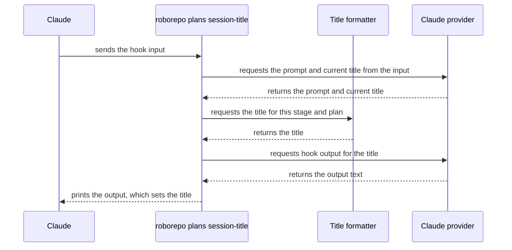

# Session Titles Show the Workflow Stage

## Summary

Give agent sessions a title that starts with the plan-workflow stage they are in, so a person
running many Claude and Codex sessions at once can tell them apart in the sidebar or session
picker. For Claude, a hook (a command Claude runs on each prompt) sets the title when a
plan-command prompt arrives; a manual trial confirmed the hook sees those prompts. Harnesses with no way to set a title get the same identifier through the
copied portal prompt, and in Codex also a rename line the person can paste.

## Context

A plan moves through the plan-suite commands (`/plan-write`, `/plan-promote`, `/plan-execute`,
`/plan-review`, `/plan-close`, `/plan-archive`), often in several sessions and sometimes several
commands in one session. Claude generates a session's title from its first prompt, according to
its official documentation. How Codex generates one was not confirmed.
Neither title says which stage or which plan the session belongs to. The user reported being
confused by these titles while running sessions in parallel.

## Goals

- A session's title names the current stage and the plan, in one fixed format.
- The title follows the session when it moves to another stage.
- The behavior exists only while the plan-suite package is enabled.
- The harness-specific way of setting a title lives with that harness's code; shared code only
  asks for it.
- Harnesses with no way to set a title still show the identifier to the person and the agent.

## Non-goals

- Setting titles automatically in Codex or Gemini. Codex offers no way today and Gemini has not
  been investigated; "Stage Titles for Codex and Gemini Sessions" (`96r9wbj0`) owns both.
- Changing the session launcher planned in "Session Launching — Milestone 1"
  (`plan-session-launching-milestone-1`). That plan does not mention titles, and this one does not
  add them to it.
- Retitling a session that receives no further prompt. A title changes only when a prompt arrives
  or the agent acts.
- A title for `/plan-suite-init`. It sets up the plan store and works on no plan, so it has no
  plan title to show.

## Terms

| Term | Meaning |
| --- | --- |
| Harness | An agent tool RoboRepo configures: Claude (CLI and desktop app), Codex, Gemini |
| Harness provider | RoboRepo's code and manifest for one harness, under `scripts/harnesses/<id>/` and `globals/harnesses/<id>/provider.json` |
| Capability | A named feature a provider's manifest declares the harness supports, listed in `scripts/harnesses/contract.mjs` |
| Adapter group | The set of functions a provider must supply for a capability it declares |
| Title hook | The Claude `UserPromptSubmit` hook this plan adds. Claude runs it on each prompt, and a title it prints becomes the session's title |
| Rename tool | A tool the Claude desktop app gives an agent to rename its own session. The Claude CLI and Codex give an agent none |
| Trial A, Trial B | Two manual checks of what Claude supports, described under Trials: A for the desktop app, B for whether the hook sees plan-command prompts |
| Plan command | One of the six commands above. The set is `PLAN_SUITE_COMMANDS`, derived from the lifecycle model in `modules/plan-suite/lifecycle-manifest.mjs` |
| Plan snapshot | The in-memory list of a repository's plans that `modules/plan-suite/index.mjs` builds from the plan store; it resolves a plan id to its title |
| Copied portal prompt | The text the Plans page puts on the clipboard for a plan action, built by `buildPrompt()` in `modules/plan-suite/index.mjs` |

## Current state

Evidence labels: *docs* means read in the harness's official documentation on 2026-11-23 and not
exercised. *checked* means read in this repository at the reviewed commit, or, for the Claude
desktop app, read on 2026-11-23 in the descriptions of the two session tools the app gives an
agent: one that renames a session and one that starts another session. *trial* means exercised on
2026-11-25 with a throwaway hook in `claude -p` (the CLI's non-interactive mode); see Trials.

| Harness | Agent can rename its session | Hook can set the title | Title at launch |
| --- | --- | --- | --- |
| Claude desktop app | Yes, with the rename tool. If the person named the session, the app asks them first; a session with nobody present to answer refuses the rename (*checked*) | Unknown; Trial A tests it | Yes, a parent session passes a title of under 60 characters (*checked*) |
| Claude Code CLI | No documented way (*docs*) | Yes: a hook may return `hookSpecificOutput.sessionTitle` on `UserPromptSubmit` (*docs*). The hook's input carries the full prompt text, including a leading plan command (*trial*). It carries the session's custom title as `session_title`, whether a person or an earlier hook set it (*docs*); the field is absent when no custom title is set (*trial*) | Yes, `claude -n "<name>"` (*docs*) |
| Codex | No documented way (*docs*) | None documented (*docs*) | No; requested in openai/codex issue 44422 (*docs*) |
| Gemini | Not investigated | Not investigated | Not investigated |

In the Claude CLI and in Codex the person can rename a session by typing `/rename <name>` (*docs*).

Repository structure this plan builds on (*checked*):

| Existing piece | Location | Use here |
| --- | --- | --- |
| Package hook resources, one per harness | `"type": "hooks"` entries such as those in `globals/packages/telemetry/package.config.json` | plan-suite gains one; it has none today |
| A package hook that calls the CLI | `globals/packages/telemetry/hooks-claude.json` runs `roborepo telemetry capture …` on `UserPromptSubmit` | Same shape for the title hook |
| Package rules | `globals/packages/plan-suite/rules.md`, loaded in every session while the package is on | Holds the agent-facing rule |
| Capabilities and their required functions | `HARNESS_CAPABILITIES` and `CAPABILITY_REQUIRED_METHODS` in `scripts/harnesses/contract.mjs`; the manifest enum in `scripts/harnesses/provider-manifest.schema.json` | Gains a `session-title` capability |
| `plans` CLI subcommands | Dispatched in `scripts/cli/plans-command.mjs`; each has a definition such as `manifests/platform/cli/command-definitions/internal/plans-stop-servers.command.json` | Gains `plans session-title` |
| Copied portal prompts | `buildPrompt()` in `modules/plan-suite/index.mjs`, called from `buildPlansPrompt()` in `scripts/cli/plans.mjs`. It has two modes: repository-aware (one line per plan naming its path) and portable (a summary block per plan) | Gains a title line in both modes |

## Related plans

| Plan | Relationship |
| --- | --- |
| "Stage Titles for Codex and Gemini Sessions" (`96r9wbj0`), backlog | Follows this plan and builds on its title format, `session-title` capability, and rename-line rule. Its description of them matches this plan; keep the names stable |
| "Session Launching — Milestone 1" (`plan-session-launching-milestone-1`), backlog | Not started. No overlap: it does not set titles, and this plan does not change it |
| "Small changes are delivered from a worktree…" (`0ubk9sug`), backlog | Not started. It relies on the `Quick Change:` title defined here and also adds a section to `globals/packages/plan-suite/rules.md`. Separate sections; whichever lands second rebases on the other |

## Trials

Two facts about Claude decide how much the hook covers. The design below is written for two "yes"
answers; the last column says what changes otherwise.

| Trial | Result | If yes | If no |
| --- | --- | --- | --- |
| A. Does a hook-returned title take effect in the Claude desktop app, not only the CLI? | Not yet run: it needs a person in the desktop app. First implementation task | The hook covers both | In the desktop app the agent sets the title with its rename tool, as the rule already instructs. No other change |
| B. Does `UserPromptSubmit` fire with the full text of a prompt that opens with a plan command? | **Yes** (*trial*), for a typed `/plan-execute …` and for a multi-line copied portal prompt with a title line. Run in `claude -p`; the interactive CLI is covered by the manual check under Validation | The hook covers typed commands and copied prompts | — |

Trial A also confirms, in the same sitting, that a hook-set title comes back as `session_title` on
the next prompt. The sandboxed trial could not check this, because the CLI could not sign in there
to finish a turn.

## Proposed design

### Title format

| Session kind | Title | Description comes from |
| --- | --- | --- |
| Running a plan command | `/plan-execute: <plan title>` (any of the six commands) | The plan's H1 heading |
| Started by a plan session for part of its work | `/plan sub-task: <task>` | The task the parent hands over |
| Work with no plan | `Quick Change: <description>` | The agent's short description of the change |

The part before the description is the **stage prefix**. There are eight: `/plan-write:`,
`/plan-promote:`, `/plan-execute:`, `/plan-review:`, `/plan-close:`, `/plan-archive:`,
`/plan sub-task:`, and `Quick Change:`.

The whole title, prefix included, is at most 59 characters, because the Claude desktop app requires
a title passed at launch to be under 60. A longer description is cut at a word boundary and ends
with `…`. The plan id never appears: ids are opaque and titles are for people.

`/plan-write` naming no known plan, as for a plan that does not exist yet, takes its description
from the first words of the prompt after the command. Any other plan command that names no known
plan sets no title, since the unmatched word is an unknown id or path. With no words to use, or
when the prompt names several plans, no title is set.

Known gaps, all in the Claude Code CLI, where the agent has no rename tool and the hook acts only
when a prompt arrives:

- Nothing sets `Quick Change:`.
- A stage the agent starts itself, with no new prompt, gets no stage title until the next prompt
  that carries a plan command.

Those sessions keep the title they had.

### How a title reaches a session

| Path | Works in | Covers |
| --- | --- | --- |
| Hook | Claude CLI (*trial*); the desktop app subject to Trial A | Any prompt that carries a title line or opens with a plan command |
| Copied portal prompt | Every harness | Shows the identifier to the agent and the person; in Claude it also feeds the hook |
| Rule | Every harness, as far as the agent's tools allow | Sub-task launches, `Quick Change:` and stages the agent starts itself where it has a rename tool, and the paste-ready rename line for plan stages in Codex |

The hook path, drawn for a typed plan command in Claude. For a copied prompt the title comes from
its title line and the formatter is not called. The early exits in the command's steps are not
drawn.



### Title formatter

A pure module in `modules/plan-suite/` exports the eight stage prefixes, a function that builds a
title from a session kind and a description (including the length cut), and a function that says
whether a given title already carries a stage prefix. It takes the six plan commands from the
lifecycle model in `modules/plan-suite/lifecycle-manifest.mjs`, the same source as
`PLAN_SUITE_COMMANDS`, so a command added to the lifecycle gets a prefix without a second list.
The command and the prompt builder call it. The rule text has to state the format in words for the
agent, so a test compares the prefixes written in `globals/packages/plan-suite/rules.md` with the
module's.

### Provider capability

Add `session-title` to the provider contract, with adapter group `sessionTitle` and two functions,
so that both ends of the harness's hook format stay in the provider:

- `readHookInput(text)` returns the submitted prompt and the session's current custom title from
  the harness's hook input, with no title when the input carries none.
- `hookOutput({ title })` returns the text the harness expects a hook to print in order to set
  that title.

| Provider | Declares `session-title` |
| --- | --- |
| Claude | Yes. `readHookInput` reads `prompt` and `session_title` (absent when unset); `hookOutput` returns the `hookSpecificOutput.sessionTitle` output with `hookEventName: "UserPromptSubmit"` |
| Codex, Gemini | No. `docs/internal/harness-provider-interface.md` requires that a capability be declared only when the harness supports it, so an undeclared capability is how "not supported yet" is expressed |

The provider only translates the harness's format. Deciding whether to set a title stays in the
shared command.

### Hook, scoped to the package

`globals/packages/plan-suite/` gains a `hooks-claude.json` and a matching `hooks` resource with
`"harness": "claude"` in `package.config.json`. The hook runs a new command,
`roborepo plans session-title --harness claude`, on `UserPromptSubmit`. The command orchestrates:

1. If the harness's provider does not declare `session-title`, print nothing and exit 0.
2. Pass standard input to the provider's `readHookInput` to get the prompt and current title.
3. If the prompt has no title line and does not open with a plan command, print nothing and exit 0.
4. If the current title is set and carries no stage prefix, print nothing and exit 0, so a
   hand-written name is never replaced. A title that carries a stage prefix is replaced, which is
   how the title follows a session to its next stage.
5. Take the title from the prompt's title line when it has one. Only otherwise read each plan's id
   and heading from the store, look up the plan the prompt names, and build the title from the
   leading plan command and that plan's heading. If `/plan-write` names no known plan, use the
   first words after the command. If there are none, the command is another one naming no known
   plan, or the prompt names several plans, print nothing and exit 0.
6. Request the hook output from the provider and print it.

The command never fails a prompt: any error exits 0 with no output. Disabling plan-suite removes
the hook along with the package's other resources.

### Rule, scoped to the package

One section in `globals/packages/plan-suite/rules.md` states the format and these instructions:

- When a plan command starts and you have a tool that renames your own session, set the stage
  title with it.
- When starting another session for part of a plan's work, pass `/plan sub-task: <task>` as its
  title if the launch accepts one.
- On the first file edit in a session that is not working a plan, set `Quick Change: <description>`
  if you have a tool that renames your own session.
- If you have no such tool: in Claude Code do nothing more, because a hook sets the stage title
  when a prompt starts the stage; in Codex print one line the person can paste, `/rename <title>`,
  once each time a plan command starts, and continue without waiting. Print no rename line for
  `Quick Change:`, and none in a harness not named here: whether Gemini has a rename command is
  not known.

### Copied prompts

`buildPrompt()` adds one line after the command line when the prompt opens with a plan command and
selects exactly one plan, in both modes. In repository-aware mode:

```text
/plan-execute

Session title: /plan-execute: Session Titles Show the Workflow Stage
Work with plan `gcfw77cq` at `plans/ready/session-stage-titles.md` in repository `roborepo`.
```

In portable mode the same line sits between the command line and the plan summary.

## Implementation plan

- [x] Run Trial A in the Claude desktop app with a throwaway `UserPromptSubmit` hook that returns
      a title; send a second prompt and confirm the hook input carries that title as
      `session_title`. Record both results in this plan's Decision Log. If the desktop app ignores
      the hook's title, change only the Hook row of "How a title reaches a session". — Moved to
      `## Not tested` as a person-only check; see Decision Log (2026-11-25).
- [x] Add the title formatter module and its tests.
- [x] Add the `session-title` capability to `scripts/harnesses/contract.mjs` and to the
      `capability` enum in `scripts/harnesses/provider-manifest.schema.json`, implement the
      `sessionTitle` group in `scripts/harnesses/claude/index.mjs`, and declare it in
      `globals/harnesses/claude/provider.json`.
- [x] Add `roborepo plans session-title` to `scripts/cli/plans-command.mjs` (dispatch and usage
      text) and register it with
      `manifests/platform/cli/command-definitions/internal/plans-session-title.command.json`,
      as `plans stop-servers` is.
- [x] Add the plan-suite hook resource and `hooks-claude.json`.
- [x] Add the rule section to `globals/packages/plan-suite/rules.md`.
- [x] Add the title line to `buildPrompt()` in both modes.
- [x] Update the documents listed under Documentation impact.

## Validation

Scripted checks, each asserting output a person or a harness would see:

- The formatter returns the three formats, cuts a long description on a word boundary so the whole
  title is at most 59 characters, and leaves a short one unchanged. Its plan-command prefixes match
  `PLAN_SUITE_COMMANDS`.
- `roborepo plans session-title --harness claude`, given recorded hook input, prints the Claude
  title output for a prompt with a title line and for a typed plan command. The recorded inputs
  match the shape the trial captured: no `session_title` field when no title is set.
- Stage change: given a current title of `/plan-execute: <plan>` and a `/plan-review` prompt for
  the same plan, it prints the `/plan-review: <plan>` title.
- For `/plan-write` naming no known plan, it prints a title built from the first words after the
  command. It prints nothing when there are none, for another command with an unknown id or path,
  and for a prompt naming several plans.
- It prints nothing for an ordinary prompt, for a current title without a stage prefix, for
  malformed input, and for `--harness codex`; it exits 0 in every case.
- The stage prefixes written in `globals/packages/plan-suite/rules.md` match the formatter's.
- `buildPrompt()` includes the title line for one plan with a plan command in both modes, and
  omits it with no command, with a command name that is no longer a plan command, and with several
  plans. These extend `scripts/test/plan-suite-check.mjs`.
- The Claude provider passes contract validation with `session-title` declared, and the Codex and
  Gemini providers do not declare it, extending `scripts/test/harness-manifest-check.mjs`.
- Enabling and disabling plan-suite adds and removes the hook in a simulated Claude config,
  extending `scripts/test/hook-composition-check.mjs`.
- `npm test`, the smoke suite, locally; CI runs the full gate (`npm run check`) because the change
  touches package defaults, harness config, and the shared provider contract.

One check needs a person: after install, a plan command in the interactive Claude CLI and in the
desktop app shows the new title in the session list.

## Not tested

- [ ] Trial A: in the Claude desktop app, a hook-returned title becomes the session's title, and the
      next prompt's hook input carries it as `session_title`. With plan-suite enabled, send
      `/plan-review <plan id>` in a new desktop session and look at the session list; send a second
      plan command and confirm the title moves to that stage. If the title does not change, the
      desktop app relies on the agent's rename tool, which the rule already instructs; edit only the
      Hook row of "How a title reaches a session" and the desktop row of the plan-suite guide's
      Session Titles table. Needs a person: it needs plan-suite's hook installed in your live Claude
      settings and the desktop app's session list read, a third-party system the agent cannot reach
      from here.
- [ ] After `roborepo package enable plan-suite` (or a reapply), a plan command typed in the
      interactive Claude Code CLI shows `/plan-…: <plan title>` in the session picker
      (`claude --resume`). Needs a person: the interactive CLI's session list is a third-party UI
      the agent cannot reach; `claude -p` runs could not sign in from the sandbox during the trial.
- [ ] In Codex, a plan command prints one `/rename /plan-…: <plan title>` line and continues
      without waiting. Needs a person: it needs a live Codex session on your account, which an
      agent must not use.
- [x] The title hook prints the Claude title output for a typed plan command, a copied prompt's
      title line, and a stage change, and prints nothing for ordinary prompts, hand-written titles,
      malformed input, and Codex. — Verified by agent 2026-11-25 at 4d600210:
      `node scripts/test/plan-session-title-check.mjs` → passed.
- [x] Enabling plan-suite adds the Claude `UserPromptSubmit` title hook and no Codex hook;
      disabling removes it. — Verified by agent 2026-11-25 at 4d600210:
      `node scripts/test/hook-composition-check.mjs` → passed.

## Documentation impact

| Document | Update |
| --- | --- |
| `docs/user/guides/plan/lifecycle/plan-suite.md` | Explain the title format and where it appears |
| `docs/user/reference/claude-hooks.md` | List the plan-suite title hook |
| `docs/user/reference/plans-portal.md` | Note the title line in copied prompts |
| `docs/user/reference/roborepo-cli.md` | Add `roborepo plans session-title` |
| `docs/user/guides/harnesses/supported-harnesses.md` | Add `session-title` to the capability table |
| `docs/internal/harness-provider-interface.md` | Add the `session-title` capability |

## Risks

- **The hook runs on every prompt.** It must be fast and silent. The command exits before reading
  the plan store unless the prompt opens with a plan command and has no title line, and then reads
  only each plan's id and heading (the store read adds well under 0.1 s in a 162-plan store;
  a whole hook run measured 0.15-0.66 s on 2026-11-25, mostly CLI startup, the same cost the
  telemetry hook already pays).
- **Claude's own retitling.** Claude replaces a generated title when a plan is accepted in its plan
  mode (*docs*). The next plan-command prompt sets the stage title again; a session that receives
  no further prompt keeps Claude's title.
- **Agent-dependent paths.** Sub-task and `Quick Change:` titles depend on the agent following the
  rule, so they will sometimes be missed. The hook path does not have this weakness.
- **A hook-set title looks like a person's.** Claude reports both as the same custom title, so the
  command tells them apart only by the stage prefix. A person who names a session with a stage
  prefix will see it replaced at the next plan command.

## Open questions

None block development. One choice is settled by its recommended default unless the user says
otherwise: a session that ran a plan command and then moved to unrelated work keeps its last stage
title, because nothing reliable signals that the plan work ended.

## Decision Log

- Hook plus rule, both inside the plan-suite package, chosen by the user over a rule alone or a
  small skill required by every plan command (2026-11-23).
- The harness-specific title mechanism is a provider capability, at the user's direction, so shared
  code never carries one harness's hook format (2026-11-23).
- Codex and Gemini leave the capability undeclared instead of declaring it with placeholder
  functions, following the provider guide's rule; the user agreed (2026-11-23).
- Copied portal prompts carry the title as the harness-neutral fallback, and Codex sessions also
  get a paste-ready rename line, at the user's direction (2026-11-23). Gemini gets the line only
  after a rename command is confirmed there.
- `Quick Change:` is set by the agent on its first edit, not guessed from the first prompt, which
  would mislabel sessions that only ask a question (user's choice, 2026-11-23).
- Trial B passed in `claude -p`: the `UserPromptSubmit` hook input carried the full text of a typed
  `/plan-execute …` prompt and of a multi-line copied prompt, before any model call, and carried no
  `session_title` field when none was set (2026-11-25).
- Trial A moved into the implementation sequence instead of blocking promotion, because both of its
  outcomes are already designed and neither changes scope: a "no" only means the desktop app relies
  on the agent's rename tool (2026-11-25).
- Trial A moved from the first implementation task to `## Not tested` (2026-11-25, during
  /plan-execute). Alternatives: block the plan on it, or install a throwaway hook in the live
  Claude settings from this session. Both outcomes were already designed and neither changes
  scope, and editing the live settings is outside the sandbox and the run's authority, so it
  stays a person-only check settled in /plan-review.
- The hook reads only each plan's id and H1 (`listPlanTitles` in `modules/plan-suite/index.mjs`)
  instead of building the full plan snapshot (2026-11-25). The snapshot asks Git about every plan
  and took about 6-11 s in this repository's 162-plan store, which would delay every plan-command
  prompt; with the light read a whole hook run takes under a second, mostly CLI startup. Alternatives: the snapshot (correct but slow), or a
  cache file (faster still, but new state to keep fresh). The light read needs no new state.
- A plan path typed in a prompt also matches a plan by file name, because plans keep their file
  name when they move between lifecycle folders; a path typed before a move still finds the plan
  (2026-11-25). Id and store-relative path match as `selectRepositoryPlan` does.
- The plan command list is compiled once into the lifecycle model (`LIFECYCLE_MODEL.commands`) and
  both `PLAN_SUITE_COMMANDS` and the formatter read it, rather than each deriving it from the states
  (2026-11-25).
- A prompt's `Session title:` line is honored only when it carries a stage prefix, so the hook
  never sets a title outside the format, and the hook prints nothing when the title is already the
  one it would set (2026-11-25).
- Only `/plan-write` titles a session from the prompt's own words when it names no known plan
  (2026-11-25, from Validator pass 1). It is the one command that can target a plan that does not
  exist yet; for the other five, an unmatched word is an unknown id or path, and putting it in the
  title would break the no-id rule. Alternative: the word fallback for every command, as first
  built, which leaked ids such as `/plan-review: zzzz9999`.
- The title formatter takes the plan commands from the lifecycle model rather than its own list, and
  the copied-prompt title line applies in portable mode as well as repository-aware mode
  (2026-11-25).

## Review

### Findings

- [x] An unknown plan id or path after a non-write plan command became the title (for example
      `/plan-review: zzzz9999`), against the no-id rule — fixed (53059b11)
- [x] The design, Validation, and Decision Log did not record that only `/plan-write` falls back to
      the prompt's words — fixed in this plan's Title format, Hook step 5, Validation, and Decision
      Log; docs aligned (9066483f)
- [x] No evidence that `npm test` ran — see Verification
- [x] An overlong first word cut into a two-word prefix (`Quick Change…`, `/plan sub-task…`), so
      the title lost its stage prefix — fixed (6a891dcc)
- [x] The guide's package-contents sentence omitted plan-suite's hooks file — fixed (6a891dcc)

### Verification

- Validation pass 1 at 4d600210 (fresh-context subagent): one actionable finding, fixed above
- Validation pass 2 at 53059b11 (fresh-context subagent): two actionable findings, both fixed
  below; four notes, of which the doc precision, constant placement, and timing figure were applied
- `npm test` (smoke suite) started at 4d600210: 427 passed, 1 failed. The failure, "package dev
  add-skill: refuses a built-in package in package mode", asserts `git diff --quiet -- globals/packages/plan-suite`,
  and that run began while this change's plan-suite edits were still uncommitted. Rerun at 9066483f
  on a clean tree: the command refuses with "package plan-suite is built in", creates no skill
  folder, and leaves plan-suite with no diff. CI runs the full gate (`npm run check`) on the pushed head
- Validation pass 3 at 9066483f (fresh-context subagent): two actionable findings, both fixed above
