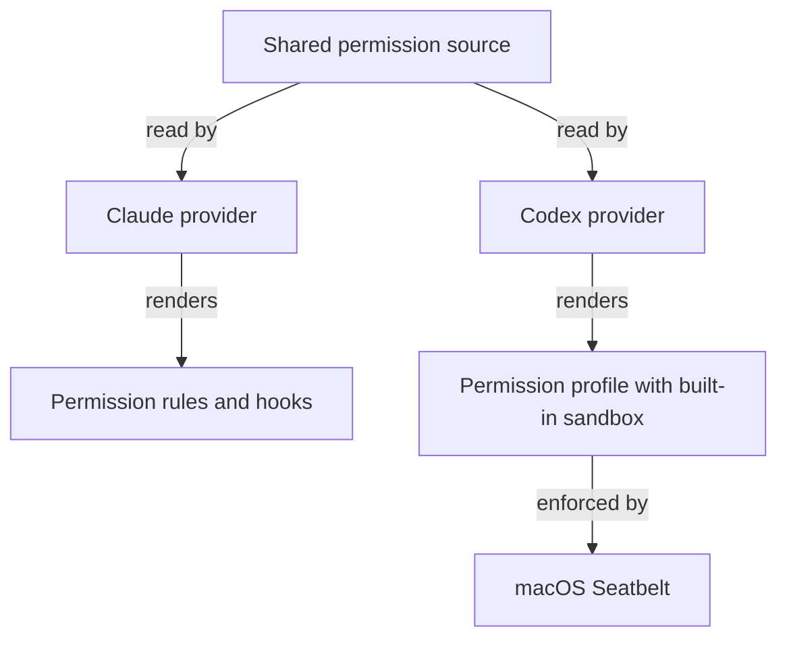
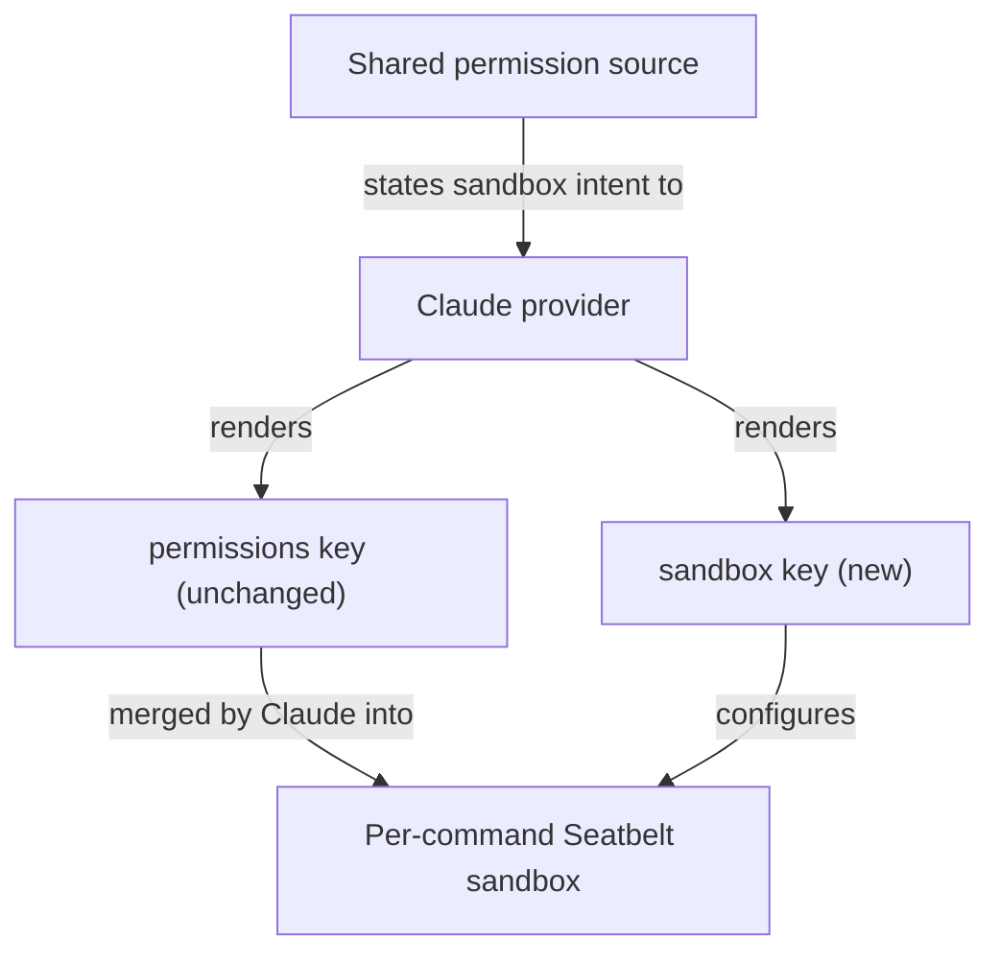

# Cut Claude permission prompts by running shell commands in the native sandbox

## Summary

Long Claude sessions stall on permission prompts for shell commands that only touch the repository
and temp folders. Claude Code has a native sandbox that confines each shell command at the OS level
and lets confined commands run without a prompt. RoboRepo does not turn it on.

This plan makes the Claude provider render that sandbox from the shared permission source, the same
way the Codex provider already renders its sandbox profile. A hand-written trial in one checkout
showed the prompt-free behavior and exposed three gaps the generated version must close.

Two companion plans cover neighboring ground. Keep local agent work within useful boundaries: Claude
(`46qth5z8`) owns worktree entry and moving Claude-specific details behind provider data. Keep local
agent work within useful boundaries: Codex, Part 2 (`4zyo2woj`) built the Codex credential denial
this plan mirrors. The global permissions audit (`permva27`) decides whether RoboRepo keeps managing
permissions or defers to native tools; this plan renders a native control, which fits either
outcome, so the audit is related and not a prerequisite.

## Context

### Terms

| Term | Meaning |
| --- | --- |
| Shared permission source | `manifests/inventory/agent-permissions.json`: harness-neutral behaviors such as `write-scope`, `read-secrets`, and `go-online` |
| Provider | The per-harness code under `scripts/harnesses/<id>/` and `globals/harnesses/<id>/` that turns shared behaviors into native config |
| Native sandbox | Claude Code's `sandbox` settings block. On macOS it wraps each shell command in Seatbelt; file writes and network access outside the configured bounds fail in the kernel |
| Excluded command | A command pattern in `sandbox.excludedCommands` that runs outside the sandbox, under the ordinary allow, ask, and deny rules |
| Public CA bundle | A file of public certificate authorities that TLS clients read to verify servers, such as `/private/etc/ssl/cert.pem` |

### Why prompts happen today

Claude allow rules match a command prefix. Agent commands rarely start with one.

| Evidence | Reading |
| --- | --- |
| The generated user settings already allow `Write` and `Edit` under `/tmp`, `/private/tmp`, and `/private/var/folders` | Temp writes through file tools do not prompt; temp writes through the shell do |
| In the 40 most recent session transcripts for this repository (November 12, 2026), about 500 shell command lines began with `cd <path> &&` | A leading `cd` defeats every prefix rule |
| The same transcripts hold hundreds of inline scripts, loops, and env-prefixed commands | No prefix rule can describe them |
| The untracked `.claude/settings.local.json` in the main checkout holds more than 30 one-off approvals, several naming scratch folders of ended sessions | Approving exact commands does not generalize |

### How the two harnesses differ today

Codex confines every command and treats approval as an escalation. Claude checks rules first, and
its sandbox is optional. `claudePermissions` in `scripts/harnesses/permissions-render.mjs` skips the
`network` behavior with the comment "Codex-only concept; no Claude equivalent to render", and
`renderClaudeSettings` writes only the `permissions` key. `docs/internal/harness-provider-interface.md`
states that Codex is the only implementer of provider-owned sandbox additions.

### What the trial showed

The trial added a `sandbox` block to the untracked `.claude/settings.local.json` of the main
checkout, on Claude Code 2.1.309 and macOS. It took effect in the running session without a restart.

| Check | Result |
| --- | --- |
| Compound temp-folder command (`mkdir && redirect && cat`) | Succeeded |
| Write inside the repository | Succeeded |
| Write to the home folder | Refused: "operation not permitted" |
| List `~/.ssh` from the shell | Refused |
| `curl` and `npm ping` to the npm registry | Failed on certificates until three public CA bundles were exempted, then succeeded |
| `curl` to a host missing from `allowedDomains` | Succeeded; in manual permission mode an unlisted host prompts and is not refused |
| `git ls-remote` over SSH | Failed; Claude's documentation says SSH cannot pass the sandbox proxy on macOS |
| Headless `claude -p` started from a sandboxed command | Reported "Not logged in"; cause not confirmed |

Whether the session prompted less was not measured: the agent cannot observe prompts.

Three findings shape the design:

- **Claude merges permission rules into the sandbox.** `Edit` allow rules became writable paths, and
  `Read` deny rules became unreadable paths. The `write-scope` and `read-secrets` behaviors
  therefore reach the sandbox with no new rendering.
- **The `//**/*.pem` credential pattern hides public CA bundles.** It blocked
  `/private/etc/ssl/cert.pem`, `/opt/homebrew/etc/ca-certificates/cert.pem`, and the
  `/opt/homebrew/etc/openssl@4/cert.pem` link to it. The generated Codex profile carries the same
  pattern. Its network is off, so the effect there is untested.
- **Local settings do not reach worktrees.** The trial file is untracked, so a session in a linked
  worktree runs without the sandbox.

## Goals

- Sessions started after `roborepo update` run shell commands in Claude's native sandbox, in the
  main checkout and in linked worktrees.
- A command that stays inside the repository and temp folders runs without a permission prompt.
- Credential paths in `read-secrets` stay unreadable from shell commands, while public CA bundles
  stay readable so allowed network tools work.
- Commands that cannot work in the sandbox run outside it under the existing allow, ask, and deny
  rules.
- The shared permission source states the intent; the Claude provider owns every Claude-native key.

## Non-goals

- Changing Claude's default permission mode, including auto mode. That is a separate decision.
- Changing the Codex profile. Codex parity for readable exceptions and allowed hosts is an open
  question below.
- Isolating app and browser test runs. Part 3 of the Codex series (`8bjltk2n`) owns that with a
  container.
- Relaxing ask rules such as `push-code`, or redesigning the permissions editor
  (`permissions-ui-revamp`).

## Proposed design

### Shared intent

| Intent | Shared source | Claude projection |
| --- | --- | --- |
| Run shell commands confined, without prompting | New behavior, default on | `sandbox.enabled`, `sandbox.autoAllowBashIfSandboxed` |
| Writable temp folders | Existing `write-scope` | None; Claude merges the `Edit` allow rules |
| Unreadable credentials | Existing `read-secrets` | None; Claude merges the `Read` deny rules |
| Readable public CA bundles | New exception list beside `read-secrets` | `sandbox.filesystem.allowRead` |
| Hosts reachable without a prompt | New host list tied to `go-online` | `sandbox.network.allowedDomains` |

`go-online` loses its `codexOnly` flag only if the open question on its meaning resolves that way.

### Provider-owned details

These carry Claude-native names or Claude-specific limits, so they live with the Claude provider and
never in platform code, as `docs/internal/harness-provider-interface.md` requires:

- The excluded command list: `docker`, `gh`, the `git` network commands, and `roborepo` commands
  that write under `~/.roborepo` or `~/.claude`.
- The mapping from shared intent to `sandbox.*` keys, as one pure function in a new module under
  `scripts/harnesses/claude/`, called where `renderClaudeSettings` builds the settings object. It
  follows `scripts/harnesses/codex/credential-permissions.mjs`.
- Extra writable paths for linked worktrees, through the existing optional adapter methods
  `permissions.workspaceRoots` and `permissions.writablePaths`, if the first checklist item shows
  they are needed.

### Ownership of the generated key

RoboRepo owns `sandbox` in the generated `~/.claude/settings.json` the way it owns `permissions`.
Claude merges array settings across scopes, so a repository's `.claude/settings.local.json` can
still add entries.

## Implementation plan

- [ ] In a linked worktree with the trial block copied in, run `git commit` and record whether
      writes to the main checkout's `.git` succeed.
- [ ] Add the confined-shell behavior, the readable exception list, and the allowed host list to
      `manifests/inventory/agent-permissions.json`.
- [ ] Add the Claude sandbox projection module and its excluded command list under the Claude
      provider.
- [ ] Render the `sandbox` key from `renderClaudeSettings`, preserving unrelated keys.
- [ ] Implement `permissions.workspaceRoots` and `permissions.writablePaths` for Claude if the
      worktree check requires them.
- [ ] Correct the two "Codex-only" comments in `scripts/harnesses/permissions-render.mjs`.
- [ ] Show the new behaviors in the permissions rows built by `scripts/cli/config.mjs`.
- [ ] Add the projection check and the native enforcement runner described under Validation.
- [ ] Remove the trial block from the main checkout's `.claude/settings.local.json` once the
      generated settings carry it.

## Validation

Projection and enforcement need separate evidence, following the Codex credential checks in
`docs/internal/testing.md`.

| Check | Establishes | Where it runs |
| --- | --- | --- |
| New `scripts/test/claude-sandbox-projection-check.mjs` | The rendered `sandbox` key for default and overridden behaviors; unrelated settings keys preserved; a second render changes nothing | Deterministic CI group |
| New `scripts/test/claude-sandbox-enforcement-check.mjs` | On a real Claude binary: temp and repository writes succeed, a home-folder write fails, a credential read fails, a public CA bundle reads, an allowed host connects | Explicit macOS probe |
| `scripts/test/permissions-render-live-characterization-check.mjs` | Existing live render output changes only by the new key | Deterministic CI group |

Acceptance criteria:

- [ ] After `roborepo update`, the generated Claude settings contain the `sandbox` key and
      `roborepo doctor` passes.
- [ ] The enforcement runner passes and records the Claude version, platform, and each positive and
      negative control.
- [ ] `git commit` succeeds from a linked worktree session with the sandbox on.
- [ ] `git push`, `gh pr view`, and `roborepo plans show` behave as they do today.
- [ ] `npm run check` passes.

## Risks

- **Projection is not enforcement.** A rendered key proves nothing about runtime behavior, so the
  enforcement runner is required before the docs claim coverage.
- **Excluded commands are a gap by design.** They run with full access, and the git network
  commands can reach any host. Keep the list short and reviewed.
- **Claude version drift.** Sandbox keys and merge rules may change between releases. The
  enforcement runner names the version it verified.
- **macOS-only evidence.** Linux uses a different mechanism and needs extra packages; Windows runs
  unsandboxed. State coverage per platform and do not imply more.
- **A CA exception list can go stale.** A new OpenSSL or Homebrew layout brings back certificate
  failures. The enforcement runner's allowed-host control catches it.

## Documentation impact

- `docs/user/reference/config-control-panel.md`: describe the confined-shell behavior, the allowed
  hosts, and what runs outside the sandbox.
- `docs/internal/harness-provider-interface.md`: "Provider-owned sandbox additions" names Codex as
  the only implementer; add Claude.
- `docs/internal/testing.md`: add the Claude projection and enforcement checks beside the Codex
  credential verification table.
- `docs/internal/config-panel-internals.md`: record the new behaviors and their Claude projection.

## Open questions

- **What should `go-online` mean for Claude?** For Codex, `deny` turns the network off. For Claude,
  an empty host list makes every host prompt in manual mode. Recommendation: keep `go-online` as
  the on/off gate and add a separate host list that defaults to the npm registry and GitHub.
- **Should local port binding be allowed?** Dev servers need it. The Codex series rejected wildcard
  listeners, and whether Claude's `allowLocalBinding` is narrower is unverified. Recommendation:
  leave it off, so dev servers run as excluded or retried commands, until that is checked.
- **Should unlisted hosts be refused instead of prompted?** `strictAllowlist` does that and only
  takes effect from user-level settings, which RoboRepo generates. Recommendation: off at first.
- **Does Codex need the same readable exceptions and host list?** Its profile carries the same
  `*.pem` denial. Recommendation: test it when Codex network access is next enabled, as its own
  plan.
