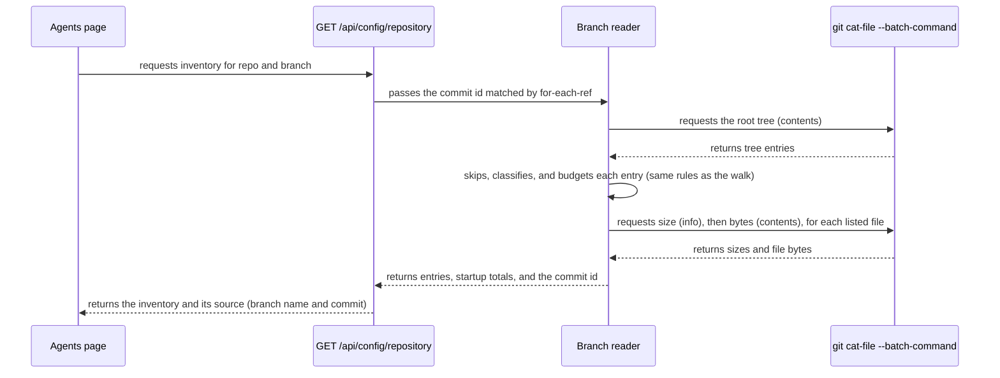

# Show a Repo's Agent Config for Any Branch

## Summary

The Agents page's repo inspector shows the agent configuration in a repo's primary checkout, which
means the files on whatever branch that checkout has checked out. A developer who wants to see the
instructions, skills, or settings on another branch must switch the checkout themselves. This plan
adds a branch picker to the inspector. It reads the chosen branch's committed files straight from
Git's object store, without checking anything out or touching the working tree. It also offers a
linked worktree as a source when the user wants that branch's uncommitted files too.

## Context

The repo inspector is the scoped view of the Agents page (`/agents?repo=<key>`), added by Inspect
Repository Agent Configuration in the Portal (`nrvwti51`, PR #69, in review when this plan was
written). It lists Claude Code and Codex instructions, skills, and configuration files and estimates
their token cost. The user asked for the checkout path and branch to be removed from that page and
for branch choice to come back as a separate story. This is that story.

Terms used below:

| Term | Meaning |
| --- | --- |
| Primary checkout | The checkout the repo list marks primary. The inspector reads its working tree today. |
| Linked worktree | An extra working tree of the same repo created with `git worktree add`, with its own branch checked out. |
| Working-tree source | A folder on disk the inspector walks: the primary checkout or a linked worktree. Includes uncommitted, untracked, and ignored files. |
| Branch source | A branch's tip commit, read from Git objects. Contains only committed files. |

## Goals

- A user can view a repo's agent config for any local branch without switching a checkout.
- Each view says plainly which source it shows: a working tree, or the committed files of a branch at
  a named commit.
- The inspector stays read-only. Reading a branch writes nothing and starts no process the repo's
  own configuration could choose: no filters, hooks, `git status`, or fetch.
- A branch view keeps today's limits, confinement, and failure states.
- The URL names the source, so a branch view can be reloaded and shared on the same machine.

## Non-goals

- Switching, creating, or checking out branches. The inspector never changes what is checked out.
- Comparing two branches, or a branch with the working tree.
- Fetching from a remote. Remote-tracking branches, if offered, show what was last fetched.
- Reading arbitrary commits, tags, or stashes. Only branch tips are offered.
- Changing the shared repo selector or carrying a branch to the Plans or Tokens pages.

## Current state

Code paths are on PR #69's branch, `claude/agent-config-repository-inspector`, until it merges.

| Area | Behavior today |
| --- | --- |
| Source selection | `selectPrimaryCheckout` in `scripts/cli/repository-agent-config.mjs` returns the primary checkout's path or a `checkout-unavailable` reason. It never substitutes another clone or a linked worktree. |
| Inventory | `loadRepositoryAgentConfig` walks the checkout breadth-first with `INVENTORY_LIMITS` (depth 12, 20,000 entries, 400 files, 512 KiB per file, 16 MiB total). It skips dependency and build folders and nested checkouts, and asks each provider to classify paths. |
| File reads | `readConfinedFile` rechecks every parent folder at read time and reads only regular files inside the checkout. A symlink is read through its target only when the target is inside the checkout on a path the walk could list. |
| Git status | `classifyGitStatus` runs `ls-files` and `check-attr` to label files untracked, ignored, or tracked. It marks `linguist-generated` files. `localModification` hashes the working file in-process against the index blob to decide **Modified**. |
| Preview | `loadRepositoryAgentConfigSource` takes an entry id (`<harness>:<path>`), reclassifies it, and reads it again from the same checkout. |
| Git execution | `modules/repositories/git-exec.mjs` runs Git with hooks off, fsmonitor off, no optional locks, no lazy fetch, and no prompts. `defaultRunGit` allows only the subcommands in `GIT_READONLY_COMMANDS` (`status`, `rev-list`, `symbolic-ref`, `rev-parse`, `merge-base`, `log`, `for-each-ref`, `ls-files`, `check-attr`). It buffers all output, at most 1 MiB by default. It has no long-lived process. |
| Worktrees | `linkedWorktrees` in `modules/repositories/worktree-inventory.mjs` lists a repo's linked worktrees with their administrative name, branch, and path. It leaves out the reserved plans worktree. |
| Page | `portal/config/app.js` requests `/api/config/repository?repo=<key>` and drops responses for a scope that is no longer current. `portal/config/templates.js` renders the title **Default Token Use for &lt;repo&gt;**. `portal/shared/repository-scope.js` owns the shared `repo` URL parameter and keeps other parameters when the scope changes. |

## Happy path

1. Open the Agents page with a repo selected. The inspector shows the primary checkout's working
   tree, as today, and the picker reads **Working tree · main**.
2. Open the picker beside the title and choose `feature/login`. The URL becomes
   `/agents?repo=<key>&branch=feature%2Flogin`.
3. The inspector reloads. A source line under the title reads **Committed files on feature/login at
   a1b2c3d**. The token table, instructions, skills, and config describe that commit.
4. Open a skill. The popup shows the committed text and its bundled files, with no Git-status chips.
5. Choose **Working tree · main** again. The `branch` parameter is removed and today's view returns.

## Proposed design

### Sources

The inspector reads from exactly one source at a time. The picker offers two groups. Everything this
plan says about linked worktrees (the Checkouts rows beyond the primary checkout, the `worktree` URL
parameter, and the worktree task) depends on open questions 1 and 4.

| Group | Entries | Read by | Shows uncommitted and local-only files | Git-status chips |
| --- | --- | --- | --- | --- |
| Checkouts | The primary checkout, then each linked worktree of the same repo, each labeled with its branch | The existing walk and confined reads, pointed at that folder | Yes | Yes, as today |
| Branches | Local branches not checked out in any listed checkout, newest commit first | A new Git object reader | No | None |

A branch already checked out in a listed checkout is offered only under Checkouts. The reserved plans
branch (`repo-plans`) is never offered. A detached linked worktree appears under Checkouts with its
short commit id.

Whether linked worktrees and remote-tracking branches appear is an open question below. Without
worktrees the Checkouts group holds only the primary checkout.

### Picker placement

The picker is a `<select>` beside the title, which becomes **Default Token Use for &lt;repo&gt; on
[source ▾]**. The shared **Viewing** menu stays repo-only, because Plans and Tokens share it and have
no branch notion. The source line under the title states the source in words. For a branch view it
also links back to the working tree.

### URL

| URL | Source |
| --- | --- |
| `/agents?repo=<key>` | Primary checkout working tree (today's view) |
| `/agents?repo=<key>&worktree=<name>` | Linked worktree, named by Git's administrative name (the folder under `.git/worktrees/`). Only if worktrees are kept. |
| `/agents?repo=<key>&branch=<short-name>` | Committed tip of that local branch |

- The URL never carries a path. Changing the source pushes a history entry like the repo selector
  does.
- Changing the repo drops `branch` and `worktree`, because they name things in one repo only.
  `hrefWithRepositoryScope` keeps other parameters today, so the Agents page clears these two itself.
- The server matches `branch` exactly against the `for-each-ref` listing and `worktree` against
  `linkedWorktrees`. It never hands the raw string to Git as a revision, so a value such as `--help`
  or `HEAD~1` is refused.
- A name that no longer matches shows an unavailable state: **This branch no longer exists in this
  repo**, with a link to the working-tree view. The inspector never falls back to another source
  silently.

### Reading a branch without a checkout

The branch reader lists and reads Git objects through one long-lived `git cat-file --batch-command`
process. It sends `info` and `contents` requests for tree and blob ids and parses tree objects
in-process. This keeps the walk breadth-first, so a truncated scan still covers the root and shallow
folders. It also lets the existing skip rules and `INVENTORY_LIMITS` apply entry by entry.



| Concern | Rule for a branch source |
| --- | --- |
| Listing branches | `for-each-ref` over `refs/heads`, with name, commit, committer date, and worktree path. The worktree path is used on the server to group branches and is never sent to the page. Cap at 200 entries, newest first. |
| No repo-chosen processes | `cat-file --batch-command` without `--filters` or `--textconv`, and `check-attr --source`. Both read objects only and run no filter, hook, or helper. In a scratch repo with a hostile smudge filter, `cat-file --batch` and `--batch-command` did not run it on Git 2.50. |
| Partial clones | A missing object shows as **Not available locally** and is never fetched. `GIT_NO_LAZY_FETCH` prevents the fetch only on Git 2.44 and later. On older Git, a partial clone's branch view is unavailable, so no fetch can start a credential helper. |
| Limits | The same `INVENTORY_LIMITS`. Directory entries count toward `maxEntriesVisited`. `info` gives blob sizes before reading, so oversized files are skipped without loading them. Each request has a timeout, and the process is killed when the request finishes or fails. |
| Confinement | Paths come from tree entries, which Git stores as single segments. They are checked with the same `cleanSegments` and `withinWalk` rules. Nothing touches the filesystem. |
| Symlinks (mode `120000`) | The blob holds the target path. Resolve it lexically against the link's folder. Read through it only when it lands on a blob the walk could list. Otherwise list it as a reference, matching today's rule. |
| Submodules (mode `160000`) | Skipped, as nested checkouts are today. |
| Generated files | `check-attr --source=<commit> linguist-generated` reads `.gitattributes` from the commit. The attribute is skipped in partial clones, as today. On a Git without `--source` (believed to arrive in 2.40; confirm when implementing), generated status is unknown and files are listed normally. |
| Token totals | Computed from committed root-level files only. The **Repo Usage** tooltip says local-only files a session would also read are not part of a branch. |
| Skill popups | Bundled files are listed from the skill folder's tree with `SKILL_FOLDER_LIMITS`. |

### Git-status chips on a branch

A branch source has no working tree or index to compare against, so **Untracked**, **Local only**,
and **Modified** do not apply, and every row shows no Git chip. Showing **Tracked** on every row would
add noise without telling files apart. The source line carries the one fact that matters: these are
committed files at a named commit.

Local-only files, such as `CLAUDE.local.md` and `.claude/settings.local.json`, are usually ignored by
Git and exist only in a checkout. A branch view cannot show them. When the source is a branch, the
source line adds: **Files that exist only on this machine, such as CLAUDE.local.md, appear only in
a checkout view.** It never borrows those files from the primary checkout, because that would mix
two sources in one list.

### Previews and moving branches

The inventory response returns the commit id it read. A preview request sends the `repo`, the
`branch`, the entry id, and that commit id. The server accepts the commit only when it equals the
branch's current tip, so a request can never read an arbitrary object. If the branch moved, the
preview returns **This branch has new commits; reload to see them**, and the page offers a reload.
Working-tree sources keep today's preview path unchanged.

On the page, the request key that discards stale responses grows from the repo to the pair of repo
and source. Switching sources while a request is pending shows only the current source's data.

### Where the code goes

| Piece | Location | Owns |
| --- | --- | --- |
| Batch reader process | `modules/repositories/git-exec.mjs` | A hardened, long-lived `cat-file --batch-command` session with the same config overrides and environment as `defaultRunGit`, per-request timeouts and byte caps, and only `info` and `contents` requests. It is the one place this process is started. |
| Source selection | `scripts/cli/repository-agent-config.mjs` | Resolving `branch` or `worktree` to a source, or an unavailable reason. `selectPrimaryCheckout` stays the default. |
| Tree walk and blob reads | `scripts/cli/repository-agent-config.mjs` | A branch-source counterpart to `walkCheckout` and `readConfinedFile`, sharing the classify, limit, describe, and token code. The inventory and preview functions take a source instead of always selecting the primary checkout. |
| Routes | `scripts/cli/portal-routes-config.mjs` | The `branch`, `worktree`, and `commit` parameters on the existing inventory and preview routes. The inventory response also lists the available sources, without paths, so the picker needs no extra request. |
| Picker and source line | `portal/config/templates.js`, `portal/config/app.js`, `portal/config/api.js` | Rendering, URL parameters, and request keys. |

The providers under `scripts/harnesses/*/project-inventory.mjs` are unchanged. They already see only
relative paths and text.

## Implementation plan

- [ ] Add the hardened `cat-file --batch-command` session to `modules/repositories/git-exec.mjs`, with tests for timeouts, byte caps, a missing object, and refusal of any request other than `info` and `contents`.
- [ ] Add source resolution: list branches and linked worktrees for a repo, match `branch` and `worktree` parameters exactly, and return unavailable states for unknown names, partial clones on Git before 2.44, and a missing primary checkout.
- [ ] Add the branch walk and blob reads behind the shared classify, limit, describe, and token code. Cover skipped folders, depth and entry budgets, oversized blobs, in-tree and out-of-tree symlinks, submodules, and `linguist-generated` from the commit.
- [ ] If open question 1 keeps worktrees: point the existing walk at a linked worktree when `worktree` is given, keeping every confinement check and Git-status label.
- [ ] Add the `branch`, `worktree`, and `commit` parameters to the inventory and preview routes, and the source list to the inventory response. A preview for a commit that is no longer the branch tip returns the reload state.
- [ ] Add the picker, source line, local-only notice, and unavailable states to the page. Clear `branch` and `worktree` on repo change, and key stale-response handling on repo and source.
- [ ] Update the docs of record and run the focused checks below.

## Validation

- [ ] Choosing a branch shows only files committed at its tip, with no Git-status chips and a source line naming the branch and commit.
- [ ] If worktrees are kept: choosing a linked worktree shows its working tree, including untracked and local-only files, with today's chips.
- [ ] Reading a branch leaves the working tree, index, refs, and Git metadata unchanged. A repo with a hostile smudge filter, a `credential.helper`, and hooks configured runs none of them.
- [ ] A partial clone never fetches. Missing objects show as not available locally, and Git before 2.44 gets the unavailable state.
- [ ] Limits, skipped folders, symlink rules, and submodule skipping match the working-tree walk, verified by the same fixtures run against both sources.
- [ ] An unknown, deleted, or option-shaped `branch` or `worktree` value shows the unavailable state and never reaches Git as a revision.
- [ ] A preview after the branch moved returns the reload state, never the new tip's content and never an arbitrary object.
- [ ] A branch view reads correctly in both a SHA-1 and a SHA-256 repo.
- [ ] No Git process remains after an inventory or preview finishes, fails, or times out.
- [ ] Switching repo or source while a request is pending shows only the current source. Changing the repo removes `branch` and `worktree` from the URL.

Focused checks, by what each covers:

```sh
node scripts/test/run-checks.mjs --filter repository-agent-config   # sources, walk, reads, safety fixtures
node scripts/test/run-checks.mjs --filter repository-scope          # real routes and scope handling
npm run test:portal-ui -- repository-scope.spec.mjs                 # picker, URL, stale responses
```

The batch-session tests and the hostile-repo fixture go in
`scripts/test/repository-agent-config-check.mjs`, beside the existing never-run-a-repo-process
fixture, so the first command covers them. Capture the branch view with browser verification.

## Risks

| Risk | Mitigation |
| --- | --- |
| A long-lived Git process outlives a request on error or timeout. | The session is owned by one request, killed in a `finally`, and has its own timeout. A test asserts no process remains. |
| Parsing tree objects by hand mishandles SHA-256 repos. | Read the object format from the repo config, which `localModification` already distinguishes by hash length, and run fixtures for both formats. |
| Users read a branch view as what a session in that branch would load. | The source line and the Repo Usage tooltip say local-only files are excluded. Total Usage stays Repo Usage plus the machine's global startup context, as today. |

## Documentation impact

- `docs/user/reference/config-control-panel.md`: the source picker, what a branch view shows and
  omits, and the URL parameters.
- `docs/internal/config-panel-internals.md`: source selection, the branch reader, preview commit
  pinning, and the no-repo-process guarantee for object reads.
- `docs/internal/portal-architecture.md`: the Agents-only `branch` and `worktree` parameters beside
  the shared `repo` parameter.

## Open questions

### 1. Should linked worktrees appear in the picker?

| Option | Leads to |
| --- | --- |
| **Yes, as a Checkouts group** (recommended) | In-progress work, including uncommitted and local-only files, is visible for the branches people actually work on in worktrees. The existing walk is reused, so the cost is small. |
| No, branches only | One kind of source, simpler picker. A worktree's uncommitted changes stay invisible, and its branch shows only committed files. |

### 2. Which branches does the picker list?

| Option | Leads to |
| --- | --- |
| **Local branches only** (recommended) | Short list of branches the user has. A colleague's pushed branch needs a local branch first. |
| Local plus remote-tracking branches without a local copy | Pushed branches are visible after a fetch the user ran. The list grows long in busy repos, and it can be stale because the inspector never fetches. |

### 3. Where does the picker go?

| Option | Leads to |
| --- | --- |
| **Beside the title** (recommended) | The choice sits next to what it changes, and the shared repo selector stays the same on every page. |
| In the top **Viewing** bar beside the repo selector | One place for scope, but that bar is shared with Plans and Tokens, which have no branch notion. |

### 4. What ships first?

| Option | Leads to |
| --- | --- |
| **Both sources in one release** (recommended) | Users get worktrees and branches at once. Needs the new Git batch reader before release. |
| Worktrees first, branches second | A smaller first release that reuses all existing reading code. Branches with no worktree stay unviewable until the second part lands. |
| Branches only, no worktrees | Same as answering No to question 1. |

## Decision Log

- **Branch content comes from Git objects, never from a temporary checkout.** A checkout, even into a
  scratch worktree, writes Git metadata and runs smudge filters and the post-checkout hook, which
  breaks the inspector's no-repo-process guarantee.
- **One `cat-file --batch-command` process instead of `ls-tree -r`.** `ls-tree -r` buffers the whole
  tree, which can exceed the output cap and fail with nothing to show. It also lists skipped folders
  and returns depth-first order, so a truncated scan would miss shallow folders.
- **No Git-status chips on a branch.** There is no working tree to compare, and a uniform
  **Tracked** chip tells no rows apart.
- **Previews are pinned to the inventory's commit.** Accepting only the branch's current tip keeps a
  request from reading arbitrary objects and stops a popup from showing content the list never
  showed.
