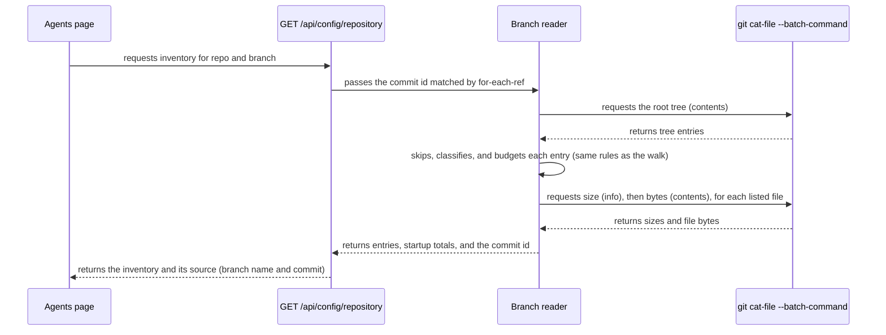

# Show a Repo's Agent Config for Any Branch

## Summary

The Agents page's repo inspector shows the agent configuration in a repo's primary checkout, which
means the files on whatever branch that checkout has checked out. A developer who wants to see the
instructions, skills, or settings on another branch must switch the checkout themselves. This plan
adds a branch picker to the inspector. It lists only the local branches whose agent configuration
differs from the primary checkout's branch. A branch checked out in a linked worktree is read from
that worktree, so its uncommitted edits show. Any other branch is read from its last commit, straight
from Git's object store, without checking anything out or touching the working tree.

## Context

The repo inspector is the scoped view of the Agents page (`/agents?repo=<key>`), added by Inspect
Repository Agent Configuration in the Portal (`nrvwti51`, PR #69, in review when this plan was
written). It lists Claude Code and Codex instructions, skills, and configuration files and estimates
their token cost. The user asked for the checkout path and branch to be removed from that page and
for branch choice to come back as a separate story. This is that story.

Terms used below:

| Term | Meaning |
| --- | --- |
| Primary checkout | The checkout the repo list marks primary. The inspector reads its working tree today. |
| Base branch | The branch the primary checkout has checked out, usually `main`. Other branches are compared with it. |
| Linked worktree | An extra folder for the same repo, created with `git worktree add`, with its own branch checked out. Every worktree belongs to one branch; most branches have no worktree. |
| Agent-config path | A path a Claude Code or Codex provider classifies as instructions, a skill, or configuration, using the same rules the inspector's walk uses. |

## Goals

- A user can view a repo's agent config for any local branch without switching a checkout.
- The picker lists only branches whose agent config differs from the base branch, so it stays short
  and every entry is worth opening.
- A branch with a linked worktree shows that worktree's files, including uncommitted edits. A branch
  without one shows the files at its last commit. The page says which.
- The inspector stays read-only. Reading or comparing a branch writes nothing and starts no process
  the repo's own configuration could choose: no filters, hooks, external diff tools, `git status`, or
  fetch.
- A branch view keeps today's limits, confinement, and failure states.
- The URL names the branch, so a branch view can be reloaded and shared on the same machine.

## Non-goals

- Switching, creating, or checking out branches. The inspector never changes what is checked out.
- Showing what differs between two branches, file by file. The picker only says whether a branch
  differs.
- Remote-tracking branches, and fetching from a remote.
- Reading tags, stashes, arbitrary commits, or detached worktrees.
- Changing the shared repo selector or carrying a branch to the Plans or Tokens pages.

## Current state

Code paths are on PR #69's branch, `claude/agent-config-repository-inspector`, until it merges.

| Area | Behavior today |
| --- | --- |
| Source selection | `selectPrimaryCheckout` in `scripts/cli/repository-agent-config.mjs` returns the primary checkout's path or a `checkout-unavailable` reason. It never substitutes another clone or a linked worktree. |
| Inventory | `loadRepositoryAgentConfig` walks the checkout breadth-first with `INVENTORY_LIMITS` (depth 12, 20,000 entries, 400 files, 512 KiB per file, 16 MiB total). It skips dependency and build folders and nested checkouts, and asks each provider to classify paths. |
| File reads | `readConfinedFile` rechecks every parent folder at read time and reads only regular files inside the checkout. A symlink is read through its target only when the target is inside the checkout on a path the walk could list. |
| Git status | `classifyGitStatus` runs `ls-files` and `check-attr` to label files untracked, ignored, or tracked. It marks `linguist-generated` files. `localModification` hashes the working file in-process against the index blob to decide **Modified**. |
| Preview | `loadRepositoryAgentConfigSource` takes an entry id (`<harness>:<path>`), reclassifies it, and reads it again from the same checkout. |
| Git execution | `modules/repositories/git-exec.mjs` runs Git with hooks off, fsmonitor off, no optional locks, no lazy fetch, and no prompts. `defaultRunGit` allows only the subcommands in `GIT_READONLY_COMMANDS` (`status`, `rev-list`, `symbolic-ref`, `rev-parse`, `merge-base`, `log`, `for-each-ref`, `ls-files`, `check-attr`). It buffers all output, at most 1 MiB by default. It has no long-lived process. |
| Worktrees | `linkedWorktrees` in `modules/repositories/worktree-inventory.mjs` lists a repo's linked worktrees with their administrative name, branch, and path. It leaves out the reserved plans worktree. |
| Page | `portal/config/app.js` requests `/api/config/repository?repo=<key>` and drops responses for a scope that is no longer current. `portal/config/templates.js` renders the title **Default Token Use for &lt;repo&gt;**. `portal/shared/repository-scope.js` owns the shared `repo` URL parameter and keeps other parameters when the scope changes. |

## Happy path

1. Open the Agents page with a repo selected. The inspector shows the primary checkout, as today. The
   picker beside the title reads **main** and, once the comparison finishes, offers two branches.
2. Choose `feature/login`, which has a linked worktree. The URL becomes
   `/agents?repo=<key>&branch=feature%2Flogin`. The source line reads **feature/login · worktree,
   including uncommitted changes**, and rows carry the usual Git-status chips.
3. Choose `docs/skills`, which has no worktree. The source line reads **docs/skills · committed files
   at a1b2c3d**, and rows carry no Git-status chips.
4. Open a skill. The popup shows that source's text and bundled files.
5. Choose **main** again. The `branch` parameter is removed and today's view returns.

## Proposed design

### One list of branches

The picker lists branches, not sources. How a branch is read follows from whether a worktree has it
checked out.

| Branch | Read from | Uncommitted and local-only files | Git-status chips |
| --- | --- | --- | --- |
| Base branch (default) | The primary checkout's folder, as today | Shown | As today |
| Checked out in a linked worktree | That worktree's folder, with the existing walk and confined reads | Shown | As today |
| No worktree | Its last commit, through a new Git object reader | Not shown | None |

The reserved plans branch (`repo-plans`) is never listed. A detached linked worktree has no branch and
is not listed. Git refuses to check out one branch in two worktrees without `--force`. If that
happened anyway, the branch shows an unavailable state rather than picking one.

### Listing only branches that differ

The picker lists the base branch first, then each local branch whose agent config differs from it,
newest commit first, capped at 200 branches examined. Below the list, a line reports the rest:
**14 other branches have the same agent config as main.** While the comparison runs the picker shows
**Checking branches…**, and the inspector itself is not delayed.

| Branch | Differs when |
| --- | --- |
| No worktree | A path that changed between the comparison base and this branch's last commit is an agent-config path. The comparison base is main's last commit or the point where the branch split off; see the open question. |
| Has a worktree | The committed check above finds a change, or the worktree has untracked or modified agent-config files. Ignored local-only files such as `CLAUDE.local.md` do not count, because they are personal to the machine rather than part of the branch. |

The committed check is one Git command per branch, which lists changed file names only:
`git diff-tree -r -z --name-only --no-renames <comparison-base> <branch-commit>`. It reads no file content,
so no text converter or external diff tool can run. A scratch repo with both configured confirmed
neither ran on Git 2.50. Each changed path is checked with the same provider classification and
skip rules the walk uses. When the output exceeds the size cap, the branch is listed as differing,
since a missing branch is worse than an extra one.

The worktree check reuses the worktree walk and its Git-status classification. The walk is bounded
like today's, and only branches with worktrees need it.


### Picker placement

The picker is a `<select>` beside the title, which becomes **Default Token Use for &lt;repo&gt; on
[branch ▾]**. The shared **Viewing** menu stays repo-only, because Plans and Tokens share it and have
no branch notion. The source line under the title says how the branch was read. For a committed view
it also says that files existing only on this machine appear only in a worktree or checkout view.

### URL

| URL | Shows |
| --- | --- |
| `/agents?repo=<key>` | The base branch in the primary checkout (today's view) |
| `/agents?repo=<key>&branch=<short-name>` | That branch, read from its worktree or its last commit |

- The URL never carries a path. Changing the branch pushes a history entry like the repo selector
  does.
- Changing the repo drops `branch`, because it names a branch in one repo only.
  `hrefWithRepositoryScope` keeps other parameters today, so the Agents page clears it itself.
- A `branch` URL opens even when the branch has the same config as main and is not in the picker.
  Whether a branch differs only decides what the picker lists.
- The server matches `branch` exactly against the `for-each-ref` listing. It never hands the raw
  string to Git as a revision, so a value such as `--help` or `HEAD~1` is refused.
- A name that no longer matches shows an unavailable state: **This branch no longer exists in this
  repo**, with a link to the base branch. The inspector never falls back to another branch silently.

### Reading a branch without a checkout

For a branch with no worktree, the reader lists and reads Git objects through one long-lived
`git cat-file --batch-command` process. It sends `info` and `contents` requests for tree and blob ids
and parses tree objects in-process. This keeps the walk breadth-first, so a truncated scan still
covers the root and shallow folders. It also lets the existing skip rules and `INVENTORY_LIMITS`
apply entry by entry.



| Concern | Rule for a committed branch view |
| --- | --- |
| No repo-chosen processes | `cat-file --batch-command` without `--filters` or `--textconv`, and `check-attr --source`. Both read objects only and run no filter, hook, or helper. In a scratch repo with a hostile smudge filter, `cat-file --batch` and `--batch-command` did not run it on Git 2.50. |
| Partial clones | A missing object shows as **Not available locally** and is never fetched. `GIT_NO_LAZY_FETCH` prevents the fetch only on Git 2.44 and later. On older Git, a partial clone's committed branch views and comparisons are unavailable, so no fetch can start a credential helper. |
| Limits | The same `INVENTORY_LIMITS`. Directory entries count toward `maxEntriesVisited`. `info` gives blob sizes before reading, so oversized files are skipped without loading them. Each request has a timeout, and the process is killed when the request finishes or fails. |
| Confinement | Paths come from tree entries, which Git stores as single segments. They are checked with the same `cleanSegments` and `withinWalk` rules. Nothing touches the filesystem. |
| Symlinks (mode `120000`) | The blob holds the target path. Resolve it lexically against the link's folder. Read through it only when it lands on a blob the walk could list. Otherwise list it as a reference, matching today's rule. |
| Submodules (mode `160000`) | Skipped, as nested checkouts are today. |
| Generated files | `check-attr --source=<commit> linguist-generated` reads `.gitattributes` from the commit. The attribute is skipped in partial clones, as today. On a Git without `--source` (believed to arrive in 2.40; confirm when implementing), generated status is unknown and files are listed normally. |
| Token totals | Computed from committed root-level files only. The **Repo Usage** tooltip says local-only files a session would also read are not part of a branch. |
| Skill popups | Bundled files are listed from the skill folder's tree with `SKILL_FOLDER_LIMITS`. |

### Git-status chips on a committed view

A committed view has no working tree or index to compare against, so **Untracked**, **Local only**,
and **Modified** do not apply, and every row shows no Git chip. Showing **Tracked** on every row would
add noise without telling files apart. The source line carries the one fact that matters: these are
committed files at a named commit. Local-only files are never borrowed from the primary checkout,
because that would mix two sources in one list.

### Previews and moving branches

For a committed view, the inventory response returns the commit id it read. A preview request sends
the `repo`, the `branch`, the entry id, and that commit id. The server accepts the commit only when it
equals the branch's current tip, so a request can never read an arbitrary object. If the branch moved,
the preview returns **This branch has new commits; reload to see them**, and the page offers a
reload. Worktree views use today's preview path against the worktree's folder.

On the page, the request key that discards stale responses grows from the repo to the pair of repo
and branch. Switching branches while a request is pending shows only the current branch's data.

### Where the code goes

| Piece | Location | Owns |
| --- | --- | --- |
| Batch reader process | `modules/repositories/git-exec.mjs` | A hardened, long-lived `cat-file --batch-command` session with the same config overrides and environment as `defaultRunGit`, per-request timeouts and byte caps, and only `info` and `contents` requests. It is the one place this process is started. `diff-tree` joins `GIT_READONLY_COMMANDS`. |
| Branch listing | `modules/repositories/` beside `linkedWorktrees` | Listing a repo's local branches with their tip commits and the worktree, if any, that has each checked out. It knows nothing about agent config, so other pages can reuse it. |
| Branch resolution and comparison | A new `scripts/cli/repository-agent-config-branches.mjs` | Resolving `branch` to a worktree folder or a commit, and deciding which branches differ. It is separate from the inventory because it works across branches and is tested on its own, but it shares the inventory's provider classification and skip rules, so it sits beside that file. `selectPrimaryCheckout` stays the default. |
| Tree walk and blob reads | `scripts/cli/repository-agent-config.mjs` | A committed-view counterpart to `walkCheckout` and `readConfinedFile`, sharing the classify, limit, describe, and token code. The inventory and preview functions take a source instead of always selecting the primary checkout. |
| Routes | `scripts/cli/portal-routes-config.mjs` | The `branch` and `commit` parameters on the inventory and preview routes, and `GET /api/config/repository/branches?repo=<key>` returning the differing branches and the count of the rest, without paths. It is a separate request so the comparison never delays the inventory. |
| Picker and source line | `portal/config/templates.js`, `portal/config/app.js`, `portal/config/api.js` | Rendering, the URL parameter, and request keys. |

The providers under `scripts/harnesses/*/project-inventory.mjs` are unchanged. They already see only
relative paths and text.

## Implementation plan

- [ ] Add the hardened `cat-file --batch-command` session to `modules/repositories/git-exec.mjs`, and `diff-tree` to the allowlist, with tests for timeouts, byte caps, a missing object, and refusal of any request other than `info` and `contents`.
- [ ] Add branch resolution: list local branches with their worktrees, match the `branch` parameter exactly, and return unavailable states for unknown names, a branch in two worktrees, partial clones on Git before 2.44, and a missing primary checkout.
- [ ] Add the committed-view walk and blob reads behind the shared classify, limit, describe, and token code. Cover skipped folders, depth and entry budgets, oversized blobs, in-tree and out-of-tree symlinks, submodules, and `linguist-generated` from the commit.
- [ ] Point the existing walk at a linked worktree when its branch is chosen, keeping every confinement check and Git-status label.
- [ ] Add the branch comparison: changed agent-config paths between commits, plus untracked or modified agent-config files in worktrees, with the over-cap rule.
- [ ] Add the branches route and the `branch` and `commit` parameters on the inventory and preview routes. A preview for a commit that is no longer the branch tip returns the reload state.
- [ ] Add the picker, its **Checking branches…** state and same-config count, the source line, the local-only notice, and unavailable states to the page. Clear `branch` on repo change, and key stale-response handling on repo and branch.
- [ ] Update the docs of record and run the focused checks below.

## Validation

- [ ] The picker lists the base branch and only the branches whose agent config differs, with a count of the rest. A branch that changes only non-config files is not listed.
- [ ] A worktree branch with an uncommitted or untracked config edit is listed even when its last commit matches main. An ignored local-only file alone does not list it.
- [ ] Choosing a branch with a worktree shows that worktree's files, including untracked and local-only files, with today's chips.
- [ ] Choosing a branch with no worktree shows only files committed at its tip, with no Git-status chips and a source line naming the commit.
- [ ] Reading or comparing a branch leaves the working tree, index, refs, and Git metadata unchanged. A repo with a hostile smudge filter, text converter, external diff tool, `credential.helper`, and hooks configured runs none of them.
- [ ] A partial clone never fetches. Missing objects show as not available locally, and Git before 2.44 gets the unavailable state.
- [ ] Limits, skipped folders, symlink rules, and submodule skipping match the working-tree walk, verified by the same fixtures run against both kinds of view.
- [ ] An unknown, deleted, or option-shaped `branch` value shows the unavailable state and never reaches Git as a revision.
- [ ] A preview after the branch moved returns the reload state, never the new tip's content and never an arbitrary object.
- [ ] A committed view reads correctly in both a SHA-1 and a SHA-256 repo.
- [ ] No Git process remains after an inventory, comparison, or preview finishes, fails, or times out.
- [ ] Switching repo or branch while a request is pending shows only the current branch. Changing the repo removes `branch` from the URL.

Focused checks, by what each covers:

```sh
node scripts/test/run-checks.mjs --filter repository-agent-config   # branches, comparison, walk, reads, safety fixtures
node scripts/test/run-checks.mjs --filter repository-scope          # real routes and scope handling
npm run test:portal-ui -- repository-scope.spec.mjs                 # picker, URL, stale responses
```

The batch-session tests and the hostile-repo fixture go in
`scripts/test/repository-agent-config-check.mjs`, beside the existing never-run-a-repo-process
fixture, so the first command covers them. Capture the picker and both kinds of branch view with
browser verification.

## Risks

| Risk | Mitigation |
| --- | --- |
| Comparing many branches is slow on a large repo. | One name-only `diff-tree` per branch, at most 200 branches, in a separate request that never delays the inventory. Worktree walks are bounded and run only for branches with worktrees. |
| A long-lived Git process outlives a request on error or timeout. | The session is owned by one request, killed in a `finally`, and has its own timeout. A test asserts no process remains. |
| Parsing tree objects by hand mishandles SHA-256 repos. | Read the object format from the repo config, which `localModification` already distinguishes by hash length, and run fixtures for both formats. |
| Users read a committed view as what a session in that branch would load. | The source line and the Repo Usage tooltip say local-only files are excluded. Total Usage stays Repo Usage plus the machine's global startup context, as today. |

## Documentation impact

- `docs/user/reference/config-control-panel.md`: the branch picker, which branches it lists, how a
  branch is read, what a committed view omits, and the URL parameter.
- `docs/internal/config-panel-internals.md`: branch resolution, the comparison, the committed-view
  reader, preview commit pinning, and the no-repo-process guarantee for object reads.
- `docs/internal/portal-architecture.md`: the Agents-only `branch` parameter beside the shared `repo`
  parameter.

## Open questions

### What does "differs from main" compare against?

A branch made a week ago has not seen main's changes since then. The two options treat that branch
differently.

| Option | Lists a branch when | Leads to |
| --- | --- | --- |
| **main's current files** (recommended) | Its config files differ from main's last commit in any way | The picker lists exactly the branches whose page would look different. An old branch is listed after main changes its config, even if the branch itself changed nothing. |
| The branch's own changes | It changed config files since it split off from main | The picker lists only branches that edit config. An old branch can be left out while its page still looks different from main. Uses `merge-base` to find the split point. |

## Decision Log

- **Branches are the only choice in the picker; a worktree is how a branch is read.** Chosen by the
  user. Every worktree is a branch with a folder, so listing them separately would show the same
  branch twice. Reading a worktree's folder shows the in-progress edits a person working there
  expects; a branch without one has only its last commit to show. Both kinds therefore ship together.
- **Branches with a worktree are read from the worktree.** Chosen by the user. Those are the branches
  people are actively changing, and the existing walk already reads a folder safely.
- **Local branches only.** Chosen by the user over adding remote-tracking branches. The inspector
  never fetches, so remote-tracking branches could be stale, and a busy repo would make the list long.
- **The picker sits beside the title.** Chosen by the user over the shared Viewing menu, which Plans
  and Tokens also use and which has no branch notion.
- **The picker lists only branches whose agent config differs from main.** Proposed by the user. A
  branch with the same config as main would show the same page, so listing it adds nothing.
- **Branch content comes from Git objects, never from a temporary checkout.** A checkout, even into a
  scratch worktree, writes Git metadata and runs smudge filters and the post-checkout hook, which
  breaks the inspector's no-repo-process guarantee.
- **One `cat-file --batch-command` process instead of `ls-tree -r`.** `ls-tree -r` buffers the whole
  tree, which can exceed the output cap and fail with nothing to show. It also lists skipped folders
  and returns depth-first order, so a truncated scan would miss shallow folders.
- **No Git-status chips on a committed view.** There is no working tree to compare, and a uniform
  **Tracked** chip tells no rows apart.
- **Previews are pinned to the inventory's commit.** Accepting only the branch's current tip keeps a
  request from reading arbitrary objects and stops a popup from showing content the list never
  showed.
- **Rejected: separate Checkouts and Branches groups.** An earlier draft listed worktrees and branches
  as two groups with a `worktree` URL parameter. It showed one branch in two places and made the
  reader learn two kinds of source.
