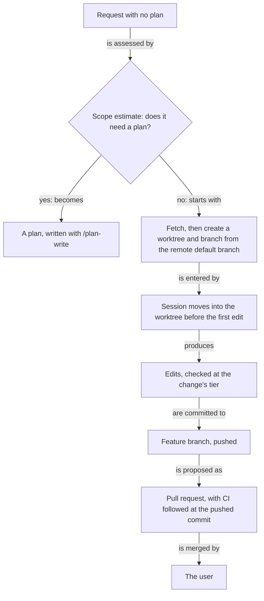

# Small changes are delivered from a worktree, never from a branch in the main checkout

## Summary

Some changes do not need a plan: the outcome is clear, the change is contained, and it fits one
session and one pull request. Today the
rule for that work tells an agent to create a feature branch inside the main checkout and leave the
checkout there. That takes `main` away from every other session, and an agent is not allowed to
switch it back.

This plan gives work without a plan one delivery path: a new worktree, a feature branch, and a pull
request. A hook refuses the direct agent commands that would move the main checkout off `main`. The plan
suite keeps its own steps and its own handoff text; it already works from a worktree, and the new
hook guard covers planned and unplanned work alike.

## Context

These terms are used throughout:

| Term | Meaning |
| --- | --- |
| Main checkout | The repository's primary working folder, which normally has `main` checked out |
| Worktree | A second working folder of the same repository on its own branch, made with `git worktree add` |
| Base path | The delivery steps every change follows whether or not it has a plan: isolate, check, push, pull request, CI, user merges |
| Plan suite | The optional package of plan commands (`/plan-write`, `/plan-promote`, `/plan-execute`, `/plan-review`, `/plan-close`) that carries larger work through a written plan |
| Handoff | The plan suite's own delivery steps at the end of `/plan-execute`: push the feature branch and open the pull request |
| Push guard hook | `globals/system/hooks/claude/protected-branch-push.mjs`, with an identical copy for Codex. It inspects agent shell commands and denies a push to a protected branch. Its delete guard asks before a delete or discard in a checkout that has a protected branch checked out |

The main checkout is where the user reads the current state of the project and where every new
worktree starts from. Several agent sessions run at once. When one of them moves the main checkout
to a feature branch, the others read and branch from the wrong code until a person moves it back.
This was observed on 2026-11-23: the main checkout sat on the branch of pull request 85.

The user wants many plans to run in parallel, with agents triggering each automated step. A main
checkout that stays on `main` is a precondition for that.

Three other plans touch the same sessions. None is a prerequisite.

| Plan | Overlap |
| --- | --- |
| Session Titles Show the Workflow Stage (`gcfw77cq`) | Defines the `Quick Change:` session title for work with no plan, which is the work this base path carries |
| Deliver finished plans as a watched pull request (`i5mnkm7z`) | Adds CI watching to plan delivery; the base path keeps the existing "follow CI" instruction until then |
| GitHub agent identity (`w7vls1yk`) | Makes GitHub itself reject an agent push to `main`, where today only local hooks do |

## Goals

- Work without a plan is always done in a new worktree and delivered as a pull request.
- A direct `git switch` or `git checkout` that would move the main checkout off a protected branch
  is refused by a hook, for Claude and Codex.
- Where the plan suite is enabled: before the first edit, the agent estimates the scope of the work with three written questions
  and proposes a plan or no plan. The decision is made once and is not reopened because the change
  took more files, lines or time than expected.
- Planned and unplanned work follow the same shape (worktree, feature branch, pull request) and
  are held to it by the same hook.

## Non-goals

- Changing any plan suite step, or adding a small-change mode to the suite.
- Committing or pushing directly to `main`. Agents cannot push to `main` today, and that stays.
- Letting an agent return the main checkout to `main`. The permission rule that denies it stays.
- Automatic session launching, and watching CI to a result. Other backlog plans own those.
- Guarding the user's own terminal. The hook reads agent commands only.

## Current state

| Step for work without a plan | Today | Source |
| --- | --- | --- |
| Where the branch is made | `git switch -c <branch>` in the main checkout, after asking | `globals/system/rules/shared/09-deliver-finished-work.md` |
| Where the checkout is left | On the feature branch; the user must switch back | Same file, last paragraph |
| Returning to `main` | Denied for agents | `occupy-main` in `manifests/inventory/agent-permissions.json` |
| Creating a worktree | Asks first, except inside a workflow such as `/plan-execute` | `globals/system/rules/shared/06-branch-safety.md` |
| Checks before delivery | Scaled to what the change touches | `globals/system/rules/shared/08-validation-gates.md` |
| Push to `main` | Denied by the push guard hook and a Git pre-push backstop | `globals/system/hooks/claude/protected-branch-push.mjs`, `scripts/git-hooks/pre-push` |
| Branch creation in the main checkout | Nothing refuses it | Read of the same hook: it parses `git switch` and `git checkout` (`recordBranchChange`) only to know which branch a checkout will be on for its merge and delete guards |
| Cleanup after merge | Automatic cleanup can remove a merged worktree that no plan claims, but only inside the configured worktree folder | `docs/user/reference/repositories.md`, "Proven-safe cleanup" |
| When a plan is required | No rule says | `globals/packages/plan-suite/rules.md` has no such section |

The plan suite already follows the wanted shape. `/plan-execute` creates its worktree under
`<worktreeRoot>/<worktreeRepoName>/<branch>` from `plans/plans-config.json`, and its handoff
(`globals/packages/plan-suite/skills/plan-execute/references/handoff.md`) pushes the branch and
opens the pull request. The delivery rule defers to it: "Follow the active skill's delivery rules
when it defines its own."

A test asserts the current wording. `scripts/test/agent-workflow-rules-check.mjs` requires the
sentence "Request approval to run `git switch -c <branch>` in the primary checkout."

## Proposed design

### The base path



The fetch and the worktree creation are two commands:

```bash
roborepo delivery fetch <remote>
git worktree add --no-track -b <branch> <worktree folder>/<branch> <remote>/<default branch>
```

Checks follow the Validation Gates rule (`globals/system/rules/shared/08-validation-gates.md`),
which scales them to what the change touches. The commit stages explicit paths, and the pull request
carries a written body. The main checkout is never touched.

Starting from the remote default branch keeps unpublished local commits out of the pull request,
which the current rule handles with a manual comparison.

The worktree folder is resolved in this order, without asking:

| Repository has | Worktree folder |
| --- | --- |
| A plan store | `<worktreeRoot>/<worktreeRepoName>` from `plans/plans-config.json` |
| No plan store, but a folder the user confirmed for worktree cleanup | That folder |
| Neither | `~/.worktrees/<repository name>` |

Automatic cleanup acts only inside a configured or confirmed folder, so a worktree in the last
folder stays until the user confirms that folder or removes it.

The whole base path is wording in the generated agent rules (`CLAUDE.md`, and `AGENTS.md` for
Codex). It adds no new command.

### Required rules

- No agent command moves a checkout that has a protected branch checked out to another branch or
  commit. Protected means what the push guard hook already protects: `main`, `master`, the remote's
  default branch, names in `ROBOREPO_PROTECTED_BRANCHES`, and `repo-plans`.
- Work to be delivered is never committed on a protected branch.
- Delivering work authorizes exactly one new worktree under the worktree folder, without asking.
  Every other branch or worktree creation still asks.
- The plan-or-no-plan decision is made once, before the first edit. More files, lines or time
  within the session never reopen it.

### The scope estimate

Before the first edit, the agent answers three questions and states its proposal in one line:
with a plan or without, and the question that decided it.

| Question | Answer that points to a plan |
| --- | --- |
| **Decisions.** Is there an open choice between real alternatives, or an outcome that still needs working out? | Yes: a choice needs a record a later reader can find |
| **Reach.** Does it touch an install, update or uninstall flow, a hook, a permission rule, harness config, a CI workflow, or an interface or schema other code depends on, or leave state behind that reverting one pull request does not undo? | Yes: a mistake there reaches every repository or cannot be taken back |
| **Independence.** Does it fit one session and one pull request, depending on no other work and belonging to no open plan? | No: work that spans sessions needs a place to record where it stands |

One answer pointing to a plan is enough to propose one. No question counts files or lines: a
large mechanical rename can go without a plan, and a three-line change to a hook cannot.

The estimate lives in the plan suite package's rules, so it reaches only repositories where the
suite is enabled. A repository without the suite has no plans to require and uses the base path
for everything.

### The hook guard

The guard goes into the push guard hook, `protected-branch-push.mjs`, in both copies. The hook
already resolves which checkout a command runs in and whether that checkout has a protected branch
checked out (`checkoutAt`), and already parses the target of `git switch` and `git checkout`
(`recordBranchChange`). The branch rows below add one decision on top of that parsing. The
detached rows need new target parsing: today a commit target is treated as a file checkout, and a
bare `--detach` is not recorded. The unreadable-target row needs none: the hook already records
such a target as an unknown branch.

| Agent command, run in a checkout on a protected branch | Decision |
| --- | --- |
| `git switch -c <name>`, `git checkout -b <name>`, `--orphan` | Deny |
| `git switch <other branch>`, `git checkout <other branch>` | Deny |
| `git switch --detach`, `git checkout <commit>` | Deny |
| A target the hook cannot read, such as `-` or a shell variable | Deny |
| `git checkout -- <file>` and other file checkouts | Unchanged |
| `git worktree add ...`, `git branch <name>` | Unchanged: neither moves the checkout |
| Any of the above in a checkout on a feature branch | Unchanged |

The denial message names the alternative: create a worktree with `git worktree add -b`. A deny
outranks the existing "Switch branches" ask rule (`switch-branches` in
`manifests/inventory/agent-permissions.json`), so the user is not prompted to approve the move.

The hook reads command text, so a script or alias can pass it. No Git hook can refuse a checkout,
so there is no backstop equivalent to pre-push; `post-checkout` runs only after the move. This limit
is accepted: the rule text covers intent, and the hook covers the direct commands.

### Rule changes

| File | Change |
| --- | --- |
| `globals/system/rules/shared/09-deliver-finished-work.md` | Replace the `git switch -c` paragraph and the closing paragraph with the base path. The new text includes this fixed sentence, which the test `scripts/test/agent-workflow-rules-check.mjs` matches: "Create a new worktree for the work; never create or switch a branch in the primary checkout." |
| `globals/system/rules/shared/06-branch-safety.md` | Add the one-worktree authorization for delivery; point at the worktree command for isolation |
| `globals/packages/plan-suite/rules.md` | Add a section, headed "Plan or No Plan", holding the scope estimate and its three questions |

### Edge cases

- **Edits already made in the main checkout.** When the agent's own work sits uncommitted on
  `main`, it moves only those paths: `git stash push --include-untracked -- <paths>` in the main
  checkout, so new files move too, then `git stash pop` in the new worktree. Stashes are shared between worktrees, and neither command
  is one the push guard hook's delete guard stops, so this works under Claude and Codex. Edits the agent did not
  make are moved only when the user asks, because the Branch Safety rule (`globals/system/rules/shared/06-branch-safety.md`) forbids
  stashing them. A
  pop that fails leaves the stash in place, and the agent reports it.
- **The work turns out different from the estimate.** More files, lines or time within the session
  change nothing: the agent finishes on the path that was chosen. When the answer to one of the
  three questions changes mid-work, for example the change turns out to need a hook edit, a choice
  between real alternatives, or a second session, the agent says so and the user decides whether
  to continue or move to a plan. Nothing switches paths automatically.
- **The main checkout is already on a feature branch.** The guard does not apply, since no
  protected branch is checked out. The agent still uses a worktree and tells the user the main
  checkout is not on `main`.
- **Gemini.** It runs no hooks, so only the rule text applies there.
- **Codex.** A hook "ask" already becomes a deny under Codex; the guard is a deny for both.

## Implementation plan

### Rules

- [ ] Rewrite `09-deliver-finished-work.md` around the base path.
- [ ] Update `06-branch-safety.md` with the delivery worktree authorization.
- [ ] Add the scope estimate to `globals/packages/plan-suite/rules.md`.
- [ ] In `scripts/test/agent-workflow-rules-check.mjs`, assert the "Plan or No Plan" heading is
      rendered when the plan suite package is enabled and absent when it is not.
- [ ] Update `scripts/test/agent-workflow-rules-check.mjs`: for every harness it renders, require
      the fixed worktree sentence quoted under Rule changes, and assert the delivery rule contains
      neither `git switch -c` nor `git checkout -b`.
- [ ] Run `roborepo update` and confirm the generated rules carry the new text.

### Hook

- [ ] Add failing cases to `scripts/test/protected-branch-push-check.mjs` for each row of the hook
      guard table, in a checkout on `main` and in one on a feature branch. Each deny case also
      asserts the message names `git worktree add`.
- [ ] Add the guard to `globals/system/hooks/claude/protected-branch-push.mjs`, reusing
      `checkoutAt` and the target parsing in `recordBranchChange`.
- [ ] Extend that parsing to recognize a detached target: `--detach` with or without a commit, and
      `git checkout <commit>`.
- [ ] Copy the change to `globals/harnesses/codex/hooks/protected-branch-push.mjs`; the two files
      stay identical.
- [ ] Update the hook's header comment to describe the new decision.
- [ ] Update the "Switch branches" description in `manifests/inventory/agent-permissions.json` to
      say the hook denies the move in a protected checkout.

### Docs

- [ ] Make the documentation updates listed under Documentation impact.

## Validation

The change spans rule text, a hook installed into every harness, and a permission description, so
it takes the tier for harness config and generated outputs.

| Check | Proves |
| --- | --- |
| `node scripts/test/agent-workflow-rules-check.mjs` | Every harness renders the delivery rule with the fixed worktree sentence, and that rule contains neither `git switch -c` nor `git checkout -b`. The scope estimate renders only where the plan suite package is enabled |
| `node scripts/test/protected-branch-push-check.mjs` | Each row of the hook guard table, that each denial message names `git worktree add`, and that pushes, merges and deletes decide as before |
| `roborepo doctor` | The installed hooks and rules match the checkout after `roborepo update` |
| CI on the pull request | The full gate |

Acceptance criteria:

- In a checkout on `main`, an agent's `git switch -c x` is denied under Claude and Codex, and the
  message names `git worktree add`.
- In a linked worktree on a feature branch, the same command behaves as it does today.
- The generated delivery rule for each harness contains the fixed worktree sentence and neither
  `git switch -c` nor `git checkout -b`, as `scripts/test/agent-workflow-rules-check.mjs` asserts.
  That the rule's wording as a whole steers agents to a worktree is judged by reading it and by
  the observed session below.
- The "Plan or No Plan" section appears in a harness's generated rules when the plan suite package
  is enabled, and not when it is disabled.
- A session given a small change with no plan creates a worktree, opens a pull request, and leaves
  the main checkout on `main`. This is observed in one real session, not asserted by a test.

## Documentation impact

| Doc | Update |
| --- | --- |
| `docs/user/reference/claude-hooks.md`, `docs/user/reference/codex-hooks.md` | The push guard hook also refuses moving a protected checkout to another branch |
| `docs/internal/rules-parity-and-layering.md` | Its "Delivering finished work" section describes switching to a feature branch and returning to the base; rewrite it for the worktree path |
| `docs/user/reference/config-control-panel.md`, `docs/internal/config-panel-internals.md` | Both say `switch-branches` only ever asks; add that the hook denies the move in a checkout on a protected branch |
| `docs/internal/hooks-internals.md` | The new decision and its limit: command text only, no Git backstop |
| `docs/user/guides/plan/lifecycle/plan-suite.md` | When a change needs a plan, and what happens to one that does not |

## Risks

| Risk | Mitigation |
| --- | --- |
| The guard blocks a legitimate agent step that switches the main checkout | No plan suite command does so, since plans live on their own branch; the hook tests keep feature-branch checkouts unaffected |
| Worktrees from small changes pile up | Existing automatic cleanup covers them inside a configured or confirmed worktree folder; in the fallback folder they stay until the user confirms it |
| An agent's estimate is wrong | The proposal and the question that decided it are stated in the session, so a wrong call is visible; the pull request and CI apply on either path. Whether the user can overrule it before any edit depends on the open question |

## Open questions

1. **After stating its proposal, does the agent proceed or wait?** Options: proceed on its own
   estimate unless the user objects, which keeps small work to one uninterrupted session; or wait
   for a yes every time, which adds a round trip to every small change. Recommended, by proposal:

   | The agent proposes | It then |
   | --- | --- |
   | No plan, with all three answers clear | Proceeds on the base path without waiting |
   | No plan, with an answer it is unsure of | Asks before the first edit |
   | A plan | Stops and offers `/plan-write`; it does not write a plan unasked |
