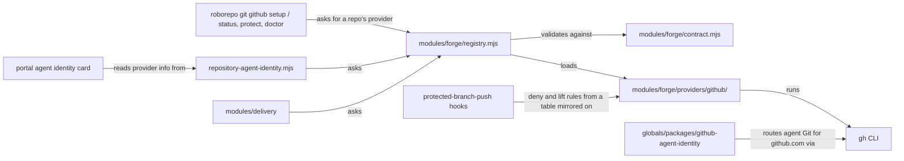
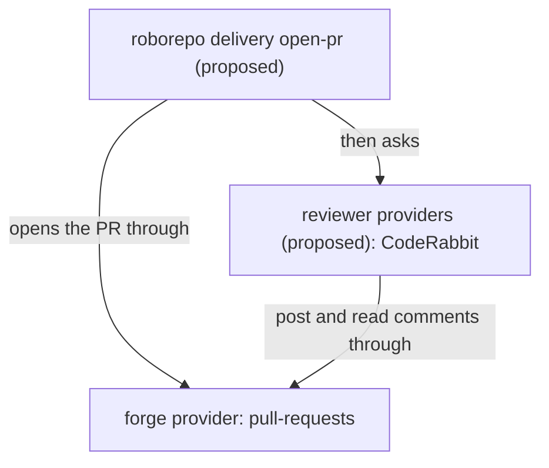

# Git Hosts as Providers, Each With Its Own Agent Account

## Summary

Agents can act on GitHub as a separate bot account, but every piece of that feature assumes GitHub:
the `gh` runner, the token files, the Git credential routing, the branch-protection rules, the
permission hooks, the setup command, and the portal card. This plan puts that code behind a
**forge provider** interface, with GitHub as the first and only provider, so a later plan can add
GitLab, Bitbucket, or Gitea as a provider with its own agent account. Each provider's account acts
only on that provider's hosts. Provider commands move under one shared namespace
(`roborepo git github setup`); for GitHub users the existing `roborepo github` commands,
files, and output keep working unchanged.

## Context

The GitHub bot identity (GitHub Integration Part 01, `w7vls1yk`, PR
[kirinmurphy/roborepo-alpha#82](https://github.com/kirinmurphy/roborepo-alpha/pull/82), merged as
`687be5f6`) made agents push, open pull requests, and reply on review threads as a bot that
GitHub itself stops from pushing to `main` or merging. During review the owner asked for the next
step: GitHub should be one provider among several, and "whatever account the agent was created on
should be responsible for doing things only with that provider." Part 01 left a seam for this (a
host-keyed client map in `modules/forge/index.mjs`, a host table in the hooks, `host` tags in the
permission inventory) and listed a forge-provider layer as future work.

Two follow-ups to Part 01 have landed since and shape this plan:

- [kirinmurphy/roborepo-alpha#95](https://github.com/kirinmurphy/roborepo-alpha/pull/95) made the
  package gitconfig's nested includes relative to the installed file
  (`../../github-agent/...`), and taught the protected-branch hooks to read commands inside
  subshells, substitutions, and `timeout`/`xargs`/`npx` wrappers.
- [kirinmurphy/roborepo-alpha#94](https://github.com/kirinmurphy/roborepo-alpha/pull/94) made the
  local-config repair render permissions with the identity's buckets, so the "identity on" flag now
  reaches a third renderer.

Terms used below:

| Term | Meaning |
| --- | --- |
| Forge | A Git hosting service with an API: GitHub, GitLab, Bitbucket, Gitea/Forgejo |
| Forge provider | RoboRepo's adapter for one forge: its CLI, account setup, Git routing, protection, and pull request calls |
| Host | A hostname a provider serves, such as `github.com`. A repo's host comes from its id, `git:<host>/<owner>/<repo>` |
| Agent account | The bot account agents act as on one provider. One per provider |
| Harness provider | The existing, unrelated adapter for an agent harness (Claude, Codex, Gemini) under `scripts/harnesses/` |
| Reviewer provider | A proposed adapter for a review bot such as CodeRabbit (see "Reconciling with the review-request design") |

## Goals

- One forge provider interface, modeled on the harness provider registry (`scripts/harnesses/`
  `registry.mjs` and `contract.mjs`): a manifest, declared capabilities, and the methods each
  capability requires, validated at load.
- Every GitHub-specific behavior lives in the GitHub provider, and RoboRepo code outside it asks the
  registry for "the provider for this repo" instead of naming GitHub.
- Each provider's agent account is scoped to its own hosts by construction: its credential helper,
  URL rewrites, commit author, CLI identity variables, network allowances, and API calls name only
  its hosts, and a test enforces that for every provider.
- No behavior change for GitHub users: the `roborepo github` commands keep working with the same
  flags and results (as aliases of the new namespaced form; the only changed text is that RoboRepo
  now names the new form when it tells the user what to run), the same
  state folder (`~/.roborepo/github-agent/`), the same package id (`github-agent-identity`), the same
  harness settings, and no `roborepo update` or re-setup required for the existing command forms.
  The agent rules for the new `roborepo git github …` forms (deny setup, allow status, run status
  outside the Claude sandbox) reach an installed harness only on its next `roborepo update`. Until
  then the new setup form is not denied by rule, but setup still refuses to run without a real
  terminal, so an agent shell cannot drive it.
- A written checklist of what a second provider must supply, proven by a test-only fake provider.

## Non-goals

- Building a second real provider (GitLab or others). That is its own plan, written when a repo
  that RoboRepo tracks actually uses that host.
- Self-hosted instances (GitHub Enterprise Server, self-managed GitLab). Calls stay pinned to
  `github.com` as today (`--hostname github.com`). See the Decision log.
- Package install sources (`scripts/cli/package-source-git.mjs` accepts only `github.com` URLs).
  That is package distribution, not agent identity.
- Reviewer providers and the "request a review when a PR opens" command. This plan only exposes the
  pull request operations they would need.
- Renaming anything a user or an installed config already depends on.

## Current state

All of this was read from the code at `ee7de424` (main after #94 and #95).

| Concern | Where it lives today | GitHub-specific parts |
| --- | --- | --- |
| Host entry point | `modules/forge/index.mjs`: `forgeClient(host)` over a one-entry map, `forgeTargetForRepositoryId` | Only `githubClient` is registered |
| API runner and REST calls | `modules/forge/github.mjs`: `runGh`, `GitHubError`, `tokenInfo`, collaborator, invitation, ruleset, and workflow-run calls | All of it |
| Account and repo checks | `modules/forge/agent-identity.mjs`: `readAccountIdentity`, `readRepoAgentAccess`, `readAgentIdentity`, expiry and scope findings | Package id, token scopes `repo`/`read:org`, `hosts.yml` parsing, `GH_CONFIG_DIR` env, noreply email, CA bundle copy, author gitconfig, state folder `github-agent/` |
| Setup page text | `modules/forge/agent-identity-guide.mjs` | github.com pages, classic token note and scopes |
| Branch protection | `modules/forge/protection.mjs`, `protection-policy.mjs`; `roborepo protect` in `scripts/cli/protect.mjs` | Rulesets, classic protection, Actions-derived required checks |
| Guided setup | `scripts/cli/github-setup.mjs` (`guidedSetup`, `inviteBot`, `storeToken`, `moveKeychainToken`, `installToken`) | Every step |
| Command definitions | `manifests/platform/cli/command-definitions/github/` (`namespace.json`, `setup.command.json`, `status.command.json`) | The top-level `github` namespace |
| Status and doctor | `scripts/cli/github-identity.mjs`; `explainBotRepoAccess` also serves `roborepo plans init` (`scripts/cli/plans-command.mjs`) | Reads as GitHub only |
| Package state and routing gaps | `scripts/cli/agent-identity-package.mjs` | `AGENT_GITCONFIG_INCLUDE` path, package id |
| Portal | `scripts/cli/repository-agent-identity.mjs` (server); `scripts/cli/portal-routes-repositories.mjs` (routes); `portal/home/agent-identity.js` (card), `portal/home/templates.js` (menu label), `portal/home/index.html` (offer text), `portal/settings/agent-identity.js` (Settings on/off row) | Server: `host !== "github.com"` checks in the status read and in `launchAgentIdentitySetup`, which runs `github setup` and refuses with reason `not_github`. Client: `supportsAgentIdentity` tests `startsWith("git:github.com/")`, `SETUP_COMMAND_PATTERN` matches `roborepo github setup`; label "Agent GitHub account" in the menu, the Home offer, and Settings; Settings hardcodes `PACKAGE_ID = "github-agent-identity"` |
| Delivery | `modules/delivery/operations.mjs` | `forgeClient("github.com")` fixed; a github.com-only remote URL pattern |
| Package | `globals/packages/github-agent-identity/` | `gitconfig` (credential helper and `insteadOf` for `https://github.com`; a plain `include` of the setup-written `gitconfig.local`, whose only section is `http "https://github.com/"`; author `includeIf` on github.com remotes; nested paths `../../github-agent/...`), `rules.md`, config patches for `GIT_CONFIG_KEY_1`/`VALUE_1`, `GH_CONFIG_DIR`, `GH_TOKEN`, `GITHUB_TOKEN`, Codex network domains |
| Permission inventory | `manifests/inventory/agent-permissions.json`: eight behaviors tagged `"host": "github"`; `agentIdentityBucket` read by `scripts/harnesses/permissions-render.mjs` | Behavior ids and `gh` prefixes |
| "Identity on" flag | One boolean `agentIdentity` option, defaulted from `agentIdentityPackageEnabled()`, threaded through `scripts/harnesses/permissions-render.mjs` (`resolveBehaviors`, `claudePermissions`, `renderCodexRules`, and Codex network on), `scripts/cli/permissions-render.mjs` (`writeCodexRulesFile` and the render targets), and `scripts/cli/local-config-repair.mjs` | Means "the GitHub package is on" |
| Hooks | `protected-branch-push.mjs`, identical copies in `globals/system/hooks/claude/` and `globals/harnesses/codex/hooks/` | `HOST_CLIS.github`, read by name in `classifyGh`; `GH_IDENTITY_VARIABLES`; `agentIdentityActive` (package runtime path, `github-agent/gh`); `codexShellsActAsBot` and `readCodexLayer` (Codex config must point `GH_CONFIG_DIR` at the bot and empty the tokens); `changesGhIdentity`; `gh api` analysis |
| Codex permission hook | `globals/harnesses/codex/hooks/permission-check.mjs` | `agentIdentityInstalled()` checks the GitHub package's runtime gitconfig; `resolveBehaviors()` then applies every `agentIdentityBucket` from that one flag, mirroring the render |
| Claude sandbox | `scripts/harnesses/claude/sandbox-settings.mjs` | `gh *` and `github status` excluded commands |
| Browser links | `modules/repositories/config.mjs` `KNOWN_PROVIDER_HOSTS` | A separate list of four hosts |

What is already host-neutral: the pre-push backstop (`globals/system/git-hooks/protected-branch.sh`)
reads only refs, the push classifier in the hooks reads only Git, and repo ids already carry the host.

Per-host scoping already holds for GitHub: the credential helper and `insteadOf` rewrite are
sections keyed on `https://github.com`, the author include fires only for github.com remotes, every
`gh api` call passes `--hostname github.com` and delivery's `gh` calls pass `--repo
github.com/<owner>/<repo>`, and `GH_CONFIG_DIR` changes only `gh`. A private GitLab
remote keeps the user's own credentials and author today. This plan keeps that property and makes it
a checked rule for every provider rather than a GitHub detail.

## Proposed design

### Shape



The generic code (finding states, expiry warnings, doctor lines, portal caching, setup step
orchestration) stays in `modules/forge/` and `scripts/cli/`. What a provider knows (its CLI, its API,
its pages, its token, its Git config) moves into `modules/forge/providers/<id>/`.

### Provider manifest

Each provider declares data the rest of RoboRepo reads, so callers never branch on a provider id.
The GitHub manifest, with today's values:

```json
{
  "id": "github",
  "displayName": "GitHub",
  "hosts": ["github.com"],
  "cli": { "name": "gh", "configSubfolder": "gh", "identityVariables": ["GH_CONFIG_DIR", "GH_TOKEN", "GITHUB_TOKEN", "GH_ENTERPRISE_TOKEN", "GITHUB_ENTERPRISE_TOKEN", "GH_HOST"] },
  "agent": {
    "packageId": "github-agent-identity",
    "stateFolder": "github-agent",
    "commandNamespace": "github",
    "networkDomains": ["github.com", "api.github.com"]
  },
  "capabilities": ["repository", "agent-identity", "branch-protection", "pull-requests"]
}
```

`agent.stateFolder` is the provider's folder under `~/.roborepo/`; `cli.configSubfolder` is the
CLI's config folder inside it (`~/.roborepo/github-agent/gh`, which `GH_CONFIG_DIR` points at).

### Capabilities

A capability names an adapter group and the methods it must have, as `CAPABILITY_REQUIRED_METHODS`
does for harness providers. A provider that declares a capability without its methods fails
validation at load. A caller that needs a capability the repo's provider lacks reports it the way an
unsupported host is reported today (`{ supported: false }`, "not available for <host>").

| Capability | Methods (GitHub implementation today) | Used by |
| --- | --- | --- |
| `repository` | `parseRemote(url)` → `{ host, repo }` or null; `repository(context, repo)` | Repo targeting, delivery's remote check, plans init |
| `agent-identity` | Reading: `readAccount(context)` → login, token expiry, scopes (`tokenInfo`); `readRepoAccess(context, repo, login)` (`collaboratorPermission`); `accountProblems(info)` (`tokenProblems`, required scopes); `agentEnv(stateDir)` (`botGhEnv`); `readStoredLogin(stateDir)` (`readAgentHosts`); `authorIdentity({ login, id })` (noreply email). Setup: `guide()` (`setupGuide`); `storeToken(...)`, `installToken(...)`; `invite(...)`, `acceptInvitation(...)`; `refreshLocalFiles(stateDir)` (CA bundle copy and author gitconfig) | Status, doctor, portal, the provider's setup command |
| `branch-protection` | `readProtection(target)`, `applyProtection(target, options)`, `manualSteps` | `roborepo protect`, doctor, setup's protection step, portal |
| `pull-requests` | `findPullRequest`, `editBody`, `markReady`, `rerunFailedChecks` (today's delivery calls); open for `openPullRequest` and `comment` when a later plan needs them | `roborepo delivery`, Runtime PR status (Part 03), review requests |

A provider without `agent-identity` can still offer `branch-protection` and `pull-requests`, run as
the user.

### One account per provider, acting only on its own hosts

These rules hold for every provider and each has a test (see Validation):

1. **Git routing is host-keyed.** Every `credential`, `url.*.insteadOf`, `http.<url>`, and
   `includeIf` section in a provider's package gitconfig, and in the files its setup writes
   (`gitconfig.local`, `gitconfig.author` for GitHub), names only that provider's `hosts`. A plain
   `include` is allowed only for a file in the provider's own state folder.
2. **The author is host-conditional.** The bot is the commit author only in repos with a remote on
   the provider's hosts, through `includeIf "hasconfig:remote.*.url:..."` as GitHub does now.
3. **API calls name their host.** Every CLI call pins the host (`--hostname github.com` or a
   `github.com/`-prefixed `--repo` today), so an environment variable cannot redirect it to another
   instance.
4. **Identity variables are provider-owned.** A provider's harness config patches set and clear only
   its own `cli.identityVariables`.
5. **Network allowances are provider-owned.** Codex network domains come from `agent.networkDomains`.
6. **State is per provider.** Tokens and helper files live under `~/.roborepo/<stateFolder>/`; one
   provider never reads another's folder.

### Hooks

The hooks are copied into harness homes and import only Node built-ins, so they cannot load the
registry. They keep an inline table, generalized so that each entry carries what is GitHub-specific
in `agentIdentityActive` today:

```js
const HOST_CLIS = {
  github: {
    cli: 'gh',
    identityVariables: ['GH_CONFIG_DIR', 'GH_TOKEN', 'GITHUB_TOKEN', 'GH_ENTERPRISE_TOKEN', 'GITHUB_ENTERPRISE_TOKEN', 'GH_HOST'],
    configDirVariable: 'GH_CONFIG_DIR',
    packageId: 'github-agent-identity',
    stateFolder: 'github-agent',
    configSubfolder: 'gh',
    denied: [['api'], ['auth', 'token'], ['pr', 'merge'], /* unchanged */],
    allowedAsAgent: [['api']],
  },
}
```

The classifier iterates the table by CLI name instead of reading `HOST_CLIS.github`. The other
identity checks read the entry instead of the GitHub constants: `changesGhIdentity` checks every
entry's `identityVariables`, and `codexShellsActAsBot` checks each entry's `configDirVariable`
against that entry's bot folder and its other variables for empty values. The `gh api`
analysis (merges, Authorization headers, GraphQL from files) stays a GitHub-only function attached
to that entry. A test keeps each table entry equal to its provider manifest and keeps the two hook
copies identical, extending the existing check that ties the `github` deny list to
`agent-permissions.json`.

### Permission inventory

`agent-permissions.json` keeps its behavior ids and `"host": "github"` tags. The tag becomes a
provider id checked against the registry, so a typo or a provider with no adapter fails the
inventory check. Today one boolean "agent identity on" flag decides every `agentIdentityBucket`.
The renderer (`scripts/harnesses/permissions-render.mjs`) takes it from its two callers,
`scripts/cli/permissions-render.mjs` and `scripts/cli/local-config-repair.mjs`, and the Codex hook's
`resolveBehaviors()` is a standalone copy of the same merge. All of them change together. The
boolean becomes the set of provider ids whose agent package is on, and a behavior's
`agentIdentityBucket` applies only when its own `host` is in that set. Codex network access follows
the same set. The Codex hook's `agentIdentityInstalled()` becomes a check per provider entry. With
only GitHub, the set is `["github"]` or empty, so the rendered output does not change.

### Commands and portal

- Provider commands sit under one shared namespace, then the provider:
  `roborepo git github setup` and `roborepo git github status`, later `roborepo git gitlab setup`.
  The existing `git` namespace holds them beside its local commands (`git inventory`,
  `git worktrees`), and its description widens to cover the Git host. Command
  definitions are static JSON, so each provider ships its own small definitions in the `git/`
  folder, named by its manifest's `agent.commandNamespace` (a check ties the two), and all of them
  call shared code (`scripts/cli/forge-setup.mjs`, `scripts/cli/forge-identity.mjs`).
- `roborepo github setup` and `roborepo github status` stay as aliases with the same flags and
  output. Command definitions have no alias field, so an alias is a second definition pointing at
  the same module export: the existing files in
  `manifests/platform/cli/command-definitions/github/` stay, with descriptions that name the new
  form, and new definitions in the `git/` folder call the same exports. Installed rules, the Claude sandbox's excluded `github status` entry, older docs, and the
  user's habits all name them, so removing them would break working setups. RoboRepo's own text
  (rules, fixes in status findings, setup guide, portal) switches to the new form.
- Doctor checks each provider whose package is on, one line each; with only GitHub this is today's line.
- `roborepo protect` already resolves the repo's host; it asks the registry for `branch-protection`
  and keeps today's messages for repos without GitHub.
- The portal server adds `provider: { id, displayName }` to its response. The card and menu label
  read "Agent <displayName> account", which is "Agent GitHub account" for GitHub, and
  `supportsAgentIdentity` uses the providers the server lists instead of the `git:github.com/` prefix.
  The server's host checks ask the registry for `agent-identity`. `launchAgentIdentitySetup` runs
  `git <commandNamespace> setup` and refuses a repo without the capability with reason
  `unsupported_host` instead of `not_github`. The client's `SETUP_COMMAND_PATTERN` matches both
  command forms.

### Reconciling with the review-request design

A design session on November 24, 2026 ("Design: request a PR review on open, via a provider layer")
proposed a `roborepo delivery open-pr` command that opens the PR and then asks each enabled
**reviewer provider** (CodeRabbit first) to request a review, with a retry queue for rate limits. No
plan was written from it. The findings that bear on this plan, checked then on PRs 83–85:

- CodeRabbit does not review this repo automatically (fewer than 10 stars), so a `@coderabbitai
  review` comment is what starts a review.
- No RoboRepo command opens pull requests; `/plan-execute`'s handoff and the shared delivery rule
  run `gh pr create` directly, and `roborepo delivery` can only edit, mark ready, and rerun checks.
- Whether CodeRabbit honours a request posted by a bot account was not tested.

The two layers stack rather than overlap:



A reviewer provider names a review bot; a forge provider names where the repo lives. CodeRabbit
works on GitHub and GitLab, so it should post through whichever forge provider the repo has rather
than call `gh` itself. This plan's `pull-requests` capability is that seam. It leaves
`openPullRequest` and `comment` unimplemented until the review-request plan exists; that plan should
depend on this one.

### What a second provider needs

Using GitLab as the example. Values in the GitLab column are from GitLab's public documentation and
have not been tested here.

| Piece | GitHub (today) | GitLab (example, unverified) |
| --- | --- | --- |
| CLI and identity variables | `gh`; `GH_CONFIG_DIR`, `GH_TOKEN`, `GITHUB_TOKEN`, … | `glab`; its config dir variable, `GITLAB_TOKEN`, `GITLAB_HOST` |
| Token | Classic token, scopes `repo` and `read:org`, expiry from response header | Personal access token, scopes such as `api` and `write_repository`, expiry from the token API |
| Repo access | Collaborator with Write | Project member with Developer |
| Credential helper | `!gh auth git-credential` under `credential "https://github.com"` | `glab`'s credential helper, or the token through a helper keyed on the GitLab host |
| Author | `<id>+<login>@users.noreply.github.com` | GitLab's noreply address for the account |
| Protection | Rulesets and classic branch protection | Protected branches and merge request approval rules |
| Pull requests | `gh pr …` | `glab mr …` |
| Package | `github-agent-identity` | `gitlab-agent-identity` |
| Hooks entry | `HOST_CLIS.github` | `HOST_CLIS.gitlab` with its own denied list |
| Permission behaviors | Eight `host: github` behaviors | Matching behaviors tagged `host: gitlab` |
| Claude sandbox | `gh *` excluded | `glab *` excluded |
| Commands | `roborepo git github setup | status` | `roborepo git gitlab setup | status` |

One shared piece changes when a second provider lands: each identity package adds its Git include
through a fixed `GIT_CONFIG_KEY_1`/`VALUE_1` pair, and two packages cannot both own index 1. The
second-provider plan moves them to one shared include file that lists each enabled provider's
gitconfig (see the Decision log).

## Implementation plan

Each phase leaves GitHub behavior unchanged and passes the existing checks on its own, so the work
can stop after any phase.

- [ ] **Phase 1: contract and registry.** Add `modules/forge/contract.mjs` (capabilities, required
      methods, manifest validation) and `modules/forge/registry.mjs` (`listForgeProviders`,
      `providerForHost`, `providerForRepositoryId`). Move `modules/forge/github.mjs` into
      `modules/forge/providers/github/` with its manifest, and make `forgeClient(host)` a wrapper
      over the registry so current callers keep working. Add a test-only fake provider for
      `forge.example.test` under `scripts/test/fixtures/forge-fake-provider/`. The registry's lookups
      take an optional provider list (default: the shipped providers), and tests pass the fake
      through it, so the fake never ships in `modules/forge/providers/`. Before any code changes,
      capture the "before" output for the comparison in Validation into `roborepo scratch m7gjz0p6`.
- [ ] **Phase 2: identity and setup move into the provider.** Split `modules/forge/agent-identity.mjs`
      into the generic reader (states, findings, expiry, package-state findings) and the GitHub
      adapter (token info, scopes, `hosts.yml`, collaborator access, CA bundle, author file). Move the
      guide and setup steps of `scripts/cli/github-setup.mjs` behind `agent-identity`. Derive state
      paths from `agent.stateFolder`.
- [ ] **Phase 3: commands, doctor, and portal through the registry.** Shared
      `scripts/cli/forge-identity.mjs` and `forge-setup.mjs` replace `scripts/cli/github-identity.mjs`
      and `scripts/cli/github-setup.mjs` (moved, not kept as wrappers; their importers (the command definitions, `plans-command.mjs`, `repository-agent-identity.mjs`, `scripts/doctor.sh`) and tests follow,
      as Validation allows). Add
      `github.namespace.json`, `github-setup.command.json`, and `github-status.command.json` to
      `manifests/platform/cli/command-definitions/git/` (the folder's existing `worktrees.*` naming),
      widen `git/namespace.json`'s description to cover the Git host, and point the new definitions at the same exports as the existing
      `github/namespace.json`, `setup.command.json`, and `status.command.json`, which stay as the
      aliases. Give the new forms the same agent rules as the old: add the
      `roborepo git github setup` prefix to the `set-up-github-identity` deny and the
      status prefix to `check-github-identity` in `manifests/inventory/agent-permissions.json`, and
      add `git github status` beside `github status` in the Claude sandbox's
      `ROBOREPO_UNSANDBOXED_SUBCOMMANDS` (`scripts/harnesses/claude/sandbox-settings.mjs`). Switch
      RoboRepo's own text to the new form, wherever Phase 2 left it: fix and next-step text in the
      generic reader's findings, the GitHub provider's `guide()` and setup steps, the shared status
      and setup commands (usage strings included), the portal copy, and code comments in those
      files. Today the old form appears in seven files under these folders, all in scope:
      `modules/forge/agent-identity.mjs`, `modules/forge/agent-identity-guide.mjs`,
      `scripts/cli/github-identity.mjs`, `scripts/cli/github-setup.mjs` (both moved above),
      `scripts/cli/repository-agent-identity.mjs`, `scripts/cli/portal-routes-repositories.mjs`, and
      `portal/home/agent-identity.js`. `rg "roborepo github (setup|status)" modules
      scripts/cli portal` should then find nothing. Docs, package rules, and the uninstall comment
      in `scripts/install/uninstall-lib.sh` change in Phase 6; rendered files under `generated/`
      and the alias definitions keep the old form on purpose. Doctor iterates enabled providers.
      `scripts/cli/agent-identity-package.mjs` reads the package id and gitconfig path from the
      manifest. Portal server returns `provider`, asks the registry instead of comparing the host to
      `github.com`, and launches the new setup form (reason `unsupported_host` for a repo without
      `agent-identity`); card and menu label read `provider`; `supportsAgentIdentity` uses the
      server's list; `SETUP_COMMAND_PATTERN` matches both forms. The Settings row
      (`portal/settings/agent-identity.js`) renders one row per provider the server lists, taking
      the package id and "Agent <displayName> account" label from it instead of its
      `PACKAGE_ID` constant; the Home offer's fixed "Agent GitHub account" text in
      `portal/home/index.html` reads the same label.
- [ ] **Phase 4: protection and delivery through capabilities.** `roborepo protect`, the setup's
      protection step, and the portal protect action ask for `branch-protection`.
      `modules/delivery/operations.mjs` uses `repository.parseRemote` and `pull-requests` instead of
      `forgeClient("github.com")` and its own URL pattern. `explainBotRepoAccess` asks the repo's provider.
- [ ] **Phase 5: hooks and permissions.** In both `protected-branch-push.mjs` copies, generalize
      `HOST_CLIS`, `classifyGh`'s table lookup, `agentIdentityActive`, `changesGhIdentity`, and
      `codexShellsActAsBot`/`readCodexLayer` to read each entry instead of the GitHub constants.
      Check permission `host` tags against the registry. Replace the boolean `agentIdentity` option
      with the set of enabled provider ids in `scripts/harnesses/permissions-render.mjs`,
      `scripts/cli/permissions-render.mjs`, and `scripts/cli/local-config-repair.mjs`, and apply
      `agentIdentityBucket` and Codex network access per provider there and in the Codex
      `permission-check.mjs` (`agentIdentityInstalled`, `resolveBehaviors`).
- [ ] **Phase 6: scoping checks and docs.** Add the host-scoping test over every provider's package
      files, setup-written Git files, and config patches. Write the second-provider checklist (the
      "What a second provider needs" table, as steps) into the repo-local `roborepo-development`
      skill, and make the other Documentation impact updates.
- [ ] **Phase 7: register and gate.** Register each new check in the `ci` group of
      `scripts/test/check-groups.json`. Run the touched checks locally, then let CI run the full gate
      (`npm run check`) on the pull request, since hooks, harness config, and generated permissions
      change. Run the before/after comparison in Validation on a machine with the bot set up.

## Validation

The existing tests are the no-behavior-change proof. They must pass with only import-path edits and
no changed expectations, with two exceptions that Phase 3 makes on purpose:

- Text that tells the user which command to run names `roborepo git github setup` (or `status`)
  instead of `roborepo github setup`.
- The portal setup launch runs `git github setup`, and refuses with reason `unsupported_host`
  instead of `not_github`.

Any other changed expected string means the phase changed behavior.

| Existing check (`scripts/test/`) | Covers |
| --- | --- |
| `github-identity-status-check.mjs` | Status findings, states, text and JSON output |
| `github-setup-check.mjs` | Every setup step and its refusals |
| `repository-agent-identity-check.mjs` | Portal server responses and caching |
| `portal-ui/agent-identity.spec.mjs` | The card, labels, polling |
| `protect-check.mjs`, `doctor-protection-check.mjs` | `roborepo protect` and its doctor line |
| `protected-branch-push-check.mjs` | Hook allow, ask, and deny decisions |
| `github-agent-identity-package-check.mjs`, `github-agent-identity-render-check.mjs` | Package files and rendered harness config |
| `git-exec-identity-check.mjs`, `permissions-render-live-characterization-check.mjs` | Git environment and permission buckets |
| `local-config-repair-render-check.mjs` | The local-config repair keeps the identity's buckets |
| `claude-sandbox-projection-check.mjs` | Commands the Claude sandbox runs outside it |

New checks, each failing without its phase:

- **Contract check:** the GitHub and fake providers load; a fake provider declaring a capability
  without one of its methods is refused at load with the missing method named.
- **Fake provider end to end:** with the fake provider for `forge.example.test` passed to the
  registry, `roborepo protect`'s check in a repo on that host reports the capability as unavailable,
  the shared status function in `scripts/cli/forge-identity.mjs` reports "not set up" under the fake
  provider's name, and the portal response names it. The fake has no command definitions; it is
  driven through the shared functions.
- **Settings row per provider:** a portal UI spec (beside `portal-ui/agent-identity.spec.mjs`; the
  Settings row has no spec today) shows one "Agent GitHub account" row whose switch turns
  `github-agent-identity` on and off, and, given a server response listing a second provider, a
  second row with that provider's label and package id.
- **Command definitions match manifests:** for every shipped provider, the `git/` folder holds
  `<commandNamespace>.namespace.json`, `-setup`, and `-status` definitions that call the shared exports.
- **Host scoping:** for every provider, each section in its package gitconfig names only its
  `hosts`, its config patches set only its `cli.identityVariables` and `networkDomains`, and a
  repo with a remote on another host gets neither the bot's credential helper nor its author
  (`git config --get-urlmatch` and `git var GIT_AUTHOR_IDENT` in a fixture repo).
- **Namespaced commands:** `roborepo git github status --json` and `roborepo github
  status --json` print identical output with the same exit code in the status check's fixture, the
  same holds for `setup` on its "already done" path in the setup check's fixture, and `roborepo
  --help` lists the new namespace.
- **Agent rules cover both forms:** the rendered Claude and Codex permissions deny both setup forms
  to agents and allow both status forms, and the Claude sandbox settings run both status forms
  outside the sandbox (extending `permissions-render-live-characterization-check.mjs` and the
  `claude-sandbox-projection-check.mjs`).
- **Hook parity:** in each `HOST_CLIS` entry, `cli`, `identityVariables`, and `configSubfolder`
  equal the manifest's `cli.*` values and `packageId` and `stateFolder` equal its `agent.*` values;
  the Claude and Codex hook copies are byte-identical. A hook test with a second, fake table entry
  shows that `changesGhIdentity` and the Codex config check react to that entry's variables too.
- **Per-provider buckets:** with the fake provider's package on and GitHub's off, a behavior tagged
  `host: github` keeps its default bucket in the Claude, Codex, and local-config-repair renders.

Before calling the plan done, compare `roborepo github status --json`, `roborepo protect --check
--json`, and `roborepo doctor` output on a machine with the bot set up, before (captured at the
start of Phase 1) and after; they must
be identical apart from timestamps and the setup command name in fix text.

## Risks

- **A refactor with one real provider can bend the interface to GitHub.** The fake provider helps
  but cannot show what GitLab actually needs. Mitigation: keep methods at the level of "read account,
  read repo access, store token" and leave GitHub details (rulesets, classic tokens) inside the adapter.
- **Moving files breaks installed paths.** The package runtime path
  (`~/.roborepo/package-runtime/github-agent-identity/gitconfig`) and the state folder are read by
  installed harness configs and hooks. Mitigation: nothing in this plan renames either; only source
  files under `modules/` and `scripts/` move.
- **Hook drift.** The inline hook table can drift from the manifest. Mitigation: the parity test.
- **Scope creep into a GitLab build.** Mitigation: Non-goals; a second provider is its own plan.

## Related plans

| Plan | Relationship | What it means here |
| --- | --- | --- |
| GitHub Integration Part 01 (`w7vls1yk`) | Landed dependency (completed; #82, with follow-ups #94 and #95) | Everything this plan moves. Current state above is read after all three |
| Protect a repo's plans and main branches (`3xh2sq32`) | Landed dependency (completed) | `roborepo protect` and the protection modules move behind `branch-protection` |
| GitHub Integration Part 02 (`f0jwe76j`) | Related, no conflict (backlog) | Its fix skill calls `gh` directly from skill text and is GitHub-only by its own scope. Nothing here changes that |
| GitHub Integration Part 03 (`developer-runtime-remote-branch-status`) | Plan-vs-plan conflict, resolved by order (backlog) | It puts a PR lookup in `modules/forge/github.mjs`, which Phase 1 moves. If Part 03 lands first, Phase 1 moves its lookup with the file. If this plan lands first, Part 03's lookup belongs in the GitHub provider's `pull-requests` capability, and Part 03's prose needs a separate revision. Neither plan blocks the other |

## Open questions

None. The decisions made while writing this plan are in the Decision log.

## Decision log

- November 27, 2026 (user decision): build all six phases now, rather than stopping after Phase 2
  with only the host-scoping test. Chosen because the owner asked for the full layer and each phase
  is small and covered by existing tests. (Promotion later added Phase 7, which only registers
  the new checks and runs the gate; see the promotion entry below.)
- November 27, 2026 (user decision): several providers' Git includes go through one shared include
  file that lists each enabled provider's gitconfig, designed and migrated in the second-provider
  plan. This plan leaves GitHub's `GIT_CONFIG_KEY_1` slot untouched. Alternative: each package
  claims its own `GIT_CONFIG_KEY_n` slot, which spreads index bookkeeping across packages.
- November 27, 2026 (user decision): provider commands go under one shared namespace before the
  provider name (`roborepo git github setup`), not a top-level namespace per provider.
  Alternative: `roborepo github …`, `roborepo gitlab …` at top level.
- November 27, 2026 (user decision): self-hosted instances (GitHub Enterprise Server, self-managed
  GitLab) stay out of scope; a configurable host list changes rule 3's host pinning and needs its
  own security review.
- November 27, 2026 (user decision): the "request a review on open" plan, when written, depends on
  this plan's `pull-requests` capability. Its retry-runner choice (local queue or GitHub Actions)
  stays open in that design session.

- November 27, 2026 (user decision): the shared namespace is the existing `git` namespace
  (`roborepo git github setup`). Chosen because it adds no new word and the `git` plan namespace
  already covers the Git host. Alternatives: `forge` (exact but jargon), `hosting`,
  `versioncontrol` (long, and GitHub hosts the repo rather than being the version control).
- November 27, 2026 (promotion): the no-changed-expectations rule now names its two deliberate
  exceptions, the new command name in fix text and the portal launch's arguments and refusal
  reason, because Phase 3's already-decided text switch changes those strings. Phase 7 adds no
  scope; it registers the new checks and leaves the full gate to CI.
- November 27, 2026 (promotion): the portal launch's refusal reason becomes `unsupported_host`,
  since `not_github` would be wrong for any second provider. The client and server are in this repo
  and change together.

## Documentation impact

| Doc | Update |
| --- | --- |
| `docs/internal/cli-internals.md` (`## Git host calls`) | Describe the registry, contract, and provider folders in place of "the one home for `gh` calls" |
| `docs/internal/docs-map.md` | Rows for branch protection and agent identity point at `modules/forge/providers/github/`; add a row for forge providers |
| `docs/user/reference/roborepo-cli.md` | Document `roborepo git github setup` and `roborepo git github status`, the widened `git` namespace, and `roborepo github …` as aliases |
| `docs/user/guides/setup-and-daily-use.md`, `docs/user/reference/repositories.md`, `docs/user/reference/claude-hooks.md`, `docs/user/reference/codex-hooks.md`, `docs/user/guides/plan/lifecycle/plan-suite.md`, `docs/internal/portal-architecture.md`, `docs/internal/config-panel-internals.md` | Name the new setup and status commands; hook behavior is unchanged |
| `globals/packages/github-agent-identity/rules.md`, `globals/packages/plan-suite/skills/plan-suite-init/SKILL.md` | Tell agents to send the user to the new setup command |
| `globals/packages/github-agent-identity/package.config.json` (`description`), the comment in `scripts/install/uninstall-lib.sh` | Name the new setup command |
| Repo-local `roborepo-development` skill | Name forge providers beside harness providers in its provider-adapter guidance, with the second-provider checklist |
