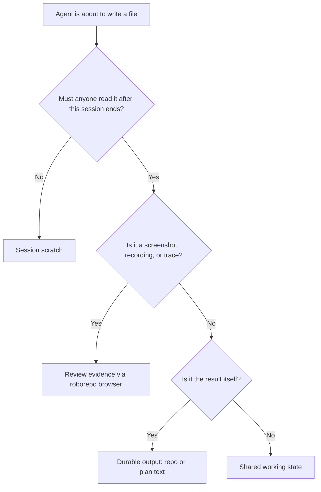

# Give agent temporary files one home per purpose, cleaned up automatically

## Summary

Agents write throwaway files to a different place each time: the system temp folder, Claude's
per-session scratchpad, `/tmp`, ad hoc `mktemp` folders, and log files dropped next to them. Nothing
removes most of it. On the machine surveyed for this plan, temporary leftovers came to
about 620 MB across three temp folders, the oldest from two weeks earlier.

This plan names four purposes for agent-written files, gives each exactly one location, tells
Claude and Codex agents which to use through one shared rule fragment, and adds a cleanup that runs
without the user. Cleanup only ever deletes inside folders roborepo owns.

## Goals

- An agent can tell from one rule which location fits what it is about to write, in Claude and in
  Codex alike.
- Temporary content disappears on its own: no user command, no reminder.
- Content that must outlive a session never sits where the operating system may clear it.
- A dry run shows exactly what cleanup would remove before anything is removed.
- Cleanup cannot delete anything outside roborepo-owned folders, whatever a path, link, or name
  says.

## Non-goals

- Retention of roborepo's own generated stores under `~/.roborepo/` (telemetry, runtime history,
  logs). The retention registry in `modules/retention/registry.mjs` owns those, and Generated State
  Stores (n8kw3rp2) owns the open gaps, including the telemetry collector cursors.
- Cleaning folders the harnesses own: Claude's session folders and scratchpads, `~/.claude/`,
  `~/.codex/`. Roborepo may report their size; it never deletes in them.
- Worktree removal, which the existing worktree cleanup owns.
- Committed folders at the repo root (`scratch/`, `sketches/`, `rename/`). They are tracked source.

## Terms

| Term | Meaning |
| --- | --- |
| Temp root | A system temp folder: the process's `$TMPDIR`, the macOS per-user temp folder (`/var/folders/.../T`), or `/tmp`. Claude's shell sandbox sets `$TMPDIR` to `/tmp/claude-<uid>`, so one machine has several temp roots at once |
| Roborepo temp folder | A `roborepo/` folder created inside a temp root. Proposed here; it does not exist yet |
| Roborepo-owned root | A folder roborepo creates and alone writes: each roborepo temp folder, and named folders under `~/.roborepo/` |
| Session | One agent conversation in Claude or Codex |

## Current state

### Where temporary content goes today

Measured on 2026-11-14 with `du` on one macOS machine.

| Location | What lands there | Who writes it | Cleaned up | Size |
| --- | --- | --- | --- | --- |
| User temp root (`/var/folders/.../T`) | 5,532 roborepo-named folders: test fixtures (`roborepo-app-*`, `cli-test.*`, `portal-ui-*`) and 3,090 `roborepo-disposable-*` folders | Roborepo's tests; `withTemporaryStorage` in `modules/repositories/temporary-storage.mjs` | No. Oldest from 2026-11-03 | 384 MB |
| Claude sandbox temp root (`/tmp/claude-<uid>/`) | 46 per-session folders holding scratchpads; 112 loose entries: 29 `*-check.log` / `*-check.err` files, agent `mktemp` folders, probe scripts | Claude Code; agents | No cleanup seen. Oldest from 2026-10-31 | 222 MB (93 MB session folders, 130 MB loose) |
| `/tmp` outside the sandbox folder | About 70 agent probe folders and files: `roborepo-validator-*`, `roborepo-protected-push-*`, `rm-ask-probe` | Agents running outside the sandbox | No | About 15 MB |
| `~/.roborepo/browser/evidence/` | Screenshots, recordings, traces | `roborepo browser run` | Yes: 14 days or 250 MB, through the retention registry | 696 KB |
| `~/.roborepo/skill-visibility/*.count` | One counter per session | skill-visibility hook | No | 60 KB |
| `~/.roborepo/telemetry/collector/` | 4,081 per-session cursors | Telemetry capture | No; owned by n8kw3rp2 | 16 MB |

Not measured: the temp root Codex sets inside its own sandbox, and whether macOS clears the user
temp root at boot on this machine. Folders 11 days old survive there, so it is not cleared daily.

### What the instructions tell agents

The sources below send the same kinds of file to different places, and none says which place fits
which purpose:

| Source | Says |
| --- | --- |
| `globals/packages/tool-call-optimization/rules.md` | Scratch work goes under `$TMPDIR`/`/tmp` with `mktemp -d`, removed by a `trap` in a script file |
| `globals/packages/test-harness/skills/test-harness/SKILL.md` | Large test output: use `roborepo run` or redirect to `/tmp` |
| `globals/packages/plan-suite/rules.md` and plan-write's `plan-schema.md` | Plan edits go in "a copy outside the code checkout" |
| Claude Code's own system prompt | Use the session scratchpad for all temporary files |
| plan-execute, plan-review, plan-close references | Never record a `/tmp` path as evidence |
| `docs/user/reference/roborepo-cli.md` (`delivery pr-body`) | The pull request body must be a file under `/tmp`, `/var/tmp`, or `/var/folders` |

### What already exists to build on

- `modules/retention/` registers every bounded store under `~/.roborepo/` with an age or size bound.
  `roborepo maintenance stores` lists and resets them; doctor reports them.
- `withTemporaryStorage` creates a temp folder and removes it after use. When the shell sandbox
  denies removing a folder, it leaves the empty folder behind with a warning. That is the source of
  the 3,090 `roborepo-disposable-*` folders.
- Production code that makes temp folders (`scripts/cli/plans.mjs`, `modules/plan-suite/plan-store.mjs`,
  the two Playwright runners under `scripts/cli/browser/`) removes them in a `finally` block.
  The leftovers come from tests and from agents, not from these.
- `globals/harnesses/claude/hooks/repo-write-scope.mjs` already lets file tools write to temp roots
  and to `~/.roborepo/` without a prompt.

### Sandbox constraint

Cut Claude permission prompts by running shell commands in the native sandbox (9njvfh5z, in review)
lets sandboxed shell commands write only to temp roots and the checkout. A sandboxed shell cannot
write to `~/.roborepo/`; `roborepo` commands run outside the sandbox and can. Codex's sandbox is
expected to allow temp roots and the workspace in the same way; that was not checked for this plan.
Any location this plan gives agents must be writable under both.

## Proposed design

### Four purposes, one location each

| Purpose | Lifetime | Location | Removed by |
| --- | --- | --- | --- |
| Session scratch: scripts, check logs, plan edit copies, pull request bodies, probes | This session | Claude: the session scratchpad. Codex and any other harness: a folder under `<temp root>/roborepo/scratch/` | Scratchpad: the harness. Roborepo scratch: cleanup, 3 days after last change |
| Shared working state: notes handed between sessions, a long investigation's intermediate results | Until the plan it serves closes, or 30 days | `~/.roborepo/work/<plan id or topic>/` | Cleanup at `plan-close` and `plan-archive` for that plan id; otherwise 30 days after last change |
| Review evidence: screenshots, recordings, traces | Until the conversation that cites them is over | `~/.roborepo/browser/evidence/` (unchanged) | Existing retention, 14 days |
| Durable output | Permanent | The repo, committed, or the plan's own text | Nothing |

Pull request bodies stay valid: both session scratch locations resolve under `/tmp` or
`/var/folders`, which `delivery pr-body` accepts.

### Rule fragment

One new shared fragment under `globals/system/rules/shared/`, rendered into both Claude and Codex
rules, carries the table and the decision above in a few lines. It also says:

- Never write temporary content into the checkout, `/tmp` directly, or a harness home.
- Get a roborepo scratch or work folder from `roborepo temp path <purpose> [<key>]` rather than
  composing the path. The command creates the folder and prints it, so the path is identical
  across harnesses and the agent never needs write access to compute it.
- Record evidence itself in plans and pull requests, never a path to a temporary location.

### Cleanup

A new module, `modules/temp-cleanup/`, owns the sweep. It is not a retention store: the retention
registry bounds files roborepo writes on a known schedule, while this sweep removes whole folders
by age and by plan lifecycle.

- **Owned roots only.** The sweep receives a fixed list: `roborepo/` inside each known temp root,
  and `~/.roborepo/work/`. It resolves each root with `realpath`, refuses a root that is a symbolic
  link, and refuses any entry whose resolved path leaves its root. It removes links as links and
  never follows them, as `withTemporaryStorage` already does.
- **Age.** An entry is removed when nothing inside it changed for its purpose's age limit.
- **Lifecycle.** `roborepo temp clean --plan <plan id>` removes `~/.roborepo/work/<plan id>/`.
  `plan-close` and `plan-archive` run it after the plan's move is committed.
- **Dry run.** `roborepo temp clean --dry-run` lists every entry it would remove with its size and
  age. `--apply` removes them. Doctor reports the dry-run total and the size of harness-owned
  scratch folders it does not touch.
- **Runs without the user.** `roborepo update` runs the sweep. A session-start hook runs it at most
  once a day, in the background, so a sweep never delays a session.

### Roborepo's own leftovers

- The test runner (`scripts/test/run-checks.mjs` and `scripts/test/test-cli.sh`) sets `TMPDIR` to a
  fresh `roborepo/tests/run-<id>/` folder for the run and removes it at the end. The 123 test files
  that call `mkdtemp` need no change, and a crashed run is caught by the age sweep.
- `withTemporaryStorage` and the other production callers create their folders under
  `<temp root>/roborepo/`, so a folder the sandbox would not let them remove is swept later.

## Implementation plan

- [ ] Confirm which paths Codex's sandbox lets a shell command write, and record the result here.
- [ ] Add `roborepo temp path <purpose> [<key>]` and `roborepo temp clean --dry-run | --apply |
      --plan <plan id>`, backed by `modules/temp-cleanup/` with the owned-roots safety rules.
- [ ] Add the shared rule fragment and render it for Claude and Codex.
- [ ] Update the instruction sources listed under "What the instructions tell agents" to name the
      purpose instead of an ad hoc location.
- [ ] Point `withTemporaryStorage` and the production `mkdtemp` callers at the roborepo temp folder.
- [ ] Give the test runners a per-run `TMPDIR` under the roborepo temp folder.
- [ ] Run the sweep from `roborepo update`, a once-a-day session-start hook, `plan-close`, and
      `plan-archive`; add the doctor report.
- [ ] Add `~/.roborepo/work/` to the writable paths for sandboxed shells in both harnesses, if Open
      question 2 keeps shared working state.
- [ ] Remove legacy leftovers per Open question 4.

## Validation

- A check builds a temp root with old and new entries, a symbolic link pointing outside it, and a
  sibling folder outside `roborepo/`. The dry run lists only the old entries inside `roborepo/`;
  apply removes exactly those, and the link target and sibling survive.
- A check asserts a root that is itself a symbolic link is refused with nothing removed.
- A check closes a fixture plan and asserts its `work/<plan id>/` folder is removed and another
  plan's is not.
- A check runs the test runner and asserts its per-run folder is gone afterwards.
- The rendered Claude and Codex rules both contain the fragment.

## Risks

- **Removing something an agent still uses.** A session idle longer than the age limit loses its
  roborepo scratch folder. The 3-day limit and the change-time measure keep this to abandoned work.
- **Several temp roots.** Cleanup run outside the sandbox sees a different `$TMPDIR` from a
  sandboxed agent. The sweep enumerates the known roots instead of reading `$TMPDIR` alone.

## Open questions

1. **Claude session scratch: scratchpad or roborepo scratch?** The scratchpad needs no permission
   and Claude's own prompt already directs agents there, but roborepo cannot clean it. Using roborepo
   scratch for Claude too makes both harnesses identical and cleaned, at the cost of contradicting
   Claude's prompt. *Recommendation:* keep the scratchpad for Claude; doctor reports its size.
2. **Keep shared working state at all?** Without it, cross-session notes go into the plan text or,
   in the Claude app, its side-session notes folder; Codex and terminal sessions would have no
   shared place. It also needs a new writable path in both sandboxes. *Recommendation:* keep it;
   parallel plan sessions need a place that is not a plan and not a temp folder.
3. **Session-start hook or `roborepo update` only?** Update alone runs only when the user runs it.
   *Recommendation:* both, with the hook throttled to once a day.
4. **Legacy leftovers outside the new roots.** The 3,090 `roborepo-disposable-*` folders and other
   roborepo-named entries sit directly in temp roots, outside any roborepo-owned root. Options: a
   one-time sweep limited to an explicit list of name prefixes, older than 3 days, dry run first;
   or leave them to the operating system. *Recommendation:* the one-time prefix sweep, run once by
   `roborepo update` after this lands, then retired.

## Documentation impact

- `docs/user/reference/roborepo-cli.md`: add `roborepo temp path` and `roborepo temp clean`.
- `docs/internal/testing.md`: the per-run test `TMPDIR`.
- The rule fragment is the reader-facing doc for agents; `globals/packages/test-harness` and
  `tool-call-optimization` text changes with it.
