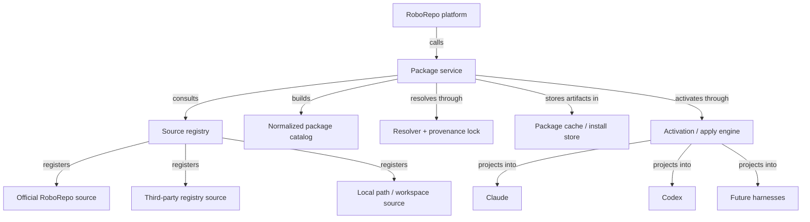
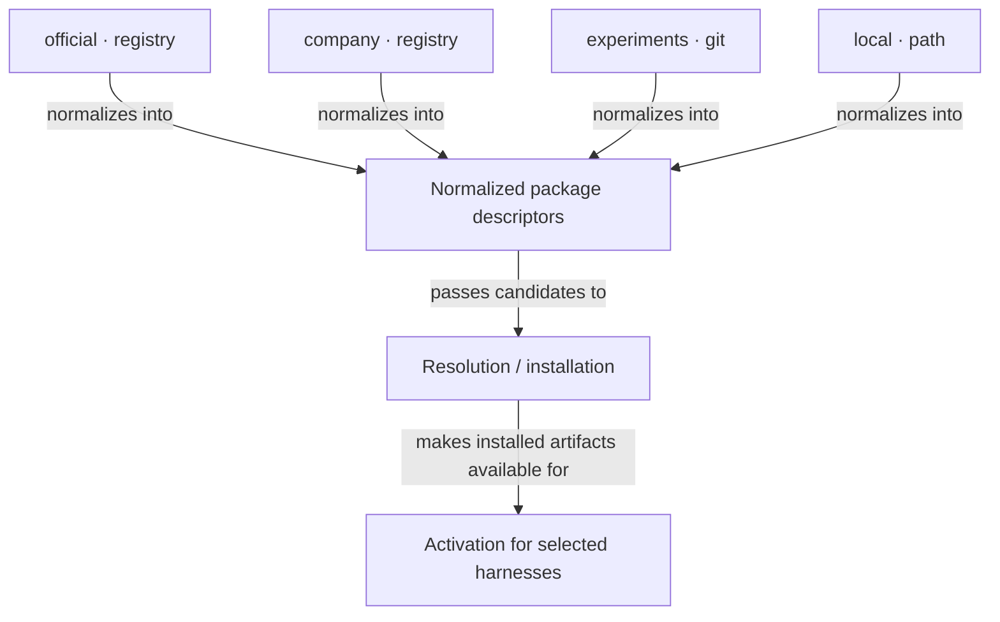
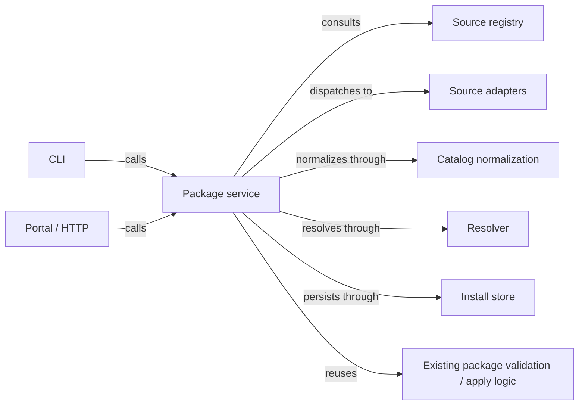
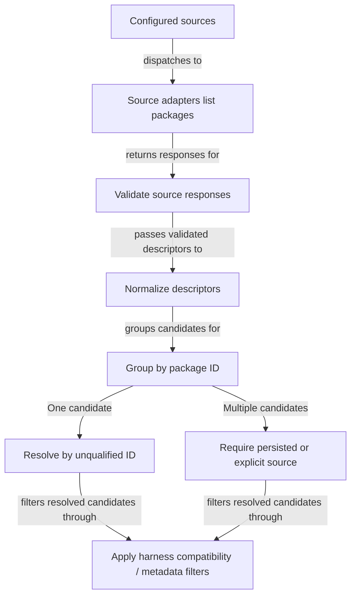
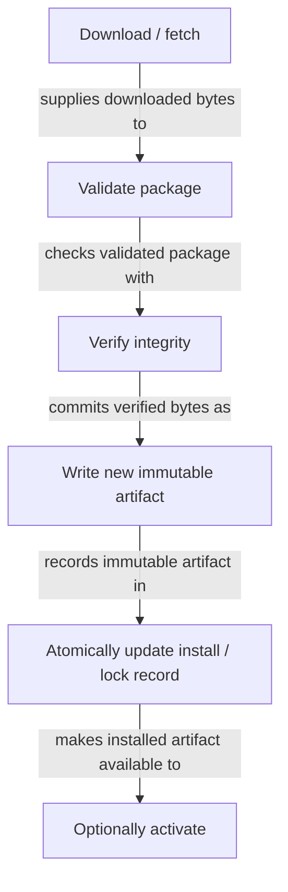

# Package Management: Part 04 - Get Packages From GitHub, Catalogs, and Local Folders

## Summary

RoboRepo currently ships the application and its available global package library together. The package catalog then combines those built-in packages with packages found in the configured workspace. This works while the package library is small, but it couples platform releases to package-library growth and makes the workspace behave like a special escape hatch rather than one member of a general package-source model.

This plan separates those concerns.

The RoboRepo application becomes a package-management platform that can discover packages from one or more configured **package sources**. The official RoboRepo package library becomes one source. A local workspace becomes another source. Additional registries, Git repositories, or organization-specific catalogs can be added later through the same source contract.

The resulting model is:



The separation is both a product decision and an ownership boundary:

- `appRoot` owns replaceable application code.
- `stateRoot` owns RoboRepo-managed mutable state, downloads, caches, locks, and installed package copies.
- `workspaceRoot` remains user-controlled source content and can be represented as a local `path` package source.
- A platform update must not overwrite user-authored packages.
- Removing RoboRepo-managed state must not recursively delete an arbitrary user-owned workspace path.


### Scope of this plan

This plan delivers the local half of the model: the source abstraction, durable provenance, a
managed install store, the public GitHub (`git`) source with its trusted catalog, and the shared
service and CLI surface for sources. It changes nothing about how RoboRepo itself is distributed.

[[f5exs0bd]] owns the remote half: the official `registry` source and its hosting, removing optional
packages from the npm artifact, and source-aware uninstall and reset scopes. Sections below that
describe those parts stay here because they are the shared product model; each names [[f5exs0bd]]
where that plan delivers it.

## Why This Change

### Current State

RoboRepo already has the architectural roots needed for this separation:

- `scripts/cli/roots.mjs` distinguishes immutable application code, machine-local mutable state, and
  the portable workspace. `scripts/cli/state-paths.mjs` names many files under `stateRoot`, including
  the package state files.
- `docs/architecture/config-code-separation.md` documents the same ownership boundary.
- `scripts/cli/package-catalog.mjs` discovers packages from two hard-coded origins: `globals/packages`
  (`origin: "built-in"`) and the workspace packages folder (`origin: "workspace"`). Consumers branch
  on that field, for example `scripts/cli/packages.mjs` and `scripts/cli/config.mjs`.
- A workspace package with the same ID as a built-in one is a hard error today, unless the workspace
  `overrides/resources.json` holds a typed `replace` override for that ID; with the override the
  workspace package replaces the built-in one. `scripts/cli/workspace-resources.mjs` reads the
  overrides and repeats the same conflict rule for workspace packages and MCP servers.
- Selection and installation state landed with [[o9zwxuav]]: `scripts/cli/package-state.mjs` owns
  `enabled-packages.json` (selected roots plus explicit deselections) and `applied-packages.json`
  (what RoboRepo installed). Both record bare package IDs. `scripts/cli/update-report.mjs` also reads
  the first, and `scripts/install/uninstall-lib.sh` deletes both.
- Package `requires` edges are resolved by bare ID in `scripts/cli/package-graph.mjs`.
- [[bysyzl1e]] defined collections as categories with `bulkToggle: true`, a field `package-catalog.mjs`
  reads from `manifests/inventory/package-categories.json`. No category sets it today, and there is
  no collection record outside categories.
- `package.json` publishes `globals/` in its `files` list, so the npm package carries the whole
  global package library.
- `roborepo uninstall` (`scripts/cli/uninstall.mjs`) already exists, with `--dry-run`, `--yes`, and
  `--delete-workspace`, and in package mode also removes the npm package. It is not source-aware.
- `scripts/test/package-catalog-check.mjs`, `package-catalog-harness-check.mjs`,
  `package-lifecycle-check.mjs`, and `package-default-enabled-check.mjs` cover discovery, harness
  compatibility, defaults, and apply. New checks are registered in `scripts/test/check-groups.json`.

The architectural problem is therefore not that RoboRepo lacks separation concepts. It is that package **discovery and distribution** have not yet been generalized around them.

### Product Pressure

Keeping every optional package inside the platform artifact creates several long-term constraints:

1. Adding a package grows the RoboRepo application distribution even if most users never enable that package.
2. Updating a package can require a RoboRepo platform release even when platform code did not change.
3. Third-party and organization-specific package libraries do not fit naturally beside a single hard-coded built-in directory.
4. The workspace has special semantics rather than participating in a uniform package-source model.
5. Package provenance becomes increasingly ambiguous once local and external packages can share identifiers.
6. Uninstall and reset behavior becomes harder to explain unless RoboRepo has explicit ownership of application files, managed state, and user-authored content.

The goal is not to reproduce npm. The goal is to establish a small, stable package-source boundary that can start with simple infrastructure and support richer distribution later without changing the package model again.


## Goals

This plan must produce a package system in which:

- RoboRepo can use packages from multiple configured sources.
- Local user-authored packages use the same normalized package contract as remote packages.
- A workspace can remain a convenient authoring location while becoming a `path` source internally.
- Package identity includes provenance strongly enough to prevent silent source switching.
- Discovery, installation, and activation are distinct operations.
- A public GitHub skill can be added by URL or from a trusted catalog, pinned to a commit.
- The same domain/service layer can serve CLI and portal experiences.
- Installed packages stay usable offline.
- Current built-in/workspace behavior migrates incrementally rather than in one large rewrite.

The official source, an npm artifact without optional packages, and ownership-aware uninstall are
goals of [[f5exs0bd]], which builds on this plan.

## Non-Goals

This plan does not require:

- Building a public marketplace with reviews, payments, ratings, moderation, or accounts.
- Mirroring npm registry protocol or npm's dependency-resolution model.
- Supporting arbitrary package code execution without an explicit trust model.
- New dependency features. Existing `requires` edges keep working, resolved by the rule in
  Collision Behavior.
- Implementing automatic publication from third-party repositories.
- Creating an MCP package-management interface.
- Supporting every possible transport in the first release.
- Treating the user's workspace as disposable RoboRepo state.
- The official `registry` source, changes to the npm `files` list, and new uninstall or reset
  scopes. [[f5exs0bd]] owns them.
- Rendering the portal tabs and the add screen. [[user-managed-packages-and-add-workflows]] owns
  them; this plan supplies the service data they read.
- Designing a general-purpose package manager outside RoboRepo's harness-configuration domain.

## Product Model

### One Package System, Multiple Sources

Do not describe the design as a two-tier package system. There is one package system with multiple sources.

A source answers a narrow set of questions:

- What packages can this source provide?
- What metadata describes each package?
- How can RoboRepo obtain a specific package revision?
- What provenance and integrity information accompanies it?
- Is the source local/live or remote/materialized?

Once a package has been normalized, downstream package validation and activation should not care whether it came from RoboRepo's official library, a company registry, a Git repository, or a local path.

Conceptually:



### Separate Discovery, Installation, and Activation

The UI and implementation must distinguish three states that are currently easy to conflate.

| State | Meaning | Example |
| --- | --- | --- |
| Available | A configured source advertises the package. | `official/code-style` appears in search. |
| Installed | RoboRepo has a resolvable local copy or live local reference with recorded provenance. | Version `1.4.0` is materialized under managed state. |
| Active | The installed package is enabled for one or more applicable harnesses/configurations. | `code-style` is applied to Claude and Codex. |

A local path package can be both available and locally resolvable without being copied into the managed install store. It still needs an installation record or equivalent resolution record if RoboRepo activates it, so the system can explain exactly what path and source produced the active package.

This distinction prevents the future package browser from treating "I can see it" as "it has modified my harness."

### Source Identity

Every source has a stable local identifier.

Examples:

```text
official
team
community
local
```

Every resolved package records both:

```text
sourceId
packageId
```

The pair is the canonical provenance identity for resolution. A human-facing qualified name may be rendered as:

```text
official/code-style
local/code-style
```

The package's own `id` remains its package identity within a source. Source qualification is not written into every package manifest merely to avoid collisions.


### Collision Behavior

RoboRepo must never silently choose between two different sources advertising the same package ID unless the user has already persisted that choice.

Rules:

1. If only one configured source supplies a package ID, unqualified selection can resolve to it.
2. If an existing installation/activation record already names a source, continue resolving against that source.
3. If multiple sources supply the same ID and no prior source is recorded, require an explicit source choice.
4. A source-priority mechanism may influence search ordering, but priority alone must not silently rewrite persisted provenance.
5. If a previously resolved source disappears, report the package as unresolved rather than substituting a different source automatically.
6. A typed `replace` override in the workspace `overrides/resources.json` is a persisted choice of
   the `local` source for that ID. It keeps working, and the migration records it as provenance.
7. A `requires` edge resolves first within the requiring package's own source, then by rules 1–3.
   A dependency that stays ambiguous is reported unresolved, never guessed.

This favors reproducibility over convenience.

### Packages and Collections From Sources Without RoboRepo Manifests

Many skill sources ship no `package.config.json`. A source adapter still produces package
descriptors for them, and the format of the source decides how its skills are grouped, using the
package and collection definitions from [[bysyzl1e]]:

| Source format | Grouping | Why |
| --- | --- | --- |
| RoboRepo package (`package.config.json`) | As declared | The author already chose |
| Claude Code plugin (`.claude-plugin/plugin.json`) | One package holding every skill in the plugin | The plugin author declared it as one installable unit |
| Agent Skills folders only (`skills/*/SKILL.md`, no unit manifest) | One package per skill; the source becomes a collection when it has two or more | Nothing says the skills are correct only together |
| Catalog entry (for example skills.sh) | One package per listed skill, resolved to its upstream repo | The catalog lists skills, not bundles |

Every rule above reads files the source contains, so the same source always groups the same way.
A collection from a source renders, inside its portal tab (see Portal Tabs and Removal), as a
section titled with the source and has Select All / Deselect All. A source with one skill renders
as one card with a source badge and no section header. `cloudflare/security-audit-skill` is that
case: one Agent Skills folder, one package, in the Third Party tab.


A source-derived collection is computed each time the catalog is read, from the source's own files,
and carried as a field on each member's package descriptor (the collection's ID and title). Nothing
about it is persisted, so it cannot drift from the source. How a user-created collection is stored
remains an open decision in [[user-managed-packages-and-add-workflows]]; the portal groups members by
this descriptor field the same way whichever storage that plan chooses.

## User Experience

### First Install

Unchanged by this plan: the application still ships its package library. [[f5exs0bd]] describes the
first-install experience once optional packages download on demand.

### Package Browser

CLI and portal should expose the same underlying information:

- package name and description;
- source;
- available version or revision;
- installed version or revision;
- active/inactive state;
- harness compatibility;
- trust/provenance label;
- update availability;
- errors such as unavailable source, invalid manifest, or integrity mismatch.

### Portal Tabs and Removal

The portal never mixes RoboRepo's own packages with anything else in one list. Packages are split
across three tabs by where they came from. The tab is derived from the package's source; it is a
presentation grouping, not a separate package type, and categories and collections still apply
inside each tab.

| Tab | Holds | Source types | Turn off | Remove |
| --- | --- | --- | --- | --- |
| **System** | RoboRepo's own packages | `official` (the temporary `bundled` adapter until [[f5exs0bd]] retires it) | Disable | Never offered |
| **Custom** | Packages the user wrote or keeps in a local folder | `path`, including the workspace | Disable | Removes RoboRepo's record and any managed copy; never the user's folder |
| **Third Party** | Packages from someone else's repo or catalog | `git`, and any `registry` other than `official` | Disable | Removes the installed copy and its record |

A local clone of someone else's repo, added as a `path` source, is Custom: the tab follows the
source, not the original author.

Required rules:

- System packages are always listed and cannot be removed. The rule holds in the CLI as well as the
  portal, because both read the same package service.
- After [[f5exs0bd]] removes optional packages from the application, a System package that has never been enabled may not be downloaded yet. Enabling
  it downloads it first; offline, that enable fails with a clear message instead of a partial
  install. To the user, a System package behaves as always installed.
- Cleanup scopes in `roborepo uninstall`, which [[f5exs0bd]] adds, may delete downloaded System
  artifacts; that is cleanup of managed state, not a per-package remove.

Third Party cards carry a source badge naming the repo or catalog, plus **Trusted** when the
package came through the trusted catalog (see Source Types).

### Source Management

The product needs a source-management surface. Exact CLI spelling can be finalized during implementation, but the domain operations should support:

```text
list sources
add source
remove source
enable/disable source
refresh source
show source details
```

A proposed CLI shape is:

```bash
roborepo package source list
roborepo package source add
roborepo package source remove <source>
roborepo package source refresh [source]
roborepo package source info <source>
```

Source removal must not implicitly delete user-authored files or silently uninstall packages. If installed packages depend on the source record for provenance, the operation should preview the effect and either preserve the installed artifact as unresolved/orphaned state or require an explicit package removal decision.

### Package Management

The package-management surface should expose the lifecycle directly:

```bash
roborepo package list
roborepo package search <query>
roborepo package info <package>
roborepo package install <package>
roborepo package update <package>
roborepo package remove <package>
roborepo package enable <package>
roborepo package disable <package>
```

Existing commands do not need to be renamed merely to match this proposed spelling. The implementation should reuse existing public commands where practical and add source/install concepts without creating two competing command families.

The important UX rule is semantic:

- **install** obtains or records a package;
- **enable** applies it to a harness/configuration;
- **disable** reverses its managed application without deleting the package artifact;
- **remove** removes the managed installed artifact/record after handling active state safely.

### Local Package Authoring

The current workspace remains useful and should become the default local source rather than disappearing.

A user should be able to:

1. Point `workspaceRoot` at a directory they control.
2. Author or clone package directories there.
3. See valid packages appear from the configured local source.
4. Enable a local package without RoboRepo copying the author's source tree into opaque managed storage.
5. Edit the source and deliberately re-apply/reload it according to existing package lifecycle behavior.

The source record could resemble:

```json
{
  "id": "local",
  "type": "path",
  "path": "~/.roborepo/workspace",
  "trust": "local"
}
```

A future user may configure additional path sources outside `workspaceRoot`. Therefore deletion safety must follow ownership metadata, not the assumption that every `path` source lives under one RoboRepo directory.

### Source Collision UX

If both `official` and `local` provide `code-style`, a command such as:

```bash
roborepo package install code-style
```

must not guess when no source has been selected previously.

It should return a concise disambiguation:

```text
Multiple sources provide "code-style":

  official/code-style
  local/code-style

Choose a qualified package name.
```

Once installed from `local`, ordinary update/enable operations can continue using the persisted source record without repeated prompts.

### Offline UX

Remote source availability and installed-package usability are separate.

When offline:

- already installed packages remain usable;
- cached catalog data may be shown with a stale/offline indicator;
- source refresh fails without corrupting the last valid catalog;
- installation of an uncached remote artifact fails clearly;
- activation should not require a network request when the resolved artifact already exists locally.

The source layer should make network availability a discovery/materialization concern, not a prerequisite for every package operation.


## Platform and Data Ownership

### Root Responsibilities

The existing three-root architecture should become the source of truth for package ownership.

| Root | Ownership | Package responsibility | Deletion policy |
| --- | --- | --- | --- |
| `appRoot` | RoboRepo application distribution | Runtime, built-in bootstrap assets, schemas/defaults needed to start | Replaceable by platform install/update |
| `stateRoot` | RoboRepo-managed machine state | source config, catalog cache, package cache, installed artifacts, locks, activation metadata | May be reset/purged through explicit RoboRepo command |
| `workspaceRoot` | User-controlled source content | default local package-authoring source | Preserve unless the user explicitly deletes content outside normal RoboRepo cleanup |

A path source elsewhere on disk inherits the same user-owned treatment as `workspaceRoot` unless RoboRepo explicitly created and marked the content as managed.


### Proposed State Layout

New state files are registered in `scripts/cli/state-paths.mjs` like every other file under
`stateRoot`. The exact names can adapt to that file's conventions, but ownership should be obvious:

```text
stateRoot/
  package-sources.json
  packages/
    catalogs/
      <source-id>.json
    installed/
      <source-id>/
        <package-id>/
          <version-or-revision>/
    package-lock.json
```

Selection stays in `enabled-packages.json` and installation ownership in `applied-packages.json`,
both owned by `scripts/cli/package-state.mjs`. Their entries gain a source-qualified reference; the
lock holds the resolution behind it.

Do not make directory paths the only database of truth. Persist explicit records so `doctor`, uninstall, and migration logic can distinguish managed artifacts from user paths.

### Package Source Configuration

Use a serializable source configuration model.

Example:

```json
{
  "version": 1,
  "sources": [
    {
      "id": "official",
      "type": "registry",
      "url": "https://example.invalid/roborepo/index.json",
      "enabled": true,
      "trust": "official"
    },
    {
      "id": "local",
      "type": "path",
      "path": "~/.roborepo/workspace",
      "enabled": true,
      "trust": "local"
    }
  ]
}
```

The production official URL is intentionally not specified in this plan. The source abstraction should not embed a host-specific URL in domain code.

Source configuration should be machine/user state rather than package source content. A portable workspace may define package content, but it should not need to own the entire machine's source registry configuration.

## Architecture

### Package Service Boundary

Introduce one shared package service/domain layer that owns source discovery, normalization, resolution, installation records, and package lifecycle coordination.

CLI and portal are clients of this layer.

Avoid implementing registry behavior directly inside CLI handlers or portal routes.

A conceptual dependency direction is:



The package service should expose plain data and typed-by-convention JavaScript objects. RoboRepo currently uses ESM JavaScript; this feature should not introduce TypeScript as a prerequisite.

### Source Adapter Contract

Use a small adapter contract rather than branching on source type throughout the catalog.

Conceptually:

```js
const createPackageSource = ({
  id,
  kind,
  list,
  resolve,
  materialize
}) => ({
  id,
  kind,
  list,
  resolve,
  materialize
})
```

The contract responsibilities should remain narrow:

```text
list()
  Return package summaries available from the source.

resolve(packageId, selector?)
  Return immutable resolution metadata for a concrete revision.

materialize(resolution, destination)
  Make a remote resolution locally usable when needed.
```

A `path` source may not need to copy files during `materialize`; it can return a verified local path. A registry source downloads or retrieves a concrete artifact into RoboRepo-managed state.

Keep source transport separate from package validation. After materialization, the existing package manifest/shape validators should validate the package exactly as they do local/built-in content.

### Normalized Package Descriptor

The catalog should normalize source-specific metadata into a common descriptor before UI filtering or harness compatibility logic.

A descriptor should carry at least:

```json
{
  "sourceId": "official",
  "packageId": "code-style",
  "displayName": "Code Style",
  "description": "...",
  "version": "1.4.0",
  "harnesses": ["claude", "codex"],
  "trust": "official",
  "location": null
}
```

`location` should only be present when a local path is meaningful and safe to expose. Remote catalog entries should not masquerade as installed local paths.

### Resolution Record and Lock

Catalog metadata is mutable: a registry can publish a new version, a Git branch can move, and a local directory can change.

Activation must therefore point at a concrete resolution record.

A package lock/provenance record should include:

```json
{
  "sourceId": "official",
  "packageId": "code-style",
  "selector": "1.4.0",
  "resolved": "1.4.0",
  "integrity": "sha256-...",
  "installedPath": "...",
  "installedAt": "2026-08-11T00:00:00Z"
}
```

For a Git source, `resolved` should be an immutable commit SHA. For a path source, the record should identify the configured source and path; an optional content fingerprint can help `doctor` report drift without pretending local authoring is immutable.

The lock is not intended to become npm's dependency lockfile. Its job is RoboRepo provenance and reproducibility.

### Catalog Composition

Replace the current hard-coded built-in/workspace merge with a general composition flow:



The first refactor can wrap today's built-in directory and workspace directory as adapters. That lets source composition land before any remote distribution behavior changes.


### Source Types

Implement source types in the smallest useful order.

#### `path`

Purpose:

- current workspace;
- additional user-authored package roots;
- development/testing.

Characteristics:

- local;
- live source;
- no remote download;
- normally user-owned;
- highest transparency;
- drift is expected.


#### `registry`

Purpose:

- official RoboRepo catalog;
- organization/community catalogs using the same protocol.

Owned by [[f5exs0bd]], which defines the index schema and implements the adapter. This plan only
reserves the type name and keeps the source contract able to carry it.

#### `git`

Purpose:

- third-party skills published on GitHub, added by pasting a repo URL in the portal or CLI;
- entries of the trusted catalog, which point at GitHub repos.

v1 scope:

- public GitHub repositories over HTTPS, with no authentication;
- the URL resolves to a commit SHA when the package is added, and that SHA is the lock's
  `resolved` value;
- updating is an explicit action that resolves the latest commit and moves the pin; nothing tracks
  a branch silently;
- package grouping follows the source-format table in Packages and Collections From Sources
  Without RoboRepo Manifests.

Deferred: private repositories and authentication, hosts other than GitHub, and tag or branch
selectors beyond "latest commit on the default branch".

Characteristics:

- remote;
- immutable by commit;
- managed copy under `stateRoot`;
- integrity is the commit SHA plus a content hash of the materialized tree.


The adapter does not depend on the `registry` adapter; it needs the install store from Stage 3.

#### Trusted catalog

A RoboRepo-owned JSON data file that ships inside the application and lists vetted third-party
GitHub repos. It is not a separate source type: the `git` source reads it as its list of known repos.
Each entry names the upstream repo and a reviewed commit, and installs through the `git` adapter.

- The portal shows it as a picker of known repos beside the paste-a-URL field.
- Its packages land in the Third Party tab with a **Trusted** badge.
- Adding a URL that is not in the catalog is allowed, with a stronger warning before install.
- It ships as a data file in the application. Once [[f5exs0bd]] delivers the `registry` source, the
  same entries can be served remotely and updated without a platform release.

### Trust and Security

Package source separation expands the trust boundary because packages can affect harness configuration and may include hooks or other executable behavior.

At minimum:

- every source has a trust classification: `official`, `local`, `trusted` (an entry in the
  trusted catalog), or `unverified` (a pasted URL);
- before installing from an `unverified` source, the portal and CLI show what the package contains,
  including any hooks, scripts, or permissions, and require an explicit confirmation;
- every installed remote package records source provenance;
- remote artifacts use integrity verification (a commit SHA plus content hash for `git`; registry
  artifacts in [[f5exs0bd]]);
- integrity failure is fatal and does not replace the prior installed artifact;
- source collisions never silently change provenance;
- third-party source addition is explicit;
- portal and CLI display non-official provenance before installation;
- package validation runs after materialization and before activation;
- remote refresh cannot directly apply or activate a newly discovered package;
- activation continues through the existing managed apply lifecycle and its safety checks.

Signature verification for registry artifacts is an open decision in [[f5exs0bd]].

### Failure and Atomicity

A failed network request, invalid catalog, invalid package manifest, or integrity mismatch must not destroy the last usable state.

Use staged writes:



Source refresh should likewise parse and validate a new catalog before replacing the cached catalog.

Activation should consume a resolved local package path. It should not intermingle network fetching with harness mutation.


## Migration Strategy

### Principle

Introduce the abstraction before changing distribution.

The migration should make today's behavior pass through the new model first. Moving official
packages out of the npm artifact happens afterwards, in [[f5exs0bd]].

### Existing Built-In Packages

During this plan, expose the current `appRoot` package directory through a temporary internal source adapter:

```text
sourceId: builtin
type: bundled
```

This is an implementation bridge, not a permanent public source type. [[f5exs0bd]] retires it once
the official source serves the same packages.

### Existing Workspace

Represent the existing workspace through the normal `path` adapter as the default local source.

The user-facing workspace concept can remain. Internally:

```text
workspaceRoot
    |
    v
source { id: "local", type: "path", path: workspaceRoot }
```

This preserves familiar authoring behavior while removing special-case catalog logic.


### Existing Enabled Packages

Create a one-time migration that maps current enabled package state to source-aware resolution records.

For each package in `enabled-packages.json` and `applied-packages.json`:

1. identify whether the current package resolves from built-in or workspace content;
2. persist the corresponding source ID, recording `local` where a workspace `replace` override exists;
3. preserve current enabled/disabled state, including explicit deselections;
4. do not auto-switch between same-ID packages from different sources;
5. report ambiguous states for manual repair rather than guessing.

The migration should be removable after the supported transition window rather than becoming a permanent compatibility layer.

## Implementation Plan

Stages run in order; Stage 4 depends on Stage 3, and Stage 5 on Stages 2 and 4. Each stage ends
with its focused checks passing.

### Stage 0 — Characterize Current Package Behavior

**Goal:** lock down the behavior that source refactoring must preserve. No new architecture lands.

- [ ] Extend `scripts/test/package-catalog-check.mjs` to cover built-in/workspace discovery, a
      duplicate workspace ID, the same-ID conflict error, and the `replace` override taking effect.
- [ ] Characterize the package descriptor fields consumed by CLI, portal, and harness filtering,
      including `origin`.
- [ ] Characterize enable, disable, and apply for one package from each origin, including how a
      `requires` edge resolves across origins.
- [ ] Run every characterization against temporary app, state, and workspace roots; never the real
      configuration.

Checks:

```bash
node scripts/test/package-catalog-check.mjs
node scripts/test/package-catalog-harness-check.mjs
node scripts/test/package-lifecycle-check.mjs
node scripts/test/package-default-enabled-check.mjs
```

### Stage 1 — Introduce the Source Domain Model

**Goal:** replace origin-specific catalog branching with configured source adapters while preserving behavior.

- [ ] Add the source configuration schema and the normalized source and package descriptor shapes,
      including `sourceId` and the derived collection field.
- [ ] Add a source registry that instantiates adapters by type.
- [ ] Wrap `globals/packages` in the temporary `bundled` adapter and the workspace packages folder in
      the `path` adapter.
- [ ] Refactor `package-catalog.mjs` to compose adapter results instead of reading two hard-coded
      origins, keeping manifest validation and harness compatibility filtering after normalization.
- [ ] Make collision results explicit per Collision Behavior, keeping the `replace` override rule.
- [ ] Keep the `origin` field, or migrate every consumer of it in the same stage.
- [ ] Add focused checks for the source registry, the `path` adapter, the `bundled` adapter, and
      collision resolution; register them in `scripts/test/check-groups.json`.

Place the domain code beside the existing package modules unless a clearer package-domain location
exists by then. The boundary that matters is domain code outside CLI and portal presentation.

Exit criteria: built-in and workspace packages are both discovered through adapters; Stage 0 checks
pass unchanged; no remote source exists.

### Stage 2 — Persist Sources and Provenance

**Goal:** make source identity durable.

- [ ] Persist source configuration under `stateRoot` and register its path in `state-paths.mjs`.
- [ ] Create the default `builtin` and `local` source records on first read. `builtin` carries
      `official` trust and maps to the System tab; `local` carries `local` trust and maps to Custom.
- [ ] Add source-qualified references to `enabled-packages.json` and `applied-packages.json`
      through `package-state.mjs`, and add the provenance lock.
- [ ] Use atomic, schema-validated reads and writes.
- [ ] Add the one-time migration from bare-ID state, as Existing Enabled Packages describes.
- [ ] Teach `doctor` to report invalid or missing sources, unresolved provenance, and path-source drift.
- [ ] Cover schema round trips, an interrupted write, ambiguous same-ID migration, a missing source,
      and no silent substitution.

Exit criteria: every active package can answer "which source did this come from?"; the choice
survives restart; removing or reordering sources cannot silently retarget an installed package.

### Stage 3 — Separate Installed Artifacts from Source Catalogs

**Goal:** create a local install boundary before any network source.

- [ ] Add managed install directories under `stateRoot`.
- [ ] Add an install service that materializes a concrete resolution before activation.
- [ ] Record `path` sources as live paths without copying user content.
- [ ] Keep resolving `bundled` packages through `appRoot`.
- [ ] Make activation accept a resolved local package reference instead of doing discovery itself.
- [ ] Validate a package immediately before it becomes installable or activatable.
- [ ] Add install, update, and remove primitives at the service layer.
- [ ] Cover install idempotence, removing an inactive and an active package, a `path` source never
      copied or deleted as managed state, and a failed materialization leaving the prior record intact.

Exit criteria: discovery and activation are separate operations; installs have explicit ownership;
source adapters never mutate harness state.

### Stage 4 — GitHub Source and Trusted Catalog

**Goal:** let a user add a third-party skill from a public GitHub repo, by URL or from the trusted catalog.

- [ ] Implement the `git` adapter for public GitHub repos: resolve to a commit SHA, download that
      commit's archive into staged storage, hash the materialized tree, then promote it atomically.
- [ ] Group the repo's skills by the source-format table (plugin, Agent Skills folders, RoboRepo package).
- [ ] Report a contents summary before install: skills, rules, hooks, scripts, and permissions found.
- [ ] Ship the trusted catalog as a JSON data file in the application, `{ schemaVersion: 1,
      entries: [{ repo, commit, description }] }`, read by the `git` source as its list of known
      repos. Ship it with the entries the Trusted Catalog Curation decision approves; an empty list is
      valid, and tests use fixture entries.
- [ ] Mark trusted catalog entries `trusted` and pasted URLs `unverified`.
- [ ] Make update resolve the latest commit and show what changed before moving the pin.
- [ ] Test against a fixture Git server or local bare repo, never the public internet: a URL resolves
      to an exact SHA in the lock; each grouping rule yields the expected packages; the summary lists
      a hook found in the repo; a moved branch changes nothing until an explicit update; an
      unreachable repo or invalid URL fails without writing state.

Exit criteria: a public GitHub skill can be added, enabled, disabled, updated, and removed; trusted
catalog entries install through the `git` adapter; every installed Git package records its repo and commit.

### Stage 5 — Service and CLI Surfaces for Sources and Installation

**Goal:** make the model understandable and controllable without editing JSON.

- [ ] Add source list, add, remove, refresh, and info operations to the shared package service, and
      expose them through the CLI, reusing existing `roborepo package` commands where they fit.
- [ ] Add available, installed, active, source, and update fields to CLI package output, keeping the
      default output concise.
- [ ] Expose each package's tab (System, Custom, Third Party) and source badge in the shared package
      view that the portal reads.
- [ ] Add the explicit collision and disambiguation flow.
- [ ] Add install, update, and remove distinct from enable and disable; refuse remove for System
      packages in the service so the CLI and portal agree.
- [ ] Cover source operations, non-interactive error codes, same-ID collision, a source becoming
      unavailable while its installed package stays usable, a refused System remove, and a `path`
      remove that leaves the folder intact.

Exit criteria: a user can tell where an installed package came from without inspecting files; CLI
and portal read the same domain state.

### Stage 6 — Documentation and Release Checks

- [ ] Update every document in Documentation impact.
- [ ] Run the focused package checks, `npm run test:package-install`, and `npm test`.
- [ ] Leave the bare-ID migration in place; a later release removes it once no supported install
      still has bare-ID state.

## Testing Strategy

### Test Levels

Use the narrowest existing harness that proves each behavior, then widen.

| Level | Purpose | Examples |
| --- | --- | --- |
| Pure/domain | Source normalization, identity, collision, lock/schema logic | new focused `.mjs` checks |
| Adapter contract | Every source type returns equivalent normalized semantics | path, bundled, git |
| Package lifecycle | Install/enable/disable/remove behavior | existing package lifecycle tests |
| Harness integration | Resolved packages still render/apply correctly per harness | existing catalog/harness characterization |
| Full regression | Cross-feature confidence after integration stages | `npm test` |


### Deterministic Fixtures

Tests must:

- use temporary directories for app/state/workspace roots;
- use a fixture Git server or local bare repository rather than the public internet;
- control package versions and integrity hashes;
- never depend on the developer's real `~/.roborepo`;
- never mutate real Claude/Codex configuration;
- clean up temporary state even after failure;
- assert public behavior and persisted contracts rather than incidental internal function order.

### Suggested New Checks

Names are proposals and should follow existing test naming conventions:

```text
scripts/test/package-source-registry-check.mjs
scripts/test/package-source-path-check.mjs
scripts/test/package-resolution-check.mjs
scripts/test/package-provenance-check.mjs
scripts/test/package-source-git-check.mjs
```

Do not create one giant source test if focused tests produce clearer failure receipts.

## Acceptance Criteria

- [ ] Package catalog discovery is driven by configured source adapters rather than hard-coded built-in/workspace branches.
- [ ] The existing workspace is represented through the normal `path` source model.
- [ ] Multiple package sources can be configured at once.
- [ ] Same-ID packages from multiple sources cannot silently override one another, and an existing
      workspace `replace` override keeps its effect.
- [ ] Active and installed packages persist source provenance, and existing selections migrate
      without changing what is enabled.
- [ ] Discovery, installation, and activation are separate service operations.
- [ ] Installed packages activate offline.
- [ ] CLI and portal consume the same normalized package/source domain state.
- [ ] Every package maps to exactly one tab (System, Custom, Third Party), and System packages cannot
      be removed from the CLI or portal.
- [ ] A public GitHub repo URL can be added, resolves to a pinned commit, and installs only after its
      contents summary is shown.
- [ ] The trusted catalog ships with RoboRepo, and its entries install with a `trusted` label while
      other URLs install as `unverified`.
- [ ] A repo with two or more Agent Skills folders appears as a collection derived from the source.
- [ ] Current package lifecycle and harness compatibility behavior remains covered by regression tests.
- [ ] Focused package checks, `npm run test:package-install`, and `npm test` pass.
- [ ] The documents in Documentation impact describe package sources, provenance, and installation
      versus activation.

## Risks and Mitigations

| Risk | Consequence | Mitigation |
| --- | --- | --- |
| Source abstraction becomes a speculative plugin framework | Large refactor before user value | Only `path`, temporary `bundled`, and `git` here; keep the adapter contract narrow |
| Remote source changes package semantics | Existing harness behavior drifts | Normalize then reuse current package validation/apply pipeline |
| Same-ID packages silently shadow each other | Wrong package becomes active | Persist source provenance and require explicit disambiguation |
| Network failure couples to local harness operations | Existing setup becomes unusable offline | Make activation local once installed |
| Migration guesses wrong source | Provenance corruption | Report ambiguity and require repair rather than source substitution |
| Source-qualified records break readers of bare IDs | Enable, apply, or doctor misreports state | `package-state.mjs` stays the only reader and writer; Stage 0 characterization guards the change |
| A pasted GitHub URL carries hooks or scripts the user did not expect | Untrusted code runs in the harness | Contents summary and explicit confirmation before install; `unverified` label; validation before activation |
| A trusted catalog entry's upstream repo changes after review | Users get unreviewed content | Catalog entries pin a reviewed commit; update is explicit and shows the change |

## Decisions Made by This Plan

The implementation should treat these as settled unless new repository constraints invalidate them:

1. **Use one package model with multiple sources, not separate official/user package tiers.**
2. **Treat workspace as a `path` source internally.**
3. **Keep `appRoot`, `stateRoot`, and `workspaceRoot` ownership boundaries.**
4. **Separate available, installed, and active package state.**
5. **Persist package source provenance.**
6. **Do not resolve same-ID source collisions silently; a workspace `replace` override counts as a persisted choice.**
7. **Use a small source-adapter contract.**
8. **Keep local path source content user-owned unless RoboRepo explicitly created and recorded ownership.**
9. **Keep package-domain logic shared below CLI and portal surfaces.**
10. **Implement in modern ESM JavaScript and reuse current validation/apply behavior rather than introducing a new TypeScript or package runtime.**
11. **Split packages into System, Custom, and Third Party tabs by source.**
12. **System packages cannot be removed.**
13. **Support public GitHub repos in v1 of the `git` source, pinned to a commit.**
14. **Ship a trusted catalog of vetted third-party repos; allow other URLs with a stronger warning.**
15. **Derive source collections when the catalog is read; persist nothing for them.**

## Decision Log

- **2026-10-24: Three portal tabs by source.** Decided by the user. System holds RoboRepo's
  packages, Custom holds the user's local packages, Third Party holds packages from other people's
  repos or catalogs. Considered and not chosen: one list with origin badges, and two tabs with
  user-authored packages under External.
- **2026-10-24: System packages are never removable.** Decided by the user. Unbundling (now owned by
  [[f5exs0bd]]) still goes ahead: a System package downloads the first time it is enabled. Considered and not
  chosen: keeping every System package bundled in the application.
- **2026-10-24: `git` source no longer deferred.** Decided by the user, to support adding a skill
  by pasting a GitHub URL. Limited to public GitHub repos in v1.
- **2026-10-24: Trusted catalog plus open URLs.** Decided by the user. Considered and not chosen:
  allowing only catalog entries.

- **2026-11-22: Split the remote half into its own plan.** Decided by the user. This plan keeps the
  local source model, provenance, install store, the `git` source and trusted catalog, and the
  service and CLI surfaces. [[f5exs0bd]] takes the official registry and its hosting, unbundling,
  and uninstall scopes. Considered and not chosen: promoting all ten stages as one implementation,
  which needed the hosting choice now; holding the plan in backlog.
- **2026-11-22: Source collections are derived at read time.** Decided by the user. A collection
  from a source is computed from its files on each catalog read and carried on the descriptor.
  Considered and not chosen: a persisted collection record this plan would define for
  [[user-managed-packages-and-add-workflows]] to reuse.
- **2026-11-22: The workspace `replace` override is a persisted source choice.** It already makes
  a workspace package win over a built-in one by explicit user action, which is what Collision
  Behavior requires; keeping it avoids breaking existing workspaces.

## Open Decisions

These are resolved during the relevant stage and do not change the architecture above.

### Trusted Catalog Curation

Who adds a repo to the trusted catalog, what review it gets, and how often reviewed commits are
refreshed. This decides how much "Trusted" actually promises.

### Source Configuration File Name

Choose the final file name/location to match current `stateRoot` configuration conventions. Do not encode source configuration in workspace package manifests.


## Documentation impact

Update each document as its stage lands:

| Document | Change |
| --- | --- |
| `docs/architecture/config-code-separation.md` | Package ownership under each root; package source versus installed artifact |
| `local/skills/roborepo-development/references/package-development.md` | Source adapters, normalized descriptor, resolution, derived collections, the `replace` override as a source choice |
| `docs/user/reference/roborepo-cli.md` | Source and install lifecycle commands |
| `docs/user/reference/config-control-panel.md` | System, Custom, and Third Party tabs and source badges, coordinated with [[user-managed-packages-and-add-workflows]] |
| `docs/internal/cli-internals.md` | Package service boundary and the new state files |

Keep the source configuration and lock schemas in one technical reference and link to it.

## References

Repository state reviewed at commit:

```text
46f37fbc51d551f49999d757a328694c176555b8
```

Relevant current RoboRepo files:

- `scripts/cli/roots.mjs`
- `scripts/cli/state-paths.mjs`
- `scripts/cli/paths.mjs`
- `scripts/cli/package-catalog.mjs`
- `scripts/cli/workspace-resources.mjs`
- `scripts/cli/package-state.mjs`
- `scripts/cli/package-graph.mjs`
- `scripts/cli/packages.mjs`
- `scripts/cli/config.mjs`
- `manifests/inventory/package-categories.json`
- `scripts/test/package-catalog-check.mjs`
- `scripts/test/check-groups.json`
- `docs/architecture/config-code-separation.md`

## Coordination

| Plan | Relationship | What it means here |
| --- | --- | --- |
| [[bysyzl1e]] Bundle Skills That Only Work Together | Landed dependency | Package and collection definitions used by the source-format table |
| [[o9zwxuav]] Track What You Turned On, What It Pulls In, and What Is Installed | Landed dependency | Owns selected roots and dependency closure in `package-state.mjs`; this plan adds source-qualified references to those records without changing their semantics |
| [[f5exs0bd]] Serve Official Packages From a Registry | Follow-up, depends on this plan | Official registry, unbundling, uninstall scopes |
| [[user-managed-packages-and-add-workflows]] Add, Organize, and Remove Custom and Third-Party Packages | Backlog, depends on Stage 4 (it calls it Stage 4b, the number before the split) | Renders the tabs and the GitHub add screen; decides user-created collection storage |
| [[74h2tlim]] Preserve User Data Across Installations and Macs | Backlog | Portable profile containment and backup; agree which new state files are portable before it migrates storage |
