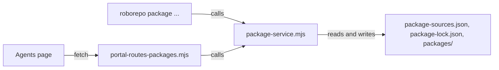

# Package Management: Part 04b - Manage Package Sources and Installs in the Portal

## Summary

Package Management Part 04 (jdsobwn) lets RoboRepo get packages from GitHub repos and local
folders, install them at a pinned commit, update them, and remove them. All of that is reachable
only from the command line today. A person who manages RoboRepo from the portal can see packages
and turn them on or off, but cannot add a source, install a package from one, update it, or remove
it.

This plan puts every one of those actions in the portal, on the Agents page, so a person never
needs the command line to manage where packages come from. The portal calls the same package
service the CLI calls, so both show the same state and refuse the same things. The plan ends with
one test pass that drives each action through the portal and through the CLI against the same
machine state, and checks that each surface sees what the other did.

## Context

### Terms

| Term | Meaning |
| --- | --- |
| **Source** | A place packages come from: the built-in library (`builtin`), the workspace (`local`), another local folder, or a public GitHub repo. Stored in `~/.roborepo/package-sources.json`. |
| **Install** | Recording a package as installed. A GitHub package is copied into the store at a pinned commit; a folder package is used in place. Install does not turn the package on. |
| **Enable** | Applying an installed package to the harnesses. The portal already does this with its toggles. |
| **Tab** | Where a package appears in the portal, derived from its source: **System** (built-in), **Custom** (local folders), **Third Party** (GitHub). |

### Current behavior

The package service in `scripts/cli/package-service.mjs` already provides every operation, and the
CLI in `scripts/cli/package-source-command.mjs` is a thin client over it:

| Action | Service call | CLI |
| --- | --- | --- |
| List sources | `listSources()`, `sourceInfo(id)` | `package source list`, `package source info` |
| Add a source | `addSource({ location, id })` | `package source add <github-url\|folder>` |
| Refresh a GitHub source | `refreshSources(id)` | `package source refresh` |
| Turn a source on or off | `setSourceEnabled(id, enabled)` | `package source enable\|disable` |
| Remove a source | `removeSource(id, { keepInstalled })` | `package source remove [--keep-installed]` |
| List the trusted catalog | `trustedCatalog()` | `package source trusted` (ships empty) |
| Preview, then install | `previewInstall(ref)` → `installPackage(ref, { confirmed, expectedPlan })` | `package install` |
| Update after confirming | `updatePackage(ref, { confirmed, expectedRevision, expectedFrom })` | `package update` |
| Remove | `removePackage(ref)` | `package remove` |
| Everything a screen shows | `packageView()`: rows with `tab`, `sourceBadge`, `installed`, `active`, `revision`, `updateAvailable`, `available`, `removable`, plus `unresolved`, `shadowed`, `collisions` | `package list` |

Refusals carry a code from `SERVICE_EXIT_CODES` (`confirmationRequired`, `ambiguous`,
`unavailable`, `refused`, `invalid`) that the CLI turns into its exit status.

The portal side:

- The Agents page (`portal/config/`) lists packages by category under "Available Agent Tools",
  with an on/off toggle each, through `/api/config` and `/api/config/packages` in
  `scripts/cli/portal-routes-config.mjs`.
- `scripts/cli/config.mjs` already passes each package's `tab` and `sourceBadge` to the page, but
  the page does not render either.
- No portal route calls the source, install, update, or remove operations.
- `npm run test:portal-ui` runs hermetic Playwright specs from `scripts/test/portal-ui/`.

### How this splits from Part 05

Package Management Part 05 (`user-managed-packages-and-add-workflows`) planned the System / Custom /
Third Party tab bar, source badges, the Remove button, and the GitHub add screen. Those are the
portal half of Part 04 and move to this plan. Part 05 keeps the typed add flows (`roborepo add
skill`, `add mcp`, and the rest), the Custom tab's add button that opens them, inspect and export,
and drift repair.

## Goals

- Every package-source action the CLI offers can be done on the Agents page.
- The portal shows the same state the CLI reports: which source a package came from, whether it is
  installed or on, its pinned commit, whether an update exists, and whether its source still
  offers it.
- An install or update in the portal shows what will change and asks first, and is bound to what
  the person saw, exactly as the CLI's confirmation is.
- An action taken in either surface shows in the other without restarting anything.

## Non-Goals

- Typed add flows for single skills, MCP servers, rules, or hooks. Part 05 owns them.
- Auditing third-party content before install. Audit Every Third-Party Package Before It Installs
  or Updates (4qzo8h0s) owns it; this plan leaves room in the install preview for its result.
- Entries in the trusted catalog. It ships empty by decision in Part 04; the portal shows an empty
  state until it has entries.
- A folder picker. The portal runs locally and takes a typed folder path, as the CLI does.
- New service behavior. A gap the screens expose is fixed in the service, shared with the CLI.

## Proposed Design

### Where it lives

- **Routes:** a new `scripts/cli/portal-routes-packages.mjs`, registered beside
  `portal-routes-config.mjs`. Each route parses the request, calls one service function, and maps a
  `PackageServiceError` code to an HTTP status and the service's message. No package logic lives in
  a route.
- **Page:** the Agents page gains the tab bar and a Sources panel. Dialogs reuse the page's existing
  dialog and busy-state patterns in `portal/config/panels.js` and `templates.js`.

### Routes

| Method and path | Service call |
| --- | --- |
| `GET /api/packages` | `packageView()` |
| `GET /api/packages/sources` | `listSources()` |
| `GET /api/packages/sources/:id` | `sourceInfo(id)` |
| `POST /api/packages/sources` `{ location, id? }` | `addSource()` |
| `POST /api/packages/sources/:id/refresh` | `refreshSources(id)` |
| `POST /api/packages/sources/:id/enabled` `{ enabled }` | `setSourceEnabled()` |
| `DELETE /api/packages/sources/:id?keepInstalled=1` | `removeSource()` |
| `GET /api/packages/trusted` | `trustedCatalog()` |
| `GET /api/packages/install-preview?ref=` | `previewInstall()` |
| `POST /api/packages/install` `{ ref, expectedPlan }` | `installPackage(ref, { confirmed: true, expectedPlan })` |
| `POST /api/packages/update` `{ ref }` | `updatePackage(ref)`: unconfirmed, it refuses with `confirmationRequired` and the change to show (`details.change`), as the CLI's prompt does |
| `POST /api/packages/update` `{ ref, confirmed: true, expectedRevision, expectedFrom }` | `updatePackage(ref, { confirmed: true, expectedRevision, expectedFrom })` |
| `DELETE /api/packages/:ref` | `removePackage()` |

A refusal returns the service code in the body. `confirmationRequired` with `planChanged` tells the
page to show the new preview and ask again, as the CLI re-prompts.

### Screens

**Tabs.** Packages on the Agents page split into System, Custom, and Third Party, with counts from
`packageView().tabs`. Categories still group packages inside each tab. Each Custom and Third Party
card shows its source badge (and **Trusted** when it applies), its pinned commit for GitHub
packages, and **Remove** when the row is `removable`.

**Card states.**

| Row state | Card shows |
| --- | --- |
| Available, not installed | **Install** |
| `installed`, not `active` | The existing on/off toggle, off |
| `updateAvailable` | **Update** beside the commit |
| `available: false` | "No longer offered by its source"; the copy keeps working |
| Listed in `unresolved` | "Can't be found", with the reason the service gives |
| Listed in `shadowed` | "Hidden by `<source>/<id>`" |

**Install dialog.** Opens from **Install**. Shows the source, the commit, and the contents grouped
by kind, from `previewInstall()`. An unverified source shows the same warning text the CLI prints.
Confirming sends the preview's plan; a changed plan replaces the dialog's contents and asks again.

**Update dialog.** Shows the current and new commit and the changed files. Confirming sends the
revision and starting point shown.

**Remove.** A confirmation that says what happens: the package is turned off first, the installed
copy is deleted for a GitHub package, and a Custom package's folder is never touched.

**Sources panel.** Lists every source with its type, tab, trust, and package counts. Each row offers
**Refresh** (GitHub sources), an on/off toggle, and **Remove**. Remove asks whether to keep
installed packages, matching `--keep-installed`, which the service allows only for GitHub
sources. `builtin` offers neither remove nor turning off, and `local` (the workspace) can be turned
off but not removed, matching what the service refuses.

**Add a source.** One dialog with a field that takes a GitHub URL or a folder path, an optional id,
and the trusted list below it (an empty state for now). A GitHub add refreshes the listing before
it returns, which can take up to two minutes; the button shows progress and the page stays usable.

### Required rules

- The portal never computes package state itself. Every screen reads `packageView()` or another
  service call, so it cannot disagree with `roborepo package list`.
- An install or update is sent only after the person confirms what the dialog showed, and carries
  the plan or revisions from that preview.
- Every refusal shows the service's own message. The portal adds no second wording.
- After any action, the page reloads its package and source data from the routes.

## Implementation Plan

- [ ] Add `scripts/cli/portal-routes-packages.mjs` with the routes above and the error-code mapping,
      and register it in the portal server.
- [ ] Add the System / Custom / Third Party tab bar, badges, and commit display to the Agents page.
- [ ] Add Install, Update, and Remove to cards, with the install and update dialogs.
- [ ] Show the `available: false`, unresolved, and shadowed states on cards.
- [ ] Add the Sources panel with refresh, on/off, and remove.
- [ ] Add the add-a-source dialog with the trusted list's empty state.
- [ ] Update Part 05 so it no longer lists the tab bar, badges, Remove, or the GitHub add screen.
- [ ] Add the checks below and update the docs of record.

## Validation

### Checks

| Check | Proves |
| --- | --- |
| `scripts/test/portal-package-routes-check.mjs` (new) | Each route returns the service's result, and each service code maps to its HTTP status and message. Runs against a temp state root with a `file://` Git fixture. |
| `scripts/test/portal-ui/package-sources.spec.mjs` (new, Playwright) | A person can add a folder and a GitHub source, install with the preview, turn the package on, update after a new commit, remove it, and remove the sources, using roles and visible text. |
| The same spec, interleaved with CLI calls | The two surfaces agree on one state root: a step done with `roborepo package ...` shows on the page after reload, and a step done on the page shows in `roborepo package list --json`. |
| Existing package checks (`package-*-check.mjs`) | The service the routes call is unchanged in behavior. |

The parity scenario follows the lifecycle the Part 04 smoke test ran: folder and GitHub sources,
install refused without confirmation, confirmed install, enable, new upstream commit, refresh,
update, remove, and source removal. It alternates which surface performs each step.

### Acceptance criteria

- [ ] Every row of the Current behavior table has a portal control that performs it.
- [ ] Each card state in the Card states table renders from `packageView()` data.
- [ ] Install and update in the portal refuse a changed plan and show the new one.
- [ ] Removing a Custom package leaves its folder untouched; removing a GitHub package deletes its
      copy.
- [ ] The interleaved CLI and portal scenario passes.
- [ ] A refusal in the portal shows the same message the CLI prints for the same case.

## Risks

| Risk | Mitigation |
| --- | --- |
| A GitHub add or refresh blocks a request for up to two minutes | The service's 120-second Git timeout bounds it; the dialog shows progress, and the package lock serializes a concurrent CLI call |
| The page shows stale state after a CLI change | The page reloads data after each action and on focus; the parity check covers a CLI change seen in the portal |
| The Agents page grows crowded | Tabs split the list; the Sources panel sits in its own section |

## Open Questions

- **Sources panel placement:** a section on the Agents page, or a tab beside System, Custom, and
  Third Party. Recommendation: a section below the package tabs, so tabs stay about packages.

## Documentation impact

| Doc | Update |
| --- | --- |
| `docs/user/reference/config-control-panel.md` | The tabs, card states, dialogs, and the Sources panel |
| `docs/internal/config-panel-internals.md` | How the Agents page loads package and source data |
| `docs/internal/portal-architecture.md` | The `/api/packages` routes and their module |
| `docs/internal/package-sources.md` | The portal as a second client of the service, beside the CLI |
