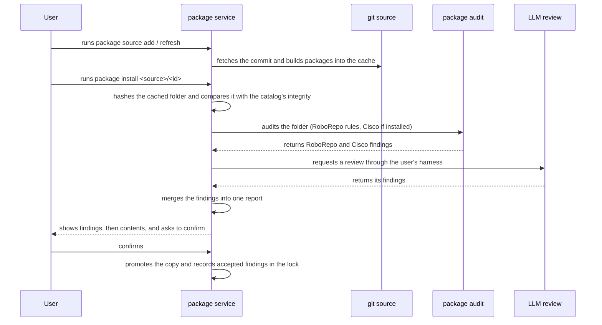

# Audit Every Third-Party Package Before It Installs or Updates

## Summary

A package from a public GitHub repo can put skills, hooks, scripts, and settings changes into the
user's harnesses. With package sources (Part 04, in review), RoboRepo lists what such a package
contains and asks for confirmation, but it does not look inside the files. It also has a "Trusted"
tier: a list of vetted repos that may skip the confirmation. That list ships empty and goes stale
as soon as a repo changes.

This plan replaces vouching with auditing. Every third-party package is audited before it installs,
and again before it updates, with a comparison of what the update adds. The Trusted tier is
removed, so every third-party install and update asks for confirmation with the audit results shown
first. The audit has three layers:

| Layer | What it is | Always runs? | Needs network |
| --- | --- | --- | --- |
| RoboRepo checks | Built-in, dependency-free rules for RoboRepo's package shapes | Yes | No |
| Cisco skill-scanner | An open-source scanner for Agent Skills, used when the user has it installed | When installed | No (static engines) |
| LLM review | The user's own harness, run headless with tools disabled, judging intent | First install; updates that add capabilities or new findings; any update on request | Yes |

## Context

### What a third-party package is today

Package Management Part 04 (jdsobwn, in review on branch `packages-multi-source-distribution`)
adds package sources. A `git` source is a public GitHub repo, fetched at one commit:

- **Refresh** (`refreshGitSource` in `scripts/cli/package-source-git.mjs`) fetches the commit, builds
  RoboRepo-shaped package folders into the cache, and records each package's `contents` (from
  `contentsSummary`) and `integrity` (a content hash) in `catalogs/<source>.json`.
- **Install** (`previewInstall`, `installPackage`, `installOne` in `scripts/cli/package-service.mjs`)
  shows the contents summary, requires confirmation when any package in the plan has
  `trust: "unverified"`, verifies the copy against the recorded integrity, and writes a lock record.
- **Update** (`updatePackage`) refreshes to the newest commit, computes the files added, removed, and
  changed (`treeDiff`), and always requires confirmation.
- **Trust tiers:** a git source is `trusted` when its URL is in
  `manifests/inventory/trusted-package-sources.json` and `unverified` otherwise. A trusted source is
  pinned to the catalog's reviewed commit, installs without confirmation, carries a ` · Trusted`
  badge, and refuses an update to any other commit. The catalog ships with `"entries": []`.

What the contents summary covers: skills, slash commands, rules, hooks, MCP servers, config changes
(each as `<harness>: <op> <setting.path>`), runtime assets, services, script files (by extension or
executable bit), requirements, and plugin files that are not installed. A repo containing a symbolic
link is refused. Nothing reads what a script or a SKILL.md actually says.

### Why a vetted list is not enough

- A vouch describes one commit. Each update of the list needs a fresh human review, and today the
  list reaches users only through a RoboRepo release.
- Scanner knowledge improves after a commit is vetted; a vouch made before a technique was known
  stays green.
- No curator RoboRepo could lean on vets security. Anthropic's plugin security docs
  (code.claude.com/docs/en/plugins/security) say it does not review third-party marketplaces, and
  the READMEs of `anthropics/skills`, `cloudflare/skills`, and `mattpocock/skills` (read 2026-11-24)
  describe no review, scanning, or signing.
- Scanners alone are not a gate either. Trail of Bits ("The sorry state of skill distribution",
  2026-06-03) bypassed Cisco skill-scanner and the skills.sh auditors with techniques such as huge
  whitespace padding and precompiled bytecode. So the audit informs the user's confirmation; the
  commit pin and the confirmation remain the gate.

### Existing tools this plan reuses

| Tool | Role here | Why |
| --- | --- | --- |
| Cisco skill-scanner (`cisco-ai-skill-scanner`, Apache-2.0) | Optional second layer | Built for SKILL.md packages; its static, pattern and dataflow engines run offline; emits SARIF (the standard JSON format for static-analysis results) |
| The harness's headless mode (`extensions.app.headlessPromptArgs` in `globals/harnesses/*/provider.json`, run by `runDeepRead` in `scripts/cli/telemetry.mjs`) | Pattern for the LLM review runner | Already selects an enabled harness with a runnable executable and degrades to a note when none exists |

## Goals

- Every third-party package is audited before it installs and before it updates, whatever repo it
  comes from.
- The confirmation prompt leads with what the audit found, then what the package (or the update)
  adds to the user's harnesses.
- The deterministic audit runs offline and needs nothing beyond RoboRepo itself.
- A user who has Cisco skill-scanner gets its findings folded into the same report, with no setup.
- A first install gets an LLM review through the user's own harness when one is available; the
  install proceeds with a note when it is not.
- `doctor --installed` reports findings in installed packages that the user has not accepted, such as
  ones a newer RoboRepo rule now catches.
- The Trusted tier and its catalog are gone.

## Non-goals

- Online sources: skills.sh audit lookups, OpenSSF Scorecard, GitHub commit-signature checks. A later
  plan covers them.
- Auditing `builtin` or `path` (local folder) sources. Their content is RoboRepo's own or the
  user's.
- The portal install flow. The portal does not install packages yet; the add workflows plan
  (user-managed-packages-and-add-workflows) builds that screen and consumes this plan's preview data.
- Making Cisco skill-scanner a required dependency, or installing it for the user.
- Blocking an install on an LLM verdict. The review advises; it never refuses on its own.
- Snyk Agent Scan. It sends package content to Snyk's API and needs a Snyk account.

## Proposed design

### Concepts

| Term | Meaning |
| --- | --- |
| **Audit report** | The result of auditing one package folder: the engines that ran or were skipped, and a list of findings. Computed when needed, never stored |
| **Finding** | `{ engine, rule, severity, file, line, message }`. Severity is `info`, `low`, `medium`, `high`, or `critical`; `llm-review` findings stop at `high`, so the review can never trigger a refusal |
| **Engine** | One audit layer: `roborepo`, `cisco-skill-scanner`, or `llm-review` |
| **Finding fingerprint** | `engine:rule:file`, without line numbers so an unrelated edit does not make an old finding look new. `rule` always comes from a fixed list (see LLM review), never free text |
| **Accepted findings** | The fingerprints of the findings present when the user confirmed an install or update (shown before the prompt, or printed with the result under `--yes`), kept in a new `acceptedFindings` array on the package's lock record. It is separate from the lock's existing `fingerprint` field, which is a live package's content hash |
| **Capability delta** | What an update adds compared with the installed copy: new hooks, config changes, MCP servers, scripts, runtime assets, and services (from the two contents summaries), plus RoboRepo and Cisco findings at `medium` or above whose fingerprints are not accepted. It is computed before the LLM review runs |

### Happy path: first install

1. Refresh is unchanged: it builds packages into the cache and records their `integrity`.
2. `previewInstall` hashes each planned git package's cached folder and compares it with the
   catalog's `integrity`, so the audit describes exactly what will be installed. Today that check
   runs only when the copy is promoted (`promoteMaterialized` in
   `scripts/cli/package-install-store.mjs`); running it at preview is new. A mismatch refuses
   with `invalid` (exit 7) and the advice to refresh the source; nothing is audited or installed.
3. `previewInstall` audits each folder with the RoboRepo rules and, when present, Cisco
   skill-scanner. These are cheap and offline, so nothing is stored; install and update run them
   again.
4. For a package with no lock record from that source (never installed, or removed since),
   `previewInstall` runs the LLM review and
   caches the verdict beside the cached package, keyed by integrity and scope, so `installPackage`
   reuses it instead of running a second review. The scope is `full` for an install, or the
   installed copy's integrity for an update's changed-files review, so a partial review is never
   reused as a full one.
5. The CLI prints the prompt (see Prompt order) and asks for confirmation.
6. `installPackage` requires confirmation for every git package and records the fingerprints of the
   findings shown as accepted in the lock record.

### Happy path: update

1. `updatePackage` refreshes, checks the new revision's cached folder against its `integrity`
   before auditing it (today that check runs only after confirmation, in `promoteMaterialized`;
   a mismatch refuses the same way as at preview), and audits it with the RoboRepo rules and Cisco skill-scanner.
2. It computes the capability delta between the installed copy and the new revision. RoboRepo and
   Cisco findings at `medium` or above count as new when their fingerprints are not accepted in the
   lock record; lower findings are listed but never count as new.
3. When the delta is not empty, the LLM review runs on the changed files (see When the LLM review
   runs).
4. The CLI prints the prompt (see Prompt order). Confirming replaces the accepted fingerprints with
   the new revision's.

The CLI calls `updatePackage` twice, first to show the change and then with `confirmed` and
`expectedRevision`; it passes `--review` and `--allow-critical` to both calls. With `--yes` it makes
one confirmed call, as today, and prints the findings and delta with the result.

### When the LLM review runs

| Situation | Review | Scope |
| --- | --- | --- |
| Install of a package with no lock record from that source, including a reinstall after `package remove` | Runs, or reuses a cached verdict for the same revision | Every file in the package |
| `package install` of a package already installed from that source | Does not run; install does not move the pin (unchanged) | — |
| Update with a non-empty capability delta | Runs | Changed files only |
| Update with an empty delta | Runs only with `--review` | Changed files only |
| Second call for the same package, revision, and scope (install after preview, the confirmed update call) | Reuses the cached verdict | Same as the first call |
| No harness with a review template, no network, timeout, or unparseable output | Recorded as skipped or failed, with the reason, in the prompt; never blocks | — |

### Confirmation policy

| Situation | Result |
| --- | --- |
| Any git package without a critical finding, or with one and `--allow-critical` | Confirmation required (as `unverified` is today), with findings in Prompt order. Without confirmation: `confirmationRequired` (exit 4) |
| A `critical` finding without `--allow-critical` | Refused: `refused` (exit 6), with the report in the error details, before any confirmation is asked |
| `builtin` or `path` package | Unchanged: no audit, no confirmation |

`package install` takes `--allow-critical`; `package update` takes `--allow-critical` and
`--review`. Install has no `--review`, because a first install always gets the review.

The policy applies the same way to `package install` and `package update`. On update it judges
every finding in the new revision, not only the new ones: an accepted critical finding still needs
`--allow-critical` each time. `--yes` confirms but does not override a critical finding, in an
interactive or a non-interactive run.

### Prompt order

Install and update print the same layout, so a finding appears in exactly one place:

1. RoboRepo and Cisco findings at `critical` and `high`. On update, each is marked **new** or
   **accepted**.
2. What the package adds: the contents summary on install, the added capabilities (hooks, config
   changes, MCP servers, scripts, runtime assets, services) on update.
3. RoboRepo and Cisco findings at `medium` and lower. On update, `medium` findings are marked the
   same way; `low` and `info` findings carry no mark, since they never count as new.
4. Engine status: which engines ran, which were skipped and why, and the Cisco skill-scanner install
   suggestion when it is absent. Then the LLM review's findings, whatever their severity.
5. On update, the file change list that exists today.

The capability delta's findings decide whether the update review runs; they are printed in
sections 1 and 3, not repeated in section 2.

### RoboRepo checks (deterministic)

Rules are a data table in the audit module. Each rule names the files it applies to, a pattern or
check, a severity, and a message.

| Area | Examples | Severity starting point |
| --- | --- | --- |
| Download and run | `curl … \| sh`, `wget … \| bash`, `base64 -d \| sh`, `eval` of fetched text | critical |
| Sensitive writes | Writes to `~/.ssh`, shell startup files, harness settings files, `~/.roborepo` | high |
| Secrets access | Reads of token-like environment variables or credential files combined with a network call in the same file | high |
| Network and exec | `child_process`, `subprocess`, `fetch`/`requests`/`http`, `nc`, `socat` in scripts and hooks | medium |
| Hidden text in Markdown | Bidirectional, zero-width, and Unicode tag characters; HTML comments; runs of blank lines or whitespace far beyond normal | high |
| Instructions in Markdown | Telling the agent to run a downloaded command, change a package registry, disable a safety setting, or skip confirmation | high |
| Opaque files | Compiled bytecode (`.pyc`), native executables, archives | high |
| Permissions | A config change that writes a permission allow list, or adds a hook or MCP server | medium (also shown in the contents summary) |
| Secrets in files | High-confidence secret patterns (private key headers, provider token prefixes) | medium |

Severity starting points are tuned during implementation against real repos; the table records the
intent, not final values.

The audit covers the whole built package folder, including the plugin `hooks/` and `commands/`
copies kept under `plugin/`. They are not installed, but a skill can tell the agent to run them.

### Cisco skill-scanner (optional)

- Detected by looking for its executable on `PATH`. RoboRepo never installs it, so it does not
  fall back to `uvx`, which would download the scanner.
- Run with only its offline engines, on the built package folder, with SARIF output parsed into
  findings tagged `cisco-skill-scanner`.
- Absent, failing, or timing out: the report records the engine as skipped with the reason, and the
  install continues.
- **Suggesting it.** When it is absent, the prompt's engine status line names it as skipped and
  gives the one command that installs it, with a short reason ("adds malicious-code checks RoboRepo
  does not do"). `doctor --installed` gives the same suggestion as a hint, only while at least one
  git package is installed. RoboRepo shows the command and never runs it: the scanner is a Python
  tool the user installs themselves.

### LLM review

- Runs through the first enabled harness that defines a review template and has a runnable
  executable, following the `runDeepRead` selection pattern.
- A new provider manifest field, `extensions.app.headlessReviewArgs`, holds that template. It is
  separate from `headlessPromptArgs` because the reviewer must run with tools disabled or read-only:
  the content under review may be written to hijack the agent reading it. The harness contract
  validates it the same way as `headlessPromptArgs`.
- The prompt passes file contents as delimited data and asks for JSON findings in a fixed shape.
  Each finding's `rule` must be one of a fixed list (`exfiltration`, `privilege-escalation`,
  `safety-bypass`, `hidden-instructions`, `remote-code`, `other`), so fingerprints stay stable
  between reviews. A severity above `high` is recorded as `high`. Output that does not parse, or
  names another rule, is recorded as a failed review, never as a clean one.
- Content beyond a fixed size cap is listed in the report as not reviewed.
- When it runs, and what happens when it cannot, is in When the LLM review runs.

### Re-auditing installed packages

`doctor --installed` runs the RoboRepo rules over each installed git package and reports findings
whose fingerprints are not accepted: `critical` as a failure, `high` and `medium` as hints, and
lower ones not at all. A finding appears
there only when a newer RoboRepo rule catches something the user never saw. Cisco skill-scanner and
the LLM review do not run there.

A git package installed before this plan has no `acceptedFindings`. Doctor reports one hint per
such package, "installed before audits", with its finding counts, instead of one line per finding,
and never a failure. Its next update records accepted findings.

### Removing the Trusted tier

| Remove | Where |
| --- | --- |
| The trusted catalog file and `readTrustedCatalog`, `trustedEntryFor`, `TRUSTED_CATALOG_PATH` | `manifests/inventory/trusted-package-sources.json`, `scripts/cli/package-source-git.mjs` |
| `roborepo package source trusted` and its command definition | `scripts/cli/package-source-command.mjs`, `manifests/platform/cli/command-definitions/package/source-trusted.command.json` |
| `trustedCatalog()`, the trust lookup and `trusted` result in `addSource`, and the update refusal for a non-reviewed commit | `scripts/cli/package-service.mjs` |
| The pinned-commit refresh for trusted sources and the `trusted-catalog` selector | `scripts/cli/package-source-git.mjs` (`refreshGitSource`, the adapter's `resolve`) |
| `trusted` in `TRUST_LEVELS` and in the git-source trust check | `scripts/cli/package-sources.mjs` |
| The "not in RoboRepo's trusted catalog" message after `source add` | `scripts/cli/package-source-command.mjs` |
| The ` · Trusted` badge and `[trusted]` marker | `scripts/cli/package-service.mjs` (`sourceBadge`), `scripts/cli/packages.mjs` |

Git sources keep `trust: "unverified"`, so lock records and source files need no migration. No
source or lock record can hold `trusted` yet, because the trusted catalog ships empty and Part 04
has not merged, so `trusted` is simply removed from the allowed values.

### Where the code goes

| Module | Owns |
| --- | --- |
| `scripts/cli/package-audit.mjs` (new) | The report shape, the RoboRepo rules table, `auditPackage` (RoboRepo rules, then Cisco skill-scanner when present), fingerprints, the capability delta. It does not call the LLM review |
| `scripts/cli/package-audit-cisco.mjs` (new) | Finding and running Cisco skill-scanner, and turning its SARIF into findings |
| `scripts/cli/package-audit-review.mjs` (new) | Picking the harness, building the review prompt, parsing the JSON verdict, caching it by integrity and scope |
| `scripts/cli/package-service.mjs` | Verifies integrity at preview and update, calls `auditPackage`, decides whether the LLM review runs (When the LLM review runs) and merges its findings into the report, applies the confirmation policy, records accepted fingerprints |
| `scripts/cli/package-source-command.mjs` | Prints findings and the delta, and adds `--allow-critical` and `--review` |
| `manifests/platform/cli/command-definitions/package/install.command.json`, `update.command.json` | `--allow-critical` in both usages; `--review` in update only |
| `scripts/cli/package-provenance-doctor.mjs` | Unaccepted findings in installed packages |
| `scripts/cli/package-lock.mjs` | `acceptedFindings` in `validateLockRecord`, which today keeps only a fixed set of fields |
| `scripts/cli/package-install-store.mjs` | Passing `acceptedFindings` through `promoteMaterialized` into the lock record |

The Cisco adapter and the LLM review are separate modules because each runs an outside process and
is tested with its own fake executable. The rules stay inside `package-audit.mjs` because they
change together with the report shape.

## Implementation plan

- [ ] Add `scripts/cli/package-audit.mjs` with the report shape, the rules table, fingerprints, and
      `auditPackage(dir)`.
- [ ] Verify the cached folder's integrity in `previewInstall` and audit each planned git package.
- [ ] Add the confirmation policy to `previewInstall`, `installPackage`, and `updatePackage`: every
      git package needs confirmation, and a critical finding needs `allowCritical`.
- [ ] Check the new revision's integrity in `updatePackage` before auditing it.
- [ ] Add `acceptedFindings` to lock records (`validateLockRecord`, `promoteMaterialized`) and
      write it on install and update.
- [ ] Add the capability delta to `updatePackage` and to its `confirmationRequired` details.
- [ ] Add `scripts/cli/package-audit-cisco.mjs` and run it when the executable is present.
- [ ] Add `extensions.app.headlessReviewArgs` to the provider manifest schema and contract, and to the
      Claude and Codex provider manifests with flags that disable tools.
- [ ] Add `scripts/cli/package-audit-review.mjs`; run it on first install, and on update when the
      delta is not empty or `--review` is passed.
- [ ] Print findings, delta, and review status in `package install` and `package update`; add
      `--allow-critical` to both commands and `--review` to `package update`, with their command
      definitions.
- [ ] Report unaccepted findings in `doctor --installed`, and the "installed before audits" hint.
- [ ] Remove the Trusted tier (see Removing the Trusted tier).
- [ ] Update the docs listed under Documentation impact.

## Validation

### Success criteria

- Installing a git package with no critical finding, without confirmation, exits with
  `confirmationRequired`, and the error details include the audit report.
- A package containing `curl … | sh` in a script is refused (exit 6) without `--allow-critical`, and
  installs with it after confirmation. An update to a revision with that script is refused the same
  way.
- A SKILL.md with zero-width or bidirectional characters, or with a long run of blank lines before
  hidden instructions, produces a `high` finding.
- An update that adds a hook shows that hook in the capability delta and triggers the LLM review;
  an update with an empty delta runs the review only with `--review`.
- Previewing and then installing the same package runs the LLM review once; so do the two
  `updatePackage` calls of one `package update --review`.
- A git package installed without `acceptedFindings` gets one "installed before audits" hint from
  `doctor --installed`, not a failure.
- With no harness available, install still completes after confirmation and the prompt says the LLM
  review was skipped and why.
- `package update --yes` prints the findings and capability delta with its result.
- Install and update output follows Prompt order: `critical` and `high` findings, then what the
  package adds, then `medium` and lower, then the LLM review, then (on update) the file list; on
  update each RoboRepo or Cisco finding at `medium` or above is marked **new** or **accepted**,
  and LLM findings appear only in the review section.
- Running `package install` on a package already installed from that source runs no LLM review.
- With Cisco skill-scanner absent, the report lists it as skipped and the prompt and
  `doctor --installed` show the command that installs it; with a fake scanner present, its
  SARIF findings appear tagged with its engine.
- After a new rule is added that matches an installed package, `doctor --installed` reports that
  finding; a finding accepted at install is not reported.
- No code path, command, or doc mentions the trusted catalog.

### Tests

| Check | Covers |
| --- | --- |
| `scripts/test/package-audit-check.mjs` (new) | Each rule fires on a positive fixture and stays quiet on a near-miss; Unicode and padding cases; fingerprints; capability delta; content over the review size cap is listed as not reviewed; a new `low` finding leaves the capability delta empty; Cisco adapter with a fake executable that prints a SARIF fixture and asserts it was asked for offline engines only, plus absent (no `uvx` fallback, install suggestion shown), failing, and timeout cases; LLM review with a fake harness (the pattern in `scripts/test/telemetry-synthetic-provider-check.mjs`, which uses `node` as the provider executable) for valid JSON, invalid output, JSON naming a rule outside the fixed list, a `critical` severity recorded as `high` (and not refusing the install), and timeout |
| `scripts/test/package-source-git-check.mjs` | Confirmation policy on install and update, `--allow-critical`, integrity mismatch at preview and update refused with exit 7, an update re-confirming a package whose critical finding was already accepted still needs `--allow-critical`, `low` findings printed without a mark, a pre-audit install gains `acceptedFindings` on its next update, a `path` package installs with no audit and no confirmation, accepted fingerprints in the lock, update delta; review runs on a non-empty delta, runs with `--review` on an empty one, and runs once across preview and install and across the two update calls (fake harness that counts calls); a cached update review is not reused for a full install; install with no harness completes and reports the review skipped; `--yes` update prints findings with the result; `--yes` without `--allow-critical` is refused on a critical finding; a reinstall after `package remove` runs the review again; `package install` of an already-installed package runs no review; printed output follows Prompt order, with new and accepted marks on update; a source record with `trust: "trusted"` is rejected; trusted-catalog cases removed |
| `git grep -n -i "trusted" -- 'scripts/cli/package*' scripts/cli/packages.mjs docs/internal/package-sources.md docs/internal/cli-internals.md docs/user/reference/roborepo-cli.md docs/user/reference/config-control-panel.md docs/architecture/config-code-separation.md local/skills/roborepo-development/references/package-development.md manifests/inventory manifests/platform/cli/command-definitions/package` | Run once before review. Every Trusted-tier name on the removal list matches this search, so any hit left must be an unrelated use of the word, checked by hand |
| `scripts/test/package-provenance-check.mjs` | `doctor --installed` suggests installing Cisco skill-scanner only while a git package is installed; reports an unaccepted `critical` finding as a failure and `high` or `medium` as a hint, stays quiet on `low` and on an accepted finding, and gives a hint (not a failure) for a record without `acceptedFindings`; the lock keeps `acceptedFindings` through a read and write |
| `scripts/test/harness-registry-check.mjs` | `headlessReviewArgs` validation |

These touch the package install and update flows and the provider manifest contract, so the tests
for those flows run locally and CI runs the full gate (`npm run check`).

## Risks

| Risk | Mitigation |
| --- | --- |
| Rules flag ordinary scripts and users learn to click through | Start conservative on `critical`; tune severities against real skill repos before shipping; on update, findings already accepted are marked as such, so the new ones stand out |
| The LLM reviewer is hijacked by the content it reads | Tools disabled through `headlessReviewArgs`; content passed as delimited data; verdict parsed from fixed JSON; review never blocks or clears on its own |
| A scanner bypass makes a malicious package look clean | The confirmation stays mandatory for every third-party package; the audit informs it |
| LLM review adds latency and token cost to first install | Runs once per package revision and scope, cached by integrity and scope; on update only when the capability delta is not empty or on request |
| Cisco skill-scanner changes its output format | Parse SARIF only; an unparseable run is recorded as skipped |

## Open questions

- **Reviewer flags per harness.** Which Claude and Codex flags run headless with tools disabled or
  read-only? These must be confirmed against each CLI's current help during `/plan-promote`, not
  assumed.

- **The scanner's install command.** The research found the PyPI package `cisco-ai-skill-scanner`.
  Confirm the package name, the executable name RoboRepo looks for on `PATH`, and the command to
  suggest (`uv tool install` or `pipx install`) against its current README during `/plan-promote`.

## Related plans

- **Package Management Part 04 (jdsobwn)** introduced the trusted catalog this plan removes. It is a
  prerequisite because the git source and install store must merge first.
- **Package Management Part 06 (f5exs0bd)** has a task to serve the trusted catalog from the registry.
  That task becomes obsolete and should be removed when this plan is promoted.
- **User-managed packages and add workflows** describes a "Browse trusted" path and a Trusted
  badge in the portal add screen. Those parts need revising to show audit results instead.

## Documentation impact

| Doc | Update |
| --- | --- |
| `docs/internal/package-sources.md` | Remove the trusted tier; add an Audit section (engines, report, policy, accepted findings, doctor) and the new code map rows |
| `docs/internal/cli-internals.md` | Remove the `trusted` subcommand from the `package source` list |
| `docs/architecture/config-code-separation.md` | Replace the trusted catalog mention with the audit |
| `local/skills/roborepo-development/references/package-development.md` | Remove `trusted` from the `package source` subcommand list |
| `docs/user/reference/roborepo-cli.md` | Remove `package source trusted`; add `--allow-critical` and `--review`; describe the audit output and the optional Cisco skill-scanner |
| `docs/user/reference/config-control-panel.md` | Remove the ` · Trusted` badge |
| `docs/internal/harness-provider-interface.md` | Document `extensions.app.headlessReviewArgs` |
| `manifests/inventory/README.md` | Remove the `trusted-package-sources.json` row |
