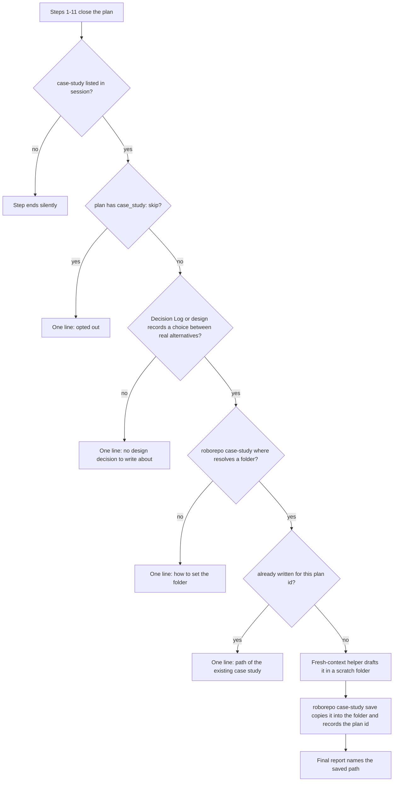

# Closing a plan writes its case study to a folder you chose once

## Summary

When a user has the case-study skill turned on, `/plan-close` ends by writing a case study about
the closed plan's main design decision. It saves the case study into a folder the user set up
once, then reports where it went. A new `roborepo case-study` command stores that folder per user,
with an optional per-repo override, and is the only writer into it. The step never blocks or
undoes a close, and it never commits in the destination repo.

## Context

A case study is a long-form article about one design decision: the problem, what it forced, how it
was built, what it still lacks, and the alternatives. The `case-study` skill
(`globals/packages/case-study-pack/skills/case-study/SKILL.md`, package `case-study-pack`,
optional) writes one on request.

Today a case study about delivered work needs a person three times. They ask for it, they name the
destination folder each time, and they approve the write, because the destination is usually
another repo and writing outside the working folder prompts. The owner keeps case studies in a
separate notes repo, one folder per source repo. The goal is fewer steps that need a person,
without weakening the sandbox or validation.

## Goals

- A plan closed in a session where `case-study` is listed gets a case study, with no request.
- The destination folder is set once per user, and per repo only where the default does not fit.
- Writing the file raises no permission prompt and does not widen the sandbox.
- A missing setting, a skipped plan, or a failed write leaves the close intact and is reported in
  one line.

## Non-goals

- Committing or pushing in the destination repo.
- Writing case studies for plans closed before this ships. A sibling effort is writing that
  backlog by hand.
- Changing the case-study skill's article rules (arc, voice, validator loop).
- A portal page for the setting. The CLI is enough for one path per user.

## Current state

| Piece | Today |
| --- | --- |
| `/plan-close` (`globals/packages/plan-suite/skills/plan-close/SKILL.md`) | Eleven steps. Step 8 commits completion; step 9 stops the worktree's servers; step 10 removes the worktree; step 11 names dependent follow-up plans. Paired Skills lists three `requires` rows and no `recommends` row. |
| Skill availability | `globals/system/rules/shared/05-skill-loading.md`: load a `recommends` skill only when the session lists it; a listed-but-missing one is "named once in the final report". |
| User-level roborepo state | Files under `~/.roborepo/<area>/` (for example `~/.roborepo/plan-suite/settings.json`, now ignored by Plans). No case-study settings exist. |
| Per-repo plan config | `plans/plans-config.json` on the `repo-plans` branch. It is pushed and shared with everyone who clones the repo, so a personal home path does not belong in it. |
| Repo name | `roborepo plans validate --json` reports `repository.name` (here `roborepo`). |
| Sandbox | `scripts/harnesses/claude/sandbox-settings.mjs` lets Bash write only to the working folder and `CLAUDE_SANDBOX_WRITABLE_PATHS` (`~/.npm`, `~/.roborepo/scratch`). Commands that must write elsewhere are listed in `ROBOREPO_UNSANDBOXED_SUBCOMMANDS` and allowed by rules in `manifests/inventory/agent-permissions.json`, the way `roborepo plans save` reaches the plans store. |
| CLI commands | One JSON file per command under `manifests/platform/cli/command-definitions/`, pointing at a module export. |

## Proposed design

### Flow



### Decisions

| Decision | Choice |
| --- | --- |
| Where the step runs | New step 12, after the follow-up handoff. The close is already committed and the worktree removed; the helper reads the landed code from the primary checkout on the base branch and the plan from `completed/`. |
| Failure | Never blocks, never undoes the close. Any failure is one line in the final report with the reason. |
| "Skill turned on" | A `recommends` row for `case-study` in plan-close's Paired Skills. A session that does not list the skill skips the step **without** the usual "named once" line, so users who never turned it on see nothing. The row states this exception, and `05-skill-loading.md` gains one sentence allowing a row to mark itself silent. |
| Setting scope | Per user, in `~/.roborepo/case-study/settings.json`: a default `destination` with a `{repo}` placeholder, plus `repos.<repositoryId>` overrides for `destination` and `anonymize`. |
| `{repo}` | The repository name that `roborepo plans validate --json` reports. Folders that don't match (the owner's `pretty_good_universe`, `visa_planner`) use an override. |
| Nothing configured | Skip and print the exact `roborepo case-study config` command. Never guess a path. |
| Anonymize | Per-repo `anonymize`, default `true`. The skill's per-article question is answered from this value, so the step asks nothing. |
| Topic | The plan's main design decision, read from its Decision Log and design. The skill's candidate-list question is not asked. |
| Write path | Draft in `roborepo scratch case-study-<plan id>`, then `roborepo case-study save <plan id> <draft.md>`. Only that command writes into the destination. |
| Commit | None. The file is left uncommitted in the destination repo. |
| Which plans | Only plans whose Decision Log or design records a choice between real alternatives. |
| Opt out | Frontmatter `case_study: skip` on the plan. |
| Retries | A ledger records plan ids already written, so an already-closed retry writes a missing case study and never a second one. |
| Cost | The case study is written by a fresh-context helper (a subagent where the harness has one, inline otherwise), because its validator loop runs up to 10 passes. |

### The `roborepo case-study` command

```text
roborepo case-study config --destination <path-with-{repo}>            set the default
roborepo case-study config --repo <repositoryId> --destination <path>  set one repo's folder
roborepo case-study config --repo <repositoryId> --anonymize <true|false>
roborepo case-study where [--json]                                     resolve for the current repo
roborepo case-study save <plan id> <draft.md> [--json]                 copy into the folder
```

`settings.json`:

```json
{
  "schemaVersion": 1,
  "destination": "~/notes/content/posts/{repo}",
  "repos": {
    "git:github.com/<owner>/<repo>": { "destination": "~/notes/content/posts/<folder>", "anonymize": false }
  }
}
```

`save` rules:

- Resolves the destination itself from settings and the current repo; it takes no path argument
  for the target, so an agent cannot aim it elsewhere.
- Creates the destination folder if its parent exists; refuses otherwise.
- Names the file from the draft's H1 or `title` frontmatter, kebab-cased, as the case-study skill
  already specifies, and refuses to overwrite an existing file.
- Records `{ planId, repositoryId, path, savedAt }` in `~/.roborepo/case-study/written.json`.
- Runs outside the sandbox: it joins `ROBOREPO_UNSANDBOXED_SUBCOMMANDS`, and
  `agent-permissions.json` gets an allow rule for `roborepo case-study save` and
  `roborepo case-study where`. `config` stays under the existing ask rules for config writes.

### Placement in code

| Code | Owns |
| --- | --- |
| `modules/case-study/` | Settings read and write, destination resolution, filename, save, ledger |
| `scripts/cli/case-study.mjs` | Argument parsing and output only, calling the module |
| `manifests/platform/cli/command-definitions/` | Three command definitions (`config`, `where`, `save`) |
| `globals/packages/plan-suite/skills/plan-close/SKILL.md` | Step 12, the `recommends` row, the opt-out field |
| `globals/packages/case-study-pack/skills/case-study/SKILL.md` | A short "Called from `/plan-close`" section: topic from the plan, anonymization from settings, save through the command, no questions |

## Implementation plan

- [ ] Add `modules/case-study/` with settings, resolve, save and ledger, and `scripts/cli/case-study.mjs` with the three command definitions.
- [ ] Add `case-study` to `ROBOREPO_UNSANDBOXED_SUBCOMMANDS` and the allow rules for `save` and `where` in `manifests/inventory/agent-permissions.json`; confirm the Codex route matches how `roborepo plans save` runs there.
- [ ] Add step 12 and the silent `recommends` row to plan-close `SKILL.md`; add the silent-row sentence to `globals/system/rules/shared/05-skill-loading.md`.
- [ ] Teach the plan validator and `roborepo plans save` to accept `case_study: skip` (check whether unknown frontmatter is kept today), and document it in plan-write's `references/plan-schema.md`.
- [ ] Add the "Called from `/plan-close`" section to the case-study skill.
- [ ] Add `scripts/test/case-study-command-check.mjs` and register it in `scripts/test/test-cli.sh`.
- [ ] Regenerate outputs (`roborepo update` path) and confirm the new allow rules appear in `generated/claude/settings.json`.

## Validation

`scripts/test/case-study-command-check.mjs`, against a temporary `ROBOREPO_STATE_ROOT` and a temporary destination:

- `where` with no settings exits non-zero and prints the `config` command.
- `{repo}` expands to the repository name; a `repos` override wins over it.
- `save` writes the file under the resolved folder, records the ledger entry, and refuses a second save for the same plan id and an existing filename.
- `save` refuses when the destination's parent does not exist.

Also:

- The plan-suite canonical and findings checks pass with a plan carrying `case_study: skip`.
- The generated Claude settings contain the allow rules and the unsandboxed entry.
- Skill content checks (`roborepo skill audit --check`) pass for the edited skills.

## Not tested

- [ ] A real `/plan-close` in a session with `case-study` listed writes a case study into the configured folder with no permission prompt. Needs a person: it needs an interactive close of a real merged plan and a judgment of the article.

## Documentation impact

| Doc | Update |
| --- | --- |
| `globals/packages/plan-suite/skills/plan-close/SKILL.md` | Step 12 and the Paired Skills row |
| `globals/packages/case-study-pack/skills/case-study/SKILL.md` | Called-from-plan-close section |
| `globals/packages/plan-suite/skills/plan-write/references/plan-schema.md` | `case_study: skip` frontmatter |
| `globals/system/rules/shared/05-skill-loading.md` | Silent `recommends` rows |
| CLI help | Generated from the command definitions; no hand-written reference doc lists `roborepo` subcommands |

## Risks

| Risk | Mitigation |
| --- | --- |
| Closes get longer and use more tokens for users who turned the skill on | Fresh-context helper; plans without a real design decision are skipped |
| An anonymized article still leaks a name | The skill's existing anonymization rules and any destination blacklist check still apply |
| Other plans edit plan-close at the same time | `kqgr1d65` changes only step 9's command (and says so), `d9ywaa8d` rewords step 6, `iz3vuxyi` edits the retry fallback, `0jped168` adds `/plan-close` eval scenarios whose fixture sessions are expected not to list `case-study` (unverified). None touch the new step; rebase on whichever lands first. |

## Decision Log

- 2026-11-25: The owner agreed the design in the table under Decisions: last step after cleanup, never blocking; `recommends` row as the on switch, skipped silently; per-user setting with `{repo}` and per-repo overrides, not `plans-config.json`; skip when unset; a single `roborepo case-study save` writer instead of widening the sandbox; no commit in the destination; only plans with a real design decision; `case_study: skip` to opt out; anonymize by default.

## Open questions

None.
