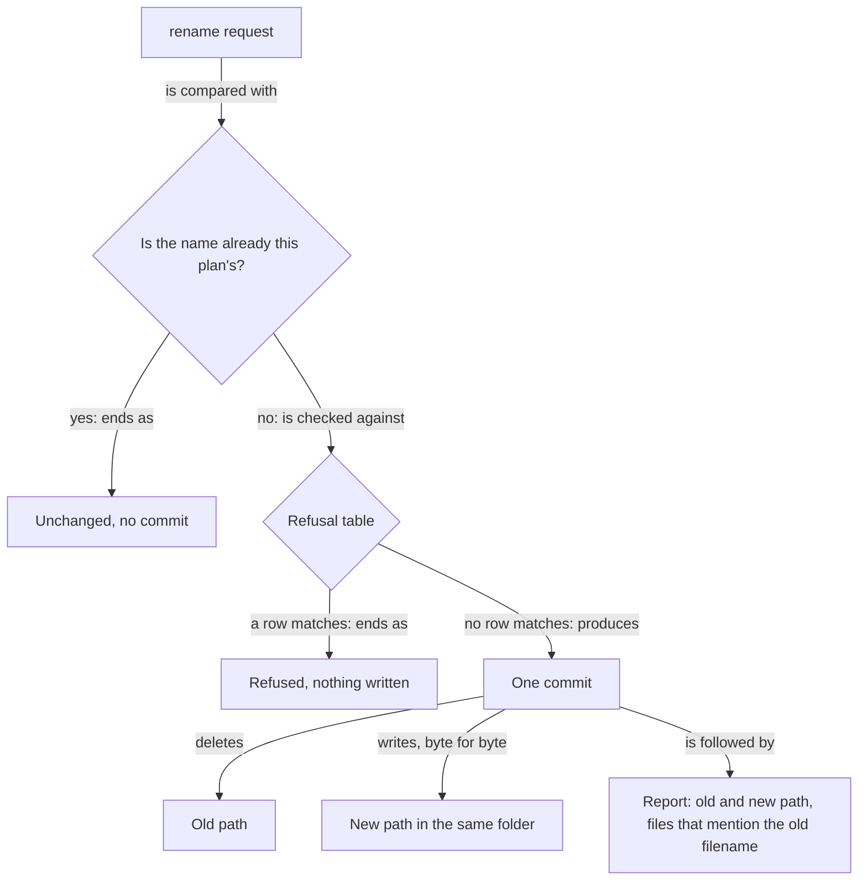

# A plan's filename can be changed with one command

## Summary

A plan's filename carries its namespace, the prefix that decides which group it is listed and
ordered under. Today nothing can change a filename once the plan is saved. The only way to fix a
wrong namespace or a poor name is to archive the plan and save a copy, which gives the work a new
id and leaves a duplicate in the archive.

This plan adds one command, `roborepo plans rename <plan> <new-name>`. It changes the filename in
one commit and keeps the plan's id, content, and lifecycle folder.

## Context

These terms are used throughout:

| Term | Meaning |
| --- | --- |
| Plan store | The `repo-plans` branch, where every plan lives under `plans/<lifecycle>/`. It changes only through `roborepo plans` commands, which validate, commit, and push |
| Store path | A plan's path inside the store, such as `plans/backlog/<name>.md` |
| Lifecycle | The folder a plan sits in: `backlog`, `ready`, `active`, `review`, `completed`, or `archived`. A plan in one of the first four is unfinished |
| Namespace | The approved prefix of a plan filename (`<namespace>-<slug>.md`). A repo declares its own in `plans/plans-config.json`. Once it declares at least one, a fixed set, such as `git` and `docs`, is allowed too; a repo that declares none has no namespaces |
| Order file | `plans/plans-order.json`: for each namespace, the ids of its Backlog plans in priority order. A plan listed there is ranked |
| Portal | RoboRepo's local web app. Its Plans page lists plans and lets a person drag Backlog plans into order; an unsaved reordering is an order draft |
| Finding | One problem reported by plan validation, with a stable code, a message, and a suggested resolution |
| Id | The opaque value in a plan's frontmatter that other plans and commands refer to. It never changes |
| Promote and start | The store moves behind `/plan-promote` (backlog to ready) and `/plan-execute` (ready to active) |
| Repair prompt | The text a refused move generates for an agent: the findings to fix, then a closing check, `roborepo plans validate`, to run before reporting done |
| Same-plan conflict | The store's refusal, coded `PLAN_STORE_CONFLICT`, of a change to a plan that another clone changed since this clone last synchronized |

The plan suite's own instructions already treat a rename as normal. The plan schema says a rename
"is a pure filename operation", and the validation instructions say a filename that breaks the
naming rules blocks `/plan-promote` and `/plan-execute` "until it is renamed". No command performs
the rename, and agents may not write to the plans worktree or run Git in it.

This was observed on 2026-11-24. A backlog plan saved under the `git` namespace belonged under
`agent-config`. Moving it took an archive of the first plan and a save of a copy. The work now has
two ids: another session had been given the first one and had to be told the second, and an
archived file remains that describes work nobody abandoned.

Two other plans are related. Neither is a prerequisite.

| Plan | Overlap |
| --- | --- |
| Small changes are delivered from a worktree, never from a branch in the main checkout (`0ubk9sug`) | The plan whose namespace change exposed the gap |
| Surface Plan Reference Integrity Where Plans Are Edited (`p3vbk03v`) | Proposes findings for broken document links in plans. Once built, it would flag a link that a rename leaves pointing at the old path |

## Goals

- One command changes the filename of an unfinished plan and keeps its id, its content, and its
  lifecycle folder.
- The new name is held to the naming rules that already gate `/plan-promote` and `/plan-execute`,
  plus one shape check that applies in every repo so the name is always a safe filename.
- The command reports the files in the store that still mention the old filename.

## Non-goals

- Deleting a plan. `roborepo plans archive` stays the only way to retire one.
- Renaming a completed or archived plan. Those are records, and their names predate the rules.
- Renaming a file that sits directly under `plans/`, outside every lifecycle folder.
- Rewriting links in other documents. The command reports them; a person or agent fixes them with
  `roborepo plans save`.
- Changing the H1 title, which `roborepo plans save` already does.
- Editing the order file. The existing handling of a plan that leaves a namespace applies.
- A rename action in the Plans page of the portal. The command comes first.

## Current state

| Need | Today | Source |
| --- | --- | --- |
| Change a plan's filename | Not possible: a save finds the plan by id and keeps its path | `existingPlanChange` in `modules/plan-suite/plan-writes.mjs` |
| Remove a plan | Only by archiving, which keeps the file | `modules/plan-suite/transition.mjs` |
| Delete one path and write another in one commit | Supported by every store write | `mutateStore` in `modules/plan-suite/plan-store.mjs` |
| Check a filename against the naming rules | `namingGateFindings`, used by promote and start | `modules/plan-suite/naming.mjs` |
| Refuse a filename another plan uses | `plans save` does, for a new plan | `planSaveChange` in `modules/plan-suite/plan-writes.mjs` |
| Find files that mention a string | `linksToPath`, used by lifecycle moves | `modules/plan-suite/plan-git.mjs` |
| Order entry of a plan that left a namespace | Ignored, then dropped | `proposeOrder` in `modules/plan-suite/backlog-order.mjs`; `orderWrite` in `modules/plan-suite/backlog-registry.mjs` |
| Two clones change one plan | The second change is refused | `modules/plan-suite/plan-store.mjs` |
| Advice when a filename breaks the rules | Three findings, none naming a command | `modules/plan-suite/findings.mjs` |
| Repair prompt for a refused promote or start | Validates by the plan's path | `modules/plan-suite/repair-prompt.mjs` |

Details behind the rows that the design depends on:

- **Naming check.** `namingGateFindings` also refuses when `plans/plans-config.json` cannot be read.
- **Link search.** Lifecycle moves pass `linksToPath` the plan's full old store path. A link
  between two plans in one folder holds only the filename, so that search does not find it.
- **Order entry.** An id whose plan left the namespace is ignored when the order is read, raises
  no finding, and is dropped by the next order save in that namespace.
- **Two clones.** The store compares changed paths by filename, on the stated ground that plans
  "keep their filename through lifecycle moves".
- **Advice.** The three findings are `INVALID_PLAN_FILENAME` ("Rename the file"),
  `UNKNOWN_PLAN_NAMESPACE`, and `FORBIDDEN_PLAN_FILENAME_SUFFIX` ("Drop the suffix"). Each blocks
  promote and start. `plans save` also returns them for a new file that is not in the store yet.

References kept in frontmatter and in the order file do not use the filename. Other plans refer
to a plan by id, the order file lists ids, and the frontmatter `worktree` value is Git's name for
the worktree, not the plan's name. The filename decides the plan's namespace, and Markdown links
between plans contain it. Beyond those two, the places found where it matters are:

- a command given a store path instead of an id;
- the `/plan-close` instructions, which tell an agent whose plan path no longer exists to look
  for the same filename in `completed/`. The `/plan-review` instructions offer the id or that
  filename;
- the two-clone check above;
- an order draft open in the portal, whose freshness check covers the filenames of the Backlog
  plans in its namespace;
- a portal page open on one plan, which the portal identifies by its path.

## Proposed design

### The command

```bash
roborepo plans rename <plan> <new-name> [--json]
```

`<plan>` is an id or a store path, as for every command that takes `<plan>`. `<new-name>` is a
bare filename, `<namespace>-<slug>`, with or without `.md`. It never names a folder.



### Refusals

| Condition | Result |
| --- | --- |
| The plan is not unfinished | Refused |
| `<new-name>`, without its optional `.md`, does not match `^[a-z0-9]+(-[a-z0-9]+)*$` | Refused, in every repo |
| `<new-name>` differs from the current filename only by letter case | Refused, with the way out |
| `plans/plans-config.json` cannot be read | Refused, as promote and start are |
| `<new-name>` breaks the naming rules for the plan's lifecycle | Refused, listing the findings from `namingGateFindings` |
| Another plan in any folder has that filename, compared without regard to letter case | Refused, naming that plan |

- A `<new-name>` equal to the plan's current filename is reported as unchanged, with exit 0 and no
  commit. That comparison is exact and comes before every row of the table, so it holds for any
  plan.
- The first row covers completed and archived plans, which keep their names, and files directly
  under `plans/`, which have no lifecycle folder.
- The shape check in the second row refuses a folder separator, an empty name, a leading hyphen,
  and capital letters. Where a repo declares no namespaces, the naming rules produce no findings
  at all, so the shape check is the only constraint on the name.
- A change of letter case alone is refused because the store cannot record it. On a filesystem
  that ignores case, the store's commit steps (remove the old file, write the new one, stage both
  paths) leave nothing staged. The way out is two renames: to a different name, then to the
  wanted one.

### What the commit changes

The commit touches the plan's old and new paths and nothing else. The content, including `id`, is
identical. The commit message is `Rename plan <old name> to <new name>`.

The order file is not edited. When a ranked Backlog plan changes namespace, its id stays in the old
namespace's list, where the existing code ignores it and later drops it (see Current state). In
the new namespace the plan has no saved position; the report says so and names
`roborepo plans order place <plan>`. One consequence is accepted: a plan renamed back before the
next order save in its old namespace regains its old position, and one renamed back after it does
not.

The report gives the id, the old and new paths, the lifecycle, the old and new namespace, the
files that still mention the old filename, and whether the commit reached the remote. Reporting
links instead of rewriting them matches what lifecycle moves do.

The search for mentions differs from the one lifecycle moves use in three ways:

- It looks for the filename, not the full path, so it finds a link between two plans in one folder.
- A match counts only when the character before the filename is not a letter, digit, or hyphen.
  Without that, renaming `foo-bar.md` to `cli-foo-bar.md` would report every correct new link.
- The renamed plan's own file is left out.

### Where the code goes

| Piece | Location | Reason |
| --- | --- | --- |
| `renamePlan`, the store operation | `modules/plan-suite/plan-writes.mjs`, beside `savePlan` | That module holds the named plan writes that are not lifecycle moves |
| The search for mentions of a filename | A function beside `linksToPath` in `modules/plan-suite/plan-git.mjs` | The existing search for mentions sits there; `linksToPath` stays as it is |
| Argument parsing and output | `plansRenameCommand` in `scripts/cli/plans-command.mjs`, plus a usage line | Where every other `plans` subcommand is parsed |
| Command definition | `manifests/platform/cli/command-definitions/internal/plans-rename.command.json` | Registered `plans` subcommands each have one; `internal`, like `plans save` |
| Agent permission | `rename` added to `plan-store-commands` in `manifests/inventory/agent-permissions.json` | That entry lists, one by one, the plan commands agents may run without a prompt |

`renamePlan` carries its own filename-in-use lookup. The lookup is one expression and its refusal
text differs from save's, so it is not shared with `planSaveChange`.

### Wording that names the command

`modules/plan-suite/findings.mjs`:

- The resolutions of the three naming findings name `roborepo plans rename` for a plan already in
  the store.
- Each resolution must also read correctly for a new file that `plans save` refused, where the
  fix is renaming the local file.

`modules/plan-suite/repair-prompt.mjs`:

- The closing check keeps validating by the plan's path, as today. Every prompt gains one
  sentence: a file renamed while fixing the findings is validated at its new path.
- The finding's own resolution line carries the rename command, so the prompt needs no branch.

`modules/plan-suite/backlog-registry.mjs`:

- `roborepo plans order place` refuses a plan whose filename has no approved namespace, and
  advises "Rename the file". That resolution names the command.
- The header table gains a row for a plan now in another namespace: ignored, then dropped.

`modules/plan-suite/plan-store.mjs`:

- The same-plan conflict resolution tells the reader to save again; reword it to fit a rename.
- Extend the comment on comparing by filename to say why it still holds across a rename: the
  rename's commit changes both the old and the new path, so both filenames are compared.

`globals/packages/plan-suite/skills/plan-write/SKILL.md`:

- A rename request is `/plan-write`'s work, done with the command, only when the user asks or a
  naming finding requires it.
- After a rename, later commands are given the plan's id, not its old path.
- The description gains the phrase "rename a plan".
- The rule "Change a plan only through `roborepo plans save`" is reworded to add the rename
  command for the filename. `scripts/test/plan-suite-skills-check.mjs` asserts that sentence and
  is updated with it.

`globals/packages/plan-suite/skills/plan-write/references/plan-schema.md` and
`workflow-validate.md`:

- "Plan store", "Naming", and the naming bullet of the validation instructions name the command
  and its limits.

`globals/packages/plan-suite/skills/plan-close/SKILL.md` and
`globals/packages/plan-suite/skills/plan-review/references/resume-review.md`:

- Where a supplied plan path no longer exists, the fallback looks the plan up by id before
  looking for the same filename in `completed/`, since the plan may have been renamed.

`globals/packages/plan-suite/skill-triggers.json`:

- `plan-write` gains the trigger phrase "rename a plan" and a match prompt that contains it.
- The trigger check requires a match prompt to contain a trigger phrase, and a trigger phrase to
  appear in the skill's description, which is why the description changes too.

### Edge cases

- **A session in the same clone holds an edited copy under the old filename.** Its next
  `roborepo plans save` finds the plan by id and writes to the new path. The existing test "an
  update under another filename" in `scripts/test/plan-store-check.mjs` covers that behavior.
- **A session in another clone holds an edited copy from before the rename.** When its save is
  that clone's first store command since the rename, the save is refused as a same-plan conflict
  (`PLAN_STORE_CONFLICT`), as after any change to the plan by another clone. It reads the plan
  again, reapplies its edit, and saves. When the clone has already run another store command,
  such as `roborepo plans show`, the save writes to the new path.
- **A clone saves a new plan under a filename a rename just freed.** When that save is the clone's
  first store command since the rename, it is refused once as a same-plan conflict, because the
  check compares filenames. A second attempt succeeds. This is accepted as rare; it is derived
  from reading the store code and is covered by a test case.
- **An active or review plan.** Allowed. The `worktree` value, the feature branch, and the recorded
  approval do not depend on the filename.
- **Another clone changed the same plan first.** The rename's commit changes the old path, so the
  store's existing check refuses it as a same-plan conflict (`PLAN_STORE_CONFLICT`), and
  nothing is lost.
- **The rename lands first, and another clone holds an unpushed commit to the plan.** That clone's
  next store write is refused as diverged (`PLAN_STORE_DIVERGED`), the store's existing refusal
  when a commit it could not push and a commit on the remote both changed one plan.
- **A session or prompt holds the old store path.** A command given that path reports the plan as
  not found. The id still works. The `/plan-close` fallback gains it, and the `/plan-review`
  fallback, which already names it, puts it first.
- **A rename's push loses a race with an unrelated change from another clone.** The store re-runs
  the rename on the fresh tree, as it does for every store write.
- **A Backlog plan is renamed while an order draft is open in the portal for its old or new
  namespace.** Saving the draft is refused as stale and the page must be reloaded, as after a
  Backlog plan is added to or removed from that namespace.
- **A page of the portal open on the plan.** The portal identifies a plan by its path, so the page
  must be reloaded, as after any lifecycle move.

### Alternatives considered

- **Let `roborepo plans save` rename a plan when the source file's name differs from the stored
  one.** No new command. Rejected: agents save from temporary copies, so a mistyped temporary
  filename would rename a plan silently. Today save keeps the stored path whatever the source
  file is called, and an existing test relies on that.
- **Remove the plan's id from the old namespace's order list in the same commit.** A tidier file.
  Rejected: it adds a second writer to the order file for an entry the existing code already
  ignores and drops.
- **Make the repair prompt's closing check validate by id.** The printed command would survive a
  rename. Rejected: an id cannot select a plan with no id or one whose id another plan shares, so
  the prompt would need a branch and a signal for each. One added sentence covers every case, at
  the cost that the agent substitutes the new path itself.

## Implementation plan

### Tests first

- [ ] Add failing cases to `scripts/test/plan-store-check.mjs`, declaring a second fixture
      namespace where needed:
  - a Backlog rename keeps the id and content, removes the old path, and reaches the remote;
  - the commit touches only the old and new paths, including when a ranked plan changes
    namespace; that report gives both namespaces and names `roborepo plans order place`;
  - a rename of a plan in `ready/` keeps it in `ready/`;
  - a rename of the fixture's approved active plan keeps its `worktree` line, and
    `roborepo plans approval` reports the approval as fresh afterward;
  - each row of the refusal table, with nothing committed, including a name that matches another
    plan's filename except for letter case;
  - the plan's own current name reports unchanged with no commit;
  - a save from a file under the old name, in the same clone, updates the plan at its new path;
  - another plan that links to the old filename, by full path or by filename alone, is listed in
    the report; a file that mentions only a longer filename ending in the old one is not, and
    neither is the renamed plan itself;
  - two clones, other change first: clone B's save of the plan reaches the remote, then clone A's
    rename is refused with `PLAN_STORE_CONFLICT` and the plan keeps its name;
  - two clones, rename first: clone A's rename reaches the remote while clone B holds a commit to
    the plan that it could not push. Clone B's next store write is refused with
    `PLAN_STORE_DIVERGED`, and both versions remain readable;
  - two clones, stale copy, save first: after clone A's rename, clone B's first store command is
    a save of an edited pre-rename copy. It is refused with `PLAN_STORE_CONFLICT`;
  - two clones, stale copy, read first, on a second renamed plan so the refused save above cannot
    have synchronized clone B: clone B runs `roborepo plans show`, then saves an edited
    pre-rename copy, which updates the plan at its new path;
  - two clones, freed name: after clone A's rename, clone B's first store command saves a new plan
    under the old filename. Record the outcome the store gives (expected: one
    `PLAN_STORE_CONFLICT`, then success on retry) and assert it.
- [ ] Add failing cases to `scripts/test/plan-suite-findings-check.mjs`:
  - the repair prompt contains the sentence about a renamed file, and still contains the
    existing validate-by-path line;
  - the resolutions of the three naming findings contain `roborepo plans rename`.
- [ ] Add cases to `scripts/test/backlog-order-check.mjs`:
  - failing first, beside the existing `order place` refusal case: the refusal for a plan with no
    approved namespace names `roborepo plans rename`;
  - a ranked Backlog plan whose filename now carries another approved namespace: its id in the
    old namespace's list is ignored when the order is read, raises no finding, and is gone after
    the next order save there. This pins existing behavior the design relies on, so it is
    expected to pass before any code changes;
  - an order draft taken before a Backlog plan's filename changes is refused as stale
    (`STALE_ORDER`) in the old and the new namespace. Also expected to pass already.

### Command

- [ ] Add `renamePlan` to `modules/plan-suite/plan-writes.mjs` and update the module's header
      comment.
- [ ] Add the filename-mention search to `modules/plan-suite/plan-git.mjs`, and update that
      module's header comment, which says it holds code-branch helpers.
- [ ] Add `plansRenameCommand` and its usage line to `scripts/cli/plans-command.mjs`.
- [ ] Add `plans-rename.command.json`, and add `rename` to the internal commands that
      `scripts/test/cli-command-catalog-check.mjs` asserts.

### Permission

- [ ] Add `rename` to `plan-store-commands` in `manifests/inventory/agent-permissions.json` and to
      its description.
- [ ] Add `rename` to the subcommands `scripts/test/agent-permission-defaults-check.mjs` asserts
      are allowed.
- [ ] Regenerate the tracked permission files with `roborepo config permissions --render` and
      commit them: `generated/claude/settings.json`, `generated/codex/rules/roborepo.rules`, and
      `generated/gemini/policies/generated-permissions.toml`.
- [ ] Run `roborepo update` and confirm the installed Claude settings allow `roborepo plans rename`.

### Wording and docs

- [ ] Make the changes listed under "Wording that names the command".
- [ ] Make the updates listed under Documentation impact.

## Validation

The change adds shared plan-store code, a command, and an agent permission default. The repo's
Validation Gates rule asks, for such a change, for the tests of the affected flows plus the repo's
health check, with the full suite left to CI.

| Check | Proves |
| --- | --- |
| `node scripts/test/plan-store-check.mjs` | The rename cases listed under Tests first, and that save, order, and clone behavior decide as before |
| `node scripts/test/plan-suite-findings-check.mjs` | The repair prompt carries the new sentence, the naming resolutions name the command, and finding codes and metadata are unchanged |
| `node scripts/test/backlog-order-check.mjs` | The order-place refusal names the command, a stale order entry is ignored and later dropped, and an order draft goes stale when a filename changes |
| `node scripts/test/cli-command-catalog-check.mjs` | The command is registered as internal with the right usage |
| `node scripts/test/agent-permission-defaults-check.mjs` | Agents may run the command without a prompt, and no broader `roborepo plans` grant appears |
| `roborepo skill triggers --check` | The new trigger phrase and match prompt satisfy the trigger rules |
| `node scripts/test/plan-suite-skills-check.mjs` | The skill text stays within its checks, including the reworded store rule |
| `node scripts/test/docs-reference-check.mjs` | Paths and links in the edited docs resolve |
| `roborepo doctor` | The generated permission files and installed skills match the checkout |
| CI on the pull request | The full gate |

Acceptance criteria:

- `roborepo plans rename <id> <new-name>` on a Backlog plan leaves one file, at the new name, with
  the same id and identical content, in one commit on the plans branch.
- `roborepo plans show <id>` returns the plan after the rename.
- The report lists each other file in the store that still mentions the old filename.
- Each refusal leaves the plans branch without a new commit.
- An agent session runs the command without a permission prompt. This is observed in one real
  session after `roborepo update`, not asserted by a test.

## Documentation impact

| Doc | Update |
| --- | --- |
| `docs/user/reference/plans-portal.md` | Add the command to the command table, with its refusals. Its table of order-file cases gains the row for a plan now in another namespace |
| `docs/user/guides/plan/lifecycle/plan-suite.md` | How to change a plan's name or namespace, and that the id stays |
| `docs/internal/plans-portal-internals.md` | Its list of the named writes in `plan-writes.mjs` gains `renamePlan`. Its sentence that `plan-git.mjs` holds code-branch helpers only is corrected for the two searches of the store |

## Risks

| Risk | Mitigation |
| --- | --- |
| A link in another plan still points at the old name | The command lists the other files in the store that contain the old filename, in the same run. A link written some other way is not found |
| An agent renames a plan nobody asked it to | The id, content, and lifecycle are untouched, and a second rename restores the name. A ranked Backlog plan moved to another namespace can lose its position. The skill text limits the command to a rename the user asked for or a naming finding |
| A rename weakens the store's same-plan conflict check, which compares filenames | The five two-clone test cases pin the outcome of each order |

## Open questions

None.
