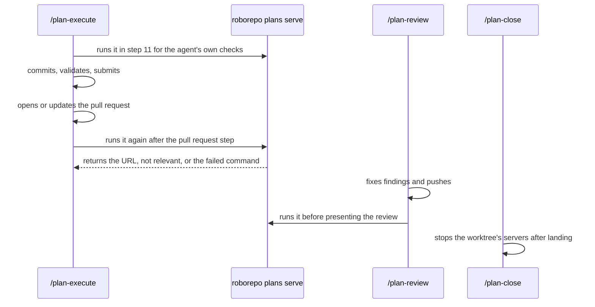
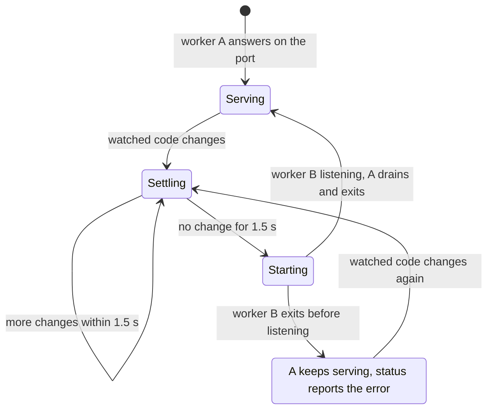

# A current server is running whenever a plan is ready to review

## Summary

A **served surface** is something a repository runs for a person to open in a browser, such as
RoboRepo's portal, together with the files whose changes it shows. When `/plan-execute` opens a
pull request for work that changes a served surface, the user wants to open it and look, without asking an agent to start a
server first. Today they have to ask: the build starts a server once, early, in whatever way the
agent improvises, and by the time the pull request is ready that server has either exited or is
serving code from before the last fixes.

This plan makes a running, current instance a deterministic part of the lifecycle:

- a new command, `roborepo plans serve <plan>`, decides from the branch's changes whether a served
  surface is affected, and if so starts it from the plan's worktree on a stable port, or reports
  the one already running;
- `/plan-execute` runs it after the pull request opens, and `/plan-execute`'s review-fix mode and
  `/plan-review` run it after their fixes, so the address lands in every final report;
- a portal started from a development checkout reloads its own server code when the files change,
  without dropping the port, and an open page reloads itself, so the "older server code" banner
  stops being something the user acts on.

## Goals

- After every `/plan-execute` or `/plan-review` run that leaves a pull request for served changes,
  a server for that worktree is running with the branch's current code, and its address is in the
  final report, and in the harness's browser pane when it has one.
- Whether a server is relevant is decided by a rule a command applies, not by an agent's judgment.
- Several plans building in parallel each get their own instance, on a port that stays the same for
  a worktree across runs, and the user can tell which address belongs to which plan.
- When a server cannot start, the final report says why and gives the exact command to allow; it is
  never silently "none".
- A portal running from a development checkout picks up server code changes by itself, keeps
  serving the previous code if the new code fails to start, and open pages reload to the new code
  unless they hold unsaved changes.

## Non-goals

- Serving work that has no plan. "Small changes are delivered from a worktree" (`0ubk9sug`) may
  reuse the command later; this plan does not wire it in.
- Hot reload for portals installed from npm. Their code changes only through `roborepo update`, and
  the existing stale-portal restart in `roborepo web` already covers that.
- Proposing served surfaces from `/plan-suite-init`. The command serves any repository that
  declares its surfaces, since the plan suite runs in other repositories too; one that declares none
  gets a report saying so and how to declare one.
- Changing `/plan-close`'s server step or the portal's **Stop Server** button. `/plan-close` gains
  the serve record only through `roborepo plans stop-servers`, which it already runs.

## Current state

Checked against the repository at `13d33e6c` and recent build transcripts.

### What the build instructions say

| Where | What it says | Gap |
| --- | --- | --- |
| `plan-execute/SKILL.md` Implementation Workflow step 11 (from pull request 70) | Start the repository's dev environment with the worktree as working directory, leave it running, open it with `preview_start`, report its URL | Runs before the commit, the validation loop, submit, and the pull request. Nothing later starts or refreshes it. How to start it is left to the agent |
| `plan-execute/references/handoff.md` | Merge base, push, open or update the pull request, report its state | No server step |
| `plan-execute/references/final-report.md` | `Server: <URL> running from the worktree \| isolated state at <URL> (<why>) \| none (<why>)`; an example row cites `npm run portal` | `package.json` defines no `portal` script |
| `plan-review/SKILL.md` | Fixes findings, pushes, presents the review | Never mentions a server |
| `plan-close/SKILL.md` step 9 | Runs the repository's linked-worktree server cleanup command (`roborepo plans stop-servers <plan>` here) after landing | Works; unchanged by this plan |
| `plan-archive/SKILL.md` | Archives the plan | Never stops the worktree's servers |

Skill paths are under `globals/packages/plan-suite/skills/`.

### What happened in recent builds

| Build | What the agent did | Outcome |
| --- | --- | --- |
| "Skills required and recommended" | Hand-picked port 4523, added an entry to the primary checkout's `.claude/launch.json`, started the portal as a background task of its session | No longer listening on 2026-11-24 |
| "Multi-source package distribution" | Same pattern, port 4393, although the branch changed no portal file | No longer listening on 2026-11-24 |
| "GitHub agent identity" | Same pattern, port 47821; reported the URL | Later fix sessions changed the Home page; the user asked "can you re start the server for this worktree? i get a portal running old server code thingie" |

The cause is therefore not a missing instruction or a too-narrow relevance call: the server is
started once, too early, by an improvised procedure whose result does not survive the session or
the fixes that follow.

### What the portal already provides

- `roborepo web --detach --port <n>`, run from a checkout, reuses a portal on that port that runs
  the current code and SIGTERMs and restarts one whose code changed (`resolvePortalPort` and
  `probePortal` in `scripts/cli/telemetry.mjs`).
- Static files under `portal/` are read from disk on every request, so page code is always current.
  Server modules (`scripts/cli/`, `scripts/harnesses/`, `modules/`) stay as loaded until the process
  restarts.
- The open page polls `/api/portal/status`; when `serverCodeChanged` is true it shows the banner
  "This portal is running older server code than what is on disk. Restart `roborepo web` to load
  the changes." (`portal/shared/theme.js`, `portal/shared/chrome-partial.html`).
- `findCheckoutServers` in `modules/developer-runtime/stop.mjs` finds every process listening from a
  given checkout, by working directory, on macOS. `roborepo plans stop-servers` uses it.

## Proposed design

### When a server is started



`/plan-execute`'s review-fix mode follows the same handoff, so it also runs the command after its
pull request step. Every call is idempotent: a second call reports the instance the first started.

### `roborepo plans serve <plan> [--json]`

The command takes the plan, resolves its linked worktree the way `stop-servers` does, and handles
each served surface the repository declares:

1. **Relevance.** List the files the worktree changed against its merge base with the plan's base
   branch, committed or not, untracked files included, because step 11 runs before the commit. The
   surface is relevant when any changed path starts with one of the surface's declared path
   prefixes. Otherwise it reports `not-relevant` with the reason.
2. **Reuse.** The command keeps a record per worktree and surface under the state root: the process
   it started and its port. If that process is alive and its URL answers, report it as `running`.
3. **Port.** Otherwise derive a port from the worktree's administrative name: a stable hash into a
   declared range (4400–4999 for the portal), probing upward past any port that cannot be bound.
   The same worktree gets the same port on every run, so a bookmarked address keeps working.
4. **Start.** Spawn the surface's command in its own process group, detached from the calling
   session, with the worktree as working directory and output appended to a log under the state
   root. Wait up to 60 seconds for the URL to answer, then write the record. The recorded process
   is the one spawned, so a surface command must keep running as the server rather than hand off
   and exit; RoboRepo's declaration below starts the portal supervisor directly for that reason.
5. **Report.** One result per surface:

| State | Meaning | Final report line |
| --- | --- | --- |
| `started` | Started now from the worktree | `Server: <URL> running from the worktree` |
| `running` | Already running from the worktree | Same |
| `not-relevant` | The branch changes none of its paths | `Server: none (<surface> unaffected by this branch)` |
| `undeclared` | The repository declares no served surface | `Server: none (no served surface declared)` |
| `failed` | It did not answer in time, or exited | Under Needs you, Commands to allow: the exact command, the error, and the log's last lines |

The command exits 0 for every state except `failed`.

Reuse and port choice rely on the command's own record and on binding a port, not on Runtime's
listener discovery, so they behave the same on every platform. A server started some other way is
not reused; the command starts its own on the next free port.

`roborepo plans stop-servers` also reads this record and sends SIGTERM to each recorded process
that is still alive, then deletes the record. Its listener discovery stays macOS-only, so on other
platforms it stops what `serve` started and nothing else.

A server keeps using the user's normal state, as step 11 already requires. A plan whose change
writes state the user would not want touched still isolates it by hand, as today.

### Declaring a served surface

RoboRepo's own declaration, in the shape this plan proposes:

```json
{
  "serve": [
    {
      "name": "portal",
      "command": ["node", "scripts/cli/portal-supervisor.mjs", "--port", "{port}"],
      "url": "http://127.0.0.1:{port}/",
      "ports": [4400, 4999],
      "paths": ["portal/", "scripts/cli/", "scripts/harnesses/", "modules/"]
    }
  ]
}
```

The `paths` prefixes are the folders the portal serves (`portal/`) or loads as server code (the
three folders `computeServerCodeSignature` in `scripts/cli/portal-source-hash.mjs` reads). Prose-only branches (skills,
rules, docs) match none and get `not-relevant`. Where the declaration lives is an open question
below.

### How the skills change

| Skill file | Change |
| --- | --- |
| `plan-execute/SKILL.md` step 11 | Run `roborepo plans serve <plan> --json` as a bare call instead of improvising a start, and open the URL in the harness's browser pane when one exists. Never add entries to the primary checkout's `.claude/launch.json` |
| `plan-execute/references/handoff.md` | New step after "Open or update the pull request": run the same command, keep its result for the report, and open the URL in the harness's browser pane when one exists |
| `plan-execute/references/final-report.md` | The Server line comes from the command's result; a `failed` result becomes a Commands to allow row; the `npm run portal` example becomes `roborepo plans serve <plan>` |
| `plan-review/SKILL.md` | Run the command before step 6 presents the review, open the URL in the harness's browser pane when one exists, and give the URL in the review packet and final report |
| `plan-archive/SKILL.md` | After the archive commit, run `roborepo plans stop-servers <plan>`, as `/plan-close` does |

### Hot reload for a development-checkout portal

The portal's server swaps to new code by itself, with no gap in service:



- **Supervisor.** In a development checkout, `roborepo web` hands off to a fresh process,
  `node scripts/cli/portal-supervisor.mjs`, instead of serving itself. That primary (Node's
  `cluster` module) owns the port and forks the server as a worker, with `cluster.setupPrimary`'s
  `exec` pointing at the worker entry so a fork does not re-run the CLI. It polls
  `computeServerCodeSignature`, the same function behind today's banner, so "server code" has one
  definition; `portal/` is not in it because those files are already read fresh. That function
  moves out of `portal-source-hash.mjs`, which imports `paths.mjs` and through it harness code,
  into a module that imports only Node built-ins and takes its folders as arguments. The primary
  then loads only that module, `state-paths.mjs`, `roots.mjs`, and its own file, so the code it holds rarely changes. When the
  signature changes and then holds still for 1.5 s (a merge or checkout touches many files), it
  starts a new worker and retires the old one only once the new one is listening.
- **Failure.** If the new worker exits before listening, for instance on a half-saved edit, the old
  worker keeps serving and `/api/portal/status` reports the error's first line. The next change
  retries.
- **Supervisor changes.** A change to those four files cannot be loaded by the running primary. The
  primary keeps their signature from its own start, and the status reports `supervisorChanged`
  when it differs. For a supervised portal that field, not `serverCodeChanged`, drives the restart
  banner, so the banner appears only for the one case a swap cannot fix. An unsupervised portal
  (an npm install) keeps showing the banner on `serverCodeChanged`, as today.
- **Process identity.** The supervisor owns the files that today's `web` process writes: once its
  first worker is listening it writes the per-port PID file with its own pid, and the
  `PORTAL_READY_FILE` when one is set. It gets the PID file's path from `portalPidPathForPort` in
  `scripts/cli/state-paths.mjs`, which imports only Node built-ins and `roots.mjs`, so the rule
  (`ROBOREPO_PORTAL_PID_PATH` when set, otherwise `<state root>/portal/server-<port>.pid`) has one
  home. No launcher has to pass it, and a portal started by `plans serve` is visible to
  `roborepo web stop`. `roborepo web --detach` spawns the supervisor where it
  spawns `web` today, so `waitForPortalReady` watches the supervisor; foreground `roborepo web`
  spawns it with the terminal attached, waits on it, and forwards SIGINT and SIGTERM. `roborepo
  plans serve` starts it directly from the declaration. The worker runs the initialization
  `serveCommand` runs today (`ensureInitialized`) before serving, so every start path is
  bootstrapped. `/api/portal/status` reports the primary's pid, so `roborepo web` and
  `roborepo web stop` signal the primary. A supervised portal also reports
  `supervised: true`, and `probePortal` treats a supervised portal from the same checkout as
  current unless `supervisorChanged` is set: page edits under `portal/` and server code swaps no
  longer make `roborepo web` restart it.
- **Supervisor state reaches the worker.** The primary holds the generation, the last swap error,
  `supervisorChanged`, and its own pid, and sends them to every worker as a cluster message
  whenever one changes. The worker keeps the latest message and answers `/api/portal/status` from
  it, so a worker that keeps serving after a failed swap still reports the error.
- **Open pages.** `/api/portal/status` reports a generation number that rises with each swap. When
  it rises, the page reloads itself, unless the page reports unsaved changes through the `isDirty`
  guard pages already register with `setRepositoryScopeGuard` (`portal/shared/repository-scope.js`,
  used by the Backlog); then it shows a one-click **Reload** notice instead. A failed swap shows "New server
  code failed to start: <error>. Still serving the previous version."
- **Stopping.** The primary is the listening process and the recorded pid, so `roborepo web stop`,
  `stop-servers`, and **Stop Server** reach it. Workers already exit when the primary dies, because their channel to
  it closes; the primary still handles SIGTERM so the worker can finish in-flight requests first.
- **Package installs** keep today's behavior: no watcher, and the next `roborepo web` restarts a
  stale portal.

### Code placement

| Piece | Home | Why there |
| --- | --- | --- |
| Relevance, record, port choice, start, and result | `modules/plan-suite/serve.mjs` | Beside `stop-servers.mjs`; resolves the plan's worktree the same way |
| Stopping recorded servers | `modules/plan-suite/stop-servers.mjs`, reading the record through a function `serve.mjs` exports | The record has one owner; stopping stays in the command that already stops |
| `plans serve` argument parsing and output | `scripts/cli/plans-command.mjs` | Where `plans stop-servers` is parsed |
| Command definition and agent permission | `manifests/platform/cli/command-definitions/internal/plans-serve.command.json`, `manifests/inventory/agent-permissions.json` | Same as `plans stop-servers`; regenerate `generated/` from them |
| Supervisor, PID and ready files | `scripts/cli/portal-supervisor.mjs`, started as its own process by `roborepo web` and `roborepo plans serve` | A fresh process so the primary loads none of the CLI or server modules; it is the long-lived process, so it owns the files that name it |
| Spawning the supervisor | `startDetachedPortal`, `spawnDetachedServer`, and `serveCommand` in `scripts/cli/telemetry.mjs` | Where `web` starts and waits on its server today |
| Worker entry | `scripts/cli/portal-worker.mjs`, the file `setupPrimary`'s `exec` names | Runs the server part of today's `serveCommand` in `telemetry.mjs` without the CLI dispatch or port resolution, which the primary owns |
| Server code signature | `scripts/cli/server-code-signature.mjs`, imported by the supervisor and by `portal-source-hash.mjs` | One definition of server code, free of harness imports |
| Generation, swap error, `supervisorChanged`, `supervised`, primary pid | `scripts/cli/portal-server.mjs` status handler | Beside today's `serverCodeChanged` field |
| Treating a supervised portal as current | `probePortal` in `scripts/cli/telemetry.mjs` | Where stale portals are detected today |
| Page reload and notices | `portal/shared/theme.js`, `portal/shared/chrome-partial.html` | Add auto-reload and the failure notice; the restart banner stays for `supervisorChanged` |
| Unsaved-changes check | A getter exported from `portal/shared/repository-scope.js` | The registered guard is private there today; a getter reuses it instead of adding a second registration |

### Harness differences

| | Claude | Codex |
| --- | --- | --- |
| Command reaches the network | The sandbox excludes `roborepo *`, so a bare call can bind a local port | A prefix rule like the existing `roborepo plans stop-servers` one allows the command; whether Codex's sandbox lets it bind a local port is unverified |
| Browser pane | `preview_start` with the URL in the desktop app | None; the URL is in the report |
| Survives the session | Yes: detached process group, not a session background task | Same |

## Implementation plan

- [ ] Settle where served surfaces are declared (Open questions).
- [ ] Write `modules/plan-suite/serve.mjs` with relevance, port, reuse, start, and the result shape.
- [ ] Add `roborepo plans serve` to `plans-command.mjs`, its command definition, and its agent
      permission; regenerate `generated/`.
- [ ] Declare RoboRepo's portal surface.
- [ ] Update `plan-execute/SKILL.md` step 11, `references/handoff.md`, and
      `references/final-report.md`.
- [ ] Make `roborepo plans stop-servers` also stop the processes in the serve record.
- [ ] Update `plan-review/SKILL.md` and `plan-archive/SKILL.md`.
- [ ] Move `computeServerCodeSignature` into `scripts/cli/server-code-signature.mjs`.
- [ ] Write `scripts/cli/portal-supervisor.mjs` and `scripts/cli/portal-worker.mjs`, and start the
      supervisor from `roborepo web` in a development checkout.
- [ ] Add the generation number, swap error, `supervisorChanged`, `supervised`, and the primary's
      pid to `/api/portal/status` and the PID file; make `probePortal` treat a supervised portal as
      current.
- [ ] Add auto-reload with the unsaved-changes check and the failure notice; keep the restart
      banner for `supervisorChanged` only.
- [ ] Update the docs listed under Documentation impact.
- [ ] Check Codex's local port binding for the command.

## Validation

### Checks to add

| Check | Proves |
| --- | --- |
| `scripts/test/plan-suite-serve-check.mjs` with a fixture repo and a tiny HTTP server as the surface command | A branch touching only unrelated paths reports `not-relevant`; an uncommitted change to a declared path counts; a touching branch reports `started` with the derived port; a second call reports `running` with the same URL; a record whose process died is replaced by a fresh start on the same port; a port held by another checkout moves to the next port; a command that exits reports `failed` with the log's last lines and exit code 1; the server outlives the calling process |
| `scripts/test/portal-supervisor-check.mjs` with a fixture worker | Changing a watched file brings a new generation with no failed requests during the swap; a broken worker leaves the old one serving and reports the error; SIGTERM to the primary frees the port and leaves no worker |
| Portal UI test in `scripts/test/portal-ui/` | A generation change reloads the page; with an unsaved Backlog change it shows the Reload notice instead |
| `scripts/test/portal-server-code-signature-check.mjs` | Updated for the new notice and status fields |
| `scripts/test/cli-command-catalog-check.mjs`, `scripts/test/claude-sandbox-projection-check.mjs` | The new command and its permission are generated for every harness |

The change regenerates `generated/` and edits shared CLI and permission manifests, so it also runs
`bash scripts/doctor.sh --quiet`, and CI's full gate on the pushed branch is the final check.

### Acceptance criteria

- A `/plan-execute` run on a branch that changes `portal/` ends with a final report whose Server
  line gives a URL that answers, served from the plan's worktree.
- After a `/plan-review` run commits a fix to a server module, the same URL serves the fixed code
  without anyone restarting it, and the open page reloads to it.
- A branch that changes only skill prose reports `Server: none (portal unaffected by this branch)`.
- Two plans built in parallel get two different URLs, each unchanged on a rerun.
- `/plan-close` and `/plan-archive` leave no server listening from the closed worktree: on every
  platform for servers `serve` started, and on macOS for any other listener in the worktree.

## Risks

| Risk | Mitigation |
| --- | --- |
| Each swap re-warms telemetry views, about 30 s of CPU on a large spool | Swaps wait for files to settle; measure during implementation and lengthen the settle window if needed |
| A server per worktree accumulates when plans sit in review for days | `/plan-close` and `/plan-archive` stop them through the serve record on every platform; on macOS, Home lists them per worktree and **Stop Server** stops them |
| Port hashing collides with another service | Probe upward past any port that cannot be bound; reuse only a process the command's own record names |
| A swap mid-request drops a response | The old worker drains in-flight requests before exiting |
| A stop cuts off requests in flight | The primary's SIGTERM handler lets the worker drain; the supervisor check asserts no worker survives |

## Open questions

### Where a repository declares its served surfaces

| Option | Gains | Loses |
| --- | --- | --- |
| `serve` key in `plans/plans-config.json` (recommended) | One existing config every plans command already reads; no new file in user repositories | Lives on the plans branch, so a branch that adds a surface cannot declare it in the same pull request |
| A file in the code checkout, such as `.roborepo/serve.json` | Versioned with the code that serves | A new per-repository file and format |

Recommendation: `plans-config.json`, because served surfaces change rarely and it keeps one place
for plan-suite configuration. `/plan-promote` settles this before implementation.

## Documentation impact

| Doc | Update |
| --- | --- |
| `docs/user/guides/plan/lifecycle/plan-suite.md` | When a server starts, where its address appears, and how archive and close stop it |
| `docs/user/reference/plans-portal.md` | `roborepo plans serve` in the command table, and the `serve` declaration |
| `docs/user/reference/roborepo-cli.md` | `roborepo web` reloads its own server code in a development checkout |
| `docs/internal/portal-architecture.md` | The supervisor, worker swap, and generation number |
| `docs/internal/plans-portal-internals.md` | `modules/plan-suite/serve.mjs` beside `stop-servers.mjs` |
| `globals/packages/plan-suite/skills/plan-write/references/plan-schema.md` | If the `serve` key goes in `plans-config.json`, its rule that the file holds only `schemaVersion` and `namespaces` names `serve` too |
| `local/skills/roborepo-development/SKILL.md` | Replace the manual dev-server guidance from pull request 70 with the command |

## Coordination

- "Deliver finished plans as a watched pull request" (`i5mnkm7z`) moves the handoff steps into a
  new `pr-delivery.md`. Whichever lands second carries the one new handoff step across. Not folded
  in: that plan waits on another and is not prepared.
- "Small changes are delivered from a worktree" (`0ubk9sug`) could call `roborepo plans serve`
  later if the command also accepts a worktree path.
- "Agents run every check they can before asking the user to check by hand" (`5xw1mmqy`, completed)
  wrote the blocked-check retry that reuses step 11's server; that retry keeps working and now
  finds the server the command started.
- "One Command per Plan Lifecycle Step" (`age4cm7r`, completed) introduced `roborepo plans stop-servers`,
  which this plan pairs with `serve` and extends to `/plan-archive`.
