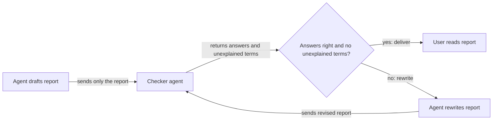

# Plan reports a reader can understand after time away

## Summary

When a plan command finishes, it writes a report in the chat. The user often reads that report
later, after working on something else, and cannot tell what the plan was for, what changed, or
what they need to decide. This plan makes every plan-command report readable on its own: it says
what the plan is for, describes changes as things a person would notice, explains every term it
uses, and sets out each decision with its options and a recommendation. For the commands that end
a stage of work, a checker agent that sees only the report checks it before the user does, and visible changes come with a screenshot,
recording, or diagram.

## Context

### Terms

| Term | Meaning in this plan |
| --- | --- |
| Plan command | One of the plan suite's slash commands: `/plan-write`, `/plan-promote`, `/plan-execute`, `/plan-review`, `/plan-close`, `/plan-archive`. Each moves a plan through its life, from idea to merged work |
| Completion report | The message a plan command writes when it stops, whether it finished, refused, or needs the user |
| Cold reader | Someone reading a report with no memory of the session: the user coming back hours later, or a person who never saw the work |
| Report template | The section of each command's instructions that tells the agent what to put in its completion report |
| `response-output` | An optional rules package that tells agents how to word every chat reply. Users can turn it off |
| Checker agent | A separate agent, started with a fresh context, that reads only a completion report and tests whether a cold reader could follow it (change 3) |
| Validator | A separate agent that `/plan-execute` starts with a fresh context, so it judges the code from the plan and the diff without the writer's blind spots. It reports problems and never edits |
| `feature-verification` | The skill that captures evidence a change works: command output, screenshots, and recordings |
| Plan suite skills | Live under `globals/packages/plan-suite/skills/<command>/`. Paths below that start with a command name, such as `plan-review/SKILL.md`, are relative to that folder |
| `## Review` record | The section of a plan where `/plan-execute` and `/plan-review` record findings, checks run, and the approval |
| Plans portal | The local web page that lists the repo's plans and their status |
| Layer | A report has two: plain context a cold reader needs, shown always, and technical detail, shown on request (see change 1) |

### The problem, in one example

A `/plan-review` report contained this bullet:

> Delivery refusals name the field that failed, such as `head commit is X, expected pushed head Y`.
> The CLI reference already promised this.

"Delivery refusals" was never explained. The report assumed the reader had just watched the agent
build the delivery commands. The user had not, so the bullet told them nothing. Written for a cold
reader, the same point reads:

> When the new `roborepo delivery` commands refuse to open or update a pull request, the error now
> says which value was wrong, for example the commit it found and the commit it expected. The docs
> had already described this behavior; now the commands match them.

### Current state

These facts were checked against `main` and against the branch of "Clear agent friction"
(`vzgsx5vz`, branch `codex/plans-suite-quick-wins-1-cleanup`), which is in review and not yet merged.

| Where | What it does today |
| --- | --- |
| `globals/packages/response-output/rules.md` | Already says "Introduce before you name". The example above broke it anyway, so more rule text alone does not fix this. Its opening aims at the wrong reader: "someone who knows the project but not what you just read" |
| `plan-execute/references/final-report.md` | Outcome first: a headline, a "What changed" table phrased as what you'll notice, and a "Needs you" table. The closest of the templates to what this plan wants |
| `plan-review/SKILL.md`, step 6 | Shows a nine-item review packet before asking for approval: commit and base, each criterion with code and test evidence, changes by area, each Validator pass and what it found, every commit, base failures, outside issues, manual checks, and escalated findings |
| `plan-promote/SKILL.md`, Completion Result | A block of ten status lines and counts, then an eight-item "also report" list |
| `plan-review`, `plan-close`, `plan-archive`, Final Report (on the `vzgsx5vz` branch) | Rewritten to be shorter: one outcome line, status only when unusual, evidence through `feature-verification` "where it applies", no passing gates or commit ids. Each skill repeats the same paragraph |
| `plan-write/SKILL.md` | Asks only to "report changed files, verification run, and paired skills" |
| Any plan command | Nothing reads a report before the user does. Code, by contrast, gets a fresh-context Validator in `/plan-execute` |
| Plan frontmatter `next_action` | One line per plan, shown by the Plans portal as "next action" (`portal/plans/templates.js`) |

Agents follow a command's own report template more closely than the general output rules, so the
templates are where the fix has to land. The `vzgsx5vz` rewrite makes reports shorter. It does not
make them understandable to someone who was not there.

## Goals

- A cold reader can tell, from one completion report alone, what the plan is for, what changed for
  a person using the work, and what they must do or decide next.
- Every term, command, flag, or plan name in a report is either explained in plain words in that
  report or is common knowledge for a developer.
- Each decision the user owes appears with its options, what each option leads to, and a
  recommendation.
- A visible change ships with a screenshot or recording, and a changed flow with a before/after
  diagram, or the report says why there is none.
- Technical detail (commit ids, check names, file lists, Validator passes) stays out of the first
  layer and is available on request or in the plan document.

## Non-goals

- **A persisted "needs you" brief in the plan for the Plans portal.** Seeing everything waiting on
  the user without opening sessions is a real problem, but a separate one: it needs a new place in
  the plan to store the brief, portal work to show it, and rules for when it goes stale. The
  frontmatter schema is deliberately small, and changing it is its own decision. This plan does
  the cheap part only: `next_action` is written to the same cold-reader standard (see Proposed
  design), so the line the portal already shows becomes readable.
- Measuring report quality across many runs. Live Evals for Skill Routing and Plan Closing
  (`0jped168`) builds the runner such a measurement would use, and leaves a model-as-judge for
  report prose to a later plan.
- Changing what any plan command does, refuses, or records in the plan. Only what it tells the user
  changes.
- Shortening reports further. `vzgsx5vz` owns length; this plan owns whether a report can be
  understood.

## Proposed design

Four changes. Each one targets a reason the "Introduce before you name" rule failed to work by itself.

| Why reports fail today | Change |
| --- | --- |
| The rules aim at a reader who has the context | 1. Aim the output rules at a cold reader |
| Each command has its own template, and agents follow it over the rules | 2. One shared report shape for every plan command |
| Nothing checks a report before the user reads it | 3. A cold-reader check before delivery |
| Visual evidence is optional ("where it applies") | 4. Visual evidence required for visible changes |

### 1. Aim the output rules at a cold reader

In `globals/packages/response-output/rules.md`, replace the opening reader with: someone returning
cold, who may not know the domain, and who wants to know what changed for them before how it
works. Add one rule under "The first reply": **outcome before mechanism**: say what a person
will notice first, and the technical cause second or when asked.

This also settles the conflict between short and self-contained. "Short by default" stays, and
self-containment wins when they conflict. The answer is layering, not cutting:

| Layer | Contains | Shown |
| --- | --- | --- |
| 1. Plain context | What the plan is for, what changed for a person, what the reader must do | Always |
| 2. Technical detail | Commit ids, check names, files, Validator passes, the plan's log of decisions made during the work | On request, or in the plan document |

A report that drops the one sentence a cold reader needs has not saved space; the reader has to
ask anyway.

The new reader applies to every reply, as the user asked for chat output in general. Inside an
ongoing conversation, a reply may still refer to things already explained earlier in it; a
completion report may not, because the user returns to it cold. Only completion reports get the
check in change 3.

### 2. One shared report shape

`response-output` is optional, so the plan suite cannot rely on it. Move the report rules into one
reference that every plan command reads before it writes its completion report. Recommended home:
generalize `plan-execute/references/final-report.md` into a shared reference, read by the other
commands through a relative path (as `plan-write` already reads `../plan-suite-init/SKILL.md`).
`/plan-promote` confirms that a file one skill reads from another skill's folder still resolves
after install, and chooses another home if it does not.

The shape, in order, skipping empty sections:

1. **Headline**: the plan's title and what happened to it, in one line.
2. **What this plan is for**: one sentence a cold reader understands, written fresh rather than
   copied from the plan's Summary.
3. **What changed**: each change as something a person would notice, with visual evidence
   (change 4).
4. **Needs you**: each decision with its options, what each leads to, and a recommendation; each
   action with the exact command.
5. **Record**: a short lookup block (plan path, branch, link to the plan document), plus a
   one-line offer of technical detail.

Every section obeys one rule: **no term the report has not introduced.** A command, flag, plan id,
or internal name appears only beside a plain description of what it does.

Each command keeps only its own specifics, and points to the shared shape for everything else:

| Command | Keeps |
| --- | --- |
| `/plan-write` | Plan title and id; open questions |
| `/plan-promote` | Whether the plan moved to ready; the snippet the user pastes into a new chat to start the plan. Its ten-line counts block moves to Record or is dropped |
| `/plan-execute` | Its current sections, now pointing at the shared reference |
| `/plan-review` | The exact-commit approval question; findings that block approval. The nine-item packet becomes layer 2: criteria appear as a plain checklist of outcomes, and commits, Validator passes, and evidence detail live in the plan's `## Review` record |
| `/plan-close` | The reason for each refusal |
| `/plan-archive` | The archive reason; any branch or worktree holding unmerged work |

The same rule applies to `next_action`: whichever command writes it phrases it as a sentence a cold
reader can act on, not as shorthand from the session.

### 3. Cold-reader check before delivery

Before a plan command delivers its completion report, a checker agent reads **only the report** and
answers three questions:

1. What is this plan for?
2. What changed, for a person using it?
3. What must the reader do or decide?

It also lists every term it could not explain from the report. The writing agent rewrites the
report until all three answers match its intent and the list is empty, at most twice, then
delivers it.

| Choice | Decision | Why |
| --- | --- | --- |
| Which reports | Completion reports of `/plan-promote`, `/plan-execute`, `/plan-review`, and `/plan-close`. `/plan-write` and `/plan-archive` use the in-session self-check below | The four end a stage of work and carry the long reports a user returns to. The other two reports are short. Ordinary chat replies would pay the cost on every turn. Open question: run it on all six |
| Model | A cheaper model is allowed | The task is reading comprehension of a short text, not judging code |
| Passes | At most two rewrites, then deliver and say which terms the check still flagged | A report must not stall delivery |
| No subagent available | Use the in-session self-check: a separate step that rereads the report as if new, answers the three questions, and lists each term with where it was introduced | Same fallback `/plan-execute` uses for its Validator |
| Shown to the user | No, unless the cap was reached | The user wants the report, not its review |

### 4. Visual evidence required for visible changes

When a change is visible in an interface, the report includes a screenshot or recording. When a
change alters a flow or sequence, the report includes a before/after diagram. When neither is
included for such a change, the report says why in one line. The plan commands reuse evidence
`/plan-execute` or `feature-verification` already captured rather than capturing it again.
This replaces the "where it applies" wording on the `vzgsx5vz` branch.

## Implementation plan

- [ ] Confirm `vzgsx5vz` has merged, and start from its Final Report wording in the review, close,
      and archive skills.
- [ ] Rewrite the opening of `globals/packages/response-output/rules.md` for a cold reader, add
      the outcome-before-mechanism rule and the layering rule, and update the package description
      in `package.config.json` if it no longer matches.
- [ ] Create the shared report reference with the shape, the "no unintroduced term" rule, the
      visual-evidence rule, and the cold-reader check.
- [ ] Point the report sections of all six plan commands at the shared reference, keeping each
      command's specifics from the table above. Restructure the `/plan-review` packet and the
      `/plan-promote` counts block into the two layers.
- [ ] Apply the cold-reader standard to `next_action` wherever a command writes it.
- [ ] Update `scripts/test/plan-suite-skills-check.mjs` for the new report wording.
- [ ] Regenerate rule outputs with `bash scripts/build/render-rules.sh`.
- [ ] Run the dry runs under Validation and record the results.

## Validation

- `node scripts/test/plan-suite-skills-check.mjs` asserts that every plan command reads the shared
  reference before reporting, that the reference names the five sections, the three cold-reader
  questions, the two-rewrite cap, and the in-session self-check, and that `/plan-review` still asks
  for approval of an exact commit.
- `bash scripts/build/render-rules.sh --check` and `bash scripts/doctor.sh --quiet` pass.
- Dry run of the check: give the cold-reader check the original "delivery refusals" bullet. It
  must flag "delivery refusals" as unexplained. The rewritten version above must pass.
- Dry run of a report: run `/plan-review` or `/plan-promote` on a real plan, then give the report
  alone to a person or agent with no context. They can answer the three questions.

## Not tested

- [ ] Reports from real runs read well to the user after time away. Only the user can judge this;
      deterministic tests can only check that the instructions exist.

## Documentation impact

| Doc | Update |
| --- | --- |
| `docs/user/guides/plan/lifecycle/plan-suite.md` | Describe what a completion report contains. Update every description of the `/plan-review` packet: the commands table, the review steps, the answer table that "shows you the packet again", and check whether the merge-readiness paragraph on the committed review packet still holds |
| `globals/packages/response-output/package.config.json` | Package description, if the new reader changes it. The Config Control Panel, the portal page for turning packages on and off, shows this text |

## Related plans

| Plan | Relationship |
| --- | --- |
| Clear agent friction (`vzgsx5vz`) | Prerequisite. In review, unmerged. It rewrites the same report sections, so this plan starts after it merges and builds on its wording |
| Deliver finished plans as a watched pull request (`i5mnkm7z`) | Also edits `final-report.md`: its Record gains the pull request link. Whichever lands second keeps the other's change |
| Live Evals for Skill Routing and Plan Closing (`0jped168`) | Could later measure report quality. The three cold-reader questions are a ready rubric for the report judge it leaves to a later plan |

## Risks

| Risk | Mitigation |
| --- | --- |
| Reports grow longer | Layering keeps technical detail out of the first layer; `vzgsx5vz`'s leave-out rules still apply |
| The check adds time and tokens to every plan command | One short report, a cheaper model, at most three reads |
| The cold reader passes a report the user still finds unclear | The Not tested entry; the user's feedback tunes the questions |
| The `/plan-review` approver loses evidence they relied on | All of it stays in the plan's `## Review` record and is one request away |

## Decisions

- **Change 1 stays, though change 2 carries the fix for plan reports.** The user asked for chat
  output in general to serve a cold reader, not only plan reports. Dropping change 1 would leave
  ordinary replies aimed at the old reader.

## Open Questions

- **Which commands get the cold-reader check from a checker agent?** Recommended: `/plan-promote`, `/plan-execute`,
  `/plan-review`, and `/plan-close`, which end a stage and write long reports; `/plan-write` and
  `/plan-archive` use the in-session self-check. Alternative: all six, which checks every report
  with a reader that never saw the session, at the cost of a short extra step on the two quick
  commands.
- **Where the shared reference lives.** `/plan-promote` confirms whether the installer ships a
  file read across skills (see change 2).
