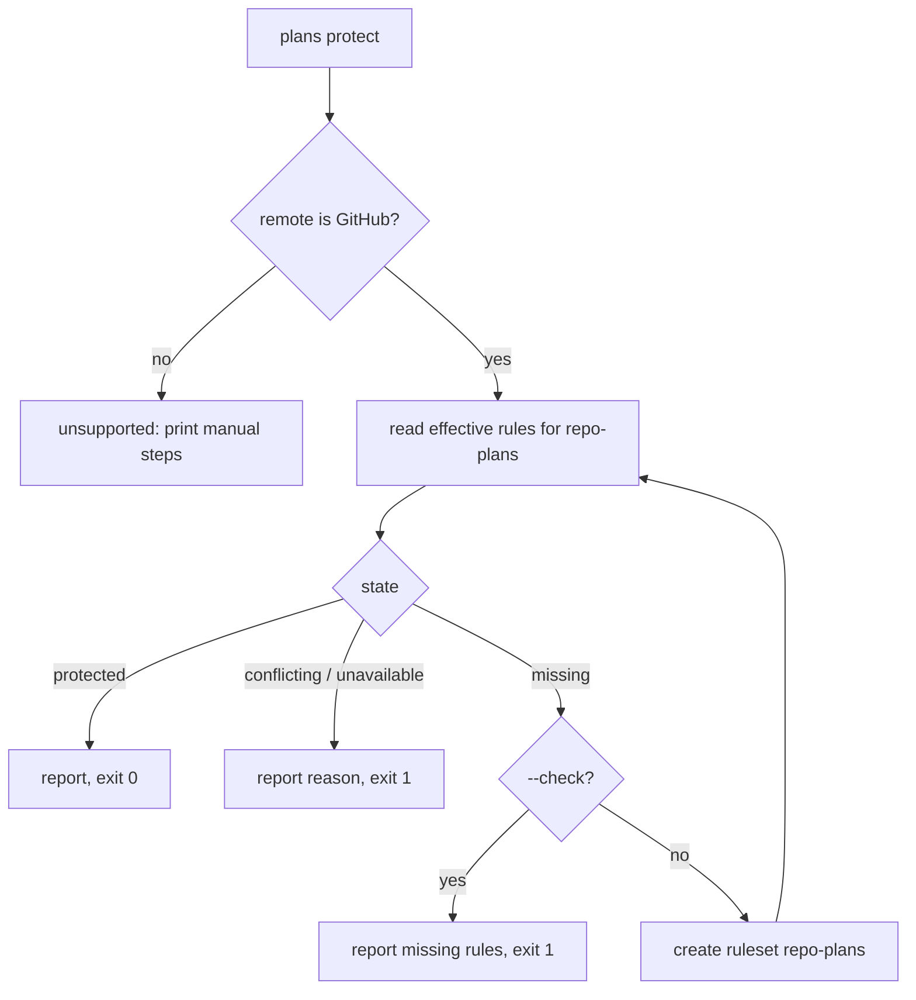

# Protect the plans branch on GitHub from one command

## Summary

Every repo that uses the plans store keeps its plans on a `repo-plans` branch that RoboRepo pushes
to directly. On GitHub, that branch should carry a ruleset that blocks deletion, force pushes, and
merge commits while still allowing direct pushes. Today the user has to remember to add that ruleset
by hand for each repo. This plan adds `roborepo plans protect`, which reports or creates the
ruleset; `/plan-suite-init` offers it after setting up a store; `roborepo doctor` reports it; and
the Plans page shows a **Protect** button only while GitHub reports the branch unprotected. When the
user's GitHub account is not an admin of the repo, and so cannot add the ruleset, the command,
doctor, and the Plans page all say so.

## Context

### Why the branch needs protection

The plans store is the only copy of a repo's plans. Each store command commits locally and pushes
`repo-plans` to `origin` (`modules/plan-suite/plan-store.mjs`). Locally, the store integrates remote
changes only by fast-forward (`merge --ff-only`) or by rebasing pending commits, and it never
force-pushes. So the remote branch's history only ever grows in a straight line, and three rules
can hold it to that without slowing any save:

| Rule (GitHub ruleset type) | Stops |
| --- | --- |
| Restrict deletions (`deletion`) | The branch, and with it every plan, being deleted |
| Block force pushes (`non_fast_forward`) | Plan history being rewritten |
| Require linear history (`required_linear_history`) | A merge commit, such as `main` merged into the branch |

Rules that refuse a direct push would break every save, which would then report
`synchronized: false` until the rule is removed: a required pull request (`pull_request`),
required status checks (`required_status_checks`), and restricted updates (`update`).

### Current state

- `docs/user/guides/plan/lifecycle/plan-suite.md`, section "Protect the plans branch", tells the
  user to add a rule disallowing force pushes and deletion. It does not mention linear history, and
  nothing checks whether the rule exists.
- `/plan-suite-init` (`globals/packages/plan-suite/skills/plan-suite-init/SKILL.md`) runs
  `roborepo plans init`, sets namespaces, and reports. It says nothing about branch rules.
- `roborepo plans` (`scripts/cli/plans-command.mjs`) has no protection command.
- The Plans page lists repo-level warnings in `renderWarnings` (`portal/plans/app.js`), such as a
  repo whose plans are not set up. Nothing there covers branch rules.
- No RoboRepo code runs `gh` today. The GitHub integration series plans one home for it:
  "GitHub Integration Part 01" (`w7vls1yk`) introduces `modules/forge/` with a `github.mjs`, and
  states that nothing outside that module runs `gh`.
- A repo's canonical id names its host: `git:github.com/<owner>/<repo>`.
  `providerUrlForRepositoryId` in `modules/repositories/identity.mjs` already parses it.

## Goals

- One command reports whether `repo-plans` is protected, and creates the protection when it is not.
- Running the command again changes nothing.
- A new store is offered protection at the end of `/plan-suite-init`.
- `roborepo doctor` reports an unprotected plans branch, and whether the user can fix it.
- When protection is missing and the user is not a repo admin, the Plans page and doctor say so
  and name what to do, instead of offering a button that GitHub would refuse.
- The Plans page shows a **Protect** button only while GitHub reports protection missing, and the
  button disappears once the rules apply, however they got there.
- A repo on another host gets the manual steps instead of an error.

## Non-goals

- Creating or editing rules on any other branch, or editing an existing ruleset.
- Support for hosts other than GitHub beyond printing manual steps.
- Changing which identity agents use on GitHub; Part 01 (`w7vls1yk`) owns that.
- Running protection automatically inside `roborepo plans init`, which must keep working without
  `gh`.

## Proposed design

### Status comes from GitHub, never from a local flag

The command and the button read the rules that currently apply to the branch, from GitHub's
effective-rules endpoint, `GET /repos/{owner}/{repo}/rules/branches/repo-plans`. It returns every
active rule from every ruleset that targets the branch, and it needs only read access. A rule
removed on GitHub therefore brings the button back, and protection added by hand hides it.

Whether the signed-in account can add the ruleset comes from the same place:
`GET /repos/{owner}/{repo}` returns `permissions.admin` for that account. The status carries it as
`admin: true|false` whenever the state is `missing`.

| State | Condition | `plans protect --check` | Plans page |
| --- | --- | --- | --- |
| `protected` | All three rules apply and no push-blocking rule does | Reports it; exit 0 | Nothing |
| `missing`, admin | One or more of the three rules is absent, and the account is a repo admin | Lists the absent rules; exit 1 | Warning line with **Protect** |
| `missing`, not admin | One or more rules is absent, and the account is not a repo admin | Lists the absent rules and says an admin must run `roborepo plans protect`; exit 1 | Warning line naming the account and saying an admin must protect the branch, no button |
| `conflicting` | A rule that refuses direct pushes applies (`pull_request`, `required_status_checks`, `update`) | Names the rule and its ruleset; exit 1 | Warning line naming it, no button |
| `unavailable` | `gh` missing, not signed in, or GitHub unreachable | Gives the reason; exit 1 | Warning line with the reason and the CLI command, no button |
| `unsupported` | The remote is not GitHub | Prints the manual steps; exit 1 | Nothing |

### The command

```text
roborepo plans protect [--check] [--json]
```

- `--check` reads the state and changes nothing. Exit 0 for `protected`, 1 otherwise.
- Without `--check`, a `missing` state creates one ruleset named `repo-plans`, targeting only
  `refs/heads/repo-plans`, with exactly the three rules and no bypass list, through
  `POST /repos/{owner}/{repo}/rulesets`. The command then reads the state again and reports it.
- Every other state is reported and nothing is written. If a ruleset named `repo-plans` already
  exists but its rules are incomplete, the command refuses and names it, rather than edit a ruleset
  someone else may have changed.
- Creating a ruleset needs repo admin. When the status says `admin: false`, the command refuses
  before calling GitHub, names the signed-in account, and says to run it from an account with admin
  rights. If GitHub refuses anyway, the command reports the same message.



### Where the code goes

| Piece | Location | Owns |
| --- | --- | --- |
| GitHub calls | `modules/forge/github.mjs` | Running `gh api`; reading effective branch rules, the account's repo permissions, and its login; creating a ruleset. The one place RoboRepo runs `gh`, matching Part 01's design |
| Protection policy | `modules/plan-suite/store-protection.mjs` | The three required rules, the push-blocking rule list, mapping effective rules to a state, and the create-then-recheck flow |
| CLI | `scripts/cli/plans-command.mjs` | Parsing `protect`, printing, exit codes |
| Portal API | `scripts/cli/portal-routes-plans.mjs` | `GET /api/plans/protection?repositoryId=` and `POST /api/plans/protection` |
| Plans page | `portal/plans/app.js`, `portal/plans/templates.js` | The warning line and button |
| Doctor | `scripts/doctor.sh` | One line for the current repo, from `roborepo plans protect --check --json` |

Whichever of this plan and Part 01 lands first creates `modules/forge/` with its host-name entry
point and `github.mjs`; the second adds to them. Part 01 keeps a seam rather than a provider
registry: callers pass a host name, and only GitHub is implemented. This plan uses that seam, so a
non-GitHub host resolves to `unsupported` at the entry point. The policy stays in `plan-suite`
because only the plans store needs these rules.

### The Plans page

The page asks for protection status separately from the plan snapshot, once per scanned GitHub repo,
when it loads and on **Refresh**, so a slow GitHub call never delays the plan list. The server does
not cache the answer. Clicking **Protect** calls the POST route, which runs the same flow as the
command, then the line rerenders from the returned state. Copy follows the repo naming rule: "Repo",
never "repository".

### `roborepo doctor`

When the current repo has a plans store, doctor adds one line from
`roborepo plans protect --check --json`. Like doctor's Node release check, it uses `hint`, so it
never turns doctor red, and test suites skip it with an environment variable to stay off the network.

| State | Doctor line |
| --- | --- |
| `protected` | `ok` |
| `missing`, admin | Hint: run `roborepo plans protect` |
| `missing`, not admin | Hint: the signed-in account is not an admin of this repo; ask an admin to run `roborepo plans protect` |
| `conflicting` | Hint naming the rule and ruleset that will refuse plan saves |
| `unavailable` | Skip line with the reason |
| `unsupported` | Hint pointing to the manual steps |

### `/plan-suite-init`

After the store exists, the skill runs `roborepo plans protect --check --json`. For `missing` with
`admin: true` it asks the user whether to protect the branch now and runs `roborepo plans protect`
on a yes. For `missing` with `admin: false` it reports that an admin must run the command. Every
other state goes into its report with the command's reason.

## Implementation plan

- [ ] Add `modules/forge/` with its host-name entry point and `github.mjs`, holding the
      effective-branch-rules, repo-permissions, login, and create-ruleset calls through `gh api`,
      or extend them if Part 01 has already added them.
- [ ] Add `modules/plan-suite/store-protection.mjs` with the state mapping and the
      create-then-recheck flow.
- [ ] Add `roborepo plans protect [--check] [--json]` to `scripts/cli/plans-command.mjs` and its
      usage text.
- [ ] Add the two portal routes and the Plans page warning line with its **Protect** button.
- [ ] Add the doctor line to `scripts/doctor.sh`, with its network skip variable.
- [ ] Add the check-and-offer step to `/plan-suite-init`.
- [ ] Add `scripts/test/plans-protect-check.mjs` to the CI group in `scripts/test/check-groups.json`.
- [ ] Add a portal UI spec for the button.
- [ ] Update the docs listed under Documentation impact.

## Validation

Automated, with a fake `gh` executable placed first on `PATH`. It answers from a JSON state file and
records each request:

- `scripts/test/plans-protect-check.mjs`:
  - each state in the status table, including `missing` with and without admin, maps to the
    documented output and exit code, for `--check` and `--json`;
  - `protect` with `admin: false` sends no create request and names the signed-in account;
  - `protect` on `missing` sends one create request with the exact ruleset body: the name, the
    target `refs/heads/repo-plans`, the three rules, and no bypass actors;
  - a second `protect` sends no create request;
  - an admin refusal from the fake `gh` is reported with the admin message, and nothing else is
    written;
  - a non-GitHub `origin` prints the manual steps and never calls `gh`.
- A portal UI spec, with the fake `gh` on the test server's `PATH`:
  - the warning line and **Protect** button appear for `missing`;
  - clicking the button removes them;
  - for `missing` without admin, the line names the account and says an admin must protect the
    branch, with no button;
  - neither appears for `protected`.
- Doctor, run against a repo with a store and the fake `gh`: `ok` for `protected`, the admin hint
  and the not-admin hint for the two `missing` cases, and exit 0 in every case.
- `node scripts/test/docs-reference-check.mjs` passes.

Manual, on a scratch GitHub repo where the user is admin:

| Check | Expected |
| --- | --- |
| `roborepo plans protect --check` before protecting | `missing`, listing all three rules |
| `roborepo plans protect`, then view the repo's rulesets on GitHub | One ruleset, `repo-plans`, with the three rules |
| `roborepo plans save` on a plan afterward | `synchronized: true` |
| `git push --force` to `repo-plans`, and `git push origin --delete repo-plans` | GitHub rejects both |
| Delete the ruleset on GitHub, then press **Refresh** on the Plans page | The **Protect** button returns |

## Risks

| Risk | Mitigation |
| --- | --- |
| The command runs `gh` with whatever token `gh` holds, so an agent that runs it acts as the user | It only reads branch rules or creates this one fixed protective ruleset; it never edits or deletes a ruleset |
| Under the agent identity from Part 01 (`w7vls1yk`), the bot has no admin rights | It reads as `missing`, not admin, and says an admin must run the command; the check still works, since it needs only read access |
| The effective-rules endpoint omits legacy branch protection | A legacy rule alone reads as `missing`; the created ruleset then duplicates it, which is harmless |
| A wildcard ruleset elsewhere adds a push-blocking rule to `repo-plans` | Reported as `conflicting`, naming the ruleset, before saves start failing |

## Decision Log

- 2026-11-11, user: `roborepo doctor` reports protection status for the current repo, including
  when the signed-in account is not an admin.
- 2026-11-11, user: the Plans page calls out a non-admin account explicitly, instead of offering a
  button GitHub would refuse.

## Documentation impact

| Doc | Update |
| --- | --- |
| `docs/user/reference/roborepo-cli.md` | Add `plans protect`, its states, and exit codes |
| `docs/user/guides/plan/lifecycle/plan-suite.md` | Replace the manual "Protect the plans branch" steps with the command; add linear history; keep the manual steps for other hosts |
| `docs/user/reference/plans-portal.md` | Add the protection warning line, the button, the not-admin line, and the two routes |
| `docs/user/reference/roborepo-cli.md`, `roborepo doctor` row | Add the plans-branch protection line and its skip variable |
| `globals/packages/plan-suite/skills/plan-suite-init/SKILL.md` | Add the check-and-offer step and its report lines |
