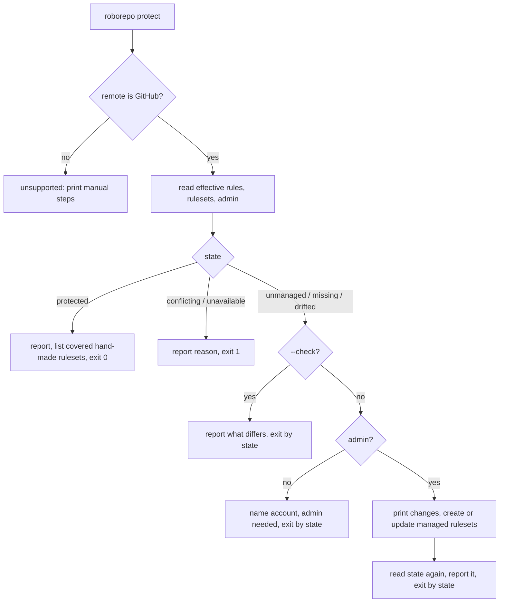

# Protect a repo's plans and main branches on GitHub from one command

## Summary

RoboRepo repos depend on two branches that GitHub should guard. `repo-plans` holds the only copy
of a repo's plans. The default branch, `main` here, should only change through a pull request that
passed CI. Today each repo gets that protection only if the owner adds rulesets by hand. In this
repo, two hand-made rulesets cover part of it, and the required CI checks are still missing.

This plan adds `roborepo protect`. It reads the rules GitHub applies to both branches and compares
them with a policy that RoboRepo ships. With no flag, it creates or updates the RoboRepo-managed
rulesets that close the gap. Every repo then gets the same protection from one command, and doctor
and the portal report when a repo drifts from it. The command never edits or deletes a ruleset it
did not create.

## Context

### Why each branch needs protection

The plans store commits locally and pushes `repo-plans` to `origin`
(`modules/plan-suite/plan-store.mjs`). It integrates remote changes only by fast-forward or by
rebasing pending commits, and it never force-pushes. The remote branch therefore only grows in a
straight line, and rules can hold it there without slowing any save.

The default branch receives code through pull requests. CI (`.github/workflows/ci.yml`) runs on
every pull request with three jobs: `check (ubuntu-latest)`, `check (macos-latest)`, and
`windows-installer`. Nothing on GitHub stops a merge while those jobs fail or are still running.

A ruleset's bypass list applies to every rule in it, so rules that differ in who may bypass them
need separate rulesets. The managed policy has three:

| Managed ruleset | Target | Rules (GitHub rule type) | Bypass | Stops |
| --- | --- | --- | --- | --- |
| `roborepo-plans` | `refs/heads/repo-plans` | `deletion`, `non_fast_forward`, `required_linear_history` | None | Deleting or rewriting plan history; merge commits on the plans branch |
| `roborepo-main-integrity` | Default branch | `deletion`, `non_fast_forward` | None | Deleting or rewriting the default branch, by anyone |
| `roborepo-main-merge` | Default branch | `pull_request` with 1 required approval and `require_last_push_approval`; `required_status_checks` with the CI job names, "up to date" off | Repo admin, mode `always` | Direct pushes, unapproved merges, and merges while a required check fails or is pending |

The admin bypass on `roborepo-main-merge` lets the owner merge their own pull request until an
agent bot account exists. The bypass does not reach the integrity rules, so even an admin token
cannot force-push or delete the default branch. Agents run with the owner's token today, which is
why that split matters.

`repo-plans` must carry no rule beyond those three. Most other rule types can refuse a plan save,
such as `pull_request`, `required_status_checks`, `update`, `required_signatures` (store commits
are unsigned), and the commit-message or file restrictions. Any of them would make saves report
`synchronized: false`.

### Current state

- This repo has two hand-made rulesets on `main`, read with `gh ruleset view` on 2026-10-30
  (recorded in `w7vls1yk`) and updated by the owner since:

  | Ruleset | Rules | Bypass |
  | --- | --- | --- |
  | `protect-main` (25203565) | `deletion`, `non_fast_forward` | None |
  | `no-push-to-main` (26185384) | `pull_request`, 1 required approval | Repo admin, always |

  The owner set 1 approval so an agent cannot merge its own pull request. The owner bypasses it
  until the bot account from GitHub Integration Part 01 (`w7vls1yk`) exists. No ruleset requires
  status checks. "Clear agent friction: permissions, rule conflicts, and stale docs"
  (`vzgsx5vz`) lists adding them as a manual owner step.
- `repo-plans` has no ruleset. `docs/user/guides/plan/lifecycle/plan-suite.md`, section
  "Protect the plans branch", tells the user to add one by hand. It omits linear history, and
  nothing checks the result.
- `/plan-suite-init` (`globals/packages/plan-suite/skills/plan-suite-init/SKILL.md`) says nothing
  about branch rules.
- No RoboRepo code runs `gh` for repository settings. Part 01 (`w7vls1yk`) plans
  `modules/forge/github.mjs` as the one module that runs `gh`.
- The Home page repo card has a ⋮ menu built by `homeMenuItems` in `portal/home/templates.js`,
  with **Pin** and **Ignore Repo** (or **Forget This Repo**). The Plans page lists repo-level
  warnings in `renderWarnings` (`portal/plans/app.js`).
- `portal/shared/hook-review-offer.js` already remembers a one-time offer per viewer in
  `localStorage`, falling back to memory when storage is unavailable.
- A repo's canonical id names its host: `git:github.com/<owner>/<repo>`.
  `providerUrlForRepositoryId` in `modules/repositories/identity.mjs` parses it.

## Goals

- One command reports whether a repo matches the managed protection policy and, when asked, makes
  it match by creating or updating only RoboRepo-managed rulesets.
- Running it again changes nothing.
- Hand-made rulesets are never edited or deleted. The command reports those the managed rulesets
  fully cover, so the owner can delete them.
- A new store is offered protection at the end of `/plan-suite-init`.
- `roborepo doctor` reports a repo that does not match the policy, and whether the signed-in
  account can fix it.
- The portal tells the user once when a repo is unprotected. After that the status stays available
  from the repo's ⋮ menu, and the notice returns only when something the user can act on changes.
- The owner can turn off the default-branch merge policy for one repo, and every clone sees that
  choice. The plans and integrity policies have no opt-out.
- A repo on another host gets the manual steps instead of an error.

## Non-goals

- Editing or deleting any ruleset not named `roborepo-*`.
- Branches other than `repo-plans` and the default branch.
- Hosts other than GitHub beyond printing manual steps.
- Changing which identity agents use on GitHub; Part 01 (`w7vls1yk`) owns that.
- Running protection inside `roborepo plans init`, which must keep working without `gh`.
- Allowing `roborepo protect` in default agent permissions. It writes repo settings with the
  owner's token.

## Proposed design

### Policy

`modules/forge/protection-policy.mjs` defines the three managed rulesets as data: name, target,
rules, and bypass. The required status checks are the job names from the latest successful CI run
on the default branch, read when the command runs. A renamed job still blocks the pull request
that renames it until an admin reruns `roborepo protect` after the merge (see Risks). CI cancels
superseded runs (`cancel-in-progress: true`), so cancelled and failed runs are passed over. A repo whose default branch has no successful run gets `roborepo-main-merge`
without the `required_status_checks` rule, and the report says so.

### Opting out of the merge policy

The opt-out lives on GitHub, so every clone, machine, and portal reads the same answer.
`roborepo protect --skip main-merge` creates or updates `roborepo-main-merge` with its policy rules
and enforcement set to `disabled`. A disabled managed ruleset reads as `skipped` for the merge
policy, and the command never re-enables it on its own. `--unskip main-merge` sets enforcement back
to `active`. The plans and integrity rulesets have no skip.

### Status comes from GitHub

The command reads three things:

- **Effective rules** for each branch, from `GET /repos/{owner}/{repo}/rules/branches/{branch}`.
  This returns every active rule that applies to the branch and needs only read access.
- **Rulesets**: the list from `GET /repos/{owner}/{repo}/rulesets`, then each ruleset in full from
  `GET /repos/{owner}/{repo}/rulesets/{id}`, because the list carries no rules. Bypass actors are
  returned only to accounts that can manage the ruleset. A non-admin therefore sees drift and
  coverage judged on rules and targets alone, and the report says the bypass was not visible.
- **Admin rights**, from `permissions.admin` in `GET /repos/{owner}/{repo}`.

| State | Condition | `--check` exit | Portal |
| --- | --- | --- | --- |
| `protected` | Every managed ruleset exists and matches the policy, or is `skipped`, and no push-blocking rule reaches `repo-plans` | 0 | Nothing |
| `unmanaged` | Every policy rule applies, but through hand-made rulesets, with a managed ruleset absent | 0 | Nothing; the menu offers **Protect** to admins |
| `missing` | A policy rule is absent from its branch's effective rules | 1 | Notice, once |
| `drifted` | A managed ruleset exists but differs from the policy, such as a renamed CI job | 1 | Notice, once, admins only |
| `conflicting` | A push-blocking rule reaches `repo-plans` | 1 | Notice, once |
| `unavailable` | `gh` missing, not signed in, or GitHub unreachable | 1 | Menu item gives the reason |
| `unsupported` | The remote is not GitHub | 1 | Menu item shows the manual steps |

When several conditions hold, the first in this order wins: `unsupported`, `unavailable`,
`conflicting`, `missing`, `drifted`, `unmanaged`, `protected`. A policy whose managed ruleset is
disabled is `skipped`: its rules are left out of the `missing` and `drifted` checks, and its rules
are not compared with the policy.

`unmanaged`, `missing`, and `drifted` carry `admin: true|false`. When GitHub could be read, the
report also lists each repository-level hand-made ruleset as **covered** when the active managed
rulesets, on the same target, apply every rule it has with parameters equal or stricter, and their
bypass list is no wider than its own. A managed ruleset may carry more rules than the one it covers.
Only a covered ruleset is safe to delete. A hand-made ruleset with no bypass is never covered by
`roborepo-main-merge`, which has one. Organization rulesets appear as "set by the organization" and
are never covered.

### The command

```text
roborepo protect [--check] [--json] [--skip main-merge | --unskip main-merge]
```

- `--check` reads the state and changes nothing.
- With no flag, an `unmanaged`, `missing`, or `drifted` state with `admin: true` creates each absent
  managed ruleset with `POST /repos/{owner}/{repo}/rulesets`. It updates each drifted managed ruleset
  with `PUT /repos/{owner}/{repo}/rulesets/{id}`. It prints the planned changes first, then reads the
  state once more and reports it, without applying again.
- With `admin: false`, the command names the signed-in account, says an admin must run it, and
  calls nothing that writes.
- `conflicting`, `unavailable`, and `unsupported` are reported, and nothing is written.
- `--skip` and `--unskip` need `admin: true` and refuse in `conflicting`, `unavailable`, and
  `unsupported`.
- Exit code: 0 when the final state is `protected` or `unmanaged`, 1 otherwise, for every flag.



### Migrating a repo with hand-made rulesets

Managed and hand-made rulesets stack, so creating the managed ones never loosens protection:

1. The owner runs `roborepo protect`. The managed rulesets are created alongside `protect-main`
   and `no-push-to-main`.
2. The command reads the state as `protected` and lists the hand-made rulesets it covers. In this
   repo both are expected to be covered; that depends on `no-push-to-main` settings not read yet.
3. The owner deletes them in GitHub.

### Where the code goes

| Piece | Location | Owns |
| --- | --- | --- |
| GitHub calls | `modules/forge/github.mjs` | Running `gh api`: effective branch rules, ruleset list and detail, repo permissions, login, the latest successful default-branch run's job names, and creating or updating a ruleset |
| Policy and state | `modules/forge/protection-policy.mjs`, `modules/forge/protection.mjs` | The managed ruleset definitions, mapping GitHub's answers to a state, coverage of hand-made rulesets, the merge-policy skip, and the apply-then-recheck flow |
| CLI | `scripts/cli/protect-command.mjs`, `manifests/platform/cli/command-definitions/root/` | Parsing, printing, exit codes |
| Portal API | `scripts/cli/portal-routes-repositories.mjs` | `GET` and `POST /api/repositories/:id/protection`, beside the existing per-repo routes |
| Portal | `portal/plans/app.js`, `portal/home/templates.js`, a shared `portal/shared/protection-panel.js` | The one-time notice, the ⋮ menu item, and the status panel both open |
| Doctor | `scripts/doctor.sh` | One line for the current repo |

Whichever of this plan and Part 01 lands first creates `modules/forge/` with its host-name entry
point and `github.mjs`. The second adds to them. A non-GitHub host resolves to `unsupported` at
that entry point.

### Portal

**Notice.** The Plans page reads protection status for each scanned GitHub repo on load and on
**Refresh**, separately from the plan snapshot, so a slow GitHub call never delays the plan list.
Each read has a bounded timeout and reports `unavailable` when it expires. A repo in `missing`,
`conflicting`, or (for admins) `drifted` shows one warning line. The line names what is missing and
why it matters, and offers
**Protect** when the account is an admin. A non-admin line names the account and says an admin must
run `roborepo protect`. Viewing the line dismisses it.

**Dismissal memory.** Each viewer's browser stores, per repo, the state and admin flag they last
saw, following `hook-review-offer.js`. Nothing is written to the repo. The notice returns only when
one of these changes:

| Change since the user last saw the notice | Notice returns? |
| --- | --- |
| `admin` goes from false to true | Yes, now with **Protect** |
| The state becomes `missing` or `conflicting` from any other state | Yes |
| The state becomes `drifted`, for an admin | Yes |
| Anything else, including a move to `protected`, `unmanaged`, or `unavailable` | No |

**Menu.** The repo card's ⋮ menu on the Home page gains **Branch protection** for GitHub repos.
It opens a panel that fetches the current status and shows it in full:

- the state, and each rule missing or drifted;
- covered hand-made rulesets;
- **Protect** for admins, or the command for an admin to run;
- **Skip merge rules** / **Use merge rules** for admins, through the same write route as
  **Protect**. **Skip merge rules** asks for confirmation first, naming what turns off: the required
  approval and the required CI checks on the default branch. The plans and integrity rules stay on.
  Non-admins see `skipped` and the command an admin would run.

**Protect** in either place runs the same flow as the command.

### Doctor

Doctor checks the Git repo it runs from: the top level of the current directory and its `origin`.
Outside a Git repo, or with a non-GitHub `origin`, it adds no line. Otherwise it adds one line from
`roborepo protect --check --json`,
using the `ok` and `hint` helpers in `scripts/doctor.sh`, so it never turns doctor red. Like the
Node release check, it reports a skip as an `ok` line, and test suites set
`ROBOREPO_SKIP_PROTECTION_CHECK=1` to stay off the network.

| State | Doctor line |
| --- | --- |
| `protected` | `ok` |
| `unmanaged` | `ok`, noting the hand-made rulesets |
| `missing` or `drifted`, admin | `hint`: run `roborepo protect` |
| `missing` or `drifted`, not admin | `hint`: an admin must run `roborepo protect` |
| `conflicting` | `hint` naming the rule and ruleset that will refuse plan saves |
| `unavailable` | `ok`, "skipped" with the reason |
| `unsupported` | `hint` pointing to the manual steps |

### `/plan-suite-init`

After the store exists, the skill runs `roborepo protect --check --json`. For `missing` with
`admin: true` it asks the user whether to protect the repo now and runs `roborepo protect` on a
yes. For `admin: false` it reports that an admin must run the command.

## Implementation plan

- [ ] Confirm the endpoints, the ruleset request bodies, the `actor_id` for the repo admin role, and
      how rulesets behave on private repos under the owner's GitHub plan, against a scratch repo.
- [ ] Add `modules/forge/` with its host-name entry point and `github.mjs`, or extend them if
      Part 01 has added them.
- [ ] Add `protection-policy.mjs` and `protection.mjs` with the state mapping, coverage of
      hand-made rulesets, the merge-policy skip, and the apply-then-recheck flow.
- [ ] Add `roborepo protect` with its command definition and usage text. Keep it out of the
      default agent permission allows.
- [ ] Add the portal routes, the Plans page notice with its dismissal memory, the Home page
      **Branch protection** menu item, and the shared status panel.
- [ ] Add the doctor line and `ROBOREPO_SKIP_PROTECTION_CHECK`, exported beside
      `ROBOREPO_SKIP_NODE_RELEASE_CHECK` in `scripts/test/ci.sh`, `scripts/test/test-cli.sh`, and
      `scripts/test/pre-push-check.sh`.
- [ ] Add the check-and-offer step to `/plan-suite-init`.
- [ ] Add `scripts/test/protect-check.mjs` and `scripts/test/doctor-protection-check.mjs` to the CI
      group in `scripts/test/check-groups.json`, and
      `scripts/test/portal-ui/branch-protection.spec.mjs` to the portal UI suite.
- [ ] Update the docs under Documentation impact.
- [ ] Replace the manual required-check procedure in `docs/internal/testing.md`, added by "Clear
      agent friction: permissions, rule conflicts, and stale docs" (`vzgsx5vz`), with running
      `roborepo protect` and deleting the covered hand-made rulesets.

## Validation

Automated, with a fake `gh` executable first on `PATH`. It answers from a JSON state file and
records each request.

- `scripts/test/protect-check.mjs`:
  - every state maps to the documented output and exit code, for `--check` and `--json`, with and
    without admin;
  - `missing` with admin sends one create per absent managed ruleset, with the exact name,
    target, rules, and bypass, then sends nothing on a second run;
  - `drifted` with admin sends one update to the drifted managed ruleset and none to hand-made ones;
  - `unmanaged` with admin creates the managed rulesets and leaves the hand-made ones untouched;
  - required checks come from the fake's latest successful default-branch run, a newer cancelled
    run is passed over, and a repo with no successful run omits the status-check rule;
  - no request ever edits or deletes a ruleset not named `roborepo-*`;
  - `admin: false` sends no write and names the account;
  - a hand-made ruleset is listed as covered only when target, rules, enforcement, and bypass
    match, and a no-bypass `pull_request` ruleset is never covered by `roborepo-main-merge`;
  - `--skip main-merge` writes `roborepo-main-merge` with enforcement `disabled`, a second clone
    against the same fake reads it as `skipped`, and `--unskip main-merge` sets it to `active`;
  - after an apply, the command reads the state once more and does not apply again;
  - a non-GitHub `origin` prints the manual steps and never calls `gh`.
- `scripts/test/doctor-protection-check.mjs`, against a repo and the fake `gh`: the documented line
  per state, exit 0 in every case, and no `gh` call with `ROBOREPO_SKIP_PROTECTION_CHECK=1`.
- `scripts/test/portal-ui/branch-protection.spec.mjs`, run by `npm run test:portal-ui`.
  `scripts/test/portal-ui/run.mjs` boots one server for every spec, so it puts the fake `gh` on
  that server's `PATH` for the whole suite:
  - the notice shows once for `missing`, and a reload with the same state does not show it again;
  - changing the fake from non-admin to admin brings the notice back with **Protect**;
  - **Protect** clears the notice and the panel reads `protected`;
  - the ⋮ **Branch protection** item opens the panel in every state;
  - **Skip merge rules** writes nothing until the confirmation is accepted, then the panel reads
    `skipped`, and **Use merge rules** restores `protected`;
  - a non-admin sees no skip buttons, only the state and the command.
- `node scripts/test/docs-reference-check.mjs` passes.

Manual, on a scratch GitHub repo where the user is admin:

| Check | Expected |
| --- | --- |
| `roborepo protect --check` before protecting | `missing`, listing the three managed rulesets |
| `roborepo protect`, then view the repo's rulesets | Three rulesets named `roborepo-*`, with the rules in Context |
| `roborepo plans save` on a plan | `synchronized: true` |
| Force-push and delete `repo-plans` and `main` | GitHub rejects all four, including for the admin |
| Open a pull request with a failing check | Merge is blocked for a non-admin, and the admin sees the bypass |
| Rename a CI job, then `roborepo protect --check` | `drifted`, naming the check |

## Risks

| Risk | Mitigation |
| --- | --- |
| The command runs `gh` with the owner's admin token, so an agent that runs it acts as the owner | It writes only `roborepo-*` rulesets, prints changes first, and stays out of the default agent allows |
| An agent calls `POST /api/repositories/:id/protection` on the local portal instead of the command | The route sits behind the portal's existing origin and `x-cli-portal-token` guard for writes, like every other portal write. An agent that can read that token can still call it; Part 01's bot identity, without admin rights, closes that path |
| A required check never reports, such as a job skipped by a path filter, and blocks every merge | Checks come from jobs in the default branch's latest successful run; the admin bypass remains |
| A pull request that renames a CI job is blocked by the old required name | The admin merges it with the bypass and reruns `roborepo protect`, which reads the new name from the next successful run |
| Several `gh api` calls per repo on every Plans page load and **Refresh** slow the page or approach GitHub's rate limit | Status loads apart from the plan list, each call has a bounded timeout, and a failure reads as `unavailable` |
| Under Part 01's bot identity, the bot has no admin rights | It reads as `admin: false`; the check needs only read access |
| The effective-rules endpoint omits legacy branch protection | A legacy rule alone reads as `missing`; the managed ruleset then duplicates it, which is harmless |
| A wildcard ruleset adds a push-blocking rule to `repo-plans` | Reported as `conflicting`, naming the ruleset, before saves start failing |

## Decision Log

- 2026-11-11, user: `roborepo doctor` reports protection status for the current repo, including
  when the signed-in account is not an admin.
- 2026-11-11, user: the portal calls out a non-admin account explicitly instead of offering a
  button GitHub would refuse.
- 2026-11-11, user: the plan covers the default branch as well as `repo-plans`, so one command
  applies the same protection to every repo, including the required CI checks from `vzgsx5vz`.
- 2026-11-11, user: the command creates and updates RoboRepo-managed rulesets but never edits or
  deletes hand-made ones. Alternatives were editing existing rulesets in place, and deleting them
  so the command owns every rule. Deletion would let any holder of the owner's token remove
  protection, and editing would overwrite settings someone chose by hand. The owner deletes covered
  hand-made rulesets after the managed ones apply.
- 2026-11-11, user: updates apply only on an explicit run or **Protect** click, never from
  `--check`, doctor, or a page load.
- 2026-11-11, user: the unprotected-repo notice shows once per viewer and returns only when the
  admin flag or protection state changes. The status stays available from the repo's ⋮ menu.
- 2026-11-11, user: 1 required approval with an admin bypass is the default merge policy. It keeps
  agents from merging their own pull requests while the owner can still merge.
- 2026-11-11, user: only the merge policy can be skipped per repo. No case was found for leaving
  the plans or integrity rules off.
- The default branch is split into two managed rulesets because GitHub applies a bypass to every
  rule in a ruleset. One ruleset would let the admin token force-push the default branch.
- The command moves from `roborepo plans protect` to `roborepo protect`, because it now covers a
  branch the plans store does not own. The filename keeps its `plans-` prefix because the store has
  no rename command; the `git` namespace would fit better if one is added.
- The merge-policy opt-out is a managed ruleset with enforcement `disabled`, not local config.
  Every clone and portal then reads the same choice from GitHub, and no RoboRepo state is added.
  Local Git config was the alternative; it would let another clone recreate the ruleset.
- Rules supplied entirely by hand-made rulesets read as `unmanaged`, exit 0, rather than `missing`:
  the branch is protected, and only the managed form is absent.
- A hand-made ruleset counts as covered only when the managed rulesets apply each of its rules,
  equal or stricter, on the same target, with a bypass no wider, so deleting a covered one never
  loosens protection.
- The merge policy includes `require_last_push_approval`, so Part 01's bot cannot merge a pull
  request it pushed last. Part 01 now relies on `roborepo-main-merge` for that rule.
- Portal routes join the per-repo routes in `portal-routes-repositories.mjs` as
  `/api/repositories/:id/protection`, matching `worktree-cleanup/dismiss`.
- 2026-11-11, user: the merge-policy opt-out is available both from the CLI (`--skip` /
  `--unskip`) and from the portal panel for admins. The alternative was CLI-only, which saves a
  button pair and its tests. The portal already has the write route for **Protect**, so the toggle
  costs little, and a confirmation step guards the one action that loosens protection.

## Open questions

- Whether rulesets are enforced on private repos under the owner's GitHub plan. If they are not,
  the command needs an `unsupported` reason for that case. The first implementation task settles it.

## Documentation impact

| Doc | Update |
| --- | --- |
| `docs/user/reference/roborepo-cli.md` | Add `roborepo protect`, its states, flags, and exit codes; add the doctor line and its skip variable |
| `docs/user/guides/plan/lifecycle/plan-suite.md` | Replace the manual "Protect the plans branch" steps with the command; keep manual steps for other hosts |
| `docs/user/reference/plans-portal.md` | The one-time notice, when it returns, and the routes |
| `docs/user/reference/repositories.md` | The **Branch protection** menu item and its panel |
| `docs/internal/testing.md` | Replace the manual required-check procedure with `roborepo protect` |
| `globals/packages/plan-suite/skills/plan-suite-init/SKILL.md` | The check-and-offer step and its report lines |
| `docs/internal/portal-architecture.md` | The `/api/repositories/:id/protection` routes |
| `docs/internal/docs-map.md` | `modules/forge/`, if this plan creates it before Part 01 |
