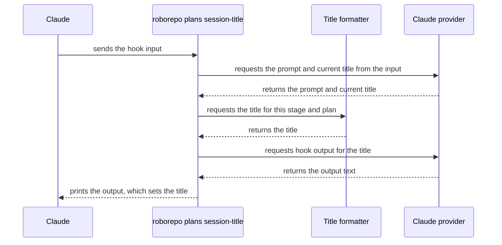

# Session Titles Show the Workflow Stage

## Summary

Give agent sessions a title that starts with the plan-workflow stage they are in, so a person
running many Claude and Codex sessions at once can tell them apart in the sidebar or session
picker. The intended mechanism for Claude is a hook that sets the title; two trials, listed below,
confirm how much of Claude that hook can cover. Harnesses with no way to set a title get the same
identifier through the copied portal prompt and a rename line the person can paste.

## Context

A plan moves through the plan-suite commands (`/plan-write`, `/plan-promote`, `/plan-execute`,
`/plan-review`, `/plan-close`, `/plan-archive`), often in several sessions and sometimes several
commands in one session. Claude generates a session's title from its first prompt (*docs*; the
evidence labels are explained under Current state). How Codex generates one was not confirmed.
Neither title says which stage or which plan the session belongs to. The user reported being
confused by these titles while running sessions in parallel.

## Goals

- A session's title names the current stage and the plan, in one fixed format.
- The title follows the session when it moves to another stage.
- The behavior exists only while the plan-suite package is enabled.
- The harness-specific way of setting a title lives with that harness's code; shared code only
  asks for it.
- Harnesses with no way to set a title still show the identifier to the person and the agent.

## Non-goals

- Setting titles automatically in Codex or Gemini. Codex offers no way today and Gemini has not
  been investigated; "Stage Titles for Codex and Gemini Sessions" (`96r9wbj0`) owns both.
- Changing the session launcher planned in "Session Launching — Milestone 1"
  (`plan-session-launching-milestone-1`). That plan does not mention titles, and this one does not
  add them to it.
- Retitling a session that receives no further prompt. A title changes only when a prompt arrives
  or the agent acts.

## Terms

| Term | Meaning |
| --- | --- |
| Harness | An agent tool RoboRepo configures: Claude (CLI and desktop app), Codex, Gemini |
| Harness provider | RoboRepo's code and manifest for one harness, under `scripts/harnesses/<id>/` and `globals/harnesses/<id>/provider.json` |
| Capability | A named feature a provider's manifest declares the harness supports, listed in `scripts/harnesses/contract.mjs` |
| Adapter group | The set of functions a provider must supply for a capability it declares |
| Plan snapshot | The in-memory list of a repository's plans that `modules/plan-suite/index.mjs` builds from the plan store; it resolves a plan id to its title |
| Copied portal prompt | The text the Plans page puts on the clipboard for a plan action, built by `buildPrompt()` |

## Current state

Evidence labels: *docs* means read in the harness's official documentation on 2026-11-23 and not
exercised. *checked* means read in this repository at the reviewed commit, or, for the Claude
desktop app, read on 2026-11-23 in the descriptions of the two session tools the app gives an
agent: one that renames a session and one that starts another session.

| Harness | Agent can rename its session | Hook can set the title | Title at launch |
| --- | --- | --- | --- |
| Claude desktop app | Yes, with the rename tool. If the person named the session, the app asks them first; a session with nobody present to answer refuses the rename (*checked*) | Unknown | Yes, a parent session passes a title of under 60 characters (*checked*) |
| Claude Code CLI | No documented way (*docs*) | Yes: a hook may return `hookSpecificOutput.sessionTitle` on `UserPromptSubmit`. Its input carries the session's custom title as `session_title`, whether a person or an earlier hook set it, and a typed command arrives as the prompt text (*docs*) | Yes, `claude -n "<name>"` (*docs*) |
| Codex | No documented way (*docs*) | None documented (*docs*) | No; requested in openai/codex issue 44422 (*docs*) |
| Gemini | Not investigated | Not investigated | Not investigated |

In the Claude CLI and in Codex the person can rename a session by typing `/rename <name>` (*docs*).

Repository structure this plan builds on (*checked*):

| Existing piece | Location | Use here |
| --- | --- | --- |
| Package hook resources, one per harness | `"type": "hooks"` entries such as those in `globals/packages/telemetry/package.config.json` | plan-suite gains one; it has none today |
| A package hook that calls the CLI | `globals/packages/telemetry/hooks-claude.json` runs `roborepo telemetry capture …` on `UserPromptSubmit` | Same shape for the title hook |
| Package rules | `globals/packages/plan-suite/rules.md`, loaded in every session while the package is on | Holds the agent-facing rule |
| Capabilities and their required functions | `HARNESS_CAPABILITIES` and `CAPABILITY_REQUIRED_METHODS` in `scripts/harnesses/contract.mjs` | Gains a `session-title` capability |
| Copied portal prompts | `buildPrompt()` in `modules/plan-suite/index.mjs`, called from `scripts/cli/plans.mjs` | Gains a title line |

## Trials first

Two facts about Claude decide how much the hook covers. Trial A is unknown; trial B is documented
but not yet exercised. Each is a short manual check with a throwaway hook in a scratch settings
file. The design below is written for two "yes"
answers; the last column says what changes otherwise.

| Trial | If yes | If no |
| --- | --- | --- |
| A. Does a hook-returned title take effect in the Claude desktop app, not only the CLI? | The hook covers both | In the desktop app the agent sets the title with its rename tool, as the rule already instructs |
| B. Does `UserPromptSubmit` fire with the text of a typed `/plan-execute …` prompt, as the documentation says? | The hook covers typed commands | The hook covers only copied prompts, which carry a title line. A typed command in the Claude CLI gets no stage title; record that as a known gap |

## Proposed design

### Title format

| Session kind | Title | Description comes from |
| --- | --- | --- |
| Running a plan command | `/plan-execute: <plan title>` (any of the six commands) | The plan's H1 heading |
| Started by a plan session for part of its work | `/plan sub-task: <task>` | The task the parent hands over |
| Work with no plan | `Quick Change: <description>` | The agent's short description of the change |

The part before the description is the **stage prefix**. There are eight: `/plan-write:`,
`/plan-promote:`, `/plan-execute:`, `/plan-review:`, `/plan-close:`, `/plan-archive:`,
`/plan sub-task:`, and `Quick Change:`.

The whole title, prefix included, is at most 59 characters, because the Claude desktop app requires
a title passed at launch to be under 60. A longer description is cut at a word boundary and ends
with `…`. The plan id never appears: ids are opaque and titles are for people.

Known gap: in the Claude Code CLI nothing sets `Quick Change:`, because the agent has no rename
tool there and the hook acts only on plan commands. Those sessions keep Claude's generated title.

### How a title reaches a session

| Path | Works in | Covers |
| --- | --- | --- |
| Hook | Claude, subject to the trials | Any prompt that carries a title line or opens with a plan command |
| Copied portal prompt | Every harness | Shows the identifier to the agent and the person; in Claude it also feeds the hook |
| Rule | Every harness, as far as the agent's tools allow | Sub-task launches, `Quick Change:` and stages the agent starts itself where it has a rename tool, and the paste-ready rename line for plan stages elsewhere |

The hook path, when a prompt is submitted in Claude:



### Title formatter

A pure module in `modules/plan-suite/` exports the eight stage prefixes, a function that builds a
title from a session kind and a description (including the length cut), and a function that says
whether a given title already carries a stage prefix. The command and the prompt builder call it. The
rule text has to state the format in words for the agent, so a test compares the prefixes written
in `globals/packages/plan-suite/rules.md` with the module's.

### Provider capability

Add `session-title` to the provider contract, with adapter group `sessionTitle` and two functions,
so that both ends of the harness's hook format stay in the provider:

- `readHookInput(text)` returns the submitted prompt and the session's current custom title from
  the harness's hook input.
- `hookOutput({ title })` returns the text the harness expects a hook to print in order to set
  that title.

| Provider | Declares `session-title` |
| --- | --- |
| Claude | Yes. `readHookInput` reads `prompt` and `session_title`; `hookOutput` returns the `hookSpecificOutput.sessionTitle` output |
| Codex, Gemini | No. `docs/internal/harness-provider-interface.md` requires that a capability be declared only when the harness supports it, so an undeclared capability is how "not supported yet" is expressed |

The provider only translates the harness's format. Deciding whether to set a title stays in the
shared command.

### Hook, scoped to the package

`globals/packages/plan-suite/` gains a `hooks-claude.json` and a matching `hooks` resource with
`"harness": "claude"` in `package.config.json`. The hook runs a new command,
`roborepo plans session-title --harness claude`, on `UserPromptSubmit`. The command orchestrates:

1. If the harness's provider does not declare `session-title`, print nothing and exit 0.
2. Pass standard input to the provider's `readHookInput` to get the prompt and current title.
3. If the prompt has no title line and does not open with a plan command, print nothing and exit 0.
4. If the current title is set and carries no stage prefix, print nothing and exit 0, so a
   hand-written name is never replaced. A title that carries a stage prefix is replaced, which is
   how the title follows a session to its next stage.
5. Take the title from the prompt's title line when it has one. Only otherwise build the plan
   snapshot, look up the plan the prompt names, and build the title from the leading plan command
   and that plan's heading (this branch depends on trial B).
6. Request the hook output from the provider and print it.

The command never fails a prompt: any error exits 0 with no output. Disabling plan-suite removes
the hook along with the package's other resources.

### Rule, scoped to the package

One section in `globals/packages/plan-suite/rules.md` states the format and these instructions:

- When a plan command starts and you have a tool that renames your own session, set the stage
  title with it.
- When starting another session for part of a plan's work, pass `/plan sub-task: <task>` as its
  title if the launch accepts one.
- On the first file edit in a session that is not working a plan, set `Quick Change: <description>`
  if you have a tool that renames your own session.
- If you have no such tool: in Claude Code do nothing more, because a hook sets plan-stage titles
  there; in any other harness print one line the person can paste, `/rename <title>`, once each
  time a plan command starts, and continue without waiting. Print no rename line for
  `Quick Change:`.

### Copied prompts

`buildPrompt()` adds one line after the command line when the prompt opens with a plan command and
selects exactly one plan:

```text
/plan-execute

Session title: /plan-execute: Session Titles Show the Workflow Stage
Work with plan `gcfw77cq` at `plans/ready/session-stage-titles.md` in repository `roborepo`.
```

## Implementation plan

- [ ] Run trials A and B and record the results in this plan's Decision Log.
- [ ] Add the title formatter module and its tests.
- [ ] Add the `session-title` capability to `scripts/harnesses/contract.mjs` and to the
      `capabilities` list in `scripts/harnesses/provider-manifest.schema.json`, implement it in
      `scripts/harnesses/claude/`, and declare it in `globals/harnesses/claude/provider.json`.
- [ ] Add `roborepo plans session-title` in `scripts/cli/plans.mjs` and register it with a command
      definition under `manifests/platform/cli/command-definitions/`, as `plans stop-servers` is.
- [ ] Add the plan-suite hook resource and `hooks-claude.json`.
- [ ] Add the rule section to `globals/packages/plan-suite/rules.md`.
- [ ] Add the title line to `buildPrompt()`.
- [ ] Update the documents listed under Documentation impact.

## Validation

Scripted checks, each asserting output a person or a harness would see:

- The formatter returns the three formats, cuts a long description on a word boundary so the whole
  title is at most 59 characters, and leaves a short one unchanged.
- `roborepo plans session-title --harness claude`, given recorded hook input, prints the Claude
  title output for a prompt with a title line and for a typed plan command.
- Stage change: given a current title of `/plan-execute: <plan>` and a `/plan-review` prompt for
  the same plan, it prints the `/plan-review: <plan>` title.
- It prints nothing for an ordinary prompt, for a current title without a stage prefix, for
  malformed input, and for `--harness codex`; it exits 0 in every case.
- The stage prefixes written in `globals/packages/plan-suite/rules.md` match the formatter's.
- `buildPrompt()` includes the title line for one plan with a plan command, and omits it with no
  command, with a command name that is no longer a plan command, and with several plans. These
  extend `scripts/test/plan-suite-check.mjs`.
- Enabling and disabling plan-suite adds and removes the hook in a simulated Claude config,
  extending `scripts/test/hook-composition-check.mjs`.
- `npm test`, the smoke suite, locally; CI runs the full gate (`npm run check`) because the change
  touches package defaults, harness config, and the shared provider contract.

One check needs a person: after install, a plan command in the Claude CLI and in the desktop app
shows the new title in the session list.

## Documentation impact

| Document | Update |
| --- | --- |
| `docs/user/guides/plan/lifecycle/plan-suite.md` | Explain the title format and where it appears |
| `docs/user/reference/claude-hooks.md` | List the plan-suite title hook |
| `docs/user/reference/plans-portal.md` | Note the title line in copied prompts |
| `docs/user/reference/roborepo-cli.md` | Add `roborepo plans session-title` |
| `docs/user/guides/harnesses/supported-harnesses.md` | Add `session-title` to the capability table |
| `docs/internal/harness-provider-interface.md` | Add the `session-title` capability |

## Risks

- **The hook runs on every prompt.** It must be fast and silent. The command exits before building
  the plan snapshot unless the prompt carries a title line or opens with a plan command.
- **Claude's own retitling.** Claude replaces a generated title when a plan is accepted in its plan
  mode (*docs*). The next plan-command prompt sets the stage title again; a session that receives
  no further prompt keeps Claude's title.
- **Agent-dependent paths.** Sub-task and `Quick Change:` titles depend on the agent following the
  rule, so they will sometimes be missed. The hook path does not have this weakness.
- **A hook-set title looks like a person's.** Claude reports both as the same custom title, so the
  command tells them apart only by the stage prefix. A person who names a session with a stage
  prefix will see it replaced at the next plan command.

## Open questions

- Should a session that ran a plan command and then moved to unrelated work keep its last stage
  title? Recommended: yes; nothing reliable signals that the plan work ended.

## Decision Log

- Hook plus rule, both inside the plan-suite package, chosen by the user over a rule alone or a
  small skill required by every plan command (2026-11-23).
- The harness-specific title mechanism is a provider capability, at the user's direction, so shared
  code never carries one harness's hook format (2026-11-23).
- Codex and Gemini leave the capability undeclared instead of declaring it with placeholder
  functions, following the provider guide's rule; the user agreed (2026-11-23).
- Copied portal prompts carry the title as the harness-neutral fallback, and sessions outside
  Claude also get a paste-ready rename line, at the user's direction (2026-11-23).
- `Quick Change:` is set by the agent on its first edit, not guessed from the first prompt, which
  would mislabel sessions that only ask a question (user's choice, 2026-11-23).
