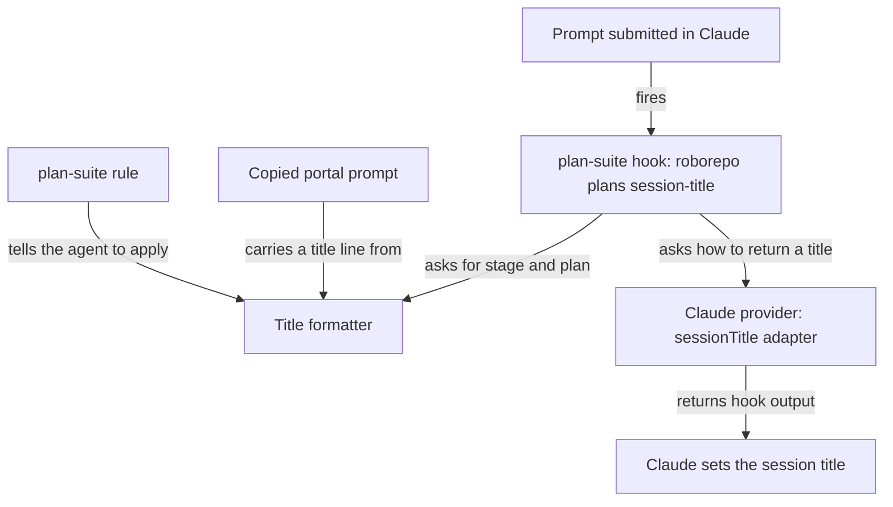

# Session Titles Show the Workflow Stage

## Summary

Give every agent session a title that starts with the plan-workflow stage it is in, so a person
running many Claude and Codex sessions at once can tell them apart in the sidebar or session
picker. Claude sessions are retitled automatically by a hook; harnesses that cannot set a title
get the same identifier through the copied portal prompt and a paste-ready rename line.

## Context

A plan moves through the plan-suite commands (`/plan-write`, `/plan-promote`, `/plan-execute`,
`/plan-review`, `/plan-close`, `/plan-archive`), often in several sessions and sometimes several
commands in one session. Each harness titles a session from its first prompt, so two sessions
working on different stages of different plans get titles that do not say which stage or which
plan they belong to. The user reported being confused by these titles while running sessions in
parallel.

## Goals

- A session's title names the current stage and the plan, in one fixed format.
- The title follows the session when it moves to another stage.
- The behavior exists only while the plan-suite package is enabled.
- The mechanism for setting a title lives in the harness provider; shared code only asks for it.
- Harnesses with no way to set a title still show the identifier to the person and the agent.

## Non-goals

- Setting titles automatically in Codex or Gemini. Neither offers a way today; see "Stage Titles on
  Harnesses That Cannot Set Them Yet" (`96r9wbj0`).
- Changing the session launcher described in "Session Launching — Milestone 1"
  (`plan-session-launching-milestone-1`). Passing a title at launch is a later addition there.
- Renaming sessions that already exist.

## Title format

| Session kind | Title | Description comes from |
| --- | --- | --- |
| Running a plan command | `/plan-execute: <plan title>` (any of the six commands) | The plan's H1 heading |
| Started by a plan session for part of its work | `/plan sub-task: <task>` | The task the parent hands over |
| Work with no plan | `Quick Change: <description>` | The agent's short description of the change |

The whole title is at most 60 characters, the limit the Claude desktop app sets on a title passed
when one session starts another. A longer description is cut at a word boundary and ends with `…`.
The plan id never appears: ids are opaque and titles are for people.

## Current state

Facts marked *docs* were read in the harness's official documentation on 2026-11-23 and have not
been exercised; facts marked *checked* were read in this repository or in the tool's own definition.

| Harness | Agent can rename its session | Hook or config can set the title | Title at launch |
| --- | --- | --- | --- |
| Claude desktop app | Yes, a rename tool; a title the user set needs their approval, and unattended sessions decline (*checked*) | Not known; see Trials first | Yes, a parent session passes a title of up to 60 characters (*checked*) |
| Claude Code CLI | No documented way (*docs*) | Yes: a hook may return `hookSpecificOutput.sessionTitle` on `UserPromptSubmit` and on `SessionStart`, and receives the current user-set title as `session_title` (*docs*) | Yes, `claude -n "<name>"` (*docs*) |
| Codex | No documented way (*docs*) | None found (*docs*) | No; requested in openai/codex issue 44422 (*docs*) |
| Gemini | Not investigated | Not investigated | Not investigated |

Both CLIs let the person rename a session by typing `/rename <name>` (*docs*).

Relevant repository structure (*checked* at the reviewed commit):

| Existing piece | Location | Use here |
| --- | --- | --- |
| Package hook resources, per harness | `"type": "hooks"` entries such as `globals/packages/telemetry/package.config.json` | plan-suite gains one; it has none today |
| A package hook that calls the CLI | `globals/packages/telemetry/hooks-claude.json` runs `roborepo telemetry capture …` on `UserPromptSubmit` | Same shape for the title hook |
| Package rules | `globals/packages/plan-suite/rules.md`, loaded in every session while the package is on | Holds the agent-facing rule |
| Provider capabilities and required methods | `HARNESS_CAPABILITIES` and `CAPABILITY_REQUIRED_METHODS` in `scripts/harnesses/contract.mjs` | Gains a `session-title` capability |
| Placeholder adapters | `stubAdapterGroups` and `isStubAdapter` in `scripts/harnesses/stub-adapter.mjs` | Codex and Gemini use them |
| Copied portal prompts | `buildPrompt()` in `modules/plan-suite/index.mjs`, called from `scripts/cli/plans.mjs` | Gains a title line |

## Proposed design

One function owns the format. Three paths deliver it: a hook where the harness supports one, the
copied prompt everywhere, and a rule for what neither can see.



### Title formatter

A pure function in `modules/plan-suite/` takes a session kind (a plan command, sub-task, or quick
change) and a description, and returns the title in the format above, including the length cut.
The hook, the prompt builder, and the tests all call it, so the format is written once.

### Provider capability

Add `session-title` to the provider contract, with adapter group `sessionTitle` and one method,
`hookOutput({ title, event, currentTitle })`. It returns the text the harness expects a hook to
print in order to set the title, or nothing when the title must stay as it is.

| Provider | Implementation |
| --- | --- |
| Claude | Real. Returns the `hookSpecificOutput.sessionTitle` output for `UserPromptSubmit`. Returns nothing when `currentTitle` is a title the user set that does not already carry one of the three prefixes, so a hand-written name is never replaced |
| Codex, Gemini | Declared and stubbed with `stubAdapterGroups`, as their other unimplemented groups are. Callers skip a stub with `isStubAdapter` |

### Hook, scoped to the package

`globals/packages/plan-suite/` gains a `hooks-claude.json` and a matching `hooks` resource with
`"harness": "claude"` in `package.config.json`. The hook runs a new command,
`roborepo plans session-title --harness claude --event UserPromptSubmit`, on every submitted prompt.
The command is the orchestrator:

1. Read the hook input from standard input.
2. Find the stage and plan: a title line in the prompt wins; otherwise a leading plan command plus
   the plan the prompt names, resolved through the plan snapshot.
3. If neither is present, print nothing and exit 0, so non-plan prompts are untouched.
4. Format the title, ask the harness provider for the hook output, and print it.

The command never fails a prompt: any error exits 0 with no output. Disabling plan-suite removes
the hook with the package's other resources.

### Rule, scoped to the package

One section in `globals/packages/plan-suite/rules.md` gives the format and four instructions:

- When a plan command starts and the title does not already show that stage, set it if the harness
  gives the agent a way to rename its own session.
- When starting another session for part of a plan's work, pass `/plan sub-task: <task>` as its
  title if the launch accepts one.
- On the first file edit in a session that is not working a plan, set `Quick Change: <description>`
  if the agent can rename its own session.
- When the agent cannot rename the session, print one line the person can paste, `/rename <title>`,
  once per stage, and continue without waiting.

### Copied prompts

`buildPrompt()` adds one line after the command line, for prompts that open with a plan command and
select exactly one plan:

```text
/plan-execute

Session title: /plan-execute: Session Titles Show the Workflow Stage
Work with plan `gcfw77cq` at `plans/ready/session-stage-titles.md` in repository `roborepo`.
```

In Claude the hook reads this line and needs no plan lookup. In any other harness the agent and the
person both see the identifier, and the rule tells the agent what to do with it.

## Trials first

Two facts decide the hook's final shape and are not yet known. Each is a short manual check with a
throwaway hook in a scratch settings file.

| Trial | If yes | If no |
| --- | --- | --- |
| Does a hook-returned title take effect in the Claude desktop app, not only the CLI? | One mechanism covers both | The desktop app relies on the rule and the agent's rename tool |
| Does `UserPromptSubmit` fire with the text of a typed `/plan-execute …` prompt? | The hook covers typed commands | The hook covers only copied prompts with a title line; typed commands rely on the rule |

## Implementation plan

- [ ] Run both trials and record the results in this plan's Decision Log.
- [ ] Add the title formatter and its tests.
- [ ] Add the `session-title` capability to the contract, the Claude implementation, and the Codex
      and Gemini stubs; declare it in the three provider manifests under `globals/harnesses/`.
- [ ] Add `roborepo plans session-title` and register it in the CLI command catalog.
- [ ] Add the plan-suite hook resource and `hooks-claude.json`.
- [ ] Add the rule section to `globals/packages/plan-suite/rules.md`.
- [ ] Add the title line to `buildPrompt()`.
- [ ] Update the documents listed under Documentation impact.

## Validation

Scripted checks, each asserting output a person or harness would see:

- The formatter returns the three formats, cuts a long description at 60 characters on a word
  boundary, and leaves a short one unchanged.
- `roborepo plans session-title` given recorded hook input prints the Claude title output for a
  prompt with a title line and for a typed plan command; prints nothing for an ordinary prompt, for
  a user-set title, and for malformed input; and always exits 0.
- The provider contract accepts all three providers with `session-title` declared, and the Codex
  and Gemini methods report as stubs.
- `buildPrompt()` includes the title line for one plan with a plan command, and omits it for no
  command, a retired command, several plans, and portable mode's unchanged cases (extend
  `scripts/test/plan-suite-check.mjs`).
- Enabling and disabling plan-suite adds and removes the hook in a simulated Claude config
  (the existing hook composition checks).
- The repository health check, because the change touches package defaults, harness config, and a
  shared provider contract.

One check needs a person: after install, typing a plan command in the Claude CLI and in the desktop
app shows the new title in the session list.

## Documentation impact

| Document | Update |
| --- | --- |
| `docs/user/guides/plan/lifecycle/plan-suite.md` | Explain the title format and where it appears |
| `docs/user/reference/claude-hooks.md` | List the plan-suite title hook |
| `docs/user/reference/plans-portal.md` | Note the title line in copied prompts |
| `docs/user/reference/roborepo-cli.md` | Add `roborepo plans session-title` |
| `docs/internal/harness-provider-interface.md` | Add the `session-title` capability |

## Risks

- **The hook runs on every prompt.** It must be fast and silent. The command exits before loading
  the plan snapshot unless the prompt carries a title line or opens with a plan command.
- **Claude's own retitling.** Claude replaces a generated title when a plan is accepted in its plan
  mode (*docs*). The next plan-command prompt sets the stage title again; a session that never
  receives another prompt keeps Claude's title.
- **Agent-dependent paths.** Sub-task and Quick Change titles depend on the agent following the
  rule, so they will sometimes be missed. The hook-driven path does not have this weakness.

## Open questions

- Should a session that ran a plan command and then moved to unrelated work keep its last stage
  title? Recommended: yes; nothing reliable signals that the plan work ended.

## Decision Log

- Hook plus rule, both inside the plan-suite package, chosen by the user over a rule alone or a
  small skill required by every plan command (2026-11-23).
- The title mechanism is a provider capability with stubs for Codex and Gemini, at the user's
  direction, so shared code never carries one harness's hook format (2026-11-23).
- Copied portal prompts carry the title as the harness-neutral fallback, and Codex sessions also
  get a paste-ready rename line, at the user's direction (2026-11-23).
- `Quick Change:` is set by the agent on its first edit rather than guessed from the first prompt,
  which would mislabel sessions that only ask a question (user's choice, 2026-11-23).
