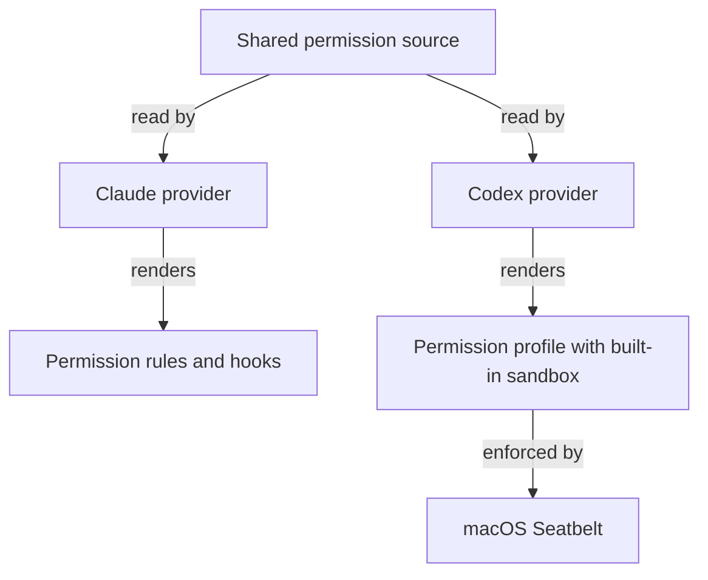
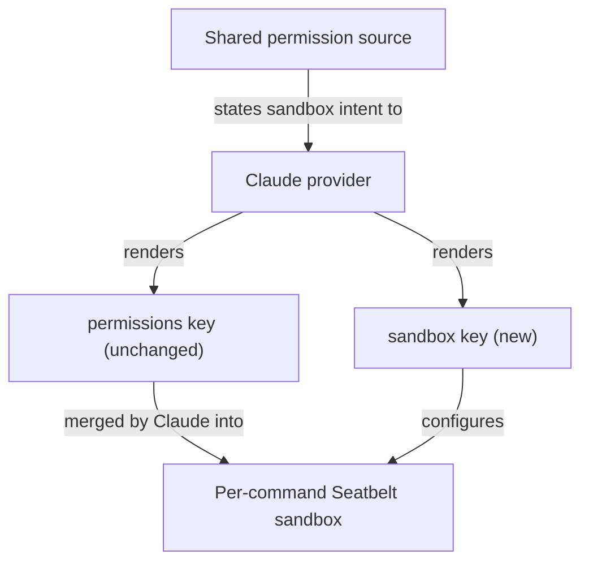

# Cut Claude permission prompts by running shell commands in the native sandbox

## Summary

Long Claude sessions stall on permission prompts for shell commands that only touch the repository
and temp folders. Claude Code has a native sandbox that confines each shell command at the OS level
and lets confined commands run without a prompt. RoboRepo does not turn it on.

This plan makes the Claude provider render that sandbox from the shared permission source, the same
way the Codex provider already renders its sandbox profile. A hand-written trial in one checkout
showed the prompt-free behavior and exposed gaps the generated version must close.

## Context

### Terms

| Term | Meaning |
| --- | --- |
| Shared permission source | `manifests/inventory/agent-permissions.json`: harness-neutral behaviors such as `write-scope`, `read-secrets`, and `go-online` |
| Provider | The per-harness code under `scripts/harnesses/<id>/` and `globals/harnesses/<id>/` that turns shared behaviors into native config |
| Native sandbox | Claude Code's `sandbox` settings block. On macOS it wraps each shell command in Seatbelt; file writes and network access outside the configured bounds fail in the kernel |
| Excluded command | A command pattern in `sandbox.excludedCommands` that is meant to run outside the sandbox, under the ordinary allow, ask, and deny rules |
| Public CA bundle | A file of public certificate authorities that TLS clients read to verify servers, such as `/private/etc/ssl/cert.pem` |
| Plans store worktree | The reserved `repo-plans` worktree outside the checkout, which `roborepo plans` commands lock and commit to |

### Why prompts happen today

Claude allow rules match a command prefix. Agent commands rarely start with one.

| Evidence | Reading |
| --- | --- |
| The generated user settings already allow `Write` and `Edit` under `/tmp`, `/private/tmp`, and `/private/var/folders` | Temp writes through file tools do not prompt; temp writes through the shell do |
| In the 40 most recent session transcripts for this repository (November 12, 2026), about 500 shell command lines began with `cd <path> &&` | A leading `cd` defeats every prefix rule |
| The same transcripts hold hundreds of inline scripts, loops, and env-prefixed commands | No prefix rule can describe them |
| The untracked `.claude/settings.local.json` in the main checkout holds more than 30 one-off approvals, several naming scratch folders of ended sessions | Approving exact commands does not generalize |

### How the two harnesses differ today



Codex confines every command and treats approval as an escalation. Claude checks rules first, and
its sandbox is optional. Current code reflects that:

| Location | Current statement |
| --- | --- |
| `claudePermissions` in `scripts/harnesses/permissions-render.mjs` | Skips `network` behaviors: "Codex-only concept; no Claude equivalent to render" |
| Comment above the Codex network rendering in the same file | "Claude has no sandbox network gate at all" |
| `renderClaudeSettings` in the same file | Writes only the `permissions` key and preserves every other key except `model` |
| `renderClaudeRootConfig` in `scripts/harnesses/claude/index.mjs` | Calls `renderClaudeSettings`, then merges core hooks; this is the Claude provider's `permissions.render` |
| `go-online` in the shared permission source | `codexOnly: true`, default `deny`, described as "Claude does not sandbox network egress" |
| Permission rows in `scripts/cli/config.mjs` | Pass `codexOnly` through with the comment that `go-online` has no Claude equivalent |
| "Provider-owned sandbox additions" in `docs/internal/harness-provider-interface.md` | Names Codex as the only implementer of `permissions.workspaceRoots` and `permissions.writablePaths` |

### What the trial showed

The trial added a `sandbox` block to the untracked `.claude/settings.local.json` of the main
checkout, on Claude Code 2.1.309 and macOS. It took effect in the running session without a restart.
The block, with the credential `denyRead` entries omitted:

```json
{
  "enabled": true,
  "autoAllowBashIfSandboxed": true,
  "filesystem": {
    "allowWrite": ["<claude-temp-folder>", "~/.npm"],
    "allowRead": [
      "/private/etc/ssl/cert.pem",
      "/opt/homebrew/etc/ca-certificates/cert.pem",
      "/opt/homebrew/etc/openssl@4/cert.pem"
    ]
  },
  "network": {
    "allowedDomains": ["registry.npmjs.org", "github.com", "*.githubusercontent.com"],
    "allowLocalBinding": false
  },
  "excludedCommands": ["docker *", "gh *", "git push *", "git pull *", "git fetch *", "roborepo *", "./bin/roborepo *"]
}
```

| Check | Result |
| --- | --- |
| Compound temp-folder command (`mkdir && redirect && cat`) | Succeeded |
| Write inside the repository | Succeeded |
| Write to the home folder | Refused: "operation not permitted" |
| List `~/.ssh` from the shell | Refused |
| `curl` and `npm ping` to the npm registry | Failed on certificates until three public CA bundles were exempted, then succeeded |
| `curl` to a host missing from `allowedDomains` | Succeeded; in manual permission mode an unlisted host prompts and is not refused |
| `git ls-remote` over SSH | Failed; Claude's documentation says SSH cannot pass the sandbox proxy on macOS |
| Headless `claude -p` started from a sandboxed command | Reported "Not logged in"; cause not confirmed |
| `roborepo plans show` from a desktop-app session, with `roborepo *` excluded | Ran inside the sandbox anyway: it reported "The plans worktree could not be locked" and returned unsynchronized output. The same command with the sandbox bypassed synchronized normally |

Whether the session prompted less was not measured: the agent cannot observe prompts.

Four findings shape the design:

- **Claude merges permission rules into the sandbox.** `Edit` allow rules became writable paths, and
  `Read` deny rules became unreadable paths. The `write-scope` and `read-secrets` behaviors
  therefore reach the sandbox with no new rendering.
- **The `//**/*.pem` credential pattern hides public CA bundles.** It blocked
  `/private/etc/ssl/cert.pem`, `/opt/homebrew/etc/ca-certificates/cert.pem`, and the
  `/opt/homebrew/etc/openssl@4/cert.pem` link to it. The generated Codex profile carries the same
  pattern. Its network is off, so the effect there is untested.
- **Excluded commands were not honored in the desktop app.** Why is unconfirmed: the desktop app may
  apply its own sandbox configuration, or the exclusion may need a different pattern. Until this is
  settled, any command on the excluded list must be assumed to run sandboxed, and `roborepo plans`
  commands then fail to write the plans store worktree.
- **Local settings do not reach worktrees.** The trial file is untracked, so a session in a linked
  worktree runs without the sandbox.

### Related plans

| Plan | Status | Relationship |
| --- | --- | --- |
| Keep local agent work within useful boundaries: Codex — Part 2 (`4zyo2woj`) | Completed; commit `60d2ba76` is in `main` | Landed dependency. Built `scripts/harnesses/codex/credential-permissions.mjs`, the pattern this plan's projection module follows |
| Repo-Scoped Write Permissions (`ia1q1z9`) | Completed; `globals/harnesses/claude/hooks/repo-write-scope.mjs` is present | Landed dependency. Its hook bounds `Write` and `Edit` to the checkout; the sandbox bounds shell commands. The two do not overlap |
| Keep local agent work within useful boundaries: Claude (`46qth5z8`) | Backlog | Neighbor. Owns worktree entry and moving Claude hook sources; no shared files with this plan |
| Keep local agent work within useful boundaries: Codex — Part 3 (`8bjltk2n`) | Backlog | Neighbor. Owns isolated app and browser test runs |
| Audit Global Agent Permissions Management (`permva27`) | Backlog | Related, not a prerequisite. This plan renders a native control, which fits either audit outcome |
| Permissions UI Revamp (`permissions-ui-revamp`) | Backlog, depends on `permva27` | Neighbor. Will redesign the rows this plan adds to `scripts/cli/config.mjs`; this plan adds rows in the current shape only |
| Capability-Derived Resource Targeting (`harness-capability-derived-resource-targeting`) | Backlog | No overlap found |
| Agent behavior evals (`0jped168`) | Backlog | Affected. Its runner starts headless `claude -p`, which the trial saw fail with "Not logged in" when started from a sandboxed command |
| Session launching, Milestone 1 (`plan-session-launching-milestone-1`) | Backlog | Affected. Its background start runs one headless Claude turn, the same path as the evals runner |

## Goals

- Sessions started after `roborepo update` run shell commands in Claude's native sandbox, in the
  main checkout and in linked worktrees.
- A command that stays inside the repository and temp folders runs without a permission prompt.
- Credential paths in `read-secrets` stay unreadable from shell commands, while public CA bundles
  stay readable so allowed network tools work.
- Commands that cannot work in the sandbox, including `roborepo plans` writes to the plans store,
  keep working.
- The shared permission source states the intent; the Claude provider owns every Claude-native key.
- Deleting files runs without a prompt: the sandbox already limits shell writes to the session's
  checkout and temp folders.
- Agents never merge into a protected branch. `gh pr merge` is denied, and in a checkout that has
  a protected branch checked out, `git merge`, `git pull`, `git rebase`, and `git cherry-pick` are
  denied. A fast-forward-only pull or merge stays allowed, so local `main` can catch up with its
  remote.
- Switching branches asks in desktop-app sessions as it does in headless ones.
- Creating, reading, and editing plans in the plans store through `roborepo plans` never needs
  approval.

## Non-goals

- Changing Claude's default permission mode, including auto mode.
- Changing the Codex profile, including what `go-online` does for Codex.
- Isolating app and browser test runs (`8bjltk2n`).
- Changing ask or deny defaults beyond those named in Goals, such as `push-code`, or
  redesigning the permissions editor (`permissions-ui-revamp`).
- Merging the base branch into feature branches without a prompt. That is a separate change to
  `sync-base` and `/plan-execute`, after `plans-agents-run-checks-before-handoff` lands.
- Making agents enter their worktree before editing. That is agent behavior the global rules
  already state, not a permission rule.

## Proposed design



### Shared intent

| Intent | Shared source | Claude projection |
| --- | --- | --- |
| Run shell commands confined, without prompting | New behavior, default on | `sandbox.enabled`, `sandbox.autoAllowBashIfSandboxed` |
| Writable temp folders | Existing `write-scope` | None; Claude merges the `Edit` allow rules |
| Unreadable credentials | Existing `read-secrets` | None; Claude merges the `Read` deny rules |
| Readable public CA bundles | New exception list beside `read-secrets` | `sandbox.filesystem.allowRead` |
| Hosts reachable without a prompt | New allowed-host list, default `registry.npmjs.org`, `github.com`, `*.githubusercontent.com` | `sandbox.network.allowedDomains` |

`go-online` keeps its meaning: Codex's network on/off switch, still `codexOnly`, default `deny`. The
allowed-host list is independent of it, and Codex ignores the list until a separate plan adopts it.
Only `go-online`'s description changes, because "Claude does not sandbox network egress" becomes
false.

### Provider-owned details

These carry Claude-native names or Claude-specific limits, so they live with the Claude provider and
never in platform code, as `docs/internal/harness-provider-interface.md` requires:

- **Projection module.** One pure function in a new module under `scripts/harnesses/claude/`,
  following `scripts/harnesses/codex/credential-permissions.mjs`. It takes resolved behaviors and
  provider options and returns the `sandbox` object. `renderClaudeRootConfig` in
  `scripts/harnesses/claude/index.mjs` sets `rendered.sandbox` from it, beside the hooks merge, so
  the platform's `renderClaudeSettings` stays free of Claude sandbox keys.
- **Fixed settings.** `allowLocalBinding: false`; `strictAllowlist` unset, so unlisted hosts prompt.
- **Excluded commands.** `docker`, `gh`, the `git` network commands, and `roborepo`, as in the trial,
  if the first checklist item shows exclusions work. Otherwise the commands that need writes outside
  the sandbox get those paths through writable paths instead.
- **Extra writable paths.** `~/.npm` for the npm cache, which the trial added. The plans store paths
  that `scripts/harnesses/codex/plans-store-grants.mjs` already lists for Codex, if `roborepo plans`
  must run sandboxed. A second consumer moves that module out of the Codex folder to a shared
  location. Wire them through the optional adapter methods `permissions.workspaceRoots` and
  `permissions.writablePaths`, which `permissionOptionsForProvider` in
  `scripts/cli/permissions-render.mjs` already calls with the current directory.

### Ownership of the generated key

RoboRepo owns `sandbox` in the generated `~/.claude/settings.json` the way it owns `permissions`:
each render replaces it, and hand edits there are lost. Claude merges array settings across scopes,
so a repository's `.claude/settings.local.json` can still add entries.

## Implementation plan

- [x] With the trial block active, check whether `sandbox.excludedCommands` is honored, in a
      desktop-app session and in a CLI session, using `roborepo plans show <id> --json` and its
      `synchronized` field. Record the result and the pattern that works in the Decision Log.
- [x] In a linked worktree with the trial block copied in, run `git commit` and record whether
      writes to the main checkout's `.git` succeed.
- [x] Add the confined-shell behavior, the readable CA exception list, and the allowed-host list to
      `manifests/inventory/agent-permissions.json`. Correct the `go-online` description.
- [x] Add the Claude sandbox projection module and its excluded command list under
      `scripts/harnesses/claude/`.
- [x] Set `rendered.sandbox` in `renderClaudeRootConfig`, preserving unrelated keys.
- [x] Implement `permissions.writablePaths`, and `permissions.workspaceRoots` if needed, for Claude
      according to the two checks above. Move `plans-store-grants.mjs` to a shared location if
      Claude reuses it.
- [x] Correct the two "Codex-only" comments in `scripts/harnesses/permissions-render.mjs` and the
      `go-online` comment in `scripts/cli/config.mjs`.
- [x] Show the new behaviors in the permission rows built by `scripts/cli/config.mjs`.
- [x] Add the projection check to `scripts/test/check-groups.json` and the enforcement runner to the
      explicit-runner list in `scripts/test/orphan-test-check.mjs`, as described under Validation.
- [x] Update the documents under Documentation impact.
- [x] ~~Remove the trial `sandbox` block from the main checkout's `.claude/settings.local.json` once
      the generated settings carry it.~~ Moved to `## Not tested`: the block can go only after this
      branch merges and `roborepo update` renders the generated key on this machine.
- [x] Change the `delete-files` default from `ask` to `allow`, and say in its description that the
      sandbox limits deletes to the session's checkout and temp folders.
- [x] Make the protected-branch hook ask (Codex: deny) before a delete or discarded work in a
      checkout that has a protected branch checked out; temp folders and feature-branch checkouts
      never prompt. Rewrite the `tool-call-optimization` rule that forbade relying on an `rm` allow.
- [x] Move `gh pr merge` out of `change-github-directly` into a new `merge-pull-requests` behavior,
      default `ask`. The other `change-github-directly` commands stay denied. Superseded by the
      next task (user decision, 2026-11-16).
- [x] Set the `merge-pull-requests` default to `deny`, and restore `pr merge` in the protected-branch
      hook's `GH_DENIED` list so `gh -R owner/repo pr merge` is denied too.
- [x] Make the protected-branch hook deny (Claude and Codex) `git merge`, `git pull`, `git rebase`,
      and `git cherry-pick` in a checkout that has a protected branch checked out, following the same
      `cd`, `git -C`, wrapper, and substitution handling as the delete guard. `--ff-only` pulls and
      merges, and `--abort`/`--quit` forms, stay allowed. Back it with the agents' `pre-merge-commit`
      git hook refusing a merge commit on a protected branch, as it already does for `repo-plans`.
- [x] Render no Claude rule for `push-code` at `ask` (`askDecidedByHook`), so the protected-branch
      hook decides pushes; assert it in `claude-sandbox-projection-check.mjs` and document it
      (user decision, 2026-11-16; done in the commit after c4a3329c).
- [x] Extend `protected-branch-push-check.mjs`, the projection, defaults, and coverage checks, and
      update `docs/user/reference/claude-hooks.md`, `codex-hooks.md`, `config-control-panel.md`, and
      `docs/internal/config-panel-internals.md` for both guards.
- [x] Add `git checkout *` and `git switch *` to the Claude sandbox's excluded commands, so the
      `switch-branches` ask rule applies in desktop-app sessions. Record that a chained call (for
      example `make x && git switch y`) stays sandboxed and still skips the prompt.
- [x] Add `roborepo plans sync-base` (and `stop-servers`, which plan-close runs) to `plan-store-commands`, the one plans subcommand a plan
      workflow runs that no allow rule covers. Check the plan skills for any instruction that pipes
      or redirects a `roborepo plans` command: such a call stays sandboxed, cannot lock the plans
      store, and, when the agent retries it outside the sandbox, asks for approval. Replace those
      with the bare command.
- [x] Extend the projection, harness-notes, and live characterization checks for the three changes.
- [x] Update `docs/user/reference/config-control-panel.md` and
      `docs/internal/config-panel-internals.md` for the three defaults.

## Validation

Projection and enforcement need separate evidence, following "Codex credential verification" in
`docs/internal/testing.md`.

| Check | Establishes | Where it runs |
| --- | --- | --- |
| New `scripts/test/claude-sandbox-projection-check.mjs` | The rendered `sandbox` key for default and overridden behaviors; unrelated settings keys and hooks preserved; a second render changes nothing | Deterministic CI group |
| New `scripts/test/claude-sandbox-enforcement-check.mjs` | On a real Claude binary: temp and repository writes succeed, a home-folder write fails, a credential read fails, a public CA bundle reads, an allowed host connects, an excluded command runs unsandboxed | Explicit macOS probe; exits 2 when no sandbox is available, like the Codex runner |
| `scripts/test/permissions-render-live-characterization-check.mjs` | Existing live render output changes only by the new key | Deterministic CI group |

Acceptance criteria:

- [x] After `roborepo update`, the generated Claude settings contain the `sandbox` key and
      `roborepo doctor` passes. Verified for the tracked baseline (`generated/claude/settings.json`) and a
      temporary-home live render; `bash scripts/doctor.sh --quiet` passed (98 checks). The live update on
      this machine waits for merge (see `## Not tested`).
- [x] The enforcement runner passes and records the Claude version, platform, and each positive and
      negative control.
- [x] `git commit` succeeds from a linked worktree session with the sandbox on.
- [x] `git push`, `gh pr view`, and `roborepo plans show <id> --json` behave as they do today;
      `roborepo plans show` reports `"synchronized": true`.
- [x] `npm run check` passes. Passed at 75f212d3 ("CI checks passed"). An earlier run failed only
      because a commit landed mid-run and changed the `generated/` status the suite's guard compares.
- [x] ~~In a manual-mode desktop-app session, `rm` …, `git switch` asks …, and the plans commands
      run without a prompt.~~ Moved to `## Not tested`: an agent cannot observe its own permission
      prompts. The rendered rules behind each are asserted by `claude-sandbox-projection-check.mjs`.
- [x] `gh pr merge` is denied in the rendered rules for Claude, Codex, and Gemini, and the hook
      denies it bare and flag-first (`gh -R owner/repo pr merge`); `gh api` and the other
      `change-github-directly` commands stay denied. Rendered: `generated/claude/settings.json` deny,
      `generated/codex/rules/roborepo.rules` forbidden, Gemini policy deny; asserted by
      `agent-permission-defaults-check.mjs` and `protected-branch-push-check.mjs`.
- [x] In a checkout with a protected branch checked out, `git merge <branch>`, `git pull`,
      `git rebase`, and `git cherry-pick` are denied, including after `cd` or with `git -C`;
      `git pull --ff-only` and `git merge --ff-only origin/main` are not. In a feature-branch
      checkout none of them is denied by the hook. Asserted by the merge cases in
      `protected-branch-push-check.mjs`.
- [x] A verified feature-branch push runs without a Claude prompt, and a push to `main` is still
      blocked. Headless Claude 2.1.309 in a throwaway repo: with the live settings the feature push
      was refused in default and auto mode although the hook returned allow; with only the
      `Bash(git push:*)` ask rule removed it ran in both modes, and `git push origin feature:main`
      was blocked by the hook in both.
- [x] `npm run check` passes on the final commit. Passed at c90c5e7d ("CI checks passed"), run
      unsandboxed.

## Risks

- **Projection is not enforcement.** A rendered key proves nothing about runtime behavior, so the
  enforcement runner is required before the docs claim coverage.
- **Excluded commands are a gap by design.** They run with full access, and the git network
  commands can reach any host. Keep the list short and reviewed.
- **Writable paths are rendered per checkout.** `~/.claude/settings.json` is user-level, so paths
  derived from the current directory at `roborepo update` apply to every session. Prefer paths that
  hold for any checkout.
- **Headless Claude may not start from a sandboxed command.** The trial's `claude -p` reported "Not
  logged in", cause unconfirmed. With the sandbox on by default, an agent that runs the evals runner
  (`0jped168`) or the session launcher's background start from its shell would hit the same failure.
  Those plans need the cause confirmed, or their commands run outside the sandbox, before they rely
  on that path.
- **Claude version drift.** Sandbox keys and merge rules may change between releases. The
  enforcement runner names the version it verified.
- **macOS-only evidence.** Linux uses a different mechanism and needs extra packages; Windows runs
  unsandboxed. State coverage per platform and do not imply more.
- **A CA exception list can go stale.** A new OpenSSL or Homebrew layout brings back certificate
  failures. The enforcement runner's allowed-host control catches it.

## Documentation impact

- `docs/user/reference/config-control-panel.md`: describe the confined-shell behavior, the allowed
  hosts, and what runs outside the sandbox.
- `docs/internal/harness-provider-interface.md`: "Provider-owned sandbox additions" names Codex as
  the only implementer; add Claude.
- `docs/internal/testing.md`: add the Claude projection and enforcement checks beside "Codex
  credential verification".
- `docs/internal/config-panel-internals.md`: record the new behaviors and their Claude projection.
- Both docs above: the `delete-files` and `merge-pull-requests` defaults, and why `git checkout` and
  `git switch` run outside the sandbox.

## Decision Log

- **2026-11-12 — `go-online` stays Codex-only; Claude reads a separate allowed-host list.** Making
  `go-online` gate Claude would, with its `deny` default, make every network command prompt; flipping
  the default would turn on Codex network access. Chosen by the user during promotion.
- **2026-11-12 — Local port binding stays off.** The Codex series rejected wildcard listeners, and
  whether `allowLocalBinding` is narrower is unverified. Dev servers started through the app's
  preview tools do not run in the shell sandbox.
- **2026-11-12 — Unlisted hosts prompt rather than fail.** `strictAllowlist` stays unset at first;
  revisit once the host list has proven complete.
- **2026-11-12 — Codex parity for the CA exceptions and host list is a separate plan.** Codex's
  network is off by default, so the `*.pem` denial has no observed effect there yet.

- **2026-11-12 — Check 1: excluded commands are honored when every command in the call matches.**
  On Claude Code 2.1.309, in this desktop-app session and in a headless `claude -p` session, bare
  `roborepo plans show 9njvfh5z --json` reported `"synchronized": true`, and so did
  `cd <checkout> && roborepo plans show …`. The same command piped to `grep` or `head` ran sandboxed
  and reported "The plans worktree could not be locked." The trial's failure was a piped call, not
  an ignored setting. Claude's documentation says every command in a call must match, and that a
  `cd` keeps a call sandboxed; the `cd` observation contradicts the second point and is not relied on.
  The pattern `roborepo *` works as written; no different pattern is needed.
- **2026-11-12 — Check 2: `git commit` from a linked worktree succeeds sandboxed.** A headless
  session rooted in this plan's worktree committed (an empty probe commit, then dropped), while
  writes to the main checkout's working tree and to the home folder were refused. Claude allows the
  shared `.git` directory for a linked worktree, as its sandbox documentation states. Its settings
  documentation also says a worktree session reads `.claude/settings.local.json` from the main
  checkout's root, so the trial's "local settings do not reach worktrees" finding no longer holds; the
  generated user-level key is still what reaches every checkout.
- **2026-11-12 — No `permissions.writablePaths` or `workspaceRoots` for Claude; `plans-store-grants.mjs`
  stays in the Codex folder.** Both methods derive paths from the current checkout, and
  `~/.claude/settings.json` is user-level. Claude already covers the checkout and the worktree's
  `.git`. The plans store cannot be granted anyway: a sandboxed write to its administrative directory
  was refused with "Operation not permitted", because Claude merges the `edit-plans-store` deny
  (`Edit(//**/repo_plans/**)`) into the sandbox, and that glob also matches
  `.git/worktrees/repo_plans`. Granting it would also undo that guard for every shell command. So
  `roborepo` stays excluded, and `~/.npm` is a provider constant in
  `scripts/harnesses/claude/sandbox-settings.mjs`. Alternative: a `writablePaths` method returning
  `~/.npm` (rejected: the build-time render passes no adapter options, so the tracked baseline would
  lack it).
- **2026-11-12 — New behaviors use provider-neutral kinds with a `claudeOnly` flag.** `sandbox-shell`
  (kind `shell-sandbox`; allow = sandboxed and prompt-free, ask = sandboxed and prompting, deny = off)
  and `reach-allowed-hosts` (kind `network-hosts`; allow = `allowedDomains`, ask = prompt, deny =
  `deniedDomains`). Every existing renderer skips unknown kinds, so Codex and Gemini output is
  unchanged, and Codex's approval policy ignores `claudeOnly` behaviors; the projection check asserts
  both. `claudeOnly` mirrors `codexOnly` in the rows, the
  terminal printout, onboarding, and the portal ("Claude only"). Alternative: a general
  `harnesses: [...]` field (rejected: it redesigns rows that `permissions-ui-revamp` owns).
- **2026-11-12 — CA exceptions are a `readableExceptions` field on `read-secrets`.** They only mean
  something while that behavior denies `*.pem`, so the projection emits `allowRead` only then.
  Alternative: a separate `tools-scoped` Read-allow behavior (rejected: Claude's file tools rank deny
  above allow, so it would render dead rules).
- **2026-11-12 — `./bin/roborepo *` is excluded alongside `roborepo *`.** It is the same CLI run from
  a development checkout, where plans commands need the same unsandboxed store access. It matches
  only that literal text.
- **2026-11-12 — The enforcement runner drives `claude -p`.** Claude has no model-free command
  runner (`claude sandbox` installs the Windows sandbox and reports status only). The runner passes
  the fresh render with `--settings` and `--setting-sources ""`, drops hooks, uses Haiku, and reads
  results the probe writes to a file, so model wording cannot affect the verdict. A global
  protected-branch pre-push guard refused a push to an anonymous path remote, so the runner gives its
  throwaway remote a recorded default branch.
- **2026-11-13 — Ask and deny rules still apply to sandboxed commands.** A headless session with the
  generated settings was told to run `rm victim.txt` (the `delete-files` ask rule) in its workspace:
  Claude requested permission instead of auto-allowing it, and the file survived. The docs say
  prompt-free "unless an ask or deny rule names them".
- **2026-11-13 — `gh pr view` works under the generated settings.** A headless session with the
  fresh render ran `gh pr view 64 --json number,state` as an excluded command and printed
  `{"number":64,"state":"MERGED"}`.
- **2026-11-12 — Scope correction: removing the trial block moves to `## Not tested`.** It may happen
  only once the generated key is live, which needs this branch merged and `roborepo update` run on
  this machine. Removing it earlier would leave the main checkout unsandboxed until then.
- **2026-11-13 — The `claude` program's Datadog log address is refused, not prompted.** A `claude`
  command run from a sandboxed shell sends its own error logs to
  `http-intake.logs.us5.datadoghq.com`, which is on no list, so every such run prompted. The user
  chose a new Claude-only `reach-claude-log-upload` behavior, default `deny`, rendered into
  `network.deniedDomains`. Allowing the address was rejected: anyone with a Datadog account can
  receive data posted there. Excluding `claude *` was rejected: the nested agent would run unfenced,
  and excluded commands still prompt without an allow rule. The same nested run also prompted for
  `api.anthropic.com`; the user chose to leave that prompt as is rather than block hosts one at a
  time, since only a `claude` command run from an agent's shell reaches it.
- **2026-11-14 — Scope change: three permission defaults move to match the user's intent.** Review
  found that in the desktop app, sandboxed commands skip ask rules: a manual-mode session ran `rm`
  with no prompt, while `claude -p` with the same settings refused it. The user then stated the
  policy they want: deny pushes to main and protected files; ask for PR merges, branch switches, and
  unlisted hosts; allow anything in the assigned worktree and in temp folders, and listed hosts.
  Pushes to main, protected files, temp folders, and hosts already matched. The user chose to change
  three defaults in this plan: `delete-files` ask → allow (the sandbox confines deletes to the
  checkout and temp folders, which also turns the desktop gap for `rm` into intended behavior);
  `gh pr merge` deny → ask, as a new `merge-pull-requests` behavior; and `git checkout` / `git switch`
  excluded from the sandbox so `switch-branches` asks in the desktop app. Alternatives considered: a
  PreToolUse hook that forces the ask for these commands however they are chained (deferred: more
  code for a narrow case), and keeping the original non-goal of not changing ask rules (rejected by
  the user). "Enter the worktree before editing" is agent behavior, not a permission, and stays out.
  The user also asked that creating, reading, and editing plans never need approval. The
  `plan-store-commands` allow rules already cover every plans subcommand except `sync-base`; the
  approvals seen in this review came from piped or redirected plans commands, which stay
  sandboxed, and from the reviewing agent's retries outside the sandbox.

- **2026-11-14 — The protected-branch hook stops denying `gh pr merge` and defers to the rules.**
  Its `GH_DENIED` list mirrored `change-github-directly` and would have kept merges denied. A
  flag-first merge (`gh -R o/r pr merge 12`) then matches no allow rule, so Claude prompts for it.
  Alternative: have the hook return `ask` for merges in any flag position (rejected: the Codex copy
  turns every hook `ask` into a deny, which would undo the `prompt` rule Codex now renders).
- **2026-11-14 — No plan skill pipes or redirects a `roborepo plans` command.** Searched
  `globals/` for plans commands followed by `|`, `>`, or `2>`; the only hit is the user reference's
  deliberate example of the pitfall. No skill text changed.
- **2026-11-14 — `stop-servers` joins `plan-store-commands` (user correction).** An earlier entry
  kept it unlisted on the grounds that no plan skill runs it. The user pointed out that plan-close
  does: its step 9 runs "the repository's canonical linked-worktree server cleanup command" without
  asking, which is `roborepo plans stop-servers`, so a search for the literal command missed it. It
  sends SIGTERM only to servers listening from the plan's own worktree. Allowed in 4019fd05.

- **2026-11-14 — User decision: `rm` stays allowed, and only a `main` checkout is guarded.** The
  user wants no prompt for temp folders and protection for `main` above all. Chosen design: keep
  `delete-files` at `allow` and have `protected-branch-push.mjs` ask (Codex: deny, since its hooks
  cannot ask) before a delete whose target is in a checkout with a protected branch checked out.
  Covered: `rm`, `rmdir`, `unlink`, `find -delete`/`-exec rm`, `xargs rm`, `git rm`, `git clean -f`,
  `git reset --hard`, `git restore` of the working tree, `git stash drop`/`clear`, following `cd`,
  `git -C`, and `sh -c`. Temp folders win over a checkout found inside one; `ROBOREPO_TEMP_ROOTS`
  replaces the temp list, which the hook test uses. Alternatives: default `ask` with the hook
  approving safe deletes (rejected: Claude's hook docs say ask and deny rules are evaluated whatever
  the hook returns, so a hook cannot approve past an ask rule); rm-only coverage (rejected: the
  sandbox already auto-approves `git clean`, `git reset --hard`, and `git restore` in a `main`
  checkout, so an rm-only guard would not protect main); a Claude-only allow (rejected: needs
  per-harness buckets). Gemini runs neither sandbox nor hook; its docs say to set `ask` there.
- **2026-11-14 — Desktop hook evidence.** Headless runs on 2.1.309 and on the desktop's bundled
  2.1.325 refused a sandboxed `rm` for a `Bash(rm:*)` ask rule, a `Bash(rm *)` ask rule, a hook ask,
  and a hook deny, so the version gap does not explain the desktop's skipped ask rule. In this
  desktop-app session switched to manual mode, a sandboxed `true && git -C <tmp repo> push origin
  feature`, which no ask rule matches and the hook answered `ask`, raised a prompt (the user
  cancelled it), and `true && git -C <tmp repo> push origin main` was refused with the hook's deny
  reason. The desktop app therefore honors hook decisions on sandboxed commands, though it skipped
  the rule-based ask for `rm`.

- **2026-11-15 — Deleting a folder that holds a main checkout asks.** Validation pass 14 found
  `rm -rf <folder holding the main checkout>` deferred, since the target is not inside a checkout.
  Claude's sandbox refuses such a delete, but Codex and unsandboxed runs would not. The guard now
  looks for a checkout on a protected branch in the deleted folder and two levels below it,
  skipping `.git` and `node_modules` and at most 200 folders per level. Alternative: listing the
  repo's worktrees (rejected: it finds only worktrees of one repo, not separate clones).

- **2026-11-16 — A `cd` whose words are all redirects stays put.** The hook sees words with their
  quotes already removed, so `cd >/dev/null` (which goes home) and `cd ">x"` (which enters a folder
  inside the checkout) look the same. The guard treats both as a move it cannot follow and keeps the
  folder before it. Alternative: going home (rejected: `cd ">x" && rm a.txt` on main would then
  defer). Keeping the folder can only over-ask, and only when home is not a protected checkout.

- **2026-11-16 — User decision: agents never merge into main.** The user asked for three rules: no
  merges into main locally, no pull request merges into main, and merges from main into feature
  branches without a prompt. The first two widen this plan: `merge-pull-requests` goes back to
  `deny` (reversing the 2026-11-14 `ask`), and the protected-branch hook denies merge-type commands
  in a protected checkout. Fast-forward-only updates stay allowed because they add no commits and
  `sync-base` refuses while local `main` is behind its remote. The third rule is left to a separate
  change after `plans-agents-run-checks-before-handoff`, which rewrites the same `/plan-execute`
  handoff text. `git-github-01-agent-identity`, `git-github-02-pr-autofix`, and
  `plans-suite-quick-wins-2-git-delivery` already assume `gh pr merge` is denied.
- **2026-11-16 — Merged `main` into the branch (d1d9eb20).** `main` added a `plan-lifecycle` behavior
  that owns `plans sync-base` and `stop-servers`, so `plan-store-commands` no longer lists them.

- **2026-11-16 — A branch switch counts alongside the branch before it.** The hook cannot see
  whether `git switch` succeeds, and `;` or `||` would run the next command either way. So a
  checkout is treated as protected if either branch is. Alternative: tracking `&&` versus `;`
  (rejected: the command splitter drops the operator, and the gain is only fewer over-denials). Cost:
  `git checkout feat && git merge main` from a main checkout is denied, which agents should not run
  there anyway. The two Validator escalations (tracking branches and `@{-N}`; a later `--no-ff`)
  were taken as fixes because each only makes the guard stricter.

- **2026-11-16 — Temp work started from a main checkout may ask.** `mkdir -p $TMPDIR/y && cd
  $TMPDIR/y && rm -rf *` run from a main checkout asks: the walker cannot tell `&&` from `;`, so it
  also judges the delete in the main checkout, where it would land if the `cd` failed and the shell
  went on. Alternative: tracking `&&` short-circuits (rejected for now: the command splitter drops
  the operator, and this over-asks only when the agent starts in a main checkout, which the user
  wants protected). The same command from a feature checkout or a temp folder does not ask.

- **2026-11-16 — User decision: the hook decides Claude pushes.** Pushes kept prompting although the
  protected-branch hook approved them. A headless test showed why: Claude applies the
  `Bash(git push:*)` ask rule even when a PreToolUse hook allows the call. `push-code` now carries
  `askDecidedByHook`, and at `ask` Claude renders no rule for it. Alternative: `allow` (rejected:
  without the hook it would push anywhere but the force variants). With the hook installed, a push
  it reads but cannot verify asks, and so does a push it can tell is there but cannot read: prefixed,
  wrapped, nested, aliased, handed to a shell as a string (`eval`, `bash -c`, a shell heredoc or
  here-string), spelled by the shell (`git $CMD`, `$GIT push`, `git {push,}`), or after a command
  that changes what it reads (`export`, `git config`). Pushes it cannot see at all are left to the
  permission rules and the `pre-push` backstop: ones started by another program (`python -c`,
  `node -e`, `make`), run over `ssh`, through a shell function or alias from an earlier command, with
  a subcommand from a variable when the command never names `push`, or in any form it does not parse.
  Cost if the hook is missing: a bare `git push` runs outside the sandbox and prompts in default
  mode (auto mode leaves it to the auto-mode reviewer), but a chained or wrapped push stays
  sandboxed and runs with no prompt, leaving only the git `pre-push` backstop. RoboRepo installs
  the hook for Claude with the base configuration.
  Codex and Gemini are unchanged; a separate session is researching whether they need the same.

- **2026-11-17 — User decision: a command that only mentions a push asks nothing.** Validation pass
  25 escalated that `git log --grep push`, `echo git push`, and similar commands asked (Codex:
  denied). The user: "if it's not actually going to push, i don't care". Done in 638f0b39: an inert
  program (`echo`, `printf`, `cat`, `grep`, `rg`, and similar) and a git subcommand that runs nothing
  (`log`, `show`, `diff`, `commit`, and similar) no longer count as a push. This holds only when
  nothing in the command could run text as a script, so `echo git push origin main | sh` still
  asks. Where something could, quoted words are now scanned too, which also catches
  `echo 'git push origin main' | bash`. Alternative: count `push` only in git's subcommand position
  (rejected: it reopens `xargs git … push` and alias bodies). A `git -c alias.*` definition still
  asks, because the alias could be a push.

- **2026-11-17 — User decision: interpreters count as able to run a push.** Review found that since
  the "only mentions a push" change, a push mention piped or written to a program other than `sh`,
  `bash`, or `zsh` ran with no prompt (`echo git push --no-verify origin HEAD:main | python3 -c
  'os.system(…)'`, `perl -e`, `node -e`, `dash`, a written Makefile then `make`). The user chose to
  treat python (any version), perl, ruby, node, awk, dash, ksh, fish, pwsh, busybox, and make as
  script runners, so such a mention asks again; plain mentions still ask nothing. Alternative:
  accept them as pushes "started by another program" (rejected by the user). The docs now list only
  pushes from text the command never shows (an existing script, Makefile, or npm script) as unseen.
- **2026-11-17 — Comments are removed once, by bash's rules, before every reader.** Review passes
  found that the hook's readers disagreed with bash about comments: an apostrophe in `# it's` opened
  a quote that hid a push to main on the next line, and treating every `#` after a blank as a
  comment hid code after `${line%% #*}`. Chosen: one `withoutComments` pass that tracks quotes,
  `${…}`, `$(…)`, `$((…))`, subshells, and backticks, and returns the text unchanged when its quotes
  do not balance. Alternative tried and dropped: reading every command twice, with and without
  comments, and keeping the stricter result (it let a push followed by `# it's` allow later lines,
  and denied feature pushes whose comment named `main`).

## Not tested

- [ ] In a manual-mode desktop-app session on `main` with the merged hook installed, `rm` of a
      checkout file asks, and `rm` of a temp-folder file runs without a prompt. The hook decisions
      are asserted by `protected-branch-push-check.mjs`, and the desktop prompt path was observed
      with the push guard; this combination needs the installed hook and a person watching.
- [ ] In a manual-mode desktop-app session in a feature-branch checkout or worktree, `rm` on a
      file in the checkout runs without a prompt. Needs a person watching for prompts after the
      merged settings are applied. A home-folder delete refused by the sandbox is the enforcement
      runner's home-write control and the 2026-11-13 desktop-app check.
- [ ] In a manual-mode desktop-app session, a bare `git switch <branch>` asks. Same reason. That
      `git switch main` stays denied is the rendered `occupy-main` deny rule, which
      `claude-sandbox-projection-check.mjs` asserts, applied to a command that now runs outside the
      sandbox under the ordinary rules.
- [ ] In a manual-mode desktop-app session, `roborepo plans show`, `roborepo plans save` of an
      edited copy in a temp folder, and `roborepo plans sync-base` run without a prompt and report
      `"synchronized": true` where they print it. Same reason; a bare `roborepo plans show 9njvfh5z
      --json` from this plan's worktree reported `"synchronized": true` on 2026-11-14.
- [x] After merge, `roborepo update` on this machine writes the `sandbox` key into
      `~/.claude/settings.json`, `roborepo doctor` passes, and a new session's shell commands run
      without prompts. Needs the merged code applied to the live home, which this branch must not do
      before review. — Confirmed during review at the user's request (2026-11-13), before merge:
      `roborepo update` from the plan worktree refuses while the global `roborepo` command links to
      the main checkout, so `roborepo config permissions` from the worktree applied the branch's
      permission outputs instead. Only the `sandbox` key changed in the live Claude settings, the
      Codex config was unchanged, and `bash scripts/doctor.sh --quiet` passed (97 checks). A headless
      `claude -p` in the repo with the live settings and no pre-allowed tools ran a compound
      temp-folder command and printed `ok`.
- [x] Then remove the trial `sandbox` block from the main checkout's `.claude/settings.local.json`,
      and confirm a new session still reports the sandbox (`claude sandbox status` shows
      `"enabled": true`). Needs the step above first. — Done 2026-11-13; `claude sandbox status`
      reports `"enabled":true` with `enabledSource` `settings` and no local sandbox block.
- [x] A desktop-app session started after the live update honors the generated key the way it
      honored the trial block. The enforcement runner covers `claude -p` only. — 2026-11-13: a new
      desktop-app session in default permission mode ran a compound temp-folder write (`ok`), was
      refused a home-folder write ("Operation not permitted"), read the public CA bundle, and
      reported the sandbox enabled; it finished without stopping at any permission prompt.

## Review

### Findings

- [x] The portal "Claude only" Not tested entry was checkable: the portal UI suite runs a hermetic
      server — fixed (75f212d3), assertion added to `portal-ui.spec.mjs`, entry removed
- [x] `claudeOnly` in rows, the config status printout, and onboarding had no deterministic check —
      fixed (75f212d3), `permission-harness-notes-check.mjs`
- [x] The `sandbox-shell` description and user doc claimed any added command keeps a call
      sandboxed, which the leading-`cd` observation contradicts — fixed (75f212d3)
- [x] The Gemini comment implied the new kinds are handled by name — fixed (75f212d3)
- [x] `docs/internal/hooks-internals.md` omitted the generated `sandbox` key — fixed (75f212d3)
- [x] The `sandbox-shell` description and user doc still claimed added commands keep a call
      sandboxed, against the leading-`cd` observation — fixed (0a1eca67)
- [x] The excluded-commands comment in `sandbox-settings.mjs` repeated the same claim — fixed (0a1eca67)
- [x] `harness-provider-interface.md` said the plans store "needs no grant" instead of "cannot be
      granted" — fixed (0a1eca67)
- [x] No evidence that `gh pr view` works under the generated settings — fixed: run and recorded in
      the Decision Log
- [x] The excluded-commands comment and user doc gave SSH as the reason `gh` runs outside the
      sandbox; it is the unlisted `api.github.com` host — fixed (b3d45537)
- [x] The testing doc claimed the runner verifies the whole projection; the `sandbox-shell` ask and
      `reach-allowed-hosts` ask and deny buckets never ran against a real binary — fixed (e342835e),
      added to the runner's unverified list
- [x] Docs said `gh` "cannot work" in the sandbox when the reason given means it would prompt —
      fixed (e342835e)
- [x] Setting a Claude-only behavior to `ask` turned Codex's `approval_policy` to `on-request`,
      against the non-goal of leaving the Codex profile unchanged — fixed (c81e4460); the projection check
      now asserts every bucket of every Claude-only behavior leaves Codex and Gemini output unchanged,
      and fails without the fix
- [x] `hooks-internals.md` still said any `ask` selects Codex's `on-request` — fixed (168a43a1)
- [x] `harnesses-explained.md` described Claude permissions without the `sandbox` key — fixed (168a43a1)
- [x] A `claude` command run from a sandboxed shell prompted for the program's Datadog log address
      — escalated, the user chose to refuse it; fixed (d0474b1a)
- [x] The projection check did not assert Codex and Gemini omit the log address, and the portal
      spec did not cover the new row's "Claude only" note — fixed (a9c5db66)
- [x] The user reference said "both behaviors" after a third Claude-only row was added — fixed
      (d50687c9)
- [x] In the desktop app, sandboxed commands skip ask rules: a manual-mode session ran
      `rm /private/tmp/rm-ask-probe/victim.txt` with no prompt (2026-11-14), while `claude -p` with
      the same live settings refused `rm` three ways. Affects `delete-files` and `git checkout` /
      `git switch`, against the non-goal of not relaxing ask rules — escalated; the user chose a
      scope change (Decision Log, 2026-11-14), and the plan returns to active for it
- [x] Three 2026-11-14 Decision Log entries were spliced into the trial-block task — fixed in the
      plan record
- [x] `make x && git switch y` replaces the `cd` chained example the 2026-11-12 Check 1 contradicts
      — fixed (d18adcd8)
- [x] The protected-branch hook header still named `pr merge` as denied — fixed (d18adcd8)
- [x] The `delete-files` description and internals doc claimed Codex's sandbox confines allowed
      deletes — fixed (d18adcd8)
- [x] Docs and the projection check grouped `merge-pull-requests` with the sandbox-dependent
      defaults — fixed (d18adcd8)
- [x] The `rm` Not tested entry listed a runner-covered home-folder refusal — fixed in the plan record
- [x] `tool-call-optimization` rules forbid relying on a blanket `rm` allow — escalated; the user
      chose the guarded allow, and the rule was rewritten (171ba56f)
- [x] `delete-files` allow is unconfined where `rm` runs unsandboxed (Windows, Linux without
      packages, `allowUnsandboxedCommands` retries, possibly Codex) — escalated; resolved by the
      branch-aware guard, which runs on every shell call, sandboxed or not (171ba56f). Gemini keeps
      the gap and is documented
- [x] The excluded-commands comment stated that a chained switch skips the prompt, without the
      desktop-app qualifier, and two lines passed 100 columns — fixed (fb76b09a)
- [x] "all three behaviors are Claude-only" followed the new table of shared behaviors — fixed
      (fb76b09a)
- [x] The defaults tables implied `switch-branches` changed its default — fixed (fb76b09a)
- [x] The `git switch main` half of a Not tested entry was not a prompt check — fixed in the plan
      record
- [x] The delete guard missed `rm -rf .git` in a main checkout — fixed (e085f4ed)
- [x] Shell keywords, grouping, subshells, and `$(…)` hid the delete program — fixed (e085f4ed)
- [x] Wrappers (`command`, `env`, `nohup`, `time`, `sudo`) hid `rm` — fixed (e085f4ed)
- [x] `xargs` option values were taken for the program — fixed (e085f4ed)
- [x] `git stash -q drop` deferred — fixed (e085f4ed)
- [x] Expanded words were judged by the working folder: `$TMPDIR/x` asked, `<main>/*.txt` from
      elsewhere deferred — fixed (e085f4ed), judged by the literal prefix
- [x] `cd --`, `pushd`, and `~` were not followed — fixed (e085f4ed)
- [x] A Not tested entry promised a prompt-free `rm` in any checkout — fixed in the plan record
- [x] Deleting a folder holding a main checkout deferred — escalated by the Validator, decided in
      the Decision Log (2026-11-15) and fixed (e085f4ed)
- [x] A `cd` inside a subshell leaked out, and `popd` and `cd -` were not followed, so a later main
      delete deferred — fixed (73e9683e)
- [x] `cd "$TMPDIR" && rm x` from a main checkout asked — fixed (73e9683e)
- [x] No test chained a verified push with a main delete — fixed (73e9683e)
- [x] A verification line still said the final gate waited on the `delete-files` answer — fixed in
      the plan record
- [x] A substitution inside double quotes (`git commit -m "$(cat x)" && rm a.txt`) hid every later
      delete — fixed (20c594e9)
- [x] `cd - >/dev/null` was not followed — fixed (20c594e9)
- [x] A `popd` inside a subshell crashed the hook on a later `popd` — fixed (20c594e9)
- [x] A `cd` or `pushd` to an unknown folder left `cd -` and `popd` landing in the wrong place —
      fixed (20c594e9)
- [x] `cd $(…)` and `` cd `…` `` were read as a bare `cd` home, so a later main delete deferred —
      fixed (8ea28b21)
- [x] No test covered bare `cd`, the bare `pushd` swap, or redirects around a `cd` target — fixed
      (8ea28b21)
- [x] `cd ">x"` lost its quotes and was dropped as a redirect — fixed (8ea28b21)
- [x] Bare `pushd >/dev/null` no longer swapped, so a main delete after it deferred — fixed
      (e5dcedd3)
- [x] Words after a substitution became a separate command, so `git -C $(pwd) clean -f` and
      `find $(pwd) -delete` deferred on main — fixed (e5dcedd3)
- [x] The docs did not say a `cd` to `$(…)` is not followed — fixed (e5dcedd3)
- [x] The `--ff-only` merge allowance accepted any ref ending in `/<branch>` (`x/main`) — fixed
      (ede8eaa4): only `@{u}` or `<configured remote>/<branch>`
- [x] The `--ff-only` pull allowance accepted any path or URL — fixed (ede8eaa4): only the branch's
      configured remote
- [x] A merge finished by `git commit` (after a conflict or `--no-commit`) skipped the backstop —
      fixed (ede8eaa4): `pre-commit` refuses while `MERGE_HEAD` exists on a protected branch
- [x] A hook comment still said `gh pr merge` asks — fixed (ede8eaa4)
- [x] A trailing slash, glob, or `..` through a symlink escaped the real-path check — fixed
      (88ecb126): operands are resolved segment by segment
- [x] Not following a `cd` to a missing folder broke `mkdir d && cd d && rm -rf ../../main` — fixed
      (88ecb126): later commands are judged in both folders
- [x] A switch that fails before `;` or `||` was trusted — fixed (88ecb126): the branch before it
      still counts
- [x] `git checkout -b/-B/--orphan main` was not recorded — fixed (88ecb126)
- [x] `--track origin/main` and `@{-N}` were under-asked, and a later `--no-ff` did not cancel
      `--ff-only` — escalated by the Validator, decided in the Decision Log (2026-11-16) and fixed
      (88ecb126)
- [x] Chained `cd`s or a `pushd` to missing folders, and `pushd`/`popd` after one, dropped the
      folder the shell may still be in — fixed (37ce7430): every possible folder is kept
- [x] `--upload-pack` became a value option, so an ff-only pull could fetch from another repository
      — fixed (37ce7430): it, and `git -c`, rule out the fast-forward exception
- [x] The 16-folder cap dropped the starting folder, so 17 chained missing `cd`s deferred on main —
      fixed (c4a3329c)
- [x] The docs did not cover `--upload-pack`/`git -c`, `pushd` to a missing folder, or attached
      create options — fixed (c4a3329c)
- [x] `cd -` after a failed `cd`, and `popd` after a failed `pushd`, could land on main unasked
      (`base`, cheap in the same code) — fixed (c4a3329c)
- [x] With no Claude ask rule for `git push`, pushes the hook deferred on (a redirect such as
      `2>/dev/null`, a remote branch delete) got no prompt at all — fixed (d296cdf4): redirects are
      skipped when reading refspecs, remote deletes ask
- [x] Past the folder cap, a relative `cd ..` out of a collapsed folder could miss main, and bare
      `pushd` ignored a `pushd` that may have failed (`base`) — fixed (d296cdf4)
- [x] A push with `git -c` or an environment prefix, or one behind a wrapper, in a subshell or
      substitution, through `xargs`, or through an alias, ran with no prompt; with a hooks bypass it
      could land on main — fixed (09bc6110): the hook asks for a configured or prefixed push, and
      asks when the command holds a push it did not read
- [x] The docs still said anything chained onto a push goes to the permission prompt — fixed
      (09bc6110)
- [x] The Decision Log's cost statement for dropping the push ask rule was incomplete — escalated by
      the Validator, corrected in the Decision Log entry (2026-11-16)
- [x] Prose inside a heredoc body counted as an unread push, so `git commit -m "$(cat <<'EOF'…`,
      `gh pr create --body "$(cat <<'EOF'…`, and `cat > f <<'EOF'` asked (Codex: denied) — fixed
      (0b5d7c38): bodies no shell reads are skipped; `bash <<EOF` and `cat <<EOF | sh` are still read
- [x] A backslash-newline was kept as a word, so `git \<newline>push` was missed and
      `git push \<newline> origin feat` read a garbled remote — fixed (0b5d7c38)
- [x] A push word split by quotes or escapes (`git pu''sh`, `git "pu"sh`, `git pu\sh`,
      `git $'push'`, `git {push,}`) skipped the hook — fixed (0b5d7c38): the quick check reads the text
      without quotes and backslashes, `$'…'` is a quoted string with escapes, a brace word asks
- [x] A push inside `eval`, `watch`, or `env -S` arguments, or a `<<<` here-string given to a shell or
      `source`, was not counted — fixed (0b5d7c38)
- [x] `git $CMD`, `git $(…)`, `xargs git` with no subcommand, and `$GIT push` ran unasked — fixed
      (0b5d7c38)
- [x] `export`, `unset`, a `GIT_*` assignment, or `git config` before a push could change where it
      lands unasked — fixed (0b5d7c38), together with `PATH`/`HOME` assignments, mutating `git remote`
      subcommands, and `git branch -u`
- [x] The docs and the Decision Log did not say which pushes the hook cannot see at all — fixed
      (0b5d7c38): `claude-hooks.md` lists them, and the Decision Log entry names them
- [x] Heredoc stripping dropped bodies the shell still runs: `$(…)` or backticks in an unquoted
      body, a body piped on to `sh`, read by `$SHELL`, `xargs sh -c`, or `tee >(sh)`, or written to a
      script a later line runs; a push to main with `--no-verify` there got no decision — fixed
      (c90c5e7d): a body is dropped only when `cat`, `tee`, `gh`, or `git commit -F -` reads it, nothing
      pipes it on, no part of the command could run a script, and nothing in it expands
- [x] The push and delete walkers still read data heredoc bodies as commands, so a README or commit
      message line in push form was denied — fixed (c90c5e7d): every walk reads the stripped text
- [x] The quick keyword check missed `git pu\<newline>sh` and `git pu$"s"h`, and `git pu$(true)sh`
      and backtick forms deferred — fixed (c90c5e7d): backslash-newlines are joined and any `$` or
      backtick sends the command to the full check, which asks when git's subcommand word runs into
      a substitution
- [x] The docs said the `pre-push` hook refuses every unseen push, which `--no-verify` defeats —
      fixed (c90c5e7d)
- [x] `source` and `.` did not count as environment changes, and `git config get` or
      `git config --file f x` over-asked — fixed (c90c5e7d)
- [x] A shell glued to a bracket or redirect (`(sh)`, `bash>log`, `sh<&0`), a program from `$(…)`
      or backticks, and `env -S sh` were not counted as able to run text, so piping or writing a
      push to one asked nothing — fixed in review (c35b47bb)
- [x] `docs/user/reference/claude-hooks.md` named only `git commit -F -` among git readers of a data
      heredoc; the code also accepts `git tag` and `git notes` — fixed in review (c35b47bb)
- [x] The heredoc reader repeated the script-runner split — fixed in review (c35b47bb), shared
      `simpleCommands`
- [x] A push mention piped or written to python, perl, ruby, node, awk, dash, ksh, fish, pwsh,
      busybox, or make asked nothing — escalated; the user chose to count them (Decision Log
      2026-11-17), fixed in review (278254bd, bc0da111)
- [x] A quoted `"$(which sh)"` was not counted as a shell, `>|` and `{fd}>` redirects hid the program,
      and `$(( $(…) ))` or `arr=( $(…) )` counted as a program — fixed in review (278254bd)
- [x] The substituted-program pattern took quadratic time on long chains — fixed in review (278254bd,
      bc0da111), with a timing test
- [x] Operators inside quotes split commands, so `git commit -m "guard git push; make it clearer"`
      asked — fixed in review (bc0da111)
- [x] Interpreter code listing git's words (`['git','push','origin','main']`) was not read as a push —
      fixed in review (bc0da111)
- [x] An apostrophe in a `#` comment opened a quote that hid the next line, so `# it's` followed by
      `git push origin main` was never checked; `$'…'` escapes flipped quoting — fixed in review
      (3b681e73, 8187b418, 0e9f68a8)
- [x] Later comment rules disagreed with bash (`${line%% #*}`, `a\\ #x`, `(true)#x`, a comment
      inside backticks) and hid pushes, deletes, and merges after them — fixed in review (0e9f68a8),
      one `withoutComments` pass
- [x] A push in a subshell read `main)` as its branch, so `(true; git push origin main)` went
      unchecked — fixed in review (0e9f68a8)
- [x] A backslash inside double quotes was dropped before characters bash keeps it before, so
      `sh -c "echo a\ #b; git push origin main"` hid the push — fixed in review (0e9f68a8)
- [x] A `#` after the `)` of `<(…)`, `>(…)`, or a group inside a word or `[[ … ]]` was taken for a
      comment and cut the code after it — fixed in review (d0617cdc)
- [x] A heredoc body a program reads (`node <<'EOF'`, `bash <<EOF`) was parsed as shell, so an
      apostrophe in it hid the commands after it — fixed in review (d0617cdc): the comment remover
      copies bodies unread, and the hook asks when such a body unbalances the quotes and the rest of
      the command could push, delete, or merge

### Verification

- Validation pass 1 at bfab9cc6 (fresh-context subagent): 5 `fix` findings, all fixed in 75f212d3
- Validation pass 2 at 75f212d3 (fresh-context subagent): 4 `fix` findings, fixed in 0a1eca67 and the
  Decision Log
- Full local gate (`npm run check`) passed at 75f212d3
- Validation pass 3 at 0a1eca67 (fresh-context subagent): 1 `fix` finding, fixed in b3d45537
- Validation pass 4 at 15136ae0 (fresh-context subagent): 2 `fix` findings, fixed in e342835e
- Validation pass 5 at e342835e (fresh-context subagent): 1 `fix` finding, fixed in c81e4460; `bash scripts/doctor.sh --quiet` passed after it
- Validation pass 6 at c81e4460 (fresh-context subagent): 2 `fix` findings (docs), fixed in 168a43a1; the subagent's own `bash scripts/doctor.sh --quiet` passed (98 checks)
- Validation: clean on pass 7 at 168a43a1 (fresh-context subagent)
- After the full gate at 75f212d3, only c81e4460 changed code (Codex approval policy); its scoped checks and `bash scripts/doctor.sh --quiet` passed, and CI runs the full gate on push
- Human review, 2026-11-13: `roborepo plans sync-base` reported up-to-date at 168a43a1 on base cedc1ebe;
  the branch is not pushed, so no CI result exists for it
- Full local gate (`npm run check`) passed at 168a43a1 ("CI checks passed"). A first run from inside
  the reviewing agent's own shell sandbox failed 15 checks on EPERM writes, port binding, and
  `.git/worktrees` creation outside that sandbox's writable root; it was the environment, not the
  branch, and the unsandboxed rerun passed
- `node scripts/test/claude-sandbox-projection-check.mjs`,
  `permissions-render-live-characterization-check.mjs`, and `permission-harness-notes-check.mjs`
  passed at 168a43a1
- `node scripts/test/claude-sandbox-enforcement-check.mjs` passed at 168a43a1 on Claude Code 2.1.309,
  darwin: temp and workspace writes ok; home write, `*.pem` and `.env` reads refused; CA bundle read
  and allowed host ok; excluded command unsandboxed; missing-sandbox mutation detected
- Validation pass 8 at 168a43a1 (fresh-context subagent, review): clean
- Validation pass 9 at d0474b1a (fresh-context subagent, review): 3 `fix` findings (test coverage,
  line wrapping), fixed in a9c5db66
- Validation pass 10 at a9c5db66 (fresh-context subagent, review): 1 `fix` finding (doc wording),
  fixed in d50687c9; that prose-only commit was not revalidated
- Full local gate (`npm run check`) at a9c5db66: 425 passed, 1 failed. The failure,
  `cli-surface-integration-check.mjs` (an interactive remote-sync menu test this branch does not
  touch), passed at 168a43a1 and passed 3 of 3 reruns at a9c5db66, so it is recorded as flaky
- Scoped checks passed at a9c5db66: projection, live characterization, harness notes, orphan test,
  and `render-agent-permissions.mjs --check`
- The live `~/.claude/settings.json` was re-rendered from d0474b1a; a desktop-app session's sandbox
  then listed `http-intake.logs.us5.datadoghq.com` among its denied hosts

- Validation pass 11 at 4f4a15b4 (fresh-context subagent): 6 `fix` findings, fixed in d18adcd8 and
  the plan record; 2 `escalate` findings folded into the `delete-files` Open Question
- Scoped checks passed at d18adcd8: projection, protected-branch push, harness notes, docs references
- Validation pass 12 at d18adcd8 (fresh-context subagent): 5 `fix` findings (comments, docs, plan
  record), fixed in fb76b09a and the plan record
- Validation: clean on pass 13 at fb76b09a (fresh-context subagent); the `delete-files` Open
  Question and its two escalated findings remain open for the user
- Desktop and headless hook probes, 2026-11-14: see the Decision Log entry "Desktop hook
  evidence"
- Full local gate (`npm run check`, run unsandboxed) passed at 171ba56f ("CI checks passed")
- Validation pass 14 at 171ba56f (fresh-context subagent): 7 `fix` and 1 `escalate` findings,
  fixed in e085f4ed and the plan record; `bash scripts/doctor.sh --quiet` passed (97 checks) after it
- Validation pass 15 at e085f4ed (fresh-context subagent, about 110 probe commands): 4 `fix`
  findings, fixed in 73e9683e and the plan record
- Validation pass 16 at 73e9683e (fresh-context subagent): 4 `fix` findings, fixed in 20c594e9
- Full local gate (`npm run check`, run unsandboxed) passed at 20c594e9 ("CI checks passed")
- Validation pass 17 at 20c594e9 (fresh-context subagent, 3,000 fuzzed and about 230 written probe
  commands): 3 `fix` findings, fixed in 8ea28b21
- Validation pass 18 at 8ea28b21 (fresh-context subagent): 2 `fix` findings, 1 `escalate` decided in
  the Decision Log (2026-11-16), and 1 `base` item, a by-product of the same splitting fixed in
  e5dcedd3. The eight-pass cap for this run is reached, so the e5dcedd3 fixes were not revalidated
  by a fresh Validator. They are covered by `protected-branch-push-check.mjs` and a probe comparison
  against 8ea28b21 (7 case files and 3,000 fuzzed commands, no crashes, every changed decision an
  intended fix)
- Pull request review (CodeRabbit, 2026-11-16) on PR 66: 9 inline findings; 8 fixed in 840a37ae
  (real paths and `$TMPDIR/..`, failed `cd`, `find -exec rm` and `xargs rm` operands, per-wrapper
  options, branch switches before a delete or merge, unsandboxed deletes ask), and the `gh -R … pr
  merge` one already fixed by b56f5a2f
- Validation pass 19 at b56f5a2f (fresh-context subagent, 151 merge probes plus the backstop under
  dash): 4 `fix` findings, fixed in ede8eaa4, which also denies `git am` and reads option values
  correctly; the remaining forms it named (`--git-dir`/`GIT_DIR`, quoted program names, `timeout`,
  `eval`, aliases) are shared with the delete guard and documented as not seen
- Validation pass 20 at ede8eaa4 (fresh-context subagent, about 3,500 probe commands): 4 `fix`,
  2 `escalate`, and 3 `base` findings; fixes and both escalations in 88ecb126. The `base` items
  (`env -C`, Codex escalations, `--no-verify` commits) predate this branch's changes
- Validation pass 21 at 88ecb126 (fresh-context subagent): 2 `fix` findings and 4 `base` items,
  fixed in 37ce7430 along with the attached `-cmain`/`--create=main` forms from the `base` list; the
  remaining `base` items (a glob inside a folder name, deleting `/`) predate this branch
- Validation pass 22 at 37ce7430 (fresh-context subagent, 3,686 earlier cases plus 49 new): 1 `fix`
  finding with a doc gap, 2 `base` items fixed alongside in c4a3329c, and 1 `escalate` decided in
  the Decision Log (2026-11-16, temp work started from a main checkout)
- Validation pass 23 at d30dbb92 (fresh-context subagent): 1 `fix` finding and 2 `base` items,
  fixed in d296cdf4. It confirmed that `roborepo update` clears an old `Bash(git push:*)` ask from
  live settings, and that `agent-run` and the config rows still show `push-code` as `ask`
- Full local gate (`npm run check`, run unsandboxed) passed at d296cdf4 ("CI checks passed")
- Validation pass 24 at d296cdf4 (fresh-context subagent, about 3,800 cases plus a real-git bypass
  run): 2 `fix` findings and 1 `escalate`, fixed in 09bc6110 and the plan record
- Full local gate (`npm run check`, run unsandboxed) at 09bc6110: 425 of 426 passed;
  `cli-surface-integration-check` failed once and passed 3 of 3 reruns, the same flaky menu test
  as at a9c5db66
- Validation pass 25 at 09bc6110 (fresh-context subagent): 6 `fix` findings and a doc gap, fixed in
  0b5d7c38; 1 `escalate` (over-asks on commands that only name a push) recorded in Open questions
- Checks at 0b5d7c38: `protected-branch-push-check.mjs` (with a case for each fix) and
  `docs-reference-check.mjs` passed; the Claude and Codex hook copies are byte-identical; a probe
  comparison against 09bc6110 over every earlier case file (about 4,000 cases) changed only intended
  decisions and crashed on none; 1,500 new fuzzed commands mixing heredocs, newlines, quoting, and
  push words produced no crash or hang
- Validation pass 26 at 0b5d7c38 (fresh-context subagent, 119 hook runs plus bash and zsh expansion
  checks): 5 `fix` findings and 2 minor ones, fixed in c90c5e7d; no new `escalate`. This was the
  eighth and last pass of the run, so the c90c5e7d fixes were not revalidated by a fresh Validator.
  They are covered by a case for each in `protected-branch-push-check.mjs` (passed), the docs
  references check (passed), byte-identical hook copies, and a probe comparison against 09bc6110
  over every earlier case file plus the 1,500 fuzzed commands: only intended decisions changed and
  nothing crashed
- Full local gate (`npm run check`, run unsandboxed) passed at c90c5e7d ("CI checks passed")
- After the user's 2026-11-17 decision, 638f0b39 (made after submission, not revalidated by a fresh
  Validator): `protected-branch-push-check.mjs` with new cases and `docs-reference-check.mjs`
  passed, the hook copies are byte-identical, and the probe comparison over every earlier case file
  plus 1,500 fuzzed commands changed only commands that merely mention a push and crashed on none
- Full local gate at d30dbb92: 425 of 426 passed; `shared-target-rows-check` failed on an empty,
  untracked `.claude/.cc-writes` folder that Claude Code's write tracking left in
  `globals/system/git-hooks/` while this session's shell sat there. Removed; the check passes
- Full local gate at 8ea28b21: one `test-cli.sh` MCP case failed (`claude mcp add` found no validated
  Claude executable). It ran while a Validator ran thousands of probe commands, and its fake
  `claude` must answer `--version` within 2 seconds; the hook change does not reach it, and the
  gate was rerun on e5dcedd3 alone
- Full local gate (`npm run check`, run unsandboxed) at 4f4a15b4: 78 of 79 suites passed.
  `codex-command-permission-check.mjs` failed because it used `rm` as its ask-bucket example and
  `delete-files` now allows it; fixed in afd22abd (uses `git pull`) and the suite passes there
- Human review, 2026-11-17: `roborepo plans sync-base` reported up-to-date at 638f0b39 on base
  97f65fa4; GitHub CI on PR 66 passed at 638f0b39 (macOS, Ubuntu, Windows installer)
- Plan checks passed at 638f0b39: `protected-branch-push-check`, `claude-sandbox-projection-check`,
  `permissions-render-live-characterization-check`, `permission-harness-notes-check`,
  `agent-permission-defaults-check`, `docs-reference-check`; hook copies byte-identical
- Review validation passes 1 to 7 (fresh-context subagents, 638f0b39 through c55f4813): 2, 4, 4,
  2, 4, 4, and 6 `fix` findings plus 1 escalation (interpreters); fixed in c35b47bb, 278254bd,
  bc0da111, 3b681e73, 8187b418, c55f4813, and 0e9f68a8
- After every review commit: `protected-branch-push-check.mjs` (a case for each fix) and
  `docs-reference-check.mjs` passed, the hook copies were byte-identical, and a probe comparison
  against 638f0b39 over every validator case file showed each loosened decision to be a real
  comment, quoted prose, a data heredoc, or a command bash rejects
- Review validation pass 8 at 0e9f68a8 (fresh-context subagent, checked against bash 3.2): 2 `fix`
  findings, fixed in d0617cdc. This was the eighth and last pass of this review run, so the
  d0617cdc fixes were not revalidated by a fresh Validator. They are covered by a case for each in
  `protected-branch-push-check.mjs` (passed), byte-identical hook copies, and a probe comparison
  against 638f0b39 over every validator case file (push, delete, and merge): each loosened decision
  is a real comment, a command bash rejects, or a refspec git refuses (`"m\ain"`)
- Outside this plan's changes, recorded in the review packet: the push walk misses a push on a
  later line inside `$(…)`; `trap '…'` bodies are not read; long backtick runs are slow and deeply
  nested `$(` crashes the hook (it then defers); a `cd` inside a subshell is followed past it
- `git push` of d0617cdc ran the pre-push doctor (passed, 99 checks)
- GitHub CI on PR 66 passed at d0617cdc (macOS, Ubuntu, Windows installer)
- `main` moved to 7f4ee1e5 during review (PRs 69 and 72); `roborepo plans sync-base` merged it
  cleanly at 92f2b41f. The plan's checks passed there (`claude-sandbox-projection-check`,
  `permissions-render-live-characterization-check`, `permission-harness-notes-check`,
  `agent-permission-defaults-check`, `docs-reference-check`, `orphan-test-check`,
  `codex-command-permission-check`, `render-agent-permissions.mjs --check`), the pre-push doctor
  passed (99 checks), and GitHub CI on PR 66 passed at 92f2b41f (macOS, Ubuntu, Windows installer)
### Result

- Status: pending — the four open `## Not tested` desktop-app checks need the user
- Reviewed implementation commit: 92f2b41fe07dc748a847c78550d0792b303cb0da
- Base commit: 7f4ee1e5a3f5a24cf48025bc76433ed5444b261e

## Open questions

None. The pass 25 question about commands that only name a push was answered by the user on
2026-11-17 (Decision Log). The `delete-files` question was answered by the user on 2026-11-14 (Decision Log).
