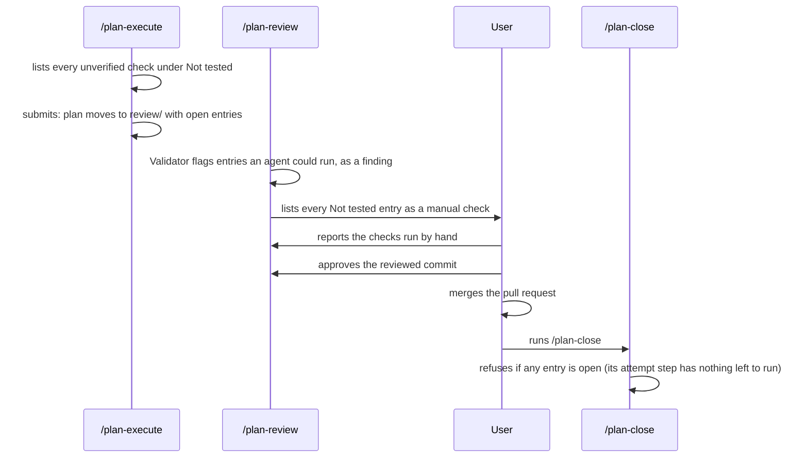
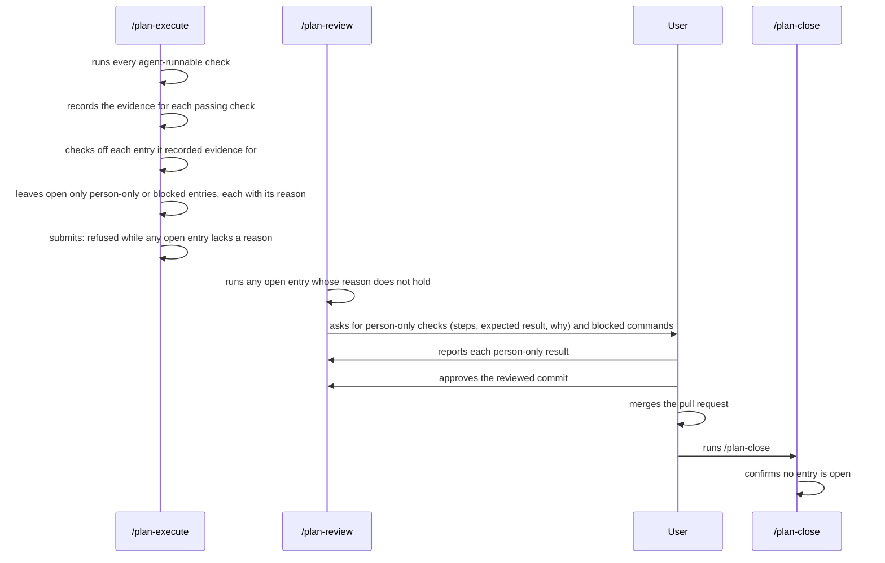

# Agents run every check they can before asking the user to check by hand

## Summary

When a finished plan reaches the user for review, the agent often asks the user to run checks the
agent could have run itself. The user wants to be asked only for what an agent cannot do. The
cause is in the plan suite's own instructions: they tell the implementing agent to list every
unverified check for the user and never to clear one itself. The one rule that says to run them
first sits in the Validator's checklist and loses to that explicit instruction, and the only step
that tries the checks is in `/plan-close`, after the user has already approved and merged.

This plan changes three things the user will notice:

1. By the time a plan reaches review, every check an agent can run has been run, with the result
   written into the plan.
2. The review asks the user only for checks a person must make, each with steps, the expected
   result, and the reason an agent could not do it, plus any command a tool blocked, for the user
   to allow.
3. A plan cannot be submitted for review while any open check lacks that reason.

Human approval of the reviewed commit is unchanged.

## Context

### Terms

| Term | Meaning in this plan |
| --- | --- |
| Plan suite | The `plan-suite` package in this repo: slash commands that carry a plan from idea to merged work. Its skills live under `globals/packages/plan-suite/skills/`; paths below such as `plan-execute/SKILL.md` are relative to that folder |
| `/plan-execute` | Implements a plan in its own worktree, runs a fresh-context Validator over the work, then submits the plan for review |
| `/plan-review` | Rechecks the finished work, fixes what it can, and asks the user to approve the exact commit |
| `/plan-close` | Runs after the user merges: confirms the work landed and the approval is still valid, then marks the plan completed |
| Validator | A separate agent with a fresh context that checks the work against the plan and reports problems. It never edits. It classes each problem as `fix` (the right fix is clear and within the plan, so the agent fixes it without asking) or `escalate` (a real choice, which goes to the user) |
| `## Not tested` | A section of a plan: one checkbox per piece of built work that no automated test covers. An unchecked entry is a check nobody has made yet |
| Agent-runnable check | A check an agent can make with the tools it has: running a command or test, driving the app in a browser, reading output. It may still need the user to allow a command |
| Person-only check | A check only a person can make: judging look and feel, using an account or credential an agent must not use, a physical device, or a third-party system the agent cannot reach |
| Plan-document check | `roborepo plans validate`, code in `modules/plan-suite/`. It checks the plan file itself, not the code, and reports each problem as a finding with a stable code. Each finding is labeled blocking or advisory, but the label decides only what `plans validate` and `plans save` refuse; a lifecycle move refuses every finding its destination does not explicitly tolerate, whatever the label |
| Review packet | The summary `/plan-review` shows the user before asking for approval (step 6 of its skill): evidence for each criterion, fixes made, and the manual checks the user must make |
| Needs you | The part of a completion report that lists what the user must do or decide |
| Review Result | The `### Result` record `/plan-review` writes before asking for approval. It may be marked complete only when every finding and manual check is settled |
| Submit | `roborepo plans submit`: the command `/plan-execute` runs to move a finished plan from `active/` to `review/`. It reruns `roborepo plans preflight`, which refuses while required work is open |
| `feature-verification` | The skill that captures evidence a change works: command output, screenshots, and browser recordings through `roborepo browser` |

### What happens today



The skill text, checked against `main` at `26dad21f` (after "Plan reports a reader can understand
after time away" landed):

| Where | What it says | Effect |
| --- | --- | --- |
| `plan-execute/SKILL.md`, "Not Tested" | Write each gap as an entry. "Never check an entry off yourself; the user confirms it by hand" | Nothing tells the agent to try a check before listing it |
| `plan-execute/references/validation-loop.md`, rubric item 4 | "Every `## Not tested` entry is a real gap: a check an agent can run is run, not listed" | Already the right rule, but it contradicts the line above, and the agent follows the explicit "never check off" |
| `plan-write/references/plan-schema.md`, "Not tested" | "Only the user clears an entry" | Same contradiction, in the schema every plan skill reads |
| `plan-review/SKILL.md`, step 3 | The Validator reports "`## Not tested` entries an agent could run instead" | Reported as a finding, not run |
| `plan-execute/references/final-report.md`, "Needs you" | "Unconfirmed `## Not tested` entries appear here as manual checks" | The implementation report hands every open entry to the user |
| `plan-review/SKILL.md`, step 6 | The packet's first layer lists "the manual checks that need the human, from `## Not tested`" | Every open entry reaches the user, runnable or not |
| `plan-close/SKILL.md`, step 5 | "Attempt each check the agent can perform", check off with recorded evidence | The only place that tries the checks, after approval and merge. It also contradicts "only the user clears" |
| `modules/plan-suite/review-freshness.mjs` | A review Result is incomplete while any entry is unchecked | Every entry must already be settled before approval, so close's attempt step can only run on an empty list |

The plan-document check reports open entries as `UNCONFIRMED_NOT_TESTED`, an advisory finding that the
submit transition, preflight, and `plans save` all tolerate. It does not look at what an entry
says. `docs/internal/plan-suite-deferred-topics.md` lists the gap under "Making execute prove
the work" and "Gates and lifecycle rules" (rows "Behavior checks", "QA script", and "Not tested
timing"); no plan owns it yet.

### Evidence from recent plans

- "Cut Claude permission prompts by running shell commands in the native sandbox" (`9njvfh5z`):
  review found that a `## Not tested` entry was checkable by the portal UI suite, and fixed it.
  Three more entries were then run during review, at the user's request, and cleared with written
  evidence. Four desktop-app prompt checks are still open.
- "Clear agent friction" (`vzgsx5vz`): five Not tested entries kept the plan active because checks
  failed on sandbox write errors and missing dependencies. An agent later ran all of them once
  those were out of the way.

Both show agents can run most entries. In each case the user had to ask.

### Tooling limits that also push checks onto the user

Some handoffs come from tools, not instructions. Findings, each with its source:

| Limit | Evidence | Status |
| --- | --- | --- |
| The shell sandbox refuses local port binding and writes outside the checkout | `9njvfh5z` review: 15 gate checks failed inside the reviewing agent's sandbox on write errors, port binding, and `.git/worktrees`; the unsandboxed rerun passed | `9njvfh5z` keeps `allowLocalBinding: false`. Its decision log notes the app's preview tools run outside the shell sandbox. Checked 2026-11-14 on Claude Code 2.1.309, desktop app: a Node server on `127.0.0.1` failed with `EPERM` inside the sandbox. The live settings exclude `roborepo *` from the sandbox, so a bare `roborepo browser run --serve "python3 -m http.server …"` started the server and its check passed; the same command piped to `cat` stayed sandboxed and was `blocked` ("--serve command exited (1)") |
| Plan-store commands cannot lock the store inside the sandbox | `9njvfh5z` current state: `roborepo plans show` reports "The plans worktree could not be locked" | Workaround is a sandbox-bypass rerun, which needs a permission prompt or auto-mode approval |
| The browser suites failed in a fresh worktree with no installed dependencies | `vzgsx5vz` verification: four suites failed with `ERR_MODULE_NOT_FOUND` until `npm ci` | Fixed on `main` by `c77b4649`, which installs dev dependencies on demand |
| Playwright may be missing | `feature-verification/SKILL.md`: a missing browser makes the run `blocked`, and installing it goes through a permission prompt | Unchanged; a declined prompt leaves the check blocked |

Today nothing distinguishes a check blocked by a tool from one only a person can make; both reach the user as
a manual check.

## Goals

- `/plan-execute` attempts every agent-runnable check before it submits, and records the result.
- Every open `## Not tested` entry says why an agent cannot clear it: a person-only reason, or the
  exact command a tool blocked.
- Every cleared entry carries its evidence, so a later reader can see who cleared it and how.
- The review asks the user only for person-only checks and blocked commands, each with steps and
  the expected result.
- An agent never confirms a person-only check, never records approval, and never clears an entry
  without recorded passing evidence.

## Non-goals

- How reports are worded and laid out. "Plan reports a reader can understand after time away"
  (`9671042v`) owns that; this plan changes what the agent does and records.
- Fixing the tooling limits above. They are recorded so the right plan can pick them up.
- Changing human approval, `roborepo plans approve`, or the `### Approval` record.
- Renaming `## Not tested` or splitting it into two sections.
- Measuring how often agents hand over runnable checks. "Live Evals for Skill Routing and Plan Closing" (`0jped168`), which runs real
  agents against fixtures, can do that
  later.

## Proposed design

### What happens after this plan



### 1. One entry format

An open entry ends with one of two reasons. A cleared entry ends with its evidence after a ` — `
dash; this plan calls that text the entry's resolution, the same convention the `## Review`
findings already use.

```markdown
## Not tested

- [ ] The dark theme reads well on the Plans page. Needs a person: judging contrast and look is a
      human judgment.
- [ ] The portal starts and lists plans in a browser. Blocked: `roborepo browser run --serve "npm run
      portal"` failed with "listen EPERM 127.0.0.1:4310"; allow it to run outside the sandbox.
- [x] `roborepo plans submit` refuses an entry with no reason. — Verified by agent 2026-11-20 at
      a1b2c3d: `node scripts/test/plan-lifecycle-transitions-check.mjs` → passed.
- [x] The approval question names the commit. — Confirmed by the user 2026-11-21: "saw the full
      commit id in the question".
```

| Entry state | Must end with | Who may write it |
| --- | --- | --- |
| Open, person-only | `Needs a person: <why an agent cannot>` | Any agent |
| Open, blocked by a tool | `Blocked: <exact command> failed with <error>` and what would unblock it | Any agent |
| Cleared by an agent | `— Verified by agent <date> at <commit>: <command or method> → <result>` | An agent, only after the check passed |
| Cleared by the user | `— Confirmed by the user <date>: <what they reported>` | The user confirms; an agent only records it, quoting the user's explicit answer in chat |
| Removed | Deleted, with the reason in `## Decision Log` | Only on the user's decision, as today |

**Safety rules.** These hold for every agent and every plan command:

- An agent never checks off a person-only entry on its own judgment.
- An agent never clears an entry without a resolution that names the passing evidence.
- An agent records a user's confirmation only from the user's explicit answer, and never records
  human approval.

Accepted reasons for `Needs a person:` are: human judgment of look, feel, or wording; an account,
credential, or payment an agent must not use; a physical device; a third-party system the agent
cannot reach; an action the user's rules reserve to the user. "No time" and "no test exists" are
not reasons: an agent writes the test or runs the check.

### 2. `/plan-execute` runs the checks before it submits

Changes to `plan-execute/SKILL.md` and its references:

| Part | Change |
| --- | --- |
| "Not Tested" section | Replace "Never check an entry off yourself" with the table above: attempt each entry, using `feature-verification` for UI, server, API, CLI, or performance behavior; clear it with evidence when it passes; leave it open only with a reason. Its example entry gains a `Needs a person:` marker |
| A failing check | A check that runs and fails is a defect: fix it, as with any failing test. It never becomes a Not tested entry |
| A blocked check | Retry through the harness's normal route first: run `roborepo browser run --serve` as a bare call, with no pipe, `cd`, or chained command, so the `roborepo *` sandbox exclusion applies; use the app's preview tools where they exist; otherwise a sandbox-bypass rerun, which goes through the permission prompt. Only then write the `Blocked:` reason, and add the command to the questions `/plan-execute` already saves for the end of its run, so its final report asks the user to allow it |
| `references/validation-loop.md`, rubric item 4 | Keep "a check an agent can run is run, not listed". Add: each open entry's reason holds, and each cleared entry's evidence names a real command or method. A reason that does not hold is a `fix` finding |
| `references/final-report.md`, "Needs you" | Lists only open entries, grouped as person-only and blocked, each with its reason; blocked commands appear as commands to allow |

### 3. `/plan-review` runs what is left, and asks only for the rest

Changes to `plan-review/SKILL.md`:

| Step | Change |
| --- | --- |
| Step 3, Validator rubric | "Entries an agent could run instead" becomes: entries whose reason does not hold, and cleared entries without evidence |
| Step 5, fixes | Run each such entry here, as a `fix`, and clear it with evidence. Retry each `Blocked:` entry once, since review may run with different permissions |
| Step 6, review packet | In the first layer, "the manual checks that need the human" lists only person-only entries and blocked commands. Each person-only check gives the steps, the expected result, and the reason. Each blocked command gives the exact command to allow |
| Step 6a | Approval still needs every entry settled, as today. Add: the agent writes `— Confirmed by the user` only from the user's explicit answer, quoting it |

### 4. `/plan-close` stops discovering checks

`plan-close/SKILL.md` step 5 becomes a confirmation only: refuse while any entry is open and send
the user to `/plan-review`. Remove "Attempt each check the agent can perform". The review Result
already cannot be complete while an entry is open (`review-freshness.mjs`), so any entry close
finds open means approval was recorded outside the normal path; review is where it is settled.
`plan-close/references/verdict.md` follows.

### 5. The schema and the other writers say the same thing

| File | Change |
| --- | --- |
| `plan-write/references/plan-schema.md`, "Not tested" | Replace "Only the user clears an entry" with the entry-format table and the safety rules; its example entry gains a `Needs a person:` marker |
| `plan-write/SKILL.md`, the "Sync" row of its Create, Revise, or Sync table (syncing brings a plan up to date after work and adds `## Not tested` entries for gaps) | A sync adds entries with a reason |
| `globals/packages/session-close/skills/session-close/SKILL.md` | Entries it adds carry a reason |

### 6. The plan-document check enforces the format

One new finding in `modules/plan-suite/`, `NOT_TESTED_UNEXPLAINED`, computed for active and
review plans only, in `validateActive` in `lifecycle-policy.mjs` (which review reuses). It goes
beside the call to `notTestedFindings`, not inside it, because `validateCompleted` calls that
function too. An entry yields it when it is:

- an unchecked entry that contains neither `Needs a person:` nor `Blocked:`;
- a checked entry with no text after a ` — ` dash.

The finding's message quotes the start of each offending entry, so a refusal names the entries to
fix rather than a count. The preflight's validator check prints that message for this finding,
where today it prints only finding codes.

The check reads the whole entry, including its wrapped lines. Today the parser in `index.mjs`
keeps only an entry's first line as its text, so it must join the indented lines that follow.

The cleared-entry check accepts any resolution after the dash rather than the exact wording, so
entries written before this plan, such as those in `9njvfh5z`, stay valid. The skills prescribe
the wording; the check only confirms evidence exists.

| Where | Treatment | Why |
| --- | --- | --- |
| `roborepo plans validate`, `roborepo plans save` | Advisory, so neither refuses it | A plan mid-work may hold an entry not yet explained. `plans save` stops only on blocking findings, so it needs no change |
| Move into `active/` (start, reopen) | Tolerated, added beside `UNCONFIRMED_NOT_TESTED` in `transition.mjs` | Resuming work must not stall on it. Lifecycle moves check advisory findings too, so this entry is needed |
| `roborepo plans preflight` and the move into `review/` (submit) | Refused: not added to the tolerated sets in `review-gates.mjs` and `transition.mjs` | Submitting is the point where every entry must be run or explained |
| Review Result freshness (`review-freshness.mjs`) | Incomplete while present | Open entries already make the Result incomplete. The new case is a checked entry with no evidence: no approval over it |
| Completed plans and the move into `completed/` | Not computed | Close already refuses any open entry. Skipping the cleared-entry check keeps older completed plans valid, and freshness has already caught a cleared entry with no evidence before approval |

The plan-document check cannot tell whether a reason is true. Judging that stays with the Validator in
`/plan-execute` and `/plan-review`.

## Decisions

- **The plan-document check is in scope.** The right instruction already exists in the execute
  Validator's rubric ("run, not listed") and is ignored because other text contradicts it. A
  deterministic refusal at submit is what makes the agent stop and either run the check or write
  down why it cannot.
- **Reasons are a marker on each entry, not a second section.** A separate `## Manual checks`
  section would read clearly but needs a new parsed section, portal and docs changes, and a
  migration of the meaning of `## Not tested`. A marker reuses the existing parser.
- **Blocked is its own reason.** A check stopped by a tool is still agent-runnable. Labelling it
  person-only would ask the user to do the work; labelling it blocked asks only for permission.
- **Every entry is settled before approval, as the code already requires.** Close keeps only its
  refusal. A check that can only run after merge is either run from the worktree before approval,
  as `9njvfh5z` did, or moved to another plan by the user's decision.
- **Builds on the layered report, not before it.** "Plan reports a reader can understand after
  time away" (`9671042v`) landed first, in `26dad21f`. This plan changes which checks appear in
  the "Needs you" section and the review packet's first layer it introduced, and keeps their
  shape.

## Implementation plan

- [x] Rewrite `plan-write/references/plan-schema.md` "Not tested" with the entry format, the
      accepted reasons, the safety rules, and an example entry that carries a reason, and correct
      its lifecycle paragraph: moves into `review/` tolerate open entries only when each carries a
      reason.
- [x] Update `plan-execute/SKILL.md` "Not Tested" (including its example entry) and its
      Implementation Completion lines on
      "unconfirmed Not tested entries" and "Genuinely unverified manual checks … resolved before
      `/plan-close`", so they say open entries must carry a reason and are settled in review;
      update `references/validation-loop.md` item 4 and `references/final-report.md`.
- [x] Update `plan-review/SKILL.md` steps 3, 5, 6, and 6a.
- [x] Reduce `plan-close/SKILL.md` step 5 and `references/verdict.md` to a confirmation. Align
      its refusal report (which quotes each open entry "so the user can confirm") and its
      Boundaries line on manual-only entries with the entry format: the refusal sends the user to
      `/plan-review`, and only person-only entries need the user.
- [x] Add `NOT_TESTED_UNEXPLAINED`, and that submit refuses it, to the finding list in
      `plan-write/references/workflow-validate.md`.
- [x] In `globals/packages/feature-verification/skills/feature-verification/SKILL.md`, say that
      `roborepo browser run --serve` must be a bare call: a pipe or chained command keeps it in the
      Claude sandbox, where the dev server cannot open its port.
- [x] Update the "Sync" row in `plan-write/SKILL.md` and the Not tested line in `session-close`.
- [x] Parse wrapped entry lines in `modules/plan-suite/index.mjs`; add `NOT_TESTED_UNEXPLAINED` to
      `findings.mjs` and `lifecycle-policy.mjs`; tolerate it for the `active` destination in
      `transition.mjs`; leave it out of the tolerated sets for preflight in `review-gates.mjs` and
      the `review` destination; mark freshness incomplete in `review-freshness.mjs`. The finding's message quotes each offending entry, and the
      preflight's validator check in `review-gates.mjs` prints that message, not only the code.
- [x] Rewrite the resolution text of `UNCONFIRMED_NOT_TESTED` in `findings.mjs` ("Confirm each
      entry by hand and check it off") and the comment above `notTestedFindings` in
      `lifecycle-policy.mjs` ("until someone confirms it by hand") to match: run the check and
      record its evidence, or give the reason an agent cannot. In `review-gates.mjs`, rewrite the
      comment above the tolerated set ("/plan-close resolves it") and the preflight message "no
      findings apart from Not tested entries" to name the new rule.
- [x] Update the pinned phrases in `scripts/test/plan-suite-skills-check.mjs` ("Never check an
      entry off yourself", "manual-only `## Not tested` entries") and pin the new ones.
- [x] Update the docs under Documentation impact.

## Validation

New behavior, each case failing before the change:

- `node scripts/test/plan-suite-findings-check.mjs`: an unchecked entry with no reason yields
  `NOT_TESTED_UNEXPLAINED`; a checked entry with no resolution yields it; the parsed text of an
  entry includes its wrapped second line.
- `node scripts/test/plan-lifecycle-transitions-check.mjs`: submit refuses an active plan with an
  unexplained entry and accepts it once a reason is added; `plans preflight` fails on the entry
  and names it; a complete review Result whose only problem is a checked entry with no evidence
  reads `incomplete`.
- `plan-suite-findings-check.mjs`: the `UNCONFIRMED_NOT_TESTED` resolution no longer tells the
  reader to confirm every entry by hand.
- `node scripts/test/plan-suite-skills-check.mjs`: new pins for the entry format, the two reason
  markers, and review asking only for person-only checks and blocked commands.

Behavior that must not change, each case passing before and after:

- `plan-suite-findings-check.mjs`: entries with `Needs a person:` or `Blocked:`, and checked
  entries written like those in `9njvfh5z` (a resolution such as "— Done 2026-11-13; …"), yield
  no `NOT_TESTED_UNEXPLAINED`; a completed plan with a checked entry and no dash yields none, and
  a completed plan with an unchecked entry and no reason yields only `UNCONFIRMED_NOT_TESTED`.
- `plan-lifecycle-transitions-check.mjs`: start and reopen still succeed for a plan whose open
  entry has no reason, and `plans save` still accepts that plan.
- `bash scripts/doctor.sh --quiet` passes. CI runs the full gate, because skills are package
  outputs.

## Not tested

- [x] An agent following this branch's skill text runs its runnable checks and the review asks only
      for person-only checks. — Verified by agent 2026-11-16 at 39d4dfa9: a fresh subagent given only
      the branch's plan-execute "Not Tested" and completion text, `final-report.md`, `plan-schema.md`,
      and `plan-review` steps 5–6 settled a fixture plan with four open entries. It ran and cleared
      the two command-line checks with exact-match evidence, left tone and Slack open with
      `Needs a person:` reasons, and its report and review packet asked only for those two, each
      with steps, expected result, and reason, with no commands to allow. `lifecycleFindings` on the
      fixture: `NOT_TESTED_UNEXPLAINED` naming both runnable entries before, none after.
- [x] The review this produces asks for nothing an agent could have done. — Confirmed by the user
      2026-11-16, after reading the dry-run's review packet (tone and Slack): "Yes, both need me".

## Documentation impact

| Doc | Update |
| --- | --- |
| `docs/user/guides/plan/lifecycle/plan-suite.md` | The "Not Tested" section (entry format, who clears what), the preflight list, the `/plan-review` packet's "manual checks waiting on you", and close step 4 |
| `docs/user/reference/plans-portal.md` | "Not Tested Entries" and the `plans preflight` row: the new finding and where it blocks |
| `docs/internal/plan-suite-deferred-topics.md` | Remove the rows this plan settles: "Behavior checks" and "QA script" under "Making execute prove the work", and "Not tested timing" under "Gates and lifecycle rules" |

## Related plans

| Plan | Relationship |
| --- | --- |
| Plan reports a reader can understand after time away (`9671042v`) | Landed in `26dad21f` and completed. It split the review packet into layers and gave the execute report its "Needs you" section; this plan decides which checks those list, and keeps their shape |
| Deliver finished plans as a watched pull request (`i5mnkm7z`) | In backlog. Also edits `plan-execute` completion, `validation-loop.md`, `final-report.md`, and `plan-review` steps 5 and 6. Independent in behavior; whichever lands second merges the other's wording. Its `next_action` still waits on `vzgsx5vz`, which has since completed; that is its own cleanup |
| Live Evals for Skill Routing and Plan Closing (`0jped168`) | Could later count entries cleared by an agent versus handed to the user, using the markers this plan adds |
| Cut Claude permission prompts by running shell commands in the native sandbox (`9njvfh5z`) | Active, unmerged. Fewer prompts means fewer `Blocked:` entries, and it keeps `allowLocalBinding: false`. Its four open entries predate the reason markers; see Risks |
| Clear agent friction (`vzgsx5vz`) | Landed and completed. This plan builds on the skill text as it is on `main` after it |

## Risks

| Risk | Mitigation |
| --- | --- |
| Agents write a plausible `Needs a person:` reason to pass the gate | The Validator in execute and review checks each reason holds; a false one is a `fix` finding and the entry is run |
| `/plan-execute` takes longer and spends more tokens running checks | The deferred-topics doc accepted this trade; the checks were going to run anyway, by the user or at close |
| An agent clears an entry on weak evidence | Evidence must name the command or method and its result, at a commit; review's Validator checks it |
| Plans already in active or review gain the finding | As of 2026-11-16 only `9njvfh5z` is affected: it is active with four open desktop-app prompt checks written without a marker, so its next submit would be refused. The refusal names each entry, and the fix is a `Needs a person:` marker on each. Its `next_action` also plans to confirm them after merge, which today's review freshness already rules out; that lifecycle drift is its own cleanup, not this plan's |
| Codex agents cannot run UI checks | On Claude, a bare `roborepo browser run --serve` call runs outside the sandbox and works (see the tooling table). Codex was not tested; its `network.allow_local_binding` setting was not checked. A Codex agent that cannot start a dev server writes a `Blocked:` entry, which is the intended behavior, so this costs the user a permission, not a check |

## Decision Log

Decisions `/plan-execute` made on its own while implementing, 2026-11-16:

- **The reason markers match in any letter case.** The check accepts `needs a person:` and
  `blocked:` as well as the capitalized forms. Alternative: exact case, as the skills write them.
  Why: the refusal exists to make an agent state a reason, not to police capitalization, and a
  lowercase marker would otherwise cost a refused submit for no gain.
- **The submit refusal also says how to fix an entry.** The plan asked only that the preflight's
  validator check print the finding's message. Its `fix` line, and so the submit refusal, now
  carries each remaining finding's resolution: what an entry must end with. Alternative: keep the
  generic "resolve the listed findings". Why: an agent reading the refusal can act without opening
  the schema, which is the point of the gate.
- **Only `## Not tested` entries join their wrapped lines.** Other task checkboxes keep their
  first line as text. Alternative: join wrapped lines for every task. Why: task text is printed by
  the preflight, merge readiness, and review findings; changing it there is outside this plan.
- **`docs/internal/plans-portal-internals.md` updated too.** It is not under Documentation impact,
  but it states which findings each destination tolerates, which this plan changed.
- **The cleared-entry check needs a space before the dash and text after it.** `- [x] Done —` with
  nothing after the dash still yields the finding. Alternative: accept any dash. Why: a bare dash
  records no evidence.

Decided by the user in review, 2026-11-16:

- **The real-run check is split: an agent dry-run, then a person's look.** The user chose "Agent
  dry-run first" when asked how to settle the open `## Not tested` entry. A fresh agent follows
  this branch's skill text against a fixture plan and the result is checked; the person then judges
  only whether the resulting review asks for nothing an agent could have done. Alternatives: keep
  the full real-plan run as a person check, or move the check to `0jped168`.

## Open Questions

None.

## Review

### Findings

- [x] `plan-review/SKILL.md` Verification example still shows a browser-checkable behavior as a
      manual check confirmed by the user — fixed (38596676)
- [x] `UNCONFIRMED_NOT_TESTED` resolution in `findings.mjs` says the user confirms a `Blocked:`
      entry; the user only allows the command and the agent runs the check — fixed (38596676)
- [x] Comment on `notTestedOpen` in `index.mjs` still says unchecked entries never block
      implementation completion — fixed (38596676)
- [x] No test covers the reason markers matching in any letter case — fixed (38596676)
- [x] Comment above `NOT_TESTED_UNEXPLAINED` in `findings.mjs` says `plans save` reports the
      finding; save accepts the plan without reporting it — fixed (0a565aa7)
- [x] `plan-schema.md` says `plans save` and moves into `active/` report the finding; both accept
      the plan silently — fixed (0a565aa7)
- [x] `docs/user/reference/plans-portal.md` table row repeats that `plans save` reports the finding
      — fixed (0a565aa7)
- [x] The plan's `next_action` still tells a reader to start building — fixed in the plan record
- [x] `### Verification` does not record the checks rerun after the pass 1 fixes — recorded below
- [x] An open entry ending in a bare `Needs a person:` or `Blocked:` with no reason passes the
      check, and so does the marker inside another word (`unblocked:`) — fixed (6cb5f0a4)
- [x] `plan-execute/SKILL.md` and `feature-verification/SKILL.md` state as fact a Claude sandbox
      exclusion for `roborepo` that this branch does not ship — fixed (6cb5f0a4): the guidance now
      applies where the harness is set up that way
- [x] The plan's `## Not tested` entry gives no steps the user can follow before approval, and
      leans on "behavior evals do not exist yet", which the new schema lists as a non-reason —
      entry rewritten with steps, the expected result, and the alternative
- [x] Review: the `## Not tested` entry only partly holds as `Needs a person:` — the Validator is
      meant to judge "nothing an agent could have done", and an agent could dry-run the branch's
      skill text against a fixture plan; installing skills reads as `Blocked:` — escalated; the user
      chose an agent dry-run plus a person's look (Decision Log); dry-run done, entry split
- [x] Review round 2: after merging `main` at 97f65fa4, `plan-execute/SKILL.md` body passed the
      500-line cap (doctor failed) — fixed in review (b30a7d54): the Not tested example and accepted
      reasons, already in `plan-schema.md`, replaced by a pointer
- [x] Review round 2: the blocked-check retry started `roborepo browser run --serve` while step 11
      (new on `main`) leaves a dev server running — fixed in review (b30a7d54): retry against the
      running environment first
- [x] Review round 2: a `Blocked:` command went into the Open Questions queue, which marks tasks
      blocked and lists it twice in Needs you — fixed in review (b30a7d54): listed only under
      Commands to allow
- [x] Review round 2: the running-server retry dropped the bare-call rule — fixed in review
      (ef022392)

### Verification

- Validation pass 1 at 6eec1dc4 (fresh-context subagent): four `fix` findings, no `escalate`, no
  `base`
- Validation pass 2 at 38596676 (fresh-context subagent): five `fix` findings, no `escalate`, no
  `base`
- Validation pass 3 at 0a565aa7 (fresh-context subagent): three `fix` findings, no `escalate`, no
  `base`
- Validation: clean on pass 4 at 6cb5f0a4 (fresh-context subagent): no findings, nothing outside
  this plan
- New test cases shown to fail before the change: the new `plan-lifecycle-transitions-check.mjs`
  run against an untouched copy of `main` at 26dad21f failed on the freshness case ("a check
  nobody recorded evidence for cannot sit under a complete review": `fresh`, expected
  `incomplete`) and, with that case removed, on the submit case ("only the validator check fails":
  `[]`, expected `[6]`); the new `plan-suite-findings-check.mjs` failed on "an open entry with no
  reason and a checked entry with no evidence are both reported" before the validator change
- At 38596676, after the pass 1 fixes: `plan-suite-findings-check.mjs`,
  `plan-lifecycle-transitions-check.mjs`, `plan-suite-commands-check.mjs`,
  `plan-suite-skills-check.mjs`, `plan-citation-comments-check.mjs`, and
  `skill-structure-check.mjs` passed
- At 0a565aa7, after the pass 2 fixes (one comment, one skill reference, one doc):
  `plan-suite-findings-check.mjs`, `plan-suite-skills-check.mjs`, `docs-reference-check.mjs`,
  `plan-citation-comments-check.mjs`, and `skill-structure-check.mjs` passed; `git diff --check`
  clean
- At 6cb5f0a4, after the pass 3 fixes: the new bare-marker case failed before the fix
  (`undefined !== 3`) and `plan-suite-findings-check.mjs` passed after it;
  `plan-suite-skills-check.mjs`, `skill-structure-check.mjs`, and
  `plan-citation-comments-check.mjs` passed; `plan-lifecycle-transitions-check.mjs` and
  `plan-suite-commands-check.mjs` passed
- At 6eec1dc4, unchanged by later commits' scope: `plan-suite-check.mjs`,
  `plan-suite-repair-check.mjs`, `plan-store-check.mjs`, `plans-portal-state-check.mjs`,
  `plan-lifecycle-manifest-check.mjs` passed, and `bash scripts/doctor.sh --quiet` reported
  "doctor passed (98 checks)"
- The suites that build Git fixtures ran outside the shell sandbox, which refuses creating
  `.git/worktrees` in a temporary repository
- Behavior shown through the real CLI in a fixture repository, on the code committed as 6eec1dc4:
  with the entry
  `- [ ] The portal lists plans in a browser.`, `roborepo plans preflight` exited 1 naming the
  entry and what it must end with, and `roborepo plans submit` refused; after adding
  `Needs a person: judging the layout is a human call.`, submit moved the plan to review
- Review 2026-11-16: `roborepo plans sync-base` merged `main` 8f53ffdc into the branch cleanly as
  39d4dfa9 (no conflicts; base also edited `findings.mjs` and `index.mjs`)
- Review at 39d4dfa9: no CI result exists (branch not pushed), so `npm run check` ran locally once:
  76/80 unit suites passed; `browser-contract-check`, `browser-playwright-check`,
  `browser-playwright-cache-check`, and `browser-playwright-cli-check` failed with
  `ERR_MODULE_NOT_FOUND` for `@playwright/test` because the worktree had no `node_modules`; after
  `npm ci` all four passed. The steps the failure skipped then ran: `test:package-install` and
  `test:portal-ui` passed; the clean-machine and Windows installer suites skipped (no Docker or
  `pwsh` on this machine), as the gate itself skips them here
- Review at 39d4dfa9: `plan-suite-findings-check.mjs`, `plan-lifecycle-transitions-check.mjs`,
  `plan-suite-skills-check.mjs`, and `plan-suite-commands-check.mjs` passed
- Review Validator pass at 39d4dfa9 (fresh-context subagent): no `fix` findings, one `escalate`
  (the Not tested entry above), nothing outside this plan; merged `findings.mjs` and `index.mjs`
  keep `NOT_TESTED_UNEXPLAINED` and wrapped-line parsing with no references to what `main` removed

- Review round 2, 2026-11-17: approval of 39d4dfa9 went stale when `main` moved; `plans sync-base`
  merged 38d51d48 (49866691) and then 97f65fa4 (11d298c0), both without conflicts
- At 11d298c0: the four plan suites passed; `npm run check` failed in `doctor.sh` on the skill size
  cap (fixed above). A Validator pass found the two retry/blocked findings above, nothing outside
  this plan, and no change to `modules/plan-suite/` since 39d4dfa9
- At b30a7d54: Validator pass over the fix found the bare-call finding (fixed in ef022392) and one
  optional note, not taken: whether the `--url` retry reaches an isolated server (the agent that
  started it knows its URL)
- At ef022392: `skill-structure-check.mjs`, `plan-suite-skills-check.mjs`, and
  `bash scripts/doctor.sh --quiet` ("doctor passed (98 checks)") passed
- Interrupted gate runs, not code failures: one run hung 10 hours in an interactive `expect` step of
  `test-install-collisions.sh` and was stopped; one failed an MCP-add case in `test-cli.sh` that
  passed on rerun; one failed "update writes nothing into the source tree" because the skill was
  edited mid-run
- At ef022392: `npm run check` passed ("CI checks passed"): doctor, 426 CLI tests, install
  collisions, 81/81 unit suites, package install, and the portal UI suite; the clean-machine and
  Windows installer suites skipped (no Docker or `pwsh` on this machine)
- Manual: the dry-run's review packet asks only for person-only checks (confirmed by the user,
  2026-11-16: "Yes, both need me")
- Review round 3, 2026-11-17: approval of ef022392 went stale when `main` moved; `plans sync-base`
  merged 7f4ee1e5 (#69, #72) cleanly as 750d1b29. `main` changed nothing under
  `modules/plan-suite/` or the plan's skills; the two docs both sides edit changed in unrelated
  sections
- Review Validator pass at 750d1b29 (fresh-context subagent): no findings, nothing outside this
  plan; the branch's own diff against `main` matches its diff at ef022392 line for line; the four
  plan suites, `skill-structure-check.mjs`, `docs-reference-check.mjs`,
  `plan-citation-comments-check.mjs`, and `roborepo plans validate` (0 findings) passed
- At 750d1b29: `npm run check` passed ("CI checks passed"): 85/85 unit suites, package install,
  and 275 portal UI tests; the clean-machine and Windows installer suites skipped (no Docker or
  `pwsh` on this machine)
- At 4b1bd901 (PR review feedback fixed: approval wording, wrapped-entry scan):
  `plan-suite-findings-check.mjs`, `plan-lifecycle-transitions-check.mjs`,
  `plan-suite-skills-check.mjs`, `plan-suite-commands-check.mjs`, `docs-reference-check.mjs`,
  and `skill-structure-check.mjs` passed; Validator pass over the fix (fresh-context subagent): no
  findings

- Review round 4, 2026-11-18: `plans sync-base` merged `main` 4bccef88 (#73, test scripts only)
  cleanly as 9a063e9e; the branch's diff against `main` is identical to its diff at 4b1bd901

- At 9a063e9e: CI run 44248992551 passed: the gate on Ubuntu and macOS and the Windows installer


### Result

- Status: complete
- Reviewed implementation commit: 9a063e9e0658d862ee383f6dad3fa66bc8b07627
- Base commit: 4bccef886b84ceb7a1603822f299f4cb7fcb196e

### Approval
- Decision: approved
- Reviewed implementation commit: 9a063e9e0658d862ee383f6dad3fa66bc8b07627
- Confirmed by: human (user answered 'Approve this commit' in chat, 2026-11-18)

## Completion

Closed 2026-11-18. When a plan reaches review, the agent has now already run every check it can,
with the result written into the plan; the review asks the user only for checks a person must make
(each with steps, expected result, and why an agent cannot) and for any command a tool blocked.
A plan cannot be submitted for review while an open `## Not tested` entry lacks a
`Needs a person:` or `Blocked:` reason, and `/plan-close` only confirms the entries are settled.
Merged to `main` through kirinmurphy/roborepo-alpha#74.

## Verification

- Completion gate: CI run 44252896072 on `main` at 65658826 passed
- Focused checks rerun on `main` at 65658826: `plan-suite-findings-check.mjs`, `plan-lifecycle-transitions-check.mjs`, and `plan-suite-skills-check.mjs` passed
- Plan claims checked against `main`: every implementation task is checked; both `## Not tested` entries are cleared with recorded evidence; every `## Review` finding is checked off; the merge commit's tree is identical to the approved commit's tree
- Docs of record checked against the landed code: `docs/user/guides/plan/lifecycle/plan-suite.md` (entry format with `Needs a person:`), `docs/user/reference/plans-portal.md` (`NOT_TESTED_UNEXPLAINED` and where it blocks), and `docs/internal/plan-suite-deferred-topics.md` (settled rows removed) match
- Approval: fresh; approved commit 9a063e9e0658d862ee383f6dad3fa66bc8b07627, confirmed by a human
- Landing: newly scanned; branch `claude/plans-agents-run-checks-before-handoff` absorbed into `main`
- Absorbing commit: 65658826f0fbd5fde4095a8c9e87fd0dde64bf67
- Not verified: Codex agents' ability to run UI checks (`network.allow_local_binding` not checked), as recorded in Risks
