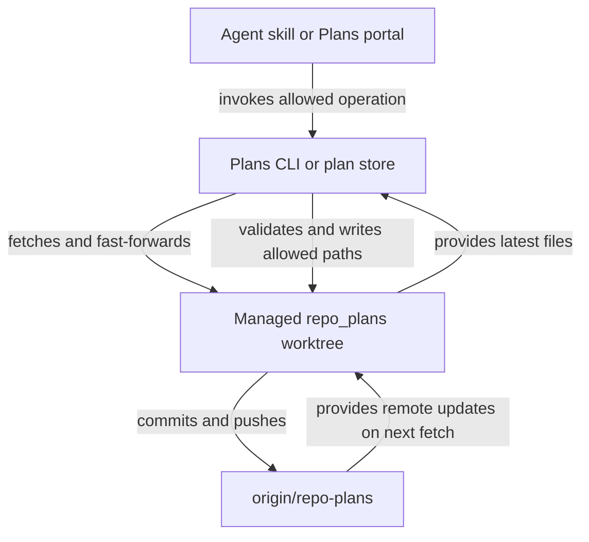

# Store plans on a dedicated Git branch

## Summary

Store plan-suite Markdown and ordering metadata under `plans/` on the remote orphan branch `origin/repo-plans`. RoboRepo maintains a persistent `repo_plans` worktree per repository. Agents and the Plans portal read plans there and use narrowly scoped RoboRepo commands to validate, commit, and push changes automatically. The plans branch never merges into a code branch.

## Context

Plan-suite derives a plan's lifecycle from its folder. Today, plan files under `docs/plans/` can exist in the primary checkout and an implementation worktree. Edits produce noisy code history and sometimes competing authoritative copies. A dedicated remote Git branch removes that duplication while retaining Markdown as the source of truth.

This reverses a recorded decision. "Make Active Plan State Follow Its Assigned Worktree" (`6q16tocb`) deferred a dedicated plan branch until the simpler worktree model had been tried, and made the assigned worktree's copy authoritative. This plan supersedes that contract: there is one copy, and it lives on `repo-plans`.

## Goals

- One canonical plan per ID, with the same lifecycle folders, plan metadata, ordering, and human approval gates; keep the branch root available for other artifacts.
- Automatic remote persistence for saves and lifecycle changes, from any implementation checkout, skill, or portal action. A sandbox that cannot reach the remote commits locally and pushes later (see [Synchronization](#synchronization)).
- One-command setup on a new Mac after cloning the code repository, without manual branch checkout or push.
- Plan writes restricted to named CLI operations, including portal upload of externally authored Markdown.
- Ordinary different-file writes by multiple agents, without building collaborative same-document editing.

## Non-goals

- A database, hosted service, or merging `repo-plans` into `main`.
- Backward-compatible reads or writes of `docs/plans/` after the switch.
- Plans in a folder that is not a Git repository with an `origin` remote. These stop being discovered.
- Executing or closing a plan on a machine that lacks its implementation worktree. The plan stays visible there; the worktree-bound commands refuse with the reason.
- Direct agent writes to the managed plans worktree.
- Same-document conflict resolution; this remains a follow-up task. Two saves of one plan from one clone are last-write-wins in the initial release.
- Plan deletion, force pushes, configurable branch names/remotes, moving the plans worktree after creation, or a separate worktree-management UI.
- Portal Markdown paste in the initial release; `.md` upload is sufficient.

## Current state

Paths below are repository-relative. The CLI lives in `scripts/cli/` and the plan-suite core in `modules/plan-suite/`.

| Area | Today | Files |
| --- | --- | --- |
| Choosing a copy | Each checkout's copies are scanned, then one authoritative copy is selected per plan | `canonical-scan.mjs`, `plan-copies.mjs`, `plan-authority.mjs`, `worktree-copy.mjs`, `copy-integration.mjs`, `landed-recovery.mjs`, `checkouts.mjs` |
| Lifecycle moves | Must run from the primary checkout on the base branch; commit there and do not push | `transition.mjs`, `transition-checks.mjs`, `transition-rules.mjs` |
| Code gates | Compare implementation commits with `:(exclude)docs/plans`; sync-base resolves plan renames | `review-freshness.mjs`, `review-gates.mjs`, `landing-gate.mjs`, `sync-base.mjs` |
| Order and naming | `docs/plans/plans-order.json`, `docs/plans/plans-config.json` | `backlog-registry.mjs`, `naming.mjs`, `findings.mjs` |
| CLI and portal | Named commands; portal order, pin, and archive writes call the core directly | `plans-command.mjs`, `plans.mjs`, `portal-routes-plans.mjs`, `snapshot-fingerprint.mjs` |
| Approval | No command records it. `/plan-review` edits `### Approval` and commits | `plan-review/SKILL.md`, `review-record.mjs` |
| Setup | `/plan-suite-init` scaffolds `docs/plans/` without committing; `/plan-execute` confirms `worktreeRoot` on a repository's first run and commits it | Skills under `globals/packages/plan-suite/skills/` |

Code outside plan-suite also reads the old path:

| Consumer | What it reads `docs/plans` for | File |
| --- | --- | --- |
| Worktree cleanup | The removal folder (`worktreeRoot`) and the worktrees active plans still claim | `scripts/cli/worktree-policy.mjs`, called by `worktree-cleanup.mjs` |
| Codex permissions | The worktree root added to the sandbox's workspace roots | `scripts/harnesses/permission-workspace-roots.mjs`, `scripts/cli/permissions-render.mjs` |
| Packaging | `package.json` ships `docs/plans/plans-config.json`, so package mode can derive that root | `package.json`, `scripts/test/package-install-smoke.mjs` |
| Repo discovery | A folder with `.git` or `docs/plans` counts as a repo | `modules/repositories/discovery-walk.mjs`, `repair.mjs`, `index.mjs`, `portal/shared/repository-sources-partial.html` |
| Worktree listings | Every linked worktree is a cleanup candidate and appears on Home | `modules/repositories/worktree-inventory.mjs`, `worktree-removal.mjs`, `worktree-discard.mjs`, `scripts/cli/worktree-hook.mjs`, `worktree-observations.mjs` |
| CI | A check validates this repository's real plan tree | `scripts/test/plan-tree-naming-check.mjs` |

Other facts the design relies on:

- CI runs only on pushes to `main` and on pull requests, so pushes to `repo-plans` start no runs (`.github/workflows/ci.yml`).
- Agent shells point `core.hooksPath` at RoboRepo's chain hooks, which run the repository's own hooks too. A repository's code hooks can fail on a tree that holds only plans.
- `modules/repositories/git-exec.mjs` provides `runGitProcess` and `runGitProcessSync` for mutations. Its 1500 ms default timeout is too short for network Git, and its read-only allow-list excludes `fetch` and `push`.
- Codex's `~/.ssh/**` deny stops SSH pushes from its sandbox, as "GitHub Integration Part 01: Agents Act on GitHub Under Their Own Identity" (`w7vls1yk`) measured. That plan's HTTPS bot identity is the fix and still needs a bot account.
- Codex's workspace roots include `<worktreeRoot>/<worktreeRepoName>`, which contains `repo_plans`.

## Proposed design

### Canonical branch layout and worktree

Create the orphan branch `repo-plans` on `origin`. Put plan-suite content under a top-level `plans/` directory, without the `docs/` wrapper. Leave the branch root available for other artifact types later; those artifacts are out of scope for this plan:

```text
repo-plans (branch root)
└── plans/
    ├── plans-config.json
    ├── plans-order.json
    ├── backlog/
    ├── ready/
    ├── active/
    ├── review/
    ├── completed/
    └── archived/
```

The remote branch is authoritative. Its local worktree is a rebuildable checkout, not another source of truth. Use existing `plans-config.json` values rather than a new path setting:

```text
<worktreeRoot>/<worktreeRepoName>/repo_plans
~/.worktrees/roborepo/repo_plans
```

How RoboRepo finds things, in order of what already exists:

| Situation | Source |
| --- | --- |
| The worktree exists locally | `git worktree list --porcelain`, by checked-out branch `refs/heads/repo-plans`; the path is never recomputed |
| Fresh clone, remote branch exists | `git show origin/repo-plans:plans/plans-config.json` supplies the destination before anything is checked out |
| New repository | `plans init --worktree-root <path>` (default `~/.worktrees`) and `--repo-name <name>` (default: the primary checkout's folder name), written to the new config |

`/plan-suite-init` confirms `worktreeRoot` with the user, so this first-run question moves out of `/plan-execute`.

Reject an occupied destination belonging to another repository; never replace or delete it. Repositories must have distinct `worktreeRepoName` values when they share a root.

Safeguards around the reserved worktree:

- `git worktree lock` it at creation, so `git worktree remove` refuses without a double force.
- Filter it out of `linkedWorktrees` consumers, by branch, so it is never a cleanup candidate, a Home worktree, or a Plans checkout. `worktree-guards.mjs` also refuses it directly.
- `plans start --worktree repo_plans` refuses.
- Worktree cleanup fails closed: when the plans store cannot be read, it removes nothing automatically, because it cannot tell which worktrees active plans claim.
- Use Git-host branch rules where available to disallow remote branch deletion and force pushes while still permitting authorized direct pushes, including from the agent bot account.

These are application and permission safeguards, not a claim that a same-user process with unrestricted shell access cannot delete local files.

The plan frontmatter `worktree:` field still identifies its **implementation** worktree, not `repo_plans`. A missing implementation worktree on a newly cloned machine must not hide a plan. Approval freshness and `reviewed_commit` are checked against code commits, never the plans branch HEAD.

### CLI-only writes

Reuse existing validation, lifecycle, order, and review commands. They stop requiring the primary checkout or the base branch for the plan commit; `--base` still names the code branch that gates compare against. `plans start` no longer fast-forwards the worktree, since the code branch carries no plan state. Add only:

| Command | Purpose |
| --- | --- |
| `roborepo plans init` | Create or reconnect `origin/repo-plans` and the reserved local worktree; recover a missing local checkout; push pending commits |
| `roborepo plans show <id>` | Refresh remote state and read a plan from the managed worktree |
| `roborepo plans save <file.md>` | Validate and create a Backlog plan or update an existing plan by ID, without changing lifecycle or granting approval |
| `roborepo plans approve <id> --commit <sha> --confirmed-by <who>` | Record `### Approval` for one exact implementation commit |
| `roborepo plans config namespaces <file.json>` | Replace the config's `namespaces` after validation, for `/plan-suite-init` and `/plan-write` |

`plans save` rules:

- An existing plan keeps its path and lifecycle, whatever the source file is called. A new plan enters `backlog/` under the source filename; a new plan with no `id` gets one from `generatePlanId`.
- It refuses a change to `id` or `worktree`, or to `### Approval`. Lifecycle commands and `plans approve` own those.
- It validates against the plan's current lifecycle, and refuses a different plan's filename.
- The agent workflow is: read with `plans show`, edit a copy outside the code checkout, then `plans save` the copy.

The portal uses the same `save` operation for uploads, not an additional import API, and calls the shared module rather than spawning the CLI. Put Git synchronization and guarded writes in one shared module, `modules/plan-suite/plan-store.mjs`, not a general storage framework. It owns locating the worktree, the lock, and fetch, commit, and push. `plan-git.mjs` keeps code-branch helpers.

Selectors become a plan ID or a store-relative path such as `plans/ready/x.md`, so prompts like `/plan-execute plans/ready/x.md` resolve from any checkout of the repository.

Agent permissions allow named `roborepo plans` commands, not direct writes or arbitrary Git commands. The CLI also validates the target branch, worktree, paths, and staged changes, and refuses when an affected path has uncommitted edits in `repo_plans`. Uploaded Markdown is untrusted document content, never an executable instruction.

Enforcement differs by harness, and the docs say so:

| Harness | Raw write to `repo_plans` | Why |
| --- | --- | --- |
| Claude | Follows the user's write-outside-the-repo setting for Write and Edit | The boundary hook treats the current checkout as the repo, so `repo_plans` is outside it; `roborepo plans` runs as an allowed Bash command |
| Codex | Technically possible | The CLI runs inside the agent's sandbox and needs this write, so the path cannot be excluded. Skills forbid it, and the next mutation refuses its uncommitted edits |

### Synchronization

Each mutation follows one sequence:



1. Serialize local mutations with a short repository-level lock; fetch and fast-forward before editing, replaying any pending local commits (step 5).
2. Validate the operation, plan ID, existing lifecycle rules, and paths within **`plans/`**. Stage only affected plan and metadata files.
3. Commit once and push `refs/heads/repo-plans` explicitly; report **synchronized** only after the remote accepts the push.
4. If another machine pushed first, fetch and re-apply the operation to the new state, a bounded number of times. Refuse if the remote commit changed the same plan file. `plans-order.json` is recomputed by re-running the placement rather than merged, because every placement touches that one file. Never force-push or silently overwrite.
5. If the remote cannot be reached, keep the commit and report **not synchronized**, with exit status 0 and `synchronized: false` in JSON, so a Codex `/plan-execute` run continues. The next mutation, `plans init`, or portal Refresh that can reach the remote pushes pending commits first. When a pending commit overlaps a remote change to the same plan file, it stops and reports both versions for a person to resolve with Git; nothing is discarded.

`plans init` is the exception to step 5: it never reports a local-only success.

`plans show` refreshes before reading; the portal refreshes on startup and explicit refresh; mutations always refresh before writing. Avoid fetching on every UI render. Network Git uses `runGitProcess` with a longer timeout than the default and `GIT_TERMINAL_PROMPT=0`, and portal requests must not block the server's event loop on it.

Store Git commands run with `core.hooksPath=/dev/null`. The tree holds only plans, so code hooks cannot pass on it, and the explicit refspec already fixes what is pushed.

### Initialization

`/plan-suite-init` confirms `worktreeRoot`, then invokes idempotent `roborepo plans init`:

- If `origin/repo-plans` exists, fetch and reconnect its reserved worktree, using `plans/plans-config.json`. Do not search code branches for plan copies.
- Otherwise, create and push a scaffolded orphan branch with config, order, and lifecycle folders inside `plans/`, using Git plumbing so no code checkout changes branch. The skill then proposes namespaces as it does today and writes them with `plans config namespaces`.
- If a remote is missing, credentials fail, or the reserved path belongs to another repository, explain the failure; never report a local-only success.

A repository with no plans worktree yields an actionable state, not "zero plans": CLI commands refuse with the `plans init` command, and the portal shows a repo-level notice to run `/plan-suite-init`, beside its existing namespaces notice.

### Consumers outside plan-suite

| Consumer | New behavior |
| --- | --- |
| Worktree cleanup | `configuredRoot`, `activeWorktreeNames`, and `findPlanWorktree` read through the plan store, and fail closed as above |
| Codex permissions | `loadPermissionWorkspaceRootsForCwd` resolves the current repository's plans config through the store. The unconditional root from RoboRepo's own config goes away, so `roborepo update` run outside a plan-suite repository adds no worktree root |
| Packaging | Remove `docs/plans/plans-config.json` from `package.json` `files`, and the smoke assertion and `defaultPlansConfigPath` that rely on it |
| Repo discovery | `.git` alone marks a repo; update the partial's tree example and legend |
| Links | Code-branch docs refer to plans by title and ID, not path, since no plan path exists on a code branch |
| Real-tree CI check | Delete `plan-tree-naming-check.mjs`, since CI has no plans branch; `plans save` and the transitions enforce naming, and fixtures keep the rule tested |

`plan-authority.mjs`, `plan-copies.mjs`, `worktree-copy.mjs`, and `copy-integration.mjs` are removed. `landed-recovery.mjs` is removed once its remaining callers are confirmed to exist only for copy reconciliation. Findings about competing copies (`PLAN_WORKTREE_COPY_UNAVAILABLE`, `PLAN_EDITED_OUTSIDE_WORKTREE`, `PLAN_AUTHORITY_UNCHECKED`) go with them, as do `authority`, `checkout`, and `primaryRelativePath` in API records and the portal code that reads them.

### Temporary migration and rollout

**No permanent backward-compatibility or migration layer.** Deliver a small, temporary helper at `scripts/dev/migrate-plans-once.mjs`, a folder `package.json` does not ship, for the three repositories the operator is moving. It runs **after** `plan-suite-init`:

1. Read the old `docs/plans/` folder from the code checkout. A plan in `active/` or `review/` naming a worktree takes its lifecycle from the primary copy and its content from that worktree's copy. Stop and report if that worktree or copy is missing.
2. Confirm the source config's `worktreeRoot` and `worktreeRepoName` agree with the initialized worktree location; stop for correction if not. Copy `plans-config.json`, `plans-order.json`, and lifecycle folders into the worktree's `plans/` directory, preserving IDs, lifecycle positions, and review records. Reject overwrites of nonempty destination plans.
3. Commit and push the imported files on `repo-plans`, then verify the remote copy before reporting success.
4. Have the operator remove tracked `docs/plans/**` files from the code branch in a separate, reviewable commit. Existing feature branches may require ordinary Git merge cleanup.
5. Run the same helper for the remaining repositories, then delete the script; do not ship or maintain it as a supported CLI feature.

The helper is an explicit operator-only exception to normal CLI-only agent writes. It must not delete the source files or modify the code branch automatically. Keep normal runtime code focused exclusively on the new `plans/` layout.

Rollout for this repository, whose own plans include this one:

1. Merge this plan's pull request, then run `roborepo update` so the new code is live.
2. Run `/plan-suite-init` and the helper.
3. Commit the removal of `docs/plans/**` from `main`.
4. Run `/plan-close` for this plan against the new store. Its approval stays fresh because its branch no longer moves.

### Portal upload location and behavior

On the **Plans lifecycle header panel**, place a **`+` icon button immediately to the right of the Filters control** in `portal/plans/index.html`, using the same `icon-action` styling. On narrow screens, where Refresh moves to the right of Filters, the order is Filters, `+`, Refresh. Clicking it opens a modal dialog, built like the Filters dialog, containing the **Import Plan** `.md` upload form.

The modal validates and previews the title, plan ID, filename, and target folder before saving. New plans enter `backlog/`. For an existing ID, show a diff and request confirmation before updating it; never use upload to change lifecycle or approval records. Display validation errors or remote push status in the dialog. It targets the repo the page is scoped to; under All repos, the dialog asks which repo. Visible copy says "repo", never "repository".

## Related plans

| Plan | Relationship | Effect on this plan |
| --- | --- | --- |
| Make Active Plan State Follow Its Assigned Worktree (`6q16tocb`) | Landed dependency, superseded | Code present; this plan replaces its authority model. Its completed record stays as history |
| A Repeatable Plan Lifecycle from Preparation Through Verified Delivery (`gqzjlzgx`) | Landed dependency | Gates preserved; its "commit on the primary checkout" rule is replaced |
| Organize and prioritize backlog plans by namespace (`rxv53v6z`) | Landed dependency | Order rules unchanged; the file moves |
| Retire Story Worktrees When Their Work Lands (`a7bslb00`) | Landed dependency | Squash-merged, code confirmed present. Cleanup gains the store exclusion and fail-closed read |
| Clear agent friction (`vzgsx5vz`) | Unlanded, no dependency | It defers lifecycle commits to this plan. Its owner bypass for lifecycle commits to `main` becomes unnecessary here. Both edit skill text, so whichever lands second rebases |
| Deliver finished plans as a watched pull request (`i5mnkm7z`) | Unlanded, no dependency | It defers lifecycle commits to this plan. Its "base commits rode along" warning has nothing to report after this lands, and is removed here if it landed first |
| Approval Survives Clean Merges of the Base Branch (`d9ywaa8d`) | Unlanded, no dependency | Its plan-only commit rule loses its subject here. Whichever lands second drops the `docs/plans` wording |
| GitHub Integration Part 01: Agents Act on GitHub Under Their Own Identity (`w7vls1yk`) | Unlanded, no dependency | Until it lands, Codex saves report not synchronized. Once it lands, Codex pushes |
| Surface Plan Reference Integrity Where Plans Are Edited (`p3vbk03v`) | Unlanded, no dependency | Its link checks must treat links from plans into code docs as cross-branch |
| Automatic Worktree Cleanup as a Reversible Setting (`b2sgiejd`) | Unlanded, no dependency | Its hook must go through the cleanup path that excludes `repo_plans` |
| Git Exec Consolidation (`git-exec-consolidation`) | Unlanded, no dependency | The new store uses the shared seam from the start |
| Plans Portal — Live Refresh and Static Slash-Command Preflight (`plans-portal-live-refresh-and-static-preflight`) | Unlanded, no dependency | Any file-change refresh must watch the store and must not fetch per render |

## Implementation checklist

- [x] **Codex sandbox check:** From `codex exec` with the managed profile, run commit-only store operations against a fixture and confirm the sandbox can write `repo_plans` and the repository's common Git directory. If it cannot, make the smallest permission-render change that allows it, or record the blocker before continuing.
- [x] **Plan store:** Add `plan-store.mjs` with `origin/repo-plans`, `plans/`-level lifecycle directories/config/order, worktree location by branch, the lock, hook-free fetch/commit/push, bounded retry, pending-commit push, and `plans init` with its path-collision checks. Add a test fixture helper that creates a bare `origin` and clones.
- [x] **Canonical plan access:** Redirect scanning, snapshot fingerprinting, validation, ordering, transitions, review records, and CLI reads/writes to the new `plans/` paths. Remove copy authority, its findings and API fields, and `docs/plans/` behavior. Add `plans show`, `plans save`, `plans approve`, and `plans config namespaces`.
- [x] **Lifecycle and code separation:** Preserve review, approval, landing, and close gates while evaluating code commits independently of plans commits. Drop the primary-checkout and base-branch requirement from plan commits, the start fast-forward, and sync-base plan-rename handling.
- [x] **Outside consumers:** Update worktree cleanup (fail closed, exclude and lock `repo_plans`, refuse it in `plans start`), Codex workspace roots, repo discovery, and packaging. Remove the real-tree CI check.
- [x] **Agent permissions:** Update plan-suite skills and `manifests/inventory/agent-permissions.json` to permit named plan CLI operations, and regenerate outputs under `generated/packages/plan-suite/`. Add remote branch protection guidance.
- [x] **Portal:** Add the not-set-up notice, the `+` button after Filters, modal `.md` upload with repo selection, validation/preview, diff confirmation for updates, and push feedback through the shared save path.
- [x] **One-time migration:** Deliver the disposable helper, including worktree-bound plans. Verify remote persistence, and document code-branch cleanup and the rollout order. Do not retain migration logic in the product.
- [x] **Tests and docs:** Move plan fixtures in `scripts/test/` to the new layout, and add a store check to `scripts/test/test-cli.sh` covering the Validation list. Update the documents under Documentation impact. Run focused suite checks, `npm run test:portal-ui`, `npm run pack:dry-run`, and `npm run check`.

## Validation

- Only `repo-plans` contains canonical plan files, under `plans/`; no plan-document merge into a code branch is required.
- A fresh clone and `roborepo plans init` expose existing remote plans in `<worktreeRoot>/<worktreeRepoName>/repo_plans` without manual Git work.
- Running `plans init` twice changes nothing the second time; without `origin`, it fails and reports no success.
- CLI and portal saves and lifecycle transitions validate, commit, and push automatically, from a linked worktree as well as the primary checkout, without changing either checkout's Git state.
- With the remote unreachable, a save exits 0 and reports not synchronized, and the next reachable mutation pushes it; `plans init` still fails.
- Two clones editing different plans both land. Two clones placing plans in one namespace both land, with both IDs in `plans-order.json`. Two clones editing the same plan: the second refuses, and its edit is preserved.
- `plans save` refuses changes to `id`, `worktree`, or `### Approval`, and `plans approve` records approval for the named commit.
- A repository's hooks do not run on store commits: a fixture whose pre-commit and pre-push hooks fail still saves.
- Existing review approval and code landing gates still operate against the implementation branch. A plans-branch commit never makes an approval stale.
- A plan whose implementation worktree is missing still appears in the portal and `plans show`; `plans preflight` and `plans landed` refuse with the reason.
- RoboRepo cleanup cannot target its reserved plans worktree, and it does not appear in Home's worktree list; another repository's occupied path is never overwritten.
- With the plans store unreadable, automatic cleanup removes nothing.
- A repository with a `.git` folder and no plans worktree shows the set-up notice in the portal, and CLI commands name `plans init`.
- Clicking `+` immediately right of Filters opens a modal that uploads a valid Markdown plan to Backlog; an existing plan requires preview and explicit confirmation.
- A one-time helper migrates all six folders, config, and ordering to `plans/` in each of the three repositories without modifying code branches, carries worktree copies of active and review plans, and can then be deleted.
- Packaging and tests succeed without `docs/plans/plans-config.json` on the main code branch, using `plans/plans-config.json` on `repo-plans` instead.
- `grep -rn "docs/plans"` over `modules/`, `scripts/cli/`, `scripts/harnesses/`, `portal/`, and `globals/packages/plan-suite/` finds nothing.

## Risks

| Risk | Minimum safeguard |
| --- | --- |
| Two machines push between fetch and push | Re-apply non-overlapping mutations; never force-push |
| Concurrent local Git writes | Short lock around a mutation |
| Remote is unavailable, or Codex cannot reach it | Keep the local commit, report unsynchronized state, push on the next reachable mutation or Refresh |
| Codex's sandbox refuses writes to the common Git directory | The first checklist task proves this before other work starts |
| Two agents save one plan from one clone | Last write wins until the follow-up task; `/plan-execute` and `/plan-review` do not run on one plan at once |
| A slow push stalls the portal | Bounded timeout, and no blocking of the server's event loop |
| A worktree path is shared by two repositories | Check ownership and stop before touching the path |
| Agent deletes canonical local files using unrestricted shell access | Do not promise absolute prevention; limit permissions and recreate checkout from the protected remote |
| Old feature branches reintroduce `docs/plans/` on merge | Treat these files as obsolete and remove them from code branches during ordinary merge cleanup |
| An approval recorded before migration goes stale when a branch merges the base that removed `docs/plans/**` | Re-run `/plan-review` for that branch; the code gates no longer exclude that path |
| A repository left unmigrated shows no plans after `roborepo update` | The portal's set-up notice, with its plan files untouched on disk |
| Each checklist tick becomes a remote commit on the plans branch | Accepted: the noise moves out of code history, and CI does not run on this branch |

## Documentation impact

| Document | Change |
| --- | --- |
| `globals/packages/plan-suite/skills/`: `plan-write` (with `plan-schema.md`, `workflow-create.md`, `workflow-validate.md`), `plan-promote`, `plan-execute` (with `start-validation.md`), `plan-review` (with `resume-review.md`), `plan-close`, `plan-archive`, `plan-suite-init` | New store, commands, and first-run flow; drop plan authority and landed-recovery guidance |
| `globals/packages/plan-suite/rules.md`, `skill-triggers.json`, `globals/packages/session-close/skills/session-close/SKILL.md` | New paths and commands |
| `docs/user/guides/plan/lifecycle/plan-suite.md`, `docs/user/reference/plans-portal.md`, `repositories.md`, `config-control-panel.md`, `docs/user/guides/setup-and-daily-use.md`, `README.md` | User-facing layout, setup, upload, and sync states |
| `docs/internal/plans-portal-internals.md`, `docs-map.md`, `backlog-review.md`, `plan-suite-deferred-topics.md`, `plan-backlog-ordering-architecture-addendum.md`, `skills-and-commands.md`, `config-panel-internals.md`, `npm-release.md`, `rename-readiness.md`, `rename/` | Replace plan paths and links with titles and IDs. Dated records under `docs/internal/history/` stay as written |
| `portal/home/index.html` | "Set by" copy for the worktree folder |
| Migration operator guide, in the helper's header | Rollout order; removed with the helper |

## Execution notes

Standing instructions from the user, for every session working this plan:

- **Hand off at stopping points.** Start a new session at each logical stopping point and continue `/plan-execute` there, so context stays small. Commit and update this plan first. Pass this instruction along in each brief, until the plan is complete.
- **Harness-specific behavior belongs in the harness provider.** Put it under `scripts/harnesses/<provider>/`; keep the shared adapter and platform code harness-agnostic. Update `docs/internal/harness-provider-interface.md` if that helps.

How to work on this branch:

- The installed `roborepo` runs the old code from the primary checkout, so this plan's own lifecycle stays on `docs/plans/` until rollout: edit this copy in the worktree, and run `roborepo plans submit` from the primary checkout. Test new code with `node scripts/cli/main.mjs plans ...`.
- `docs/plans/**` stays tracked on this branch; rollout removes it after merge.

State of the work (what the checklist's unchecked items still need):

| Item | Done | Remaining |
| --- | --- | --- |
| Codex | Rendered: `permissions.writablePaths` adapter seam, list in `scripts/harnesses/codex/plans-store-grants.mjs`, roots through the store | Nothing |
| Outside consumers | Cleanup reads the store and fails closed, reserved branch guarded, discovery is `.git` only, `package.json`, naming check deleted, worktree and discovery fixtures moved | Nothing |
| Canonical access | All readers moved. Home's plan path comes from the store (`planPath`); the drawer lost its authority rows | Nothing |
| Lifecycle | Gates read the store and compare code without exclusions; sync-base lost rename handling, and nothing reads its `resolved` | Nothing |
| Agent permissions | Manifest behavior, skills, rules, triggers, generated outputs, branch protection guidance in the user guide | Nothing |
| Portal | Not-set-up notice (empty state when scoped or alone, warning line under All repos), `+` after Filters, `plan-import-dialog.js`, `/api/plans/import` and `/preview`, `plans-import.spec.mjs` | Nothing |
| Migration | `scripts/dev/migrate-plans-once.mjs`, rollout order in its header, `migrate-plans-once-check.mjs` in the CI group; deleted after rollout with its check | Nothing |
| Tests | Every plan fixture is on the store. `npm run check` passes end to end at 54ab2bc2: 427 CLI assertions, 76 of 76 unit suites, package install, clean-machine suites, 252 portal specs. `npm run pack:dry-run` passes | Nothing |
| Docs | Every document under Documentation impact, plus `docs/architecture/developer-runtime-container-support.md`, `usage-statusline/README.md`, and links to plan files replaced with titles and ids | Nothing known. `rename/manifest.json` still lists `docs/plans/` as an excluded path, which is harmless |

Tests: `plan-store-check.mjs` and `codex-plans-store-grants-check.mjs` pass and are in `scripts/test/check-groups.json`. `scripts/test/lib/plan-store-fixture.mjs` adds a read-only store for checks that need no remote. `scripts/test/lib/plan-git-fixture.mjs` now builds a bare origin and a store: keys under `plans/` go to the store, others to `main`.

## Decision Log

- **Codex needs an exact-path grant, not the whole Git directory (measured with `codex exec`, codex-cli 0.166.0, on a fixture with the primary outside the workspace roots).** Without a grant, `git add` in `repo_plans` fails on `<common>/worktrees/<name>/index.lock`. Granting write to `<common>/objects/**`, `<common>/worktrees/repo_plans/**`, and the exact paths `refs/heads/repo-plans`, `logs/refs/heads/repo-plans`, `refs/remotes/origin/repo-plans`, `logs/refs/remotes/origin/repo-plans`, each with its `.lock`, lets add, commit, fetch, `reset --keep`, and the lock file exit 0, while `hooks/`, `config`, and other branches stay denied. Alternative: all of `.git/**`, rejected because writing hooks or config runs code outside the sandbox. Codex accepts `write` only on an exact path or trailing `/**`, so the lock paths are listed. Git prints `Unable to create packed-refs.lock` on these commands; every exit status stays 0 and `packed-refs` stays denied, because writing it could move other branches.
- **Inventory filters the reserved worktree centrally.** `linkedWorktrees` drops the `repo-plans` branch unless the store passes `includeReserved`. Alternative: a filter at each consumer, which a new consumer could forget.
- **The store is located from Git's administrative files, not `git worktree list`.** The portal's stat-only fingerprint calls it every poll, and the plan's lookup is still by checked-out branch.
- **Operations return files; the store writes them.** `mutateStore` runs an operation that reads the fresh tree and returns `{ files, message, result }`, so a rejected push re-runs it and `plans-order.json` is recomputed. Alternative: operations writing directly, which could not be re-applied.
- **A same-plan change from another clone is refused for every operation, and the refusal lets a rerun proceed.** The fetch advances the local store, so a repeat runs against current content. Alternative: exempting transitions, which adds a mode for little benefit.
- **A pending commit's order change is merged by intent when replayed.** Its closure is gone after an offline save, so it applies the ids it added and removed to the remote's order. Same-plan overlap still stops for a person.
- **Transition check 6 now confirms the plans worktree is on `repo-plans`.** "Runs from the primary checkout" no longer means anything.
- **Promote and close no longer carry uncommitted plan edits.** Skills save edits with `plans save`, then run the transition, since a transition reads only the store.
- **`plans save` refuses every `### Approval` change, including `Decision: requested`.** `/plan-review` loses that placeholder; a plan with no record reads as `missing`. Update the skill to match.

- **The Codex grant is a provider adapter method, not a render option the platform computes.** `permissions.writablePaths({ cwd })` sits beside `workspaceRoots`, and the path list lives in `scripts/harnesses/codex/`. Alternative: computing the list in `scripts/cli/permissions-render.mjs`, which puts one harness's sandbox rules in platform code.
- **Grants and roots follow the repo `roborepo update` runs in, like workspace roots already did.** A Codex session in another repo gets neither until an update runs there. Alternative: enumerating every registered repo at render time, which widens the sandbox to all of them.
- **An unreadable store reads as every worktree claimed.** `activeWorktreeNames` returns a set whose `has` is always true, so the automatic path stops at its existing guard and the confirmed path keeps its warning. A repo with no store claims nothing, so cleanup for repos outside plan-suite is unchanged. A repo left unmigrated also claims nothing, so its active plans lose this protection until migrated; automatic removal there still needs landed work inside a confirmed folder.
- **Home keeps treating a repo with no store as not scanned.** Its plain worktree rows and missing counts are already right, and Home never shows the domain's message. The set-up notice belongs on the Plans page. Alternative: a Home-specific notice, which repeats it on a page whose job is not setup.
- **Home's plan path is the store file's absolute path, passed only to Home.** `loadCachedPlansSnapshot` keeps `absolutePath` and the summary exposes `planPath`; `/api/plans` stays path-free. Home already carries each checkout's absolute path. Alternative: dropping the row, which removes a working copy action.
- **The named plan commands, including `plans approve` and `plans close`, are allowed unattended.** The plan calls for allowing named commands, and an agent could already record approval by editing and committing, so this weakens nothing; `/plan-review` and `/plan-close` still require a person's words. `sync-base` and `stop-servers` stay out: they touch the code branch and running processes, not plans.
- **`plans reopen` marks an approval `invalidated`.** Reopening means the requirements changed, which an implementation comparison can't see, and `plans save` refuses approval edits, so the skill's old manual step had no way to happen. Alternative: letting `plans save` accept this one change, which opens the field the command exists to guard.
- **Post-merge approval recovery becomes plain `plans approve`.** The `### Post-merge recovery` provenance existed to reconcile two copies; with one copy on the plans branch, recording approval touches nothing on the code branch.
- **Skills name the `roborepo plans` commands directly** where they said "the repository's canonical command". The store has one interface, and agents get allow rules for exactly those commands.
- **A portal upload shows Git's unified diff.** `git diff --no-index` over two temporary files needs no new dependency, and the headers that name those files are dropped. Alternative: a client-side diff library.
- **Upload routes carry their own 4 MB body limit.** Other portal control routes stay at 64 KB, and a plan can exceed that once JSON-escaped.
- **The review record no longer parses `recovery`.** The post-merge provenance it read is gone with the second copy, so the findings check drops that field.
- **`branchIsUnoccupied` refuses the reserved branch directly.** Hiding the store from inventory made `repo-plans` look like an unoccupied branch to branch retirement. The refusal sits where every retirement path passes, and the branch also leaves the candidate list.
- **`plans close` clears `next_action` itself.** Review requires one and Completed forbids one, so the `/plan-close` step of saving a cleared field could never pass. Alternative: letting `plans save` accept an empty one in Review, which weakens the validator for every other save. Archive already works this way.
- **A plan past the completion preflight accepts a fast-forward as landed.** Lifecycle commits no longer move the base branch, so a branch can now fast-forward into it, which the generic branch check reports as "no own work". The preflight already proved the branch had commits, so `planLanding` falls back to reachability for Review and Completed plans. Alternative: changing `inspectBranchLanding`, which would let branch cleanup treat a branch with no work as landed.
- **A store mutation that recomputes identical content commits nothing.** Pinning a pinned namespace failed on `git commit`; `commitFiles` now returns no commit.
- **Order and pin saves get the same browser-safe error as archive and import.** A raw filesystem error from the store carries an absolute path, and the portal's security section promises none. The reader sees the file and the error code.
- **The uncommitted-move handling is gone from the portal.** The store restores files when a commit fails, so `MOVE_NOT_COMMITTED` no longer exists, and neither does the dialog's "Close" path for it.
- **Reftable worktrees resolve HEAD through Git.** Every HEAD file in a reftable repository holds `ref: refs/heads/.invalid`, so `linkedWorktrees` could not find the store. It now asks Git for those worktrees only, caching on the worktree's `tables.list`, so pollers on `files` repositories stay free of subprocesses. Alternative: reading reftable's binary format, which is far more code for the same answer.

- **Portal specs empty a fixture rather than delete its root.** A registered checkout whose parent is gone reads as unreadable, and Home keeps listing it, which put a stale repo ahead of the card the keyboard focus spec expects. `removeFixtureContents` leaves an empty folder in the temp directory per fixture. Alternative: changing the focus spec's expectation, which would hide stale repos from every later spec's Home only in that one test.
- **The reserved worktree is recognized by its rebase head or lock reason when HEAD is off its branch.** Alternative: the admin folder's name, which Git suffixes when `repo_plans` is taken. The lock reason is written only by the store.
- **A push the remote refuses is a not-synchronized result, like an unreachable remote.** The commit stays and the next reachable mutation retries it, with Git's `[remote rejected]` line as the reason. Alternative: a hard error, which would stop a Codex run for a branch rule a person must change.
- **User decision: Codex gets no reftable grant.** In a reftable repo every ref lives in `<common>/reftable/`, so the exact-path grants in `scripts/harnesses/codex/plans-store-grants.mjs` cannot cover a store commit there, and granting `<common>/reftable/**` would let a Codex session move any branch. Codex therefore cannot save plans in reftable repos; Claude and the portal can. This repo uses the `files` format.
- **The remote-sync menu flake stays out of this plan.** `cli-surface-integration-check.mjs` fails intermittently on the same assertion on `main` (2 of 6 runs) and on this branch; this branch does not touch that flow.

## Open Questions

None.

## Not tested

None. The real Codex save was run once by hand (see Verification); no automated check runs Codex, which needs its login and a model call, and `codex-plans-store-grants-check.mjs` pins the rendered grant list.

## Review

### Findings

- [x] A store with HEAD off `repo-plans` (mid-rebase, detached) read as no store, and cleanup failed open — fixed (da30cccd)
- [x] A push the remote refused was retried as a race and reported as busy — fixed (da30cccd)
- [x] `plans init` could not recreate a deleted remote branch from the local one — fixed (da30cccd)
- [x] A replayed offline unpin was undone by a union of pins — fixed (da30cccd)
- [x] Portal order, pin, and import errors carried the plans worktree's absolute path — fixed (da30cccd)
- [x] A test-cli label still described merging copies by plan id — fixed (da30cccd)
- [x] The Codex save was listed as untested although an agent can run it — run, see Verification
- [x] Docs described "not synchronized" only for an unreachable remote, and the reserved-worktree filter only by branch — fixed (5efc953b)
- [x] A refused push left the store's push state named "unreachable" — fixed (5efc953b)
- [x] No test covered `start` refusing the store while it is detached — fixed (5efc953b)
- [x] The hooks check could not see a pre-push hook run, and an agent shell's GIT_CONFIG_* shadowed its hooks — fixed (5bb19898)
- [x] CLI, import dialog, and reference copy promised a refused push would go through on the next change — fixed (5bb19898)
- [x] `isPushRejection` named the opposite of what it detects — fixed (5bb19898)
- [x] The plan-execute skill and plan schema described `synchronized: false` as unreachable only — fixed (d3402fcf)
- [x] The migration helper printed "Nothing was migrated" after committing the import locally — fixed (52f6241c)
- [x] No spec covered the import dialog asking which repo under All repos — fixed (52f6241c)
- [x] The migration helper said "Nothing was migrated" when only the read-back after a push failed — fixed (dad52e4f)
- [x] No check covered the migration helper's local-only path — fixed (dad52e4f)
- [x] The import spec's no-preview check could not fail if the guard regressed — fixed (dad52e4f)
- [x] Portal UI saves failed on Linux CI: the test server's temp HOME had no Git identity — fixed in review (5dd10c12)
- [x] Automatic cleanup failed open when an active plan's frontmatter, worktree field, or a worktree-bound folder was unreadable — fixed in review (cb1d2078)
- [x] Replaying an offline backlog reorder over a remote order change dropped the local reorder — fixed in review (1a875388)

### Verification

- Gate: `npm run check` passed end to end at 54ab2bc2 (427 CLI assertions, 76 of 76 unit suites, package install, four clean-machine suites, 252 portal specs). Windows installer parity skipped: `pwsh` unavailable.
- Validation pass 1 (fresh-context subagent) at 54821b17: 7 fix findings, all fixed above.
- Gate: `npm run check` passed end to end again at 8e1ba4c4 (427 CLI assertions, 76 of 76 unit suites, 252 portal specs).
- Validation pass 2 (fresh-context subagent) at 8e1ba4c4: 3 fix findings, all fixed above.
- Validation pass 3 (fresh-context subagent) at bf1f2d88: 3 fix findings, all fixed above.
- Validation pass 4 (fresh-context subagent) at 51a48a67: 1 fix finding, fixed above.
- Validation pass 5 (fresh-context subagent) at 79ebea7a: 2 fix findings, fixed above. The gate at 79ebea7a failed one portal spec on an `index.lock` race in the backlog spec's own store staging, which now retries (52f6241c).
- Validation pass 6 (fresh-context subagent) at 18e5f72d: 3 fix findings, fixed above.
- Validation: clean on pass 7 at f45b84cd (fresh-context subagent).
- Gate at f45b84cd: `test-cli.sh` 426 passed and 1 failed, the remote-sync menu base failure below; every later stage then passed when run directly (76 of 76 unit suites, package install, 254 portal specs). Docker was unavailable for that run, so the clean-machine suites last passed at 8e1ba4c4; nothing they cover changed after it.
- Intermittent, outside the diff: the gate at 18e5f72d stopped in `test-cli.sh`'s MCP section on `Claude Code has no validated CLI or desktop runtime`; `test-cli.sh` alone then passed (427 passed, 0 failed), and no MCP or harness code changed since the last passing run.
- Intermittent, outside the diff: `browser-playwright-check.mjs` failed once in the gate at 51a48a67 (`the mismatch images are evidence`) and passed 3 of 3 reruns; this branch changes no browser code.
- Codex save, run by `codex exec` (codex-cli 0.166.0) with the profile `renderPermissionsTo` writes for a fixture repo kept outside `/tmp` and `$TMPDIR`, so only the rendered grants made Git writable: `roborepo plans save` exited 0, committed to the store, and reported `synchronized: false` with `! [remote rejected] repo-plans -> repo-plans (unpacker error)`, because the bare origin sat outside the sandbox. A later `plans init` outside Codex pushed it (`synchronized: true`, nothing pending).
- Base failure: `scripts/test/cli-surface-integration-check.mjs` fails intermittently on `main` too, on `single-repo refresh should leave other cached ahead repos in the main list` (2 of 6 runs on an export of `main`).
- Human review (2026-11-10): base `main` at b94fe510 merged cleanly at d7129473; one documentation hunk in `docs/user/reference/repositories.md` resolved to keep the store wording.
- Human review gate at d7129473 (no CI result exists for it): `npm run check` ran doctor, `test-cli.sh` (427 passed, 0 failed), install collisions, and unit suites (76 of 76), then stopped at `test:package-install`, the base failure below. `npm run test:portal-ui` then passed directly (254 of 254). Docker and `pwsh` were unavailable, so the clean-machine suites and Windows parity did not run.
- Base failure: `test:package-install` fails with `usage-statusline:package-runtime-asset source missing: scripts/usage-adapters.mjs`. Base 0bde0b5f made `globals/packages/usage-statusline/scripts/usage-{adapters,domain,render}.mjs` symlinks, which `npm pack` omits; `main` packs the same file list and its `package.config.json` references the same source.
- Human review Validator pass (fresh-context subagent) at d7129473: clean. Every Validation criterion has code and test evidence, including the merged copy-path, missing-worktree, and empty-directory cleanup changes from base; the `docs/plans` grep criterion finds nothing.

- Base `main` at 3f2a33e7, which ships the usage-statusline modules without symlinks, merged cleanly at 71e4ddb5; the `test:package-install` base failure above no longer applies.
- PR CI at 1a875388 passed (3 checks passed, 1 skipped). The cleanup fix and the reorder fix each come with a test that fails without them (`worktree-lifecycle-check.mjs`, `plan-store-check.mjs`); the portal identity fix passed 91 of 91 affected specs locally with the Git identity removed.
- History: d7129473 was approved by the human on 2026-11-10; the three review fixes above made that approval stale.
- Re-review after merge (2026-11-10): 1a875388..f28de44c changes only `docs/plans/review/plans-dedicated-branch.md`, the pre-rollout copy of this review record (ec343658, f28de44c); no code, test, or doc of record changed. That made the 1a875388 approval read stale, because the code gates no longer exclude `docs/plans/**`.
- PR CI at f28de44c passed (run 42899076690). PR #62 merged as fe75b35f, which absorbs f28de44c.
- Validator pass (fresh-context subagent) over 1a875388..f28de44c: clean. Every commit id the record cites exists.

### Result

- Status: complete
- Reviewed implementation commit: f28de44c89504b15ffb998cd6e18b5933bcdfe41
- Base commit: 3f2a33e7bbc4f55f5189cb3c553e9ba05f1b6c2c

### Approval

- Decision: approved
- Reviewed implementation commit: 1a875388c74ada963083a84cc706e180de228578
- Confirmed by: human
- Answer: approved in the /plan-review session on 2026-11-10, choosing "Approve 1a875388" in reply to the exact-commit approval question.

## Follow-up task

After rollout, design same-document concurrent editing: detect a plan changed since an agent read it, display differences, and require user-guided conflict resolution. The initial release only refuses overlapping automatic retries.
