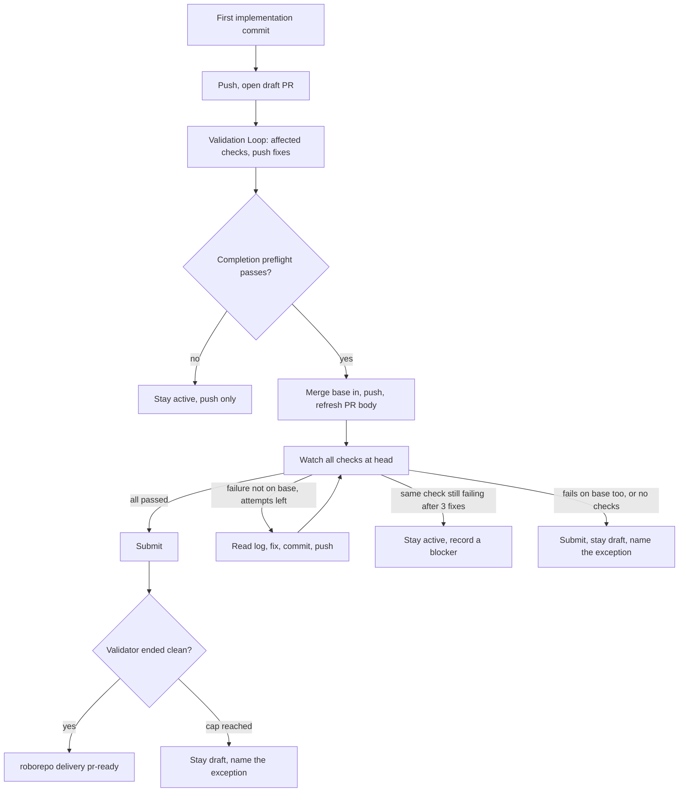

# Deliver finished plans as a watched pull request

## Summary

`/plan-execute` already ends a finished plan with a pushed branch and a pull request with a written
body. What it does not do is wait for CI: it reports "CI is running" and stops, so the user still
finds out later whether the checks passed, and fixes a red run by hand. It also opens the pull
request only at the very end, and marks any draft ready without checking CI.

This plan closes those gaps. The pull request opens as a draft at the first push, CI is watched to a
result and fixed when it fails, and the pull request leaves draft only when CI is green and the
Validator ended clean. `/plan-review` pushes each fix as it lands and confirms the pull request shows
the reviewed commit before asking for approval. Merge readiness refuses a branch whose local tip was
never pushed. The user still approves and merges.

The long-term goal is that an approved plan reaches a green, mergeable pull request without
babysitting. Topics held back from this plan, and what would unblock each, are recorded in
`docs/internal/plan-suite-deferred-topics.md` on `main`.

## Goals

- A draft pull request exists from the first feature-branch push, with a body a reviewer can read.
- CI is watched to a result at the head commit, and a failure is fixed or raised rather than left for
  the user to find.
- A pull request leaves draft only when the Validator ended clean and every check passed at its head
  commit.
- Fixes made during review reach the pull request as they land, and the review packet names the
  pull request and its CI result at the reviewed commit.
- Merge readiness refuses a branch whose local tip differs from what was pushed.

## Non-goals

- Merging. `gh pr merge` stays denied, and the user merges.
- Starting a next stage automatically. Stages keep running in separate sessions that the user starts.
- Replying to or resolving review threads, and fixing pull requests outside a plan run. "GitHub
  Integration Part 02" (`f0jwe76j`) owns those.
- Changing `manifests/inventory/agent-permissions.json`. Every command this plan needs is already
  allowed (see Current state).
- Fixing the Validator loop's churn or changing the plan record's shape.
- Changing `manifests/platform/plan-lifecycle.json`. The "Fix findings" action stays as the path for
  sending a finding to a separate session.

## Current state

Checked against `main` at `f9d32846`. Skill paths such as `plan-execute/SKILL.md` are under
`globals/packages/plan-suite/skills/`.

### What already works

These landed after this plan was first written, and this plan builds on them rather than replacing
them.

| Capability | Where |
| --- | --- |
| Plans live on the `repo-plans` branch; start, submit, and approval commits go there and are pushed, never to the feature branch or `main` | "Store plans on a dedicated Git branch" (`pvgx8oh7`, completed) |
| Every `/plan-execute` and `/plan-review` run that commits to the feature branch ends by pushing it | `plan-execute/references/handoff.md` (Push), `plan-review/SKILL.md` (Push the feature branch) |
| After submit, `/plan-execute` merges base in, pushes, and opens or updates the pull request with a written body, then reports its link, mergeability, and CI so far | `plan-execute/references/handoff.md` (Hand off) |
| Guarded pull request writes that refuse a mismatched repo, branch, or head: replace the body, mark ready, rerun a failed run | `roborepo delivery pr-body`, `pr-ready`, `retry-ci` in `modules/delivery/operations.mjs` |
| The one module that runs `gh` | `modules/forge/github.mjs` |

### What is missing

| Gap | Today | Source |
| --- | --- | --- |
| Pull request timing | Opened only in the handoff after submit; nothing exists on GitHub while the Validation Loop runs | `handoff.md` Hand off step 6 |
| Draft handling | The handoff runs `pr-ready` whenever the pull request is a draft, whatever CI says | `handoff.md` Hand off step 6 |
| Waiting for CI | "A CI run still in progress is reported as running, not waited for." Runs take 15–22 minutes | `handoff.md` Hand off step 7 |
| Fixing red CI | Nothing reads a failing run's log or fixes it | No caller of `gh run view --log-failed` in the skills |
| Order of submit and CI | Submit runs before the base merge and push, so a plan reaches `review/` with CI unknown | `plan-execute/SKILL.md` Implementation Completion step 4 |
| Fixes in review | Committed one by one and pushed together at step 6; nothing checks that the pull request shows the reviewed commit | `plan-review/SKILL.md` steps 5 and 6 |
| Merge readiness | Reads local refs only; a tip that was never pushed passes | `mergeReadiness` in `modules/plan-suite/review-gates.mjs`; no test covers it |

### Commands and permissions

All allowed today in `manifests/inventory/agent-permissions.json`, so this plan adds no permission:

| Need | Command | Bucket |
| --- | --- | --- |
| Open the draft | `gh pr create --draft --base <base> --head <branch> --title … --body-file …` | allow (`open-prs`) |
| Read state and wait | `gh pr view`, `gh pr checks <number> --watch`, `gh run view <id> --log-failed` | allow (read-only) |
| Replace the body, mark ready, rerun a failed run | `roborepo delivery pr-body`, `pr-ready`, `retry-ci` | allow |
| Refresh the upstream before readiness | `roborepo delivery fetch <remote>` | allow |

`gh pr edit` and `gh pr ready` called directly are in the `ask` bucket; the skills use the
`roborepo delivery` commands instead.

`gh pr checks --required` is not usable: it reported "no required checks" on pull request #59
before required checks existed, and the plan suite installs into repos that may never require any.
The skills therefore watch all reported checks.

## Proposed design

### The delivery sequence in `/plan-execute`

The completion preflight runs first, as a check only, so a plan that is not finished never waits on
CI: it stays in `active/` and its branch is pushed, as today. A finished plan then merges base in
before the CI watch, so CI runs on the commit that will be reviewed. `roborepo plans submit` reruns
the preflight; a merge or CI fix cannot make it fail, since the preflight reads plan tasks, blockers,
a clean worktree, and branch commits. Submit commits only to the plans branch, so it does not change
the feature branch's head or start another CI run.

### One shared procedure

`plan-execute/references/handoff.md` stays the one reference both skills follow. `/plan-review`
links to it at `../plan-execute/references/handoff.md` instead of keeping its own push section.
The reference gains three parts and changes one.

**Open the draft early.** At the first push of a run, read the open pull request for the branch. When
none exists, run `gh pr create --draft` with a written body (the body rules in Hand off step 6 are
unchanged). Never use `--fill`. A resumed run reuses the existing pull request, draft or not.

**Watch CI.** After a push, run `gh pr checks <number> --watch` in the background where the harness
allows, so waiting spends no tokens. Then read `gh pr view --json headRefOid,statusCheckRollup` and
confirm the result is for the head commit:

| Result at head | Meaning | Action | Pull request |
| --- | --- | --- | --- |
| At least one check, all passed | Green | Continue | May leave draft |
| A failure that does not occur on base | Red | Read `gh run view <id> --log-failed`, fix, commit, push, watch again | Stays draft |
| The same check still failing after 3 fix commits for it | Blocked | Stop, record a blocker in Open Questions, report it | Stays draft |
| A failure that also occurs on base | Not green | Record it under `- [x] Merge-readiness docs listed only two failure states and omitted a missing tracking ref and a local-branch upstream — fixed in review (93bf5323)
- [x] The plan's Merge readiness state table had no row for a local-branch upstream or a missing tracking ref — fixed in review (plan record)
- [x] handoff.md's Attempts rule named "timeout error" as retryable, then said a `timed_out` run is not retried — fixed in review (93bf5323)
- [x] The internals doc said a local upstream proves nothing was pushed, where it only cannot show a push — fixed in review (b49e0d71)

### Verification` as a base failure, continue, name it as an exception | Stays draft |
| No checks reported 2 minutes after the push | Not green | Run the canonical completion gate locally once, continue, name the exception | Stays draft |

"Continue" means the caller's next step. Only `/plan-execute`'s Implementation Completion submits
after it, as the diagram shows, and a Blocked result there keeps the plan in `active/`. Review
Findings and `/plan-review` never run a lifecycle transition at this point.

Rules the table relies on:

- **Base failure.** Read the base branch's CI result for the base commit the branch last merged;
  when it has none, rerun the failing check locally on the base branch. A failure counts as a base
  failure only when that evidence shows the same check failing there, as `/plan-review` step 3
  already defines it.
- **Attempts.** Counted per failing check, per run, so a rerun of the skill starts fresh, because a
  person chose to try again. One `roborepo delivery retry-ci <run-id>` is allowed per run for a
  failure that looks like infrastructure (a runner, network, or timeout error, not a test
  assertion), and it does not count as an attempt.
- **Never passing.** Base failures and missing checks never count as green.
- **No revalidation.** A CI fix does not rerun the Validation Loop; the final report lists it, and
  `/plan-review`'s Validator covers it.

**Mark ready only when earned.** Run `roborepo delivery pr-ready` only when the Validator ended clean,
CI is green at the head commit, and no `escalate` finding is open. This replaces today's rule of
readying any draft. A Validator that stopped at its cap leaves the pull request in draft;
`/plan-review` readies it after its own pass.

**Changed: the handoff runs before submit, and CI is waited for.** The Push and Hand off intros stop
saying the handoff follows the submit transition; it follows a passing completion preflight. Hand
off step 7 stops reporting "CI's result so far" and reports the result the watch reached.

Unchanged: a refused push or an unreachable GitHub is reported with the exact command under Needs
you, and the plan's lifecycle stands.

### `/plan-execute` changes

| Part | Change |
| --- | --- |
| Implementation Workflow step 13 (the implementation commit) | Push and open the draft pull request |
| Validation Loop | Push each pass's fixes as they are committed |
| `references/validation-loop.md` | Gate evidence is the affected checks' commands and output, plus the latest finished CI result when one exists. A pass never waits for CI, because a run takes 15–22 minutes and the loop can run eight passes |
| Implementation Completion, and its "Push and hand off the feature branch" subsection | Order becomes: completion preflight; if incomplete, stay active and push; if complete, hand off (merge base, push, refresh body), watch CI, submit, then mark ready. A blocked CI failure keeps the plan in `active/` |
| Review Findings | Watch CI after the existing handoff |
| Completion Conditions | The handoff line follows the new order, and CI's watched result is reported |
| `references/final-report.md` | The Record's pull request line gains its state, draft or ready; it already has the link, mergeability, and CI. The push row still shows only when a push failed |
| Boundaries | Allow opening this plan's pull request as a draft and marking it ready through `roborepo delivery`; merging stays forbidden |

### `/plan-review` changes

| Part | Change |
| --- | --- |
| Step 2, after base synchronization | Push the merge, opening the draft pull request if none exists |
| Step 5, fixing findings | Push each fix as it lands, instead of once at step 6, and take the full gate from CI's result at the fixed commit, per the shared procedure |
| Step 6, before presenting | Run `roborepo delivery fetch <remote>`, confirm with `gh pr view` that the pull request's head equals the local tip, and confirm CI is green there or name the exception. Link the pull request in the packet |
| Step 6a, after approval | Run `roborepo plans merge-readiness`. When it passes, CI is green at the reviewed commit, and step 5's Validator loop ended on a pass with no `fix` findings (not at its cap), mark the pull request ready if it is still a draft; otherwise leave it in draft and name why. Tell the user to merge |
| "Push the feature branch" section | Replaced by a link to the shared reference |
| Boundaries | Already allow pushing the plan's feature branch. Add opening it as a draft and marking it ready; merging the feature branch into the base and merging pull requests stay forbidden |

Approval is recorded on the plans branch, so step 6a pushes nothing to the feature branch and starts
no CI run.

### Merge readiness

`mergeReadiness` in `modules/plan-suite/review-gates.mjs` gains one check, "branch tip is pushed":

| State | Result |
| --- | --- |
| The branch's tip equals `<branch>@{upstream}` | Pass |
| The tip differs, or the repo has a remote but the branch has no upstream | Fail, with "push the branch" as the fix |
| The upstream is a local branch (`branch.<name>.remote = .`) or its tracking ref is missing locally | Fail, with "push the branch" as the fix |
| The repo has no remote | Pass, observed as "no remote" |

It reads only local refs, so the command stays offline and fast. It depends on the fetch in
`/plan-review` step 6 for a current upstream. The pull request's head is compared by the skill
through `gh pr view`, not by this check, so `roborepo plans` keeps making no network calls.

### Related plans

| Plan | Relationship |
| --- | --- |
| "Store plans on a dedicated Git branch" (`pvgx8oh7`) | Landed dependency. Removed this plan's earlier steps for unpushed lifecycle commits and for pushing the approval commit |
| "Clear agent friction: permissions, rule conflicts, and stale docs" (`vzgsx5vz`) | Landed dependency, completed |
| "GitHub Integration Part 01" (`w7vls1yk`) | In review as pull request 82; changes the permission manifest and push guard. Not needed here: every command this plan uses is allowed today |
| "GitHub Integration Part 02" (`f0jwe76j`) | Plan-vs-plan drift: it cites `plan-execute/references/pr-delivery.md` for this plan's CI fixes. This plan keeps that procedure in the existing `handoff.md`; `f0jwe76j` needs its link updated when it is next promoted. No conflict in scope |
| "A current server is running whenever a plan is ready to review" (`kqgr1d65`) | Edits `handoff.md` and `final-report.md` after this plan; its server step runs after the pull request step defined here. Builds after this plan |
| "Approval survives clean merges of the base branch" (`d9ywaa8d`) | Builds after this plan; shares `review-gates.mjs` |
| `developer-runtime-remote-branch-status`, `0jped168` | No shared code. `0jped168` (behavior evals) is what would let the Not tested entry below become a test |

## Implementation plan

- [x] Add the "branch tip is pushed" check to `mergeReadiness`, with cases in
      `scripts/test/plan-lifecycle-transitions-check.mjs` (where the `plans approve` fixtures live;
      merge readiness has no test today): tip equal to upstream passes; tip ahead of upstream fails;
      no upstream with a remote fails; no remote passes. Write the cases first and confirm the two
      failing ones fail before the check exists.
- [x] Update `plan-execute/references/handoff.md`: draft at first push, the CI watch table and its
      rules, the mark-ready rule replacing "ready any draft", the Push and Hand off intros (the
      handoff now runs after the completion preflight and before submit), and Hand off step 7
      reporting the watched result.
- [x] Update `plan-execute/SKILL.md`: step 13's push and draft, pushes during the Validation Loop, the
      new Implementation Completion order and its "Push and hand off the feature branch" subsection,
      Review Findings, Completion Conditions, and Boundaries.
- [x] Update `plan-execute/references/validation-loop.md` and `references/final-report.md`.
- [x] Update `plan-review/SKILL.md` steps 2, 5, 6, and 6a, replace its push section with a link to
      the shared reference, and update its Boundaries.
- [x] Update the pins in `scripts/test/plan-suite-skills-check.mjs`: the handoff phrases that name
      the old order ("After the submit transition, and after Review Findings commits its fixes",
      "CI's result so far", "Then hand off the feature branch"), and the plan-review boundary
      phrase. Add pins for `handoff.md`: `--draft`, the 3-attempt limit, the rule that no checks is
      not green, and `pr-ready` only after green CI and a clean Validator.
- [x] Update the docs under Documentation impact.

## Validation

- `node scripts/test/plan-lifecycle-transitions-check.mjs` passes, and the two failing
  merge-readiness cases failed before the check was added.
- `node scripts/test/plan-suite-skills-check.mjs` passes, with pins for the new procedure.
- `bash scripts/doctor.sh --quiet` passes. CI runs the full gate, because skills are package outputs.

## Not tested

- [x] A complete plan run on a real change, using the skills as changed here: draft pull request at
      first push, CI watched without polling, a failing check fixed, marked ready, review fixes
      pushed, and the user merges. This plan's own run uses the installed skills from before the
      change, so it cannot show this. Text pins cannot show an agent follows the procedure, and
      behavior evals (`0jped168`) do not exist yet. Needs a person: the run ends in merging the pull
      request, an action the user's rules reserve to the user, and the changed skills are installed
      only after this branch merges and `roborepo update` runs.
      — Confirmed by the user 2026-11-24: "Accept as post-merge" (the check is deferred to the first real plan run after this branch merges)

## Documentation impact

| Doc | Update |
| --- | --- |
| `docs/user/guides/plan/lifecycle/plan-suite.md` | The handoff paragraph under `/plan-execute` (draft at first push, CI watched, ready only when green), the review steps, and the merge step |
| `docs/user/reference/roborepo-cli.md` | The new check in the `merge-readiness` row |
| `docs/user/reference/plans-portal.md`, `docs/internal/plans-portal-internals.md` | What merge readiness requires |

## Risks

| Risk | Mitigation |
| --- | --- |
| A run now waits 15–22 minutes for CI before submit | Accepted: the wait spends no tokens in the background, and it replaces the user checking by hand later |
| A long CI run outlasts the session | Nothing is stored about the wait. Rerunning `/plan-execute` finds the pull request and reads its current checks |
| More pushes mean more CI runs | `.github/workflows/ci.yml` cancels superseded runs on the same ref |
| A CI fix lands after the last Validator pass | The final report lists it, and `/plan-review` runs its own Validator before approval |

## Review

### Findings
- [x] `/plan-review` recorded the Result before the CI watch, so a CI fix made there moved the tip past the recorded commit with no Validator pass over it — fixed (3546603d)
- [x] The user guide said a blocked CI check keeps the plan in `active/` even when fixing review findings, where the plan stays in `review/` — fixed (3546603d)
- [x] `plan-execute`'s Completion Conditions and description still moved a plan to review once the loop and preflight passed, ignoring a Blocked CI watch — fixed (5f7a76d1)
- [x] The handoff opened the draft pull request before handling a refused push — fixed (5f7a76d1)
- [x] `/plan-review` step 6 had no path for a branch with no open pull request — fixed (d050d7a7)
- [x] `/plan-review` step 6 did not say a Blocked CI result keeps `### Result` pending — fixed (d050d7a7)

### Verification
- Review 2026-11-25: Validator pass over 93bf5323 → 1 actionable `fix` finding (internals doc said a local upstream proves nothing was pushed) and 1 note, fixed in b49e0d71; Validator pass over b49e0d71 → no actionable findings, one cosmetic note (a long line) left as is
- Review 2026-11-25: CI on pull request 87 at b49e0d71, which equals the local tip: `check (ubuntu-latest)`, `check (macos-latest)`, `windows-installer` passed; `plan-suite-skills-check` → ok and `doctor.sh --quiet` → passed (98 checks) at b49e0d71
- Review 2026-11-25: main 051d2449 merged in at a2aa8191 (sandbox settings only; no overlap with this plan's files); `plan-lifecycle-transitions-check` and `plan-suite-skills-check` → ok at a2aa8191
- Review 2026-11-25: Validator pass (fresh-context subagent) over 8c34801d..a2aa8191 → 3 actionable `fix` findings and 1 note, all fixed in 93bf5323; `plan-suite-skills-check` → ok and `doctor.sh --quiet` → passed (98 checks) at 93bf5323
- Review 2026-11-24: `roborepo plans sync-base --base main` → up-to-date (main 5cba47f0 already merged)
- Review 2026-11-24: CI on pull request 87 at 8c34801d, which equals the local tip: `check (ubuntu-latest)`, `check (macos-latest)`, `windows-installer` passed
- Review 2026-11-24: `node scripts/test/plan-suite-skills-check.mjs` → ok and `node scripts/test/plan-lifecycle-transitions-check.mjs` → ok at 8c34801d
- Review 2026-11-24: Validator pass (fresh-context subagent) at 8c34801d → clean, no `fix` findings
- CI on pull request 87 at 8c34801d (main merged in): `check (ubuntu-latest)`, `check (macos-latest)`, and `windows-installer` passed; marked ready with `roborepo delivery pr-ready`
- After merging main at 8c34801d: `plan-suite-skills-check`, `plan-lifecycle-transitions-check`, and `doctor.sh --quiet` (98 checks) pass
- Validation: clean on pass 4 at d050d7a7 (fresh-context subagent); `plan-suite-skills-check`, `plan-lifecycle-transitions-check`, and `doctor.sh --quiet` all pass there
- Validation pass 3 at 5f7a76d1 (fresh-context subagent): 2 actionable `fix` findings and 3 notes, all fixed in d050d7a7, which adds a merge-readiness case for a pruned upstream tracking ref; all three gates pass at d050d7a7
- Validation pass 2 at 3546603d (fresh-context subagent): 2 actionable `fix` findings and 2 notes, all fixed in 5f7a76d1; generated command files regenerated with `node scripts/build/render-slash-commands.mjs`; `bash scripts/doctor.sh --quiet` → doctor passed (99 checks) at 5f7a76d1
- Validation pass 1 at ac48c546 (fresh-context subagent): 2 actionable `fix` findings, both fixed in 3546603d
- `node scripts/test/plan-lifecycle-transitions-check.mjs` → ok at ac48c546; the new merge-readiness section failed before the check existed
- `node scripts/test/plan-suite-skills-check.mjs` → ok at 3546603d
- `bash scripts/doctor.sh --quiet` → doctor passed (98 checks) at 3546603d

### Result
- Status: complete
- Reviewed implementation commit: b49e0d7125fdc91c2b44802636aa8c61f5e01665
- Base commit: 051d2449f55cd64f01e5ada732521319eff625b1

### Approval
- Decision: approved
- Reviewed implementation commit: b49e0d7125fdc91c2b44802636aa8c61f5e01665
- Confirmed by: human

## Decision Log

- 2026-11-25, during review: merge readiness also refuses an upstream that is not a remote-tracking branch, because a local upstream at the same commit proves nothing was pushed (pull request feedback, fixed in d3c288f6).

- 2026-11-24, during promotion: kept the shared procedure in the existing
  `plan-execute/references/handoff.md` instead of a new `pr-delivery.md`, because both skills
  already push through it and a second reference would duplicate its push and body rules.
- 2026-11-24, during promotion: moved the base merge ahead of the CI watch, so the commit CI passes
  is the commit the plan is submitted at, and put the completion preflight first, so an unfinished
  plan never waits on CI.
- 2026-11-24, during promotion: dropped the acceptance check that this plan's own pull request opens
  as a draft. The run that builds this plan uses the skills from before the change; the real-run
  check stays under Not tested.
- 2026-11-24, during promotion: dropped the steps for unpushed lifecycle commits riding along and
  for pushing the approval commit, because `pvgx8oh7` moved those commits to the plans branch.
- 2026-11-24, during promotion: the skills use `roborepo delivery pr-ready` and `retry-ci` rather
  than `gh pr ready` (in the `ask` bucket) and `gh run rerun`, because the delivery commands are
  allowed and refuse a pull request or run that does not match the pushed head.
- 2026-11-24, during execution: "branch tip is pushed" reads the upstream with
  `git for-each-ref --format=%(upstream) refs/heads/<branch>` instead of `<branch>@{upstream}`,
  because `refs/heads/<branch>@{upstream}` does not resolve and a short branch name can match a tag.
- 2026-11-24, during execution: all four merge-readiness cases failed before the check existed (the
  check was absent from the output), not only the two cases that expect a refusal; the two refusal
  cases are the ones whose outcome the check changes.
- 2026-11-24, during execution: the handoff's report step became step 8, after a new step 7 "Watch
  CI", so the order merge → recheck → push → pull request → CI → report is pinned as one sequence.
- 2026-11-24, during execution: `/plan-review`'s push section now names which parts of the shared
  reference it follows (Push, Watch CI, Mark ready) and leaves Hand off to `/plan-execute`, because
  `/plan-review` synchronizes the base in its own step 2.
- 2026-11-24, during execution: trimmed `plan-execute/SKILL.md`'s "Push and hand off" subsection to
  a summary that defers to the reference, to stay within the 500-line skill body budget that
  `scripts/doctor.sh` enforces.
- 2026-11-24, during execution: regenerated `docs/internal/skill-invocation-audit.md`; the
  `/plan-review` edits removed its side-effect keyword finding and the doctor reported the doc stale.
